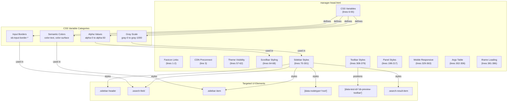
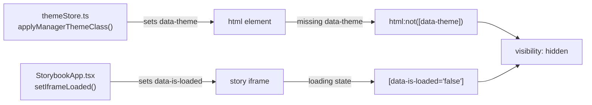
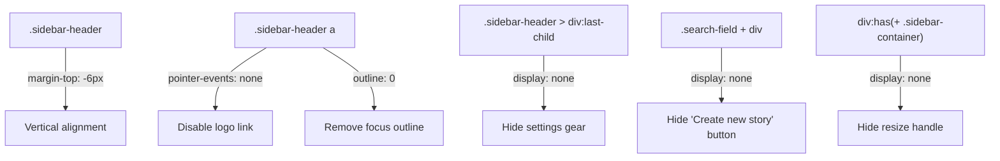
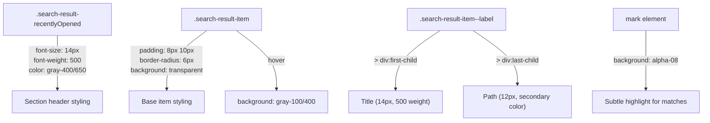
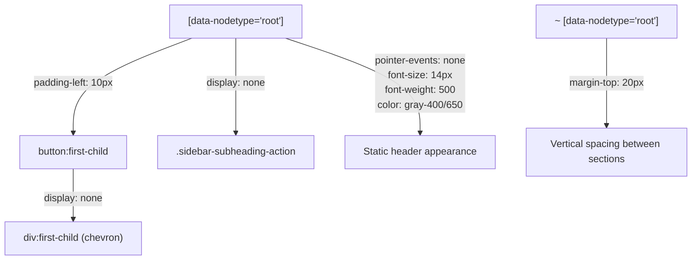
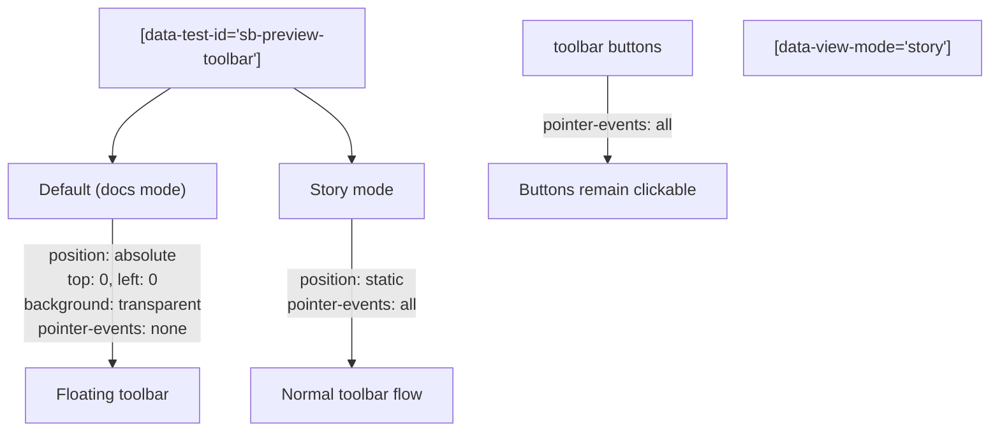

<!-- source: DeepWiki mcp.deepwiki.com · repo openai/apps-sdk-ui · page 3.3 Manager UI Customization · fetched 2026-10-26 -->

# Manager UI Customization

<details>
<summary>Relevant source files</summary>

The following files were used as context for generating this wiki page:

- [.storybook-base/manager-head.html](.storybook-base/manager-head.html)

</details>


## Purpose and Scope

This document details the extensive CSS customizations applied to the Storybook manager UI through the `manager-head.html` file. These customizations override Storybook's default styling to provide a cohesive visual experience aligned with the OpenAI design system. The customizations cover color systems, sidebar behavior, toolbar positioning, search functionality, and responsive layouts.

For information about the manager's JavaScript configuration and addon registration, see [Manager Configuration](#3.2). For theme system implementation details, see [Theme System](#5.2).

## Overview

The manager UI customization is implemented entirely in `.storybook-base/manager-head.html` as inline CSS injected into the Storybook manager's `<head>` element. This approach allows direct manipulation of Storybook's internal DOM structure and CSS classes without requiring a custom manager build.



**Sources:** [.storybook-base/manager-head.html:1-387]()

## CSS Variable System

The customization defines a comprehensive set of CSS custom properties using the `light-dark()` function to support automatic theme switching based on the browser's color scheme preference.

### Gray Scale Variables

A complete gray scale from 0 (pure white/black) to 1000 (pure black/white) with 25-unit increments for fine-grained color control:

| Variable | Light Mode | Dark Mode | Purpose |
|----------|------------|-----------|---------|
| `--gray-0` | `#ffffff` | `#0d0d0d` | Pure background |
| `--gray-100` | `#ededed` | `#181818` | Subtle backgrounds |
| `--gray-200` | `#c4c4c4` | `#212121` | Surface backgrounds |
| `--gray-500` | `#5d5d5d` | `#5d5d5d` | Mid-point (same both modes) |
| `--gray-800` | `#212121` | `#c4c4c4` | Strong borders |
| `--gray-1000` | `#0d0d0d` | `#ffffff` | Pure foreground |

The gray scale is symmetric: light mode's `--gray-100` equals dark mode's `--gray-900`, creating a mirrored color system.

**Sources:** [.storybook-base/manager-head.html:7-31]()

### Alpha Transparency Variables

Dynamic alpha values calculated using `color-mix()` to blend with transparency:

```css
--alpha-base: light-dark(#0d0d0d, #ffffff);
--alpha-08: color-mix(in srgb, var(--alpha-base) 8%, transparent);
--alpha-30: color-mix(in srgb, var(--alpha-base) 30%, transparent);
```

These provide theme-aware transparency that adapts to light or dark backgrounds. Available values: 0, 02, 04, 05, 06, 08, 10, 12, 15, 20, 25, 30, 35, 40, 50.

**Sources:** [.storybook-base/manager-head.html:32-47]()

### Input Border Variables

Three states for input borders with theme-aware opacity:

| Variable | Light Mode | Dark Mode | Usage |
|----------|------------|-----------|-------|
| `--sb-input-border-color` | `rgba(0,0,0,0.08)` | `rgba(255,255,255,0.18)` | Default state |
| `--sb-input-border-hover-color` | `rgba(0,0,0,0.15)` | `rgba(255,255,255,0.25)` | Hover state |
| `--sb-input-border-focus-color` | `rgba(0,0,0,0.25)` | `rgba(255,255,255,0.35)` | Focus state |

**Sources:** [.storybook-base/manager-head.html:49-51]()

### Semantic Color Variables

High-level semantic variables built on the gray scale:

```css
--color-text: light-dark(var(--gray-750), var(--gray-850));
--color-text-secondary: light-dark(var(--gray-500), var(--gray-700));
--color-surface: light-dark(var(--gray-0), var(--gray-200));
```

**Sources:** [.storybook-base/manager-head.html:52-55]()

## Theme Visibility Control

The manager implements a visibility control mechanism to prevent flash of unstyled content during theme initialization:



The `html:not([data-theme])` selector keeps the manager hidden until the theme addon applies the `data-theme` attribute. The `[data-is-loaded="false"]` selector hides the story iframe until content loads.

**Sources:** [.storybook-base/manager-head.html:57-62]()

## Scrollbar Styling

Global scrollbar aesthetics using the universal selector:

```css
* {
  scrollbar-color: var(--alpha-30) transparent;
  scrollbar-width: thin;
}
```

This applies a subtle, semi-transparent scrollbar thumb with thin width across all scrollable elements.

**Sources:** [.storybook-base/manager-head.html:64-68]()

## Sidebar Customizations

The sidebar receives the most extensive customization, modifying header, search, navigation structure, and item styling.

### Sidebar Header Modifications



Key modifications:
- **Logo link disabled**: Prevents navigation when clicking the sidebar logo [.storybook-base/manager-head.html:74-80]()
- **Settings gear hidden**: The configuration icon is removed [.storybook-base/manager-head.html:82-85]()
- **Create button hidden**: The "Create new story" button is removed [.storybook-base/manager-head.html:87-90]()
- **Resize handle hidden**: The sidebar width adjustment handle is hidden [.storybook-base/manager-head.html:92-95]()

**Sources:** [.storybook-base/manager-head.html:70-95]()

### Search Field Styling

The search field receives comprehensive styling with custom borders, shadows, and a gradient fade effect:

```css
.search-field {
  height: 36px !important;
  box-shadow: 0 0 0 1px var(--sb-input-border-color) !important;
  transition: box-shadow 0.15s ease;
}

.search-field::before {
  content: "";
  -webkit-mask-image: linear-gradient(0deg, rgba(0,0,0,0), rgb(0,0,0));
  mask-image: linear-gradient(0deg, rgba(0,0,0,0), #000);
  height: 20px;
  position: absolute;
  top: 100%;
  background: var(--color-surface);
}
```

The `::before` pseudo-element creates a gradient fade that smoothly transitions into the scrollable sidebar content below. The search field has three interactive states with progressively darker borders:

| State | Box Shadow Variable |
|-------|-------------------|
| Default | `var(--sb-input-border-color)` |
| Hover | `var(--sb-input-border-hover-color)` |
| Focus | `var(--sb-input-border-focus-color)` |

**Sources:** [.storybook-base/manager-head.html:97-133]()

### Search Results Styling

Search results use custom styling for both the "Recently Opened" label and individual result items:



The icon/status indicator in search results is hidden using `.search-result-item > div:first-child { display: none !important; }`.

**Sources:** [.storybook-base/manager-head.html:148-190]()

### Sidebar Navigation Structure

The sidebar implements a custom scrolling container and modified node hierarchy:

```css
#storybook-explorer-menu {
  position: absolute;
  top: 99px;
  left: 0;
  right: 0;
  bottom: 0;
  overflow: auto;
  padding: 20px 12px 10px;
}
```

This positions the navigation menu below the search field with full-height scrolling.

**Sources:** [.storybook-base/manager-head.html:225-235]()

### Root Node Customization

Root nodes (top-level categories) are converted from expandable/collapsible containers to static section headers:



The chevron icon and action button are hidden, and pointer events are disabled, preventing expand/collapse interaction. Subsequent root nodes receive 20px top margin for visual separation.

**Sources:** [.storybook-base/manager-head.html:237-263]()

### Sidebar Item Styling

Individual sidebar items receive refined spacing, hover states, and selection styling:

| Selector | Properties | Purpose |
|----------|-----------|---------|
| `.sidebar-item` | `min-height: auto`<br/>`margin-bottom: 2px`<br/>`border-radius: 6px`<br/>`font-weight: 500` | Base item styling |
| `.sidebar-item:hover` | `background: gray-100/400` | Hover state |
| `.sidebar-item > a` | `min-height: 36px`<br/>`padding: 0 0 0 10px`<br/>`color: var(--color-text)` | Link styling |
| `.sidebar-item[data-selected="true"]` | `background: gray-100/400`<br/>`color: var(--gray-900)`<br/>`font-weight: 600` | Selected state |

The item icon (`.sidebar-item > a:first-child > div`) is hidden via `display: none`.

**Sources:** [.storybook-base/manager-head.html:265-300]()

## Toolbar Customizations

The toolbar positioning adapts based on viewport width and view mode to provide optimal placement in different contexts.

### Desktop Toolbar Positioning

On viewports ≥600px, the toolbar is repositioned absolutely when viewing docs:



In docs mode, the toolbar floats absolutely positioned at the top-left with transparent background. The container has `pointer-events: none`, but buttons retain `pointer-events: all` to remain interactive. In story mode, the toolbar returns to normal static positioning.

**Sources:** [.storybook-base/manager-head.html:309-327]()

### Mobile Toolbar Adaptations

On viewports <600px, the toolbar receives special treatment:

```css
@media (max-width: 599px) {
  #root > div > div:last-child {
    position: absolute !important;
    background: none !important;
  }

  #root > div > div:last-child > div > button {
    position: fixed;
    top: 8px;
    left: 8px;
  }
}
```

The sidebar toggle button is fixed to the top-left corner, the button text is hidden (keeping only the icon), and the addon panel drawer is completely hidden on mobile.

**Sources:** [.storybook-base/manager-head.html:329-363]()

### Toolbar Content Layout

Toolbar content is right-aligned with orphan dividers removed:

```css
[data-test-id="sb-preview-toolbar"] > div {
  justify-content: flex-end !important;
  width: 100%;
  padding: 0 8px;
}

[data-test-id="sb-preview-toolbar"] > div > div:last-child {
  display: none !important;
}

.sb-bar > div > div > span:first-child {
  display: none !important;
}
```

**Sources:** [.storybook-base/manager-head.html:365-379]()

## Panel Customizations

The addon panel (containing Controls, Actions, etc.) receives custom border styling when the sidebar is not visible:

```css
#root > div > div:nth-child(3):not(:has(.sidebar-container)) {
  margin-right: 20px;
  margin-left: 20px;
  border: 1px solid var(--gray-150);
  border-bottom: 0;
  border-radius: 8px 8px 0 0;
}
```

The panel orientation toggle button is also hidden to simplify the interface.

**Sources:** [.storybook-base/manager-head.html:198-217]()

## Additional Customizations

### Args Table Modifications

JSDoc tables within args tables are hidden as they're intended for IDE consumption:

```css
.docblock-argstable-body td table {
  display: none !important;
}
```

**Sources:** [.storybook-base/manager-head.html:302-306]()

### Back to Docs Link Positioning

The back link component has absolute positioning:

```css
.story-back-link {
  position: absolute;
  top: 5px;
  left: 16px;
}
```

This is removed on mobile (`position: static`) to prevent overlap issues.

**Sources:** [.storybook-base/manager-head.html:192-196](), [.storybook-base/manager-head.html:360-362]()

### Iframe Loading State

The story iframe starts with zero opacity and transitions to full opacity once loaded:

```css
#storybook-preview-iframe {
  opacity: 0 !important;
}
#storybook-preview-iframe[data-is-loaded="true"] {
  opacity: 1 !important;
}
```

This prevents flash of unstyled content during story initialization. The `data-is-loaded` attribute is managed by the StorybookApp component.

**Sources:** [.storybook-base/manager-head.html:381-386]()

## CSS Specificity Strategy

The customizations extensively use `!important` declarations to override Storybook's default styles, which are often applied with high specificity or inline styles. Complex CSS selectors target specific DOM positions (e.g., `#root > div > div:nth-child(3)`) to ensure styles apply to the correct elements without affecting unintended parts of the UI.

**Sources:** [.storybook-base/manager-head.html:1-387]()

---

