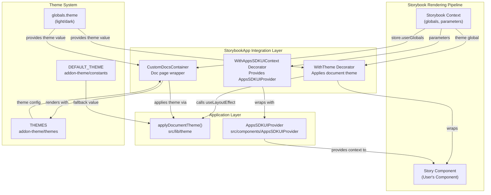
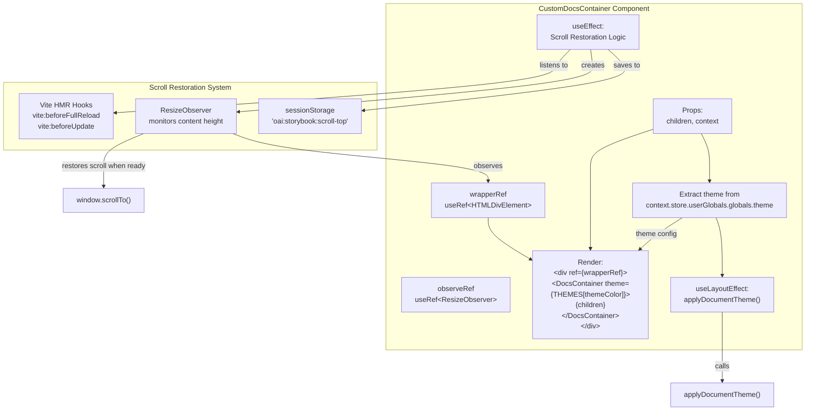
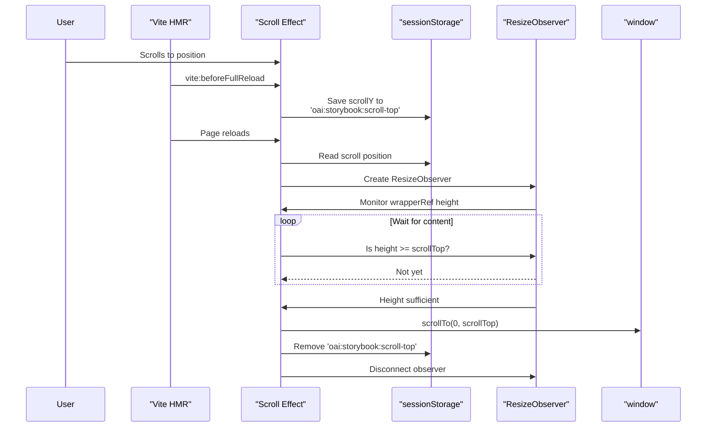
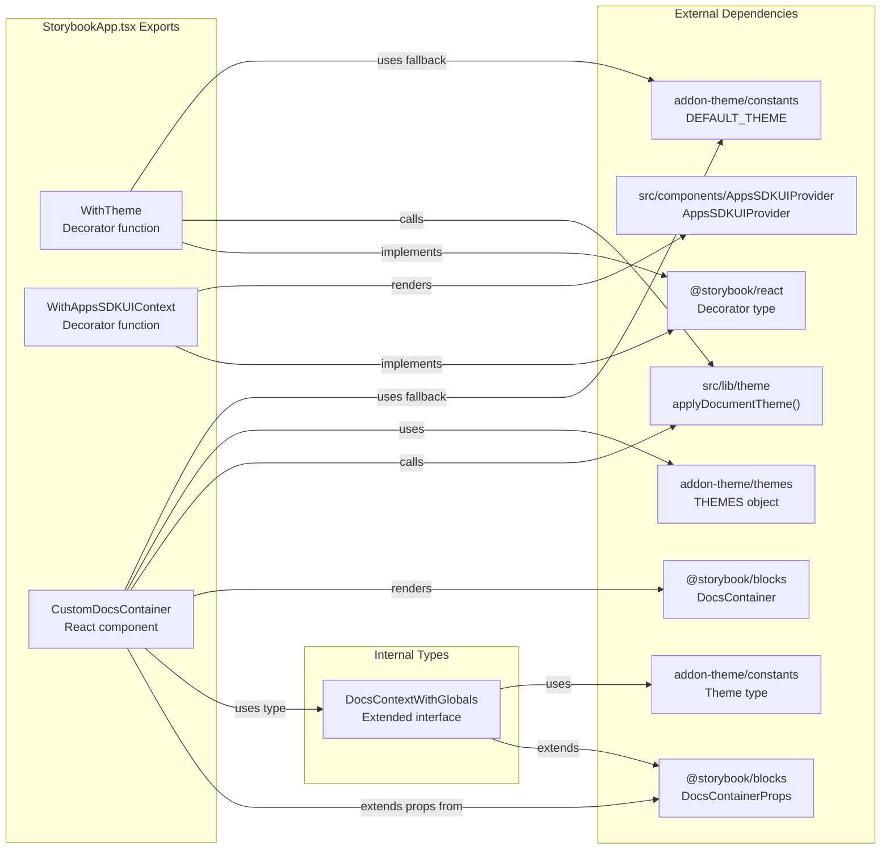

<!-- source: DeepWiki mcp.deepwiki.com · repo openai/apps-sdk-ui · page 3.4 Storybook App Integration · fetched 2026-10-26 -->

# Storybook App Integration

<details>
<summary>Relevant source files</summary>

The following files were used as context for generating this wiki page:

- [.storybook-base/components/StorybookApp.tsx](.storybook-base/components/StorybookApp.tsx)

</details>


## Purpose and Scope

This document explains the integration layer between Storybook and the Apps SDK UI component library, focusing on how stories and documentation pages are wrapped with necessary context providers and theme support. The `StorybookApp.tsx` file defines decorators and container components that ensure all rendered components have access to required contexts and theming capabilities.

For theme system configuration and storage, see [Theme Addon](#4.1). For the main Storybook configuration that applies these decorators, see [Main Configuration](#3.1).

**Sources:** [.storybook-base/components/StorybookApp.tsx:1-88]()

---

## Architecture Overview

The integration system consists of three primary exports from `StorybookApp.tsx`:

| Export | Type | Purpose |
|--------|------|---------|
| `WithTheme` | Decorator | Applies theme to individual stories based on global theme state |
| `WithAppsSDKUIContext` | Decorator | Wraps stories with `AppsSDKUIProvider` for component library context |
| `CustomDocsContainer` | Component | Custom documentation container with theme support and scroll restoration |

These components act as middleware between Storybook's rendering pipeline and the actual component library, ensuring proper context and styling are available at render time.

**Sources:** [.storybook-base/components/StorybookApp.tsx:4-87]()

---

## Integration Flow



**Sources:** [.storybook-base/components/StorybookApp.tsx:1-87]()

---

## WithTheme Decorator

### Implementation

The `WithTheme` decorator applies the current theme to the document when rendering stories. It reads the theme value from Storybook's global state and uses `useLayoutEffect` to apply it synchronously before browser paint.

```typescript
export const WithTheme: Decorator = (Story, context) => {
  const theme = context.globals.theme
  
  useLayoutEffect(() => {
    applyDocumentTheme(theme || DEFAULT_THEME)
  }, [theme])
  
  return <Story />
}
```

**Sources:** [.storybook-base/components/StorybookApp.tsx:19-27]()

### Key Characteristics

| Aspect | Implementation Detail |
|--------|----------------------|
| **Hook Type** | `useLayoutEffect` for synchronous DOM updates |
| **Theme Source** | `context.globals.theme` from Storybook context |
| **Fallback** | `DEFAULT_THEME` if no theme is set |
| **Theme Application** | Delegates to `applyDocumentTheme()` from `src/lib/theme` |
| **Dependencies** | Re-runs when `theme` value changes |

The decorator does not wrap the story in any additional DOM elements, ensuring the component tree remains clean and unaffected by the decoration logic.

**Sources:** [.storybook-base/components/StorybookApp.tsx:19-27]()

---

## WithAppsSDKUIContext Decorator

### Implementation

The `WithAppsSDKUIContext` decorator wraps stories with the `AppsSDKUIProvider`, which provides necessary context for the component library to function correctly.

```typescript
export const WithAppsSDKUIContext: Decorator = (Story, { parameters }) => {
  return (
    <AppsSDKUIProvider linkComponent={parameters.linkComponent ?? "a"}>
      <Story />
    </AppsSDKUIProvider>
  )
}
```

**Sources:** [.storybook-base/components/StorybookApp.tsx:29-35]()

### Configuration

| Parameter | Type | Purpose | Default |
|-----------|------|---------|---------|
| `linkComponent` | `string \| Component` | Component to use for internal links | `"a"` |

The `linkComponent` parameter can be configured per-story or globally through Storybook parameters, allowing stories to specify custom link handling (e.g., Next.js Link component).

**Sources:** [.storybook-base/components/StorybookApp.tsx:29-35]()

---

## CustomDocsContainer Component

### Purpose

The `CustomDocsContainer` replaces Storybook's default `DocsContainer` to provide:

1. **Theme Integration**: Applies theme to documentation pages
2. **Scroll Restoration**: Preserves scroll position during hot module reloads
3. **Theme Configuration**: Passes theme configuration to Storybook's docs renderer

**Sources:** [.storybook-base/components/StorybookApp.tsx:37-87]()

### Component Structure



**Sources:** [.storybook-base/components/StorybookApp.tsx:37-87]()

### Theme Extraction

The container extracts the theme from a deeply nested context structure:

```typescript
interface DocsContextWithGlobals extends DocsContainerProps {
  context: DocsContainerProps["context"] & {
    store?: { userGlobals?: { globals?: { theme?: Theme } } }
  }
}

const themeColor = context?.store?.userGlobals?.globals?.theme ?? DEFAULT_THEME
```

This extended interface type ensures type safety when accessing Storybook's internal state structure.

**Sources:** [.storybook-base/components/StorybookApp.tsx:13-17,41]()

### Scroll Restoration Logic

The scroll restoration system addresses Storybook's inconsistent scroll behavior during hot module reloads (HMR):



**Sources:** [.storybook-base/components/StorybookApp.tsx:46-74]()

### Implementation Details

| Feature | Implementation | Location |
|---------|---------------|----------|
| **Storage Key** | `"oai:storybook:scroll-top"` | [.storybook-base/components/StorybookApp.tsx:48,51]() |
| **Save Trigger** | Vite HMR hooks: `vite:beforeFullReload`, `vite:beforeUpdate` | [.storybook-base/components/StorybookApp.tsx:67-68]() |
| **Restore Trigger** | `ResizeObserver` monitoring wrapper element height | [.storybook-base/components/StorybookApp.tsx:54-64]() |
| **Restore Delay** | 100ms timeout after height threshold reached | [.storybook-base/components/StorybookApp.tsx:57-59]() |
| **Height Threshold** | Content height must be >= saved scroll position | [.storybook-base/components/StorybookApp.tsx:55]() |

The `ResizeObserver` approach ensures scroll restoration only occurs once sufficient content has rendered, preventing premature scrolling that would be overridden by subsequent renders.

**Sources:** [.storybook-base/components/StorybookApp.tsx:46-74]()

---

## Code Entity Mapping



**Sources:** [.storybook-base/components/StorybookApp.tsx:1-88]()

---

## Special Directive

The file begins with a special directive:

```typescript
// Controls are not working without this - if removing, ensure controls in stories update the component
"use no memo"
```

This directive disables React's memoization for the file, ensuring that Storybook's controls (interactive props panel) can properly update components. Without this directive, memoized components may not re-render when controls are adjusted.

**Sources:** [.storybook-base/components/StorybookApp.tsx:1-2]()

---

## Usage in Storybook Configuration

These exports are typically registered in the main Storybook configuration ([Main Configuration](#3.1)) as global decorators and custom docs container:

```typescript
// In .storybook-base/main.ts (example usage)
export default {
  decorators: [WithTheme, WithAppsSDKUIContext],
  parameters: {
    docs: {
      container: CustomDocsContainer,
    },
  },
}
```

The decorators are applied in the order specified, with `WithTheme` typically executing before `WithAppsSDKUIContext` to ensure theming is applied before context providers render.

**Sources:** [.storybook-base/components/StorybookApp.tsx:19-87]()

---

