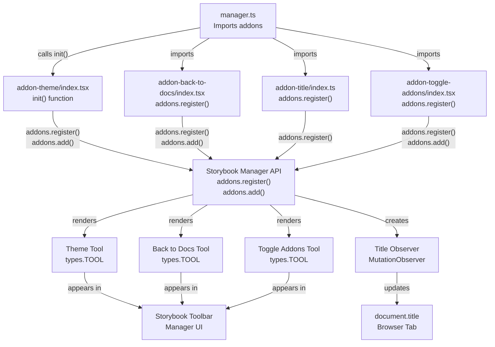
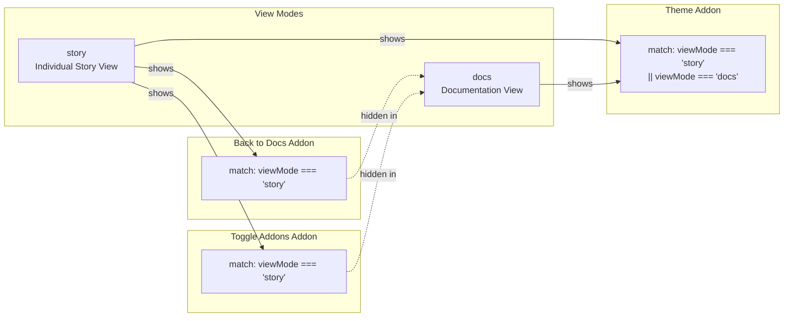
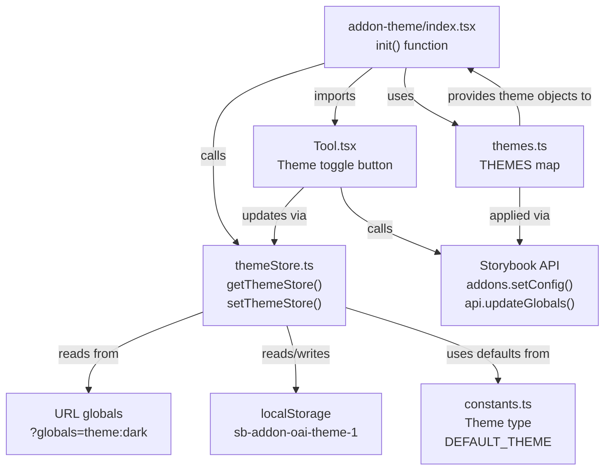
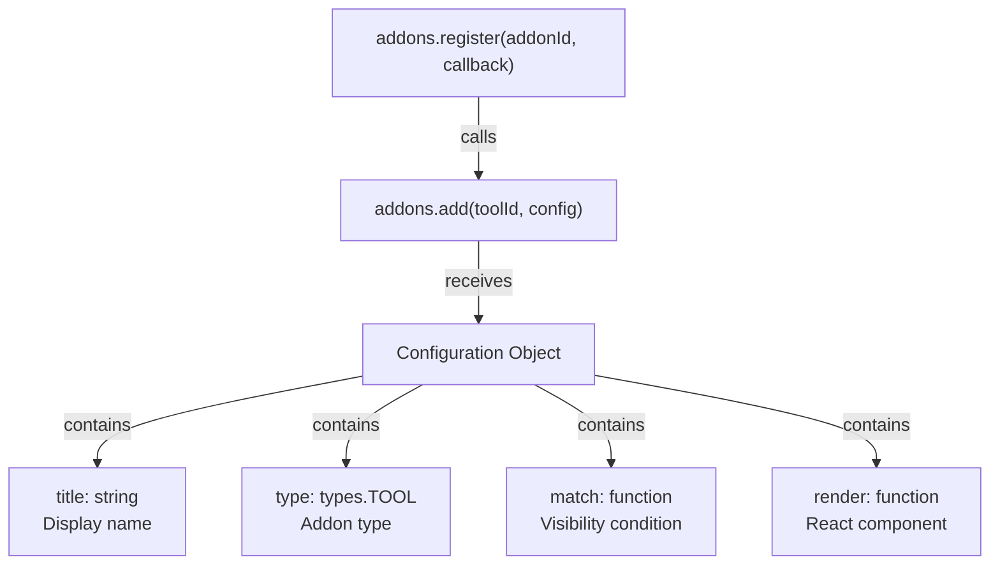
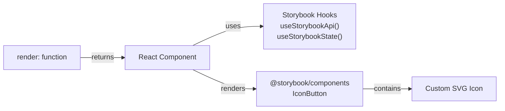

<!-- source: DeepWiki mcp.deepwiki.com · repo openai/apps-sdk-ui · page 4 Custom Addons · fetched 2026-10-26 -->

# Custom Addons

<details>
<summary>Relevant source files</summary>

The following files were used as context for generating this wiki page:

- [.storybook-base/addon-back-to-docs/index.tsx](.storybook-base/addon-back-to-docs/index.tsx)
- [.storybook-base/addon-theme/index.tsx](.storybook-base/addon-theme/index.tsx)
- [.storybook-base/addon-title/index.ts](.storybook-base/addon-title/index.ts)
- [.storybook-base/addon-toggle-addons/index.tsx](.storybook-base/addon-toggle-addons/index.tsx)

</details>


This document provides an overview of the custom Storybook addons developed for the apps-sdk-ui repository. These addons enhance the Storybook documentation experience by providing theme management, navigation improvements, and UI controls beyond Storybook's default functionality.

For detailed information about the theme system itself, see [Design System](#5). For documentation of the Storybook configuration that loads these addons, see [Storybook Configuration](#3).

## Purpose and Scope

The custom addons system consists of four specialized addons that extend Storybook's manager UI:

| Addon | Location | Purpose |
|-------|----------|---------|
| Theme Addon | `.storybook-base/addon-theme/` | Provides theme toggle functionality for light/dark mode switching |
| Back to Docs Addon | `.storybook-base/addon-back-to-docs/` | Adds navigation button to return from story view to docs view |
| Title Addon | `.storybook-base/addon-title/` | Dynamically updates browser tab title based on current story |
| Toggle Addons Addon | `.storybook-base/addon-toggle-addons/` | Provides toolbar button to show/hide addon panels |

Each addon integrates with Storybook's manager API to register toolbar items, modify UI behavior, or enhance navigation. Detailed documentation for each addon is available in their respective sub-pages (sections [4.1](#4.1) through [4.4](#4.4)).

**Sources:** [.storybook-base/addon-theme/index.tsx](), [.storybook-base/addon-back-to-docs/index.tsx](), [.storybook-base/addon-title/index.ts](), [.storybook-base/addon-toggle-addons/index.tsx]()

## Addon Architecture

### Registration Flow

All custom addons follow Storybook's addon API pattern, using the `addons.register()` and `addons.add()` functions to integrate with the manager UI.



**Diagram: Addon Registration and Integration Flow**

**Sources:** [.storybook-base/manager.ts](), [.storybook-base/addon-theme/index.tsx:9-28](), [.storybook-base/addon-back-to-docs/index.tsx:7-16](), [.storybook-base/addon-title/index.ts:5-36](), [.storybook-base/addon-toggle-addons/index.tsx:7-14]()

### Addon Types and Match Conditions

Each addon specifies when it should be visible using the `match` property:



**Diagram: Addon Visibility Conditions**

| Addon | View Modes | Reason |
|-------|-----------|--------|
| Theme | `story`, `docs` | Theme applies to all views |
| Back to Docs | `story` only | Only needed when viewing individual stories |
| Title | All views | Always updates browser tab |
| Toggle Addons | `story` only | Addon panels are only shown in story view |

**Sources:** [.storybook-base/addon-theme/index.tsx:25](), [.storybook-base/addon-back-to-docs/index.tsx:13](), [.storybook-base/addon-toggle-addons/index.tsx:11]()

## Addon Overview

### Theme Addon

The theme addon provides comprehensive light/dark mode switching functionality. It consists of multiple components working together:



**Diagram: Theme Addon Component Structure**

The theme addon is the most complex of the custom addons. For detailed documentation, see [Theme Addon](#4.1).

**Sources:** [.storybook-base/addon-theme/index.tsx:9-29]()

### Back to Docs Addon

The back to docs addon provides a navigation button that appears when viewing individual stories, allowing users to quickly return to the documentation page.

Key implementation details:
- Registers as `"oai/back-to-docs"` addon
- Renders `<BackToDocs />` component only when `viewMode === "story"`
- Uses `useStorybookApi()` to access current story data
- Transforms story ID by replacing `--base` suffix with `--docs`
- Validates that docs page exists before rendering button

**Sources:** [.storybook-base/addon-back-to-docs/index.tsx:7-37]()

### Title Addon

The title addon dynamically updates the browser tab title based on the currently viewed story or documentation page.

Key implementation details:
- Registers as `"TitleAddon"`
- Uses `MutationObserver` to detect when Storybook changes the title
- Extracts section title from story data using `api.getCurrentStoryData()`
- Formats title as: `"{Section Title} - Apps SDK UI"`
- Handles both story and docs views

**Sources:** [.storybook-base/addon-title/index.ts:5-36]()

### Toggle Addons Addon

The toggle addons addon provides a toolbar button to show/hide Storybook's addon panels (controls, actions, etc.).

Key implementation details:
- Registers as `"platform/toggle-addons"`
- Only visible in story view (`viewMode === "story"`)
- Uses `useStorybookState()` to check panel visibility
- Checks both `bottomPanelHeight` and `rightPanelWidth` to determine if panels are open
- Calls `api.togglePanel()` to toggle visibility

**Sources:** [.storybook-base/addon-toggle-addons/index.tsx:7-31]()

## Common Patterns

### Addon Registration Pattern

All addons follow a consistent registration pattern:



**Diagram: Standard Addon Registration Pattern**

Example from back-to-docs addon:

```typescript
addons.register("oai/back-to-docs", () => {
  addons.add("oai/back-to-docs/tool", {
    title: "Back to docs",
    type: types.TOOL,
    match: ({ viewMode }) => viewMode === "story",
    render: () => <BackToDocs />,
  })
})
```

**Sources:** [.storybook-base/addon-back-to-docs/index.tsx:7-16]()

### API Access Pattern

Addons that need to interact with Storybook's state or navigate between stories use the `useStorybookApi()` hook:

| Hook | Purpose | Used By |
|------|---------|---------|
| `useStorybookApi()` | Access API methods like `selectStory()`, `getCurrentStoryData()`, `updateGlobals()` | Theme, Back to Docs |
| `useStorybookState()` | Read current Storybook state (layout, view mode, etc.) | Toggle Addons |

**Sources:** [.storybook-base/addon-back-to-docs/index.tsx:20](), [.storybook-base/addon-toggle-addons/index.tsx:18-19](), [.storybook-base/addon-theme/Tool.tsx]()

### React Component Pattern

Tool addons that render UI components follow this pattern:



**Diagram: Tool Component Structure**

All toolbar tools render an `IconButton` from `@storybook/components` with a custom SVG icon.

**Sources:** [.storybook-base/addon-back-to-docs/index.tsx:31-37](), [.storybook-base/addon-toggle-addons/index.tsx:22-31]()

## Initialization and Loading

Custom addons are imported and initialized in the manager configuration:

```mermaid
sequenceDiagram
    participant Browser
    participant Manager as manager.ts
    participant ThemeInit as addon-theme/init()
    participant ThemeRegister as Theme Registration
    participant BackDocs as addon-back-to-docs
    participant Title as addon-title
    participant Toggle as addon-toggle-addons
    participant API as Storybook Manager API
    
    Browser->>Manager: Load Storybook Manager
    Manager->>ThemeInit: Call init()
    ThemeInit->>ThemeRegister: Register addon
    ThemeRegister->>API: addons.register()
    
    Manager->>BackDocs: Import module
    BackDocs->>API: addons.register()
    
    Manager->>Title: Import module
    Title->>API: addons.register()
    
    Manager->>Toggle: Import module
    Toggle->>API: addons.register()
    
    API-->>Browser: Render Storybook UI with addons
```

**Diagram: Addon Initialization Sequence**

The theme addon requires explicit initialization via its `init()` function to set up the initial theme state before registration. Other addons self-register upon import.

**Sources:** [.storybook-base/manager.ts](), [.storybook-base/addon-theme/index.tsx:9-29]()

## File Structure

```
.storybook-base/
├── addon-back-to-docs/
│   └── index.tsx              # Back to docs addon registration and component
├── addon-theme/
│   ├── index.tsx              # Theme addon initialization and registration
│   ├── Tool.tsx               # Theme toggle button component
│   ├── themes.ts              # Theme definitions (light/dark)
│   ├── themeStore.ts          # Theme persistence and retrieval
│   └── constants.ts           # Theme type definitions and defaults
├── addon-title/
│   └── index.ts               # Title management addon
└── addon-toggle-addons/
    └── index.tsx              # Addon panel toggle button
```

**Sources:** Directory structure inferred from file paths

---

For detailed documentation of individual addons:
- [Theme Addon](#4.1) - Comprehensive theme management system
- [Back to Docs Addon](#4.2) - Navigation enhancement
- [Title Addon](#4.3) - Browser tab title management
- [Toggle Addons Addon](#4.4) - Panel visibility control

---

