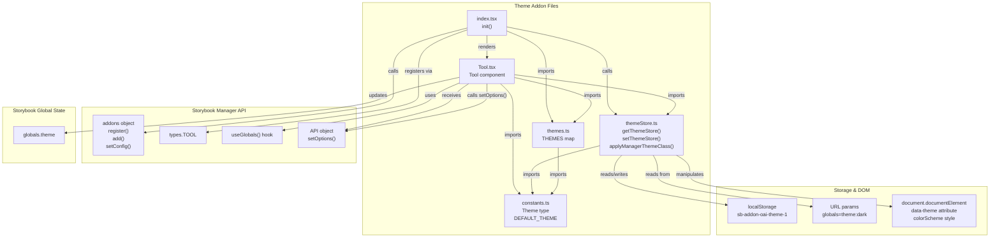
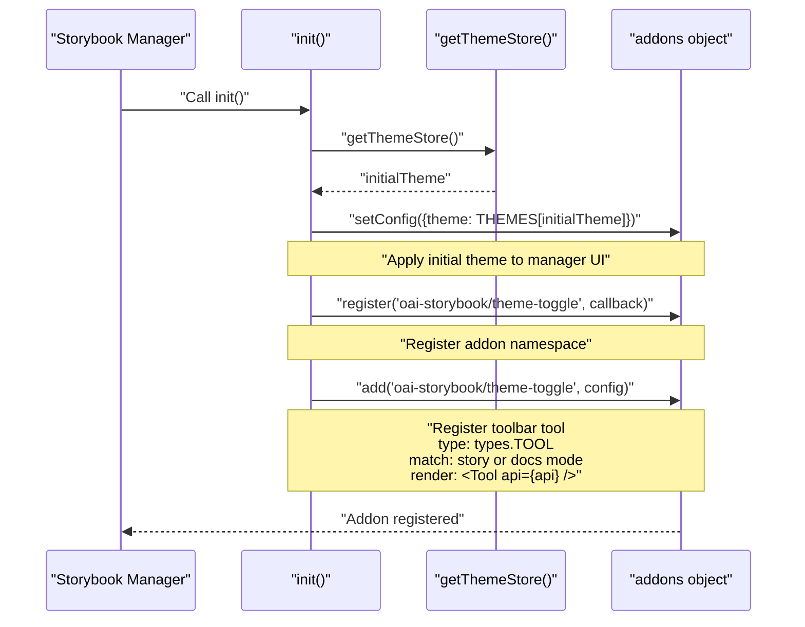
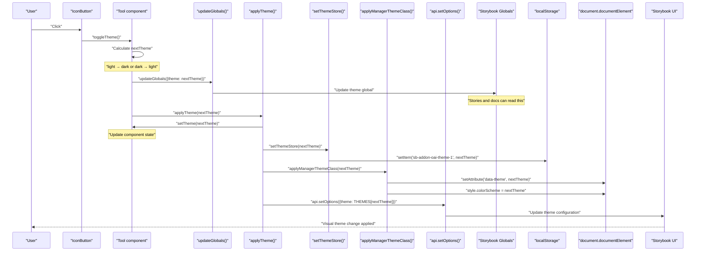
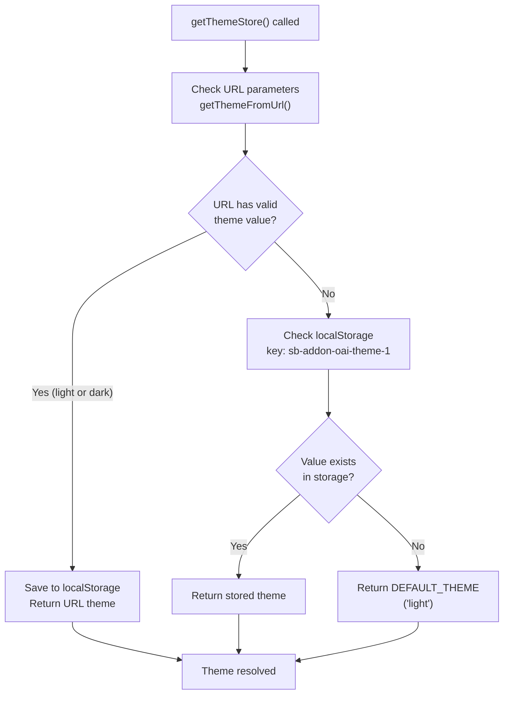
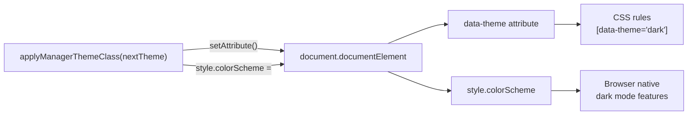

<!-- source: DeepWiki mcp.deepwiki.com · repo openai/apps-sdk-ui · page 4.1 Theme Addon · fetched 2026-10-26 -->

# Theme Addon

<details>
<summary>Relevant source files</summary>

The following files were used as context for generating this wiki page:

- [.storybook-base/addon-theme/Tool.tsx](.storybook-base/addon-theme/Tool.tsx)
- [.storybook-base/addon-theme/constants.ts](.storybook-base/addon-theme/constants.ts)
- [.storybook-base/addon-theme/index.tsx](.storybook-base/addon-theme/index.tsx)
- [.storybook-base/addon-theme/themeStore.ts](.storybook-base/addon-theme/themeStore.ts)
- [.storybook-base/addon-theme/themes.ts](.storybook-base/addon-theme/themes.ts)

</details>


## Purpose and Scope

The Theme Addon provides a custom Storybook toolbar control that allows users to toggle between light and dark themes throughout the documentation interface. This addon manages theme persistence across page reloads, synchronizes theme state between the manager frame and preview frame, and applies visual styling to both Storybook's UI and the documented components.

This document covers the overall architecture, initialization, and integration of the theme addon. For implementation details of specific subsystems, see:
- [Theme Tool Component](#4.1.1) - The React UI component
- [Theme Storage System](#4.1.2) - Persistence and retrieval logic
- [Theme Definitions](#4.1.3) - Light and dark theme configurations

For the broader design system context including design tokens and theme application in documentation components, see [Design System](#5).

---

## Overview

The Theme Addon consists of five core files that work together to provide theme management:

| File | Purpose | Key Exports |
|------|---------|-------------|
| `index.tsx` | Addon registration and initialization | `init()` |
| `Tool.tsx` | React component rendering the toggle button | `Tool` |
| `themeStore.ts` | Theme persistence and DOM manipulation | `getThemeStore()`, `setThemeStore()`, `applyManagerThemeClass()` |
| `themes.ts` | Light and dark theme definitions | `THEMES` |
| `constants.ts` | Type definitions and defaults | `Theme`, `DEFAULT_THEME` |

The addon integrates with Storybook through the Manager API, registering itself as a toolbar tool that appears in both `story` and `docs` view modes. It maintains theme state in three locations: Storybook's global state, browser localStorage, and the DOM via data attributes.

Sources: [.storybook-base/addon-theme/index.tsx:1-30](), [.storybook-base/addon-theme/Tool.tsx:1-82](), [.storybook-base/addon-theme/themeStore.ts:1-42]()

---

## Architecture

The following diagram shows the relationships between the theme addon components and their interactions with Storybook's API:



Sources: [.storybook-base/addon-theme/index.tsx:1-30](), [.storybook-base/addon-theme/Tool.tsx:1-82](), [.storybook-base/addon-theme/themeStore.ts:1-42]()

---

## Addon Registration

The `init()` function in [.storybook-base/addon-theme/index.tsx:9-29]() handles addon registration with Storybook's Manager API:



The registration process:

1. **Initial Theme Retrieval**: Calls `getThemeStore()` to determine the initial theme from URL parameters, localStorage, or defaults
2. **Theme Application**: Calls `addons.setConfig()` with the corresponding theme object from `THEMES`
3. **Namespace Registration**: Calls `addons.register()` with the identifier `"oai-storybook/theme-toggle"`
4. **Tool Registration**: Calls `addons.add()` with configuration:
   - `title`: `"Theme toggle"`
   - `type`: `types.TOOL` (toolbar button)
   - `match`: Function returning `true` for `story` and `docs` view modes
   - `render`: Function returning `<Tool api={api} />`

Sources: [.storybook-base/addon-theme/index.tsx:9-29]()

---

## Theme Switching Flow

When a user clicks the theme toggle button, the following sequence occurs:



Key functions involved:

| Function | Location | Responsibility |
|----------|----------|----------------|
| `toggleTheme()` | [.storybook-base/addon-theme/Tool.tsx:15-21]() | Calculates next theme and orchestrates update |
| `applyTheme()` | [.storybook-base/addon-theme/Tool.tsx:23-31]() | Applies theme to all state locations |
| `updateGlobals()` | [.storybook-base/addon-theme/Tool.tsx:12]() | Updates Storybook's global state |
| `setThemeStore()` | [.storybook-base/addon-theme/themeStore.ts:22-24]() | Persists theme to localStorage |
| `applyManagerThemeClass()` | [.storybook-base/addon-theme/themeStore.ts:37-41]() | Updates DOM attributes |

Sources: [.storybook-base/addon-theme/Tool.tsx:11-48](), [.storybook-base/addon-theme/themeStore.ts:22-41]()

---

## Theme Priority System

The `getThemeStore()` function implements a priority-based theme resolution system:



Priority order:
1. **URL Parameters** (highest priority): `?globals=theme:dark` or `?globals=theme:light`
2. **localStorage**: Previously saved theme at key `"sb-addon-oai-theme-1"`
3. **Default**: `DEFAULT_THEME` constant (`"light"`)

When a valid theme is found in the URL, it is immediately saved to localStorage, ensuring that URL-based theme selection persists across navigation.

Sources: [.storybook-base/addon-theme/themeStore.ts:6-35](), [.storybook-base/addon-theme/constants.ts:1-3]()

---

## DOM Manipulation

The `applyManagerThemeClass()` function applies the theme to the DOM in two ways:

| Property | Purpose | Values |
|----------|---------|--------|
| `data-theme` attribute | Custom attribute for CSS selectors | `"light"` or `"dark"` |
| `colorScheme` style | Browser-native color scheme | `"light"` or `"dark"` |



The `data-theme` attribute enables CSS rules in [.storybook-base/manager-head.html]() to conditionally apply theme-specific styling using selectors like `[data-theme="dark"]`. The `colorScheme` style property triggers browser-native features such as scrollbar theming and form control styling.

Sources: [.storybook-base/addon-theme/themeStore.ts:37-41]()

---

## Component State Management

The `Tool` component uses React hooks to manage local state and synchronize with Storybook:

| Hook | Purpose | Source |
|------|---------|--------|
| `useGlobals()` | Access and update Storybook's global state | `@storybook/manager-api` |
| `useState<Theme>()` | Track current theme in component state | React |
| `useLayoutEffect()` | Apply theme class on initial mount | React |

The component maintains its own `theme` state via `useState(getThemeStore())` initialized from storage. This local state is kept in sync with three external sources:
- Storybook globals (via `updateGlobals()`)
- localStorage (via `setThemeStore()`)
- Manager UI theme (via `api.setOptions()`)

The `useLayoutEffect` hook at [.storybook-base/addon-theme/Tool.tsx:33-37]() ensures that the theme class is applied to the manager frame immediately on component mount, preventing flash-of-wrong-theme issues.

Sources: [.storybook-base/addon-theme/Tool.tsx:11-48]()

---

## Type Safety

The addon uses TypeScript for type safety with a minimal type definition:

```typescript
export type Theme = "light" | "dark"
export const DEFAULT_THEME: Theme = "light"
```

This `Theme` type is exported from [.storybook-base/addon-theme/constants.ts:1-3]() and re-exported from [.storybook-base/addon-theme/themeStore.ts:1]() for convenient import. The string literal union type ensures that only valid theme values can be used throughout the addon, preventing runtime errors from invalid theme strings.

Sources: [.storybook-base/addon-theme/constants.ts:1-3](), [.storybook-base/addon-theme/themeStore.ts:1-2]()

---

## Icon Implementation

The theme toggle button displays SVG icons imported directly into the component rather than using an external icon system:

| Theme State | Icon Displayed | Function |
|-------------|----------------|----------|
| `"light"` | Sun icon | `LightMode()` |
| `"dark"` | Moon icon | `DarkMode()` |

The icons are defined as functional components returning inline SVG at [.storybook-base/addon-theme/Tool.tsx:51-81](). The button title attribute updates dynamically: `"Switch to Dark Mode"` when in light theme, and `"Switch to Light Mode"` when in dark theme.

Sources: [.storybook-base/addon-theme/Tool.tsx:39-81]()

---

## Integration Summary

The Theme Addon integrates with Storybook at multiple levels:

| Integration Point | Mechanism | Purpose |
|-------------------|-----------|---------|
| Toolbar | `types.TOOL` registration | Adds theme toggle button to toolbar |
| Global State | `useGlobals()` hook | Shares theme with stories and docs |
| Manager API | `api.setOptions()` | Updates Storybook UI theming |
| Manager Config | `addons.setConfig()` | Sets initial theme on load |
| View Mode Matching | `match` function | Shows tool in `story` and `docs` modes |

The addon is initialized via a call to `init()` from [.storybook-base/manager.ts](), which occurs during Storybook manager startup. This ensures that the theme system is ready before any stories or documentation pages are rendered.

Sources: [.storybook-base/addon-theme/index.tsx:9-29](), [.storybook-base/addon-theme/Tool.tsx:11-48]()

---

