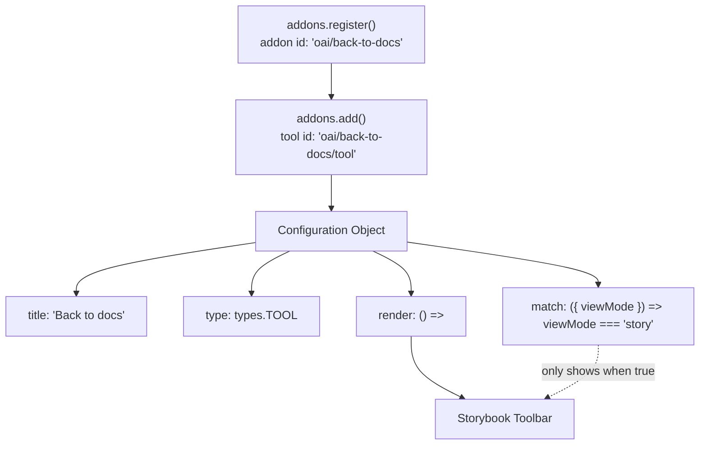
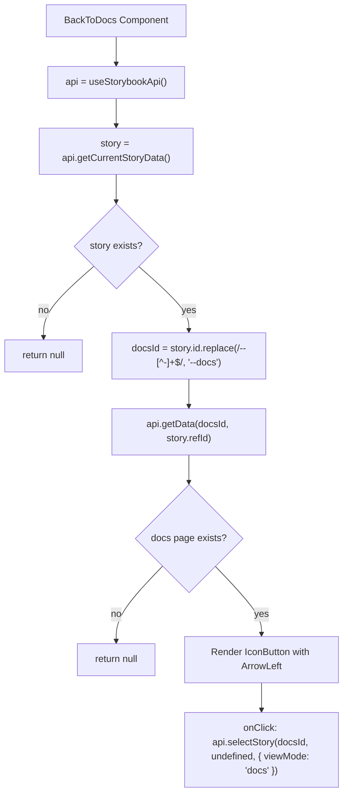
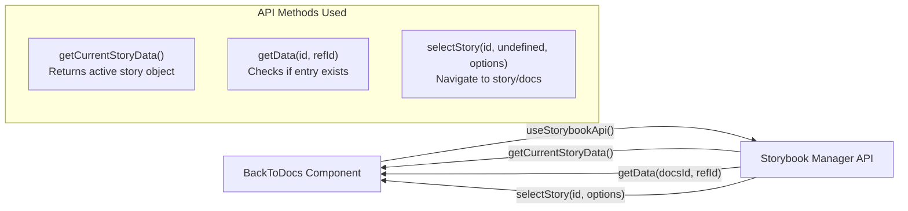
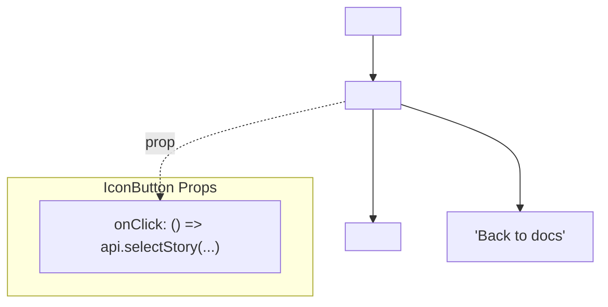
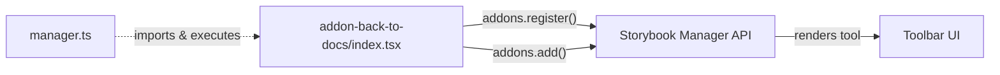

<!-- source: DeepWiki mcp.deepwiki.com · repo openai/apps-sdk-ui · page 4.2 Back to Docs Addon · fetched 2026-10-26 -->

# Back to Docs Addon

<details>
<summary>Relevant source files</summary>

The following files were used as context for generating this wiki page:

- [.storybook-base/addon-back-to-docs/index.tsx](.storybook-base/addon-back-to-docs/index.tsx)

</details>


## Purpose and Scope

The Back to Docs addon provides a navigation tool in the Storybook toolbar that allows users to quickly return to the documentation page when viewing individual story views. This addon only appears when a user navigates to an individual story's canvas view and provides a single-click navigation back to the corresponding documentation page.

For information about other custom addons, see [Custom Addons](#4). For theme management functionality, see [Theme Addon](#4.1). For browser title updates, see [Title Addon](#4.3). For panel visibility controls, see [Toggle Addons Addon](#4.4).

---

## Overview

The Back to Docs addon solves a common navigation problem in Storybook: when viewing an individual story in "story" view mode, users need an easy way to return to the documentation page that lists all stories for that component. This addon adds a toolbar button that only appears in story view mode and intelligently navigates back to the corresponding docs page.

**Sources:** [.storybook-base/addon-back-to-docs/index.tsx:1-48]()

---

## Addon Architecture

### Addon Registration Flow



**Diagram: Addon Registration Process**

The addon uses Storybook's addon API to register itself and add a tool to the toolbar with conditional visibility.

**Sources:** [.storybook-base/addon-back-to-docs/index.tsx:7-17]()

---

## Component Structure

### Code Entity Mapping

| Component | Type | Purpose | Location |
|-----------|------|---------|----------|
| `addons.register()` | Function | Registers addon with Storybook | Line 7 |
| `addons.add()` | Function | Adds tool to toolbar | Line 8 |
| `BackToDocs` | React Component | Main UI component | Lines 19-38 |
| `ArrowLeft` | React Component | SVG icon component | Lines 40-47 |
| `useStorybookApi()` | Hook | Accesses Storybook API | Line 20 |

**Sources:** [.storybook-base/addon-back-to-docs/index.tsx:1-48]()

---

## BackToDocs Component Implementation

### Component Logic Flow



**Diagram: BackToDocs Component Execution Flow**

The component implements defensive checks to ensure both the story and corresponding docs page exist before rendering the navigation button.

**Sources:** [.storybook-base/addon-back-to-docs/index.tsx:19-38]()

---

## Story ID Transformation Logic

The addon uses a regular expression to transform story IDs into their corresponding documentation page IDs. Understanding this transformation is key to how the navigation works.

### ID Transformation Pattern

| Input Story ID | Transformation | Output Docs ID |
|----------------|----------------|----------------|
| `component--story-name` | Replace last `--segment` with `--docs` | `component--docs` |
| `button--primary` | `/--[^-]+$/` → `--docs` | `button--docs` |
| `card--with-footer` | `/--[^-]+$/` → `--docs` | `card--docs` |

The regular expression `/--[^-]+$/` matches:
- `--` followed by
- One or more non-hyphen characters `[^-]+`
- At the end of the string `$`

This pattern effectively replaces the story-specific segment with `--docs`, which is Storybook's convention for documentation pages.

**Sources:** [.storybook-base/addon-back-to-docs/index.tsx:26]()

---

## API Interaction

### Storybook Manager API Methods

The addon interacts with Storybook's Manager API through three key methods:



**Diagram: Manager API Integration Points**

| API Method | Purpose | Return Type | Usage |
|------------|---------|-------------|-------|
| `useStorybookApi()` | Access Manager API instance | API object | Get API reference |
| `getCurrentStoryData()` | Get currently active story | Story object or undefined | Determine current context |
| `getData(docsId, refId)` | Check if entry exists | Story/Docs object or undefined | Validate docs page exists |
| `selectStory(id, undefined, options)` | Navigate to story/docs | void | Perform navigation |

**Sources:** [.storybook-base/addon-back-to-docs/index.tsx:20-33]()

---

## UI Rendering

### Button Component Hierarchy



**Diagram: Component Rendering Structure**

The rendered output consists of:
- A wrapper `<span>` with class `story-back-link`
- An `IconButton` component from `@storybook/components`
- An `ArrowLeft` SVG icon
- Text label "Back to docs"

The button's `onClick` handler calls `api.selectStory()` with the transformed docs ID and explicitly sets `viewMode: "docs"` to ensure the docs page loads rather than another story view.

**Sources:** [.storybook-base/addon-back-to-docs/index.tsx:31-37]()

---

## ArrowLeft Icon Component

The addon includes a custom SVG arrow icon component rather than importing from an icon library.

### SVG Specification

| Property | Value |
|----------|-------|
| Width | 14px |
| Height | 14px |
| ViewBox | `0 0 14 14` |
| Fill | `currentColor` (inherits text color) |
| Path | Single path element defining left arrow shape |

The icon uses `currentColor` for the fill, allowing it to inherit the text color from its parent container and adapt to Storybook's theme automatically.

**Sources:** [.storybook-base/addon-back-to-docs/index.tsx:40-47]()

---

## Conditional Visibility

The addon implements two levels of conditional visibility:

### Level 1: Toolbar Match Function

The `match` function in the addon configuration determines when the tool appears in the toolbar:

```
match: ({ viewMode }) => viewMode === "story"
```

This ensures the button only appears when `viewMode === "story"`, hiding it in docs view and other view modes.

### Level 2: Component Early Returns

The `BackToDocs` component implements defensive checks:

1. **Story existence check** (line 23): Returns `null` if no story is currently active
2. **Docs page existence check** (line 29): Returns `null` if the corresponding docs page doesn't exist

These checks prevent the button from rendering when it wouldn't be functional.

**Sources:** [.storybook-base/addon-back-to-docs/index.tsx:13, 23, 29]()

---

## Integration with Storybook Manager

### Manager Registration Context



**Diagram: Addon Integration Flow**

The addon is imported and executed in the manager configuration, where it self-registers with Storybook's addon system. Once registered, Storybook automatically handles rendering the tool in the toolbar when the match condition is satisfied.

**Sources:** [.storybook-base/addon-back-to-docs/index.tsx:7-17]()

---

## Usage Pattern

### Typical User Flow

1. User navigates to a documentation page (e.g., `button--docs`)
2. User clicks on an individual story example (e.g., `button--primary`)
3. Storybook switches to story view mode
4. The "Back to docs" button appears in the toolbar
5. User clicks the "Back to docs" button
6. The addon transforms `button--primary` → `button--docs`
7. `api.selectStory()` navigates to `button--docs` with `viewMode: "docs"`
8. User returns to the documentation page
9. The "Back to docs" button disappears (no longer in story view)

This provides a seamless navigation experience between story previews and their corresponding documentation.

**Sources:** [.storybook-base/addon-back-to-docs/index.tsx:1-48]()

---

