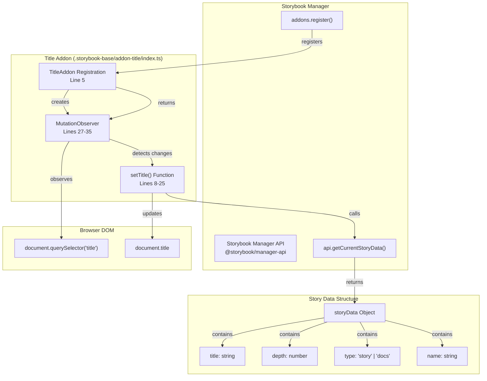
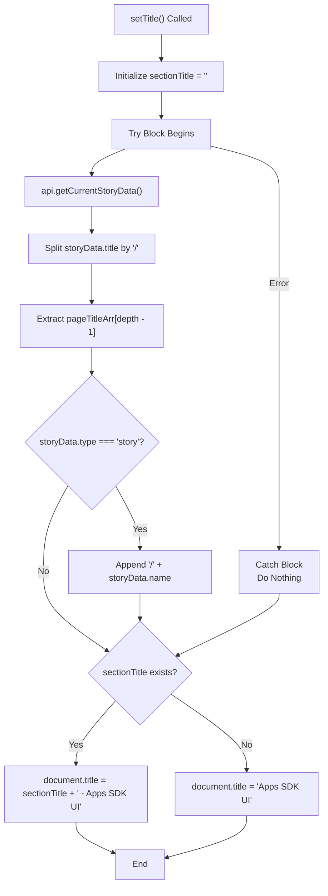
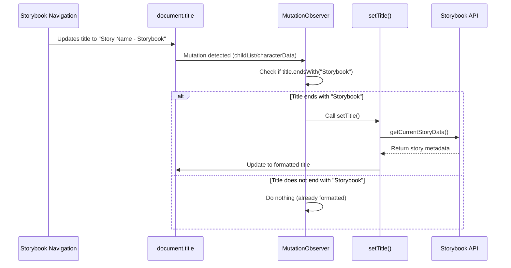

<!-- source: DeepWiki mcp.deepwiki.com · repo openai/apps-sdk-ui · page 4.3 Title Addon · fetched 2026-10-26 -->

# Title Addon

<details>
<summary>Relevant source files</summary>

The following files were used as context for generating this wiki page:

- [.storybook-base/addon-title/index.ts](.storybook-base/addon-title/index.ts)

</details>


## Purpose and Scope

The Title Addon is a custom Storybook addon that dynamically updates the browser tab title to reflect the currently viewed story or documentation page. This provides better navigation context when users have multiple browser tabs open or are switching between different stories.

This document covers the implementation details, title formatting logic, and integration mechanism of the addon. For information about other custom addons in this repository, see [Custom Addons](#4). For details on the addon registration process, see [Manager Configuration](#3.2).

**Sources:** [.storybook-base/addon-title/index.ts:1-37]()

---

## Overview

The Title Addon implements a lightweight solution that monitors the browser's document title and updates it whenever Storybook navigates to a different story or documentation page. It uses the native `MutationObserver` API to detect title changes and the Storybook Manager API to retrieve current story metadata.

### Key Features

| Feature | Description |
|---------|-------------|
| **Automatic Updates** | Detects when Storybook changes the title and applies custom formatting |
| **Story Context** | Extracts story hierarchy and names from Storybook's data structure |
| **Fallback Handling** | Gracefully handles errors and defaults to base title when story data is unavailable |
| **Persistent Brand** | Always includes "Apps SDK UI" suffix for brand consistency |

**Sources:** [.storybook-base/addon-title/index.ts:1-37]()

---

## Implementation Architecture

The addon consists of a single file that registers with Storybook's addon system and establishes a mutation observer to watch for title changes.



**Diagram: Title Addon Component Architecture**

The addon registers with Storybook's addon system using the identifier `"TitleAddon"` and receives an API instance to interact with Storybook's internal state.

**Sources:** [.storybook-base/addon-title/index.ts:1-7]()

---

## Registration and Initialization

### Addon Registration

The addon registers itself with Storybook during the manager initialization phase:

[.storybook-base/addon-title/index.ts:5-6]()

The registration function receives the Storybook `api` object, which provides methods for accessing story data and other manager functionality.

### Base Configuration

The addon defines a constant base title that represents the application name:

[.storybook-base/addon-title/index.ts:6]()

This constant is appended to all story-specific titles to maintain brand consistency across all tabs.

**Sources:** [.storybook-base/addon-title/index.ts:5-6]()

---

## Title Update Logic

### Title Formatting Function

The `setTitle()` function is responsible for constructing and applying the formatted title:



**Diagram: Title Formatting Logic Flow**

**Sources:** [.storybook-base/addon-title/index.ts:8-25]()

### Story Data Extraction

The function retrieves the current story data and extracts relevant information:

[.storybook-base/addon-title/index.ts:11-14]()

| Property | Type | Purpose |
|----------|------|---------|
| `storyData.title` | `string` | Full hierarchical title with `/` separators (e.g., "Components/Button/Primary") |
| `storyData.depth` | `number` | Depth level in the story hierarchy |
| `pageTitleArr` | `string[]` | Array of title segments after splitting |
| `sectionTitle` | `string` | Extracted page title without parent sections |

The `depth` property is used as an index to extract the appropriate segment from the title array, effectively removing parent section names like "Overview", "Concepts", or "Components".

**Sources:** [.storybook-base/addon-title/index.ts:11-14]()

### Story Type Handling

The addon handles two types of Storybook entries differently:

[.storybook-base/addon-title/index.ts:17-19]()

- **Documentation pages (`type === 'docs'`)**: Uses only the section title
- **Story pages (`type === 'story'`)**: Appends the story name with a `/` separator

For example:
- Docs page: `"Button - Apps SDK UI"`
- Story page: `"Button/Primary - Apps SDK UI"`

**Sources:** [.storybook-base/addon-title/index.ts:17-19]()

### Error Handling

The entire title extraction logic is wrapped in a try-catch block:

[.storybook-base/addon-title/index.ts:10-22]()

If any errors occur (e.g., story data is unavailable during initial load), the catch block silently continues, and `sectionTitle` remains an empty string. This ensures the addon never breaks Storybook's functionality.

**Sources:** [.storybook-base/addon-title/index.ts:10-22]()

### Final Title Assignment

The final title is assigned based on whether a section title was successfully extracted:

[.storybook-base/addon-title/index.ts:24]()

This ternary operation produces either:
- `"<sectionTitle> - Apps SDK UI"` if a section title exists
- `"Apps SDK UI"` as a fallback

**Sources:** [.storybook-base/addon-title/index.ts:24]()

---

## Mutation Observer Pattern

### Observer Setup

The addon uses the native `MutationObserver` API to detect when Storybook changes the document title:



**Diagram: Mutation Observer Interaction Sequence**

**Sources:** [.storybook-base/addon-title/index.ts:27-35]()

### Observer Configuration

The observer is configured to watch for specific types of changes:

[.storybook-base/addon-title/index.ts:27-35]()

| Option | Value | Purpose |
|--------|-------|---------|
| `childList` | `true` | Detects when child nodes (text nodes) are added or removed |
| `subtree` | `true` | Monitors changes in all descendant nodes |
| `characterData` | `true` | Detects when text content within nodes changes |

These options ensure the observer catches all possible ways the title element's content might change.

**Sources:** [.storybook-base/addon-title/index.ts:31-34]()

### Trigger Condition

The observer callback includes a conditional check before executing the title update:

[.storybook-base/addon-title/index.ts:28-30]()

This check prevents infinite loops: the observer only calls `setTitle()` when the title ends with `"Storybook"` (Storybook's default format), not when it has already been formatted by this addon. Once the title is updated to include `"Apps SDK UI"`, the observer will not trigger again until Storybook navigates to a new story and resets the title.

**Sources:** [.storybook-base/addon-title/index.ts:28-30]()

---

## Integration with Storybook

### Manager API Integration

The addon relies on two key methods from the Storybook Manager API:

| API Method | Return Type | Usage |
|------------|-------------|-------|
| `addons.register()` | `void` | Registers the addon with an identifier and callback function |
| `api.getCurrentStoryData()` | `StoryData` | Retrieves metadata about the currently displayed story |

The `getCurrentStoryData()` method returns an object with the following relevant properties:

```typescript
interface StoryData {
  title: string;      // Full hierarchical title (e.g., "Components/Button/Primary")
  depth: number;      // Hierarchy depth
  type: string;       // "story" or "docs"
  name: string;       // Story name (e.g., "Primary")
  // ... other properties
}
```

**Sources:** [.storybook-base/addon-title/index.ts:1,11]()

### Registration in Manager

This addon is registered in the Storybook manager configuration alongside other custom addons. The manager imports and initializes all addons during the Storybook startup sequence.

For details on how this addon is loaded and initialized as part of the manager configuration, see [Manager Configuration](#3.2).

**Sources:** [.storybook-base/addon-title/index.ts:5]()

---

## Example Title Transformations

The following table shows how different story paths are transformed into browser tab titles:

| Story Path | Story Type | Depth | Resulting Title |
|------------|------------|-------|-----------------|
| `"Overview"` | `docs` | 1 | `"Overview - Apps SDK UI"` |
| `"Components/Button"` | `docs` | 2 | `"Button - Apps SDK UI"` |
| `"Components/Button/Primary"` | `story` | 3 | `"Button/Primary - Apps SDK UI"` |
| `"Design Tokens/Colors"` | `docs` | 2 | `"Colors - Apps SDK UI"` |
| N/A (error state) | - | - | `"Apps SDK UI"` |

The `depth` property determines which segment of the path is used:
- `depth = 1`: Uses the entire path (e.g., "Overview")
- `depth = 2`: Uses the second segment (e.g., "Button" from "Components/Button")
- `depth = 3`: Uses the third segment (e.g., "Button" from "Components/Button/Primary")

**Sources:** [.storybook-base/addon-title/index.ts:11-19]()

---

## Source Attribution

This implementation was inspired by a community solution discussed in the Storybook GitHub issues:

[.storybook-base/addon-title/index.ts:3]()

The referenced issue (storybookjs/storybook#6339) discusses various approaches to customizing the document title in Storybook, and this addon represents an adapted solution tailored for this repository's needs.

**Sources:** [.storybook-base/addon-title/index.ts:3]()

---

