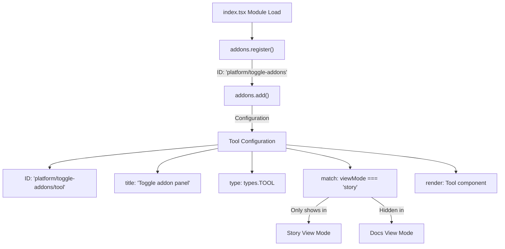
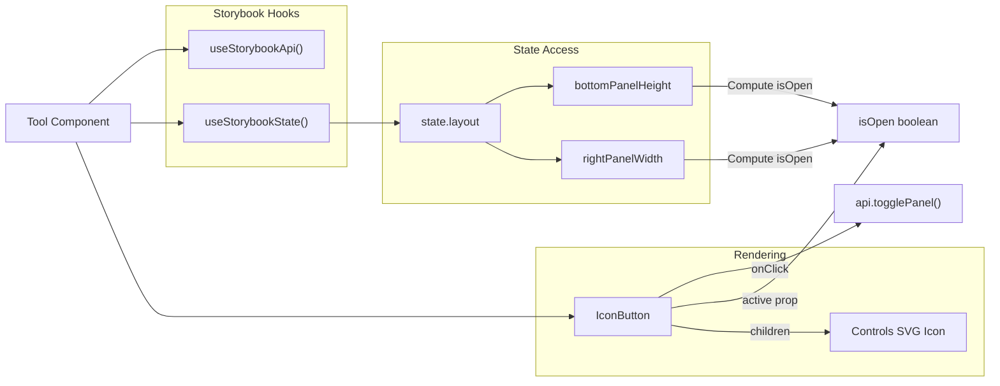
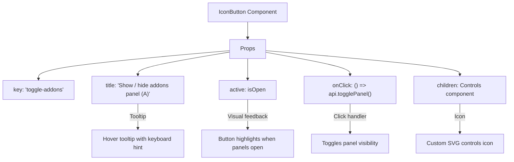
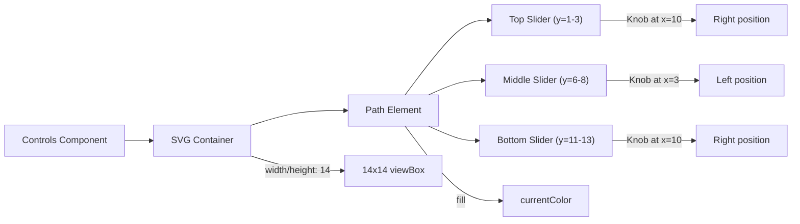
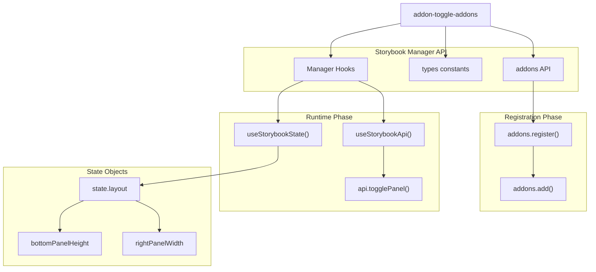
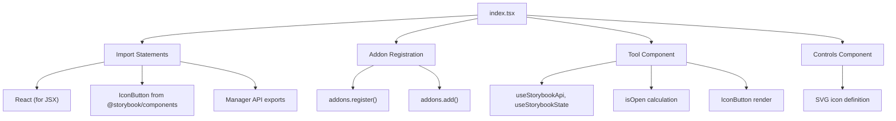
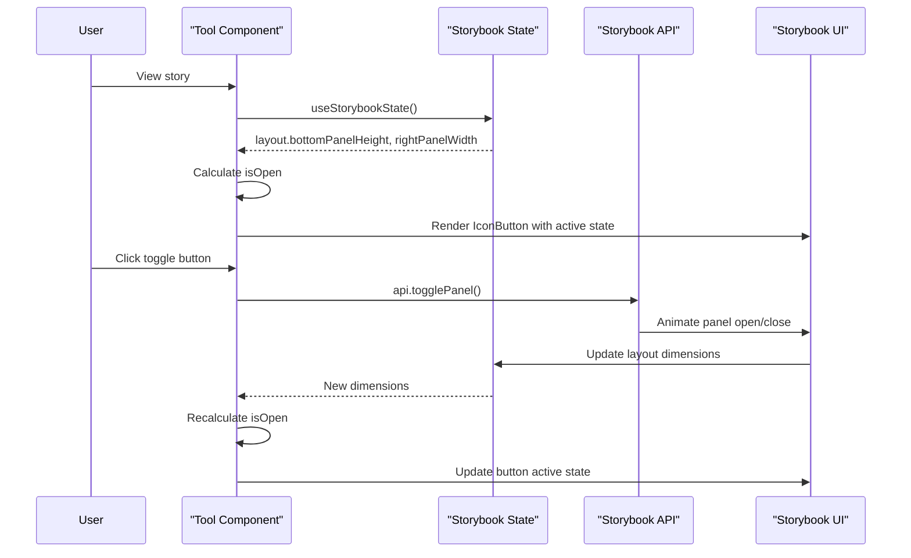

<!-- source: DeepWiki mcp.deepwiki.com · repo openai/apps-sdk-ui · page 4.4 Toggle Addons Addon · fetched 2026-10-26 -->

# Toggle Addons Addon

<details>
<summary>Relevant source files</summary>

The following files were used as context for generating this wiki page:

- [.storybook-base/addon-toggle-addons/index.tsx](.storybook-base/addon-toggle-addons/index.tsx)

</details>


## Purpose and Scope

This document describes the **Toggle Addons Addon**, a custom Storybook addon that provides a toolbar button for showing and hiding Storybook's addon panels (bottom and right panels). This addon enhances the Storybook interface by allowing users to quickly toggle the visibility of the Controls, Actions, and other addon panels to maximize the story viewport area.

This addon is distinct from the other custom addons in this repository. For theme management functionality, see [Theme Addon](#4.1). For navigation functionality, see [Back to Docs Addon](#4.2).

**Sources:** [.storybook-base/addon-toggle-addons/index.tsx:1-42]()

---

## Addon Overview

The Toggle Addons Addon is a minimal toolbar enhancement that provides a single button in the Storybook toolbar. When clicked, it toggles the visibility of Storybook's addon panels, effectively maximizing or restoring the story viewport.

| Feature | Description |
|---------|-------------|
| **Registration ID** | `platform/toggle-addons` |
| **Tool ID** | `platform/toggle-addons/tool` |
| **View Mode** | Story view only |
| **Type** | Toolbar tool (types.TOOL) |
| **Button Title** | "Show / hide addons panel (A)" |
| **Visual Indicator** | Button appears active when panels are open |

**Sources:** [.storybook-base/addon-toggle-addons/index.tsx:7-14]()

---

## Addon Registration

The addon registers itself with Storybook's addon system using the standard registration pattern. The registration occurs at module load time and configures the addon to appear only in story view mode.



The `match` function ensures the toggle button only appears when viewing individual stories, not in documentation pages where addon panels are typically not visible.

**Sources:** [.storybook-base/addon-toggle-addons/index.tsx:7-14]()

---

## Tool Component Architecture

The `Tool` component is the main React component that renders the toolbar button. It integrates with Storybook's state management and API to detect panel visibility and toggle panels.

### Component Structure



**Sources:** [.storybook-base/addon-toggle-addons/index.tsx:17-32]()

---

## State Management and Panel Detection

The addon determines whether addon panels are currently visible by examining the Storybook layout state. Panels can appear either at the bottom of the screen or on the right side, so the addon checks both dimensions.

### Panel Visibility Logic

The `isOpen` boolean is calculated using the following logic:

```
isOpen = (state.layout.bottomPanelHeight > 0) || (state.layout.rightPanelWidth > 0)
```

| Layout Property | Type | Meaning When > 0 |
|----------------|------|------------------|
| `bottomPanelHeight` | number | Bottom addon panel is visible and has height |
| `rightPanelWidth` | number | Right addon panel is visible and has width |

When either dimension is greater than zero, at least one panel is open, and the button displays as "active" (highlighted) in the toolbar.

### API Integration

The addon uses a single API method to toggle panel visibility:

| API Method | Purpose | Behavior |
|-----------|---------|----------|
| `api.togglePanel()` | Toggle addon panel visibility | Opens panels if closed; closes panels if open |

This method handles all the complexity of determining which panel to open/close and animating the transition.

**Sources:** [.storybook-base/addon-toggle-addons/index.tsx:17-32]()

---

## IconButton Component Integration

The `Tool` component renders a Storybook `IconButton` component with specific configuration for the toggle functionality.

### IconButton Props



The `active` prop provides visual feedback by highlighting the button when panels are open, helping users understand the current state of the UI.

**Sources:** [.storybook-base/addon-toggle-addons/index.tsx:23-31]()

---

## Controls Icon Component

The addon uses a custom SVG icon that visually represents control sliders or settings. The `Controls` component renders this icon inline.

### Icon Specification

| Property | Value |
|----------|-------|
| Dimensions | 14x14 pixels |
| ViewBox | `0 0 14 14` |
| Fill | `currentColor` (inherits text color) |
| Namespace | SVG 1.1 |

The icon consists of three horizontal slider controls at different positions, rendered as SVG paths. The `currentColor` fill ensures the icon matches the toolbar's color scheme and responds to theme changes.

### SVG Path Elements

The icon is composed of three slider controls positioned at vertical positions 1, 7, and 11:



**Sources:** [.storybook-base/addon-toggle-addons/index.tsx:34-41]()

---

## Integration Points

The Toggle Addons Addon integrates with several Storybook systems to provide its functionality.

### Storybook Manager API



| Integration Point | Module | Purpose |
|-------------------|--------|---------|
| `addons.register()` | `@storybook/manager-api` | Registers the addon with Storybook |
| `addons.add()` | `@storybook/manager-api` | Adds the tool to the toolbar |
| `useStorybookApi()` | `@storybook/manager-api` | Accesses Storybook API methods |
| `useStorybookState()` | `@storybook/manager-api` | Accesses current layout state |
| `IconButton` | `@storybook/components` | Renders the toolbar button |
| `types.TOOL` | `@storybook/manager-api` | Identifies addon as a toolbar tool |

**Sources:** [.storybook-base/addon-toggle-addons/index.tsx:1-42]()

---

## File Structure

The entire addon is contained in a single file with a straightforward organization:



| Section | Lines | Purpose |
|---------|-------|---------|
| Import statements | 1-5 | Dependencies and type definitions |
| Addon registration | 7-15 | Register and configure the addon |
| Tool component | 17-32 | Main component implementation |
| Controls component | 34-41 | SVG icon definition |

**Sources:** [.storybook-base/addon-toggle-addons/index.tsx:1-42]()

---

## Usage and Behavior

### User Interaction Flow



**Sources:** [.storybook-base/addon-toggle-addons/index.tsx:17-32]()

---

## Technical Notes

### View Mode Restriction

The addon's `match` function restricts the toggle button to story view mode only:

```javascript
match: ({ viewMode }) => viewMode === "story"
```

This ensures the button does not appear in docs view mode, where addon panels are typically not used and the toggle would be confusing or non-functional.

### Keyboard Shortcut Hint

The button title includes "(A)" to indicate that the keyboard shortcut 'A' can also be used to toggle panels. This is a built-in Storybook keyboard shortcut that the addon complements with a visual button.

### State Reactivity

The component automatically re-renders when the layout state changes because it uses the `useStorybookState()` hook. This ensures the button's active state always reflects the current panel visibility.

**Sources:** [.storybook-base/addon-toggle-addons/index.tsx:7-14](), [.storybook-base/addon-toggle-addons/index.tsx:17-32]()

---

