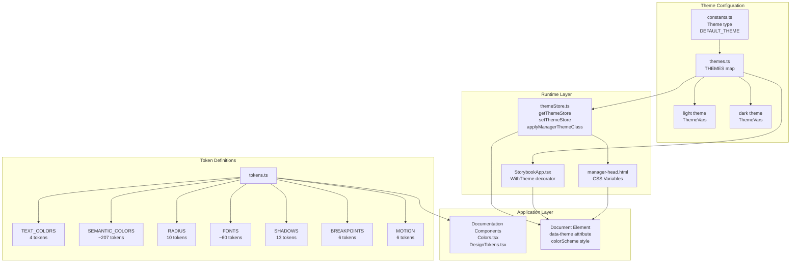
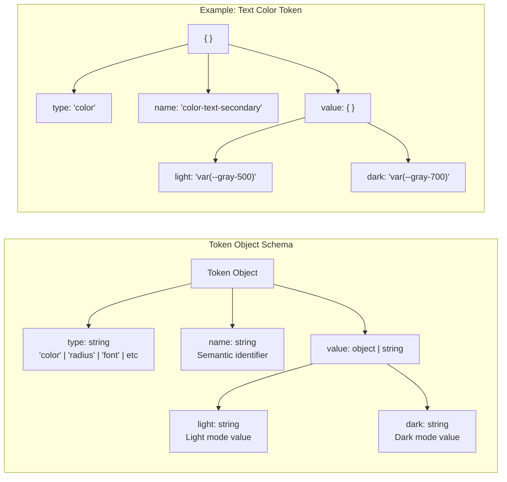
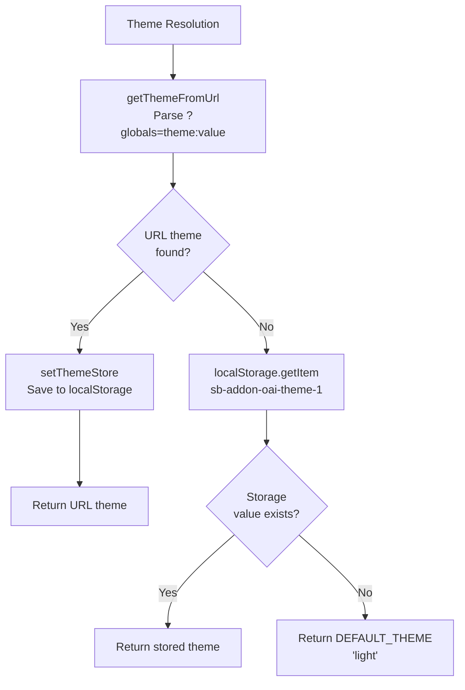
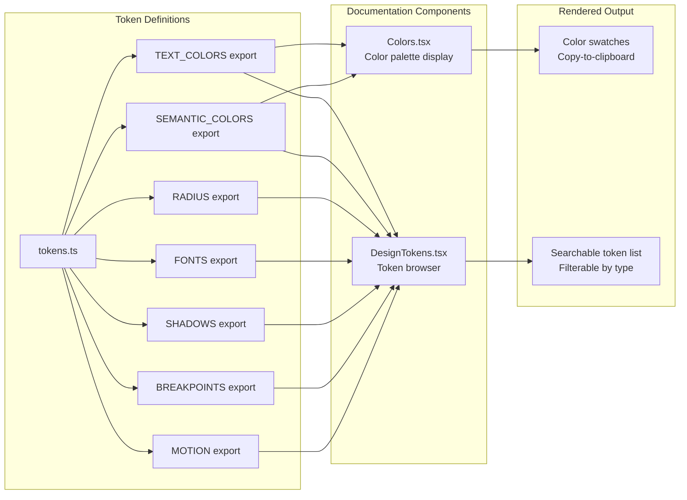

<!-- source: DeepWiki mcp.deepwiki.com · repo openai/apps-sdk-ui · page 5 Design System · fetched 2026-10-26 -->

# Design System

<details>
<summary>Relevant source files</summary>

The following files were used as context for generating this wiki page:

- [.storybook-base/addon-theme/constants.ts](.storybook-base/addon-theme/constants.ts)
- [.storybook-base/addon-theme/themeStore.ts](.storybook-base/addon-theme/themeStore.ts)
- [.storybook-base/addon-theme/themes.ts](.storybook-base/addon-theme/themes.ts)
- [.storybook-base/components/tokens.ts](.storybook-base/components/tokens.ts)

</details>


The design system provides a centralized collection of design tokens and theming infrastructure for the Apps SDK UI Storybook. It defines the visual language of the component library through semantic color scales, typography, spacing, shadows, motion parameters, and responsive breakpoints. The system supports light and dark themes with runtime theme switching capabilities.

For detailed documentation of individual tokens and their values, see [Design Tokens](#5.1). For information about theme configuration and the runtime theme switching mechanism, see [Theme System](#5.2).

## Architecture Overview

The design system is organized into three layers: token definitions, theme configurations, and runtime application mechanisms. Design tokens are defined as structured data objects that specify values for both light and dark modes, while themes configure the Storybook UI appearance and branding.

**Diagram: Design System Architecture**



Sources: [.storybook-base/components/tokens.ts:1-2493](), [.storybook-base/addon-theme/constants.ts:1-3](), [.storybook-base/addon-theme/themes.ts:1-68](), [.storybook-base/addon-theme/themeStore.ts:1-42]()

## Token Categories

The design system defines tokens across seven primary categories. Each token includes a type identifier, a semantic name, and theme-specific values for light and dark modes.

| Category | Export Name | Token Count | Purpose |
|----------|-------------|-------------|---------|
| Text Colors | `TEXT_COLORS` | 4 | Base text color hierarchy (primary, secondary, tertiary, inverse) |
| Semantic Colors | `SEMANTIC_COLORS` | ~207 | Component state colors organized by intent (primary, secondary, info, warning, caution, danger, success, discovery, disabled) |
| Border Radius | `RADIUS` | 10 | Corner radius values from 2xs to full |
| Typography | `FONTS` | ~60 | Font families, weights, tracking, and complete text/heading scales |
| Shadows | `SHADOWS` | 13 | Elevation shadows in four levels (100-400) with strength variations |
| Breakpoints | `BREAKPOINTS` | 6 | Responsive design breakpoints (xs through 2xl) |
| Motion | `MOTION` | 6 | Cubic bezier curves and transition parameters |

Sources: [.storybook-base/components/tokens.ts:1-41](), [.storybook-base/components/tokens.ts:43-2207](), [.storybook-base/components/tokens.ts:2209-2260](), [.storybook-base/components/tokens.ts:2262-2384](), [.storybook-base/components/tokens.ts:2386-2447](), [.storybook-base/components/tokens.ts:2449-2480](), [.storybook-base/components/tokens.ts:2482-2492]()

## Token Structure

Each design token follows a consistent data structure with type classification and theme-aware values. This structure enables programmatic token browsing and automatic documentation generation.

**Diagram: Token Data Structure**



Sources: [.storybook-base/components/tokens.ts:1-41]()

## Semantic Color Organization

Semantic colors are organized by component intent and interaction state. Each intent (primary, secondary, info, warning, etc.) includes multiple variants for different component styles (soft, solid, outline, ghost) and interaction states (hover, active).

**Diagram: Semantic Color Intent Structure**

```mermaid
graph TD
    SEMANTIC_COLORS["SEMANTIC_COLORS<br/>Combined array"]
    
    subgraph "Intent Categories"
        PRIMARY["SEMANTIC_COLORS_PRIMARY<br/>~79 tokens"]
        SECONDARY["SEMANTIC_COLORS_SECONDARY<br/>~42 tokens"]
        INFO["SEMANTIC_COLORS_INFO<br/>~38 tokens"]
        WARNING["SEMANTIC_COLORS_WARNING<br/>~34 tokens"]
        CAUTION["SEMANTIC_COLORS_CAUTION<br/>~30 tokens"]
        DANGER["SEMANTIC_COLORS_DANGER<br/>~34 tokens"]
        SUCCESS["SEMANTIC_COLORS_SUCCESS<br/>~34 tokens"]
        DISCOVERY["SEMANTIC_COLORS_DISCOVERY<br/>~34 tokens"]
        DISABLED["SEMANTIC_COLORS_DISABLED<br/>3 tokens"]
        MISC["SEMANTIC_COLORS_MISC<br/>9 tokens"]
    end
    
    subgraph "Variant Patterns"
        SOFT["Soft Variants<br/>background-*-soft<br/>text-*-soft"]
        SURFACE["Surface Variants<br/>background-*-surface<br/>border-*-surface"]
        SOLID["Solid Variants<br/>background-*-solid<br/>text-*-solid"]
        OUTLINE["Outline Variants<br/>border-*-outline<br/>text-*-outline"]
        GHOST["Ghost Variants<br/>background-*-ghost<br/>text-*-ghost"]
        RING["Ring Variants<br/>color-ring-*"]
    end
    
    SEMANTIC_COLORS --> PRIMARY
    SEMANTIC_COLORS --> SECONDARY
    SEMANTIC_COLORS --> INFO
    SEMANTIC_COLORS --> WARNING
    SEMANTIC_COLORS --> CAUTION
    SEMANTIC_COLORS --> DANGER
    SEMANTIC_COLORS --> SUCCESS
    SEMANTIC_COLORS --> DISCOVERY
    SEMANTIC_COLORS --> DISABLED
    SEMANTIC_COLORS --> MISC
    
    PRIMARY --> SOFT
    PRIMARY --> SURFACE
    PRIMARY --> SOLID
    PRIMARY --> OUTLINE
    PRIMARY --> GHOST
    PRIMARY --> RING
```



Sources: [.storybook-base/components/tokens.ts:43-321](), [.storybook-base/components/tokens.ts:323-565](), [.storybook-base/components/tokens.ts:567-820](), [.storybook-base/components/tokens.ts:822-1076](), [.storybook-base/components/tokens.ts:1078-1324](), [.storybook-base/components/tokens.ts:1326-1580](), [.storybook-base/components/tokens.ts:1582-1836](), [.storybook-base/components/tokens.ts:1838-2092](), [.storybook-base/components/tokens.ts:2094-2119](), [.storybook-base/components/tokens.ts:2121-2194](), [.storybook-base/components/tokens.ts:2196-2207]()

## Typography Scale

The typography system provides comprehensive text and heading scales with corresponding size, line-height, weight, and tracking values. The system includes nine heading sizes (5xl to xs) and six text sizes (lg to 3xs).

| Scale | Size | Line Height | Weight | Tracking |
|-------|------|-------------|--------|----------|
| **Headings** |
| heading-5xl | 4.5rem | 4.5rem | semibold (600) | tight (-0.02em) |
| heading-4xl | 3.75rem | 3.75rem | semibold (600) | tight (-0.02em) |
| heading-3xl | 3rem | 3rem | semibold (600) | tight (-0.02em) |
| heading-2xl | 2.25rem | 2.625rem | semibold (600) | tight (-0.02em) |
| heading-xl | 2rem | 2.375rem | semibold (600) | tight (-0.02em) |
| heading-lg | 1.5rem | 1.75rem | semibold (600) | normal (-0.01em) |
| heading-md | 1.25rem | 1.625rem | semibold (600) | normal (-0.01em) |
| heading-sm | 1.125rem | 1.625rem | semibold (600) | normal (-0.01em) |
| heading-xs | 1rem | 1.5rem | semibold (600) | normal (-0.01em) |
| **Text** |
| text-lg | 1.125rem | 1.8125rem | normal (400) | normal (-0.01em) |
| text-md | 1rem | 1.5rem | normal (400) | normal (-0.01em) |
| text-sm | 0.875rem | 1.25rem | normal (400) | normal (-0.01em) |
| text-xs | 0.75rem | 1.125rem | normal (400) | wide (0em) |
| text-2xs | 0.625rem | 0.875rem | normal (400) | wide (0em) |
| text-3xs | 0.5rem | 0.75rem | normal (400) | wide (0em) |

Sources: [.storybook-base/components/tokens.ts:2262-2384]()

## Theme Type System

The theme system uses TypeScript types to enforce valid theme values and provide type safety. The `Theme` type restricts theme values to `"light"` or `"dark"`, with a default theme constant exported for initialization.

```typescript
// Type definition
export type Theme = "light" | "dark"

// Default value
export const DEFAULT_THEME: Theme = "light"
```

Sources: [.storybook-base/addon-theme/constants.ts:1-3]()

## Theme Storage and Persistence

The `themeStore` module provides functions for persisting and retrieving theme preferences with a priority system: URL parameters override localStorage, which overrides the default theme.

**Diagram: Theme Storage Priority System**



Sources: [.storybook-base/addon-theme/themeStore.ts:1-42]()

### Theme Storage Functions

| Function | Parameters | Return | Purpose |
|----------|------------|--------|---------|
| `getThemeFromUrl` | `urlString: string` | `string \| null` | Extracts theme from `?globals=theme:value` URL parameter |
| `setThemeStore` | `theme: Theme` | `void` | Persists theme preference to localStorage with key `sb-addon-oai-theme-1` |
| `getThemeStore` | none | `Theme` | Retrieves theme with priority: URL → localStorage → default |
| `applyManagerThemeClass` | `nextTheme: Theme` | `void` | Applies theme to document by setting `data-theme` attribute and `colorScheme` style |

Sources: [.storybook-base/addon-theme/themeStore.ts:6-41]()

## Storybook Theme Configuration

The `themes.ts` module defines complete Storybook theme configurations using the `@storybook/theming` API. Each theme includes branding, typography, color palette, and UI spacing values.

### Light Theme Configuration

```typescript
const light = create({
  base: "light",
  brandTitle: "Apps SDK UI",
  brandImage: "https://openai.github.io/apps-sdk-ui/logo-storybook.svg",
  brandUrl: "https://developers.openai.com",
  brandTarget: "_self",
  
  // Typography
  fontBase: "ui-sans-serif, -apple-system, system-ui, ...",
  fontCode: "ui-monospace, 'SFMono-Regular', ...",
  
  // Variables
  colorPrimary: "#3A10E5",
  colorSecondary: "#585C6D",
  
  // UI
  appBg: "#ffffff",
  appContentBg: "#ffffff",
  appPreviewBg: "#ffffff",
  appBorderColor: "#ededed",
  appBorderRadius: 6,
  
  // Toolbar
  barTextColor: "#6e6e80",
  barBg: "#ffffff",
})
```

Sources: [.storybook-base/addon-theme/themes.ts:4-32]()

### Dark Theme Configuration

The dark theme extends the default Storybook dark theme with custom branding and adjusted colors:

```typescript
const dark = create({
  ...themes.dark,
  brandTitle: "Apps SDK UI",
  brandImage: "https://openai.github.io/apps-sdk-ui/logo-storybook-dark.svg",
  brandUrl: "https://platform.openai.com",
  brandTarget: "_self",
  
  // Variables
  colorPrimary: "#3A10E5",
  colorSecondary: "#585C6D",
  
  // UI
  appBg: "#212121",
  appContentBg: "#212121",
  appPreviewBg: "#212121",
  appBorderColor: "#393939",
  appBorderRadius: 6,
  
  // Toolbar
  barTextColor: "#c1c1c1",
  barBg: "#212121",
})
```

Sources: [.storybook-base/addon-theme/themes.ts:34-62]()

### THEMES Export

The themes are exported as a strongly-typed record mapping theme names to Storybook `ThemeVars` objects:

```typescript
export const THEMES: Record<Theme, ThemeVars> = {
  light,
  dark,
}
```

Sources: [.storybook-base/addon-theme/themes.ts:64-67]()

## Integration with Documentation Components

The design tokens are consumed by documentation components that provide interactive browsing and exploration of the design system. The `Colors` and `DesignTokens` components import token arrays directly from `tokens.ts` to generate their displays.

**Diagram: Token Consumption Flow**



Sources: [.storybook-base/components/tokens.ts:1-2493]()

## CSS Variable Application

The design tokens are applied to the DOM through CSS variables defined in the manager head HTML. The `applyManagerThemeClass` function sets the `data-theme` attribute and `colorScheme` style property on `document.documentElement`, enabling CSS to react to theme changes.

```typescript
// Applied to document root
htmlTag.setAttribute("data-theme", nextTheme)
htmlTag.style.colorScheme = nextTheme
```

This enables CSS selectors like:

```css
[data-theme="light"] {
  /* Light theme variables */
}

[data-theme="dark"] {
  /* Dark theme variables */
}
```

Sources: [.storybook-base/addon-theme/themeStore.ts:37-41]()

---

