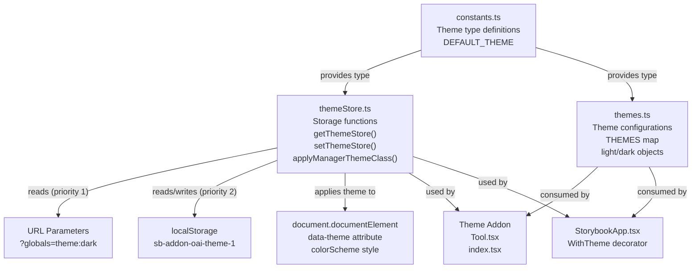
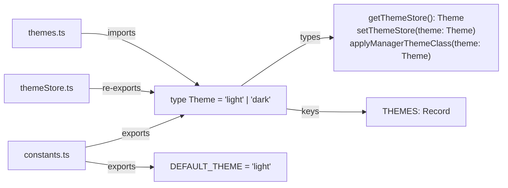
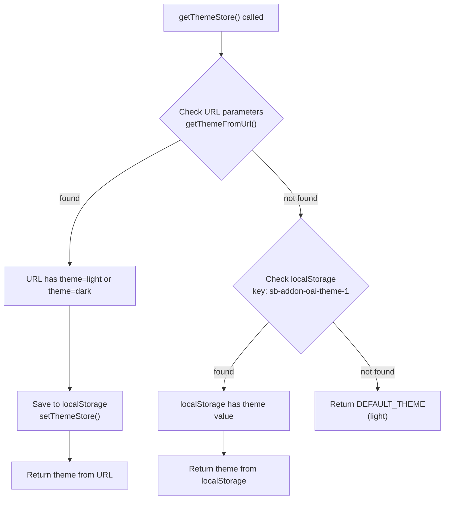
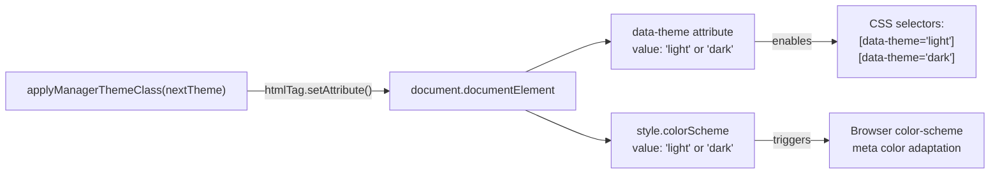
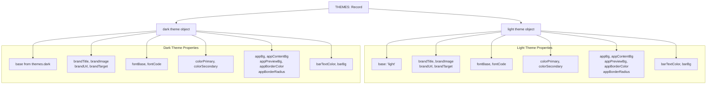
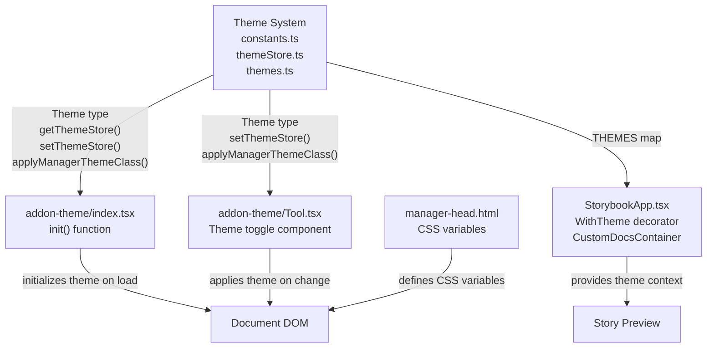

<!-- source: DeepWiki mcp.deepwiki.com · repo openai/apps-sdk-ui · page 5.2 Theme System · fetched 2026-10-26 -->

# Theme System

<details>
<summary>Relevant source files</summary>

The following files were used as context for generating this wiki page:

- [.storybook-base/addon-theme/constants.ts](.storybook-base/addon-theme/constants.ts)
- [.storybook-base/addon-theme/themeStore.ts](.storybook-base/addon-theme/themeStore.ts)
- [.storybook-base/addon-theme/themes.ts](.storybook-base/addon-theme/themes.ts)

</details>


## Purpose and Scope

This document describes the Theme System architecture in the apps-sdk-ui Storybook repository. The Theme System provides the foundational infrastructure for managing light and dark themes, including type definitions, storage mechanisms, and theme configurations. This system is consumed by the Theme Addon (see [4.1](#4.1)) which provides the user interface for theme switching.

For information about design tokens (colors, typography, spacing), see [5.1](#5.1). For the Theme Tool UI component that users interact with, see [4.1.1](#4.1.1).

---

## Architecture Overview

The Theme System consists of three core modules that work together to provide theme functionality:

**Theme Architecture Components**



**Sources:** [.storybook-base/addon-theme/constants.ts:1-3](), [.storybook-base/addon-theme/themeStore.ts:1-42](), [.storybook-base/addon-theme/themes.ts:1-68]()

---

## Theme Type System

The Theme System uses TypeScript to enforce type safety for theme values. The type definitions are centralized in the constants module.

### Type Definition

| Symbol | Type | Definition | Purpose |
|--------|------|------------|---------|
| `Theme` | Type Alias | `"light" \| "dark"` | Restricts theme values to valid options |
| `DEFAULT_THEME` | Constant | `"light"` | Provides fallback when no theme preference exists |

The `Theme` type is exported from both `constants.ts` and `themeStore.ts` for convenient imports throughout the codebase.

**Complete Type System**



**Sources:** [.storybook-base/addon-theme/constants.ts:1-3](), [.storybook-base/addon-theme/themeStore.ts:1-2]()

---

## Theme Storage and Retrieval

The `themeStore.ts` module implements a priority-based system for theme persistence and retrieval. Theme preferences are stored in localStorage and can be overridden by URL parameters.

### Storage Key

The system uses the localStorage key `"sb-addon-oai-theme-1"` for persisting theme preferences across browser sessions.

### Retrieval Priority System

The `getThemeStore()` function implements a three-level priority hierarchy:

**Theme Resolution Priority Flow**



### URL Parameter Parsing

The `getThemeFromUrl()` function extracts theme values from URL parameters in the format `?globals=theme:dark`. The function parses the `globals` parameter which may contain multiple semicolon-separated key-value pairs.

**URL Parsing Logic**

| Step | Code Reference | Purpose |
|------|----------------|---------|
| 1 | [.storybook-base/addon-theme/themeStore.ts:7]() | Parse URL string into URL object |
| 2 | [.storybook-base/addon-theme/themeStore.ts:9]() | Extract `globals` search parameter |
| 3 | [.storybook-base/addon-theme/themeStore.ts:11]() | Split on semicolons to get key-value pairs |
| 4 | [.storybook-base/addon-theme/themeStore.ts:13-14]() | Find pair where key equals "theme" |
| 5 | [.storybook-base/addon-theme/themeStore.ts:15]() | Return theme value or null |

### Storage Functions

| Function | Signature | Purpose |
|----------|-----------|---------|
| `setThemeStore` | `(theme: Theme) => void` | Writes theme to localStorage |
| `getThemeStore` | `() => Theme` | Reads theme with priority fallback |

**Sources:** [.storybook-base/addon-theme/themeStore.ts:4-35]()

---

## Theme Application to DOM

The `applyManagerThemeClass()` function applies theme changes to the document's root HTML element using both data attributes and inline styles.

### DOM Modifications

**DOM Application Mechanism**



### Applied Attributes

When `applyManagerThemeClass("dark")` is called, the following changes occur:

```
<html data-theme="dark" style="color-scheme: dark;">
```

| Attribute | Purpose | Usage |
|-----------|---------|-------|
| `data-theme` | CSS selector targeting | Enables `[data-theme="dark"]` selectors in stylesheets |
| `style.colorScheme` | Browser color scheme | Triggers browser native dark mode behaviors (scrollbars, form controls) |

**Sources:** [.storybook-base/addon-theme/themeStore.ts:37-41]()

---

## Theme Definitions

The `themes.ts` module defines the complete visual appearance for light and dark themes using Storybook's theming API.

### Theme Configuration Structure

Each theme is created using the `create()` function from `@storybook/theming`, which accepts a `ThemeVars` object.

**Theme Object Structure**



### Theme Property Categories

#### Branding

| Property | Light Value | Dark Value | Purpose |
|----------|-------------|------------|---------|
| `brandTitle` | "Apps SDK UI" | "Apps SDK UI" | Sidebar logo tooltip |
| `brandImage` | `logo-storybook.svg` | `logo-storybook-dark.svg` | Sidebar logo image |
| `brandUrl` | `developers.openai.com` | `platform.openai.com` | Logo click destination |
| `brandTarget` | `"_self"` | `"_self"` | Logo link behavior |

#### Typography

Both themes use identical font stacks for consistency:

- **Sans-serif:** `ui-sans-serif, -apple-system, system-ui, "Segoe UI", "Noto Sans", "Helvetica", "Arial", "Apple Color Emoji", "Segoe UI Emoji", "Segoe UI Symbol", sans-serif`
- **Monospace:** `ui-monospace, "SFMono-Regular", "SF Mono", "Menlo", "Monaco", "Consolas", "Liberation Mono", "DejaVu Sans Mono", "Courier New", monospace`

#### Colors

| Property | Light | Dark | Purpose |
|----------|-------|------|---------|
| `colorPrimary` | `#3A10E5` | `#3A10E5` | Primary accent color (links, buttons) |
| `colorSecondary` | `#585C6D` | `#585C6D` | Secondary accent color |

#### UI Backgrounds

| Property | Light | Dark | Purpose |
|----------|-------|------|---------|
| `appBg` | `#ffffff` | `#212121` | Main application background |
| `appContentBg` | `#ffffff` | `#212121` | Content area background |
| `appPreviewBg` | `#ffffff` | `#212121` | Story preview background |
| `appBorderColor` | `#ededed` | `#393939` | Border color throughout UI |
| `appBorderRadius` | `6` | `6` | Border radius (pixels) |

#### Toolbar

| Property | Light | Dark | Purpose |
|----------|-------|------|---------|
| `barTextColor` | `#6e6e80` | `#c1c1c1` | Toolbar text/icon color |
| `barBg` | `#ffffff` | `#212121` | Toolbar background color |

### Theme Creation Approach

The light theme is created from scratch, while the dark theme extends Storybook's built-in dark theme:

```
const light = create({ base: "light", ... })
const dark = create({ ...themes.dark, ... })
```

This approach allows the dark theme to inherit sensible defaults for properties like text colors and input styling while overriding specific values.

**Sources:** [.storybook-base/addon-theme/themes.ts:1-68]()

---

## Integration Points

The Theme System is consumed by multiple parts of the Storybook application:

**Theme System Consumers**



### Usage in Theme Addon

The Theme Addon's initialization code retrieves and applies the stored theme on load:

1. `init()` calls `getThemeStore()` to determine current theme
2. Result is passed to `applyManagerThemeClass()` to update DOM
3. Theme state is stored in Storybook's global state

### Usage in Storybook App

The `THEMES` map from `themes.ts` is imported into `StorybookApp.tsx` where:

1. The current theme value is read from Storybook globals
2. The corresponding theme object is selected from the `THEMES` map
3. Theme is applied to documentation pages via the `CustomDocsContainer`

**Sources:** [.storybook-base/addon-theme/constants.ts:1-3](), [.storybook-base/addon-theme/themeStore.ts:1-42](), [.storybook-base/addon-theme/themes.ts:1-68]()

---

## Summary

The Theme System provides three interconnected modules:

1. **constants.ts** - Type definitions and defaults
2. **themeStore.ts** - Storage, retrieval, and DOM application
3. **themes.ts** - Visual theme configurations

The system implements a priority-based theme resolution (URL > localStorage > default) and applies themes through both data attributes and CSS color-scheme properties. Theme configurations define comprehensive visual properties including branding, typography, colors, and UI styling for both light and dark modes.

---

