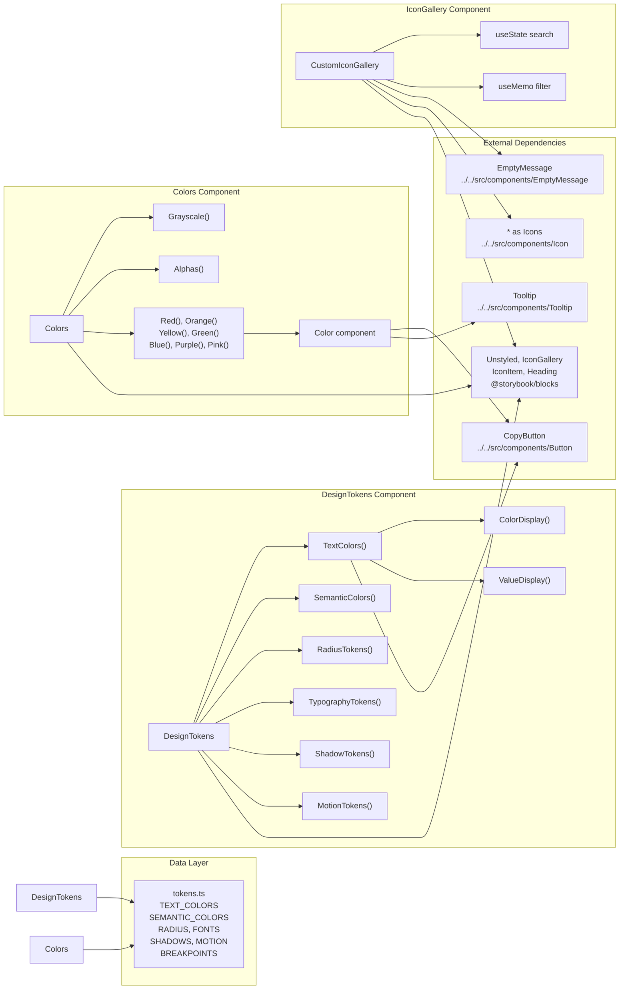
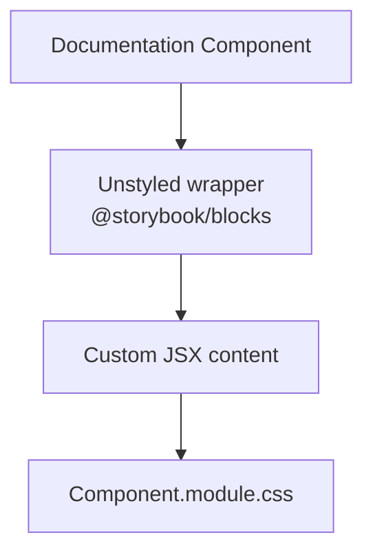
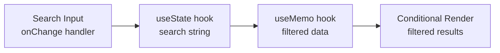
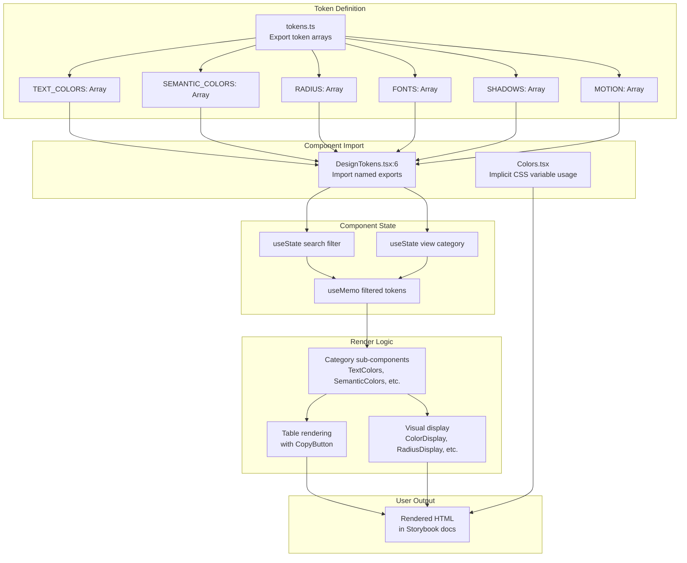

<!-- source: DeepWiki mcp.deepwiki.com · repo openai/apps-sdk-ui · page 6 Documentation Components · fetched 2026-10-26 -->

# Documentation Components

Relevant source files

The following files were used as context for generating this wiki page:

- [.storybook-base/components/Card.tsx](.storybook-base/components/Card.tsx)
- [.storybook-base/components/Colors.tsx](.storybook-base/components/Colors.tsx)
- [.storybook-base/components/CustomIconGallery.tsx](.storybook-base/components/CustomIconGallery.tsx)
- [.storybook-base/components/DesignTokens.tsx](.storybook-base/components/DesignTokens.tsx)
- [.storybook-base/components/Hero.tsx](.storybook-base/components/Hero.tsx)

This page provides an overview of the custom React components developed specifically for enhancing Storybook documentation pages. These components are located in [.storybook-base/components/]() and provide specialized UI elements for displaying design tokens, color palettes, icon galleries, and navigation structures. They are distinct from the source UI components in `src/components/` and are designed exclusively for documentation purposes within the Storybook environment.

For information about the design tokens these components display, see [Design Tokens](#5.1). For information about reusable source UI components, refer to the main component library documentation.

## Architecture Overview

The documentation components follow a consistent architectural pattern that separates presentation logic, styling, and data sources. All components integrate with Storybook's theming system and use the `Unstyled` wrapper from `@storybook/blocks` to prevent style conflicts.

```mermaid
graph TB
    subgraph "Documentation Component Layer"
        Card["Card.tsx<br/>FooterCard"]
        Colors["Colors.tsx<br/>Color palette display"]
        DesignTokens["DesignTokens.tsx<br/>Token browser"]
        IconGallery["CustomIconGallery.tsx<br/>Icon showcase"]
        Hero["Hero.tsx<br/>Hero sections"]
        NextPrev["NextPrev.tsx<br/>Navigation"]
        CustomTable["CustomTable.tsx<br/>Table utilities"]
        HideToC["HideTableOfContents.tsx<br/>UI control"]
    end
    
    subgraph "Styling Layer"
        CardCSS["Card.module.css"]
        ColorsCSS["Colors.module.css"]
        TokensCSS["DesignTokens.module.css"]
        IconCSS["CustomIconGallery.module.css"]
        HeroCSS["Hero.module.css"]
        TableCSS["CustomTable.module.css"]
    end
    
    subgraph "Data Sources"
        TokensData["tokens.ts<br/>TEXT_COLORS<br/>SEMANTIC_COLORS<br/>RADIUS, FONTS<br/>SHADOWS, MOTION"]
        IconsData["../../src/components/Icon<br/>Icon exports"]
    end
    
    subgraph "Shared Components"
        Button["Button/CopyButton<br/>../../src/components/Button"]
        Tooltip["Tooltip<br/>../../src/components/Tooltip"]
        Empty["EmptyMessage<br/>../../src/components/EmptyMessage"]
    end
    
    subgraph "Storybook Integration"
        Unstyled["Unstyled<br/>@storybook/blocks"]
        IconBlocks["IconGallery/IconItem<br/>@storybook/blocks"]
        Links["linkTo<br/>@storybook/addon-links"]
        Heading["Heading<br/>@storybook/blocks"]
    end
    
    Card --> CardCSS
    Colors --> ColorsCSS
    DesignTokens --> TokensCSS
    IconGallery --> IconCSS
    Hero --> HeroCSS
    CustomTable --> TableCSS
    
    Colors --> TokensData
    DesignTokens --> TokensData
    IconGallery --> IconsData
    
    Colors --> Button
    Colors --> Tooltip
    DesignTokens --> Button
    IconGallery --> Empty
    NextPrev --> Card
    
    Card --> Unstyled
    Colors --> Unstyled
    DesignTokens --> Unstyled
    DesignTokens --> Heading
    IconGallery --> Unstyled
    IconGallery --> IconBlocks
    Hero --> Unstyled
    NextPrev --> Links
```

**Sources:** [.storybook-base/components/Card.tsx](), [.storybook-base/components/Colors.tsx](), [.storybook-base/components/DesignTokens.tsx](), [.storybook-base/components/CustomIconGallery.tsx](), [.storybook-base/components/Hero.tsx]()

## Component Dependency Map

This diagram shows the concrete imports and dependencies between documentation components and their supporting modules.

**Sources:** [.storybook-base/components/Colors.tsx:1-6](), [.storybook-base/components/DesignTokens.tsx:1-6](), [.storybook-base/components/CustomIconGallery.tsx:1-5]()

## Common Patterns

### Unstyled Wrapper Integration

All documentation components wrap their content with Storybook's `Unstyled` component to prevent Storybook's default documentation styles from interfering with custom component styling. This pattern is consistent across all components:

Example implementation in [.storybook-base/components/Card.tsx:16-25]():
- `Card` component wraps content in `<Unstyled>` 
- Custom styles from `Card.module.css` are applied via className
- Inner content maintains complete style isolation

**Sources:** [.storybook-base/components/Card.tsx:16-25](), [.storybook-base/components/Hero.tsx:11-16](), [.storybook-base/components/Colors.tsx:11-13]()

### CSS Module Pattern

Each component uses CSS modules for scoped styling, preventing style leakage and naming conflicts:

| Component | CSS Module | Import Statement |
|-----------|-----------|------------------|
| `Card` | `Card.module.css` | `import s from "./Card.module.css"` |
| `Colors` | `Colors.module.css` | `import s from "./Colors.module.css"` |
| `DesignTokens` | `DesignTokens.module.css` | `import s from "./DesignTokens.module.css"` |
| `CustomIconGallery` | `CustomIconGallery.module.css` | `import s from "./CustomIconGallery.module.css"` |
| `Hero` | `Hero.module.css` | `import s from "./Hero.module.css"` |

**Sources:** [.storybook-base/components/Card.tsx:3](), [.storybook-base/components/Colors.tsx:5](), [.storybook-base/components/DesignTokens.tsx:5](), [.storybook-base/components/CustomIconGallery.tsx:5](), [.storybook-base/components/Hero.tsx:2]()

### Interactive Features with Source Components

Documentation components frequently integrate interactive elements from the source component library:

**CopyButton Integration Pattern:**

Used in [.storybook-base/components/Colors.tsx:586-605]() and [.storybook-base/components/DesignTokens.tsx:118-126]():
- Imported from `../../src/components/Button`
- Provides one-click copying of CSS variable names and values
- Configured with `variant="ghost"` and `size="2xs"` for minimal UI

**Tooltip Integration Pattern:**

Used in [.storybook-base/components/Colors.tsx:576-609]():
- Imported from `../../src/components/Tooltip`
- Displays color token details on hover
- Configuration: `interactive`, `maxWidth="none"`, `sideOffset={-10}`, `openDelay={300}`

**EmptyMessage Integration Pattern:**

Used in [.storybook-base/components/CustomIconGallery.tsx:30-38]():
- Imported from `../../src/components/EmptyMessage`
- Shows "No icons found" state when search returns empty results
- Includes search icon and descriptive text

**Sources:** [.storybook-base/components/Colors.tsx:3-4](), [.storybook-base/components/DesignTokens.tsx:3-4](), [.storybook-base/components/CustomIconGallery.tsx:3]()

### Search and Filter Capabilities

Components that display large datasets implement consistent search/filter patterns using React hooks:

**DesignTokens Implementation** [.storybook-base/components/DesignTokens.tsx:8-23]():
- `useState<string>("")` for search term
- `useState<string>("all")` for category filter
- Sticky search container with icon
- Filter buttons for token categories

**CustomIconGallery Implementation** [.storybook-base/components/CustomIconGallery.tsx:8-15]():
- `useState<string>("")` for search term
- `useMemo` to filter icon list: `Object.entries(Icons).filter([name] => name.toLowerCase().includes(search.toLowerCase().trim()))`
- Displays `EmptyMessage` when no matches found

**Sources:** [.storybook-base/components/DesignTokens.tsx:8-23](), [.storybook-base/components/CustomIconGallery.tsx:8-15]()

## Component Categories

### Layout Components

**Card and FooterCard** (See [Card Components](#6.1) for details)

Defined in [.storybook-base/components/Card.tsx:5-54]():
- `Card`: Displays icon, title, and subtitle with optional onClick handler
- `FooterCard`: Variant with reversed layout (subtitle above title)
- Both support `data-interactive` attribute for hover states
- Wrapped with `Unstyled` component for style isolation

**Hero** (See [Hero Component](#6.6) for details)

Defined in [.storybook-base/components/Hero.tsx:4-18]():
- Simple wrapper component for prominent content sections
- Accepts `className` and `children` props
- Provides consistent container styling via `Hero.module.css`

**Sources:** [.storybook-base/components/Card.tsx:5-54](), [.storybook-base/components/Hero.tsx:4-18]()

### Data Display Components

**Colors** (See [Colors Component](#6.2) for details)

Defined in [.storybook-base/components/Colors.tsx:7-30]():
- Main component renders color palette sections
- Sub-components: `Grayscale`, `Alphas`, and color functions (`Red`, `Orange`, `Yellow`, `Green`, `Blue`, `Purple`, `Pink`)
- Each color is rendered by the `Color` component [line 559-619]() with tooltip and copy functionality
- Displays both light and dark theme values using `light-dark()` CSS function

**DesignTokens** (See [Design Tokens Component](#6.3) for details)

Defined in [.storybook-base/components/DesignTokens.tsx:8-94]():
- Interactive browser for all design tokens
- Token categories: Text Colors, Semantic Colors, Fonts, Radius, Shadows, Motion, Breakpoints
- Each category has dedicated sub-component: `TextColors`, `SemanticColors`, `RadiusTokens`, `TypographyTokens`, `ShadowTokens`, `MotionTokens`, `BreakpointTokens`
- Imports token data from [.storybook-base/components/tokens.ts:6](): `TEXT_COLORS`, `SEMANTIC_COLORS`, `RADIUS`, `FONTS`, `SHADOWS`, `MOTION`, `BREAKPOINTS`

**CustomIconGallery** (See [Icon Gallery Component](#6.4) for details)

Defined in [.storybook-base/components/CustomIconGallery.tsx:7-50]():
- Searchable icon gallery using Storybook's `IconGallery` and `IconItem` components
- Imports all icons: `import * as Icons from "../../src/components/Icon"` [line 4]()
- Uses `Object.entries(Icons)` to iterate over icon exports [line 11]()
- Shows `EmptyMessage` when search returns no results [lines 30-38]()

**Sources:** [.storybook-base/components/Colors.tsx:7-619](), [.storybook-base/components/DesignTokens.tsx:8-431](), [.storybook-base/components/CustomIconGallery.tsx:7-50]()

### Navigation Components

**NextPrev** (See [Navigation Components](#6.7) for details)
- Sequential navigation between documentation pages
- Uses `Card` or `FooterCard` components
- Integrates with `linkTo` from `@storybook/addon-links`

**Sources:** High-level diagrams, referenced but implementation file not provided

### Utility Components

**CustomTable** (See [Table Components](#6.5) for details)
- Custom table rendering utilities
- Value display functions for formatted output
- Used internally by `DesignTokens` component

**HideTableOfContents** (See [Utility Components](#6.8) for details)
- Controls visibility of Storybook's table of contents
- Provides documentation page layout control

**Sources:** High-level diagrams, referenced but implementation files not provided

## Data Flow Architecture

The following diagram illustrates how data flows from token definitions through documentation components to the rendered UI:

**Sources:** [.storybook-base/components/tokens.ts](), [.storybook-base/components/DesignTokens.tsx:6](), [.storybook-base/components/DesignTokens.tsx:96-137]()

## Component Summary Table

| Component | Purpose | Key Features | Child Page |
|-----------|---------|-------------|------------|
| `Card` / `FooterCard` | Structured content display and navigation | Icon support, clickable, reversed layout variant | [#6.1](#6.1) |
| `Colors` | Interactive color palette | Hover tooltips, copy functionality, light/dark values | [#6.2](#6.2) |
| `DesignTokens` | Comprehensive token browser | Search, category filters, copy buttons, visual previews | [#6.3](#6.3) |
| `CustomIconGallery` | Icon library showcase | Live search, empty states, grid layout | [#6.4](#6.4) |
| `CustomTable` | Table rendering utilities | Value formatting, display helpers | [#6.5](#6.5) |
| `Hero` | Prominent content sections | Simple wrapper, custom styling | [#6.6](#6.6) |
| `NextPrev` | Sequential page navigation | Card-based, link integration | [#6.7](#6.7) |
| `HideTableOfContents` | UI layout control | Toggle ToC visibility | [#6.8](#6.8) |

**Sources:** [.storybook-base/components/Card.tsx](), [.storybook-base/components/Colors.tsx](), [.storybook-base/components/DesignTokens.tsx](), [.storybook-base/components/CustomIconGallery.tsx](), [.storybook-base/components/Hero.tsx]()

## Integration Points

### Storybook Blocks Integration

Documentation components leverage official Storybook blocks for consistency:

**Unstyled Block** - Used by all components:
- Import: `import { Unstyled } from "@storybook/blocks"`
- Purpose: Prevents Storybook's default documentation styles from affecting component rendering
- Usage: Wrap all custom-styled content in `<Unstyled>` tags

**IconGallery/IconItem Blocks** - Used by `CustomIconGallery` [.storybook-base/components/CustomIconGallery.tsx:1]():
- Import: `import { IconGallery, IconItem } from "@storybook/blocks"`
- Purpose: Provides consistent icon grid layout
- Usage: `<IconGallery>` wraps multiple `<IconItem name={name}>` components

**Heading Block** - Used by `DesignTokens` [.storybook-base/components/DesignTokens.tsx:1]():
- Import: `import { Heading } from "@storybook/blocks"`
- Purpose: Generates properly linked section headings
- Usage: `<Heading id="section-id" as="h2">Title</Heading>`

**Sources:** [.storybook-base/components/Card.tsx:1](), [.storybook-base/components/CustomIconGallery.tsx:1](), [.storybook-base/components/DesignTokens.tsx:1]()

### Theme System Integration

All documentation components respect the active theme (light/dark) and display appropriate values:

- Colors component uses `light-dark()` CSS function in color values [.storybook-base/components/Colors.tsx:39-138]()
- DesignTokens displays separate light/dark values in `ValueDisplay` component [.storybook-base/components/DesignTokens.tsx:404-430]()
- CSS modules can reference theme-aware CSS variables defined in [.storybook-base/manager-head.html]()

**Sources:** [.storybook-base/components/Colors.tsx:39-138](), [.storybook-base/components/DesignTokens.tsx:404-430]()

---

