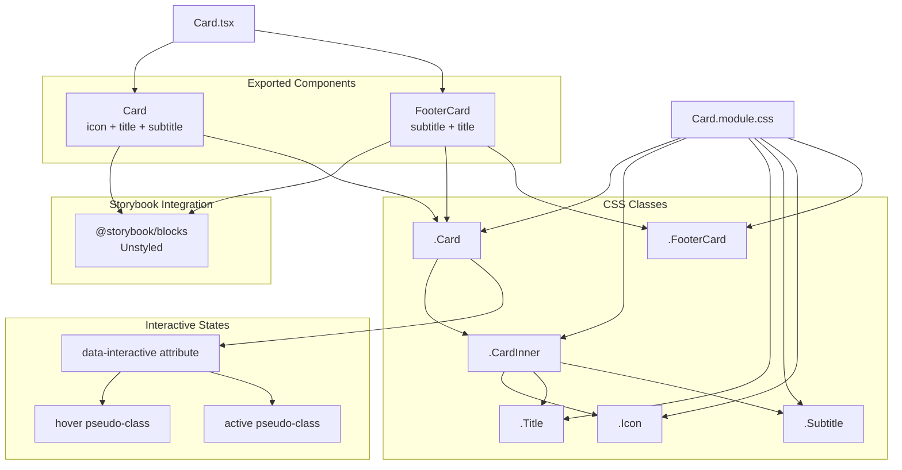
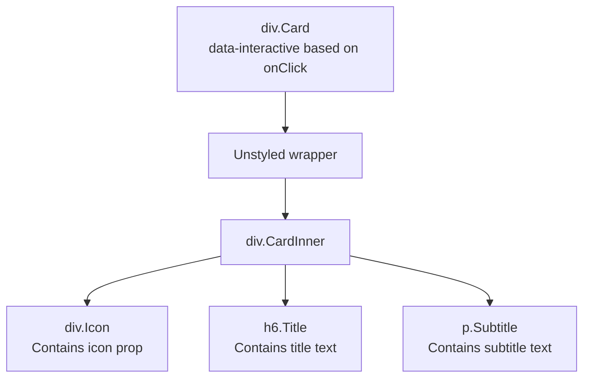
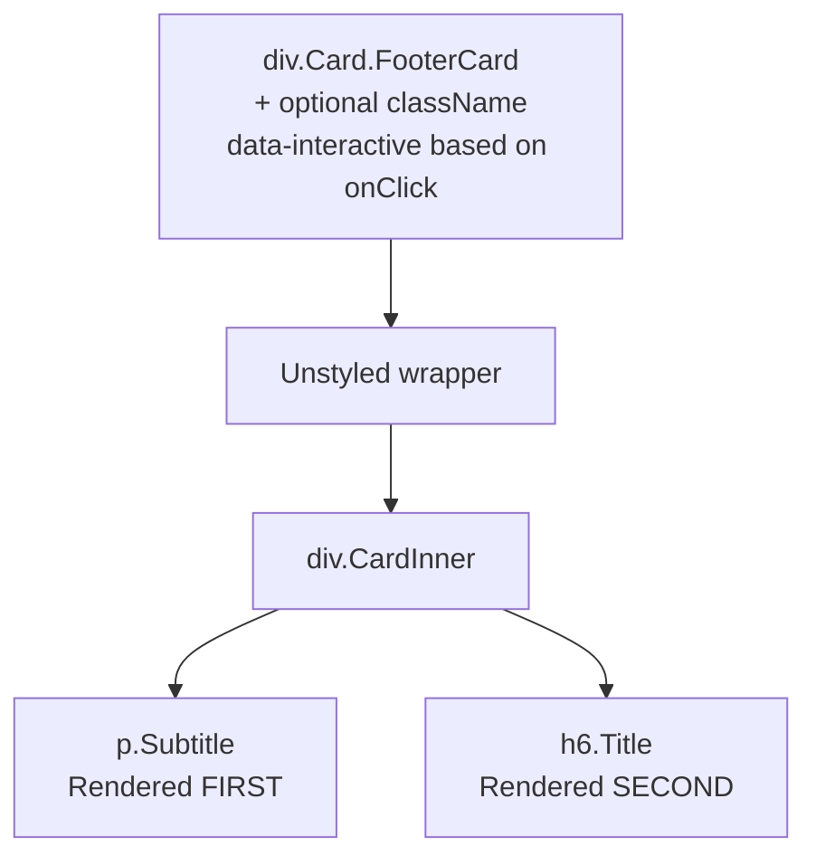
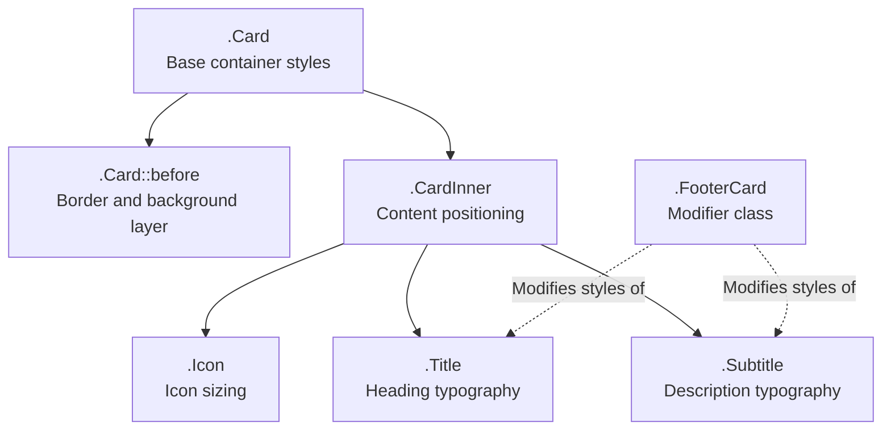
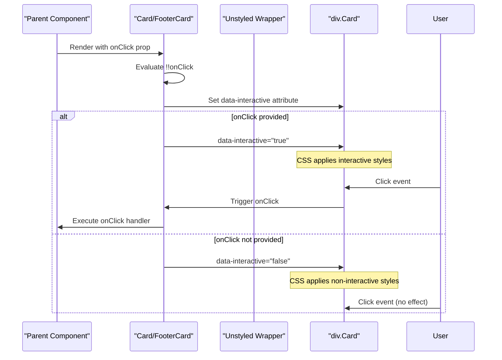

<!-- source: DeepWiki mcp.deepwiki.com · repo openai/apps-sdk-ui · page 6.1 Card Components · fetched 2026-10-26 -->

# Card Components

Relevant source files

The following files were used as context for generating this wiki page:

- [.storybook-base/components/Card.module.css](.storybook-base/components/Card.module.css)
- [.storybook-base/components/Card.tsx](.storybook-base/components/Card.tsx)

## Purpose and Scope

This document covers the Card component system located in [.storybook-base/components/Card.tsx]() and [.storybook-base/components/Card.module.css](). The system provides two specialized card components—`Card` and `FooterCard`—used throughout the Storybook documentation pages for displaying structured content blocks and navigation elements.

For information about the design tokens used in card styling, see [Design Tokens](#5.1). For information about the NextPrev navigation component that uses FooterCard, see [Navigation Components](#6.7).

---

## Component Architecture

The card system consists of two React components sharing a common styling foundation but differing in layout and semantic purpose.

**Sources:** [.storybook-base/components/Card.tsx:1-54](), [.storybook-base/components/Card.module.css:1-71]()

---

## Card Component

### Props Interface

The `Card` component accepts the following props:

| Prop | Type | Required | Description |
|------|------|----------|-------------|
| `icon` | `React.ReactNode` | Yes | Icon element displayed at the top of the card |
| `title` | `string` | Yes | Primary heading text |
| `subtitle` | `string` | Yes | Secondary descriptive text |
| `onClick` | `() => void` | No | Click handler; when provided, card becomes interactive |

**Sources:** [.storybook-base/components/Card.tsx:5-14]()

### Component Structure

The `Card` component renders with the following hierarchy:

The component wraps content in Storybook's `Unstyled` component to prevent inherited documentation styles from affecting the card's appearance.

**Sources:** [.storybook-base/components/Card.tsx:16-27]()

---

## FooterCard Component

### Props Interface

The `FooterCard` component is a variant designed for navigation elements with a simplified structure:

| Prop | Type | Required | Description |
|------|------|----------|-------------|
| `className` | `string` | No | Additional CSS class to apply to the card |
| `title` | `string` | Yes | Primary heading text |
| `subtitle` | `string` | Yes | Secondary descriptive text (rendered above title) |
| `onClick` | `() => void` | No | Click handler; when provided, card becomes interactive |

**Sources:** [.storybook-base/components/Card.tsx:29-38]()

### Component Structure

`FooterCard` differs from `Card` by omitting the icon and reversing the order of subtitle and title:

This reversed ordering creates a visual hierarchy suited for navigation elements where the label (subtitle) should appear before the destination (title).

**Sources:** [.storybook-base/components/Card.tsx:40-54]()

---

## Styling Architecture

### CSS Module Structure

The card styling is implemented using CSS modules with the following class hierarchy:

**Sources:** [.storybook-base/components/Card.module.css:1-71]()

### Base Card Styles

The `.Card` class provides the foundation for both components:

| Property | Value | Purpose |
|----------|-------|---------|
| `position` | `relative` | Positions the `::before` pseudo-element |
| `flex` | `1` | Allows card to grow in flex containers |
| `padding` | `20px` | Internal spacing |
| `border-radius` | `var(--radius-md)` | Rounded corners using design token |
| `user-select` | `none` | Prevents text selection on interactive cards |

The `::before` pseudo-element [.storybook-base/components/Card.module.css:8-18]() creates a separate layer for borders and hover effects:

- Uses `position: absolute` with `inset: 0` to cover the entire card
- Applies a 1px border with `var(--alpha-12)` color
- Provides smooth transitions for `background-color` and `transform` (0.15s ease)

**Sources:** [.storybook-base/components/Card.module.css:1-18]()

### Interactive States

Cards have two interactive modes controlled by the `data-interactive` attribute:

#### Non-Interactive State

When `data-interactive="false"` [.storybook-base/components/Card.module.css:20-22]():
- The `::before` pseudo-element has `opacity: 0.6`
- No cursor change or hover effects
- Visual indicator that the card is static content

#### Interactive State

When `data-interactive="true"` [.storybook-base/components/Card.module.css:24-38]():

| State | Effect | Implementation |
|-------|--------|----------------|
| Default | `cursor: pointer` | Indicates clickability |
| Hover | Background overlay | `background-color: light-dark(var(--alpha-02), var(--alpha-04))` |
| Active | Scale animation | `transform: scale(0.98)` on the `::before` element |

The hover effect uses the `light-dark()` CSS function to automatically select appropriate alpha values based on the current theme.

**Sources:** [.storybook-base/components/Card.module.css:20-38]()

### Typography Styles

#### Title Element

The `.Title` class [.storybook-base/components/Card.module.css:45-54]():
- Uses `font-size: 18px` with `font-weight: var(--font-weight-semibold)`
- Has `margin: 0 0 1px` (1px bottom margin)
- Within `.FooterCard`, margin changes to `3px 0 0` (3px top margin)

#### Subtitle Element

The `.Subtitle` class [.storybook-base/components/Card.module.css:56-65]():
- Uses `color: var(--color-text-secondary)` for visual hierarchy
- Has `font-size: 15px` by default
- Within `.FooterCard`, reduces to `font-size: 14px`

#### Icon Element

The `.Icon` class [.storybook-base/components/Card.module.css:67-70]():
- Sets `font-size: 24px` for consistent icon sizing
- Has `margin: 0 0 8px` (8px bottom spacing)

**Sources:** [.storybook-base/components/Card.module.css:45-70]()

---

## Component Behavior

### Click Handling

Both components implement the same click handling pattern:

The `onClick` prop is directly attached to the outer `div` element [.storybook-base/components/Card.tsx:17](), and the `data-interactive` attribute is set using the boolean coercion `!!onClick` [.storybook-base/components/Card.tsx:17]().

**Sources:** [.storybook-base/components/Card.tsx:17](), [.storybook-base/components/Card.tsx:44]()

### Design Token Integration

The card components rely on CSS custom properties (design tokens) for consistent theming:

| Token | Usage | Defined In |
|-------|-------|------------|
| `--radius-md` | Border radius | Design token system |
| `--alpha-12` | Border color | Design token system |
| `--alpha-02` | Light mode hover overlay | Design token system |
| `--alpha-04` | Dark mode hover overlay | Design token system |
| `--color-text-secondary` | Subtitle text color | Design token system |
| `--font-weight-semibold` | Title font weight | Design token system |

These tokens ensure cards automatically adapt to theme changes without component-level modifications. For complete token documentation, see [Design Tokens](#5.1).

**Sources:** [.storybook-base/components/Card.module.css:5,11,29,59,49]()

---

## Usage Context

The card components are used in the following contexts within the Storybook documentation:

### NextPrev Navigation

The `FooterCard` component is specifically designed for and used by the `NextPrev` navigation component (see [Navigation Components](#6.7)), which displays previous/next page links at the bottom of documentation pages. The reversed order of subtitle and title provides optimal visual hierarchy for navigation labels and destinations.

### General Documentation Cards

The standard `Card` component with icon support is used for displaying feature overviews, component showcases, and other structured content blocks throughout the documentation.

**Sources:** [.storybook-base/components/Card.tsx:1-54]()

---

