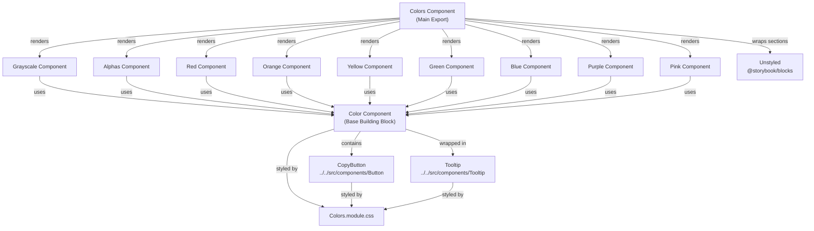
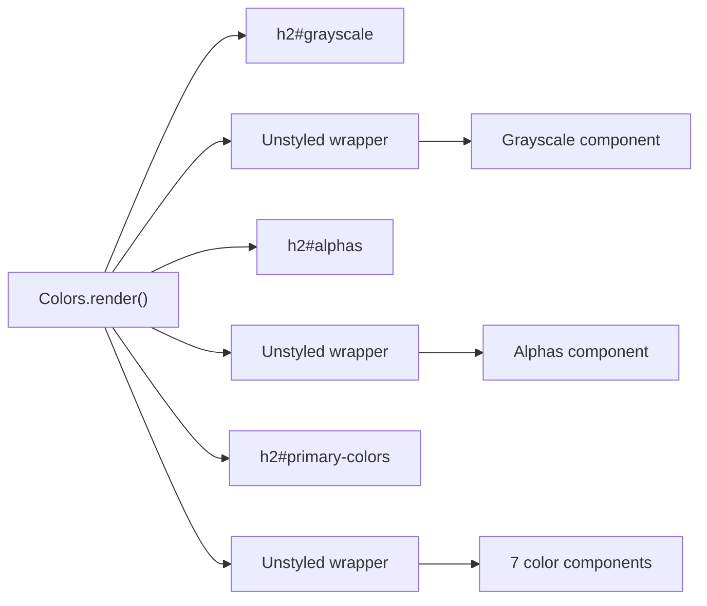
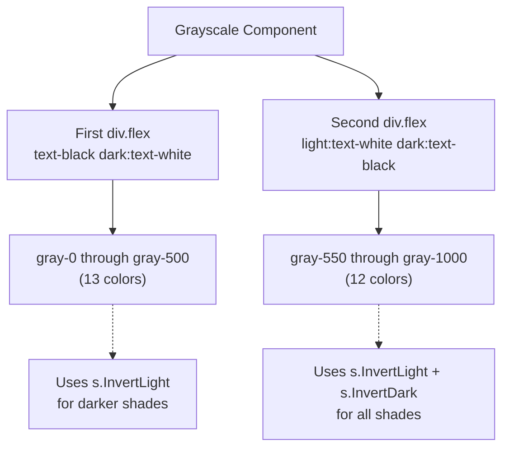
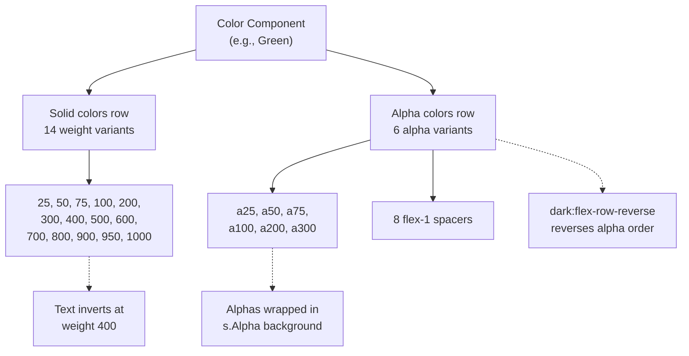
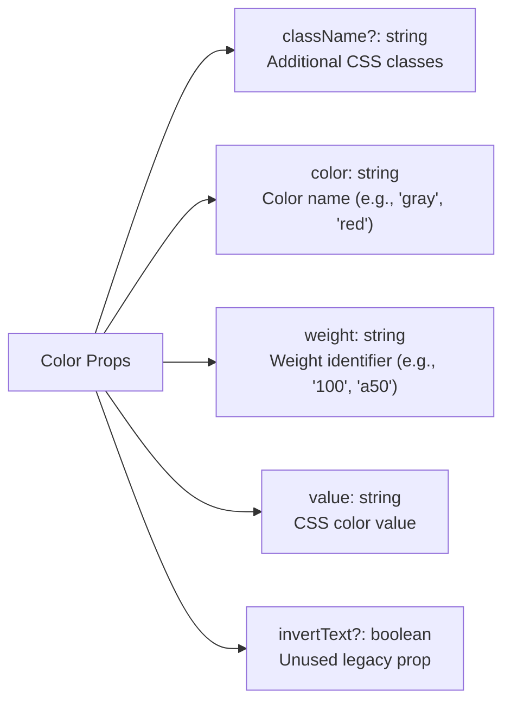
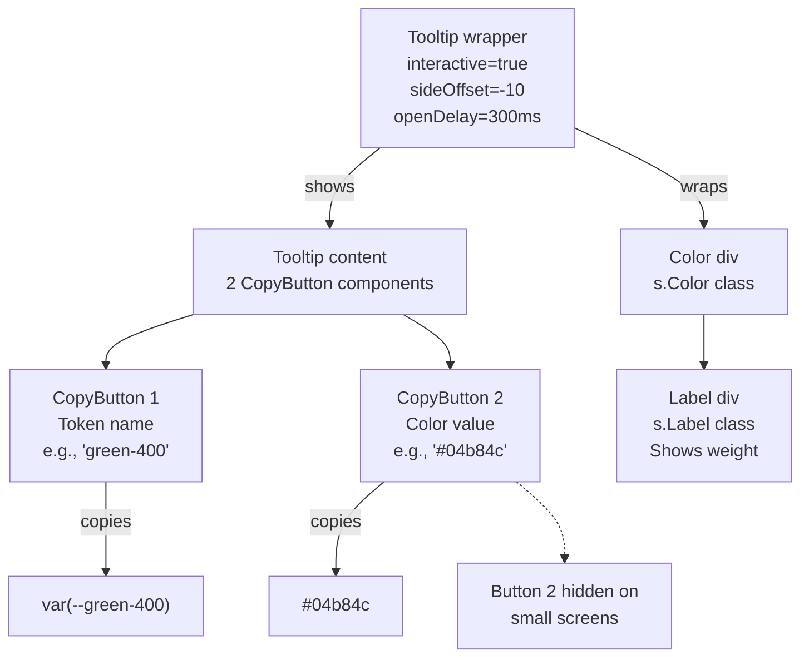
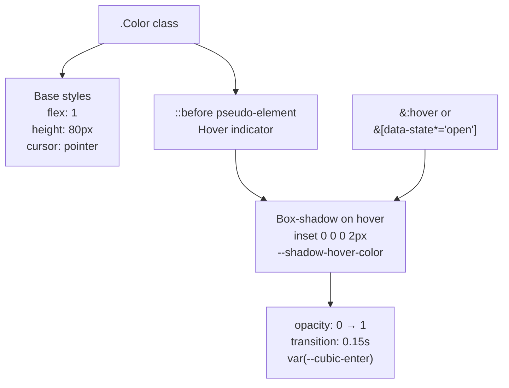
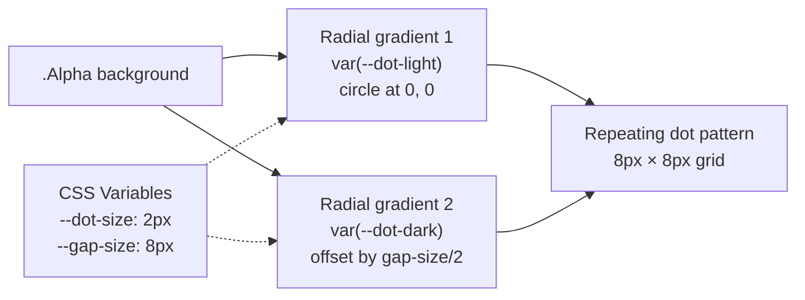
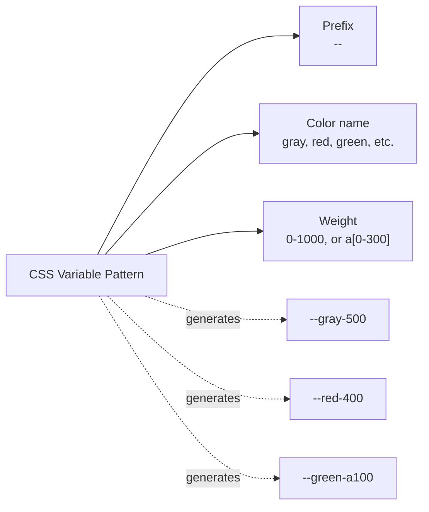
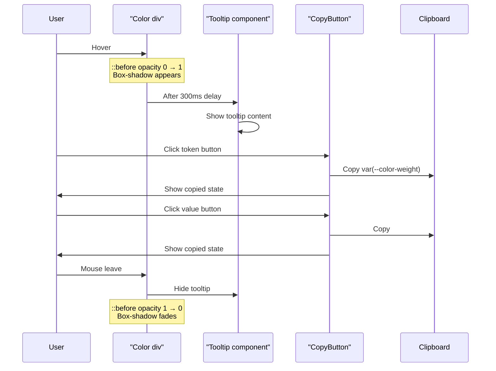

<!-- source: DeepWiki mcp.deepwiki.com · repo openai/apps-sdk-ui · page 6.2 Colors Component · fetched 2026-10-26 -->

# Colors Component

<details>
<summary>Relevant source files</summary>

The following files were used as context for generating this wiki page:

- [.storybook-base/components/Colors.module.css](.storybook-base/components/Colors.module.css)
- [.storybook-base/components/Colors.tsx](.storybook-base/components/Colors.tsx)
- [.storybook-base/components/tokens.ts](.storybook-base/components/tokens.ts)

</details>


The Colors component is an interactive documentation component that displays the complete color palette of the design system. It renders color swatches organized by category (grayscale, alphas, and primary colors) with copy-to-clipboard functionality for both CSS variable names and raw color values. This component is specifically designed for use in Storybook documentation pages to help developers explore and reference the color system.

For information about the underlying design token definitions, see [Design Tokens](#5.1). For general documentation component architecture, see [Documentation Components](#6).

---

## Component Architecture

The Colors component is structured as a hierarchical system of React components, each responsible for rendering a specific color category.



**Sources:** [.storybook-base/components/Colors.tsx:1-620]()

---

## Main Colors Component

The `Colors` component serves as the orchestrator, rendering section headers and delegating to specialized color category components.

### Structure

| Element | Purpose |
|---------|---------|
| `<h2 id="grayscale">` | Section header with anchor link |
| `<Unstyled>` wrapper | Removes Storybook's default styling |
| `<Grayscale />` | Renders grayscale color swatches |
| `<h2 id="alphas">` | Alpha transparency section header |
| `<Alphas />` | Renders alpha channel color swatches |
| `<h2 id="primary-colors">` | Primary colors section header |
| Color components | Red, Orange, Yellow, Green, Blue, Purple, Pink |

### Implementation



The `Unstyled` component from `@storybook/blocks` is used to prevent Storybook's default prose styling from affecting the color swatches.

**Sources:** [.storybook-base/components/Colors.tsx:7-30]()

---

## Color Category Components

Each color category (Grayscale, Alphas, and primary colors like Red, Green, etc.) follows a consistent structure.

### Grayscale Component

The Grayscale component renders 25 shades from white to black, organized into two rows based on text color inversion requirements.



The two rows separate at `gray-500`, which is the midpoint where text color needs to invert from black to white for readability.

**Sources:** [.storybook-base/components/Colors.tsx:32-141]()

### Alphas Component

Alphas display transparent colors with a special dotted background pattern to visualize transparency.

| Weight | Alpha Value | CSS Variable |
|--------|-------------|--------------|
| 0 | 0% | `alpha(var(--alpha-base), 0%)` |
| 02-50 | 2%-50% | Various percentages |

Each alpha swatch is wrapped in a `div` with the `s.Alpha` class, which applies a radial gradient dot pattern background [.storybook-base/components/Colors.module.css:63-85]().

**Sources:** [.storybook-base/components/Colors.tsx:142-200]()

### Primary Color Components

Each primary color (Red, Orange, Yellow, Green, Blue, Purple, Pink) follows this structure:



The spacers maintain consistent layout between solid and alpha rows.

**Sources:** [.storybook-base/components/Colors.tsx:202-557]()

---

## Base Color Component

The `Color` component is the fundamental building block that renders individual color swatches.

### Props Interface



### Token Construction

The component constructs CSS variable references from props:

| Step | Operation | Example |
|------|-----------|---------|
| 1. Combine | `${color}-${weight}` | `"green-400"` |
| 2. Variable | `` var(--${token}) `` | `"var(--green-400)"` |
| 3. Apply | Set as `backgroundColor` | Rendered as background |

**Sources:** [.storybook-base/components/Colors.tsx:559-619]()

### Interactive Features



The tooltip provides two copy targets:
1. **CSS variable name** (e.g., `var(--green-400)`) - Always visible
2. **Raw color value** (e.g., `#04b84c`) - Hidden on small screens via `.TooltipValue` class

**Sources:** [.storybook-base/components/Colors.tsx:575-617](), [.storybook-base/components/Colors.module.css:99-105]()

---

## Styling System

The CSS module provides sophisticated styling for color presentation and interaction.

### Color Swatch Styling



The hover effect uses an absolutely positioned `::before` element with an inset box-shadow, creating a border effect without affecting layout.

**Sources:** [.storybook-base/components/Colors.module.css:1-27]()

### Theme-Aware Text Inversion

| Class | Light Theme | Dark Theme | Purpose |
|-------|-------------|------------|---------|
| `.InvertLight` | `color: var(--white)` | No change | Invert text on dark backgrounds |
| `.InvertDark` | No change | `color: var(--black)` | Invert text on light backgrounds |
| `.InvertDarkHover` | `--shadow-hover-color: rgb(255 255 255 / 50%)` | Same | Adjust hover indicator |
| `.LightColorBorder` | `box-shadow: inset 0 0 0 1px var(--gray-50)` | No change | Border for light colors |

The `@mixin light` and `@mixin dark` directives ensure proper text contrast across themes.

**Sources:** [.storybook-base/components/Colors.module.css:29-53]()

### Alpha Transparency Visualization

The `.Alpha` class creates a checkerboard pattern to show transparency:



The two radial gradients are offset by half the gap size to create a staggered dot pattern.

**Sources:** [.storybook-base/components/Colors.module.css:63-85]()

### CopyButton Customization

```css
.CopyButton {
  flex-direction: row-reverse;  /* Icon after text */
  gap: 6px;
  border-radius: var(--radius-sm);
  font-family: var(--font-mono);
  font-weight: var(--font-weight-medium);
  
  svg {
    opacity: 0.75;  /* Subtle icon */
  }
}
```

The button uses a monospace font to clearly display CSS variable names and color values.

**Sources:** [.storybook-base/components/Colors.module.css:87-97]()

---

## Color Value System

The component references CSS variables that follow a consistent naming convention.

### Variable Naming Pattern



### Weight Scale

| Weight Range | Description | Text Color |
|-------------|-------------|------------|
| 0-350 | Very light shades | Black text |
| 400-500 | Mid-range shades | Transition zone |
| 550-1000 | Very dark shades | White text |

Alpha weights use the `a` prefix (e.g., `a25`, `a50`) and represent percentage opacity.

### Color-Specific Values

Each color component hardcodes its values using CSS color functions:

```
light-dark(lightValue, darkValue)
```

For example, `gray-100` is defined as:
```
light-dark(#ededed, #181818)
```

This allows the same variable to resolve to different values based on the active theme.

**Sources:** [.storybook-base/components/Colors.tsx:39-619]()

---

## Usage in Storybook

The Colors component integrates with Storybook's documentation system through specific patterns.

### MDX Integration

```markdown
import { Colors } from '.storybook-base/components/Colors'

<Colors />
```

The component automatically renders all color categories with section headers that include anchor IDs for direct linking:
- `#grayscale`
- `#alphas`  
- `#primary-colors`

### Unstyled Wrapper Pattern

Each major section wraps its content in `<Unstyled>` from `@storybook/blocks`:

```jsx
<Unstyled>
  <Grayscale />
</Unstyled>
```

This prevents Storybook's default documentation styles (prose typography, spacing) from interfering with the custom grid layouts.

**Sources:** [.storybook-base/components/Colors.tsx:11-27]()

---

## Dependencies

```mermaid
graph TD
    ColorsComponent[".storybook-base/components/Colors.tsx"]
    
    CSS[".storybook-base/components/Colors.module.css"]
    Unstyled["@storybook/blocks<br/>Unstyled"]
    CopyButton["../../src/components/Button<br/>CopyButton"]
    Tooltip["../../src/components/Tooltip<br/>Tooltip"]
    clsx["clsx<br/>Class name utility"]
    
    ColorsComponent -->|imports styles| CSS
    ColorsComponent -->|imports| Unstyled
    ColorsComponent -->|imports| CopyButton
    ColorsComponent -->|imports| Tooltip
    ColorsComponent -->|imports| clsx
    
    CSSVars["CSS Variables<br/>Defined globally"]
    
    ColorsComponent -.->|references via var()| CSSVars
```

| Dependency | Source | Purpose |
|-----------|--------|---------|
| `Colors.module.css` | Local | Component styling |
| `Unstyled` | `@storybook/blocks` | Remove default prose styling |
| `CopyButton` | `../../src/components/Button` | Copy-to-clipboard functionality |
| `Tooltip` | `../../src/components/Tooltip` | Interactive hover information |
| `clsx` | npm package | Conditional class name composition |

**Sources:** [.storybook-base/components/Colors.tsx:1-5]()

---

## Interactive Behavior

### Hover State Flow



The 300ms delay (`openDelay={300}`) prevents tooltip spam during quick mouse movements.

**Sources:** [.storybook-base/components/Colors.tsx:576-609](), [.storybook-base/components/Colors.module.css:11-26]()

---

## Responsive Design

### Tooltip Value Visibility

The second CopyButton (showing raw color values) is conditionally displayed based on screen size:

```css
.TooltipValue {
  display: none;  /* Hidden on mobile */
  
  @mixin breakpoint md {
    display: block;  /* Visible on tablet+ */
  }
}
```

This prevents tooltip overflow on smaller screens while maintaining full functionality on larger displays.

**Sources:** [.storybook-base/components/Colors.module.css:99-105]()

### Color Grid Flexibility

All color rows use `display: flex` with `flex: 1` on individual color swatches, allowing the grid to adapt to container width while maintaining equal-width columns.

---

## Color Data Summary

The component renders the following color categories:

| Category | Count | Structure |
|----------|-------|-----------|
| Grayscale | 25 colors | 2 rows (split at weight 500) |
| Alphas | 16 variants | 1 row with dotted background |
| Red | 14 solid + 6 alpha | 2 rows per color |
| Orange | 14 solid + 6 alpha | 2 rows per color |
| Yellow | 14 solid + 6 alpha | 2 rows per color |
| Green | 14 solid + 6 alpha | 2 rows per color |
| Blue | 14 solid + 6 alpha | 2 rows per color |
| Purple | 14 solid + 6 alpha | 2 rows per color |
| Pink | 14 solid + 6 alpha | 2 rows per color |

**Total: 157 interactive color swatches**

**Sources:** [.storybook-base/components/Colors.tsx:7-620]()

---

