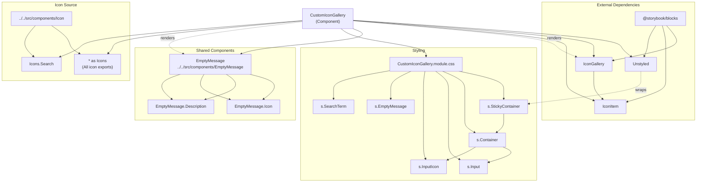
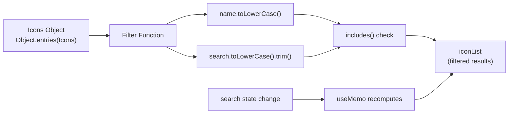
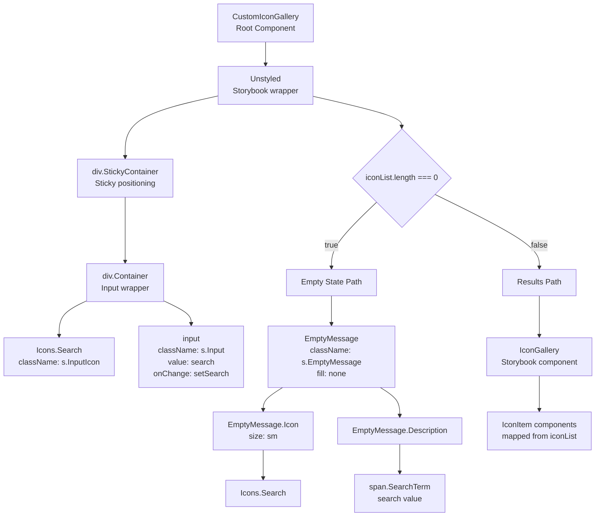
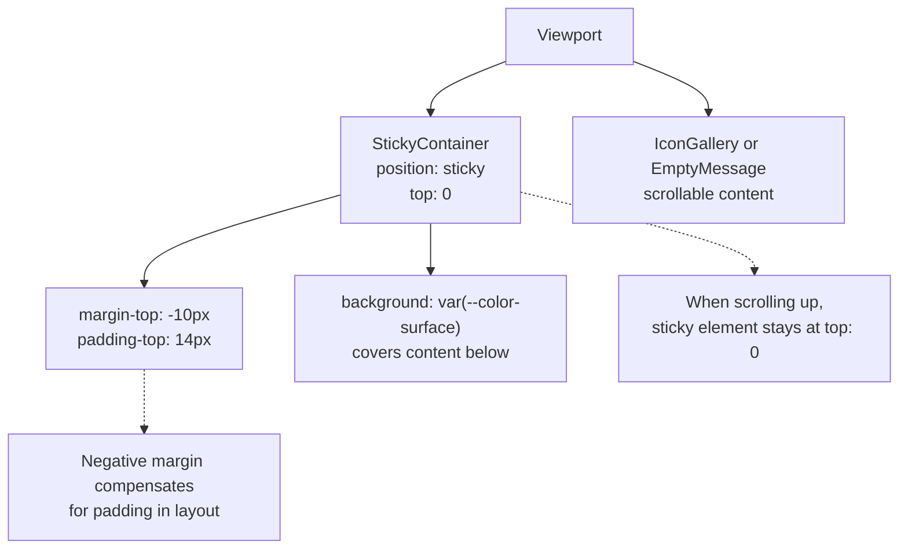
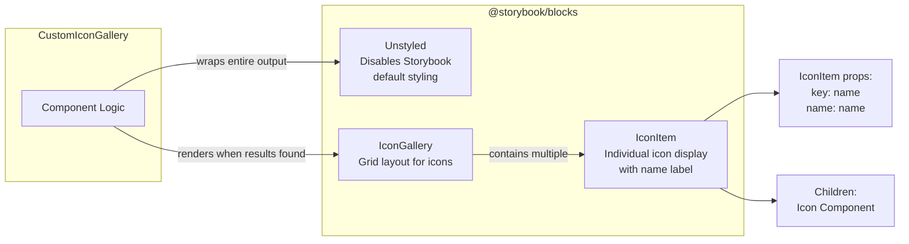
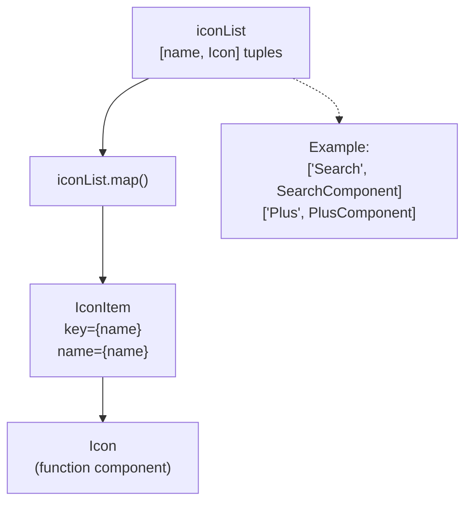
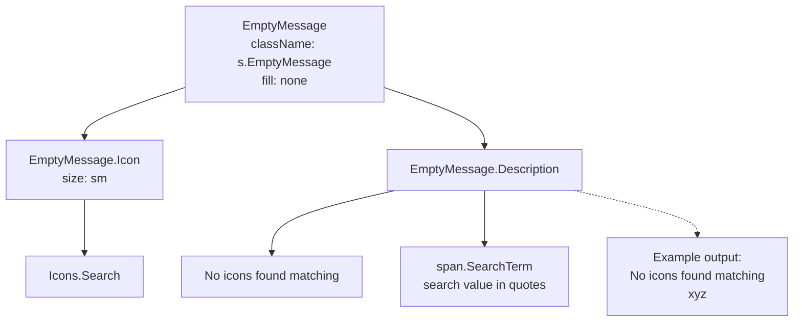

<!-- source: DeepWiki mcp.deepwiki.com · repo openai/apps-sdk-ui · page 6.4 Icon Gallery Component · fetched 2026-10-26 -->

# Icon Gallery Component

Relevant source files

The following files were used as context for generating this wiki page:

- [.storybook-base/components/CustomIconGallery.module.css](.storybook-base/components/CustomIconGallery.module.css)
- [.storybook-base/components/CustomIconGallery.tsx](.storybook-base/components/CustomIconGallery.tsx)

## Purpose and Scope

The Icon Gallery Component provides a searchable, filterable interface for browsing the icon library in Storybook documentation. This component is built specifically for displaying icon collections with real-time search capabilities and empty state handling.

For information about other documentation components, see [Documentation Components](#6). For details about the design tokens and color displays, see [Colors Component](#6.2).

**Sources:** [.storybook-base/components/CustomIconGallery.tsx:1-50]()

---

## Component Architecture

The `CustomIconGallery` component integrates Storybook's native icon display blocks with custom search functionality and styling. The following diagram shows the key dependencies and data flow:

**Sources:** [.storybook-base/components/CustomIconGallery.tsx:1-6](), [.storybook-base/components/CustomIconGallery.module.css:1-56]()

---

## Search Functionality

### State Management

The component uses React's `useState` hook to track the search input value and `useMemo` for performance-optimized filtering:

| Hook | State Variable | Purpose |
|------|---------------|---------|
| `useState` | `search` | Stores the current search query string |
| `useMemo` | `iconList` | Caches filtered icon entries to avoid re-computation |

**Sources:** [.storybook-base/components/CustomIconGallery.tsx:8-15]()

### Filtering Algorithm

The filtering logic processes icon names using a case-insensitive substring match:

The filtering implementation at [.storybook-base/components/CustomIconGallery.tsx:10-13]():
- Converts icon names to lowercase
- Converts search term to lowercase and trims whitespace
- Uses `String.includes()` for substring matching
- Dependencies array `[search]` ensures recomputation only when search changes

**Sources:** [.storybook-base/components/CustomIconGallery.tsx:9-15]()

---

## Component Render Tree

The component renders different UI trees based on the search results:

**Sources:** [.storybook-base/components/CustomIconGallery.tsx:17-49]()

---

## Styling System

### CSS Module Classes

The component uses CSS modules for scoped styling. The following table describes each class and its purpose:

| Class Name | Purpose | Key Properties |
|------------|---------|----------------|
| `.StickyContainer` | Keeps search input visible during scroll | `position: sticky`, `top: 0`, `background: var(--color-surface)` |
| `.Container` | Positions search icon relative to input | `position: relative` |
| `.Input` | Styled search input field | `padding: 12px 20px 12px 44px`, border styling, transitions |
| `.InputIcon` | Absolutely positioned search icon | `position: absolute`, `left: 16px`, `top: 50%`, `margin-top: -9px` |
| `.EmptyMessage` | Spacing for empty state | `padding-top: 30px` |
| `.SearchTerm` | Emphasis for search term in empty message | `font-weight: var(--font-weight-semibold)` |

**Sources:** [.storybook-base/components/CustomIconGallery.module.css:1-56]()

### Sticky Positioning Implementation

The search input remains visible as users scroll through icon results:

The sticky positioning at [.storybook-base/components/CustomIconGallery.module.css:1-7]() combines:
- `position: sticky` and `top: 0` to anchor at viewport top
- Negative `margin-top: -10px` with compensating `padding-top: 14px` for layout adjustment
- `background: var(--color-surface)` to cover content scrolling underneath

**Sources:** [.storybook-base/components/CustomIconGallery.module.css:1-7]()

### Input Field Styling

The search input field provides visual feedback for different interaction states:

| State | Styling |
|-------|---------|
| Default | `border: 1px solid var(--alpha-10)` |
| Hover | `border-color: var(--alpha-15)` |
| Focus | `border-color: var(--alpha-20)`, `outline: 0` |
| Placeholder | `color: var(--color-text-tertiary)` |

The input uses `padding-left: 44px` to accommodate the search icon positioned at `left: 16px` with `width: 18px` [.storybook-base/components/CustomIconGallery.module.css:13-47]().

**Sources:** [.storybook-base/components/CustomIconGallery.module.css:13-47]()

---

## Integration with Storybook Blocks

### Storybook Components Usage

The component leverages three Storybook block components:

**Sources:** [.storybook-base/components/CustomIconGallery.tsx:1](), [.storybook-base/components/CustomIconGallery.tsx:18](), [.storybook-base/components/CustomIconGallery.tsx:40-46]()

### Icon Rendering Logic

The component maps over filtered icon entries to render individual icons:

The mapping implementation at [.storybook-base/components/CustomIconGallery.tsx:41-45]():
- Destructures each entry as `[name, Icon]`
- Uses `name` as both the key and the displayed name
- Renders the Icon component as a child of IconItem

**Sources:** [.storybook-base/components/CustomIconGallery.tsx:40-46]()

---

## Empty State Handling

When no icons match the search query, the component displays a user-friendly empty state:

The empty state implementation at [.storybook-base/components/CustomIconGallery.tsx:31-38]():
- Uses `EmptyMessage` component from shared UI components
- Displays a small search icon
- Shows the search term in bold using `.SearchTerm` class
- Only renders when `iconList.length === 0`

**Sources:** [.storybook-base/components/CustomIconGallery.tsx:30-39](), [.storybook-base/components/CustomIconGallery.module.css:49-55]()

---

## Performance Optimization

The component implements memoization to prevent unnecessary re-computation of filtered results:

| Optimization | Implementation | Benefit |
|--------------|----------------|---------|
| `useMemo` hook | Wraps icon filtering logic | Only recomputes when `search` changes |
| Dependency array | `[search]` | Prevents recalculation on unrelated re-renders |
| Case conversion | Performed once per icon during filter | Single conversion instead of repeated operations |

The memoization at [.storybook-base/components/CustomIconGallery.tsx:9-15]() ensures that filtering `Object.entries(Icons)` only occurs when the search term changes, not on every render.

**Sources:** [.storybook-base/components/CustomIconGallery.tsx:9-15]()

---

