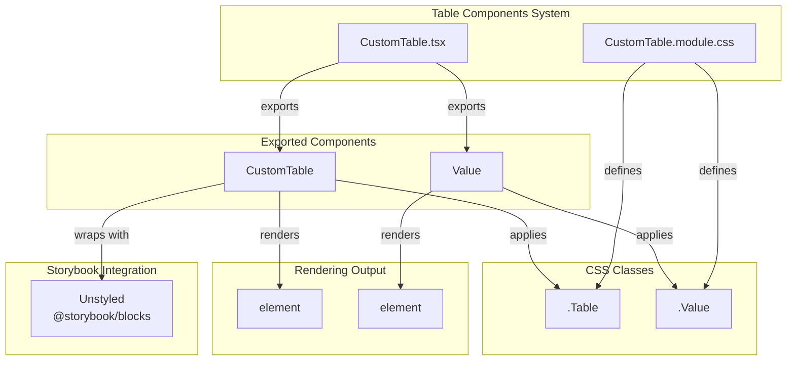
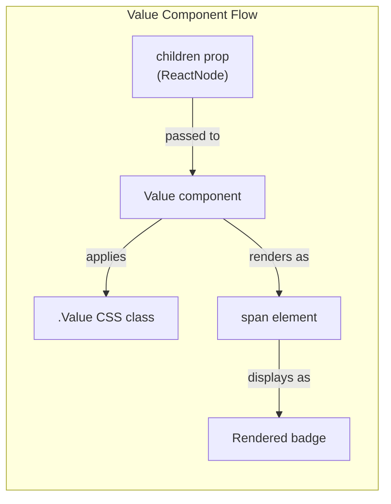
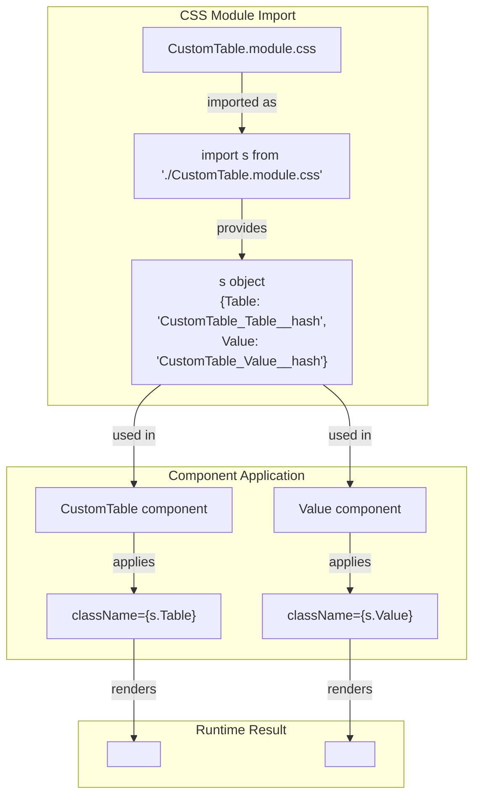
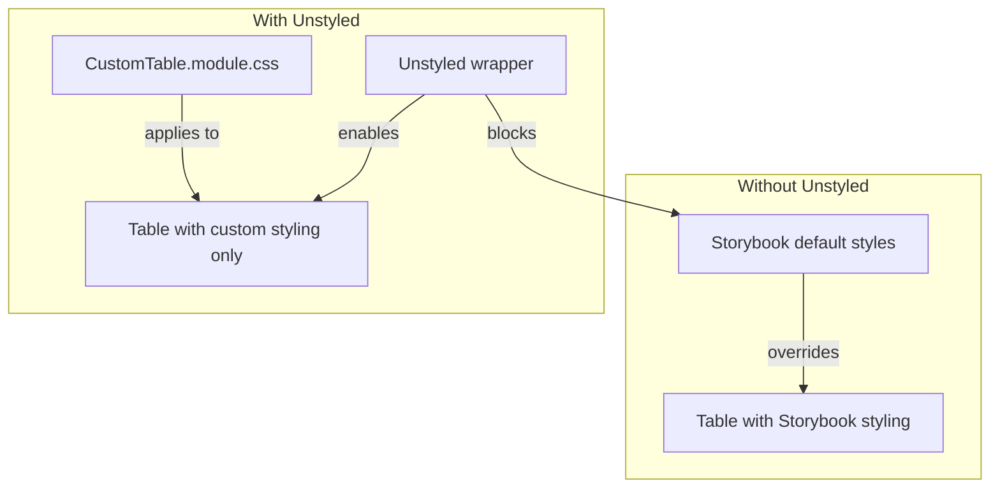

<!-- source: DeepWiki mcp.deepwiki.com · repo openai/apps-sdk-ui · page 6.5 Table Components · fetched 2026-10-26 -->

# Table Components

<details>
<summary>Relevant source files</summary>

The following files were used as context for generating this wiki page:

- [.storybook-base/components/CustomTable.module.css](.storybook-base/components/CustomTable.module.css)
- [.storybook-base/components/CustomTable.tsx](.storybook-base/components/CustomTable.tsx)

</details>


## Purpose and Scope

This document covers the table-related components used in Storybook documentation pages. The Table Components system provides two primary exports: `CustomTable` for rendering styled table elements and `Value` for displaying inline values with consistent formatting.

For information about other documentation components, see:
- Card-based content display: [Card Components](#6.1)
- Interactive color palettes: [Colors Component](#6.2)
- Icon browsing: [Icon Gallery Component](#6.4)

---

## Component Architecture

The Table Components system consists of two React components that work together to provide styled table rendering within Storybook's documentation environment.



**Component Architecture Diagram**: Shows the relationship between source files, exported components, Storybook integration, CSS classes, and rendered HTML elements.

**Sources:** [.storybook-base/components/CustomTable.tsx:1-16](), [.storybook-base/components/CustomTable.module.css:1-28]()

---

## CustomTable Component

The `CustomTable` component provides a styled table wrapper that integrates with Storybook's documentation blocks system.

### Implementation

| Aspect | Details |
|--------|---------|
| **File** | `.storybook-base/components/CustomTable.tsx` |
| **Lines** | 5-11 |
| **Props** | `children: ReactNode` |
| **Wrapper** | `Unstyled` from `@storybook/blocks` |
| **Output** | `<table>` element with `.Table` CSS class |

The component wraps its children with Storybook's `Unstyled` component to prevent default Storybook styling from interfering with custom table styles [.storybook-base/components/CustomTable.tsx:7-8]().

### Styling Characteristics

The `.Table` CSS class applies the following styles [.storybook-base/components/CustomTable.module.css:1-18]():

| Element | Styling |
|---------|---------|
| **Table** | 100% width, 28px top margin, 32px bottom margin |
| **Header cells (`th`)** | 0-6px horizontal padding, 4px bottom padding, tertiary text color, 13px font size, medium weight, left-aligned |
| **Data cells (`td`)** | 12px vertical padding, 6px horizontal padding, 1px top border with `--alpha-10` color, left-aligned |

**Sources:** [.storybook-base/components/CustomTable.tsx:5-11](), [.storybook-base/components/CustomTable.module.css:1-18]()

---

## Value Component

The `Value` component renders inline values with badge-like styling, commonly used within table cells or other documentation contexts to highlight specific values, tokens, or code snippets.

### Implementation Details



**Value Component Data Flow**: Illustrates how the Value component transforms children into a styled span element.

| Property | Value/Behavior |
|----------|----------------|
| **Component Type** | Functional component |
| **Props** | `children: ReactNode` |
| **Element** | `<span>` |
| **CSS Class** | `.Value` |
| **Location** | [.storybook-base/components/CustomTable.tsx:13-15]() |

### Visual Styling

The `.Value` class provides badge-like styling [.storybook-base/components/CustomTable.module.css:20-27]():

| Style Property | Value | Purpose |
|----------------|-------|---------|
| **Padding** | `2px 4px` | Compact spacing around content |
| **Border** | `1px solid var(--alpha-12)` | Subtle outline using theme-aware alpha value |
| **Border Radius** | `var(--radius-sm)` | Rounded corners via design token |
| **Background** | `light-dark(var(--gray-50), var(--alpha-08))` | Theme-adaptive background: light gray in light mode, translucent in dark mode |
| **Font Size** | `13px` | Consistent with table header sizing |
| **Font Weight** | `var(--font-weight-medium)` | Medium emphasis via design token |

The `light-dark()` CSS function enables automatic color switching based on the current theme without requiring JavaScript [.storybook-base/components/CustomTable.module.css:24]().

**Sources:** [.storybook-base/components/CustomTable.tsx:13-15](), [.storybook-base/components/CustomTable.module.css:20-27]()

---

## CSS Module Integration

Both components utilize CSS Modules for scoped styling, preventing class name conflicts with other Storybook or application styles.



**CSS Module Compilation Flow**: Shows how CSS Module classes are transformed from source to runtime.

The import statement [.storybook-base/components/CustomTable.tsx:3]() creates a module object `s` containing scoped class names that are applied via the `className` prop [.storybook-base/components/CustomTable.tsx:8,14]().

**Sources:** [.storybook-base/components/CustomTable.tsx:3](), [.storybook-base/components/CustomTable.module.css:1-28]()

---

## Design Token Integration

The table components integrate with the design system through CSS custom properties (design tokens):

| Token | Usage | Location |
|-------|-------|----------|
| `--color-text-tertiary` | Table header text color | [.storybook-base/components/CustomTable.module.css:7]() |
| `--font-weight-medium` | Table header and Value font weight | [.storybook-base/components/CustomTable.module.css:9,26]() |
| `--alpha-10` | Table cell border color | [.storybook-base/components/CustomTable.module.css:15]() |
| `--alpha-12` | Value component border color | [.storybook-base/components/CustomTable.module.css:22]() |
| `--radius-sm` | Value component border radius | [.storybook-base/components/CustomTable.module.css:23]() |
| `--gray-50` | Value background (light mode) | [.storybook-base/components/CustomTable.module.css:24]() |
| `--alpha-08` | Value background (dark mode) | [.storybook-base/components/CustomTable.module.css:24]() |

These tokens are defined in the design system (see [Design Tokens](#5.1)) and ensure consistent styling across themes.

**Sources:** [.storybook-base/components/CustomTable.module.css:7,9,15,22-26]()

---

## Component Usage Patterns

### Basic Table Structure

The `CustomTable` component expects standard HTML table children (`thead`, `tbody`, `tr`, `th`, `td`):

```
<CustomTable>
  <thead>
    <tr>
      <th>Property</th>
      <th>Value</th>
    </tr>
  </thead>
  <tbody>
    <tr>
      <td>Token</td>
      <td><Value>--color-primary</Value></td>
    </tr>
  </tbody>
</CustomTable>
```

The component automatically applies spacing, borders, and typography styles to create a consistent table appearance across documentation pages.

### Value Component Context

The `Value` component is typically used:
- Within table cells to highlight specific values
- Inline within documentation text to emphasize tokens, variables, or code references
- As a visual separator between regular text and technical identifiers

**Sources:** [.storybook-base/components/CustomTable.tsx:5-15]()

---

## Storybook Integration

The components leverage Storybook's `Unstyled` wrapper [.storybook-base/components/CustomTable.tsx:1,7]() to prevent Storybook's default documentation styles from overriding custom table styling. This is essential because Storybook applies default styles to common HTML elements like tables.



**Styling Isolation Diagram**: Demonstrates how the Unstyled wrapper prevents Storybook's default styles from interfering with custom table styles.

**Sources:** [.storybook-base/components/CustomTable.tsx:1,7]()

---

## File Structure Summary

| File | Purpose | Exports |
|------|---------|---------|
| `.storybook-base/components/CustomTable.tsx` | Component implementations | `CustomTable`, `Value` |
| `.storybook-base/components/CustomTable.module.css` | Scoped CSS styling | `.Table`, `.Value` classes |

Both files are located in the `.storybook-base/components/` directory alongside other documentation components (see [Documentation Components](#6)).

**Sources:** [.storybook-base/components/CustomTable.tsx:1-16](), [.storybook-base/components/CustomTable.module.css:1-28]()

---

