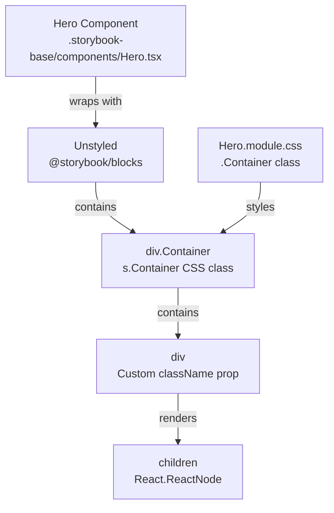
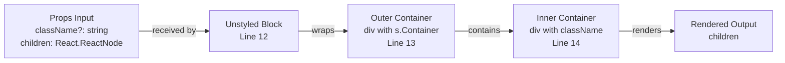
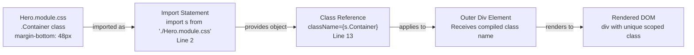
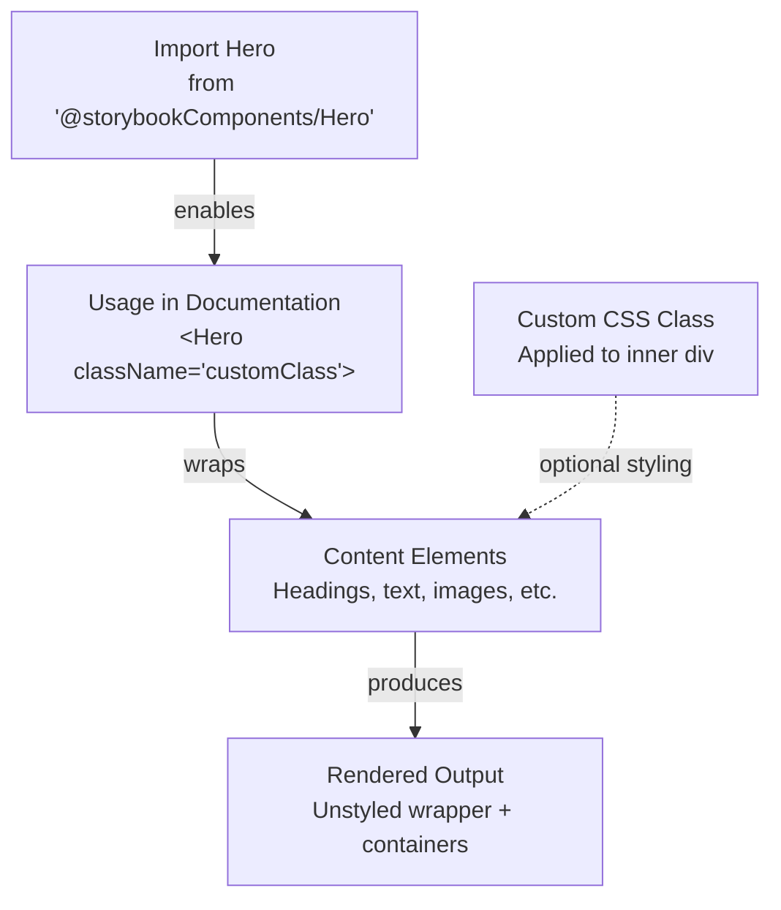
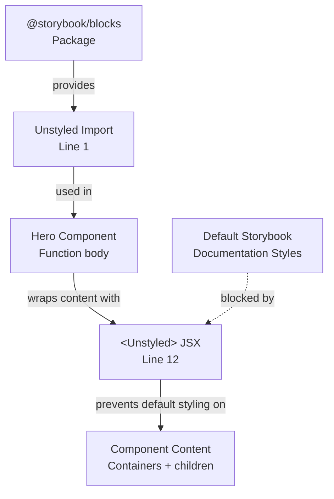

<!-- source: DeepWiki mcp.deepwiki.com · repo openai/apps-sdk-ui · page 6.6 Hero Component · fetched 2026-10-26 -->

# Hero Component

<details>
<summary>Relevant source files</summary>

The following files were used as context for generating this wiki page:

- [.storybook-base/components/Hero.module.css](.storybook-base/components/Hero.module.css)
- [.storybook-base/components/Hero.tsx](.storybook-base/components/Hero.tsx)

</details>


## Purpose and Scope

This document covers the Hero component, a simple wrapper component used to create prominent content sections in Storybook documentation pages. The Hero component provides consistent spacing and integrates with Storybook's styling system through the `Unstyled` block wrapper.

For other documentation components in the same category, see [Card Components](#6.1), [Navigation Components](#6.7), and [Utility Components](#6.8). For the broader design system that influences styling decisions, see [Design System](#5).

---

## Component Overview

The Hero component is a lightweight presentation component located at [.storybook-base/components/Hero.tsx:1-18](). It serves as a container for prominent content sections, typically used at the top of documentation pages or to highlight important information.

### Key Characteristics

| Characteristic | Description |
|---------------|-------------|
| **File Location** | `.storybook-base/components/Hero.tsx` |
| **Styling** | CSS Module (`.storybook-base/components/Hero.module.css`) |
| **Storybook Integration** | Wrapped in `Unstyled` block |
| **Complexity** | Minimal - single-purpose wrapper |
| **Customization** | Accepts custom className for inner content |

**Sources:** [.storybook-base/components/Hero.tsx:1-18]()

---

## Component Structure

The Hero component has a simple two-tier structure with minimal props.

### Component Hierarchy



**Sources:** [.storybook-base/components/Hero.tsx:1-18](), [.storybook-base/components/Hero.module.css:1-4]()

### TypeScript Interface

The component accepts two props:

```typescript
{
  className?: string        // Optional CSS class for inner div
  children: React.ReactNode // Content to render
}
```

**Sources:** [.storybook-base/components/Hero.tsx:4-10]()

---

## Implementation Details

### Component Function

The Hero component is implemented as a functional React component that applies a consistent container structure with optional custom styling.



**Sources:** [.storybook-base/components/Hero.tsx:11-16]()

### Key Implementation Features

1. **Unstyled Block Integration**: The component wraps its entire output in Storybook's `Unstyled` block [.storybook-base/components/Hero.tsx:12](), which prevents Storybook from applying default documentation styling. This gives complete control over the component's appearance.

2. **Two-Layer Structure**: 
   - **Outer Layer** [.storybook-base/components/Hero.tsx:13](): A `div` with the `s.Container` CSS class that applies consistent bottom margin spacing
   - **Inner Layer** [.storybook-base/components/Hero.tsx:14](): A `div` that accepts a custom `className` prop for content-specific styling

3. **Children Rendering**: The `children` prop is rendered directly within the inner container [.storybook-base/components/Hero.tsx:14](), allowing any React content to be displayed.

**Sources:** [.storybook-base/components/Hero.tsx:11-16]()

---

## Styling System

### CSS Module Structure

The Hero component uses a CSS Module with a single class definition:

| Class Name | Property | Value | Purpose |
|-----------|----------|-------|---------|
| `.Container` | `margin-bottom` | `48px` | Provides consistent spacing below hero sections |

**Sources:** [.storybook-base/components/Hero.module.css:1-4]()

### Styling Flow



**Sources:** [.storybook-base/components/Hero.tsx:2](), [.storybook-base/components/Hero.tsx:13](), [.storybook-base/components/Hero.module.css:1-4]()

### Spacing Strategy

The `48px` bottom margin provides visual separation between hero sections and subsequent content. This fixed spacing value maintains consistency across all documentation pages that use the Hero component.

**Sources:** [.storybook-base/components/Hero.module.css:2]()

---

## Usage Pattern

### Basic Usage Example

The Hero component is designed to wrap prominent content sections. The typical usage pattern involves:

1. Importing the Hero component
2. Passing custom className for inner styling (optional)
3. Providing content as children



**Sources:** [.storybook-base/components/Hero.tsx:4-18]()

### Integration Points

The Hero component integrates with other documentation components through:

- **Custom className prop**: Allows parent documentation pages to apply specific styling to the hero's inner content area
- **Children prop**: Accepts any React nodes, enabling composition with other documentation components
- **Unstyled wrapper**: Ensures the hero section is not affected by Storybook's default documentation styling

**Sources:** [.storybook-base/components/Hero.tsx:8-9]()

---

## Storybook Integration

### Unstyled Block Usage

The Hero component leverages Storybook's `Unstyled` block from `@storybook/blocks` [.storybook-base/components/Hero.tsx:1](). This integration is critical for maintaining visual consistency.



**Sources:** [.storybook-base/components/Hero.tsx:1](), [.storybook-base/components/Hero.tsx:12]()

### Purpose of Unstyled Wrapper

The `Unstyled` block serves two key purposes:

1. **Style Isolation**: Prevents Storybook's default documentation styles from being applied to hero content, giving complete control over appearance
2. **Custom Styling**: Allows the Hero component to use its own CSS module styling without conflicts from Storybook's global styles

This approach is consistent with other documentation components in the system (see [Card Components](#6.1) and [Table Components](#6.5)), which also wrap their content in `Unstyled` blocks to maintain styling autonomy.

**Sources:** [.storybook-base/components/Hero.tsx:12-16]()

---

## Design Decisions

### Minimal Complexity

The Hero component intentionally maintains minimal complexity with:

- **Single responsibility**: Acts solely as a spacing and styling container
- **No state management**: Pure presentational component with no internal state
- **No business logic**: Simply renders children with consistent spacing
- **Flexible content**: Accepts any React node as children

This design makes the component easy to understand, test, and maintain while providing the flexibility needed for various documentation use cases.

### Two-Div Structure Rationale

The component uses a two-div structure [.storybook-base/components/Hero.tsx:13-15]() rather than a single div:

- **Outer div**: Applies the standard bottom margin through CSS module
- **Inner div**: Accepts custom className for content-specific styling

This separation allows documentation authors to apply custom styling to the content area without interfering with the component's standard spacing behavior.

**Sources:** [.storybook-base/components/Hero.tsx:11-16]()

---

## Summary

The Hero component is a focused, single-purpose wrapper component that:

- Provides consistent spacing for prominent content sections (48px bottom margin)
- Integrates with Storybook through the `Unstyled` block to avoid style conflicts
- Offers flexibility through the custom `className` prop for inner content styling
- Maintains a simple two-tier div structure for separation of concerns
- Uses CSS Modules for scoped, maintainable styling

**Sources:** [.storybook-base/components/Hero.tsx:1-18](), [.storybook-base/components/Hero.module.css:1-4]()

---

