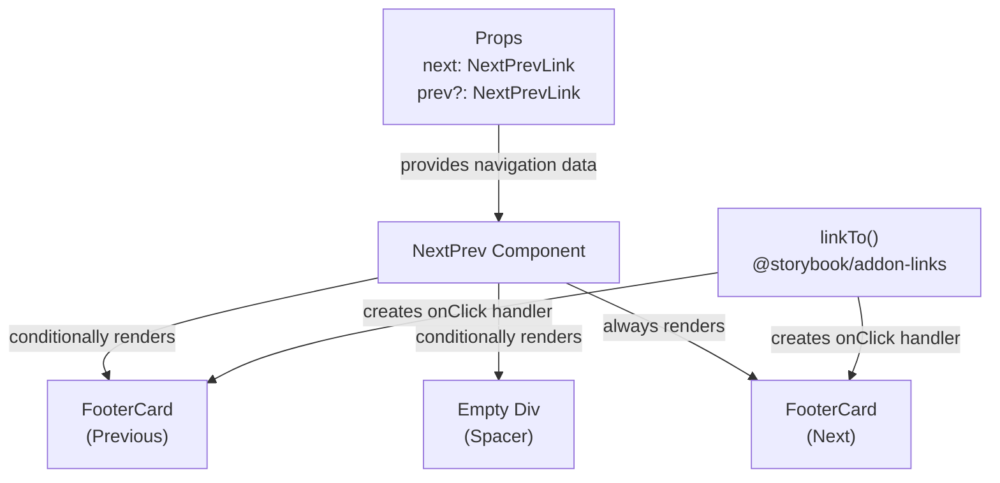
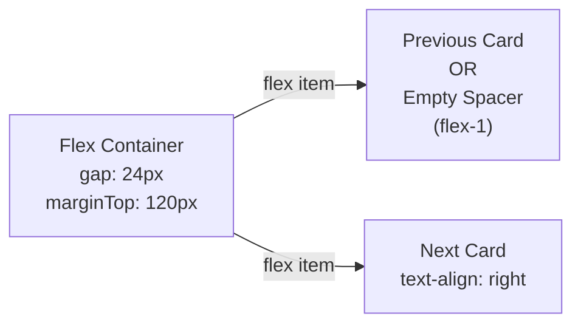
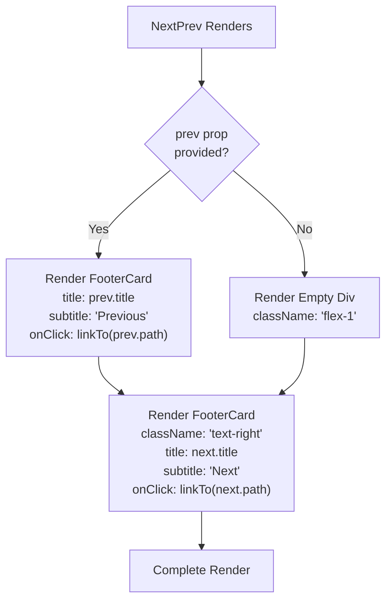
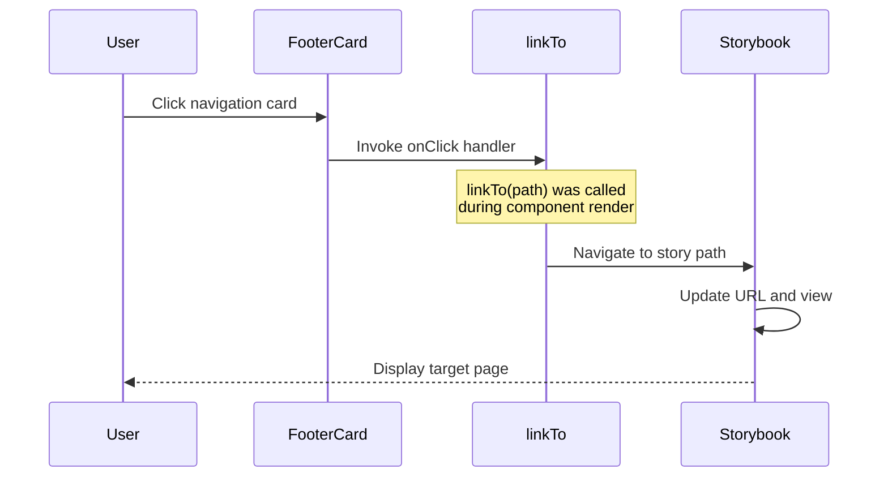
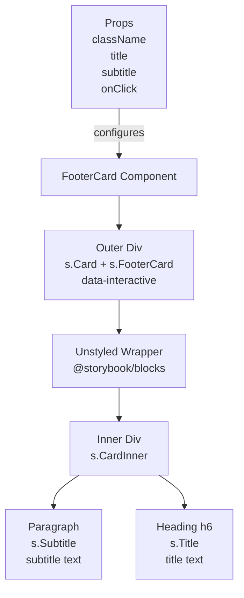
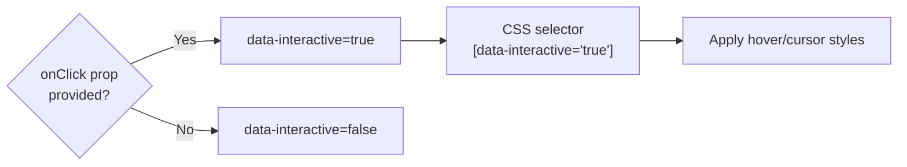
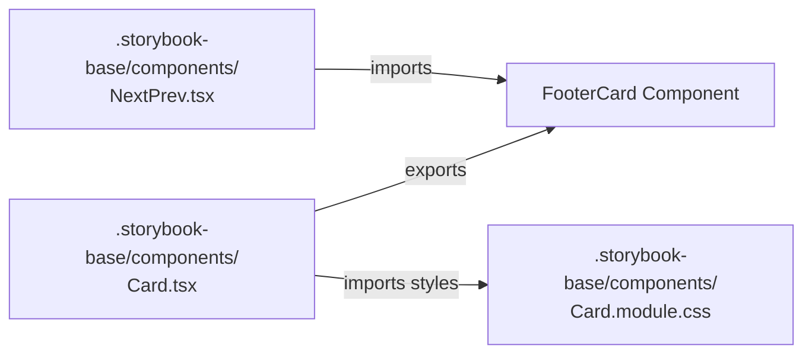

<!-- source: DeepWiki mcp.deepwiki.com · repo openai/apps-sdk-ui · page 6.7 Navigation Components · fetched 2026-10-26 -->

# Navigation Components

<details>
<summary>Relevant source files</summary>

The following files were used as context for generating this wiki page:

- [.storybook-base/components/Card.tsx](.storybook-base/components/Card.tsx)
- [.storybook-base/components/NextPrev.tsx](.storybook-base/components/NextPrev.tsx)

</details>


## Purpose and Scope

This document covers the navigation components used for sequential page-to-page navigation in Storybook documentation. The primary component is `NextPrev`, which provides Previous/Next footer navigation links between documentation pages.

For information about general card components used throughout the documentation, see [Card Components](#6.1). For information about other navigation features like the "Back to docs" addon, see [Back to Docs Addon](#4.2).

---

## Overview

The navigation components provide a standardized way to link documentation pages in sequence, allowing readers to move through the documentation in a linear flow. The system consists of the `NextPrev` component which renders footer navigation cards using the `FooterCard` component and integrates with Storybook's navigation system through the `linkTo` function.

**Sources:** [.storybook-base/components/NextPrev.tsx:1-22]()

---

## Component Architecture

### NextPrev Component Structure



**Diagram: NextPrev Component Structure**

The `NextPrev` component accepts navigation link objects and renders footer cards with appropriate handlers. When no previous link is provided, an empty spacer maintains the layout.

**Sources:** [.storybook-base/components/NextPrev.tsx:1-22]()

---

## Component Interface

### NextPrevLink Type

The navigation links follow a simple type definition:

| Property | Type | Description |
|----------|------|-------------|
| `title` | `string` | Display title for the navigation link |
| `path` | `string` | Storybook story path (e.g., "components-button--docs") |

**Sources:** [.storybook-base/components/NextPrev.tsx:4]()

### NextPrev Props

| Prop | Type | Required | Description |
|------|------|----------|-------------|
| `next` | `NextPrevLink` | Yes | Navigation target for the "Next" button |
| `prev` | `NextPrevLink` | No | Navigation target for the "Previous" button (optional) |

**Sources:** [.storybook-base/components/NextPrev.tsx:6]()

---

## Implementation Details

### Layout Structure

The `NextPrev` component renders a flex container with the following characteristics:



**Diagram: NextPrev Layout Structure**

The layout uses flexbox to position navigation cards at opposite ends of the container. A 120px top margin creates separation from the main content.

**Sources:** [.storybook-base/components/NextPrev.tsx:8-20]()

### Conditional Rendering Logic



**Diagram: NextPrev Rendering Logic**

The component always renders a "Next" card but conditionally renders either a "Previous" card or an empty spacer div. This ensures consistent layout regardless of whether a previous link exists.

**Sources:** [.storybook-base/components/NextPrev.tsx:9-19]()

---

## Integration with Storybook Navigation

### linkTo Function Usage

The `NextPrev` component uses the `linkTo` function from `@storybook/addon-links` to create navigation handlers:



**Diagram: Navigation Flow Sequence**

The `linkTo` function is invoked during render to create click handlers that trigger Storybook's internal navigation when the user clicks a card.

**Sources:** [.storybook-base/components/NextPrev.tsx:1,10,18]()

### Story Path Format

The `path` parameter passed to `linkTo` follows Storybook's story identification format:

| Component | Description | Example |
|-----------|-------------|---------|
| Story ID | Category and story name separated by dashes | `"components-button--docs"` |
| Category | Top-level organization | `"components"` |
| Component | Specific component or page | `"button"` |
| Story | Specific variant or page type | `"docs"` |

**Sources:** [.storybook-base/components/NextPrev.tsx:10,18]()

---

## FooterCard Integration

### Prop Mapping

The `NextPrev` component configures `FooterCard` components with specific props:

| NextPrev Context | FooterCard Prop | Value |
|------------------|-----------------|-------|
| Previous link | `title` | `prev.title` |
| Previous link | `subtitle` | `"Previous"` |
| Previous link | `onClick` | `linkTo(prev.path)` |
| Next link | `title` | `next.title` |
| Next link | `subtitle` | `"Next"` |
| Next link | `onClick` | `linkTo(next.path)` |
| Next link | `className` | `"text-right"` |

**Sources:** [.storybook-base/components/NextPrev.tsx:10,14-18]()

### FooterCard Component

The `FooterCard` component is defined in `Card.tsx` and provides the visual presentation for navigation links:



**Diagram: FooterCard Component Structure**

The `FooterCard` renders subtitle above title (reversed from regular `Card`) and applies interactive styling when an `onClick` handler is provided.

**Sources:** [.storybook-base/components/Card.tsx:29-54]()

---

## Styling and Layout

### CSS Module Classes

The `FooterCard` component uses the following CSS module classes from `Card.module.css`:

| Class | Element | Purpose |
|-------|---------|---------|
| `s.Card` | Outer container | Base card styling |
| `s.FooterCard` | Outer container | Footer-specific overrides |
| `s.CardInner` | Inner wrapper | Content padding and layout |
| `s.Subtitle` | `<p>` element | Subtitle text styling |
| `s.Title` | `<h6>` element | Title text styling |

**Sources:** [.storybook-base/components/Card.tsx:42-49]()

### Utility Classes

The `NextPrev` component applies utility classes directly:

| Class | Element | Purpose |
|-------|---------|---------|
| `"flex"` | Container | Flexbox display |
| `"gap-6"` | Container | Gap between cards (24px) |
| `"flex-1"` | Empty spacer | Fill available space |
| `"text-right"` | Next card | Right-align text |

**Sources:** [.storybook-base/components/NextPrev.tsx:8,12,15]()

### Interactive State

The `FooterCard` sets a `data-interactive` attribute based on the presence of an `onClick` handler:



**Diagram: Interactive State Management**

The `data-interactive` attribute allows CSS to apply hover effects and cursor changes only to clickable cards.

**Sources:** [.storybook-base/components/Card.tsx:44]()

---

## Usage Example

### Typical Implementation

Documentation pages typically use `NextPrev` at the bottom of the content:

```typescript
<NextPrev
  prev={{ title: "Getting Started", path: "docs-getting-started--docs" }}
  next={{ title: "Components Overview", path: "docs-components--docs" }}
/>
```

### First Page Pattern

For the first page in a sequence (no previous page):

```typescript
<NextPrev
  next={{ title: "Components Overview", path: "docs-components--docs" }}
/>
```

**Sources:** [.storybook-base/components/NextPrev.tsx:6-21]()

---

## Component Dependencies

### External Dependencies

| Package | Import | Usage |
|---------|--------|-------|
| `@storybook/addon-links` | `linkTo` | Generate navigation click handlers |
| `@storybook/blocks` | `Unstyled` | Prevent Storybook default styling in FooterCard |
| `clsx` | `clsx` | Conditional class name composition in FooterCard |

**Sources:** [.storybook-base/components/NextPrev.tsx:1](), [.storybook-base/components/Card.tsx:1-2]()

### Internal Dependencies



**Diagram: Component Dependency Graph**

The `NextPrev` component depends on the `FooterCard` export from the `Card` module, which in turn depends on its CSS module for styling.

**Sources:** [.storybook-base/components/NextPrev.tsx:2](), [.storybook-base/components/Card.tsx:3,29]()

---

## Design Patterns

### Composition Over Configuration

The `NextPrev` component uses composition to delegate visual presentation to `FooterCard` while handling layout and navigation logic itself. This separation allows:

- Consistent card styling across different contexts
- Reusable `FooterCard` component for other purposes
- Simple navigation logic in `NextPrev`

**Sources:** [.storybook-base/components/NextPrev.tsx:1-22]()

### Optional Previous Link Pattern

The optional `prev` prop enables flexible usage:

| Scenario | Pattern | Result |
|----------|---------|--------|
| Middle page | Both `prev` and `next` provided | Two navigation cards |
| First page | Only `next` provided | One card with spacer |
| Last page | Both provided, next points to index | Standard two-card layout |

**Sources:** [.storybook-base/components/NextPrev.tsx:6,9-13]()

### Accessibility Considerations

The component structure supports accessibility through:

- Semantic HTML (`<h6>` for titles, `<p>` for subtitles)
- Interactive elements receive click handlers
- `data-interactive` attribute signals clickable state to CSS

**Sources:** [.storybook-base/components/Card.tsx:42-49]()

---

