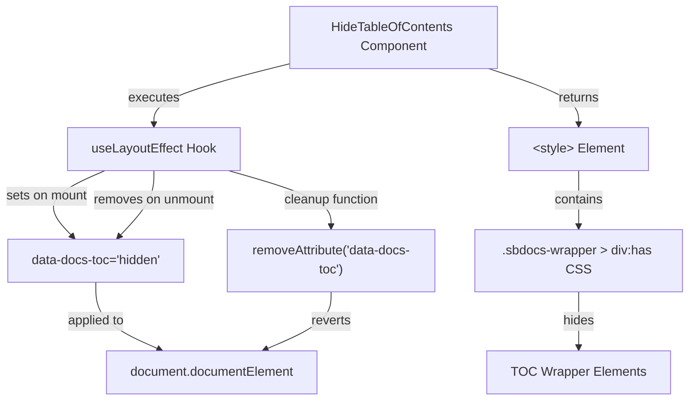
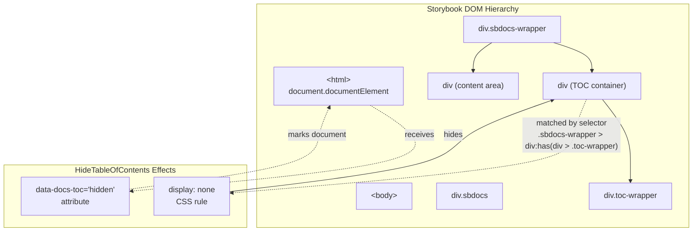

<!-- source: DeepWiki mcp.deepwiki.com · repo openai/apps-sdk-ui · page 6.8 Utility Components · fetched 2026-10-26 -->

# Utility Components

<details>
<summary>Relevant source files</summary>

The following files were used as context for generating this wiki page:

- [.storybook-base/components/HideTableOfContents.tsx](.storybook-base/components/HideTableOfContents.tsx)

</details>


This page documents utility components that provide specialized functionality for controlling Storybook's UI behavior. These components do not render visible content themselves, but rather modify the documentation environment through DOM manipulation and styling.

For information about other documentation components that render visible content, see [Documentation Components](#6).

---

## Overview

Utility components serve as invisible helpers that modify the Storybook documentation environment. Unlike presentation components such as Card or Hero, utility components primarily interact with the DOM and Storybook's internal UI structure to control display behavior.

The primary utility component in this repository is `HideTableOfContents`, which provides control over Storybook's table of contents visibility in documentation pages.

**Sources:** [.storybook-base/components/HideTableOfContents.tsx:1-24]()

---

## HideTableOfContents Component

### Purpose

The `HideTableOfContents` component conditionally hides Storybook's automatically-generated table of contents sidebar in documentation pages. This is particularly useful for documentation pages where the table of contents is not needed or would interfere with the component's interactive controls.

The component includes a critical note indicating it prevents issues with Storybook's Controls addon: "Controls are not working without this - if removing, ensure controls in stories update the component" [.storybook-base/components/HideTableOfContents.tsx:1]().

### Component Structure



**Diagram: HideTableOfContents Component Architecture**

The component operates through two mechanisms: a data attribute on the document element and inline CSS styling that targets Storybook's table of contents wrapper.

**Sources:** [.storybook-base/components/HideTableOfContents.tsx:1-24]()

---

## Implementation Details

### DOM Attribute Manipulation

The component uses `useLayoutEffect` to synchronously manipulate the DOM before the browser paints. This ensures the table of contents is hidden without visual flicker.

**Key behaviors:**

| Lifecycle Phase | Action | Target | Effect |
|----------------|--------|--------|--------|
| Mount | `setAttribute('data-docs-toc', 'hidden')` | `document.documentElement` | Marks document for TOC hiding |
| Unmount | `removeAttribute('data-docs-toc')` | `document.documentElement` | Restores default TOC behavior |

The component implementation is located at [.storybook-base/components/HideTableOfContents.tsx:6-12]().

### CSS Selector Strategy

The component returns an inline `<style>` element with CSS that targets Storybook's specific DOM structure:

```css
.sbdocs-wrapper > div:has(div > .toc-wrapper) {
  display: none;
}
```

This selector specifically targets the container div within `.sbdocs-wrapper` that contains the `.toc-wrapper` element, effectively hiding the entire table of contents column.

**Sources:** [.storybook-base/components/HideTableOfContents.tsx:14-23]()

---

## React Optimization Directive

The component includes the directive `"use no memo"` at the top of the file [.storybook-base/components/HideTableOfContents.tsx:2](). This directive instructs React's compiler to skip memoization for this component, ensuring the effect runs on every render when needed. This is critical for the component's interaction with Storybook's Controls addon.

**Sources:** [.storybook-base/components/HideTableOfContents.tsx:2]()

---

## Integration with Storybook

### DOM Structure Interaction



**Diagram: Storybook DOM Structure and HideTableOfContents Effects**

The component operates at two levels of the DOM hierarchy:
1. **Document level**: Sets a data attribute on `document.documentElement` for semantic marking
2. **Component level**: Injects CSS that targets Storybook's specific DOM structure

**Sources:** [.storybook-base/components/HideTableOfContents.tsx:1-24]()

---

## Usage Pattern

The `HideTableOfContents` component is typically used within MDX documentation files or story decorators where the table of contents should be hidden. Since it performs side effects and returns minimal markup, it should be rendered at the top level of a documentation page:

```jsx
// In an MDX file
<HideTableOfContents />
```

The component will automatically clean up after itself when the documentation page is navigated away from, restoring default table of contents behavior for other pages.

### Component Lifecycle

```mermaid
sequenceDiagram
    participant Page as "Documentation Page"
    participant Component as "HideTableOfContents"
    participant DOM as "document.documentElement"
    participant Browser as "Browser Layout Engine"
    
    Page->>Component: Mount component
    activate Component
    
    Component->>DOM: setAttribute('data-docs-toc', 'hidden')
    Component->>Browser: Inject &lt;style&gt; element
    Browser->>Browser: Hide TOC wrapper
    
    Note over Component,Browser: Table of contents hidden
    
    Page->>Component: Unmount (navigation)
    Component->>DOM: removeAttribute('data-docs-toc')
    deactivate Component
    
    Note over DOM,Browser: Default TOC behavior restored
```

**Diagram: HideTableOfContents Lifecycle**

This sequence ensures that the table of contents hiding effect is scoped to only the pages where the component is actively mounted.

**Sources:** [.storybook-base/components/HideTableOfContents.tsx:6-12]()

---

## Technical Considerations

### Why useLayoutEffect

The component uses `useLayoutEffect` instead of `useEffect` to ensure DOM mutations occur synchronously before the browser paints [.storybook-base/components/HideTableOfContents.tsx:6](). This prevents visual flicker where the table of contents might briefly appear before being hidden.

### Controls Addon Compatibility

The comment at the top of the file indicates this component resolves an issue with Storybook's Controls addon [.storybook-base/components/HideTableOfContents.tsx:1](). Without this component, interactive controls in stories may not properly update the component being documented. This suggests the component's DOM manipulation or the `"use no memo"` directive helps maintain proper reactivity in Storybook's interactive environment.

### CSS Specificity

The CSS selector `.sbdocs-wrapper > div:has(div > .toc-wrapper)` uses the `:has()` pseudo-class to target the parent container based on its descendants [.storybook-base/components/HideTableOfContents.tsx:17](). This modern CSS feature requires browser support for parent selection.

**Sources:** [.storybook-base/components/HideTableOfContents.tsx:1-24]()

---

## File Location and Exports

The component is located at `.storybook-base/components/HideTableOfContents.tsx` and is exported as a named export. It can be imported into MDX files or other components within the Storybook environment.

**Sources:** [.storybook-base/components/HideTableOfContents.tsx:5]()

---

