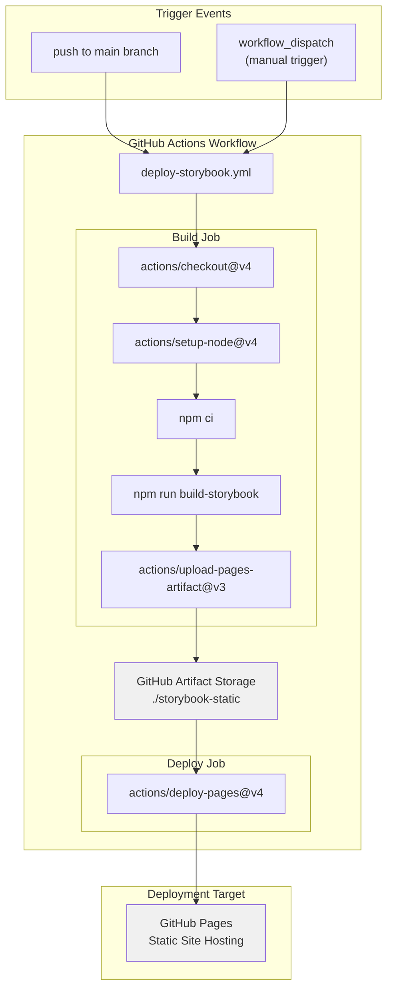
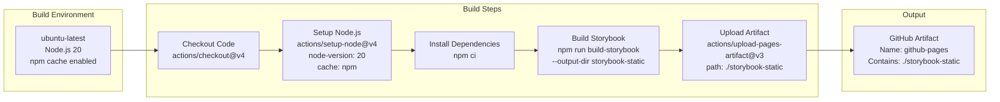
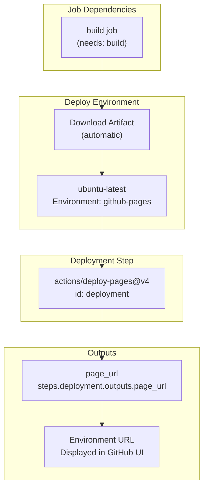
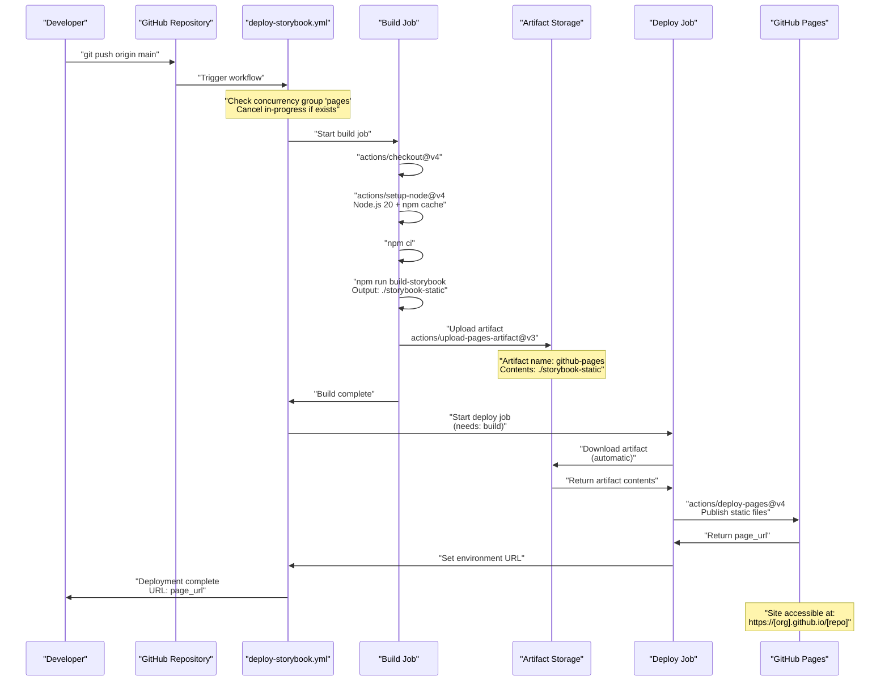
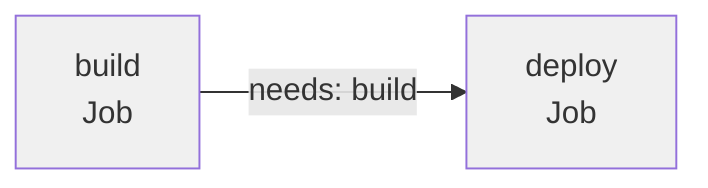

<!-- source: DeepWiki mcp.deepwiki.com · repo openai/apps-sdk-ui · page 7 CI/CD & Deployment · fetched 2026-10-26 -->

# CI/CD & Deployment

<details>
<summary>Relevant source files</summary>

The following files were used as context for generating this wiki page:

- [.github/workflows/deploy-storybook.yml](.github/workflows/deploy-storybook.yml)

</details>


This document describes the automated continuous integration and deployment pipeline that builds and publishes the Storybook documentation to GitHub Pages. The pipeline is implemented as a GitHub Actions workflow that automatically triggers on changes to the main branch.

For information about the Storybook build configuration itself, see [Storybook Configuration](#3). For details about development tools and excluded files, see [Development Tools & Configuration](#8).

---

## Overview

The CI/CD system uses GitHub Actions to automate the build and deployment process. When changes are pushed to the `main` branch, the workflow compiles the Storybook application into static assets and deploys them to GitHub Pages. This ensures the documentation is always up-to-date with the latest code changes.

**Key Characteristics:**
- **Fully automated**: No manual intervention required for deployments
- **Two-stage pipeline**: Separate build and deploy jobs with artifact sharing
- **Concurrency control**: Prevents simultaneous deployments that could conflict
- **Manual trigger support**: Allows on-demand deployments via `workflow_dispatch`

**Sources:** [.github/workflows/deploy-storybook.yml:1-52]()

---

## Workflow Architecture

The deployment pipeline consists of two sequential jobs that communicate through GitHub's artifact storage system.



**Sources:** [.github/workflows/deploy-storybook.yml:3-7](), [.github/workflows/deploy-storybook.yml:18-51]()

---

## Workflow Configuration

### Triggers

The workflow is configured with two trigger mechanisms:

| Trigger Type | Configuration | Purpose |
|-------------|---------------|---------|
| **push** | `branches: [main]` | Automatically deploys on every commit to main |
| **workflow_dispatch** | Manual trigger | Allows manual deployment through GitHub UI |

**Sources:** [.github/workflows/deploy-storybook.yml:3-7]()

### Permissions

The workflow requires explicit permissions to perform its operations:

```yaml
permissions:
  contents: write
  pages: write
  id-token: write
```

| Permission | Purpose |
|-----------|---------|
| `contents: write` | Read repository contents and write deployment information |
| `pages: write` | Publish to GitHub Pages |
| `id-token: write` | Generate OIDC tokens for secure GitHub Pages deployment |

**Sources:** [.github/workflows/deploy-storybook.yml:9-12]()

### Concurrency Control

The workflow implements concurrency control to prevent deployment conflicts:

```yaml
concurrency:
  group: "pages"
  cancel-in-progress: true
```

**Behavior:**
- All deployments are grouped under the `"pages"` concurrency group
- If a new deployment starts while another is running, the in-progress deployment is cancelled
- Ensures only one deployment runs at a time, preventing race conditions

**Sources:** [.github/workflows/deploy-storybook.yml:14-16]()

---

## Build Job

The build job compiles the Storybook application into production-ready static assets.



**Sources:** [.github/workflows/deploy-storybook.yml:19-40]()

### Build Steps Breakdown

#### 1. Checkout Repository

```yaml
- name: Checkout
  uses: actions/checkout@v4
```

Retrieves the repository code using GitHub Actions' official checkout action (v4).

**Sources:** [.github/workflows/deploy-storybook.yml:22-23]()

#### 2. Setup Node.js Environment

```yaml
- name: Set up Node
  uses: actions/setup-node@v4
  with:
    node-version: "20"
    cache: "npm"
```

**Configuration Details:**
- **Node Version**: 20 (latest LTS)
- **Cache Strategy**: npm cache enabled for faster subsequent builds
- The cache stores `node_modules` and npm cache directories between workflow runs

**Sources:** [.github/workflows/deploy-storybook.yml:25-29]()

#### 3. Install Dependencies

```yaml
- name: Install dependencies
  run: npm ci
```

Uses `npm ci` (clean install) rather than `npm install` for:
- **Reproducibility**: Installs exact versions from `package-lock.json`
- **Speed**: Faster than regular install in CI environments
- **Reliability**: Removes existing `node_modules` before installing

**Sources:** [.github/workflows/deploy-storybook.yml:31-32]()

#### 4. Build Storybook

```yaml
- name: Build Storybook
  run: npm run build-storybook --output-dir storybook-static
```

**Build Process:**
- Executes the `build-storybook` npm script
- Output directory: `storybook-static`
- The build process is configured through `.storybook-base/main.ts` (see [Main Configuration](#3.1))
- Uses Vite as the bundler with custom configuration

**What Gets Built:**
- Compiled JavaScript bundles
- CSS stylesheets
- Static HTML files for each story and documentation page
- Asset files (images, fonts, etc.)
- Manager UI with custom addons

**Sources:** [.github/workflows/deploy-storybook.yml:34-35]()

#### 5. Upload Build Artifact

```yaml
- name: Upload Pages artifact
  uses: actions/upload-pages-artifact@v3
  with:
    path: ./storybook-static
```

**Artifact Details:**
- **Action Version**: v3 (GitHub Pages artifact format)
- **Path**: `./storybook-static` directory
- **Artifact Name**: Automatically named `github-pages`
- **Retention**: Stored temporarily for the deploy job to consume

The artifact is uploaded to GitHub's artifact storage and made available to the deploy job through the `needs: build` dependency.

**Sources:** [.github/workflows/deploy-storybook.yml:37-40]()

---

## Deploy Job

The deploy job takes the built artifact and publishes it to GitHub Pages.



**Sources:** [.github/workflows/deploy-storybook.yml:42-51]()

### Deploy Configuration

```yaml
deploy:
  needs: build
  runs-on: ubuntu-latest
  environment:
    name: github-pages
    url: ${{ steps.deployment.outputs.page_url }}
```

**Key Configuration:**
- **Dependency**: `needs: build` - Deploy only runs after successful build
- **Environment**: `github-pages` - Associates deployment with GitHub Pages environment
- **URL Output**: Captures and displays the deployed site URL

**Sources:** [.github/workflows/deploy-storybook.yml:42-47]()

### Deployment Step

```yaml
- name: Deploy to GitHub Pages
  id: deployment
  uses: actions/deploy-pages@v4
```

**Deployment Process:**
1. Action downloads the `github-pages` artifact automatically
2. Artifact contents are extracted
3. Files are published to GitHub Pages infrastructure
4. Deployment URL is returned as output

**Step ID Usage:**
The `id: deployment` allows referencing outputs:
```yaml
url: ${{ steps.deployment.outputs.page_url }}
```

**Sources:** [.github/workflows/deploy-storybook.yml:48-51]()

---

## Deployment Flow

The following diagram shows the complete deployment lifecycle, including how artifacts flow between jobs and how GitHub Pages serves the content.



**Sources:** [.github/workflows/deploy-storybook.yml:1-52]()

---

## Build Command Details

The workflow executes `npm run build-storybook`, which invokes the Storybook build process. The build system is configured through several files:

| Component | Location | Purpose |
|-----------|----------|---------|
| **Main Config** | `.storybook-base/main.ts` | Defines story patterns, addons, and Vite configuration |
| **Manager Config** | `.storybook-base/manager.ts` | Configures Storybook UI and custom addons |
| **Vite Config** | Referenced in main.ts | Build tool configuration with custom aliases |

### Build Output Structure

The `storybook-static` directory created during build contains:

```
storybook-static/
├── index.html              # Main entry point
├── iframe.html             # Story rendering iframe
├── assets/                 # Compiled JS and CSS
│   ├── *.js               # JavaScript bundles
│   ├── *.css              # Stylesheet bundles
│   └── *.svg, *.png       # Image assets
├── sb-preview/            # Storybook preview runtime
└── [story-files].html     # Individual story pages
```

**Sources:** [.github/workflows/deploy-storybook.yml:34-35]()

---

## GitHub Pages Configuration

### Repository Settings

For the workflow to deploy successfully, the repository must have GitHub Pages enabled:

1. **Source**: Set to "GitHub Actions" in repository settings
2. **Branch**: Not applicable (Actions-based deployment)
3. **Environment**: `github-pages` environment is automatically created

### Deployment URL

The deployed site is accessible at:
```
https://[organization].github.io/[repository-name]
```

The exact URL is captured in the deploy job's output and displayed in:
- The workflow run summary
- The GitHub Pages environment in the repository
- The deployment step output

**Sources:** [.github/workflows/deploy-storybook.yml:46-47]()

---

## Workflow Execution Details

### Job Dependencies



The `deploy` job explicitly depends on `build` through the `needs: build` declaration. This ensures:
- Deploy only runs if build succeeds
- Deploy has access to artifacts from build
- Sequential execution (no parallel deployment attempts)

**Sources:** [.github/workflows/deploy-storybook.yml:43]()

### Runner Environment

Both jobs use the same runner specification:

```yaml
runs-on: ubuntu-latest
```

**Environment Characteristics:**
- Latest Ubuntu LTS version
- Includes standard GitHub Actions tools
- Pre-installed with common build tools
- Ephemeral (destroyed after job completion)

**Sources:** [.github/workflows/deploy-storybook.yml:20](), [.github/workflows/deploy-storybook.yml:44]()

---

## Failure Handling

### Build Failures

If the build job fails:
1. The workflow stops immediately
2. Deploy job is skipped (dependency not satisfied)
3. Existing GitHub Pages deployment remains unchanged
4. Developer receives notification of failure

**Common Build Failure Causes:**
- TypeScript compilation errors
- Missing dependencies
- Storybook configuration errors
- Out of memory during build

### Deploy Failures

If the deploy job fails:
1. Build artifact is retained (can be inspected)
2. Previous GitHub Pages deployment remains active
3. Can retry deployment manually via `workflow_dispatch`

**Common Deploy Failure Causes:**
- GitHub Pages permissions issues
- Invalid artifact format
- GitHub Pages service disruption

**Sources:** [.github/workflows/deploy-storybook.yml:42-51]()

---

## Manual Deployment

The workflow supports manual triggering through the GitHub UI:

1. Navigate to **Actions** tab in GitHub
2. Select **Build & deploy Storybook** workflow
3. Click **Run workflow** button
4. Select branch (defaults to `main`)
5. Click **Run workflow** to start

This is useful for:
- Re-deploying after GitHub Pages service issues
- Deploying from a specific commit
- Testing deployment changes before merging to main

**Sources:** [.github/workflows/deploy-storybook.yml:7]()

---

## Relationship to Build Configuration

The CI/CD pipeline relies on several configuration files documented elsewhere:

| Configuration | Purpose | Documentation |
|--------------|---------|---------------|
| `.storybook-base/main.ts` | Story discovery, addon setup, Vite configuration | [Main Configuration](#3.1) |
| `.storybook-base/manager.ts` | Manager UI and addon registration | [Manager Configuration](#3.2) |
| `package.json` | Build scripts and dependencies | Repository root |
| `.gitignore` | Files excluded from deployment | [Version Control Configuration](#8.1) |

The workflow invokes `npm run build-storybook`, which internally uses the Storybook CLI with configuration from these files.

---

## Performance Considerations

### Build Caching

The workflow enables npm caching to improve build times:

```yaml
- uses: actions/setup-node@v4
  with:
    cache: "npm"
```

**Cache Behavior:**
- Caches `~/.npm` directory
- Cache key based on `package-lock.json` hash
- Invalidated when dependencies change
- Reduces subsequent build times by 30-50%

**Sources:** [.github/workflows/deploy-storybook.yml:25-29]()

### Artifact Optimization

The Pages artifact upload is optimized for static sites:
- Compressed during upload
- Only changed files require re-upload (handled by GitHub)
- Temporary storage (deleted after deployment)

**Sources:** [.github/workflows/deploy-storybook.yml:37-40]()

---

## Security Considerations

### Permission Model

The workflow uses minimal required permissions:
- `contents: write` - Only for deployment metadata
- `pages: write` - Only for GitHub Pages
- `id-token: write` - For OIDC authentication

**No Secrets Required:**
- Uses built-in `GITHUB_TOKEN`
- No custom secrets needed
- All authentication via OIDC

**Sources:** [.github/workflows/deploy-storybook.yml:9-12]()

### Concurrency Protection

The concurrency group prevents:
- Race conditions during deployment
- Multiple simultaneous writes to GitHub Pages
- Corruption of deployment state

**Sources:** [.github/workflows/deploy-storybook.yml:14-16]()

---

## Monitoring and Debugging

### Workflow Status

Monitor deployment status through:
- GitHub Actions tab (workflow runs list)
- Commit status checks (green checkmark / red X)
- GitHub Pages environment page
- Email notifications (if enabled)

### Log Access

Detailed logs are available for each step:
1. Navigate to the workflow run
2. Click on job name (`build` or `deploy`)
3. Expand individual steps to view output

**Useful Debug Information:**
- Build step: Shows Storybook compilation output
- npm ci: Lists installed dependency versions
- Deploy step: Shows deployment URL

### Artifact Inspection

If deployment fails, inspect the build artifact:
1. Go to workflow run summary
2. Download artifact from "Artifacts" section
3. Extract and inspect `storybook-static` directory
4. Verify build output is correct

**Sources:** [.github/workflows/deploy-storybook.yml:37-40]()

---

## Summary

The CI/CD pipeline provides automated, reliable deployment of Storybook documentation:

- **Automated**: Triggers on every push to main
- **Reliable**: Two-stage process with artifact validation
- **Fast**: npm caching reduces build times
- **Secure**: Minimal permissions with OIDC authentication
- **Robust**: Concurrency control prevents conflicts

The workflow integrates with Storybook's build system (documented in [Storybook Configuration](#3)) and outputs to GitHub Pages for public access.

**Sources:** [.github/workflows/deploy-storybook.yml:1-52]()

---

