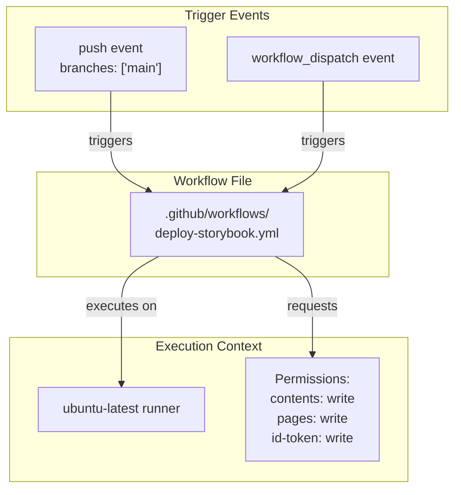
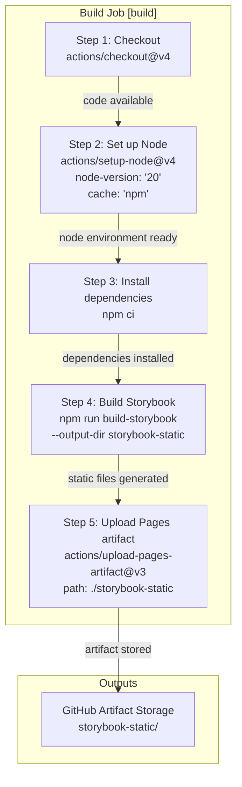
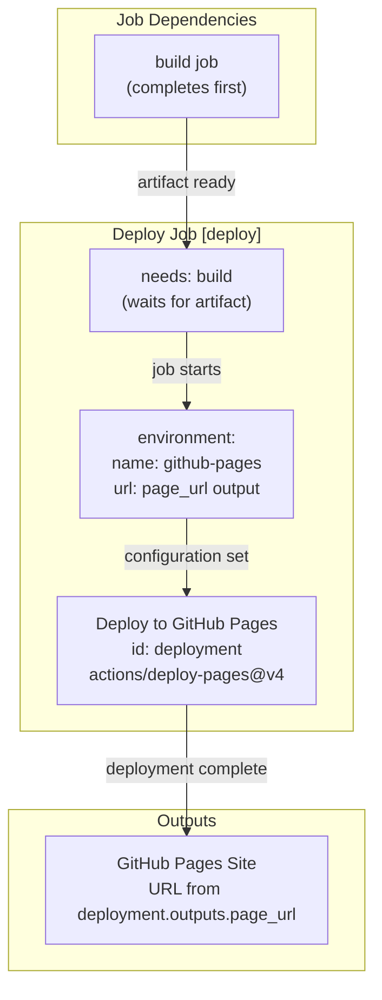
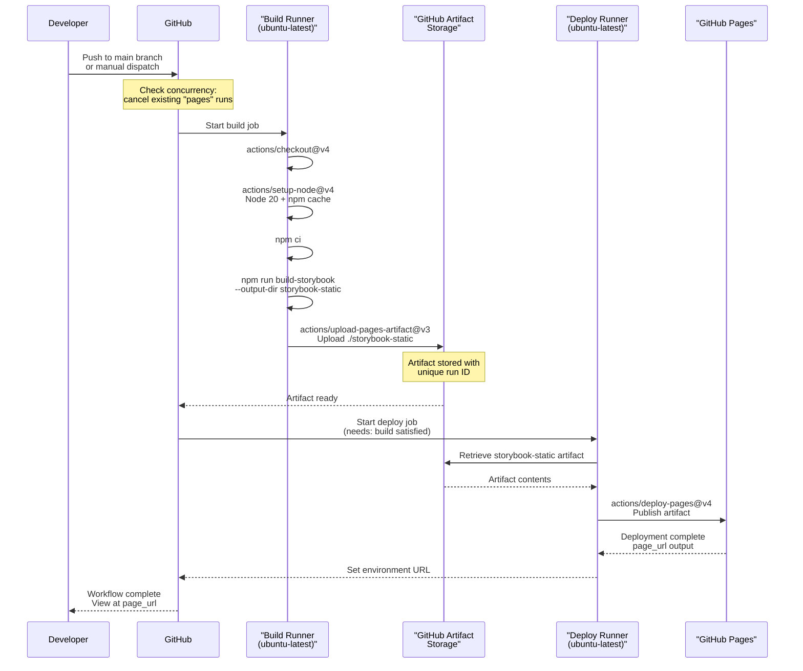

<!-- source: DeepWiki mcp.deepwiki.com · repo openai/apps-sdk-ui · page 7.1 GitHub Actions Workflow · fetched 2026-10-26 -->

# GitHub Actions Workflow

<details>
<summary>Relevant source files</summary>

The following files were used as context for generating this wiki page:

- [.github/workflows/deploy-storybook.yml](.github/workflows/deploy-storybook.yml)

</details>


## Purpose and Scope

This document provides a comprehensive breakdown of the automated CI/CD pipeline defined in `.github/workflows/deploy-storybook.yml`. This workflow handles building the Storybook documentation and deploying it to GitHub Pages. The workflow is triggered automatically on pushes to the main branch or can be manually triggered through the GitHub interface.

For information about the Storybook build configuration itself, see [Main Configuration (main.ts)](#3.1). For details on the runtime configuration and addons, see [Custom Addons](#4).

---

## Workflow Configuration Overview

The `deploy-storybook.yml` workflow is a two-job pipeline that separates build and deployment concerns. The workflow uses GitHub's artifact storage as an intermediary between jobs, ensuring that the built assets are preserved and can be deployed by a separate job with appropriate permissions.

### Workflow Metadata

| Property | Value | Purpose |
|----------|-------|---------|
| **Name** | `Build & deploy Storybook` | Display name in GitHub Actions UI |
| **Trigger Events** | `push` (main branch), `workflow_dispatch` | Automatic deployment on commit, manual dispatch available |
| **Runner OS** | `ubuntu-latest` | Linux environment for both jobs |
| **Concurrency Group** | `pages` | Prevents simultaneous deployments |

**Sources:** [.github/workflows/deploy-storybook.yml:1-7]()

---

## Workflow Trigger Configuration



The workflow is configured with two trigger mechanisms defined in the `on` block:

1. **Automatic Trigger** [.github/workflows/deploy-storybook.yml:3-6](): Activates on any push to the `main` branch, ensuring documentation is always up-to-date with the latest code.

2. **Manual Trigger** [.github/workflows/deploy-storybook.yml:7](): The `workflow_dispatch` event allows developers to manually initiate the deployment through the GitHub Actions interface without requiring a new commit.

**Sources:** [.github/workflows/deploy-storybook.yml:3-7]()

---

## Permissions and Concurrency Control

### Permissions Configuration

The workflow requests three specific permissions [.github/workflows/deploy-storybook.yml:9-12]():

| Permission | Scope | Usage |
|------------|-------|-------|
| `contents` | `write` | Allows the workflow to read repository contents and write to branches if needed |
| `pages` | `write` | Enables deployment to GitHub Pages environment |
| `id-token` | `write` | Permits the workflow to request GitHub's OIDC token for secure deployment |

These permissions follow the principle of least privilege, granting only what's necessary for building and deploying the Storybook application.

### Concurrency Management

```yaml
concurrency:
  group: "pages"
  cancel-in-progress: true
```

The concurrency configuration [.github/workflows/deploy-storybook.yml:14-16]() ensures:

- **Concurrency Group**: All workflows deploying to GitHub Pages are grouped under the `"pages"` identifier
- **Cancellation Policy**: If a new deployment is triggered while one is in progress, the older deployment is cancelled automatically, preventing race conditions and ensuring only the latest version is deployed

**Sources:** [.github/workflows/deploy-storybook.yml:9-16]()

---

## Build Job Architecture



The build job [.github/workflows/deploy-storybook.yml:19-40]() executes on `ubuntu-latest` and consists of five sequential steps:

### Step 1: Checkout Repository

```yaml
- name: Checkout
  uses: actions/checkout@v4
```

Uses GitHub's official checkout action (v4) to clone the repository contents into the runner's workspace [.github/workflows/deploy-storybook.yml:22-23]().

### Step 2: Node.js Setup

```yaml
- name: Set up Node
  uses: actions/setup-node@v4
  with:
    node-version: "20"
    cache: "npm"
```

Configures the Node.js environment [.github/workflows/deploy-storybook.yml:25-29]():

- **Node Version**: Pins to Node.js 20 for consistency
- **NPM Cache**: Enables caching of npm dependencies to speed up subsequent workflow runs

### Step 3: Dependency Installation

```yaml
- name: Install dependencies
  run: npm ci
```

Executes `npm ci` [.github/workflows/deploy-storybook.yml:31-32]() for clean, reproducible dependency installation. Using `npm ci` instead of `npm install` ensures:

- Dependencies are installed exactly as specified in `package-lock.json`
- Existing `node_modules` directory is removed first
- Installation fails if lockfile and `package.json` are out of sync

### Step 4: Storybook Build

```yaml
- name: Build Storybook
  run: npm run build-storybook --output-dir storybook-static
```

Builds the Storybook application [.github/workflows/deploy-storybook.yml:34-35]() into static files:

- **Build Command**: Executes the `build-storybook` npm script
- **Output Directory**: Generates static assets in `./storybook-static`
- **Build Process**: Uses Vite as configured in the Storybook setup (see [Main Configuration](#3.1))

### Step 5: Artifact Upload

```yaml
- name: Upload Pages artifact
  uses: actions/upload-pages-artifact@v3
  with:
    path: ./storybook-static
```

Uploads the built Storybook assets [.github/workflows/deploy-storybook.yml:37-40]() as a GitHub Pages artifact for consumption by the deploy job.

**Sources:** [.github/workflows/deploy-storybook.yml:19-40]()

---

## Deploy Job Architecture



The deploy job [.github/workflows/deploy-storybook.yml:42-51]() handles publishing the built Storybook to GitHub Pages.

### Job Dependencies

```yaml
deploy:
  needs: build
```

The `needs: build` declaration [.github/workflows/deploy-storybook.yml:43]() ensures the deploy job only executes after the build job completes successfully. This creates a dependency chain that prevents deployment of failed builds.

### Environment Configuration

```yaml
environment:
  name: github-pages
  url: ${{ steps.deployment.outputs.page_url }}
```

The environment block [.github/workflows/deploy-storybook.yml:45-47]() configures:

- **Environment Name**: Declares this deployment targets the `github-pages` environment
- **Environment URL**: Dynamically sets the environment URL from the deployment step's output, providing a direct link to the deployed site in the GitHub Actions UI

### Deployment Step

```yaml
- name: Deploy to GitHub Pages
  id: deployment
  uses: actions/deploy-pages@v4
```

The deployment step [.github/workflows/deploy-storybook.yml:49-51]():

- **Step ID**: Assigned `deployment` identifier for output referencing
- **Action**: Uses GitHub's official `deploy-pages@v4` action
- **Artifact Retrieval**: Automatically downloads the artifact uploaded by the build job
- **Publishing**: Publishes the artifact contents to the GitHub Pages hosting infrastructure
- **Output**: Produces `page_url` output containing the final deployment URL

**Sources:** [.github/workflows/deploy-storybook.yml:42-51]()

---

## Complete Workflow Execution Flow



### Execution Sequence

The workflow executes in the following order:

1. **Trigger Reception**: GitHub receives either a push to `main` or a manual workflow dispatch
2. **Concurrency Check**: If another deployment is running, it's cancelled per the `cancel-in-progress: true` setting
3. **Permission Grant**: Workflow receives requested permissions (`contents`, `pages`, `id-token`)
4. **Build Job Initialization**: Runner provisions an Ubuntu environment
5. **Code Checkout**: Repository code is cloned to the runner
6. **Environment Setup**: Node.js 20 is installed with npm cache enabled
7. **Dependency Installation**: All dependencies are installed via `npm ci`
8. **Storybook Build**: Static Storybook site is generated in `./storybook-static`
9. **Artifact Upload**: Build output is uploaded to GitHub's artifact storage
10. **Deploy Job Initialization**: Second runner provisions after build completes
11. **Artifact Retrieval**: Storybook static files are downloaded from artifact storage
12. **GitHub Pages Deployment**: Artifact is published to GitHub Pages infrastructure
13. **URL Output**: Deployment URL is captured and displayed in workflow summary

### Failure Handling

| Failure Point | Behavior | Impact |
|---------------|----------|--------|
| Build job fails | Deploy job is skipped | No deployment occurs; previous deployment remains live |
| Artifact upload fails | Deploy job cannot start | Build must be re-run |
| Deploy job fails | Build artifact remains available | Can retry deployment without rebuilding |

**Sources:** [.github/workflows/deploy-storybook.yml:1-52]()

---

## Workflow Outputs and Artifacts

### Artifact Structure

The uploaded artifact contains the complete static Storybook build:

```
storybook-static/
├── index.html
├── iframe.html
├── assets/
│   ├── *.js
│   ├── *.css
│   └── *.woff2
├── sb-addons/
└── [other Storybook static files]
```

### Deployment URL

The final deployment URL follows the pattern:

```
https://{org}.github.io/{repo}/
```

This URL is:
- Output by the deployment step as `page_url` [.github/workflows/deploy-storybook.yml:47]()
- Displayed in the GitHub Actions UI
- Accessible from the repository's Settings > Pages section
- Linked in the environment deployment view

**Sources:** [.github/workflows/deploy-storybook.yml:37-47]()

---

## Key Features and Design Decisions

### Two-Job Architecture

The separation of build and deploy into distinct jobs provides:

- **Failure Isolation**: Build failures don't affect deployment logic
- **Artifact Reusability**: Successful builds can be redeployed without rebuilding
- **Parallel Capability**: While not used here, this pattern allows parallel deployments to different environments

### Dependency Pinning

| Dependency | Version | Rationale |
|------------|---------|-----------|
| Node.js | `20` | Stable LTS version with modern features |
| `actions/checkout` | `v4` | Latest major version with improved performance |
| `actions/setup-node` | `v4` | Latest with enhanced caching capabilities |
| `actions/upload-pages-artifact` | `v3` | Official GitHub Pages artifact format |
| `actions/deploy-pages` | `v4` | Latest deployment action with OIDC support |

### Cache Strategy

The workflow leverages npm caching [.github/workflows/deploy-storybook.yml:29]() to reduce build times:

- Cache key is automatically generated from `package-lock.json`
- Subsequent runs skip downloading unchanged dependencies
- Cache invalidates when dependencies change

**Sources:** [.github/workflows/deploy-storybook.yml:1-52]()

---

