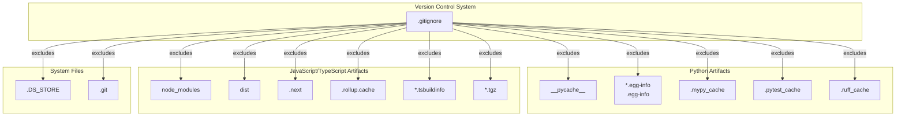
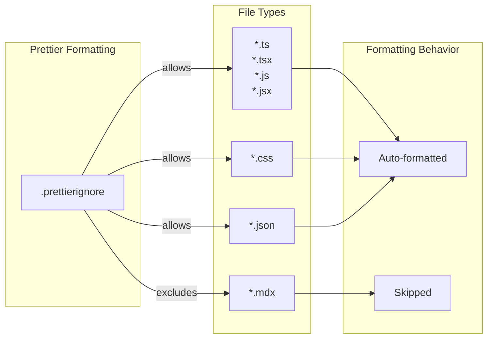
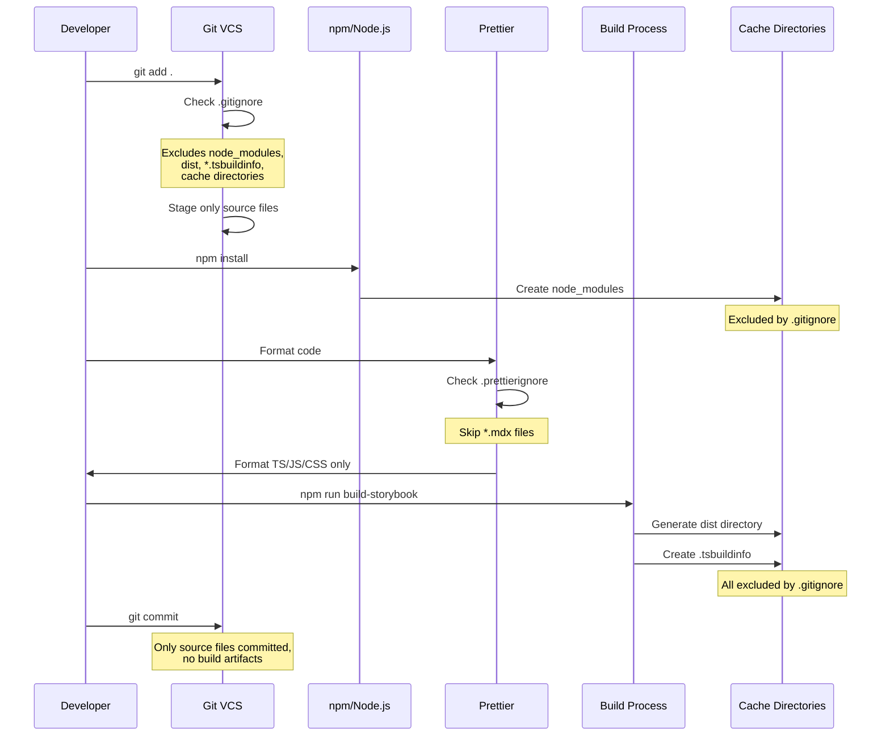

<!-- source: DeepWiki mcp.deepwiki.com · repo openai/apps-sdk-ui · page 8 Development Tools & Configuration · fetched 2026-10-26 -->

# Development Tools & Configuration

<details>
<summary>Relevant source files</summary>

The following files were used as context for generating this wiki page:

- [.gitignore](.gitignore)
- [.prettierignore](.prettierignore)

</details>


This document covers the development configuration files that control version control exclusions and code formatting behavior in the apps-sdk-ui repository. These configuration files ensure clean repository state and consistent handling of generated artifacts and documentation files.

For information about build configuration and Storybook setup, see [Storybook Configuration](#3). For CI/CD pipeline configuration, see [CI/CD & Deployment](#7).

---

## Overview

The repository includes two primary configuration files for development tooling:

- **`.gitignore`** - Defines patterns for files and directories excluded from version control
- **`.prettierignore`** - Specifies file patterns excluded from automatic code formatting

These configurations support a polyglot development environment that includes both JavaScript/TypeScript and Python artifacts, ensuring that build outputs, temporary files, and certain documentation formats are handled appropriately.

**Sources:** [.gitignore:1-17](), [.prettierignore:1-2]()

---

## Version Control Exclusions

### Excluded Artifact Types

The `.gitignore` file organizes exclusion patterns into three categories: Python artifacts, JavaScript/TypeScript artifacts, and system files.



**Diagram: .gitignore Exclusion Categories**

**Sources:** [.gitignore:1-17]()

### Python Development Artifacts

The following Python-related patterns are excluded from version control:

| Pattern | Description | Purpose |
|---------|-------------|---------|
| `__pycache__` | Python bytecode cache directories | Generated at runtime by Python interpreter |
| `*.egg-info` | Python package metadata | Created during package installation |
| `.egg-info` | Package distribution information | Build artifact from setuptools |
| `.mypy_cache` | MyPy type checker cache | Generated by static type checking tool |
| `.pytest_cache` | Pytest test cache | Created by pytest test runner for optimization |
| `.ruff_cache` | Ruff linter cache | Generated by the Ruff linting tool |

These patterns indicate that Python development tools are used in the broader codebase ecosystem, even though the Storybook documentation focuses on JavaScript/TypeScript components.

**Sources:** [.gitignore:1-2,6-9,13]()

### JavaScript/TypeScript Build Artifacts

The following JavaScript and TypeScript build artifacts are excluded:

| Pattern | Description | Purpose |
|---------|-------------|---------|
| `node_modules` | NPM package dependencies | Installed via `npm install`, recreatable from package.json |
| `dist` | Build output directory | Generated by build tools like Vite or Rollup |
| `.next` | Next.js build cache | Framework-specific build artifacts |
| `.rollup.cache` | Rollup bundler cache | Performance optimization for repeated builds |
| `*.tsbuildinfo` | TypeScript incremental build cache | Speeds up subsequent TypeScript compilations |
| `*.tgz` | Compressed tarball archives | Package distribution files |

The presence of `.next` suggests Next.js may be used elsewhere in the broader application ecosystem, while `.rollup.cache` indicates Rollup is used as a bundler (in addition to Vite for Storybook).

**Sources:** [.gitignore:2-3,10,12,15-16]()

### System Files

System-specific files are also excluded:

| Pattern | Description | Purpose |
|---------|-------------|---------|
| `.DS_STORE` | macOS directory metadata | Operating system artifact |
| `.git` | Git repository metadata | Version control system internals |

The `.DS_STORE` pattern prevents macOS-specific directory metadata from being committed, ensuring cross-platform compatibility.

**Sources:** [.gitignore:4,8]()

---

## Code Formatting Exclusions

### Prettier Ignore Configuration

The `.prettierignore` file contains a single exclusion pattern:

```
*.mdx
```

This configuration prevents Prettier from automatically formatting MDX (Markdown + JSX) files.



**Diagram: Prettier Formatting Behavior**

**Sources:** [.prettierignore:1-2]()

### Rationale for MDX Exclusion

MDX files are excluded from Prettier formatting for several reasons:

1. **Embedded JSX Complexity** - MDX combines Markdown with JSX syntax, and automatic formatting can disrupt carefully crafted component layouts
2. **Documentation Precision** - Documentation pages often require specific whitespace and line breaks for readability
3. **Code Example Preservation** - MDX files may contain code examples where exact formatting matters

Storybook documentation in this repository uses MDX files extensively for component stories and documentation pages. The exclusion ensures that documentation authors maintain full control over formatting.

**Sources:** [.prettierignore:1]()

---

## Development Workflow Integration

### Build Process Integration

The configuration files integrate with the development and build processes:



**Diagram: Development Workflow with Configuration Files**

**Sources:** [.gitignore:1-17](), [.prettierignore:1-2]()

### Configuration Impact on Repository State

The table below summarizes how these configurations maintain clean repository state:

| Scenario | Without Configuration | With Configuration |
|----------|----------------------|-------------------|
| After `npm install` | ~100MB+ node_modules tracked | Dependencies ignored, only package.json tracked |
| After build | Multiple dist/cache directories tracked | Build artifacts ignored, reproducible from source |
| After Python execution | Bytecode and cache files tracked | All Python artifacts ignored |
| MDX file editing | Prettier auto-formats, may break layout | Manual formatting control preserved |
| Cross-platform development | .DS_STORE files on macOS tracked | System files ignored per platform |

This configuration strategy ensures:
- **Minimal repository size** - Only source files are versioned
- **Reproducible builds** - Dependencies installed from package manifests
- **Cross-platform compatibility** - System-specific files excluded
- **Documentation control** - Critical formatting preserved in MDX files

**Sources:** [.gitignore:1-17](), [.prettierignore:1-2]()

---

## Relationship to Build Configuration

These development tool configurations complement the build system configuration:

- **`.gitignore`** excludes artifacts that the build process generates (referenced in Vite configuration and GitHub Actions workflow)
- **`.prettierignore`** preserves MDX documentation that Storybook's `main.ts` discovers via story patterns
- Both configurations support the CI/CD pipeline by ensuring clean builds from source

The `node_modules` and `dist` exclusions directly correspond to the npm cache strategy used in the GitHub Actions workflow ([deploy-storybook.yml]()), where dependencies are installed fresh and the build output is generated on-demand.

**Sources:** [.gitignore:15-16](), [.prettierignore:1-2]()

---

## Summary

The development tool configuration in this repository implements a clean separation between source files and generated artifacts:

| Configuration File | Primary Purpose | Key Exclusions |
|-------------------|-----------------|----------------|
| `.gitignore` | Version control exclusions | Build artifacts, dependencies, cache files, system files |
| `.prettierignore` | Formatting exclusions | MDX documentation files |

These configurations ensure that:
1. Repository contains only version-controlled source files
2. Build artifacts are reproducible from source
3. Documentation formatting remains under author control
4. Development environment supports both JavaScript/TypeScript and Python workflows

**Sources:** [.gitignore:1-17](), [.prettierignore:1-2]()

---

