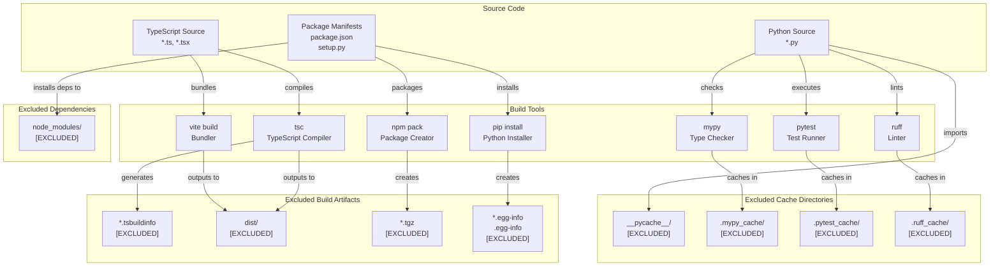
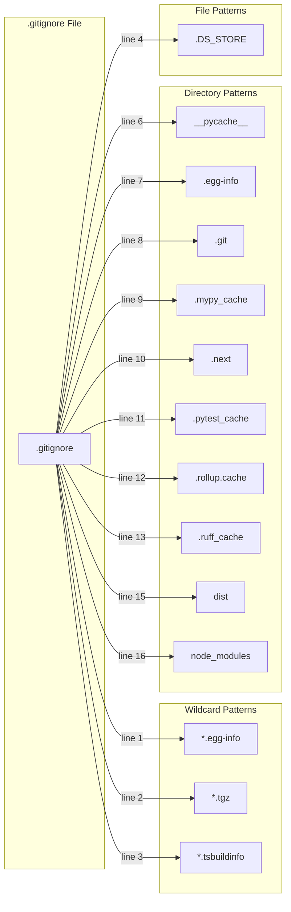
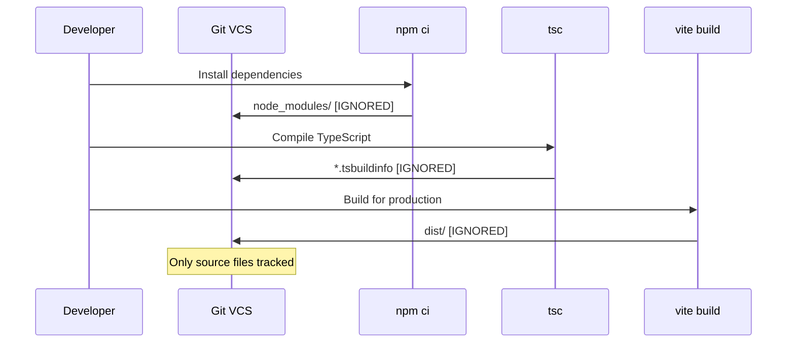
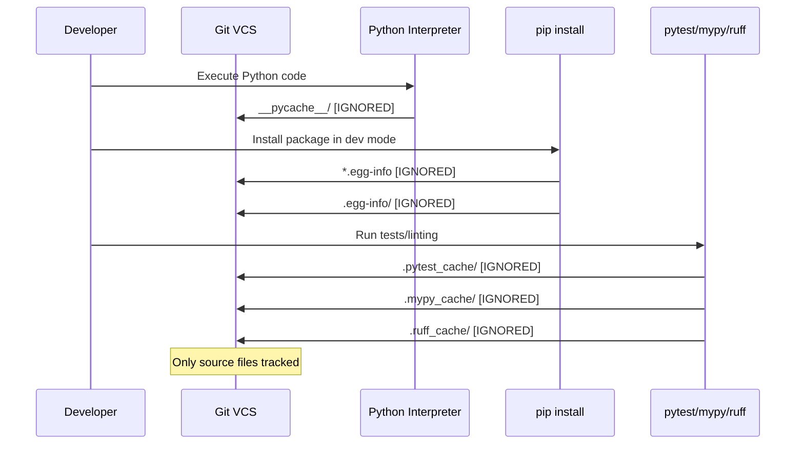
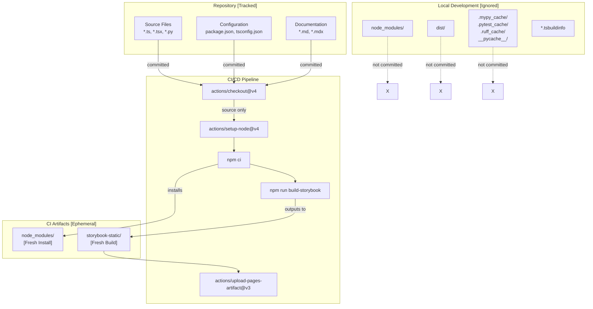
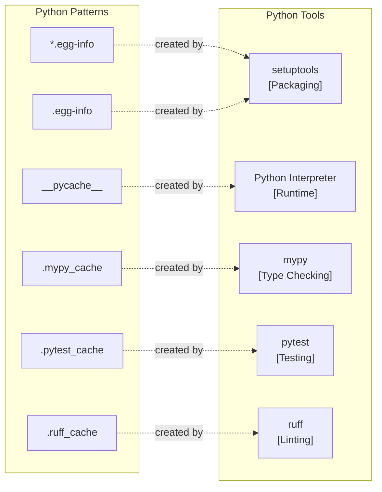
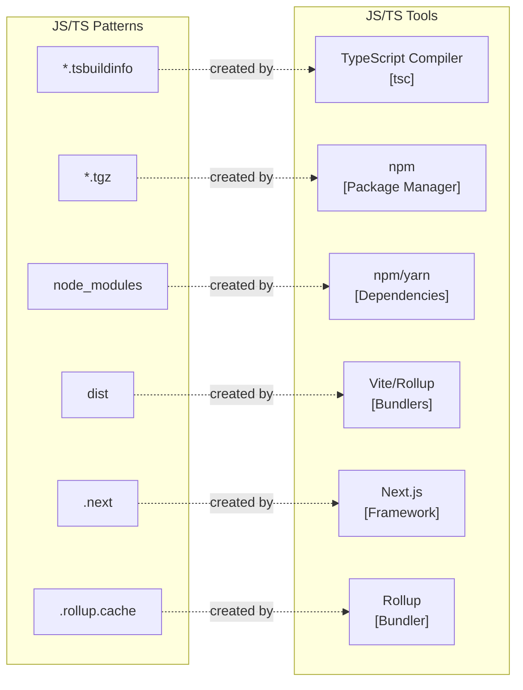

<!-- source: DeepWiki mcp.deepwiki.com · repo openai/apps-sdk-ui · page 8.1 Version Control Configuration · fetched 2026-10-26 -->

# Version Control Configuration

Relevant source files

The following files were used as context for generating this wiki page:

- [.gitignore](.gitignore)

## Purpose and Scope

This document explains the version control exclusions defined in the repository's `.gitignore` file. It describes which files and directories are excluded from Git tracking, organized by category and purpose. This configuration prevents build artifacts, dependency directories, cache files, and system-specific files from being committed to the repository.

For information about code formatting exclusions, see [Code Formatting Configuration](#8.2).

**Sources:** [.gitignore:1-17]()

---

## Overview

The `.gitignore` file implements a hybrid exclusion strategy that supports both Python and JavaScript/TypeScript development workflows. The configuration excludes three primary categories of files:

1. **Build artifacts and distributions** - Compiled outputs and packaged files
2. **Dependency directories** - Package manager-installed modules
3. **Cache and temporary files** - Tool-generated caches and system files

**Sources:** [.gitignore:1-17]()

---

## Exclusion Categories

### Build Artifacts

The following patterns exclude files generated during build and packaging processes:

| Pattern | Description | Generated By |
|---------|-------------|--------------|
| `*.tsbuildinfo` | TypeScript incremental compilation cache | `tsc --incremental` |
| `*.tgz` | Compressed tarball packages | `npm pack` |
| `*.egg-info` | Python package metadata | `pip install -e .` |
| `.egg-info` | Python package metadata directory | `setuptools` |
| `dist` | Distribution/build output directory | `vite build`, `python -m build` |

**Sources:** [.gitignore:1-3,7,15]()

### Dependency Directories

Package manager dependencies are excluded to prevent bloating the repository:

| Pattern | Description | Populated By |
|---------|-------------|--------------|
| `node_modules` | npm/yarn package dependencies | `npm install`, `npm ci` |

**Sources:** [.gitignore:16]()

### Cache Files

Multiple tools generate cache directories that are excluded:

| Pattern | Description | Tool |
|---------|-------------|------|
| `__pycache__` | Python bytecode cache | Python interpreter |
| `.mypy_cache` | MyPy type checker cache | `mypy` |
| `.pytest_cache` | pytest test cache | `pytest` |
| `.ruff_cache` | Ruff linter cache | `ruff` |
| `.rollup.cache` | Rollup bundler cache | `rollup` |
| `.next` | Next.js build cache | `next build` |

**Sources:** [.gitignore:6,9-13]()

### System and VCS Files

System-specific and version control metadata:

| Pattern | Description | Source |
|---------|-------------|--------|
| `.DS_STORE` | macOS directory metadata | macOS Finder |
| `.git` | Git repository metadata | Git |

**Sources:** [.gitignore:4,8]()

---

## Architecture Diagram: Excluded Artifact Generation

**Diagram: Build Tool Artifact Generation**  
This diagram shows how various build tools and development utilities generate files and directories that are excluded from version control.

**Sources:** [.gitignore:1-17]()

---

## Exclusion Pattern Mapping

**Diagram: .gitignore Pattern Structure**  
This diagram maps each line in the `.gitignore` file to its corresponding exclusion pattern type.

**Sources:** [.gitignore:1-17]()

---

## Development Workflow Integration

The `.gitignore` configuration integrates with multiple development workflows:

### JavaScript/TypeScript Workflow

**Diagram: JavaScript/TypeScript Build Exclusions**  
This sequence shows how JavaScript/TypeScript build artifacts are excluded during development.

**Sources:** [.gitignore:3,15-16]()

### Python Workflow

**Diagram: Python Build Exclusions**  
This sequence shows how Python development artifacts are excluded during development.

**Sources:** [.gitignore:1,6-7,9,11,13]()

---

## Pattern Types and Matching Behavior

The `.gitignore` file uses two types of patterns:

### Wildcard Patterns

These patterns match files anywhere in the repository tree:

| Pattern | Matches | Example Files |
|---------|---------|---------------|
| `*.egg-info` | Files ending in `.egg-info` | `package.egg-info`, `mylib.egg-info` |
| `*.tgz` | Compressed tarball files | `package-1.0.0.tgz`, `dist.tgz` |
| `*.tsbuildinfo` | TypeScript build info files | `tsconfig.tsbuildinfo`, `tsconfig.app.tsbuildinfo` |

**Sources:** [.gitignore:1-3]()

### Directory and File Patterns

These patterns match specific directories or files:

| Pattern | Type | Matches |
|---------|------|---------|
| `__pycache__` | Directory | `__pycache__/` anywhere in tree |
| `.egg-info` | Directory | `.egg-info/` anywhere in tree |
| `.git` | Directory | `.git/` anywhere in tree |
| `.mypy_cache` | Directory | `.mypy_cache/` anywhere in tree |
| `.next` | Directory | `.next/` anywhere in tree |
| `.pytest_cache` | Directory | `.pytest_cache/` anywhere in tree |
| `.rollup.cache` | Directory | `.rollup.cache/` anywhere in tree |
| `.ruff_cache` | Directory | `.ruff_cache/` anywhere in tree |
| `dist` | Directory | `dist/` anywhere in tree |
| `node_modules` | Directory | `node_modules/` anywhere in tree |
| `.DS_STORE` | File | `.DS_STORE` anywhere in tree |

**Sources:** [.gitignore:4,6-13,15-16]()

---

## Relationship to CI/CD Pipeline

The `.gitignore` exclusions ensure that only source files are committed, which affects the CI/CD pipeline:

**Diagram: Version Control and CI/CD Integration**  
This diagram shows how `.gitignore` exclusions affect the CI/CD pipeline by ensuring clean builds from source.

**Sources:** [.gitignore:1-17]()

---

## Multi-Language Support

The `.gitignore` configuration indicates this is a polyglot repository supporting multiple language ecosystems:

### Python Ecosystem Indicators

**Diagram: Python Tool Artifact Exclusions**

**Sources:** [.gitignore:1,6-7,9,11,13]()

### JavaScript/TypeScript Ecosystem Indicators

**Diagram: JavaScript/TypeScript Tool Artifact Exclusions**

**Sources:** [.gitignore:2-3,10,12,15-16]()

---

## File System Exclusions

System-specific files are excluded to maintain cross-platform compatibility:

| Pattern | Operating System | Purpose |
|---------|-----------------|---------|
| `.DS_STORE` | macOS | Finder view settings and icon positions |
| `.git` | All | Git repository metadata and object database |

These exclusions prevent system-specific metadata from being tracked, ensuring the repository remains portable across different development environments.

**Sources:** [.gitignore:4,8]()

---

## Summary

The `.gitignore` configuration implements a comprehensive exclusion strategy that:

1. **Prevents build artifacts** from being tracked by excluding `dist`, `*.tsbuildinfo`, and packaging outputs
2. **Excludes dependency directories** like `node_modules` that can be regenerated from manifests
3. **Ignores cache files** from multiple development tools including Python and JavaScript ecosystems
4. **Filters system files** that are platform-specific like `.DS_STORE`

This configuration ensures:
- Clean repository history without binary artifacts
- Faster clone and checkout operations
- Consistent CI/CD builds from source
- Cross-platform compatibility

**Sources:** [.gitignore:1-17]()

---

