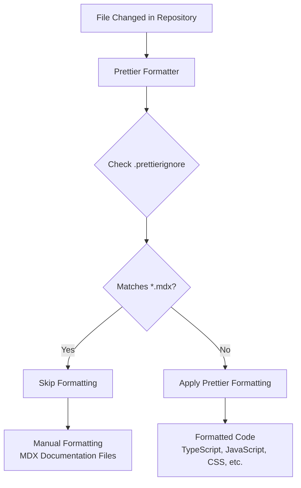
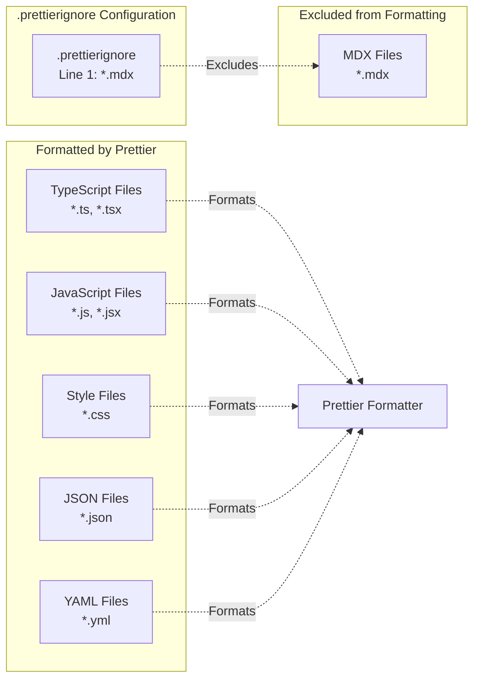

<!-- source: DeepWiki mcp.deepwiki.com · repo openai/apps-sdk-ui · page 8.2 Code Formatting Configuration · fetched 2026-10-26 -->

# Code Formatting Configuration

<details>
<summary>Relevant source files</summary>

The following files were used as context for generating this wiki page:

- [.prettierignore](.prettierignore)

</details>


## Purpose and Scope

This document covers the Prettier formatting configuration for the apps-sdk-ui repository, specifically the `.prettierignore` file that controls which files are excluded from automatic code formatting. This configuration ensures that certain file types maintain their original formatting rather than being automatically reformatted by Prettier.

For information about version control exclusions, see [Version Control Configuration](#8.1).

**Sources:** [.prettierignore:1-2]()

---

## Overview

The repository uses Prettier as its code formatter, with a minimal exclusion configuration that prevents automatic formatting of specific file types. The `.prettierignore` file follows the same pattern syntax as `.gitignore` and specifies files that should not be processed by Prettier's formatting engine.

**Sources:** [.prettierignore:1-2]()

---

## Configuration File Structure

### Location and Format

The `.prettierignore` file is located at the root of the repository and contains glob patterns for files to exclude from formatting:

| File Path | Purpose |
|-----------|---------|
| `.prettierignore` | Specifies files excluded from Prettier formatting |

**Sources:** [.prettierignore:1-2]()

### Excluded File Patterns

The configuration excludes the following pattern:

```
*.mdx
```

This glob pattern excludes all MDX (Markdown + JSX) files from Prettier formatting, regardless of their location in the repository.

**Sources:** [.prettierignore:1]()

---

## MDX File Exclusion Rationale

### Why MDX Files Are Excluded

MDX files combine Markdown content with JSX components, creating a hybrid format used extensively in Storybook documentation. These files are excluded from Prettier formatting for several reasons:

1. **Preserves Documentation Structure**: MDX files often contain carefully formatted prose, code examples, and component demonstrations where manual formatting is intentional
2. **Prevents Component Attribute Reformatting**: JSX components embedded in MDX may have specific attribute layouts that should remain unchanged
3. **Maintains Readability**: Documentation authors can control line breaks, spacing, and layout without automatic reformatting
4. **Avoids Formatting Conflicts**: MDX parsers may have different formatting expectations than Prettier's JSX formatter

**Sources:** [.prettierignore:1]()

### MDX Files in the Repository

The repository contains MDX files in the stories directory structure, which are used for:

- Component documentation pages
- Design system documentation
- Getting started guides
- API reference pages

These documentation files benefit from manual formatting control to ensure optimal readability and presentation.

**Sources:** [.prettierignore:1]()

---

## Formatting Workflow

### Diagram: Code Formatting Decision Flow



This diagram illustrates the decision flow when Prettier processes files in the repository. All files pass through the `.prettierignore` check, and MDX files are excluded from automatic formatting.

**Sources:** [.prettierignore:1-2]()

### Diagram: File Type Formatting Treatment



This diagram categorizes file types by their formatting treatment. The `.prettierignore` configuration file explicitly excludes MDX files while all other standard development files remain subject to Prettier formatting.

**Sources:** [.prettierignore:1-2]()

---

## Integration with Development Workflow

### Comparison with Version Control Exclusions

The formatting exclusions in `.prettierignore` serve a different purpose than the version control exclusions in `.gitignore`:

| Configuration | Purpose | Scope |
|---------------|---------|-------|
| `.prettierignore` | Controls code formatting | Only excludes MDX files |
| `.gitignore` | Controls version tracking | Excludes build artifacts, dependencies, system files |

While `.gitignore` prevents files from being committed to the repository, `.prettierignore` only affects which committed files are automatically formatted.

**Sources:** [.prettierignore:1-2]()

### Command Integration

The `.prettierignore` configuration is automatically respected by:

- **Prettier CLI**: When running `prettier --write .` or similar commands
- **Editor Integrations**: VS Code, WebStorm, and other editors with Prettier plugins
- **Pre-commit Hooks**: If configured, formatting hooks will skip ignored patterns
- **CI/CD Pipelines**: Any automated formatting checks will respect exclusions

**Sources:** [.prettierignore:1-2]()

---

## Best Practices

### When to Update .prettierignore

Consider adding patterns to `.prettierignore` when:

1. Files contain intentional formatting that serves documentation or presentation purposes
2. File formats have edge cases where Prettier formatting degrades readability
3. Third-party generated files are committed but should not be reformatted
4. Special file types require manual control over formatting

### Current Exclusion Justification

The single exclusion pattern (`*.mdx`) is intentional and minimal, reflecting the philosophy that most code should be consistently formatted while documentation content benefits from author control.

**Sources:** [.prettierignore:1-2]()

---

## Configuration Summary

### Key Characteristics

| Aspect | Value |
|--------|-------|
| **Location** | Repository root |
| **File Name** | `.prettierignore` |
| **Total Patterns** | 1 |
| **Excluded File Types** | MDX files only |
| **Configuration Approach** | Minimal exclusions |

**Sources:** [.prettierignore:1-2]()

### Pattern Reference

```
*.mdx
```

This is the complete content of the `.prettierignore` file. The pattern uses glob syntax where:
- `*` matches any filename
- `.mdx` specifies the MDX file extension

The pattern applies recursively to all directories in the repository.

**Sources:** [.prettierignore:1-2]()