# Page: Overview

# Overview

<details>
<summary>Relevant source files</summary>

The following files were used as context for generating this wiki page:

- [.github/workflows/deploy-storybook.yml](.github/workflows/deploy-storybook.yml)
- [.storybook-base/addon-theme/themes.ts](.storybook-base/addon-theme/themes.ts)
- [.storybook-base/components/tokens.ts](.storybook-base/components/tokens.ts)
- [.storybook-base/main.ts](.storybook-base/main.ts)
- [.storybook-base/manager.ts](.storybook-base/manager.ts)

</details>


This document provides an overview of the **apps-sdk-ui Storybook** repository, which serves as a documentation and component development platform for the OpenAI Apps SDK UI component library. This repository contains the Storybook configuration, custom addons, design system documentation, and automated deployment infrastructure for publishing component documentation to GitHub Pages.

For detailed information about specific subsystems, see:
- Storybook configuration details: [Storybook Configuration](#3)
- Custom addon implementations: [Custom Addons](#4)
- Design system tokens and themes: [Design System](#5)
- CI/CD pipeline specifics: [CI/CD & Deployment](#7)

## Purpose and Scope

The apps-sdk-ui Storybook repository is a specialized documentation platform built on top of Storybook that provides:

1. **Interactive component documentation** for React UI components from the main `apps-sdk-ui` library
2. **Custom Storybook addons** that enhance the documentation experience with theme switching, navigation helpers, and UI controls
3. **Comprehensive design system documentation** including design tokens, color palettes, typography, and motion guidelines
4. **Automated deployment** to GitHub Pages for public access to the documentation site

This repository does not contain the source code for the UI components themselves—it focuses exclusively on their documentation and presentation. The actual component implementations are imported from the parent `src/` directory.

## Technology Stack

| Technology | Purpose | Configuration |
|------------|---------|---------------|
| **Storybook 7.x** | Core documentation platform | [.storybook-base/main.ts:1-78]() |
| **React 18** | Component rendering framework | Used throughout components |
| **TypeScript** | Type-safe development | [.storybook-base/main.ts:36-43]() |
| **Vite** | Build tool and dev server | [.storybook-base/main.ts:44-76]() |
| **GitHub Actions** | CI/CD automation | [.github/workflows/deploy-storybook.yml:1-52]() |
| **GitHub Pages** | Static site hosting | [.github/workflows/deploy-storybook.yml:42-51]() |

Sources: [.storybook-base/main.ts:1-78](), [.github/workflows/deploy-storybook.yml:1-52]()

## System Architecture Overview

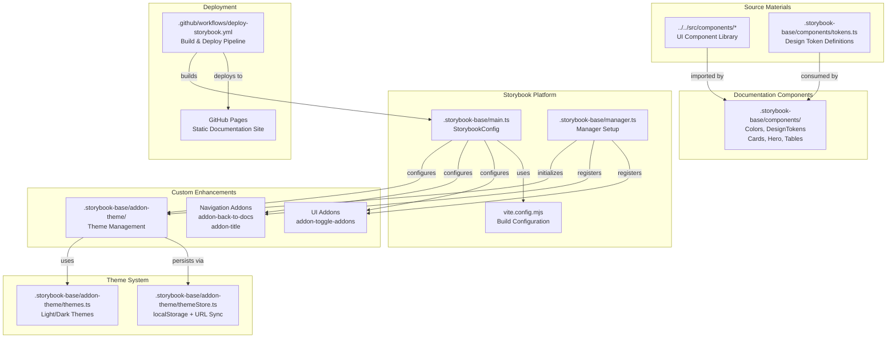

**Architecture Overview: Repository Components and Data Flow**

This diagram shows how the repository's major subsystems interact. Story and documentation files import UI components and design tokens, which are then rendered through Storybook's platform. Custom addons enhance the user experience, while the theme system manages light/dark mode preferences. The GitHub Actions pipeline automates the build and deployment process.

Sources: [.storybook-base/main.ts:1-78](), [.storybook-base/manager.ts:1-45](), [.github/workflows/deploy-storybook.yml:1-52](), [.storybook-base/addon-theme/themes.ts:1-68]()

## Key Features

### 1. Comprehensive Design System Documentation

The repository provides detailed documentation for the complete design system, including:

| Design Token Category | Count | Definition Location |
|----------------------|-------|---------------------|
| **Text Colors** | 4 base colors | [.storybook-base/components/tokens.ts:1-41]() |
| **Semantic Colors** | 200+ variants | [.storybook-base/components/tokens.ts:43-2207]() |
| **Border Radius** | 10 sizes | [.storybook-base/components/tokens.ts:2209-2260]() |
| **Typography** | 50+ tokens | [.storybook-base/components/tokens.ts:2262-2384]() |
| **Shadows** | 13 variants | [.storybook-base/components/tokens.ts:2386-2447]() |
| **Breakpoints** | 6 sizes | [.storybook-base/components/tokens.ts:2449-2480]() |
| **Motion** | 6 parameters | [.storybook-base/components/tokens.ts:2482-2492]() |

Sources: [.storybook-base/components/tokens.ts:1-2493]()

### 2. Custom Storybook Addons

Four custom-built addons enhance the documentation experience:

| Addon | Purpose | Implementation |
|-------|---------|----------------|
| **addon-theme** | Theme toggle (light/dark mode) with persistence | [.storybook-base/addon-theme/]() |
| **addon-back-to-docs** | Navigation button to return to docs view | [.storybook-base/addon-back-to-docs/]() |
| **addon-title** | Dynamic browser tab title updates | [.storybook-base/addon-title/]() |
| **addon-toggle-addons** | Show/hide addon panels control | [.storybook-base/addon-toggle-addons/]() |

Sources: [.storybook-base/manager.ts:1-45]()

### 3. Theme System with Persistence

The theme system supports both light and dark modes with multi-layer persistence:

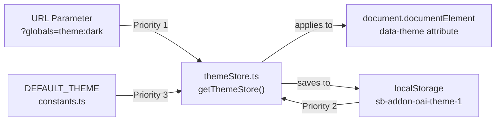

**Theme Persistence Priority System**

The theme store checks three sources in order: URL parameters (highest priority), localStorage (medium priority), and default values (fallback). Changes are persisted to localStorage and applied to the DOM via data attributes.

Sources: [.storybook-base/addon-theme/themeStore.ts](), [.storybook-base/addon-theme/constants.ts]()

### 4. Automated CI/CD Pipeline

Every push to the `main` branch triggers an automated build and deployment:

| Stage | Action | Tool |
|-------|--------|------|
| **Build** | `npm ci` → `npm run build-storybook` | GitHub Actions + Node 20 |
| **Artifact** | Upload `storybook-static/` directory | `upload-pages-artifact@v3` |
| **Deploy** | Publish to GitHub Pages | `deploy-pages@v4` |
| **Access** | Public documentation site | `https://{org}.github.io/{repo}` |

Sources: [.github/workflows/deploy-storybook.yml:1-52]()

## Repository Structure and Code Entity Mapping

```mermaid
graph TB
    subgraph "Root Directory"
        WORKFLOW["..github/workflows/<br/>deploy-storybook.yml"]
        VITE_CONFIG["vite.config.mjs"]
        GITIGNORE[".gitignore"]
        PRETTIER[".prettierignore"]
    end
    
    subgraph ".storybook-base/ Directory"
        MAIN["main.ts<br/>StorybookConfig"]
        MANAGER["manager.ts<br/>addons.setConfig()"]
        MANAGER_HEAD["manager-head.html<br/>CSS Variables"]
        
        subgraph "addon-theme/"
            THEME_INDEX["index.tsx<br/>init()"]
            THEME_TOOL["Tool.tsx<br/>Theme Toggle UI"]
            THEME_STORE["themeStore.ts<br/>getThemeStore()"]
            THEME_DEFS["themes.ts<br/>THEMES Record"]
            THEME_CONST["constants.ts<br/>Theme type"]
        end
        
        subgraph "addon-back-to-docs/"
            BACK_INDEX["index.tsx"]
        end
        
        subgraph "addon-title/"
            TITLE_INDEX["index.tsx"]
        end
        
        subgraph "addon-toggle-addons/"
            TOGGLE_INDEX["index.tsx"]
        end
        
        subgraph "components/"
            TOKENS_FILE["tokens.ts<br/>TEXT_COLORS<br/>SEMANTIC_COLORS<br/>RADIUS, FONTS"]
            COLORS_COMP["Colors.tsx"]
            DESIGN_TOKENS_COMP["DesignTokens.tsx"]
            CARDS["Card.tsx<br/>FooterCard.tsx"]
            HERO_COMP["Hero.tsx"]
            TABLE_COMP["CustomTable.tsx"]
            ICON_GALLERY["CustomIconGallery.tsx"]
        end
        
        subgraph "StorybookApp/"
            APP_INDEX["index.tsx<br/>WithTheme decorator"]
            DOCS_CONTAINER["CustomDocsContainer.tsx"]
        end
    end
    
    subgraph "src/ Directory (Parent)"
        SRC_COMPONENTS["components/*<br/>Button, Icon, Tooltip, etc."]
        STORIES["**/*.stories.tsx<br/>**/*.mdx"]
    end
    
    MAIN -->|discovers| STORIES
    MAIN -->|configures addons| THEME_INDEX
    MAIN -->|viteFinal hook| VITE_CONFIG
    
    MANAGER -->|init()| THEME_INDEX
    MANAGER -->|registers| BACK_INDEX
    MANAGER -->|registers| TITLE_INDEX
    MANAGER -->|registers| TOGGLE_INDEX
    
    THEME_TOOL -->|uses| THEME_DEFS
    THEME_INDEX -->|persists via| THEME_STORE
    
    COLORS_COMP -->|imports| TOKENS_FILE
    DESIGN_TOKENS_COMP -->|imports| TOKENS_FILE
    ICON_GALLERY -->|imports| SRC_COMPONENTS
    
    STORIES -->|imports| SRC_COMPONENTS
    STORIES -->|imports| COLORS_COMP
    STORIES -->|imports| DESIGN_TOKENS_COMP
    
    WORKFLOW -->|builds| MAIN
    WORKFLOW -->|uses| VITE_CONFIG
```

**File Structure and Code Entity Relationships**

This diagram maps the repository's file structure to key code entities, showing how TypeScript modules, classes, and functions interconnect. Gray boxes represent directories, while white boxes show individual files with their primary exports.

Sources: [.storybook-base/main.ts:1-78](), [.storybook-base/manager.ts:1-45](), [.storybook-base/components/tokens.ts:1-2493](), [.github/workflows/deploy-storybook.yml:1-52]()

## How the System Works

### Development Workflow

1. **Component Development**: UI components are developed in the parent `src/` directory
2. **Story Creation**: Developers create `.stories.tsx` or `.mdx` files that import and showcase components
3. **Local Preview**: Run `npm run storybook` to preview documentation at `localhost:6006`
4. **Design Token Usage**: Documentation components reference tokens from [.storybook-base/components/tokens.ts:1-2493]()

### Build Process

The build process is orchestrated by [.storybook-base/main.ts:1-78]():

| Step | Configuration | Purpose |
|------|---------------|---------|
| **Story Discovery** | `stories: ["../src/**/*.mdx", "../src/**/*.stories.@(js\|jsx\|ts\|tsx)"]` | Locate all documentation files |
| **Addon Loading** | `addons: ["@storybook/addon-links", ...]` | Enable Storybook features |
| **TypeScript Setup** | `reactDocgen: "react-docgen-typescript"` | Generate prop tables from types |
| **Vite Configuration** | `viteFinal()` hook | Custom build settings |
| **Environment Variable** | `process.env.IS_STORYBOOK = "true"` | Runtime detection flag |

Sources: [.storybook-base/main.ts:1-78]()

### Theme Application

The theme system applies visual styling through multiple layers:

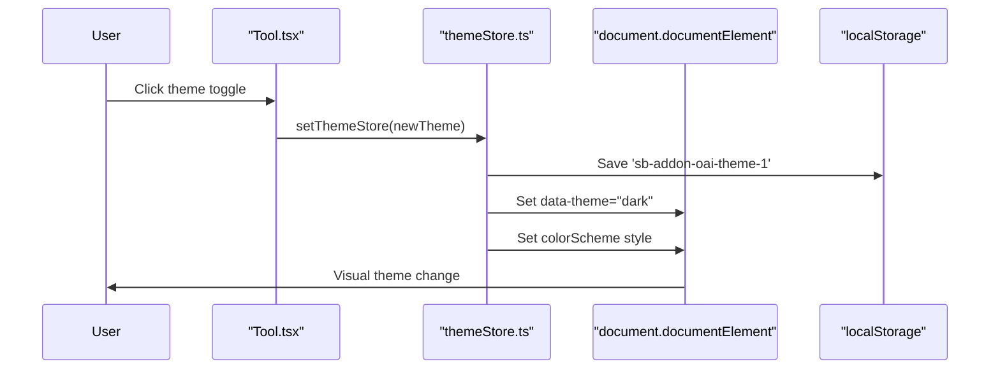

**Theme Toggle Sequence**

When a user clicks the theme toggle, the Tool component calls `setThemeStore()`, which persists the choice to localStorage and applies CSS classes to the document element, triggering visual changes via CSS variable overrides.

Sources: [.storybook-base/addon-theme/Tool.tsx](), [.storybook-base/addon-theme/themeStore.ts]()

### Deployment Pipeline

The deployment is fully automated via GitHub Actions:

1. **Trigger**: Push to `main` branch or manual `workflow_dispatch`
2. **Build Job** ([.github/workflows/deploy-storybook.yml:19-40]()):
   - Checkout code with `actions/checkout@v4`
   - Setup Node.js 20 with npm cache
   - Install dependencies: `npm ci`
   - Build static site: `npm run build-storybook --output-dir storybook-static`
   - Upload artifact to GitHub's artifact storage
3. **Deploy Job** ([.github/workflows/deploy-storybook.yml:42-51]()):
   - Download build artifact
   - Deploy to GitHub Pages using `actions/deploy-pages@v4`
   - Site becomes accessible at the GitHub Pages URL

Sources: [.github/workflows/deploy-storybook.yml:1-52]()

## Storybook Configuration Summary

### Main Configuration (`main.ts`)

The primary configuration file [.storybook-base/main.ts:1-78]() defines:

- **Story patterns**: `["../src/**/*.mdx", "../src/**/*.stories.@(js|jsx|ts|tsx)"]`
- **Enabled addons**: Links, toolbars, essentials (with disabled features), storysource
- **TypeScript integration**: `react-docgen-typescript` with prop extraction options
- **Vite customizations**: Module aliases, asset includes, TSConfig overrides
- **Static directory**: `["../public"]` for public assets

### Manager Configuration (`manager.ts`)

The manager configuration [.storybook-base/manager.ts:1-45]() sets:

- **Sidebar width**: `navSize: 230` pixels
- **Hidden toolbar items**: copy, eject, fullscreen, createStory
- **Sidebar behavior**: `showRoots: true`, `collapsedRoots: []`
- **Docs defaults**: `isCodeExpanded: true`, `source.state: "shown"`
- **Custom addon registration**: Theme, back-to-docs, title, toggle-addons
- **View mode tracking**: Sets `data-view-mode` attribute on document element

Sources: [.storybook-base/main.ts:1-78](), [.storybook-base/manager.ts:1-45]()

## Design System Highlights

The design system is built on a comprehensive token architecture defined in [.storybook-base/components/tokens.ts:1-2493](). Key characteristics:

### Color System Architecture

| Category | Variants | Theme Support |
|----------|----------|---------------|
| **Text Colors** | Base, Secondary, Tertiary, Inverse | Light/Dark values |
| **Primary Semantic** | Soft, Surface, Solid, Outline, Ghost + Ring | Full theme support |
| **Intent Colors** | Info, Warning, Caution, Danger, Success, Discovery | 40+ variants each |
| **State Colors** | Disabled, Hover, Active states | Cross-variant support |

### Typography Scale

The system defines a complete typographic scale:
- **Headings**: 5xl → xs (9 sizes) with size, line-height, weight, tracking
- **Text**: lg → 3xs (6 sizes) with full specifications
- **Font families**: Sans-serif and monospace stacks
- **Weights**: Normal (400), Medium (500), Semibold (600), Bold (700)
- **Tracking**: Wide (0em), Normal (-0.01em), Tight (-0.02em)

### Theme Definitions

Two themes are defined in [.storybook-base/addon-theme/themes.ts:1-68]():

**Light Theme** ([.storybook-base/addon-theme/themes.ts:4-32]()):
- Brand image: `logo-storybook.svg`
- Primary color: `#3A10E5`
- Background: `#ffffff`
- Border: `#ededed`
- Text: `#6e6e80`

**Dark Theme** ([.storybook-base/addon-theme/themes.ts:34-62]()):
- Brand image: `logo-storybook-dark.svg`
- Primary color: `#3A10E5` (same)
- Background: `#212121`
- Border: `#393939`
- Text: `#c1c1c1`

Sources: [.storybook-base/components/tokens.ts:1-2493](), [.storybook-base/addon-theme/themes.ts:1-68]()

## Next Steps

For in-depth information about specific subsystems:

- **Repository organization and file structure**: See [Repository Structure](#1.1)
- **Development environment setup**: See [Getting Started](#2)
- **Storybook configuration deep dive**: See [Storybook Configuration](#3)
- **Custom addon implementation details**: See [Custom Addons](#4)
- **Complete design token reference**: See [Design System](#5)
- **Documentation component usage**: See [Documentation Components](#6)
- **CI/CD pipeline details**: See [CI/CD & Deployment](#7)

---

# Page: Repository Structure

# Repository Structure

<details>
<summary>Relevant source files</summary>

The following files were used as context for generating this wiki page:

- [.gitignore](.gitignore)
- [.prettierignore](.prettierignore)
- [.storybook-base/main.ts](.storybook-base/main.ts)

</details>


## Purpose and Scope

This document describes the physical organization of the apps-sdk-ui repository, including its directory layout, file patterns, and version control configuration. It explains where components, stories, and documentation files are located, and which files are excluded from version control and formatting tools.

For information about how Storybook is configured to discover and display these files, see [Storybook Configuration](#3). For details on the CI/CD pipeline that builds and deploys this structure, see [CI/CD & Deployment](#7).

---

## Repository Layout

The repository follows a standard Storybook project structure with custom extensions for theme management and documentation components.

### Directory Organization

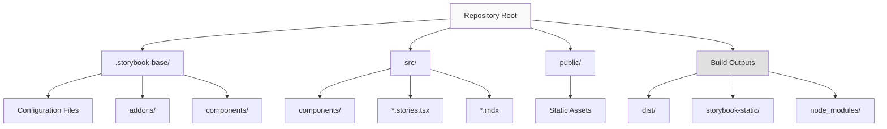

**Sources:** [.storybook-base/main.ts:1-78](), [.gitignore:1-17]()

### Key Directories

| Directory | Purpose | Tracked in Git |
|-----------|---------|----------------|
| `.storybook-base/` | Storybook configuration, custom addons, and documentation components | ✓ Yes |
| `src/` | Source components and their stories/documentation | ✓ Yes |
| `public/` | Static assets served by Storybook | ✓ Yes |
| `node_modules/` | Node.js dependencies | ✗ No |
| `dist/` | Build output for the component library | ✗ No |
| `storybook-static/` | Compiled Storybook site | ✗ No |

**Sources:** [.storybook-base/main.ts:52](), [.gitignore:15-16]()

---

## Story Discovery and Organization

Storybook discovers stories and documentation using glob patterns defined in the configuration. The system locates files in the `src/` directory based on specific file extensions.

### Story File Patterns

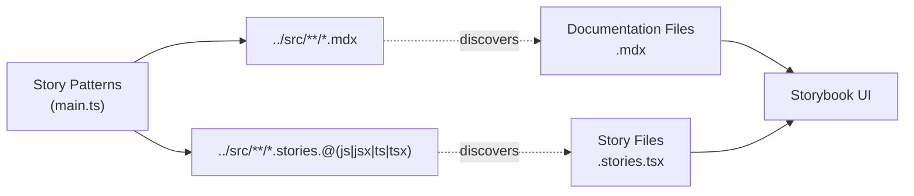

**Sources:** [.storybook-base/main.ts:5]()

The configuration defines two story patterns:

1. **MDX Documentation**: `../src/**/*.mdx` - Markdown files with embedded JSX for rich documentation pages
2. **Component Stories**: `../src/**/*.stories.@(js|jsx|ts|tsx)` - JavaScript/TypeScript files containing component examples and variations

These patterns use glob syntax where:
- `**` matches any number of directory levels
- `*` matches any characters within a filename
- `@(js|jsx|ts|tsx)` matches any of the specified extensions

**Sources:** [.storybook-base/main.ts:5]()

### Module Resolution Aliases

The build configuration establishes a module alias to simplify imports within documentation:

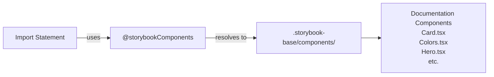

**Sources:** [.storybook-base/main.ts:56-61]()

This alias allows MDX files to import documentation components using `@storybookComponents/ComponentName` instead of relative paths like `../.storybook-base/components/ComponentName`.

**Sources:** [.storybook-base/main.ts:60]()

---

## Version Control Exclusions

The `.gitignore` file excludes build artifacts, dependencies, and system-generated files from version control. The repository supports both Python and JavaScript/TypeScript development workflows.

### Excluded File Categories

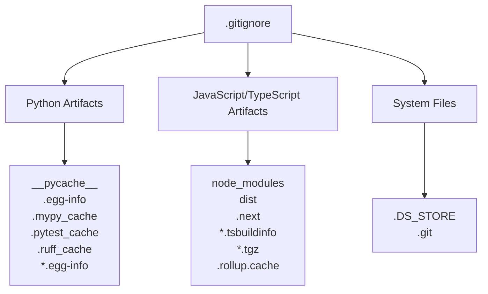

**Sources:** [.gitignore:1-17]()

### Detailed Exclusion Patterns

| Pattern | Type | Reason for Exclusion |
|---------|------|---------------------|
| `__pycache__` | Python | Compiled Python bytecode |
| `.egg-info` / `*.egg-info` | Python | Python package metadata |
| `.mypy_cache` | Python | Type checker cache |
| `.pytest_cache` | Python | Test framework cache |
| `.ruff_cache` | Python | Linter cache |
| `node_modules` | JavaScript | NPM dependencies (large, reproducible) |
| `dist` | JavaScript | Build output directory |
| `.next` | JavaScript | Next.js build cache |
| `*.tsbuildinfo` | TypeScript | Incremental compilation cache |
| `*.tgz` | Archive | Compressed package files |
| `.rollup.cache` | JavaScript | Rollup bundler cache |
| `.DS_STORE` | macOS | Finder metadata |
| `.git` | Git | Git internal directory |

**Sources:** [.gitignore:1-17]()

The presence of Python-related exclusions (lines 6-9, 13) indicates the repository may be part of a larger monorepo or have Python tooling integration, though the primary focus is the Storybook documentation system.

**Sources:** [.gitignore:6-13]()

---

## Code Formatting Exclusions

The `.prettierignore` file prevents the Prettier code formatter from processing specific file types that could be negatively affected by automatic formatting.

### Excluded Formats

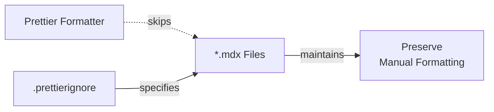

**Sources:** [.prettierignore:1-2]()

### MDX File Exclusion

MDX files combine Markdown with JSX, and are excluded from Prettier formatting:

**Pattern**: `*.mdx`

**Rationale**: MDX files often contain carefully formatted documentation with specific line breaks, indentation, and spacing that contribute to readability. Automatic formatting could:
- Disrupt intentional line breaks in prose
- Alter the visual structure of embedded code examples
- Change the spacing around JSX components in ways that reduce clarity

Since these files are primarily authored by humans for human consumption, preserving the author's formatting choices is prioritized over automatic consistency.

**Sources:** [.prettierignore:1]()

---

## Static Asset Serving

The Storybook configuration specifies static directories that are served without processing during development and in the production build.

### Static Directory Configuration

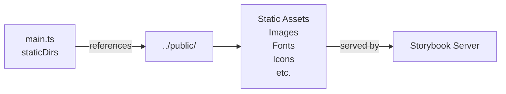

**Sources:** [.storybook-base/main.ts:52]()

The `staticDirs` configuration points to `../public/`, making all files in this directory accessible at the root of the Storybook URL. For example, a file at `public/logo.svg` would be accessible at `/logo.svg` in the running Storybook instance.

**Sources:** [.storybook-base/main.ts:52]()

---

## Build Configuration Context

The repository uses Vite as its build tool, referenced through the Storybook framework configuration. The Vite configuration is located at `./vite.config.mjs` relative to the `.storybook-base/` directory.

### Build Configuration Flow

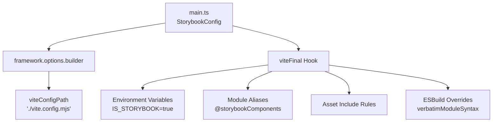

**Sources:** [.storybook-base/main.ts:44-76]()

### Vite Configuration Modifications

The `viteFinal` hook in the Storybook configuration applies several runtime modifications to the Vite build:

1. **Environment Variable**: Sets `IS_STORYBOOK=true` to allow conditional logic in source code ([.storybook-base/main.ts:54]())

2. **Module Alias**: Creates `@storybookComponents` alias for documentation component imports ([.storybook-base/main.ts:56-61]())

3. **Asset Include**: Adds `/sb-preview/runtime.js` to `assetsInclude` to work around Storybook issue #25256 ([.storybook-base/main.ts:64]())

4. **TypeScript Override**: Disables `verbatimModuleSyntax` compiler option for ESBuild to ensure Storybook compatibility ([.storybook-base/main.ts:68-73]())

**Sources:** [.storybook-base/main.ts:53-76]()

---

## Summary

The repository structure is organized into clearly defined areas:

- **Configuration**: `.storybook-base/` contains all Storybook setup and customizations
- **Source**: `src/` contains component source code and their stories
- **Assets**: `public/` holds static files served without processing
- **Build Artifacts**: Multiple directories (`dist/`, `storybook-static/`, `node_modules/`) are excluded from version control

Story discovery is automatic based on glob patterns, supporting both `.mdx` documentation files and `.stories.tsx` component examples throughout the `src/` directory tree. The build system uses Vite with custom modifications for Storybook compatibility, and both Git and Prettier are configured to ignore generated artifacts and preserve manual formatting where appropriate.

**Sources:** [.storybook-base/main.ts:1-78](), [.gitignore:1-17](), [.prettierignore:1-2]()

---

# Page: Getting Started

# Getting Started

<details>
<summary>Relevant source files</summary>

The following files were used as context for generating this wiki page:

- [.github/workflows/deploy-storybook.yml](.github/workflows/deploy-storybook.yml)
- [.gitignore](.gitignore)
- [.storybook-base/main.ts](.storybook-base/main.ts)

</details>


This document provides instructions for setting up the development environment and running the Storybook documentation platform locally. It covers prerequisites, installation steps, available npm scripts, and the build process. For detailed information about Storybook configuration options, see [Storybook Configuration](#3). For deployment and CI/CD details, see [CI/CD & Deployment](#7).

## Prerequisites

The repository requires the following software to be installed:

| Software | Version | Purpose |
|----------|---------|---------|
| Node.js | 20 | Runtime environment for building and running Storybook |
| npm | Latest (bundled with Node.js) | Package manager for dependency installation |
| Git | Any recent version | Version control for cloning the repository |

The Node.js version requirement is specified in the GitHub Actions workflow at [.github/workflows/deploy-storybook.yml:28]().

**Sources:** `.github/workflows/deploy-storybook.yml`

## Installation

### Clone the Repository

```bash
git clone https://github.com/openai/apps-sdk-ui.git
cd apps-sdk-ui
```

### Install Dependencies

Install all required packages using npm:

```bash
npm ci
```

The `npm ci` command (clean install) is used instead of `npm install` to ensure reproducible builds by strictly following the `package-lock.json` file. This is the same approach used in the CI/CD pipeline at [.github/workflows/deploy-storybook.yml:32]().

**Sources:** `.github/workflows/deploy-storybook.yml`

## Development Workflow

### Development Workflow Overview

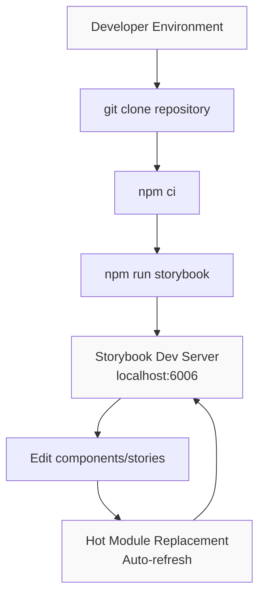

**Sources:** `.github/workflows/deploy-storybook.yml`, `.storybook-base/main.ts`

### Running Storybook Locally

To start the Storybook development server:

```bash
npm run storybook
```

This command launches a local development server with hot module replacement (HMR), typically accessible at `http://localhost:6006`. Changes to component files and stories are automatically reflected in the browser without requiring a full page reload.

### Building for Production

To build a static version of Storybook for deployment:

```bash
npm run build-storybook
```

This command generates static HTML, CSS, and JavaScript files in the `storybook-static` directory (configurable via the `--output-dir` flag). The build command is defined at [.github/workflows/deploy-storybook.yml:35]() and uses Vite as the bundler.

**Sources:** `.github/workflows/deploy-storybook.yml`, `.storybook-base/main.ts`

## Build Process Architecture

### Build Pipeline Stages

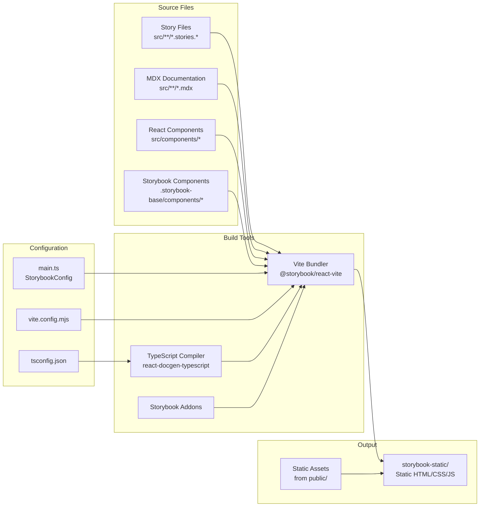

**Sources:** `.storybook-base/main.ts`, `.github/workflows/deploy-storybook.yml`

## File Structure Overview

After cloning and installing dependencies, the repository structure includes:

| Directory/File | Description | Version Control |
|----------------|-------------|-----------------|
| `.storybook-base/` | Storybook configuration and custom components | Tracked |
| `src/` | Source component files and stories | Tracked |
| `public/` | Static assets served by Storybook | Tracked |
| `node_modules/` | Installed npm dependencies | Ignored |
| `dist/` | Build output directory | Ignored |
| `storybook-static/` | Built Storybook static files | Ignored (generated) |
| `.next/` | Next.js build cache | Ignored |
| `__pycache__/` | Python cache files | Ignored |

Files and directories excluded from version control are defined in [.gitignore:1-17]().

**Sources:** `.gitignore`

## Story Discovery and Configuration

### Story Pattern Matching

Storybook automatically discovers story files using the patterns defined in [.storybook-base/main.ts:5]():

```
stories: ["../src/**/*.mdx", "../src/**/*.stories.@(js|jsx|ts|tsx)"]
```

This configuration matches:
- **MDX files**: Documentation pages with interactive examples
- **Story files**: Component stories in JavaScript or TypeScript

### Static Asset Serving

Static assets located in the `public/` directory are served by Storybook during development and included in production builds. This is configured via the `staticDirs` option at [.storybook-base/main.ts:52]().

**Sources:** `.storybook-base/main.ts`

## Build Configuration Details

### Vite Integration

The Storybook build process uses Vite as its bundler, configured through the `@storybook/react-vite` framework at [.storybook-base/main.ts:44-50]():

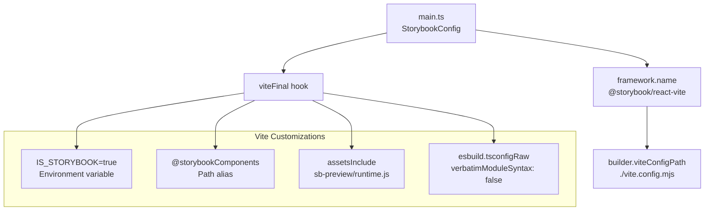

The `viteFinal` hook at [.storybook-base/main.ts:53-76]() applies several customizations:

1. **Environment Variable**: Sets `IS_STORYBOOK=true` to enable conditional logic in components
2. **Path Alias**: Creates `@storybookComponents` alias pointing to `.storybook-base/components/` for convenient imports in MDX files
3. **Asset Includes**: Adds `/sb-preview/runtime.js` to prevent build errors
4. **TypeScript Configuration**: Overrides `verbatimModuleSyntax` to `false` for Storybook compatibility

**Sources:** `.storybook-base/main.ts`

### TypeScript Configuration

TypeScript integration is configured at [.storybook-base/main.ts:36-43]() using `react-docgen-typescript` for automatic prop documentation generation:

| Option | Value | Purpose |
|--------|-------|---------|
| `reactDocgen` | `"react-docgen-typescript"` | Documentation generator |
| `savePropValueAsString` | `true` | Preserve prop values as strings for display |
| `shouldRemoveUndefinedFromOptional` | `true` | Clean up optional prop types |
| `shouldExtractLiteralValuesFromEnum` | `true` | Extract enum values for documentation |

**Sources:** `.storybook-base/main.ts`

## CI/CD Build Process

The automated build and deployment process is triggered by pushes to the `main` branch or manual workflow dispatch. The pipeline consists of two jobs:

### Build Job

The build job executes the following steps on `ubuntu-latest`:

1. **Checkout**: Retrieves the repository code using `actions/checkout@v4`
2. **Node Setup**: Installs Node.js 20 with npm cache using `actions/setup-node@v4`
3. **Dependencies**: Runs `npm ci` to install packages
4. **Build**: Executes `npm run build-storybook --output-dir storybook-static`
5. **Upload**: Uploads the `storybook-static` directory as a GitHub Pages artifact

### Deploy Job

The deploy job runs after the build job completes and publishes the artifact to GitHub Pages using `actions/deploy-pages@v4`.

For complete CI/CD documentation, see [GitHub Actions Workflow](#7.1).

**Sources:** `.github/workflows/deploy-storybook.yml`

## Next Steps

After successfully running Storybook locally, you can:

1. **Explore the Design System**: Review design tokens and themes in [Design System](#5)
2. **Customize Themes**: Understand theme configuration in [Theme System](#5.2)
3. **Create Documentation Components**: Learn about custom components in [Documentation Components](#6)
4. **Configure Addons**: Explore custom addons in [Custom Addons](#4)

**Sources:** `.storybook-base/main.ts`, `.github/workflows/deploy-storybook.yml`, `.gitignore`

---

# Page: Storybook Configuration

# Storybook Configuration

<details>
<summary>Relevant source files</summary>

The following files were used as context for generating this wiki page:

- [.storybook-base/components/StorybookApp.tsx](.storybook-base/components/StorybookApp.tsx)
- [.storybook-base/main.ts](.storybook-base/main.ts)
- [.storybook-base/manager-head.html](.storybook-base/manager-head.html)
- [.storybook-base/manager.ts](.storybook-base/manager.ts)

</details>


This document provides a comprehensive overview of how Storybook is configured in the apps-sdk-ui repository. It covers the main configuration files, manager setup, UI customizations, and component integrations that collectively define the Storybook development and documentation environment.

For detailed information about specific configuration areas, see:
- Main configuration file settings: [Main Configuration (main.ts)](#3.1)
- Manager toolbar and sidebar settings: [Manager Configuration (manager.ts)](#3.2)
- CSS-based UI customizations: [Manager UI Customization](#3.3)
- Theme decorators and context providers: [Storybook App Integration](#3.4)

For information about custom addons that extend Storybook's functionality, see [Custom Addons](#4).

---

## Configuration Architecture

The Storybook configuration is split across multiple files, each serving a distinct purpose in the system. The following diagram illustrates how these configuration files are organized and their primary responsibilities.

**Configuration File Structure**

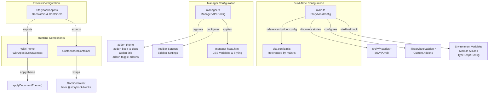

**Sources:** [.storybook-base/main.ts:1-78](), [.storybook-base/manager.ts:1-44](), [.storybook-base/manager-head.html:1-387](), [.storybook-base/components/StorybookApp.tsx:1-87]()

---

## Configuration Files Overview

The Storybook configuration consists of four primary files:

| File | Purpose | Execution Context |
|------|---------|-------------------|
| `main.ts` | Defines story locations, addons, framework settings, and Vite customizations | Build time (Node.js) |
| `manager.ts` | Configures the Storybook manager UI (sidebar, toolbar) and registers custom addons | Browser (manager iframe) |
| `manager-head.html` | Provides CSS variables, custom styling, and UI theme definitions | Browser (manager iframe, loaded in `<head>`) |
| `StorybookApp.tsx` | Exports decorators and containers that wrap stories and documentation pages | Browser (preview iframe) |

**Sources:** [.storybook-base/main.ts:1-78](), [.storybook-base/manager.ts:1-44](), [.storybook-base/manager-head.html:1-387](), [.storybook-base/components/StorybookApp.tsx:1-87]()

---

## Build and Runtime Flow

The configuration files are applied at different stages of the Storybook lifecycle. Understanding when each configuration takes effect is crucial for troubleshooting and extending the system.

**Configuration Application Flow**

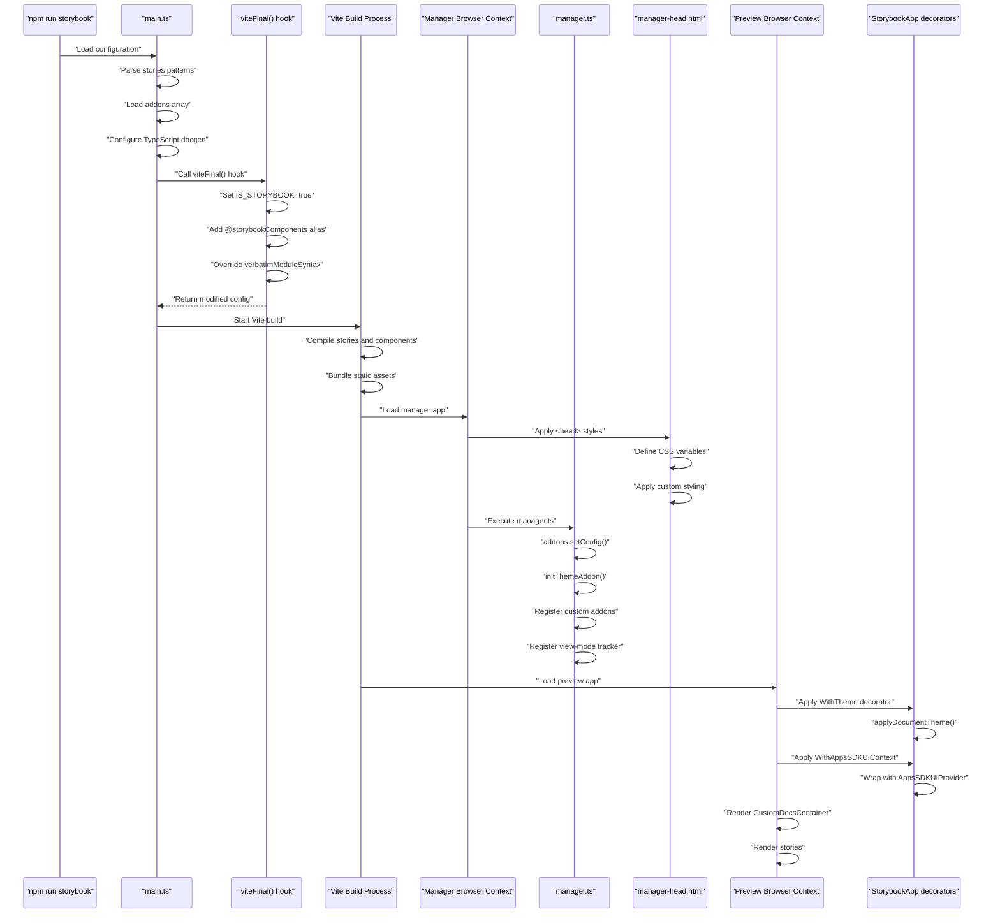

**Sources:** [.storybook-base/main.ts:53-76](), [.storybook-base/manager.ts:8-44](), [.storybook-base/manager-head.html:1-387](), [.storybook-base/components/StorybookApp.tsx:19-86]()

---

## Main Configuration Details

The `main.ts` file is the primary configuration entry point for Storybook. It defines:

### Story Discovery

Stories are discovered using glob patterns: `../src/**/*.mdx` and `../src/**/*.stories.@(js|jsx|ts|tsx)` as specified in [.storybook-base/main.ts:5]().

### Addon Configuration

The configuration includes several addons with customized options:

- **@storybook/addon-links** - Enables navigation between stories
- **@storybook/addon-toolbars** - Provides toolbar functionality
- **@storybook/addon-essentials** - Core features with several subfeatures disabled (actions, backgrounds, viewport, measure, outline, highlight) per [.storybook-base/main.ts:10-20]()
- **@storybook/addon-storysource** - Shows story source code with custom Prettier configuration [.storybook-base/main.ts:22-34]()

### TypeScript Integration

The configuration enables `react-docgen-typescript` with specific options:
- `savePropValueAsString: true`
- `shouldRemoveUndefinedFromOptional: true`
- `shouldExtractLiteralValuesFromEnum: true`

These settings are defined in [.storybook-base/main.ts:36-42]().

### Vite Customizations

The `viteFinal` hook [.storybook-base/main.ts:53-76]() applies critical customizations:

1. **Environment Variable**: Sets `IS_STORYBOOK=true` for conditional behavior
2. **Module Alias**: Creates `@storybookComponents` alias pointing to `./.storybook-base/components/`
3. **Asset Inclusion**: Adds `/sb-preview/runtime.js` to asset handling
4. **TypeScript Override**: Disables `verbatimModuleSyntax` to prevent build failures

**Sources:** [.storybook-base/main.ts:1-78]()

---

## Manager Configuration Details

The `manager.ts` file configures the Storybook manager UI and initializes custom addons.

### Manager API Configuration

The `addons.setConfig()` call [.storybook-base/manager.ts:8-26]() defines:

| Setting | Value | Purpose |
|---------|-------|---------|
| `navSize` | 230 | Fixed sidebar width in pixels |
| `toolbar.copy` | hidden | Hides the copy button |
| `toolbar.eject` | hidden | Hides the eject button |
| `toolbar.fullscreen` | hidden | Hides the fullscreen toggle |
| `toolbar.createStory` | hidden | Hides the create story button |
| `sidebar.showRoots` | true | Displays root-level categories |
| `sidebar.collapsedRoots` | [] | All roots expanded by default |
| `docs.isCodeExpanded` | true | Code blocks expanded by default |
| `docs.source.state` | "shown" | Source addon visible by default |

### Custom Addon Registration

Four custom addons are registered:
1. `addon-theme` - Initialized via `initThemeAddon()` [.storybook-base/manager.ts:29]()
2. `addon-back-to-docs` - Imported for side effects [.storybook-base/manager.ts:4]()
3. `addon-title` - Imported for side effects [.storybook-base/manager.ts:5]()
4. `addon-toggle-addons` - Imported for side effects [.storybook-base/manager.ts:6]()

### View Mode Tracking

A custom `view-mode` addon [.storybook-base/manager.ts:31-44]() tracks whether the user is viewing docs or stories, setting the `data-view-mode` attribute on `document.documentElement` for CSS targeting.

**Sources:** [.storybook-base/manager.ts:1-44]()

---

## Manager UI Customization

The `manager-head.html` file provides extensive CSS customizations to match the design system.

### CSS Variable Definitions

The file defines a comprehensive set of CSS variables using the `light-dark()` function for automatic theme adaptation [.storybook-base/manager-head.html:6-55]():

- **Gray Scale**: `--gray-0` through `--gray-1000` in 25-50 unit increments
- **Alpha Channels**: `--alpha-0` through `--alpha-50` using `color-mix()`
- **Semantic Colors**: `--color-text`, `--color-text-secondary`, `--color-surface`
- **Input States**: `--sb-input-border-color`, `--sb-input-border-hover-color`, `--sb-input-border-focus-color`

### UI Component Customizations

Key customizations include:

| Component | Customization | Location |
|-----------|---------------|----------|
| Sidebar Header | Margin adjustment, pointer-events disabled | [.storybook-base/manager-head.html:70-85]() |
| Search Field | Custom border, height, hover/focus states | [.storybook-base/manager-head.html:98-133]() |
| Search Results | Custom spacing, background, typography | [.storybook-base/manager-head.html:148-190]() |
| Sidebar Items | Custom padding, hover states, selection styling | [.storybook-base/manager-head.html:266-300]() |
| Sidebar Roots | Treated as static headers, not collapsible | [.storybook-base/manager-head.html:238-263]() |
| Toolbar | Position absolute in docs mode, static in story mode | [.storybook-base/manager-head.html:309-327]() |

### Visibility Control

The configuration hides the UI until theme initialization completes [.storybook-base/manager-head.html:58-62]() using:
```css
html:not([data-theme]),
[data-is-loaded="false"] {
  visibility: hidden;
}
```

**Sources:** [.storybook-base/manager-head.html:1-387]()

---

## StorybookApp Integration

The `StorybookApp.tsx` file provides React components that integrate with Storybook's preview environment.

### Component Exports

**Decorator and Container Mapping**

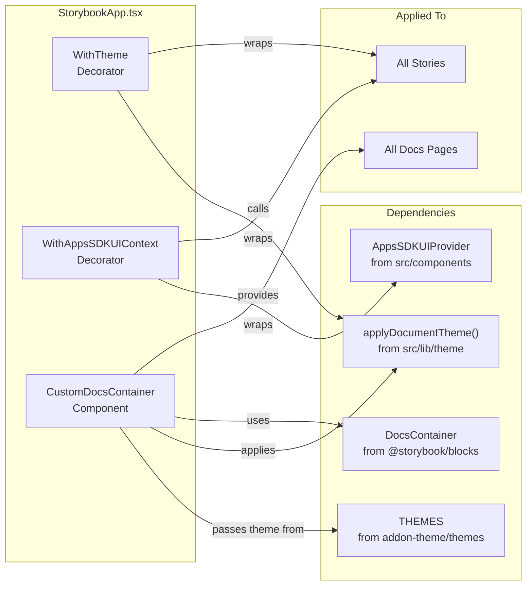

**Sources:** [.storybook-base/components/StorybookApp.tsx:1-87]()

### WithTheme Decorator

The `WithTheme` decorator [.storybook-base/components/StorybookApp.tsx:19-27]() applies theme changes to all stories:

1. Reads `theme` from `context.globals.theme`
2. Calls `applyDocumentTheme()` in `useLayoutEffect` to apply theme to the document
3. Defaults to `DEFAULT_THEME` if no theme is specified

### WithAppsSDKUIContext Decorator

The `WithAppsSDKUIContext` decorator [.storybook-base/components/StorybookApp.tsx:29-35]() wraps stories with the `AppsSDKUIProvider`:

- Provides React context for SDK components
- Accepts `linkComponent` from story parameters (defaults to `"a"`)

### CustomDocsContainer

The `CustomDocsContainer` [.storybook-base/components/StorybookApp.tsx:37-87]() wraps documentation pages with several enhancements:

1. **Theme Application**: Reads theme from globals and applies via `applyDocumentTheme()` [.storybook-base/components/StorybookApp.tsx:76-78]()
2. **Scroll Restoration**: Implements custom scroll position persistence across hot reloads [.storybook-base/components/StorybookApp.tsx:46-74]()
3. **Storybook Theme Integration**: Passes theme object to `DocsContainer` from `THEMES` map [.storybook-base/components/StorybookApp.tsx:82]()

The scroll restoration system:
- Saves scroll position to `sessionStorage` before Vite reloads
- Uses `ResizeObserver` to detect when content height exceeds saved position
- Restores scroll position once content is rendered

**Sources:** [.storybook-base/components/StorybookApp.tsx:1-87]()

---

## Configuration Integration Summary

The following diagram shows how all configuration elements work together at runtime:

**Runtime Configuration Integration**

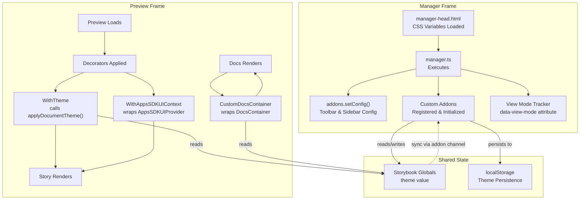

**Sources:** [.storybook-base/main.ts:1-78](), [.storybook-base/manager.ts:1-44](), [.storybook-base/manager-head.html:1-387](), [.storybook-base/components/StorybookApp.tsx:1-87]()

---

## Configuration Files Reference

| File | Type | Key Exports/Configurations |
|------|------|----------------------------|
| `main.ts` | Build Config | `StorybookConfig` object with stories, addons, framework, viteFinal |
| `manager.ts` | Manager Config | `addons.setConfig()`, addon registrations, view mode tracker |
| `manager-head.html` | CSS/HTML | CSS variables, component styling, visibility rules |
| `StorybookApp.tsx` | React Components | `WithTheme`, `WithAppsSDKUIContext`, `CustomDocsContainer` |

**Sources:** [.storybook-base/main.ts:1-78](), [.storybook-base/manager.ts:1-44](), [.storybook-base/manager-head.html:1-387](), [.storybook-base/components/StorybookApp.tsx:1-87]()

---

# Page: Main Configuration (main.ts)

# Main Configuration (main.ts)

<details>
<summary>Relevant source files</summary>

The following files were used as context for generating this wiki page:

- [.storybook-base/main.ts](.storybook-base/main.ts)

</details>


The main configuration file defines core Storybook behavior including story discovery patterns, addon registration, TypeScript integration, framework setup, and build customizations. This file is the primary entry point for configuring the Storybook environment.

For manager-specific UI configuration, see [Manager Configuration (manager.ts)](#3.2). For custom addon implementations, see [Custom Addons](#4).

**Sources:** [.storybook-base/main.ts:1-79]()

---

## Configuration Overview

The configuration exports a `StorybookConfig` object typed as `StorybookConfig` from `@storybook/react-vite`. This type ensures type safety across all configuration properties.

```
StorybookConfig
├── stories: string[]
├── addons: (string | { name: string; options: object })[]
├── typescript: TypeScriptOptions
├── framework: FrameworkOptions
├── staticDirs: string[]
└── viteFinal: (config: ViteConfig) => Promise<ViteConfig>
```

The configuration is structured into six primary sections, each controlling a distinct aspect of Storybook's behavior.

**Sources:** [.storybook-base/main.ts:4-78]()

---

## Story Discovery Patterns

### Story File Pattern Configuration

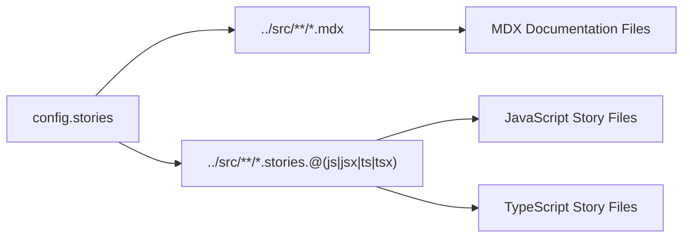

**Story Discovery Pattern Configuration**

The `stories` array defines glob patterns that Storybook uses to discover story files. The configuration specifies two patterns:

| Pattern | Purpose | File Types |
|---------|---------|------------|
| `"../src/**/*.mdx"` | Documentation pages | MDX files containing narrative documentation |
| `"../src/**/*.stories.@(js|jsx|ts|tsx)"` | Component stories | Story files in JavaScript or TypeScript |

The patterns use `../src/**/*` to recursively search the entire `src` directory from the `.storybook-base` location. The `@(js|jsx|ts|tsx)` syntax is a glob pattern that matches any of the listed extensions.

**Sources:** [.storybook-base/main.ts:5]()

---

## Addon Configuration

### Registered Addons

The configuration registers four addons, each serving a specific purpose in the documentation workflow:

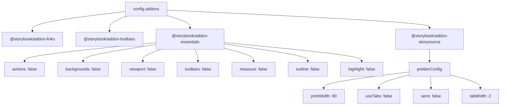

**Addon Dependency Structure**

### @storybook/addon-links

Registered as a simple string without additional configuration. This addon enables navigation between stories using the `linkTo` function.

**Sources:** [.storybook-base/main.ts:7]()

### @storybook/addon-toolbars

Registered as a simple string. This addon provides the toolbar API used by custom addons for rendering toolbar items.

**Sources:** [.storybook-base/main.ts:8]()

### @storybook/addon-essentials

Registered with extensive configuration to disable most built-in features. The configuration object at [.storybook-base/main.ts:10-21]() disables seven features:

| Feature | Status | Reason |
|---------|--------|--------|
| `actions` | `false` | Disabled - reduces noise in documentation workflow |
| `backgrounds` | `false` | Disabled - custom theme system handles this |
| `viewport` | `false` | Disabled - not needed for component documentation |
| `toolbars` | `false` | Disabled - custom toolbar addons provide required functionality |
| `measure` | `false` | Disabled - measurement tools create unnecessary UI clutter |
| `outline` | `false` | Disabled - outline visualization not needed |
| `highlight` | `false` | Disabled - element highlighting not required |

Despite these disabled features, the essentials addon still provides the docs and controls features which remain enabled by default.

**Sources:** [.storybook-base/main.ts:9-21]()

### @storybook/addon-storysource

Configured with custom Prettier formatting options to display story source code in the UI. The `loaderOptions.prettierConfig` object specifies:

| Option | Value | Purpose |
|--------|-------|---------|
| `printWidth` | `90` | Maximum line length before wrapping |
| `useTabs` | `false` | Use spaces for indentation |
| `semi` | `false` | Omit semicolons |
| `tabWidth` | `2` | Two spaces per indentation level |

**Sources:** [.storybook-base/main.ts:22-34]()

---

## TypeScript Integration

### React Docgen Configuration

```mermaid
graph TD
    typescript["config.typescript"]
    
    reactDocgen["reactDocgen: 'react-docgen-typescript'"]
    options["reactDocgenTypescriptOptions"]
    
    typescript --> reactDocgen
    typescript --> options
    
    options --> saveProp["savePropValueAsString: true"]
    options --> removeUndef["shouldRemoveUndefinedFromOptional: true"]
    options --> extractEnum["shouldExtractLiteralValuesFromEnum: true"]
    
    saveProp --> propTable["Preserves prop values as strings in docs"]
    removeUndef --> propTable2["Simplifies optional prop display"]
    extractEnum --> propTable3["Shows enum values in documentation"]
```

**TypeScript Documentation Generation Pipeline**

The `typescript` configuration object specifies how component props are extracted and documented:

### reactDocgen

Set to `"react-docgen-typescript"` to use the TypeScript-based prop extraction tool. This analyzer parses TypeScript type definitions to generate component prop documentation.

**Sources:** [.storybook-base/main.ts:37]()

### reactDocgenTypescriptOptions

Three options control prop documentation generation:

| Option | Value | Effect |
|--------|-------|--------|
| `savePropValueAsString` | `true` | Preserves prop values as string representations in generated documentation |
| `shouldRemoveUndefinedFromOptional` | `true` | Removes `undefined` from union types for optional props, simplifying display |
| `shouldExtractLiteralValuesFromEnum` | `true` | Extracts literal values from enum types for documentation tables |

**Sources:** [.storybook-base/main.ts:38-42]()

---

## Framework Setup

### React-Vite Framework Configuration

```mermaid
graph LR
    framework["config.framework"]
    
    name["name: '@storybook/react-vite'"]
    options["options"]
    
    framework --> name
    framework --> options
    
    options --> builder["builder"]
    builder --> viteConfigPath["viteConfigPath: './vite.config.mjs'"]
    
    viteConfigPath --> viteFile["vite.config.mjs"]
    viteFile --> buildProcess["Vite Build Process"]
```

**Framework and Builder Configuration**

The `framework` section specifies the Storybook framework adapter and build tool:

| Property | Value | Purpose |
|----------|-------|---------|
| `framework.name` | `"@storybook/react-vite"` | Configures Storybook for React with Vite as the build tool |
| `framework.options.builder.viteConfigPath` | `"./vite.config.mjs"` | References the base Vite configuration file to merge with Storybook's config |

The `viteConfigPath` reference ensures that the base Vite configuration at `./vite.config.mjs` is merged with Storybook's internal Vite configuration before the `viteFinal` hook is applied.

**Sources:** [.storybook-base/main.ts:44-51]()

---

## Static Asset Configuration

The `staticDirs` array specifies directories containing static assets that should be served by Storybook's development server:

```typescript
staticDirs: ["../public"]
```

This configuration maps the `../public` directory (relative to `.storybook-base`) to be served at the root of the Storybook server. Assets in this directory can be referenced in stories using root-relative paths like `/logo.svg`.

**Sources:** [.storybook-base/main.ts:52]()

---

## Vite Customizations (viteFinal)

### Overview

The `viteFinal` async function provides a hook to modify the Vite configuration after Storybook has constructed it. This function receives the final Vite configuration and returns a modified version.

```mermaid
graph TD
    viteFinal["viteFinal(finalConfig)"]
    
    env["Set IS_STORYBOOK env var"]
    alias["Configure module aliases"]
    assets["Fix assetsInclude"]
    esbuild["Override esbuild options"]
    
    viteFinal --> env
    viteFinal --> alias
    viteFinal --> assets
    viteFinal --> esbuild
    
    env --> envVar["process.env.IS_STORYBOOK = 'true'"]
    
    alias --> resolveAlias["finalConfig.resolve.alias"]
    resolveAlias --> storybookComponents["@storybookComponents: ./components/"]
    
    assets --> assetsInclude["finalConfig.assetsInclude"]
    assetsInclude --> runtime["/sb-preview/runtime.js"]
    
    esbuild --> esbuildConfig["finalConfig.esbuild"]
    esbuildConfig --> tsconfigRaw["tsconfigRaw.compilerOptions"]
    tsconfigRaw --> verbatim["verbatimModuleSyntax: false"]
```

**Vite Configuration Modification Pipeline**

**Sources:** [.storybook-base/main.ts:53-76]()

### Environment Variable Injection

```typescript
process.env.IS_STORYBOOK = "true"
```

Sets the `IS_STORYBOOK` environment variable to `"true"`. This variable can be checked in application code to conditionally enable Storybook-specific behavior.

**Sources:** [.storybook-base/main.ts:54]()

### Module Alias Configuration

The configuration creates a module alias to simplify imports in MDX files:

```mermaid
graph LR
    import["Import Statement"]
    alias["@storybookComponents"]
    resolve["Module Resolution"]
    path[".storybook-base/components/"]
    
    import --> alias
    alias --> resolve
    resolve --> path
```

**Module Alias Resolution**

The alias configuration at [.storybook-base/main.ts:56-61]() adds `@storybookComponents` as an alias pointing to the `.storybook-base/components/` directory. This enables imports like:

```typescript
import { Card } from '@storybookComponents/Card'
```

Instead of requiring relative paths like:

```typescript
import { Card } from '../../../.storybook-base/components/Card'
```

**Sources:** [.storybook-base/main.ts:56-61]()

### Assets Include Fix

```typescript
finalConfig.assetsInclude = ["/sb-preview/runtime.js"]
```

This configuration addresses a known issue documented at GitHub issue #25256 in the Storybook repository. The `assetsInclude` setting explicitly includes the `/sb-preview/runtime.js` file to prevent build errors.

**Sources:** [.storybook-base/main.ts:63-64]()

### TypeScript Compiler Option Override

The esbuild configuration override addresses a compatibility issue with TypeScript's `verbatimModuleSyntax` compiler option:

```mermaid
graph TD
    esbuild["finalConfig.esbuild"]
    
    tsconfigRaw["tsconfigRaw"]
    compilerOptions["compilerOptions"]
    verbatim["verbatimModuleSyntax: false"]
    
    esbuild --> tsconfigRaw
    tsconfigRaw --> compilerOptions
    compilerOptions --> verbatim
    
    verbatim --> fix["Fixes Storybook build failures"]
```

**esbuild TypeScript Configuration Override**

The configuration at [.storybook-base/main.ts:68-73]() overrides the TypeScript compiler option specifically for the Storybook build:

| Configuration Path | Value | Purpose |
|-------------------|-------|---------|
| `finalConfig.esbuild` | `{}` or existing object | Ensures esbuild config object exists |
| `finalConfig.esbuild.tsconfigRaw` | Object | Raw TypeScript configuration override |
| `tsconfigRaw.compilerOptions.verbatimModuleSyntax` | `false` | Disables strict module syntax checking that causes Storybook build failures |

This override is necessary because Storybook's internal code is incompatible with `verbatimModuleSyntax: true`. The override only affects the Storybook build and does not modify the project's main TypeScript configuration.

**Sources:** [.storybook-base/main.ts:66-73]()

---

## Configuration Loading and Application

```mermaid
sequenceDiagram
    participant SB as "Storybook CLI"
    participant Config as "main.ts"
    participant Vite as "Vite Builder"
    participant Server as "Dev Server"
    
    SB->>Config: "Load configuration"
    Config->>Config: "Parse stories patterns"
    Config->>Config: "Register addons"
    Config->>Config: "Configure TypeScript"
    Config->>Config: "Set framework options"
    
    Config->>Vite: "Initialize with viteConfigPath"
    Vite->>Vite: "Load ./vite.config.mjs"
    Vite->>Vite: "Merge with Storybook defaults"
    
    Vite->>Config: "Call viteFinal(finalConfig)"
    Config->>Config: "Set IS_STORYBOOK=true"
    Config->>Config: "Add @storybookComponents alias"
    Config->>Config: "Fix assetsInclude"
    Config->>Config: "Override verbatimModuleSyntax"
    Config->>Vite: "Return modified config"
    
    Vite->>Server: "Start with final config"
    Server->>Server: "Serve static from ../public"
    Server->>Server: "Discover stories in ../src"
```

**Storybook Configuration Loading Sequence**

The configuration is loaded and applied in a specific order:

1. Storybook CLI loads `main.ts`
2. Story patterns are parsed to determine file discovery
3. Addons are registered with their specific options
4. TypeScript integration is configured
5. Framework and builder are initialized
6. Base Vite config is loaded from `./vite.config.mjs`
7. Storybook's default Vite config is merged
8. `viteFinal` hook applies final customizations
9. Development server starts with the final configuration

**Sources:** [.storybook-base/main.ts:1-79]()

---

# Page: Manager Configuration (manager.ts)

# Manager Configuration (manager.ts)

<details>
<summary>Relevant source files</summary>

The following files were used as context for generating this wiki page:

- [.storybook-base/manager.ts](.storybook-base/manager.ts)

</details>


## Purpose and Scope

The manager configuration file [.storybook-base/manager.ts]() serves as the entry point for customizing Storybook's manager application—the outer frame that contains the sidebar, toolbar, and navigation chrome. This file is distinct from the main configuration (see [Main Configuration](#3.1)), which configures the preview iframe where stories are rendered.

This document covers:
- Manager UI configuration including toolbar button visibility and sidebar behavior
- Registration and initialization of custom addons
- View mode tracking system for managing UI states

For information about the actual custom addon implementations, see [Custom Addons](#4). For UI styling customizations applied to the manager, see [Manager UI Customization](#3.3).

**Sources:** [.storybook-base/manager.ts:1-45]()

---

## Configuration Overview

The manager configuration performs three primary functions: configuring the Storybook manager UI, registering custom addons, and tracking view mode state. These operations occur when the Storybook manager application initializes, before any story content is loaded.

### Initialization Flow

```mermaid
sequenceDiagram
    participant SB as "Storybook Manager"
    participant MGR as "manager.ts"
    participant API as "Manager API"
    participant Addons as "Custom Addons"
    participant DOM as "document.documentElement"

    SB->>MGR: Load manager.ts
    MGR->>Addons: Import addon-back-to-docs
    MGR->>Addons: Import addon-title
    MGR->>Addons: Import addon-toggle-addons
    Note over MGR,Addons: Side-effect imports register addons
    
    MGR->>API: addons.setConfig({...})
    Note over API: Configure navSize, toolbar,<br/>sidebar, docs settings
    
    MGR->>Addons: initThemeAddon()
    Note over Addons: Manual initialization required<br/>for theme addon
    
    MGR->>API: addons.register("view-mode", callback)
    API->>API: getUrlState().viewMode
    API->>DOM: setAttribute("data-view-mode", mode)
    
    loop On Render Events
        SB->>API: channel.emit("docsRendered")
        API->>DOM: setAttribute("data-view-mode", "docs")
        SB->>API: channel.emit("storyRendered")
        API->>API: Check viewMode from URL
        API->>DOM: setAttribute("data-view-mode", mode)
    end
```

**Sources:** [.storybook-base/manager.ts:1-44]()

---

## Manager Configuration Object

The `addons.setConfig()` call [.storybook-base/manager.ts:8-26]() configures the Storybook manager UI. This configuration controls the appearance and behavior of the manager application's chrome.

### Configuration Structure

| Configuration Path | Value | Effect |
|-------------------|-------|--------|
| `navSize` | `230` | Sets sidebar width to 230 pixels |
| `toolbar.copy.hidden` | `true` | Hides the "Copy Canvas Link" toolbar button |
| `toolbar.eject.hidden` | `true` | Hides the "Eject to Codesandbox" toolbar button |
| `toolbar.fullscreen.hidden` | `true` | Hides the fullscreen toggle button |
| `toolbar.createStory.hidden` | `true` | Hides the "Create Story" button |
| `sidebar.showRoots` | `true` | Displays root-level story groups in sidebar |
| `sidebar.collapsedRoots` | `[]` | No root groups collapsed by default |
| `docs.isCodeExpanded` | `true` | Code blocks in docs expanded by default |
| `docs.source.state` | `"shown"` | Source code visible in docs by default |

```mermaid
graph TB
    subgraph "Manager Configuration"
        CONFIG["addons.setConfig()"]
    end
    
    subgraph "Navigation Settings"
        NAV_SIZE["navSize: 230"]
    end
    
    subgraph "Toolbar Customization"
        COPY["copy.hidden: true"]
        EJECT["eject.hidden: true"]
        FULL["fullscreen.hidden: true"]
        CREATE["createStory.hidden: true"]
    end
    
    subgraph "Sidebar Behavior"
        ROOTS["showRoots: true"]
        COLLAPSED["collapsedRoots: []"]
    end
    
    subgraph "Docs Panel Defaults"
        CODE_EXP["isCodeExpanded: true"]
        SOURCE["source.state: 'shown'"]
    end
    
    subgraph "UI Effects"
        SIDEBAR_UI["Sidebar Width<br/>230px"]
        TOOLBAR_UI["Toolbar Buttons<br/>4 buttons hidden"]
        SIDEBAR_TREE["Story Tree<br/>All roots visible<br/>None collapsed"]
        DOCS_UI["Documentation<br/>Code expanded<br/>Source shown"]
    end
    
    CONFIG --> NAV_SIZE
    CONFIG --> COPY
    CONFIG --> EJECT
    CONFIG --> FULL
    CONFIG --> CREATE
    CONFIG --> ROOTS
    CONFIG --> COLLAPSED
    CONFIG --> CODE_EXP
    CONFIG --> SOURCE
    
    NAV_SIZE --> SIDEBAR_UI
    COPY --> TOOLBAR_UI
    EJECT --> TOOLBAR_UI
    FULL --> TOOLBAR_UI
    CREATE --> TOOLBAR_UI
    ROOTS --> SIDEBAR_TREE
    COLLAPSED --> SIDEBAR_TREE
    CODE_EXP --> DOCS_UI
    SOURCE --> DOCS_UI
```

**Sources:** [.storybook-base/manager.ts:8-26]()

### Toolbar Customization

The toolbar configuration [.storybook-base/manager.ts:10-15]() hides four standard Storybook toolbar buttons. This creates a cleaner, more focused toolbar appropriate for this documentation-focused Storybook instance:

- **copy**: The "Copy Canvas Link" button is hidden as it's not essential for documentation browsing
- **eject**: The "Eject to Codesandbox" button is hidden since this Storybook is not intended for live editing
- **fullscreen**: The fullscreen toggle is hidden, likely because fullscreen mode is managed differently
- **createStory**: The "Create Story" button is hidden as this is a static documentation site

### Sidebar Configuration

The sidebar configuration [.storybook-base/manager.ts:16-19]() ensures all story groups are visible and accessible:

- **showRoots: true**: Root-level story groups appear in the sidebar tree
- **collapsedRoots: []**: No roots are collapsed by default, providing immediate visibility into all story categories

### Documentation Defaults

The docs configuration [.storybook-base/manager.ts:20-25]() sets default visibility for code elements in documentation pages:

- **isCodeExpanded: true**: Code blocks are expanded by default, making code immediately visible
- **source.state: "shown"**: Component source code is shown by default in documentation

**Sources:** [.storybook-base/manager.ts:8-26]()

---

## Addon Registration System

The manager file orchestrates the registration of four custom addons. Three use side-effect imports while one requires manual initialization.

### Addon Import Strategy

```mermaid
graph LR
    subgraph "manager.ts Imports"
        THEME_IMPORT["import { init as initThemeAddon }<br/>from './addon-theme'"]
        BACK_IMPORT["import './addon-back-to-docs'"]
        TITLE_IMPORT["import './addon-title'"]
        TOGGLE_IMPORT["import './addon-toggle-addons'"]
    end
    
    subgraph "Registration Methods"
        MANUAL["Manual Initialization<br/>initThemeAddon()"]
        SIDE_EFFECT["Side-Effect Registration<br/>Auto-registers on import"]
    end
    
    subgraph "Registered Addons"
        THEME_ADDON["addon-theme<br/>Theme Toggle Tool"]
        BACK_ADDON["addon-back-to-docs<br/>Navigation Tool"]
        TITLE_ADDON["addon-title<br/>Title Manager"]
        TOGGLE_ADDON["addon-toggle-addons<br/>Panel Toggle"]
    end
    
    THEME_IMPORT --> MANUAL
    BACK_IMPORT --> SIDE_EFFECT
    TITLE_IMPORT --> SIDE_EFFECT
    TOGGLE_IMPORT --> SIDE_EFFECT
    
    MANUAL --> THEME_ADDON
    SIDE_EFFECT --> BACK_ADDON
    SIDE_EFFECT --> TITLE_ADDON
    SIDE_EFFECT --> TOGGLE_ADDON
```

**Sources:** [.storybook-base/manager.ts:2-6,29]()

### Side-Effect Imports

Three addons are registered through side-effect imports [.storybook-base/manager.ts:4-6]():

```
import "./addon-back-to-docs"
import "./addon-title"
import "./addon-toggle-addons"
```

These imports execute the addon registration code at import time. Each addon file calls `addons.register()` internally, registering itself with Storybook's addon system automatically.

For details on each addon's functionality:
- [Back to Docs Addon](#4.2)
- [Title Addon](#4.3)
- [Toggle Addons Addon](#4.4)

### Manual Initialization

The theme addon requires manual initialization [.storybook-base/manager.ts:2,29]():

```
import { init as initThemeAddon } from "./addon-theme"
...
initThemeAddon()
```

This addon is imported as a named export (`init`) and called explicitly. This pattern is necessary because the theme addon needs to perform additional setup beyond simple registration, such as reading theme preferences from storage and applying the initial theme.

For complete details on the theme addon, see [Theme Addon](#4.1).

**Sources:** [.storybook-base/manager.ts:2-6,29]()

---

## View Mode Tracking

The manager file registers a custom addon called `"view-mode"` [.storybook-base/manager.ts:31-44]() that tracks whether the user is viewing a story or documentation page. This tracking is exposed through a `data-view-mode` attribute on the document root element.

### View Mode Tracking Mechanism

```mermaid
graph TB
    subgraph "View Mode Addon Registration"
        REGISTER["addons.register('view-mode', callback)"]
        API_REF["api parameter"]
        CHANNEL["addons.getChannel()"]
    end
    
    subgraph "Initial State Detection"
        GET_STATE["api.getUrlState()"]
        VIEW_MODE["viewMode: 'story' | 'docs'"]
        INIT_SET["setAttr(mode)"]
    end
    
    subgraph "Event Listeners"
        DOCS_EVENT["channel.on('docsRendered')"]
        STORY_EVENT["channel.on('storyRendered')"]
    end
    
    subgraph "DOM Application"
        SET_ATTR_FUNC["setAttr() function"]
        DOC_ELEMENT["document.documentElement"]
        DATA_ATTR["data-view-mode attribute"]
    end
    
    subgraph "Attribute Values"
        DOCS_VALUE["'docs'"]
        STORY_VALUE["'story'"]
    end
    
    REGISTER --> API_REF
    REGISTER --> CHANNEL
    API_REF --> GET_STATE
    GET_STATE --> VIEW_MODE
    VIEW_MODE --> INIT_SET
    
    CHANNEL --> DOCS_EVENT
    CHANNEL --> STORY_EVENT
    
    DOCS_EVENT --> SET_ATTR_FUNC
    STORY_EVENT --> SET_ATTR_FUNC
    INIT_SET --> SET_ATTR_FUNC
    
    SET_ATTR_FUNC --> DOC_ELEMENT
    DOC_ELEMENT --> DATA_ATTR
    DATA_ATTR --> DOCS_VALUE
    DATA_ATTR --> STORY_VALUE
```

**Sources:** [.storybook-base/manager.ts:31-44]()

### Implementation Details

The view mode addon consists of three key components:

#### 1. Helper Function

The `setAttr()` function [.storybook-base/manager.ts:34-35]() encapsulates the DOM manipulation:

```
const setAttr = (mode: "story" | "docs") =>
  document.documentElement.setAttribute("data-view-mode", mode)
```

This function sets the `data-view-mode` attribute on `<html>` to either `"story"` or `"docs"`.

#### 2. Initial State

On registration, the addon immediately determines and applies the initial view mode [.storybook-base/manager.ts:37]():

```
setAttr(api.getUrlState().viewMode === "docs" ? "docs" : "story")
```

This reads the current view mode from Storybook's URL state and sets the attribute accordingly. Any view mode that is not explicitly `"docs"` is treated as `"story"`.

#### 3. Event Handlers

The addon listens to two Storybook channel events to track view mode changes:

**docsRendered Event** [.storybook-base/manager.ts:39]()
```
channel.on("docsRendered", () => setAttr("docs"))
```
When documentation is rendered, the attribute is set to `"docs"`.

**storyRendered Event** [.storybook-base/manager.ts:40-43]()
```
channel.on("storyRendered", () => {
  const { viewMode } = api.getUrlState()
  setAttr(viewMode === "docs" ? "docs" : "story")
})
```
When a story is rendered, the addon checks the URL state's `viewMode` property. This check is necessary because stories can be rendered in both story view and docs view (when embedded in documentation).

### Use Cases

The `data-view-mode` attribute enables CSS selectors to apply different styles based on the current view:

```css
html[data-view-mode="docs"] .sidebar { /* docs-specific styles */ }
html[data-view-mode="story"] .toolbar { /* story-specific styles */ }
```

This mechanism is leveraged by the manager UI customizations documented in [Manager UI Customization](#3.3).

**Sources:** [.storybook-base/manager.ts:31-44]()

---

## Integration with Other Systems

### Manager Head HTML

The manager configuration works in conjunction with custom CSS loaded through `manager-head.html`. The view mode tracking provides the `data-view-mode` attribute that CSS selectors can target. See [Manager UI Customization](#3.3) for details on the CSS customizations.

### Theme System

The manual initialization of the theme addon [.storybook-base/manager.ts:29]() is critical for the theme system to function. The theme addon reads preferences from storage, applies CSS classes to the document element, and registers the theme toggle toolbar button. See [Theme Addon](#4.1) for complete details.

### Storybook Manager API

The configuration uses several Storybook manager API methods:

| API Method | Usage | Location |
|------------|-------|----------|
| `addons.setConfig()` | Configure manager UI | Line 8 |
| `addons.register()` | Register custom addon | Line 31 |
| `addons.getChannel()` | Access event channel | Line 32 |
| `api.getUrlState()` | Read current URL state | Lines 37, 41 |

**Sources:** [.storybook-base/manager.ts:1-44]()

---

## Summary

The manager configuration file serves as the orchestration layer for Storybook's manager application. It:

1. **Configures UI elements** through `addons.setConfig()`, customizing toolbar buttons, sidebar behavior, and documentation defaults
2. **Registers custom addons** using both side-effect imports and manual initialization
3. **Tracks view mode** through a custom addon that maintains a `data-view-mode` attribute on the document root

This configuration is evaluated once when the Storybook manager loads, establishing the foundation for the entire documentation experience. The manager configuration works closely with the theme system, UI customizations, and custom addons to create a cohesive, branded Storybook instance.

**Sources:** [.storybook-base/manager.ts:1-45]()

---

# Page: Manager UI Customization

# Manager UI Customization

<details>
<summary>Relevant source files</summary>

The following files were used as context for generating this wiki page:

- [.storybook-base/manager-head.html](.storybook-base/manager-head.html)

</details>


## Purpose and Scope

This document details the extensive CSS customizations applied to the Storybook manager UI through the `manager-head.html` file. These customizations override Storybook's default styling to provide a cohesive visual experience aligned with the OpenAI design system. The customizations cover color systems, sidebar behavior, toolbar positioning, search functionality, and responsive layouts.

For information about the manager's JavaScript configuration and addon registration, see [Manager Configuration](#3.2). For theme system implementation details, see [Theme System](#5.2).

## Overview

The manager UI customization is implemented entirely in `.storybook-base/manager-head.html` as inline CSS injected into the Storybook manager's `<head>` element. This approach allows direct manipulation of Storybook's internal DOM structure and CSS classes without requiring a custom manager build.

```mermaid
graph TB
    subgraph "manager-head.html"
        FAVICON["Favicon Links<br/>(lines 1-2)"]
        PRECONNECT["CDN Preconnect<br/>(line 3)"]
        CSS_VARS["CSS Variables<br/>(lines 6-55)"]
        VISIBILITY["Theme Visibility<br/>(lines 57-62)"]
        SCROLLBAR["Scrollbar Styling<br/>(lines 64-68)"]
        SIDEBAR["Sidebar Styles<br/>(lines 70-301)"]
        TOOLBAR["Toolbar Styles<br/>(lines 308-379)"]
        PANEL["Panel Styles<br/>(lines 198-217)"]
        MOBILE["Mobile Responsive<br/>(lines 329-363)"]
        ARGS["Args Table<br/>(lines 302-306)"]
        IFRAME["Iframe Loading<br/>(lines 381-386)"]
    end
    
    subgraph "CSS Variable Categories"
        GRAY_SCALE["Gray Scale<br/>gray-0 to gray-1000"]
        ALPHA["Alpha Values<br/>alpha-0 to alpha-50"]
        INPUT_BORDERS["Input Borders<br/>sb-input-border-*"]
        SEMANTIC["Semantic Colors<br/>color-text, color-surface"]
    end
    
    subgraph "Targeted UI Elements"
        HEADER[".sidebar-header"]
        SEARCH[".search-field"]
        ITEMS[".sidebar-item"]
        ROOT_NODES["[data-nodetype='root']"]
        TOOLBAR_EL["[data-test-id='sb-preview-toolbar']"]
        SEARCH_RESULTS[".search-result-item"]
    end
    
    CSS_VARS -->|defines| GRAY_SCALE
    CSS_VARS -->|defines| ALPHA
    CSS_VARS -->|defines| INPUT_BORDERS
    CSS_VARS -->|defines| SEMANTIC
    
    SIDEBAR -->|styles| HEADER
    SIDEBAR -->|styles| SEARCH
    SIDEBAR -->|styles| ITEMS
    SIDEBAR -->|styles| ROOT_NODES
    SIDEBAR -->|styles| SEARCH_RESULTS
    
    TOOLBAR -->|positions| TOOLBAR_EL
    
    GRAY_SCALE -->|used in| SIDEBAR
    ALPHA -->|used in| SCROLLBAR
    INPUT_BORDERS -->|used in| SEARCH
    SEMANTIC -->|used in| ITEMS
```

**Sources:** [.storybook-base/manager-head.html:1-387]()

## CSS Variable System

The customization defines a comprehensive set of CSS custom properties using the `light-dark()` function to support automatic theme switching based on the browser's color scheme preference.

### Gray Scale Variables

A complete gray scale from 0 (pure white/black) to 1000 (pure black/white) with 25-unit increments for fine-grained color control:

| Variable | Light Mode | Dark Mode | Purpose |
|----------|------------|-----------|---------|
| `--gray-0` | `#ffffff` | `#0d0d0d` | Pure background |
| `--gray-100` | `#ededed` | `#181818` | Subtle backgrounds |
| `--gray-200` | `#c4c4c4` | `#212121` | Surface backgrounds |
| `--gray-500` | `#5d5d5d` | `#5d5d5d` | Mid-point (same both modes) |
| `--gray-800` | `#212121` | `#c4c4c4` | Strong borders |
| `--gray-1000` | `#0d0d0d` | `#ffffff` | Pure foreground |

The gray scale is symmetric: light mode's `--gray-100` equals dark mode's `--gray-900`, creating a mirrored color system.

**Sources:** [.storybook-base/manager-head.html:7-31]()

### Alpha Transparency Variables

Dynamic alpha values calculated using `color-mix()` to blend with transparency:

```css
--alpha-base: light-dark(#0d0d0d, #ffffff);
--alpha-08: color-mix(in srgb, var(--alpha-base) 8%, transparent);
--alpha-30: color-mix(in srgb, var(--alpha-base) 30%, transparent);
```

These provide theme-aware transparency that adapts to light or dark backgrounds. Available values: 0, 02, 04, 05, 06, 08, 10, 12, 15, 20, 25, 30, 35, 40, 50.

**Sources:** [.storybook-base/manager-head.html:32-47]()

### Input Border Variables

Three states for input borders with theme-aware opacity:

| Variable | Light Mode | Dark Mode | Usage |
|----------|------------|-----------|-------|
| `--sb-input-border-color` | `rgba(0,0,0,0.08)` | `rgba(255,255,255,0.18)` | Default state |
| `--sb-input-border-hover-color` | `rgba(0,0,0,0.15)` | `rgba(255,255,255,0.25)` | Hover state |
| `--sb-input-border-focus-color` | `rgba(0,0,0,0.25)` | `rgba(255,255,255,0.35)` | Focus state |

**Sources:** [.storybook-base/manager-head.html:49-51]()

### Semantic Color Variables

High-level semantic variables built on the gray scale:

```css
--color-text: light-dark(var(--gray-750), var(--gray-850));
--color-text-secondary: light-dark(var(--gray-500), var(--gray-700));
--color-surface: light-dark(var(--gray-0), var(--gray-200));
```

**Sources:** [.storybook-base/manager-head.html:52-55]()

## Theme Visibility Control

The manager implements a visibility control mechanism to prevent flash of unstyled content during theme initialization:

```mermaid
graph LR
    HTML["html element"]
    IFRAME["story iframe"]
    
    CONDITION1["html:not([data-theme])"]
    CONDITION2["[data-is-loaded='false']"]
    
    HIDDEN["visibility: hidden"]
    
    HTML -->|missing data-theme| CONDITION1
    IFRAME -->|loading state| CONDITION2
    CONDITION1 --> HIDDEN
    CONDITION2 --> HIDDEN
    
    THEME_STORE["themeStore.ts<br/>applyManagerThemeClass()"]
    IFRAME_LOAD["StorybookApp.tsx<br/>setIframeLoaded()"]
    
    THEME_STORE -->|sets data-theme| HTML
    IFRAME_LOAD -->|sets data-is-loaded| IFRAME
```

The `html:not([data-theme])` selector keeps the manager hidden until the theme addon applies the `data-theme` attribute. The `[data-is-loaded="false"]` selector hides the story iframe until content loads.

**Sources:** [.storybook-base/manager-head.html:57-62]()

## Scrollbar Styling

Global scrollbar aesthetics using the universal selector:

```css
* {
  scrollbar-color: var(--alpha-30) transparent;
  scrollbar-width: thin;
}
```

This applies a subtle, semi-transparent scrollbar thumb with thin width across all scrollable elements.

**Sources:** [.storybook-base/manager-head.html:64-68]()

## Sidebar Customizations

The sidebar receives the most extensive customization, modifying header, search, navigation structure, and item styling.

### Sidebar Header Modifications

```mermaid
graph TB
    HEADER[".sidebar-header"]
    LINK[".sidebar-header a"]
    GEAR[".sidebar-header > div:last-child"]
    CREATE[".search-field + div"]
    RESIZE["div:has(+ .sidebar-container)"]
    
    HEADER -->|margin-top: -6px| ADJUST1["Vertical alignment"]
    LINK -->|pointer-events: none| DISABLE["Disable logo link"]
    LINK -->|outline: 0| FOCUS["Remove focus outline"]
    GEAR -->|display: none| HIDE1["Hide settings gear"]
    CREATE -->|display: none| HIDE2["Hide 'Create new story' button"]
    RESIZE -->|display: none| HIDE3["Hide resize handle"]
```

Key modifications:
- **Logo link disabled**: Prevents navigation when clicking the sidebar logo [.storybook-base/manager-head.html:74-80]()
- **Settings gear hidden**: The configuration icon is removed [.storybook-base/manager-head.html:82-85]()
- **Create button hidden**: The "Create new story" button is removed [.storybook-base/manager-head.html:87-90]()
- **Resize handle hidden**: The sidebar width adjustment handle is hidden [.storybook-base/manager-head.html:92-95]()

**Sources:** [.storybook-base/manager-head.html:70-95]()

### Search Field Styling

The search field receives comprehensive styling with custom borders, shadows, and a gradient fade effect:

```css
.search-field {
  height: 36px !important;
  box-shadow: 0 0 0 1px var(--sb-input-border-color) !important;
  transition: box-shadow 0.15s ease;
}

.search-field::before {
  content: "";
  -webkit-mask-image: linear-gradient(0deg, rgba(0,0,0,0), rgb(0,0,0));
  mask-image: linear-gradient(0deg, rgba(0,0,0,0), #000);
  height: 20px;
  position: absolute;
  top: 100%;
  background: var(--color-surface);
}
```

The `::before` pseudo-element creates a gradient fade that smoothly transitions into the scrollable sidebar content below. The search field has three interactive states with progressively darker borders:

| State | Box Shadow Variable |
|-------|-------------------|
| Default | `var(--sb-input-border-color)` |
| Hover | `var(--sb-input-border-hover-color)` |
| Focus | `var(--sb-input-border-focus-color)` |

**Sources:** [.storybook-base/manager-head.html:97-133]()

### Search Results Styling

Search results use custom styling for both the "Recently Opened" label and individual result items:

```mermaid
graph TB
    LABEL[".search-result-recentlyOpened"]
    ITEM[".search-result-item"]
    ITEM_LABEL[".search-result-item--label"]
    MARK["mark element"]
    
    LABEL -->|"font-size: 14px<br/>font-weight: 500<br/>color: gray-400/650"| STYLE1["Section header styling"]
    
    ITEM -->|"padding: 8px 10px<br/>border-radius: 6px<br/>background: transparent"| STYLE2["Base item styling"]
    
    ITEM -->|hover| HOVER["background: gray-100/400"]
    
    ITEM_LABEL -->|"> div:first-child"| TITLE["Title (14px, 500 weight)"]
    ITEM_LABEL -->|"> div:last-child"| PATH["Path (12px, secondary color)"]
    
    MARK -->|"background: alpha-08"| HIGHLIGHT["Subtle highlight for matches"]
```

The icon/status indicator in search results is hidden using `.search-result-item > div:first-child { display: none !important; }`.

**Sources:** [.storybook-base/manager-head.html:148-190]()

### Sidebar Navigation Structure

The sidebar implements a custom scrolling container and modified node hierarchy:

```css
#storybook-explorer-menu {
  position: absolute;
  top: 99px;
  left: 0;
  right: 0;
  bottom: 0;
  overflow: auto;
  padding: 20px 12px 10px;
}
```

This positions the navigation menu below the search field with full-height scrolling.

**Sources:** [.storybook-base/manager-head.html:225-235]()

### Root Node Customization

Root nodes (top-level categories) are converted from expandable/collapsible containers to static section headers:

```mermaid
graph TB
    ROOT["[data-nodetype='root']"]
    BUTTON["button:first-child"]
    CHEVRON["div:first-child (chevron)"]
    ACTION[".sidebar-subheading-action"]
    
    ROOT -->|"pointer-events: none<br/>font-size: 14px<br/>font-weight: 500<br/>color: gray-400/650"| HEADER_STYLE["Static header appearance"]
    
    ROOT -->|"padding-left: 10px"| BUTTON
    BUTTON -->|"display: none"| CHEVRON
    ROOT -->|"display: none"| ACTION
    
    SPACING["~ [data-nodetype='root']"]
    SPACING -->|margin-top: 20px| GAP["Vertical spacing between sections"]
```

The chevron icon and action button are hidden, and pointer events are disabled, preventing expand/collapse interaction. Subsequent root nodes receive 20px top margin for visual separation.

**Sources:** [.storybook-base/manager-head.html:237-263]()

### Sidebar Item Styling

Individual sidebar items receive refined spacing, hover states, and selection styling:

| Selector | Properties | Purpose |
|----------|-----------|---------|
| `.sidebar-item` | `min-height: auto`<br/>`margin-bottom: 2px`<br/>`border-radius: 6px`<br/>`font-weight: 500` | Base item styling |
| `.sidebar-item:hover` | `background: gray-100/400` | Hover state |
| `.sidebar-item > a` | `min-height: 36px`<br/>`padding: 0 0 0 10px`<br/>`color: var(--color-text)` | Link styling |
| `.sidebar-item[data-selected="true"]` | `background: gray-100/400`<br/>`color: var(--gray-900)`<br/>`font-weight: 600` | Selected state |

The item icon (`.sidebar-item > a:first-child > div`) is hidden via `display: none`.

**Sources:** [.storybook-base/manager-head.html:265-300]()

## Toolbar Customizations

The toolbar positioning adapts based on viewport width and view mode to provide optimal placement in different contexts.

### Desktop Toolbar Positioning

On viewports ≥600px, the toolbar is repositioned absolutely when viewing docs:

```mermaid
graph TB
    TOOLBAR["[data-test-id='sb-preview-toolbar']"]
    BUTTONS["toolbar buttons"]
    STORY_MODE["[data-view-mode='story']"]
    
    DEFAULT["Default (docs mode)"]
    STORY["Story mode"]
    
    TOOLBAR --> DEFAULT
    TOOLBAR --> STORY
    
    DEFAULT -->|"position: absolute<br/>top: 0, left: 0<br/>background: transparent<br/>pointer-events: none"| FLOAT["Floating toolbar"]
    
    BUTTONS -->|"pointer-events: all"| CLICKABLE["Buttons remain clickable"]
    
    STORY -->|"position: static<br/>pointer-events: all"| NORMAL["Normal toolbar flow"]
```

In docs mode, the toolbar floats absolutely positioned at the top-left with transparent background. The container has `pointer-events: none`, but buttons retain `pointer-events: all` to remain interactive. In story mode, the toolbar returns to normal static positioning.

**Sources:** [.storybook-base/manager-head.html:309-327]()

### Mobile Toolbar Adaptations

On viewports <600px, the toolbar receives special treatment:

```css
@media (max-width: 599px) {
  #root > div > div:last-child {
    position: absolute !important;
    background: none !important;
  }

  #root > div > div:last-child > div > button {
    position: fixed;
    top: 8px;
    left: 8px;
  }
}
```

The sidebar toggle button is fixed to the top-left corner, the button text is hidden (keeping only the icon), and the addon panel drawer is completely hidden on mobile.

**Sources:** [.storybook-base/manager-head.html:329-363]()

### Toolbar Content Layout

Toolbar content is right-aligned with orphan dividers removed:

```css
[data-test-id="sb-preview-toolbar"] > div {
  justify-content: flex-end !important;
  width: 100%;
  padding: 0 8px;
}

[data-test-id="sb-preview-toolbar"] > div > div:last-child {
  display: none !important;
}

.sb-bar > div > div > span:first-child {
  display: none !important;
}
```

**Sources:** [.storybook-base/manager-head.html:365-379]()

## Panel Customizations

The addon panel (containing Controls, Actions, etc.) receives custom border styling when the sidebar is not visible:

```css
#root > div > div:nth-child(3):not(:has(.sidebar-container)) {
  margin-right: 20px;
  margin-left: 20px;
  border: 1px solid var(--gray-150);
  border-bottom: 0;
  border-radius: 8px 8px 0 0;
}
```

The panel orientation toggle button is also hidden to simplify the interface.

**Sources:** [.storybook-base/manager-head.html:198-217]()

## Additional Customizations

### Args Table Modifications

JSDoc tables within args tables are hidden as they're intended for IDE consumption:

```css
.docblock-argstable-body td table {
  display: none !important;
}
```

**Sources:** [.storybook-base/manager-head.html:302-306]()

### Back to Docs Link Positioning

The back link component has absolute positioning:

```css
.story-back-link {
  position: absolute;
  top: 5px;
  left: 16px;
}
```

This is removed on mobile (`position: static`) to prevent overlap issues.

**Sources:** [.storybook-base/manager-head.html:192-196](), [.storybook-base/manager-head.html:360-362]()

### Iframe Loading State

The story iframe starts with zero opacity and transitions to full opacity once loaded:

```css
#storybook-preview-iframe {
  opacity: 0 !important;
}
#storybook-preview-iframe[data-is-loaded="true"] {
  opacity: 1 !important;
}
```

This prevents flash of unstyled content during story initialization. The `data-is-loaded` attribute is managed by the StorybookApp component.

**Sources:** [.storybook-base/manager-head.html:381-386]()

## CSS Specificity Strategy

The customizations extensively use `!important` declarations to override Storybook's default styles, which are often applied with high specificity or inline styles. Complex CSS selectors target specific DOM positions (e.g., `#root > div > div:nth-child(3)`) to ensure styles apply to the correct elements without affecting unintended parts of the UI.

**Sources:** [.storybook-base/manager-head.html:1-387]()

---

# Page: Storybook App Integration

# Storybook App Integration

<details>
<summary>Relevant source files</summary>

The following files were used as context for generating this wiki page:

- [.storybook-base/components/StorybookApp.tsx](.storybook-base/components/StorybookApp.tsx)

</details>


## Purpose and Scope

This document explains the integration layer between Storybook and the Apps SDK UI component library, focusing on how stories and documentation pages are wrapped with necessary context providers and theme support. The `StorybookApp.tsx` file defines decorators and container components that ensure all rendered components have access to required contexts and theming capabilities.

For theme system configuration and storage, see [Theme Addon](#4.1). For the main Storybook configuration that applies these decorators, see [Main Configuration](#3.1).

**Sources:** [.storybook-base/components/StorybookApp.tsx:1-88]()

---

## Architecture Overview

The integration system consists of three primary exports from `StorybookApp.tsx`:

| Export | Type | Purpose |
|--------|------|---------|
| `WithTheme` | Decorator | Applies theme to individual stories based on global theme state |
| `WithAppsSDKUIContext` | Decorator | Wraps stories with `AppsSDKUIProvider` for component library context |
| `CustomDocsContainer` | Component | Custom documentation container with theme support and scroll restoration |

These components act as middleware between Storybook's rendering pipeline and the actual component library, ensuring proper context and styling are available at render time.

**Sources:** [.storybook-base/components/StorybookApp.tsx:4-87]()

---

## Integration Flow

```mermaid
graph TB
    subgraph "Storybook Rendering Pipeline"
        STORY["Story Component<br/>(User's Component)"]
        CONTEXT["Storybook Context<br/>(globals, parameters)"]
    end
    
    subgraph "StorybookApp Integration Layer"
        WITH_THEME["WithTheme Decorator<br/>Applies document theme"]
        WITH_CONTEXT["WithAppsSDKUIContext Decorator<br/>Provides AppsSDKUIProvider"]
        CUSTOM_DOCS["CustomDocsContainer<br/>Doc page wrapper"]
    end
    
    subgraph "Application Layer"
        APPLY_THEME["applyDocumentTheme()<br/>src/lib/theme"]
        PROVIDER["AppsSDKUIProvider<br/>src/components/AppsSDKUIProvider"]
    end
    
    subgraph "Theme System"
        THEME_GLOBALS["globals.theme<br/>(light/dark)"]
        THEMES_MAP["THEMES<br/>addon-theme/themes"]
        DEFAULT["DEFAULT_THEME<br/>addon-theme/constants"]
    end
    
    CONTEXT -->|"theme global"| WITH_THEME
    CONTEXT -->|"parameters"| WITH_CONTEXT
    CONTEXT -->|"store.userGlobals"| CUSTOM_DOCS
    
    WITH_THEME -->|"calls useLayoutEffect"| APPLY_THEME
    WITH_THEME -->|"wraps"| STORY
    
    WITH_CONTEXT -->|"wraps with"| PROVIDER
    PROVIDER -->|"provides context to"| STORY
    
    CUSTOM_DOCS -->|"applies theme via"| APPLY_THEME
    CUSTOM_DOCS -->|"renders with"| THEMES_MAP
    
    THEME_GLOBALS -->|"provides theme value"| WITH_THEME
    THEME_GLOBALS -->|"provides theme value"| CUSTOM_DOCS
    DEFAULT -->|"fallback value"| APPLY_THEME
    THEMES_MAP -->|"theme config"| CUSTOM_DOCS
```

**Sources:** [.storybook-base/components/StorybookApp.tsx:1-87]()

---

## WithTheme Decorator

### Implementation

The `WithTheme` decorator applies the current theme to the document when rendering stories. It reads the theme value from Storybook's global state and uses `useLayoutEffect` to apply it synchronously before browser paint.

```typescript
export const WithTheme: Decorator = (Story, context) => {
  const theme = context.globals.theme
  
  useLayoutEffect(() => {
    applyDocumentTheme(theme || DEFAULT_THEME)
  }, [theme])
  
  return <Story />
}
```

**Sources:** [.storybook-base/components/StorybookApp.tsx:19-27]()

### Key Characteristics

| Aspect | Implementation Detail |
|--------|----------------------|
| **Hook Type** | `useLayoutEffect` for synchronous DOM updates |
| **Theme Source** | `context.globals.theme` from Storybook context |
| **Fallback** | `DEFAULT_THEME` if no theme is set |
| **Theme Application** | Delegates to `applyDocumentTheme()` from `src/lib/theme` |
| **Dependencies** | Re-runs when `theme` value changes |

The decorator does not wrap the story in any additional DOM elements, ensuring the component tree remains clean and unaffected by the decoration logic.

**Sources:** [.storybook-base/components/StorybookApp.tsx:19-27]()

---

## WithAppsSDKUIContext Decorator

### Implementation

The `WithAppsSDKUIContext` decorator wraps stories with the `AppsSDKUIProvider`, which provides necessary context for the component library to function correctly.

```typescript
export const WithAppsSDKUIContext: Decorator = (Story, { parameters }) => {
  return (
    <AppsSDKUIProvider linkComponent={parameters.linkComponent ?? "a"}>
      <Story />
    </AppsSDKUIProvider>
  )
}
```

**Sources:** [.storybook-base/components/StorybookApp.tsx:29-35]()

### Configuration

| Parameter | Type | Purpose | Default |
|-----------|------|---------|---------|
| `linkComponent` | `string \| Component` | Component to use for internal links | `"a"` |

The `linkComponent` parameter can be configured per-story or globally through Storybook parameters, allowing stories to specify custom link handling (e.g., Next.js Link component).

**Sources:** [.storybook-base/components/StorybookApp.tsx:29-35]()

---

## CustomDocsContainer Component

### Purpose

The `CustomDocsContainer` replaces Storybook's default `DocsContainer` to provide:

1. **Theme Integration**: Applies theme to documentation pages
2. **Scroll Restoration**: Preserves scroll position during hot module reloads
3. **Theme Configuration**: Passes theme configuration to Storybook's docs renderer

**Sources:** [.storybook-base/components/StorybookApp.tsx:37-87]()

### Component Structure

```mermaid
graph TB
    subgraph "CustomDocsContainer Component"
        PROPS["Props:<br/>children, context"]
        WRAPPER_REF["wrapperRef<br/>useRef&lt;HTMLDivElement&gt;"]
        OBSERVE_REF["observeRef<br/>useRef&lt;ResizeObserver&gt;"]
        
        THEME_EXTRACTION["Extract theme from<br/>context.store.userGlobals.globals.theme"]
        
        SCROLL_EFFECT["useEffect:<br/>Scroll Restoration Logic"]
        THEME_EFFECT["useLayoutEffect:<br/>applyDocumentTheme()"]
        
        RENDER["Render:<br/>&lt;div ref={wrapperRef}&gt;<br/>&lt;DocsContainer theme={THEMES[themeColor]}&gt;<br/>{children}<br/>&lt;/DocsContainer&gt;<br/>&lt;/div&gt;"]
    end
    
    subgraph "Scroll Restoration System"
        SESSION_STORAGE["sessionStorage<br/>'oai:storybook:scroll-top'"]
        RESIZE_OBSERVER["ResizeObserver<br/>monitors content height"]
        HMR_HOOKS["Vite HMR Hooks<br/>vite:beforeFullReload<br/>vite:beforeUpdate"]
    end
    
    PROPS --> THEME_EXTRACTION
    PROPS --> RENDER
    
    THEME_EXTRACTION --> THEME_EFFECT
    THEME_EFFECT -->|"calls"| APPLY_THEME_FUNC["applyDocumentTheme()"]
    
    SCROLL_EFFECT -->|"saves to"| SESSION_STORAGE
    SCROLL_EFFECT -->|"creates"| RESIZE_OBSERVER
    SCROLL_EFFECT -->|"listens to"| HMR_HOOKS
    
    RESIZE_OBSERVER -->|"observes"| WRAPPER_REF
    RESIZE_OBSERVER -->|"restores scroll when ready"| WINDOW_SCROLL["window.scrollTo()"]
    
    WRAPPER_REF --> RENDER
    THEME_EXTRACTION -->|"theme config"| RENDER
```

**Sources:** [.storybook-base/components/StorybookApp.tsx:37-87]()

### Theme Extraction

The container extracts the theme from a deeply nested context structure:

```typescript
interface DocsContextWithGlobals extends DocsContainerProps {
  context: DocsContainerProps["context"] & {
    store?: { userGlobals?: { globals?: { theme?: Theme } } }
  }
}

const themeColor = context?.store?.userGlobals?.globals?.theme ?? DEFAULT_THEME
```

This extended interface type ensures type safety when accessing Storybook's internal state structure.

**Sources:** [.storybook-base/components/StorybookApp.tsx:13-17,41]()

### Scroll Restoration Logic

The scroll restoration system addresses Storybook's inconsistent scroll behavior during hot module reloads (HMR):

```mermaid
sequenceDiagram
    participant User
    participant HMR as "Vite HMR"
    participant Effect as "Scroll Effect"
    participant Storage as "sessionStorage"
    participant Observer as "ResizeObserver"
    participant Window as "window"
    
    User->>Effect: Scrolls to position
    
    HMR->>Effect: vite:beforeFullReload
    Effect->>Storage: Save scrollY to<br/>'oai:storybook:scroll-top'
    
    HMR->>Effect: Page reloads
    Effect->>Storage: Read scroll position
    Effect->>Observer: Create ResizeObserver
    Observer->>Effect: Monitor wrapperRef height
    
    loop Wait for content
        Effect->>Observer: Is height >= scrollTop?
        Observer-->>Effect: Not yet
    end
    
    Observer->>Effect: Height sufficient
    Effect->>Window: scrollTo(0, scrollTop)
    Effect->>Storage: Remove 'oai:storybook:scroll-top'
    Effect->>Observer: Disconnect observer
```

**Sources:** [.storybook-base/components/StorybookApp.tsx:46-74]()

### Implementation Details

| Feature | Implementation | Location |
|---------|---------------|----------|
| **Storage Key** | `"oai:storybook:scroll-top"` | [.storybook-base/components/StorybookApp.tsx:48,51]() |
| **Save Trigger** | Vite HMR hooks: `vite:beforeFullReload`, `vite:beforeUpdate` | [.storybook-base/components/StorybookApp.tsx:67-68]() |
| **Restore Trigger** | `ResizeObserver` monitoring wrapper element height | [.storybook-base/components/StorybookApp.tsx:54-64]() |
| **Restore Delay** | 100ms timeout after height threshold reached | [.storybook-base/components/StorybookApp.tsx:57-59]() |
| **Height Threshold** | Content height must be >= saved scroll position | [.storybook-base/components/StorybookApp.tsx:55]() |

The `ResizeObserver` approach ensures scroll restoration only occurs once sufficient content has rendered, preventing premature scrolling that would be overridden by subsequent renders.

**Sources:** [.storybook-base/components/StorybookApp.tsx:46-74]()

---

## Code Entity Mapping

```mermaid
graph LR
    subgraph "StorybookApp.tsx Exports"
        WITH_THEME_EXPORT["WithTheme<br/>Decorator function"]
        WITH_CONTEXT_EXPORT["WithAppsSDKUIContext<br/>Decorator function"]
        CUSTOM_DOCS_EXPORT["CustomDocsContainer<br/>React component"]
    end
    
    subgraph "External Dependencies"
        STORYBOOK_DECORATOR["@storybook/react<br/>Decorator type"]
        DOCS_CONTAINER["@storybook/blocks<br/>DocsContainer"]
        DOCS_PROPS["@storybook/blocks<br/>DocsContainerProps"]
        
        APPLY_THEME_LIB["src/lib/theme<br/>applyDocumentTheme()"]
        PROVIDER_LIB["src/components/AppsSDKUIProvider<br/>AppsSDKUIProvider"]
        
        THEME_TYPE["addon-theme/constants<br/>Theme type"]
        DEFAULT_THEME_CONST["addon-theme/constants<br/>DEFAULT_THEME"]
        THEMES_OBJ["addon-theme/themes<br/>THEMES object"]
    end
    
    subgraph "Internal Types"
        DOCS_CONTEXT_EXT["DocsContextWithGlobals<br/>Extended interface"]
    end
    
    WITH_THEME_EXPORT -->|"implements"| STORYBOOK_DECORATOR
    WITH_THEME_EXPORT -->|"calls"| APPLY_THEME_LIB
    WITH_THEME_EXPORT -->|"uses fallback"| DEFAULT_THEME_CONST
    
    WITH_CONTEXT_EXPORT -->|"implements"| STORYBOOK_DECORATOR
    WITH_CONTEXT_EXPORT -->|"renders"| PROVIDER_LIB
    
    CUSTOM_DOCS_EXPORT -->|"extends props from"| DOCS_PROPS
    CUSTOM_DOCS_EXPORT -->|"uses type"| DOCS_CONTEXT_EXT
    CUSTOM_DOCS_EXPORT -->|"renders"| DOCS_CONTAINER
    CUSTOM_DOCS_EXPORT -->|"calls"| APPLY_THEME_LIB
    CUSTOM_DOCS_EXPORT -->|"uses"| THEMES_OBJ
    CUSTOM_DOCS_EXPORT -->|"uses fallback"| DEFAULT_THEME_CONST
    
    DOCS_CONTEXT_EXT -->|"extends"| DOCS_PROPS
    DOCS_CONTEXT_EXT -->|"uses"| THEME_TYPE
```

**Sources:** [.storybook-base/components/StorybookApp.tsx:1-88]()

---

## Special Directive

The file begins with a special directive:

```typescript
// Controls are not working without this - if removing, ensure controls in stories update the component
"use no memo"
```

This directive disables React's memoization for the file, ensuring that Storybook's controls (interactive props panel) can properly update components. Without this directive, memoized components may not re-render when controls are adjusted.

**Sources:** [.storybook-base/components/StorybookApp.tsx:1-2]()

---

## Usage in Storybook Configuration

These exports are typically registered in the main Storybook configuration ([Main Configuration](#3.1)) as global decorators and custom docs container:

```typescript
// In .storybook-base/main.ts (example usage)
export default {
  decorators: [WithTheme, WithAppsSDKUIContext],
  parameters: {
    docs: {
      container: CustomDocsContainer,
    },
  },
}
```

The decorators are applied in the order specified, with `WithTheme` typically executing before `WithAppsSDKUIContext` to ensure theming is applied before context providers render.

**Sources:** [.storybook-base/components/StorybookApp.tsx:19-87]()

---

# Page: Custom Addons

# Custom Addons

<details>
<summary>Relevant source files</summary>

The following files were used as context for generating this wiki page:

- [.storybook-base/addon-back-to-docs/index.tsx](.storybook-base/addon-back-to-docs/index.tsx)
- [.storybook-base/addon-theme/index.tsx](.storybook-base/addon-theme/index.tsx)
- [.storybook-base/addon-title/index.ts](.storybook-base/addon-title/index.ts)
- [.storybook-base/addon-toggle-addons/index.tsx](.storybook-base/addon-toggle-addons/index.tsx)

</details>


This document provides an overview of the custom Storybook addons developed for the apps-sdk-ui repository. These addons enhance the Storybook documentation experience by providing theme management, navigation improvements, and UI controls beyond Storybook's default functionality.

For detailed information about the theme system itself, see [Design System](#5). For documentation of the Storybook configuration that loads these addons, see [Storybook Configuration](#3).

## Purpose and Scope

The custom addons system consists of four specialized addons that extend Storybook's manager UI:

| Addon | Location | Purpose |
|-------|----------|---------|
| Theme Addon | `.storybook-base/addon-theme/` | Provides theme toggle functionality for light/dark mode switching |
| Back to Docs Addon | `.storybook-base/addon-back-to-docs/` | Adds navigation button to return from story view to docs view |
| Title Addon | `.storybook-base/addon-title/` | Dynamically updates browser tab title based on current story |
| Toggle Addons Addon | `.storybook-base/addon-toggle-addons/` | Provides toolbar button to show/hide addon panels |

Each addon integrates with Storybook's manager API to register toolbar items, modify UI behavior, or enhance navigation. Detailed documentation for each addon is available in their respective sub-pages (sections [4.1](#4.1) through [4.4](#4.4)).

**Sources:** [.storybook-base/addon-theme/index.tsx](), [.storybook-base/addon-back-to-docs/index.tsx](), [.storybook-base/addon-title/index.ts](), [.storybook-base/addon-toggle-addons/index.tsx]()

## Addon Architecture

### Registration Flow

All custom addons follow Storybook's addon API pattern, using the `addons.register()` and `addons.add()` functions to integrate with the manager UI.

```mermaid
graph TD
    MANAGER["manager.ts<br/>Imports addons"]
    
    THEME_INDEX["addon-theme/index.tsx<br/>init() function"]
    BACK_INDEX["addon-back-to-docs/index.tsx<br/>addons.register()"]
    TITLE_INDEX["addon-title/index.ts<br/>addons.register()"]
    TOGGLE_INDEX["addon-toggle-addons/index.tsx<br/>addons.register()"]
    
    API["Storybook Manager API<br/>addons.register()<br/>addons.add()"]
    
    THEME_TOOL["Theme Tool<br/>types.TOOL"]
    BACK_TOOL["Back to Docs Tool<br/>types.TOOL"]
    TITLE_OBSERVER["Title Observer<br/>MutationObserver"]
    TOGGLE_TOOL["Toggle Addons Tool<br/>types.TOOL"]
    
    TOOLBAR["Storybook Toolbar<br/>Manager UI"]
    TITLE_ELEM["document.title<br/>Browser Tab"]
    
    MANAGER -->|"calls init()"| THEME_INDEX
    MANAGER -->|imports| BACK_INDEX
    MANAGER -->|imports| TITLE_INDEX
    MANAGER -->|imports| TOGGLE_INDEX
    
    THEME_INDEX -->|"addons.register()<br/>addons.add()"| API
    BACK_INDEX -->|"addons.register()<br/>addons.add()"| API
    TITLE_INDEX -->|"addons.register()"| API
    TOGGLE_INDEX -->|"addons.register()<br/>addons.add()"| API
    
    API -->|"renders"| THEME_TOOL
    API -->|"renders"| BACK_TOOL
    API -->|"creates"| TITLE_OBSERVER
    API -->|"renders"| TOGGLE_TOOL
    
    THEME_TOOL -->|"appears in"| TOOLBAR
    BACK_TOOL -->|"appears in"| TOOLBAR
    TOGGLE_TOOL -->|"appears in"| TOOLBAR
    
    TITLE_OBSERVER -->|"updates"| TITLE_ELEM
```

**Diagram: Addon Registration and Integration Flow**

**Sources:** [.storybook-base/manager.ts](), [.storybook-base/addon-theme/index.tsx:9-28](), [.storybook-base/addon-back-to-docs/index.tsx:7-16](), [.storybook-base/addon-title/index.ts:5-36](), [.storybook-base/addon-toggle-addons/index.tsx:7-14]()

### Addon Types and Match Conditions

Each addon specifies when it should be visible using the `match` property:

```mermaid
graph LR
    subgraph "View Modes"
        STORY["story<br/>Individual Story View"]
        DOCS["docs<br/>Documentation View"]
    end
    
    subgraph "Theme Addon"
        THEME_MATCH["match: viewMode === 'story'<br/>|| viewMode === 'docs'"]
    end
    
    subgraph "Back to Docs Addon"
        BACK_MATCH["match: viewMode === 'story'"]
    end
    
    subgraph "Toggle Addons Addon"
        TOGGLE_MATCH["match: viewMode === 'story'"]
    end
    
    STORY -->|"shows"| THEME_MATCH
    DOCS -->|"shows"| THEME_MATCH
    STORY -->|"shows"| BACK_MATCH
    STORY -->|"shows"| TOGGLE_MATCH
    
    BACK_MATCH -.->|"hidden in"| DOCS
    TOGGLE_MATCH -.->|"hidden in"| DOCS
```

**Diagram: Addon Visibility Conditions**

| Addon | View Modes | Reason |
|-------|-----------|--------|
| Theme | `story`, `docs` | Theme applies to all views |
| Back to Docs | `story` only | Only needed when viewing individual stories |
| Title | All views | Always updates browser tab |
| Toggle Addons | `story` only | Addon panels are only shown in story view |

**Sources:** [.storybook-base/addon-theme/index.tsx:25](), [.storybook-base/addon-back-to-docs/index.tsx:13](), [.storybook-base/addon-toggle-addons/index.tsx:11]()

## Addon Overview

### Theme Addon

The theme addon provides comprehensive light/dark mode switching functionality. It consists of multiple components working together:

```mermaid
graph TD
    INDEX["addon-theme/index.tsx<br/>init() function"]
    TOOL["Tool.tsx<br/>Theme toggle button"]
    STORE["themeStore.ts<br/>getThemeStore()<br/>setThemeStore()"]
    THEMES["themes.ts<br/>THEMES map"]
    CONSTANTS["constants.ts<br/>Theme type<br/>DEFAULT_THEME"]
    
    STORAGE["localStorage<br/>sb-addon-oai-theme-1"]
    URL_PARAMS["URL globals<br/>?globals=theme:dark"]
    STORYBOOK_API["Storybook API<br/>addons.setConfig()<br/>api.updateGlobals()"]
    
    INDEX -->|"imports"| TOOL
    INDEX -->|"calls"| STORE
    INDEX -->|"uses"| THEMES
    
    TOOL -->|"updates via"| STORE
    TOOL -->|"calls"| STORYBOOK_API
    
    STORE -->|"reads from"| URL_PARAMS
    STORE -->|"reads/writes"| STORAGE
    STORE -->|"uses defaults from"| CONSTANTS
    
    THEMES -->|"provides theme objects to"| INDEX
    THEMES -->|"applied via"| STORYBOOK_API
```

**Diagram: Theme Addon Component Structure**

The theme addon is the most complex of the custom addons. For detailed documentation, see [Theme Addon](#4.1).

**Sources:** [.storybook-base/addon-theme/index.tsx:9-29]()

### Back to Docs Addon

The back to docs addon provides a navigation button that appears when viewing individual stories, allowing users to quickly return to the documentation page.

Key implementation details:
- Registers as `"oai/back-to-docs"` addon
- Renders `<BackToDocs />` component only when `viewMode === "story"`
- Uses `useStorybookApi()` to access current story data
- Transforms story ID by replacing `--base` suffix with `--docs`
- Validates that docs page exists before rendering button

**Sources:** [.storybook-base/addon-back-to-docs/index.tsx:7-37]()

### Title Addon

The title addon dynamically updates the browser tab title based on the currently viewed story or documentation page.

Key implementation details:
- Registers as `"TitleAddon"`
- Uses `MutationObserver` to detect when Storybook changes the title
- Extracts section title from story data using `api.getCurrentStoryData()`
- Formats title as: `"{Section Title} - Apps SDK UI"`
- Handles both story and docs views

**Sources:** [.storybook-base/addon-title/index.ts:5-36]()

### Toggle Addons Addon

The toggle addons addon provides a toolbar button to show/hide Storybook's addon panels (controls, actions, etc.).

Key implementation details:
- Registers as `"platform/toggle-addons"`
- Only visible in story view (`viewMode === "story"`)
- Uses `useStorybookState()` to check panel visibility
- Checks both `bottomPanelHeight` and `rightPanelWidth` to determine if panels are open
- Calls `api.togglePanel()` to toggle visibility

**Sources:** [.storybook-base/addon-toggle-addons/index.tsx:7-31]()

## Common Patterns

### Addon Registration Pattern

All addons follow a consistent registration pattern:

```mermaid
graph TD
    REGISTER["addons.register(addonId, callback)"]
    ADD["addons.add(toolId, config)"]
    CONFIG["Configuration Object"]
    
    TITLE_PROP["title: string<br/>Display name"]
    TYPE_PROP["type: types.TOOL<br/>Addon type"]
    MATCH_PROP["match: function<br/>Visibility condition"]
    RENDER_PROP["render: function<br/>React component"]
    
    REGISTER -->|"calls"| ADD
    ADD -->|"receives"| CONFIG
    
    CONFIG -->|"contains"| TITLE_PROP
    CONFIG -->|"contains"| TYPE_PROP
    CONFIG -->|"contains"| MATCH_PROP
    CONFIG -->|"contains"| RENDER_PROP
```

**Diagram: Standard Addon Registration Pattern**

Example from back-to-docs addon:

```typescript
addons.register("oai/back-to-docs", () => {
  addons.add("oai/back-to-docs/tool", {
    title: "Back to docs",
    type: types.TOOL,
    match: ({ viewMode }) => viewMode === "story",
    render: () => <BackToDocs />,
  })
})
```

**Sources:** [.storybook-base/addon-back-to-docs/index.tsx:7-16]()

### API Access Pattern

Addons that need to interact with Storybook's state or navigate between stories use the `useStorybookApi()` hook:

| Hook | Purpose | Used By |
|------|---------|---------|
| `useStorybookApi()` | Access API methods like `selectStory()`, `getCurrentStoryData()`, `updateGlobals()` | Theme, Back to Docs |
| `useStorybookState()` | Read current Storybook state (layout, view mode, etc.) | Toggle Addons |

**Sources:** [.storybook-base/addon-back-to-docs/index.tsx:20](), [.storybook-base/addon-toggle-addons/index.tsx:18-19](), [.storybook-base/addon-theme/Tool.tsx]()

### React Component Pattern

Tool addons that render UI components follow this pattern:

```mermaid
graph LR
    RENDER["render: function"]
    COMPONENT["React Component"]
    HOOKS["Storybook Hooks<br/>useStorybookApi()<br/>useStorybookState()"]
    ICON_BUTTON["@storybook/components<br/>IconButton"]
    SVG["Custom SVG Icon"]
    
    RENDER -->|"returns"| COMPONENT
    COMPONENT -->|"uses"| HOOKS
    COMPONENT -->|"renders"| ICON_BUTTON
    ICON_BUTTON -->|"contains"| SVG
```

**Diagram: Tool Component Structure**

All toolbar tools render an `IconButton` from `@storybook/components` with a custom SVG icon.

**Sources:** [.storybook-base/addon-back-to-docs/index.tsx:31-37](), [.storybook-base/addon-toggle-addons/index.tsx:22-31]()

## Initialization and Loading

Custom addons are imported and initialized in the manager configuration:

```mermaid
sequenceDiagram
    participant Browser
    participant Manager as manager.ts
    participant ThemeInit as addon-theme/init()
    participant ThemeRegister as Theme Registration
    participant BackDocs as addon-back-to-docs
    participant Title as addon-title
    participant Toggle as addon-toggle-addons
    participant API as Storybook Manager API
    
    Browser->>Manager: Load Storybook Manager
    Manager->>ThemeInit: Call init()
    ThemeInit->>ThemeRegister: Register addon
    ThemeRegister->>API: addons.register()
    
    Manager->>BackDocs: Import module
    BackDocs->>API: addons.register()
    
    Manager->>Title: Import module
    Title->>API: addons.register()
    
    Manager->>Toggle: Import module
    Toggle->>API: addons.register()
    
    API-->>Browser: Render Storybook UI with addons
```

**Diagram: Addon Initialization Sequence**

The theme addon requires explicit initialization via its `init()` function to set up the initial theme state before registration. Other addons self-register upon import.

**Sources:** [.storybook-base/manager.ts](), [.storybook-base/addon-theme/index.tsx:9-29]()

## File Structure

```
.storybook-base/
├── addon-back-to-docs/
│   └── index.tsx              # Back to docs addon registration and component
├── addon-theme/
│   ├── index.tsx              # Theme addon initialization and registration
│   ├── Tool.tsx               # Theme toggle button component
│   ├── themes.ts              # Theme definitions (light/dark)
│   ├── themeStore.ts          # Theme persistence and retrieval
│   └── constants.ts           # Theme type definitions and defaults
├── addon-title/
│   └── index.ts               # Title management addon
└── addon-toggle-addons/
    └── index.tsx              # Addon panel toggle button
```

**Sources:** Directory structure inferred from file paths

---

For detailed documentation of individual addons:
- [Theme Addon](#4.1) - Comprehensive theme management system
- [Back to Docs Addon](#4.2) - Navigation enhancement
- [Title Addon](#4.3) - Browser tab title management
- [Toggle Addons Addon](#4.4) - Panel visibility control

---

# Page: Theme Addon

# Theme Addon

<details>
<summary>Relevant source files</summary>

The following files were used as context for generating this wiki page:

- [.storybook-base/addon-theme/Tool.tsx](.storybook-base/addon-theme/Tool.tsx)
- [.storybook-base/addon-theme/constants.ts](.storybook-base/addon-theme/constants.ts)
- [.storybook-base/addon-theme/index.tsx](.storybook-base/addon-theme/index.tsx)
- [.storybook-base/addon-theme/themeStore.ts](.storybook-base/addon-theme/themeStore.ts)
- [.storybook-base/addon-theme/themes.ts](.storybook-base/addon-theme/themes.ts)

</details>


## Purpose and Scope

The Theme Addon provides a custom Storybook toolbar control that allows users to toggle between light and dark themes throughout the documentation interface. This addon manages theme persistence across page reloads, synchronizes theme state between the manager frame and preview frame, and applies visual styling to both Storybook's UI and the documented components.

This document covers the overall architecture, initialization, and integration of the theme addon. For implementation details of specific subsystems, see:
- [Theme Tool Component](#4.1.1) - The React UI component
- [Theme Storage System](#4.1.2) - Persistence and retrieval logic
- [Theme Definitions](#4.1.3) - Light and dark theme configurations

For the broader design system context including design tokens and theme application in documentation components, see [Design System](#5).

---

## Overview

The Theme Addon consists of five core files that work together to provide theme management:

| File | Purpose | Key Exports |
|------|---------|-------------|
| `index.tsx` | Addon registration and initialization | `init()` |
| `Tool.tsx` | React component rendering the toggle button | `Tool` |
| `themeStore.ts` | Theme persistence and DOM manipulation | `getThemeStore()`, `setThemeStore()`, `applyManagerThemeClass()` |
| `themes.ts` | Light and dark theme definitions | `THEMES` |
| `constants.ts` | Type definitions and defaults | `Theme`, `DEFAULT_THEME` |

The addon integrates with Storybook through the Manager API, registering itself as a toolbar tool that appears in both `story` and `docs` view modes. It maintains theme state in three locations: Storybook's global state, browser localStorage, and the DOM via data attributes.

Sources: [.storybook-base/addon-theme/index.tsx:1-30](), [.storybook-base/addon-theme/Tool.tsx:1-82](), [.storybook-base/addon-theme/themeStore.ts:1-42]()

---

## Architecture

The following diagram shows the relationships between the theme addon components and their interactions with Storybook's API:

```mermaid
graph TB
    subgraph "Theme Addon Files"
        INDEX["index.tsx<br/>init()"]
        TOOL["Tool.tsx<br/>Tool component"]
        STORE["themeStore.ts<br/>getThemeStore()<br/>setThemeStore()<br/>applyManagerThemeClass()"]
        THEMES["themes.ts<br/>THEMES map"]
        CONSTANTS["constants.ts<br/>Theme type<br/>DEFAULT_THEME"]
    end
    
    subgraph "Storybook Manager API"
        ADDONS["addons object<br/>register()<br/>add()<br/>setConfig()"]
        TYPES["types.TOOL"]
        USEGLOBALS["useGlobals() hook"]
        API["API object<br/>setOptions()"]
    end
    
    subgraph "Storage & DOM"
        LOCALSTORAGE["localStorage<br/>sb-addon-oai-theme-1"]
        URL["URL params<br/>globals=theme:dark"]
        DOM["document.documentElement<br/>data-theme attribute<br/>colorScheme style"]
    end
    
    subgraph "Storybook Global State"
        GLOBALS["globals.theme"]
    end
    
    INDEX -->|"calls"| STORE
    INDEX -->|"imports"| THEMES
    INDEX -->|"calls"| ADDONS
    INDEX -->|"renders"| TOOL
    
    TOOL -->|"imports"| THEMES
    TOOL -->|"imports"| STORE
    TOOL -->|"imports"| CONSTANTS
    TOOL -->|"uses"| USEGLOBALS
    TOOL -->|"receives"| API
    
    STORE -->|"imports"| CONSTANTS
    STORE -->|"reads from"| URL
    STORE -->|"reads/writes"| LOCALSTORAGE
    STORE -->|"manipulates"| DOM
    
    THEMES -->|"imports"| CONSTANTS
    
    TOOL -->|"updates"| GLOBALS
    TOOL -->|"calls setOptions()"| API
    
    INDEX -->|"registers via"| TYPES
```

Sources: [.storybook-base/addon-theme/index.tsx:1-30](), [.storybook-base/addon-theme/Tool.tsx:1-82](), [.storybook-base/addon-theme/themeStore.ts:1-42]()

---

## Addon Registration

The `init()` function in [.storybook-base/addon-theme/index.tsx:9-29]() handles addon registration with Storybook's Manager API:

```mermaid
sequenceDiagram
    participant Manager as "Storybook Manager"
    participant Init as "init()"
    participant Store as "getThemeStore()"
    participant Addons as "addons object"
    
    Manager->>Init: "Call init()"
    Init->>Store: "getThemeStore()"
    Store-->>Init: "initialTheme"
    
    Init->>Addons: "setConfig({theme: THEMES[initialTheme]})"
    Note over Init,Addons: "Apply initial theme to manager UI"
    
    Init->>Addons: "register('oai-storybook/theme-toggle', callback)"
    Note over Init,Addons: "Register addon namespace"
    
    Init->>Addons: "add('oai-storybook/theme-toggle', config)"
    Note over Init,Addons: "Register toolbar tool<br/>type: types.TOOL<br/>match: story or docs mode<br/>render: <Tool api={api} />"
    
    Addons-->>Manager: "Addon registered"
```

The registration process:

1. **Initial Theme Retrieval**: Calls `getThemeStore()` to determine the initial theme from URL parameters, localStorage, or defaults
2. **Theme Application**: Calls `addons.setConfig()` with the corresponding theme object from `THEMES`
3. **Namespace Registration**: Calls `addons.register()` with the identifier `"oai-storybook/theme-toggle"`
4. **Tool Registration**: Calls `addons.add()` with configuration:
   - `title`: `"Theme toggle"`
   - `type`: `types.TOOL` (toolbar button)
   - `match`: Function returning `true` for `story` and `docs` view modes
   - `render`: Function returning `<Tool api={api} />`

Sources: [.storybook-base/addon-theme/index.tsx:9-29]()

---

## Theme Switching Flow

When a user clicks the theme toggle button, the following sequence occurs:

```mermaid
sequenceDiagram
    participant User as "User"
    participant Button as "IconButton"
    participant Tool as "Tool component"
    participant UpdateGlobals as "updateGlobals()"
    participant ApplyTheme as "applyTheme()"
    participant SetThemeStore as "setThemeStore()"
    participant ApplyClass as "applyManagerThemeClass()"
    participant APISetOptions as "api.setOptions()"
    participant Globals as "Storybook Globals"
    participant LocalStorage as "localStorage"
    participant DOM as "document.documentElement"
    participant StorybookUI as "Storybook UI"
    
    User->>Button: "Click"
    Button->>Tool: "toggleTheme()"
    Tool->>Tool: "Calculate nextTheme"
    Note over Tool: "light → dark or dark → light"
    
    Tool->>UpdateGlobals: "updateGlobals({theme: nextTheme})"
    UpdateGlobals->>Globals: "Update theme global"
    Note over Globals: "Stories and docs can read this"
    
    Tool->>ApplyTheme: "applyTheme(nextTheme)"
    
    ApplyTheme->>Tool: "setTheme(nextTheme)"
    Note over Tool: "Update component state"
    
    ApplyTheme->>SetThemeStore: "setThemeStore(nextTheme)"
    SetThemeStore->>LocalStorage: "setItem('sb-addon-oai-theme-1', nextTheme)"
    
    ApplyTheme->>ApplyClass: "applyManagerThemeClass(nextTheme)"
    ApplyClass->>DOM: "setAttribute('data-theme', nextTheme)"
    ApplyClass->>DOM: "style.colorScheme = nextTheme"
    
    ApplyTheme->>APISetOptions: "api.setOptions({theme: THEMES[nextTheme]})"
    APISetOptions->>StorybookUI: "Update theme configuration"
    
    StorybookUI-->>User: "Visual theme change applied"
```

Key functions involved:

| Function | Location | Responsibility |
|----------|----------|----------------|
| `toggleTheme()` | [.storybook-base/addon-theme/Tool.tsx:15-21]() | Calculates next theme and orchestrates update |
| `applyTheme()` | [.storybook-base/addon-theme/Tool.tsx:23-31]() | Applies theme to all state locations |
| `updateGlobals()` | [.storybook-base/addon-theme/Tool.tsx:12]() | Updates Storybook's global state |
| `setThemeStore()` | [.storybook-base/addon-theme/themeStore.ts:22-24]() | Persists theme to localStorage |
| `applyManagerThemeClass()` | [.storybook-base/addon-theme/themeStore.ts:37-41]() | Updates DOM attributes |

Sources: [.storybook-base/addon-theme/Tool.tsx:11-48](), [.storybook-base/addon-theme/themeStore.ts:22-41]()

---

## Theme Priority System

The `getThemeStore()` function implements a priority-based theme resolution system:

```mermaid
graph TD
    START["getThemeStore() called"]
    CHECK_URL["Check URL parameters<br/>getThemeFromUrl()"]
    URL_VALID{"URL has valid<br/>theme value?"}
    SAVE_URL["Save to localStorage<br/>Return URL theme"]
    
    CHECK_LOCAL["Check localStorage<br/>key: sb-addon-oai-theme-1"]
    LOCAL_EXISTS{"Value exists<br/>in storage?"}
    RETURN_LOCAL["Return stored theme"]
    
    RETURN_DEFAULT["Return DEFAULT_THEME<br/>('light')"]
    
    START --> CHECK_URL
    CHECK_URL --> URL_VALID
    URL_VALID -->|"Yes (light or dark)"| SAVE_URL
    URL_VALID -->|"No"| CHECK_LOCAL
    CHECK_LOCAL --> LOCAL_EXISTS
    LOCAL_EXISTS -->|"Yes"| RETURN_LOCAL
    LOCAL_EXISTS -->|"No"| RETURN_DEFAULT
    
    SAVE_URL --> END["Theme resolved"]
    RETURN_LOCAL --> END
    RETURN_DEFAULT --> END
```

Priority order:
1. **URL Parameters** (highest priority): `?globals=theme:dark` or `?globals=theme:light`
2. **localStorage**: Previously saved theme at key `"sb-addon-oai-theme-1"`
3. **Default**: `DEFAULT_THEME` constant (`"light"`)

When a valid theme is found in the URL, it is immediately saved to localStorage, ensuring that URL-based theme selection persists across navigation.

Sources: [.storybook-base/addon-theme/themeStore.ts:6-35](), [.storybook-base/addon-theme/constants.ts:1-3]()

---

## DOM Manipulation

The `applyManagerThemeClass()` function applies the theme to the DOM in two ways:

| Property | Purpose | Values |
|----------|---------|--------|
| `data-theme` attribute | Custom attribute for CSS selectors | `"light"` or `"dark"` |
| `colorScheme` style | Browser-native color scheme | `"light"` or `"dark"` |

```mermaid
graph LR
    APPLY["applyManagerThemeClass(nextTheme)"]
    HTML["document.documentElement"]
    ATTR["data-theme attribute"]
    STYLE["style.colorScheme"]
    CSS["CSS rules<br/>[data-theme='dark']"]
    BROWSER["Browser native<br/>dark mode features"]
    
    APPLY -->|"setAttribute()"| HTML
    HTML --> ATTR
    ATTR --> CSS
    
    APPLY -->|"style.colorScheme ="| HTML
    HTML --> STYLE
    STYLE --> BROWSER
```

The `data-theme` attribute enables CSS rules in [.storybook-base/manager-head.html]() to conditionally apply theme-specific styling using selectors like `[data-theme="dark"]`. The `colorScheme` style property triggers browser-native features such as scrollbar theming and form control styling.

Sources: [.storybook-base/addon-theme/themeStore.ts:37-41]()

---

## Component State Management

The `Tool` component uses React hooks to manage local state and synchronize with Storybook:

| Hook | Purpose | Source |
|------|---------|--------|
| `useGlobals()` | Access and update Storybook's global state | `@storybook/manager-api` |
| `useState<Theme>()` | Track current theme in component state | React |
| `useLayoutEffect()` | Apply theme class on initial mount | React |

The component maintains its own `theme` state via `useState(getThemeStore())` initialized from storage. This local state is kept in sync with three external sources:
- Storybook globals (via `updateGlobals()`)
- localStorage (via `setThemeStore()`)
- Manager UI theme (via `api.setOptions()`)

The `useLayoutEffect` hook at [.storybook-base/addon-theme/Tool.tsx:33-37]() ensures that the theme class is applied to the manager frame immediately on component mount, preventing flash-of-wrong-theme issues.

Sources: [.storybook-base/addon-theme/Tool.tsx:11-48]()

---

## Type Safety

The addon uses TypeScript for type safety with a minimal type definition:

```typescript
export type Theme = "light" | "dark"
export const DEFAULT_THEME: Theme = "light"
```

This `Theme` type is exported from [.storybook-base/addon-theme/constants.ts:1-3]() and re-exported from [.storybook-base/addon-theme/themeStore.ts:1]() for convenient import. The string literal union type ensures that only valid theme values can be used throughout the addon, preventing runtime errors from invalid theme strings.

Sources: [.storybook-base/addon-theme/constants.ts:1-3](), [.storybook-base/addon-theme/themeStore.ts:1-2]()

---

## Icon Implementation

The theme toggle button displays SVG icons imported directly into the component rather than using an external icon system:

| Theme State | Icon Displayed | Function |
|-------------|----------------|----------|
| `"light"` | Sun icon | `LightMode()` |
| `"dark"` | Moon icon | `DarkMode()` |

The icons are defined as functional components returning inline SVG at [.storybook-base/addon-theme/Tool.tsx:51-81](). The button title attribute updates dynamically: `"Switch to Dark Mode"` when in light theme, and `"Switch to Light Mode"` when in dark theme.

Sources: [.storybook-base/addon-theme/Tool.tsx:39-81]()

---

## Integration Summary

The Theme Addon integrates with Storybook at multiple levels:

| Integration Point | Mechanism | Purpose |
|-------------------|-----------|---------|
| Toolbar | `types.TOOL` registration | Adds theme toggle button to toolbar |
| Global State | `useGlobals()` hook | Shares theme with stories and docs |
| Manager API | `api.setOptions()` | Updates Storybook UI theming |
| Manager Config | `addons.setConfig()` | Sets initial theme on load |
| View Mode Matching | `match` function | Shows tool in `story` and `docs` modes |

The addon is initialized via a call to `init()` from [.storybook-base/manager.ts](), which occurs during Storybook manager startup. This ensures that the theme system is ready before any stories or documentation pages are rendered.

Sources: [.storybook-base/addon-theme/index.tsx:9-29](), [.storybook-base/addon-theme/Tool.tsx:11-48]()

---

# Page: Theme Tool Component

# Theme Tool Component

<details>
<summary>Relevant source files</summary>

The following files were used as context for generating this wiki page:

- [.storybook-base/addon-theme/Tool.tsx](.storybook-base/addon-theme/Tool.tsx)
- [.storybook-base/addon-theme/constants.ts](.storybook-base/addon-theme/constants.ts)

</details>


This page documents the `Tool` React component located at [.storybook-base/addon-theme/Tool.tsx](). This component renders the theme toggle button in the Storybook toolbar, allowing users to switch between light and dark modes.

**Scope**: This page covers the React component implementation, its state management, and rendering logic. For information about theme persistence and storage mechanisms, see [Theme Storage System](#4.1.2). For theme configuration and definitions, see [Theme Definitions](#4.1.3).

---

## Component Structure

The `Tool` component is a memoized React component that serves as the primary UI control for theme switching in the Storybook manager interface.

### Props Interface

| Prop | Type | Description |
|------|------|-------------|
| `api` | `API` | Storybook manager API instance for controlling Storybook configuration |

The component accepts a single prop containing the Storybook manager API, which is used to update Storybook's global theme configuration.

**Sources**: [.storybook-base/addon-theme/Tool.tsx:11]()

---

## Component Dependencies

```mermaid
graph TB
    Tool["Tool Component<br/>(.storybook-base/addon-theme/Tool.tsx)"]
    
    subgraph "Storybook Imports"
        IconButton["IconButton<br/>@storybook/components"]
        API["API type<br/>@storybook/manager-api"]
        useGlobals["useGlobals hook<br/>@storybook/manager-api"]
    end
    
    subgraph "React Imports"
        memo["memo"]
        useLayoutEffect["useLayoutEffect"]
        useState["useState"]
    end
    
    subgraph "Local Module Imports"
        Theme["Theme type<br/>./constants.ts"]
        THEMES["THEMES map<br/>./themes.ts"]
        getThemeStore["getThemeStore()"]
        setThemeStore["setThemeStore()"]
        applyManagerThemeClass["applyManagerThemeClass()"]
    end
    
    subgraph "Inline Components"
        DarkMode["DarkMode SVG"]
        LightMode["LightMode SVG"]
    end
    
    Tool -->|uses| IconButton
    Tool -->|receives| API
    Tool -->|calls| useGlobals
    Tool -->|wrapped in| memo
    Tool -->|uses| useLayoutEffect
    Tool -->|uses| useState
    Tool -->|imports| Theme
    Tool -->|references| THEMES
    Tool -->|calls| getThemeStore
    Tool -->|calls| setThemeStore
    Tool -->|calls| applyManagerThemeClass
    Tool -->|renders| DarkMode
    Tool -->|renders| LightMode
```

**Sources**: [.storybook-base/addon-theme/Tool.tsx:1-9]()

---

## State Management

The `Tool` component manages theme state through a combination of local React state and Storybook's global state system.

### Local State

The component maintains a local `theme` state variable initialized with the value from persistent storage:

```typescript
const [theme, setTheme] = useState<Theme>(getThemeStore())
```

The `theme` variable holds the current theme value (`"light"` or `"dark"`) and is synchronized with the theme store on initialization.

**Sources**: [.storybook-base/addon-theme/Tool.tsx:13]()

### Global State Integration

The component uses Storybook's `useGlobals` hook to manage theme state globally across the Storybook instance:

```typescript
const [, updateGlobals] = useGlobals()
```

The `updateGlobals` function is called when the theme changes, making the theme value accessible to stories and documentation pages through Storybook's global state.

**Sources**: [.storybook-base/addon-theme/Tool.tsx:12](), [.storybook-base/addon-theme/Tool.tsx:18]()

### State Flow Diagram

```mermaid
stateDiagram-v2
    [*] --> ComponentMount
    ComponentMount --> InitializeState: "getThemeStore()"
    InitializeState --> ApplyInitialTheme: "useLayoutEffect"
    ApplyInitialTheme --> Ready
    
    Ready --> ToggleClicked: "User clicks button"
    ToggleClicked --> CalculateNext: "nextTheme = theme === 'light' ? 'dark' : 'light'"
    CalculateNext --> UpdateGlobals: "updateGlobals({theme: nextTheme})"
    UpdateGlobals --> ApplyTheme: "applyTheme(nextTheme)"
    
    ApplyTheme --> SetLocalState: "setTheme(themeToApply)"
    SetLocalState --> PersistStorage: "setThemeStore(themeToApply)"
    PersistStorage --> ApplyManagerClass: "applyManagerThemeClass(themeToApply)"
    ApplyManagerClass --> UpdateAPIOptions: "api.setOptions({theme: THEMES[themeToApply]})"
    UpdateAPIOptions --> Ready
```

**Sources**: [.storybook-base/addon-theme/Tool.tsx:13-37]()

---

## Theme Toggle Logic

The component implements theme toggling through two primary functions: `toggleTheme` and `applyTheme`.

### toggleTheme Function

The `toggleTheme` function handles user interaction with the theme toggle button:

| Step | Action | Code Line Reference |
|------|--------|---------------------|
| 1 | Calculate next theme | [Tool.tsx:16]() |
| 2 | Update Storybook globals | [Tool.tsx:18]() |
| 3 | Apply theme visually | [Tool.tsx:20]() |

The function toggles between `"light"` and `"dark"` values using a ternary operator:

```typescript
const nextTheme = theme === "light" ? "dark" : "light"
```

**Sources**: [.storybook-base/addon-theme/Tool.tsx:15-21]()

### applyTheme Function

The `applyTheme` function orchestrates the complete theme application process across multiple systems:

```mermaid
sequenceDiagram
    participant User
    participant toggleTheme
    participant applyTheme
    participant LocalState as "Local State<br/>(setTheme)"
    participant Storage as "Theme Store<br/>(setThemeStore)"
    participant DOM as "Manager DOM<br/>(applyManagerThemeClass)"
    participant API as "Storybook API<br/>(api.setOptions)"
    
    User->>toggleTheme: "Click theme button"
    toggleTheme->>toggleTheme: "Calculate nextTheme"
    toggleTheme->>toggleTheme: "updateGlobals({theme: nextTheme})"
    toggleTheme->>applyTheme: "applyTheme(nextTheme)"
    
    applyTheme->>LocalState: "setTheme(themeToApply)"
    applyTheme->>Storage: "setThemeStore(themeToApply)"
    applyTheme->>DOM: "applyManagerThemeClass(themeToApply)"
    applyTheme->>API: "api.setOptions({theme: THEMES[themeToApply]})"
    
    Note over LocalState,API: "All systems synchronized<br/>with new theme"
```

**Sources**: [.storybook-base/addon-theme/Tool.tsx:23-31]()

### Integration Points

The `applyTheme` function updates four distinct systems:

1. **Component State**: Updates the local `theme` state via `setTheme()`
2. **Persistent Storage**: Saves theme preference via `setThemeStore()`
3. **Manager UI**: Applies CSS classes via `applyManagerThemeClass()`
4. **Storybook Configuration**: Updates theme styling via `api.setOptions()`

**Sources**: [.storybook-base/addon-theme/Tool.tsx:24-30]()

---

## Rendering and UI

The component renders a Storybook `IconButton` with theme-appropriate icons and tooltips.

### IconButton Configuration

| Property | Value | Purpose |
|----------|-------|---------|
| `active` | `false` | Button does not show active state |
| `title` | Dynamic tooltip text | Provides accessibility and user guidance |
| `onClick` | `toggleTheme` | Triggers theme toggle on click |

The tooltip text dynamically displays the opposite theme, indicating what will happen on click:

```typescript
title={`Switch to ${theme === "light" ? "Dark" : "Light"} Mode`}
```

**Sources**: [.storybook-base/addon-theme/Tool.tsx:40-46]()

### Icon Components

The component renders different icons based on the current theme:

- **Light theme active**: Displays `<LightMode />` component (sun icon)
- **Dark theme active**: Displays `<DarkMode />` component (moon icon)

Both icon components are inline SVG implementations defined at the bottom of the file:

```mermaid
graph LR
    Tool["Tool Component"]
    IconButton["IconButton"]
    Conditional["theme === 'light' ?"]
    LightMode["LightMode<br/>(Sun SVG)<br/>lines 67-81"]
    DarkMode["DarkMode<br/>(Moon SVG)<br/>lines 51-65"]
    
    Tool -->|renders| IconButton
    IconButton -->|children| Conditional
    Conditional -->|true| LightMode
    Conditional -->|false| DarkMode
```

**Sources**: [.storybook-base/addon-theme/Tool.tsx:45](), [.storybook-base/addon-theme/Tool.tsx:51-81]()

### SVG Icon Specifications

Both icons are defined as inline React functional components returning SVG elements with the following properties:

| Property | Value |
|----------|-------|
| `xmlns` | `"http://www.w3.org/2000/svg"` |
| `width` | `"16px"` |
| `height` | `"16px"` |
| `fill` | `"currentColor"` |
| `viewBox` | `"0 0 24 24"` |

The icons use `currentColor` for fill, ensuring they inherit the toolbar's text color and adapt to Storybook's UI theme.

**Sources**: [.storybook-base/addon-theme/Tool.tsx:52-58](), [.storybook-base/addon-theme/Tool.tsx:68-74]()

---

## Lifecycle Behavior

The component uses `useLayoutEffect` to ensure proper theme initialization when the component mounts.

### Initial Theme Application

```typescript
useLayoutEffect(() => {
  // Ensure the correct class is applied to manager state on load
  applyManagerThemeClass(theme)
  // eslint-disable-next-line react-hooks/exhaustive-deps
}, [])
```

The effect runs once on mount (empty dependency array) and applies the manager theme class to ensure visual consistency. The `applyManagerThemeClass` function modifies the DOM to apply theme-specific CSS classes to the Storybook manager frame.

**Why useLayoutEffect?**: This hook is used instead of `useEffect` to ensure the theme class is applied synchronously before the browser paints, preventing a flash of incorrectly themed content.

**Sources**: [.storybook-base/addon-theme/Tool.tsx:33-37]()

---

## Complete Data Flow

The following diagram illustrates the complete data flow from component initialization through user interaction:

```mermaid
graph TB
    subgraph "Initialization Flow"
        Mount["Component Mount"]
        InitState["useState(getThemeStore())"]
        InitEffect["useLayoutEffect()"]
        ApplyClass["applyManagerThemeClass(theme)"]
    end
    
    subgraph "Runtime State"
        Theme["theme state<br/>(local)"]
        Globals["Storybook globals<br/>(updateGlobals)"]
        Storage["localStorage<br/>(via setThemeStore)"]
        ManagerDOM["Manager DOM<br/>(data-theme class)"]
        APITheme["Storybook API theme<br/>(api.setOptions)"]
    end
    
    subgraph "User Interaction"
        Click["User clicks IconButton"]
        Toggle["toggleTheme()"]
        CalcNext["nextTheme = toggle value"]
        UpdateGlob["updateGlobals({theme: nextTheme})"]
        Apply["applyTheme(nextTheme)"]
    end
    
    subgraph "Theme Application"
        SetLocal["setTheme(themeToApply)"]
        Persist["setThemeStore(themeToApply)"]
        ApplyDOM["applyManagerThemeClass(themeToApply)"]
        SetAPI["api.setOptions({theme: THEMES[themeToApply]})"]
    end
    
    Mount --> InitState
    InitState --> Theme
    Mount --> InitEffect
    InitEffect --> ApplyClass
    ApplyClass --> ManagerDOM
    
    Click --> Toggle
    Toggle --> CalcNext
    CalcNext --> UpdateGlob
    UpdateGlob --> Globals
    CalcNext --> Apply
    
    Apply --> SetLocal
    Apply --> Persist
    Apply --> ApplyDOM
    Apply --> SetAPI
    
    SetLocal --> Theme
    Persist --> Storage
    ApplyDOM --> ManagerDOM
    SetAPI --> APITheme
    
    Theme -.->|renders| Click
```

**Sources**: [.storybook-base/addon-theme/Tool.tsx:11-48]()

---

## Code Entity Reference

### Functions

| Function | Location | Purpose |
|----------|----------|---------|
| `Tool` | [Tool.tsx:11]() | Main component export |
| `toggleTheme` | [Tool.tsx:15]() | Handles theme toggle button click |
| `applyTheme` | [Tool.tsx:23]() | Applies theme across all systems |
| `DarkMode` | [Tool.tsx:51]() | Renders moon icon SVG |
| `LightMode` | [Tool.tsx:67]() | Renders sun icon SVG |

### Imported Functions

| Function | Source Module | Usage |
|----------|---------------|-------|
| `getThemeStore` | `./themeStore` | [Tool.tsx:13]() - Initialize theme state |
| `setThemeStore` | `./themeStore` | [Tool.tsx:26]() - Persist theme preference |
| `applyManagerThemeClass` | `./themeStore` | [Tool.tsx:28](), [Tool.tsx:35]() - Apply DOM classes |

### Imported Types and Constants

| Import | Source Module | Usage |
|--------|---------------|-------|
| `Theme` | `./constants` | [Tool.tsx:13]() - Type annotation for theme state |
| `THEMES` | `./themes` | [Tool.tsx:30]() - Map theme name to Storybook theme object |

**Sources**: [.storybook-base/addon-theme/Tool.tsx:1-9](), [.storybook-base/addon-theme/constants.ts:1-2]()

---

## Summary

The `Tool` component is a focused React component responsible for rendering the theme toggle UI and orchestrating theme changes across multiple systems. It implements a clear separation of concerns:

- **UI Layer**: `IconButton` with dynamic icons and tooltips
- **State Layer**: Local React state synchronized with Storybook globals
- **Persistence Layer**: Integration with theme storage system
- **Application Layer**: Multi-system theme application via `applyTheme`

The component uses `memo` for performance optimization and `useLayoutEffect` to ensure proper initialization timing.

**Sources**: [.storybook-base/addon-theme/Tool.tsx]()

---

# Page: Theme Storage System

# Theme Storage System

<details>
<summary>Relevant source files</summary>

The following files were used as context for generating this wiki page:

- [.storybook-base/addon-theme/constants.ts](.storybook-base/addon-theme/constants.ts)
- [.storybook-base/addon-theme/themeStore.ts](.storybook-base/addon-theme/themeStore.ts)

</details>


The Theme Storage System manages persistence and retrieval of user theme preferences across Storybook sessions. It implements a three-tier priority system where URL parameters override localStorage, which in turn overrides the default theme setting. The system also provides DOM manipulation utilities to apply theme changes to the Storybook manager interface.

For information about the UI component that allows users to toggle themes, see [Theme Tool Component](#4.1.1). For theme configuration objects and styling definitions, see [Theme Definitions](#4.1.3).

## Purpose and Scope

This system is responsible for:

- **Persistence**: Storing theme preferences in browser localStorage
- **Retrieval**: Reading theme values from URL parameters, localStorage, or defaults
- **Priority Resolution**: Determining which theme source takes precedence
- **DOM Application**: Applying theme attributes to the document element
- **URL Synchronization**: Parsing and respecting theme values from URL query parameters

The system does not handle theme rendering or styling definitions—those are managed by separate systems documented in [Theme Definitions](#4.1.3) and [Manager UI Customization](#3.3).

---

## Storage Architecture

The theme storage system uses two primary storage mechanisms with a fallback to a hardcoded default:

```mermaid
graph TB
    subgraph "Storage Sources (Priority Order)"
        URL["URL Query Parameters<br/>?globals=theme:dark"]
        LOCAL["localStorage<br/>Key: sb-addon-oai-theme-1"]
        DEFAULT["DEFAULT_THEME Constant<br/>Value: 'light'"]
    end
    
    subgraph "Retrieval Process"
        GET["getThemeStore()"]
        URL_PARSE["getThemeFromUrl()"]
        URL_CHECK{"URL has<br/>valid theme?"}
        STORAGE_CHECK{"localStorage<br/>has value?"}
    end
    
    subgraph "Storage Process"
        SET["setThemeStore(theme)"]
    end
    
    subgraph "Application"
        APPLY["applyManagerThemeClass(theme)"]
        DOM["document.documentElement<br/>data-theme attribute<br/>colorScheme style"]
    end
    
    GET -->|"calls"| URL_PARSE
    URL_PARSE -->|"parses"| URL
    URL_PARSE --> URL_CHECK
    URL_CHECK -->|"Yes"| SET
    URL_CHECK -->|"No"| STORAGE_CHECK
    STORAGE_CHECK -->|"Yes"| LOCAL
    STORAGE_CHECK -->|"No"| DEFAULT
    
    SET -->|"writes to"| LOCAL
    
    APPLY -->|"sets attributes"| DOM
```

**Diagram: Storage Priority and Flow**

Sources: [.storybook-base/addon-theme/themeStore.ts:1-42](), [.storybook-base/addon-theme/constants.ts:1-3]()

---

## Core Components

### Constants and Types

| Symbol | Type | Value | Purpose |
|--------|------|-------|---------|
| `Theme` | Type Alias | `"light" \| "dark"` | Defines valid theme values |
| `DEFAULT_THEME` | Constant | `"light"` | Fallback theme when no preference exists |
| `STORAGE_KEY` | Constant | `"sb-addon-oai-theme-1"` | localStorage key for persistence |

The `Theme` type is a string literal union restricting values to `"light"` or `"dark"`. This ensures type safety throughout the theme system.

Sources: [.storybook-base/addon-theme/constants.ts:1-2](), [.storybook-base/addon-theme/themeStore.ts:4]()

### Function Reference

```mermaid
graph LR
    subgraph "Public API"
        getThemeStore["getThemeStore()<br/>Returns: Theme"]
        setThemeStore["setThemeStore(theme)<br/>Returns: void"]
        applyManagerThemeClass["applyManagerThemeClass(nextTheme)<br/>Returns: void"]
    end
    
    subgraph "Internal Helper"
        getThemeFromUrl["getThemeFromUrl(urlString)<br/>Returns: string | null"]
    end
    
    subgraph "Browser APIs"
        localStorage["localStorage.getItem()<br/>localStorage.setItem()"]
        urlAPI["URL()<br/>searchParams.get()"]
        docAPI["document.documentElement<br/>setAttribute()<br/>style.colorScheme"]
    end
    
    getThemeStore -->|"calls"| getThemeFromUrl
    getThemeStore -->|"reads"| localStorage
    getThemeStore -->|"may call"| setThemeStore
    
    setThemeStore -->|"writes"| localStorage
    
    getThemeFromUrl -->|"uses"| urlAPI
    
    applyManagerThemeClass -->|"manipulates"| docAPI
```

**Diagram: Function Dependencies and Browser API Interactions**

Sources: [.storybook-base/addon-theme/themeStore.ts:1-42]()

---

## Priority System

The theme resolution follows a strict three-tier priority hierarchy:

### Priority Table

| Priority | Source | Conditions | Behavior |
|----------|--------|------------|----------|
| 1 (Highest) | URL Parameter | `?globals=theme:light` or `?globals=theme:dark` | Overrides all other sources; writes to localStorage |
| 2 | localStorage | Key `sb-addon-oai-theme-1` exists | Used if URL has no theme parameter |
| 3 (Lowest) | Default Constant | Always available | Used only if URL and localStorage have no value |

### Resolution Flow

```mermaid
flowchart TD
    START["getThemeStore() invoked"]
    PARSE["Call getThemeFromUrl()"]
    URL_CHECK{"URL contains<br/>?globals=theme:X"}
    VALIDATE{"X is 'light'<br/>or 'dark'?"}
    SAVE["Call setThemeStore(X)<br/>Save to localStorage"]
    RETURN_URL["Return X"]
    
    CHECK_LOCAL["Read localStorage<br/>STORAGE_KEY"]
    LOCAL_CHECK{"Value<br/>exists?"}
    RETURN_LOCAL["Return localStorage value"]
    
    RETURN_DEFAULT["Return DEFAULT_THEME<br/>'light'"]
    
    START --> PARSE
    PARSE --> URL_CHECK
    URL_CHECK -->|"Yes"| VALIDATE
    URL_CHECK -->|"No"| CHECK_LOCAL
    
    VALIDATE -->|"Yes"| SAVE
    VALIDATE -->|"No"| CHECK_LOCAL
    SAVE --> RETURN_URL
    
    CHECK_LOCAL --> LOCAL_CHECK
    LOCAL_CHECK -->|"Yes"| RETURN_LOCAL
    LOCAL_CHECK -->|"No"| RETURN_DEFAULT
```

**Diagram: Theme Resolution Decision Tree**

The URL parameter implementation ensures that when users share Storybook links with `?globals=theme:dark`, the recipient sees the same theme. The system automatically persists this to localStorage so the preference survives navigation within Storybook.

Sources: [.storybook-base/addon-theme/themeStore.ts:26-35]()

---

## URL Parameter Parsing

### Format Specification

The theme value is embedded in a `globals` query parameter with the following structure:

```
?globals=theme:dark
?globals=theme:light
?globals=otherKey:value;theme:dark;anotherKey:value
```

Multiple global values can be semicolon-delimited, with each value formatted as `key:value`.

### Implementation Details

The `getThemeFromUrl()` function implements the parser:

| Step | Implementation | Line Reference |
|------|----------------|----------------|
| 1. Parse URL | `new URL(urlString)` | [themeStore.ts:7]() |
| 2. Get globals parameter | `params.get("globals")` | [themeStore.ts:9]() |
| 3. Split by semicolon | `globals.split(";")` | [themeStore.ts:11]() |
| 4. Split each pair by colon | `pair.split(":")` | [themeStore.ts:13]() |
| 5. Find theme key | `if (key === "theme")` | [themeStore.ts:14]() |
| 6. Return value | `return value` | [themeStore.ts:15]() |

The function returns `null` if no theme parameter is found, allowing the caller to proceed to the next priority level.

Sources: [.storybook-base/addon-theme/themeStore.ts:6-20]()

---

## Storage Operations

### Writing to Storage

The `setThemeStore()` function provides the write interface:

```typescript
setThemeStore(theme: Theme) => void
```

**Behavior:**
- Writes theme value to localStorage under key `sb-addon-oai-theme-1`
- Type-safe: only accepts `Theme` type (`"light"` | `"dark"`)
- Synchronous operation
- No return value

**Usage Context:**
This function is called internally by `getThemeStore()` when a URL parameter is detected, ensuring URL preferences are persisted. It is also called by the Theme Tool Component (see [Theme Tool Component](#4.1.1)) when users manually toggle themes.

Sources: [.storybook-base/addon-theme/themeStore.ts:22-24]()

### Reading from Storage

The `getThemeStore()` function provides the read interface:

```typescript
getThemeStore() => Theme
```

**Behavior:**
- Always returns a valid `Theme` value (never null/undefined)
- Implements the three-tier priority system
- May have side effect: writes to localStorage if URL parameter detected
- Reads from `window.location.href` and `window.localStorage`

**Return Value Guarantee:**
The function guarantees a return value through the fallback chain: URL → localStorage → DEFAULT_THEME.

Sources: [.storybook-base/addon-theme/themeStore.ts:26-35]()

---

## DOM Integration

### Applying Theme to Document

The `applyManagerThemeClass()` function bridges the storage system to the visual rendering layer:

```typescript
applyManagerThemeClass(nextTheme: Theme) => void
```

**DOM Modifications:**

| Property | Target | Value | Purpose |
|----------|--------|-------|---------|
| `data-theme` attribute | `document.documentElement` | `"light"` or `"dark"` | CSS selector target for theme-specific styles |
| `colorScheme` style | `document.documentElement.style` | `"light"` or `"dark"` | Hints to browser for native UI elements |

### Implementation

```mermaid
sequenceDiagram
    participant Caller as "Theme Tool / Addon"
    participant Function as "applyManagerThemeClass()"
    participant DOM as "document.documentElement"
    participant Browser as "Browser Rendering"
    
    Caller->>Function: applyManagerThemeClass("dark")
    Function->>DOM: setAttribute("data-theme", "dark")
    Function->>DOM: style.colorScheme = "dark"
    DOM->>Browser: Trigger style recalculation
    Browser->>Browser: Apply CSS rules for [data-theme="dark"]
    Browser->>Browser: Adjust native scrollbars, inputs
```

**Diagram: DOM Application Sequence**

The `data-theme` attribute is used by CSS selectors throughout the Storybook manager to apply theme-specific colors and styles. The `colorScheme` property instructs the browser to render native form controls (scrollbars, inputs, buttons) in an appearance consistent with the theme.

Sources: [.storybook-base/addon-theme/themeStore.ts:37-41]()

---

## Integration Points

The theme storage system integrates with several other components:

```mermaid
graph TB
    subgraph "Theme Storage System"
        themeStore["themeStore.ts<br/>getThemeStore()<br/>setThemeStore()<br/>applyManagerThemeClass()"]
    end
    
    subgraph "Consumers"
        Tool["Tool.tsx<br/>Theme Toggle UI<br/>(4.1.1)"]
        Index["index.tsx<br/>init() function"]
        StorybookApp["StorybookApp.tsx<br/>Theme Decorator"]
    end
    
    subgraph "Dependencies"
        constants["constants.ts<br/>Theme type<br/>DEFAULT_THEME"]
        browserAPI["Browser APIs<br/>localStorage<br/>URL<br/>document.documentElement"]
    end
    
    Tool -->|"calls on toggle"| themeStore
    Index -->|"calls on startup"| themeStore
    StorybookApp -->|"reads theme"| themeStore
    
    themeStore -->|"imports"| constants
    themeStore -->|"uses"| browserAPI
```

**Diagram: System Integration Points**

Sources: [.storybook-base/addon-theme/themeStore.ts:1-2]()

---

## Storage Key Versioning

The storage key `sb-addon-oai-theme-1` includes a version suffix (`-1`). This versioning scheme allows for future migrations if the storage format or theme values need to change. A new version would use a different key (e.g., `sb-addon-oai-theme-2`), preventing conflicts with legacy stored values.

**Key Components:**
- `sb-addon`: Indicates Storybook addon context
- `oai`: Namespace prefix (likely organization identifier)
- `theme`: Feature identifier
- `1`: Version number

Sources: [.storybook-base/addon-theme/themeStore.ts:4]()

---

## Type Safety

All functions are strongly typed using the `Theme` type alias imported from `constants.ts`:

```typescript
export type Theme = "light" | "dark"
```

This provides compile-time safety ensuring:
- Only valid theme strings can be passed to `setThemeStore()` and `applyManagerThemeClass()`
- `getThemeStore()` is guaranteed to return a valid theme value
- TypeScript autocomplete works correctly in consuming code

Internal validation in `getThemeFromUrl()` at [themeStore.ts:28]() performs runtime validation to ensure URL parameters match the type definition before returning.

Sources: [.storybook-base/addon-theme/constants.ts:1](), [.storybook-base/addon-theme/themeStore.ts:1-2]()

---

## Summary

The Theme Storage System provides a robust, type-safe mechanism for persisting theme preferences with the following characteristics:

- **Resilient**: Three-tier fallback ensures a theme is always available
- **User-friendly**: URL sharing propagates theme preferences automatically
- **Persistent**: localStorage maintains preferences across sessions
- **Type-safe**: TypeScript types prevent invalid theme values
- **Browser-integrated**: Leverages `colorScheme` for native UI consistency
- **Versioned**: Storage key allows for future format migrations

The system serves as the data layer for the theme addon, with the UI layer implemented in [Theme Tool Component](#4.1.1) and styling definitions in [Theme Definitions](#4.1.3).

Sources: [.storybook-base/addon-theme/themeStore.ts:1-42](), [.storybook-base/addon-theme/constants.ts:1-3]()

---

# Page: Theme Definitions

# Theme Definitions

<details>
<summary>Relevant source files</summary>

The following files were used as context for generating this wiki page:

- [.storybook-base/addon-theme/constants.ts](.storybook-base/addon-theme/constants.ts)
- [.storybook-base/addon-theme/themes.ts](.storybook-base/addon-theme/themes.ts)

</details>


## Purpose and Scope

This page documents the theme configurations that define the visual appearance of the Storybook environment. The theme definitions specify colors, typography, branding, and UI properties for both light and dark themes. These definitions integrate with Storybook's native theming system and are consumed by the theme storage system ([4.1.2](#4.1.2)) and applied via the theme tool component ([4.1.1](#4.1.1)).

For information about the broader design token system used in component documentation, see [Design Tokens](#5.1). For information about how themes are applied at runtime, see [Theme System](#5.2).

---

## Theme Type System

The theme type system defines the available theme variants and default selection through TypeScript type definitions.

### Type Definition

The `Theme` type is defined as a union of string literals:

[.storybook-base/addon-theme/constants.ts:1-2]()

This creates a type-safe enumeration that restricts theme values to either `"light"` or `"dark"`, providing compile-time validation throughout the theme system.

### Default Theme

The system specifies a default theme that is used when no theme preference is found:

[.storybook-base/addon-theme/constants.ts:2]()

The light theme serves as the fallback when the theme storage system cannot determine a user preference from URL parameters or localStorage.

**Sources:** `.storybook-base/addon-theme/constants.ts`

---

## Theme Structure Overview

Both themes are created using Storybook's `create` function from `@storybook/theming`, which generates `ThemeVars` objects containing all styling properties for the Storybook UI.

```mermaid
graph TD
    subgraph "Type System"
        Theme_Type["Theme type<br/>'light' | 'dark'"]
        DEFAULT["DEFAULT_THEME<br/>'light'"]
    end
    
    subgraph "Theme Creation"
        create_fn["@storybook/theming.create()"]
        themes_base["@storybook/theming.themes"]
    end
    
    subgraph "Light Theme Definition"
        light_config["light configuration object"]
        light_vars["light ThemeVars"]
    end
    
    subgraph "Dark Theme Definition"
        dark_config["dark configuration object<br/>extends themes.dark"]
        dark_vars["dark ThemeVars"]
    end
    
    subgraph "Theme Export"
        THEMES_record["THEMES: Record<Theme, ThemeVars>"]
        light_export["THEMES.light"]
        dark_export["THEMES.dark"]
    end
    
    Theme_Type -->|constrains keys| THEMES_record
    DEFAULT -->|points to| light_export
    
    create_fn -->|generates| light_vars
    create_fn -->|generates| dark_vars
    
    light_config -->|input to| create_fn
    dark_config -->|input to| create_fn
    themes_base -->|base for| dark_config
    
    light_vars -->|stored as| light_export
    dark_vars -->|stored as| dark_export
    
    THEMES_record -->|contains| light_export
    THEMES_record -->|contains| dark_export
```

**Sources:** `.storybook-base/addon-theme/constants.ts`, `.storybook-base/addon-theme/themes.ts`

---

## Theme Property Categories

Each theme configuration is organized into five primary categories of properties that control different aspects of the Storybook UI.

### Property Category Breakdown

| Category | Properties | Purpose |
|----------|-----------|---------|
| **Branding** | `brandTitle`, `brandImage`, `brandUrl`, `brandTarget` | Controls logo, title, and navigation behavior in the Storybook toolbar |
| **Typography** | `fontBase`, `fontCode` | Defines font stacks for UI text and code blocks |
| **Colors** | `colorPrimary`, `colorSecondary` | Primary and secondary accent colors used throughout the UI |
| **UI Background** | `appBg`, `appContentBg`, `appPreviewBg` | Background colors for different UI regions |
| **UI Borders** | `appBorderColor`, `appBorderRadius` | Border styling for UI elements |
| **Toolbar** | `barTextColor`, `barBg` | Styling for the Storybook toolbar |

```mermaid
graph LR
    subgraph "Theme Configuration Structure"
        theme_obj["Theme Configuration Object"]
        
        subgraph "Brand Properties"
            brandTitle["brandTitle"]
            brandImage["brandImage"]
            brandUrl["brandUrl"]
            brandTarget["brandTarget"]
        end
        
        subgraph "Typography Properties"
            fontBase["fontBase"]
            fontCode["fontCode"]
        end
        
        subgraph "Color Properties"
            colorPrimary["colorPrimary"]
            colorSecondary["colorSecondary"]
        end
        
        subgraph "UI Properties"
            appBg["appBg"]
            appContentBg["appContentBg"]
            appPreviewBg["appPreviewBg"]
            appBorderColor["appBorderColor"]
            appBorderRadius["appBorderRadius"]
        end
        
        subgraph "Toolbar Properties"
            barTextColor["barTextColor"]
            barBg["barBg"]
        end
    end
    
    theme_obj -->|contains| brandTitle
    theme_obj -->|contains| brandImage
    theme_obj -->|contains| brandUrl
    theme_obj -->|contains| brandTarget
    theme_obj -->|contains| fontBase
    theme_obj -->|contains| fontCode
    theme_obj -->|contains| colorPrimary
    theme_obj -->|contains| colorSecondary
    theme_obj -->|contains| appBg
    theme_obj -->|contains| appContentBg
    theme_obj -->|contains| appPreviewBg
    theme_obj -->|contains| appBorderColor
    theme_obj -->|contains| appBorderRadius
    theme_obj -->|contains| barTextColor
    theme_obj -->|contains| barBg
```

**Sources:** `.storybook-base/addon-theme/themes.ts`

---

## Light Theme Configuration

The light theme is created with the `"light"` base and custom property overrides.

### Light Theme Properties

[.storybook-base/addon-theme/themes.ts:4-32]()

#### Detailed Property Values

| Property | Value | Description |
|----------|-------|-------------|
| `base` | `"light"` | Storybook's base theme type |
| `brandTitle` | `"Apps SDK UI"` | Title displayed in toolbar |
| `brandImage` | `https://openai.github.io/apps-sdk-ui/logo-storybook.svg` | Logo URL for light backgrounds |
| `brandUrl` | `https://developers.openai.com` | Link destination when logo is clicked |
| `brandTarget` | `"_self"` | Opens links in same tab |
| `fontBase` | System UI font stack | Sans-serif fonts for UI text |
| `fontCode` | Monospace font stack | Monospace fonts for code blocks |
| `colorPrimary` | `#3A10E5` | Purple primary accent color |
| `colorSecondary` | `#585C6D` | Gray secondary color |
| `appBg` | `#ffffff` | White main background |
| `appContentBg` | `#ffffff` | White content area background |
| `appPreviewBg` | `#ffffff` | White preview area background |
| `appBorderColor` | `#ededed` | Light gray borders |
| `appBorderRadius` | `6` | 6px border radius |
| `barTextColor` | `#6e6e80` | Medium gray toolbar text |
| `barBg` | `#ffffff` | White toolbar background |

### Font Stack Details

The `fontBase` property uses a comprehensive system font stack that prioritizes native UI fonts for optimal performance and appearance:

```
ui-sans-serif, -apple-system, system-ui, "Segoe UI", "Noto Sans", "Helvetica",
"Arial", "Apple Color Emoji", "Segoe UI Emoji", "Segoe UI Symbol", sans-serif
```

The `fontCode` property provides a monospace font stack for code display:

```
ui-monospace, "SFMono-Regular", "SF Mono", "Menlo", "Monaco", "Consolas",
"Liberation Mono", "DejaVu Sans Mono", "Courier New", monospace
```

**Sources:** `.storybook-base/addon-theme/themes.ts`

---

## Dark Theme Configuration

The dark theme extends Storybook's built-in dark theme with custom overrides.

### Dark Theme Properties

[.storybook-base/addon-theme/themes.ts:34-62]()

#### Detailed Property Values

| Property | Value | Description |
|----------|-------|-------------|
| `...themes.dark` | Spreads base dark theme | Inherits all properties from Storybook's default dark theme |
| `brandTitle` | `"Apps SDK UI"` | Title displayed in toolbar |
| `brandImage` | `https://openai.github.io/apps-sdk-ui/logo-storybook-dark.svg` | Logo URL optimized for dark backgrounds |
| `brandUrl` | `https://platform.openai.com` | Link destination when logo is clicked |
| `brandTarget` | `"_self"` | Opens links in same tab |
| `fontBase` | System UI font stack | Same as light theme |
| `fontCode` | Monospace font stack | Same as light theme |
| `colorPrimary` | `#3A10E5` | Purple primary accent (same as light) |
| `colorSecondary` | `#585C6D` | Gray secondary color (same as light) |
| `appBg` | `#212121` | Dark gray main background |
| `appContentBg` | `#212121` | Dark gray content area background |
| `appPreviewBg` | `#212121` | Dark gray preview area background |
| `appBorderColor` | `#393939` | Lighter gray borders for contrast |
| `appBorderRadius` | `6` | 6px border radius (same as light) |
| `barTextColor` | `#c1c1c1` | Light gray toolbar text |
| `barBg` | `#212121` | Dark gray toolbar background |

### Theme Inheritance Strategy

The dark theme uses a spread operator to inherit from `themes.dark`:

[.storybook-base/addon-theme/themes.ts:35]()

This strategy ensures that all unspecified properties automatically receive appropriate dark theme defaults from Storybook's theming system, while custom overrides take precedence.

### Brand Differences Between Themes

The themes differ in their branding configuration:

- **Logo**: Light theme uses `logo-storybook.svg`, dark theme uses `logo-storybook-dark.svg`
- **Brand URL**: Light theme links to `developers.openai.com`, dark theme links to `platform.openai.com`

**Sources:** `.storybook-base/addon-theme/themes.ts`

---

## Theme Export and Type Mapping

The themes are exported as a type-safe record that maps theme names to their configurations.

### THEMES Record

[.storybook-base/addon-theme/themes.ts:64-67]()

This export creates a strongly-typed mapping:

```mermaid
graph TD
    subgraph "Type Definition"
        Theme_type["Theme<br/>'light' | 'dark'"]
        ThemeVars_type["ThemeVars<br/>@storybook/theming"]
    end
    
    subgraph "THEMES Record"
        THEMES_obj["THEMES: Record<Theme, ThemeVars>"]
        light_key["key: 'light'"]
        dark_key["key: 'dark'"]
        light_value["value: light ThemeVars"]
        dark_value["value: dark ThemeVars"]
    end
    
    subgraph "Implementation"
        light_impl["light const<br/>create({ base: 'light', ... })"]
        dark_impl["dark const<br/>create({ ...themes.dark, ... })"]
    end
    
    Theme_type -->|constrains keys| THEMES_obj
    ThemeVars_type -->|defines values| THEMES_obj
    
    THEMES_obj -->|contains| light_key
    THEMES_obj -->|contains| dark_key
    light_key -->|maps to| light_value
    dark_key -->|maps to| dark_value
    
    light_impl -->|provides| light_value
    dark_impl -->|provides| dark_value
```

**Sources:** `.storybook-base/addon-theme/themes.ts`, `.storybook-base/addon-theme/constants.ts`

---

## Integration with Storybook Theming System

The theme definitions integrate with Storybook's theming API through the `create` function and `ThemeVars` type.

### Theme Creation Flow

```mermaid
sequenceDiagram
    participant constants as constants.ts
    participant themes_file as themes.ts
    participant storybook as @storybook/theming
    participant THEMES_export as THEMES export
    
    constants->>themes_file: "import { type Theme }"
    storybook->>themes_file: "import { create, themes, ThemeVars }"
    
    themes_file->>themes_file: "Define light config object"
    themes_file->>storybook: "create({ base: 'light', ... })"
    storybook-->>themes_file: "Return light ThemeVars"
    
    themes_file->>themes_file: "Define dark config object"
    themes_file->>themes_file: "Spread ...themes.dark"
    themes_file->>storybook: "create({ ...themes.dark, ... })"
    storybook-->>themes_file: "Return dark ThemeVars"
    
    themes_file->>THEMES_export: "Export THEMES record"
    Note over THEMES_export: "{ light: ThemeVars, dark: ThemeVars }"
```

### Usage by Theme System

The `THEMES` export is consumed by:

- **Theme Store** ([4.1.2](#4.1.2)): Retrieves theme configuration based on current theme selection
- **Storybook App** (see [3.4](#3.4)): Applies themes to Storybook's UI via the theming API
- **Manager Configuration** (see [3.2](#3.2)): Sets initial theme for Storybook manager

The type-safe record ensures that any code referencing themes can only use valid theme names (`"light"` or `"dark"`), preventing runtime errors from invalid theme selections.

**Sources:** `.storybook-base/addon-theme/themes.ts`, `.storybook-base/addon-theme/constants.ts`

---

## Color Palette Comparison

The following table compares the color values between themes:

| Color Property | Light Theme | Dark Theme | Usage |
|---------------|-------------|------------|-------|
| Primary | `#3A10E5` | `#3A10E5` | Accent color, links, interactive elements |
| Secondary | `#585C6D` | `#585C6D` | Secondary UI elements |
| App Background | `#ffffff` | `#212121` | Main container background |
| Content Background | `#ffffff` | `#212121` | Content area background |
| Preview Background | `#ffffff` | `#212121` | Component preview background |
| Border Color | `#ededed` | `#393939` | UI element borders |
| Toolbar Text | `#6e6e80` | `#c1c1c1` | Toolbar button text |
| Toolbar Background | `#ffffff` | `#212121` | Toolbar background |

Note that the primary and secondary accent colors remain consistent across both themes, providing brand continuity while background and text colors adjust for optimal contrast.

**Sources:** `.storybook-base/addon-theme/themes.ts`

---

# Page: Back to Docs Addon

# Back to Docs Addon

<details>
<summary>Relevant source files</summary>

The following files were used as context for generating this wiki page:

- [.storybook-base/addon-back-to-docs/index.tsx](.storybook-base/addon-back-to-docs/index.tsx)

</details>


## Purpose and Scope

The Back to Docs addon provides a navigation tool in the Storybook toolbar that allows users to quickly return to the documentation page when viewing individual story views. This addon only appears when a user navigates to an individual story's canvas view and provides a single-click navigation back to the corresponding documentation page.

For information about other custom addons, see [Custom Addons](#4). For theme management functionality, see [Theme Addon](#4.1). For browser title updates, see [Title Addon](#4.3). For panel visibility controls, see [Toggle Addons Addon](#4.4).

---

## Overview

The Back to Docs addon solves a common navigation problem in Storybook: when viewing an individual story in "story" view mode, users need an easy way to return to the documentation page that lists all stories for that component. This addon adds a toolbar button that only appears in story view mode and intelligently navigates back to the corresponding docs page.

**Sources:** [.storybook-base/addon-back-to-docs/index.tsx:1-48]()

---

## Addon Architecture

### Addon Registration Flow

```mermaid
graph TD
    REGISTER["addons.register()<br/>addon id: 'oai/back-to-docs'"]
    ADD["addons.add()<br/>tool id: 'oai/back-to-docs/tool'"]
    CONFIG["Configuration Object"]
    TITLE["title: 'Back to docs'"]
    TYPE["type: types.TOOL"]
    MATCH["match: ({ viewMode }) => viewMode === 'story'"]
    RENDER["render: () => <BackToDocs />"]
    TOOLBAR["Storybook Toolbar"]
    
    REGISTER --> ADD
    ADD --> CONFIG
    CONFIG --> TITLE
    CONFIG --> TYPE
    CONFIG --> MATCH
    CONFIG --> RENDER
    RENDER --> TOOLBAR
    
    MATCH -.->|"only shows when true"| TOOLBAR
```

**Diagram: Addon Registration Process**

The addon uses Storybook's addon API to register itself and add a tool to the toolbar with conditional visibility.

**Sources:** [.storybook-base/addon-back-to-docs/index.tsx:7-17]()

---

## Component Structure

### Code Entity Mapping

| Component | Type | Purpose | Location |
|-----------|------|---------|----------|
| `addons.register()` | Function | Registers addon with Storybook | Line 7 |
| `addons.add()` | Function | Adds tool to toolbar | Line 8 |
| `BackToDocs` | React Component | Main UI component | Lines 19-38 |
| `ArrowLeft` | React Component | SVG icon component | Lines 40-47 |
| `useStorybookApi()` | Hook | Accesses Storybook API | Line 20 |

**Sources:** [.storybook-base/addon-back-to-docs/index.tsx:1-48]()

---

## BackToDocs Component Implementation

### Component Logic Flow

```mermaid
graph TD
    START["BackToDocs Component"]
    API["api = useStorybookApi()"]
    GETSTORY["story = api.getCurrentStoryData()"]
    CHECK1{"story exists?"}
    NULL1["return null"]
    TRANSFORM["docsId = story.id.replace(/--[^-]+$/, '--docs')"]
    GETDOCS["api.getData(docsId, story.refId)"]
    CHECK2{"docs page exists?"}
    NULL2["return null"]
    RENDER["Render IconButton with ArrowLeft"]
    ONCLICK["onClick: api.selectStory(docsId, undefined, { viewMode: 'docs' })"]
    
    START --> API
    API --> GETSTORY
    GETSTORY --> CHECK1
    CHECK1 -->|"no"| NULL1
    CHECK1 -->|"yes"| TRANSFORM
    TRANSFORM --> GETDOCS
    GETDOCS --> CHECK2
    CHECK2 -->|"no"| NULL2
    CHECK2 -->|"yes"| RENDER
    RENDER --> ONCLICK
```

**Diagram: BackToDocs Component Execution Flow**

The component implements defensive checks to ensure both the story and corresponding docs page exist before rendering the navigation button.

**Sources:** [.storybook-base/addon-back-to-docs/index.tsx:19-38]()

---

## Story ID Transformation Logic

The addon uses a regular expression to transform story IDs into their corresponding documentation page IDs. Understanding this transformation is key to how the navigation works.

### ID Transformation Pattern

| Input Story ID | Transformation | Output Docs ID |
|----------------|----------------|----------------|
| `component--story-name` | Replace last `--segment` with `--docs` | `component--docs` |
| `button--primary` | `/--[^-]+$/` → `--docs` | `button--docs` |
| `card--with-footer` | `/--[^-]+$/` → `--docs` | `card--docs` |

The regular expression `/--[^-]+$/` matches:
- `--` followed by
- One or more non-hyphen characters `[^-]+`
- At the end of the string `$`

This pattern effectively replaces the story-specific segment with `--docs`, which is Storybook's convention for documentation pages.

**Sources:** [.storybook-base/addon-back-to-docs/index.tsx:26]()

---

## API Interaction

### Storybook Manager API Methods

The addon interacts with Storybook's Manager API through three key methods:

```mermaid
graph LR
    COMPONENT["BackToDocs Component"]
    API["Storybook Manager API"]
    
    COMPONENT -->|"useStorybookApi()"| API
    API -->|"getCurrentStoryData()"| COMPONENT
    API -->|"getData(docsId, refId)"| COMPONENT
    API -->|"selectStory(id, options)"| COMPONENT
    
    subgraph "API Methods Used"
        GET_CURRENT["getCurrentStoryData()<br/>Returns active story object"]
        GET_DATA["getData(id, refId)<br/>Checks if entry exists"]
        SELECT["selectStory(id, undefined, options)<br/>Navigate to story/docs"]
    end
```

**Diagram: Manager API Integration Points**

| API Method | Purpose | Return Type | Usage |
|------------|---------|-------------|-------|
| `useStorybookApi()` | Access Manager API instance | API object | Get API reference |
| `getCurrentStoryData()` | Get currently active story | Story object or undefined | Determine current context |
| `getData(docsId, refId)` | Check if entry exists | Story/Docs object or undefined | Validate docs page exists |
| `selectStory(id, undefined, options)` | Navigate to story/docs | void | Perform navigation |

**Sources:** [.storybook-base/addon-back-to-docs/index.tsx:20-33]()

---

## UI Rendering

### Button Component Hierarchy

```mermaid
graph TD
    SPAN["<span className='story-back-link'>"]
    BUTTON["<IconButton>"]
    ARROW["<ArrowLeft />"]
    TEXT["'Back to docs'"]
    
    SPAN --> BUTTON
    BUTTON --> ARROW
    BUTTON --> TEXT
    
    subgraph "IconButton Props"
        ONCLICK["onClick: () => api.selectStory(...)"]
    end
    
    BUTTON -.->|"prop"| ONCLICK
```

**Diagram: Component Rendering Structure**

The rendered output consists of:
- A wrapper `<span>` with class `story-back-link`
- An `IconButton` component from `@storybook/components`
- An `ArrowLeft` SVG icon
- Text label "Back to docs"

The button's `onClick` handler calls `api.selectStory()` with the transformed docs ID and explicitly sets `viewMode: "docs"` to ensure the docs page loads rather than another story view.

**Sources:** [.storybook-base/addon-back-to-docs/index.tsx:31-37]()

---

## ArrowLeft Icon Component

The addon includes a custom SVG arrow icon component rather than importing from an icon library.

### SVG Specification

| Property | Value |
|----------|-------|
| Width | 14px |
| Height | 14px |
| ViewBox | `0 0 14 14` |
| Fill | `currentColor` (inherits text color) |
| Path | Single path element defining left arrow shape |

The icon uses `currentColor` for the fill, allowing it to inherit the text color from its parent container and adapt to Storybook's theme automatically.

**Sources:** [.storybook-base/addon-back-to-docs/index.tsx:40-47]()

---

## Conditional Visibility

The addon implements two levels of conditional visibility:

### Level 1: Toolbar Match Function

The `match` function in the addon configuration determines when the tool appears in the toolbar:

```
match: ({ viewMode }) => viewMode === "story"
```

This ensures the button only appears when `viewMode === "story"`, hiding it in docs view and other view modes.

### Level 2: Component Early Returns

The `BackToDocs` component implements defensive checks:

1. **Story existence check** (line 23): Returns `null` if no story is currently active
2. **Docs page existence check** (line 29): Returns `null` if the corresponding docs page doesn't exist

These checks prevent the button from rendering when it wouldn't be functional.

**Sources:** [.storybook-base/addon-back-to-docs/index.tsx:13, 23, 29]()

---

## Integration with Storybook Manager

### Manager Registration Context

```mermaid
graph LR
    MANAGER["manager.ts"]
    INDEX["addon-back-to-docs/index.tsx"]
    STORYBOOK_API["Storybook Manager API"]
    TOOLBAR["Toolbar UI"]
    
    MANAGER -.->|"imports & executes"| INDEX
    INDEX -->|"addons.register()"| STORYBOOK_API
    INDEX -->|"addons.add()"| STORYBOOK_API
    STORYBOOK_API -->|"renders tool"| TOOLBAR
```

**Diagram: Addon Integration Flow**

The addon is imported and executed in the manager configuration, where it self-registers with Storybook's addon system. Once registered, Storybook automatically handles rendering the tool in the toolbar when the match condition is satisfied.

**Sources:** [.storybook-base/addon-back-to-docs/index.tsx:7-17]()

---

## Usage Pattern

### Typical User Flow

1. User navigates to a documentation page (e.g., `button--docs`)
2. User clicks on an individual story example (e.g., `button--primary`)
3. Storybook switches to story view mode
4. The "Back to docs" button appears in the toolbar
5. User clicks the "Back to docs" button
6. The addon transforms `button--primary` → `button--docs`
7. `api.selectStory()` navigates to `button--docs` with `viewMode: "docs"`
8. User returns to the documentation page
9. The "Back to docs" button disappears (no longer in story view)

This provides a seamless navigation experience between story previews and their corresponding documentation.

**Sources:** [.storybook-base/addon-back-to-docs/index.tsx:1-48]()

---

# Page: Title Addon

# Title Addon

<details>
<summary>Relevant source files</summary>

The following files were used as context for generating this wiki page:

- [.storybook-base/addon-title/index.ts](.storybook-base/addon-title/index.ts)

</details>


## Purpose and Scope

The Title Addon is a custom Storybook addon that dynamically updates the browser tab title to reflect the currently viewed story or documentation page. This provides better navigation context when users have multiple browser tabs open or are switching between different stories.

This document covers the implementation details, title formatting logic, and integration mechanism of the addon. For information about other custom addons in this repository, see [Custom Addons](#4). For details on the addon registration process, see [Manager Configuration](#3.2).

**Sources:** [.storybook-base/addon-title/index.ts:1-37]()

---

## Overview

The Title Addon implements a lightweight solution that monitors the browser's document title and updates it whenever Storybook navigates to a different story or documentation page. It uses the native `MutationObserver` API to detect title changes and the Storybook Manager API to retrieve current story metadata.

### Key Features

| Feature | Description |
|---------|-------------|
| **Automatic Updates** | Detects when Storybook changes the title and applies custom formatting |
| **Story Context** | Extracts story hierarchy and names from Storybook's data structure |
| **Fallback Handling** | Gracefully handles errors and defaults to base title when story data is unavailable |
| **Persistent Brand** | Always includes "Apps SDK UI" suffix for brand consistency |

**Sources:** [.storybook-base/addon-title/index.ts:1-37]()

---

## Implementation Architecture

The addon consists of a single file that registers with Storybook's addon system and establishes a mutation observer to watch for title changes.

```mermaid
graph TB
    subgraph "Storybook Manager"
        MANAGER_API["Storybook Manager API<br/>@storybook/manager-api"]
        ADDONS["addons.register()"]
        CURRENT_STORY["api.getCurrentStoryData()"]
    end
    
    subgraph "Title Addon (.storybook-base/addon-title/index.ts)"
        REGISTER["TitleAddon Registration<br/>Line 5"]
        SET_TITLE["setTitle() Function<br/>Lines 8-25"]
        MUTATION_OBS["MutationObserver<br/>Lines 27-35"]
    end
    
    subgraph "Browser DOM"
        TITLE_ELEMENT["document.querySelector('title')"]
        DOCUMENT_TITLE["document.title"]
    end
    
    subgraph "Story Data Structure"
        STORY_DATA["storyData Object"]
        TITLE_PROP["title: string"]
        DEPTH_PROP["depth: number"]
        TYPE_PROP["type: 'story' | 'docs'"]
        NAME_PROP["name: string"]
    end
    
    ADDONS -->|"registers"| REGISTER
    REGISTER -->|"creates"| MUTATION_OBS
    REGISTER -->|"returns"| MUTATION_OBS
    
    MUTATION_OBS -->|"observes"| TITLE_ELEMENT
    MUTATION_OBS -->|"detects changes"| SET_TITLE
    
    SET_TITLE -->|"calls"| CURRENT_STORY
    CURRENT_STORY -->|"returns"| STORY_DATA
    
    STORY_DATA -->|"contains"| TITLE_PROP
    STORY_DATA -->|"contains"| DEPTH_PROP
    STORY_DATA -->|"contains"| TYPE_PROP
    STORY_DATA -->|"contains"| NAME_PROP
    
    SET_TITLE -->|"updates"| DOCUMENT_TITLE
```

**Diagram: Title Addon Component Architecture**

The addon registers with Storybook's addon system using the identifier `"TitleAddon"` and receives an API instance to interact with Storybook's internal state.

**Sources:** [.storybook-base/addon-title/index.ts:1-7]()

---

## Registration and Initialization

### Addon Registration

The addon registers itself with Storybook during the manager initialization phase:

[.storybook-base/addon-title/index.ts:5-6]()

The registration function receives the Storybook `api` object, which provides methods for accessing story data and other manager functionality.

### Base Configuration

The addon defines a constant base title that represents the application name:

[.storybook-base/addon-title/index.ts:6]()

This constant is appended to all story-specific titles to maintain brand consistency across all tabs.

**Sources:** [.storybook-base/addon-title/index.ts:5-6]()

---

## Title Update Logic

### Title Formatting Function

The `setTitle()` function is responsible for constructing and applying the formatted title:

```mermaid
flowchart TD
    START["setTitle() Called"]
    INIT["Initialize sectionTitle = ''"]
    TRY["Try Block Begins"]
    GET_DATA["api.getCurrentStoryData()"]
    SPLIT["Split storyData.title by '/'"]
    EXTRACT["Extract pageTitleArr[depth - 1]"]
    CHECK_TYPE{"storyData.type === 'story'?"}
    APPEND_NAME["Append '/' + storyData.name"]
    CATCH["Catch Block<br/>Do Nothing"]
    CHECK_SECTION{"sectionTitle exists?"}
    SET_FULL["document.title = sectionTitle + ' - Apps SDK UI'"]
    SET_BASE["document.title = 'Apps SDK UI'"]
    END["End"]
    
    START --> INIT
    INIT --> TRY
    TRY --> GET_DATA
    GET_DATA --> SPLIT
    SPLIT --> EXTRACT
    EXTRACT --> CHECK_TYPE
    CHECK_TYPE -->|"Yes"| APPEND_NAME
    CHECK_TYPE -->|"No"| CHECK_SECTION
    APPEND_NAME --> CHECK_SECTION
    TRY -->|"Error"| CATCH
    CATCH --> CHECK_SECTION
    CHECK_SECTION -->|"Yes"| SET_FULL
    CHECK_SECTION -->|"No"| SET_BASE
    SET_FULL --> END
    SET_BASE --> END
```

**Diagram: Title Formatting Logic Flow**

**Sources:** [.storybook-base/addon-title/index.ts:8-25]()

### Story Data Extraction

The function retrieves the current story data and extracts relevant information:

[.storybook-base/addon-title/index.ts:11-14]()

| Property | Type | Purpose |
|----------|------|---------|
| `storyData.title` | `string` | Full hierarchical title with `/` separators (e.g., "Components/Button/Primary") |
| `storyData.depth` | `number` | Depth level in the story hierarchy |
| `pageTitleArr` | `string[]` | Array of title segments after splitting |
| `sectionTitle` | `string` | Extracted page title without parent sections |

The `depth` property is used as an index to extract the appropriate segment from the title array, effectively removing parent section names like "Overview", "Concepts", or "Components".

**Sources:** [.storybook-base/addon-title/index.ts:11-14]()

### Story Type Handling

The addon handles two types of Storybook entries differently:

[.storybook-base/addon-title/index.ts:17-19]()

- **Documentation pages (`type === 'docs'`)**: Uses only the section title
- **Story pages (`type === 'story'`)**: Appends the story name with a `/` separator

For example:
- Docs page: `"Button - Apps SDK UI"`
- Story page: `"Button/Primary - Apps SDK UI"`

**Sources:** [.storybook-base/addon-title/index.ts:17-19]()

### Error Handling

The entire title extraction logic is wrapped in a try-catch block:

[.storybook-base/addon-title/index.ts:10-22]()

If any errors occur (e.g., story data is unavailable during initial load), the catch block silently continues, and `sectionTitle` remains an empty string. This ensures the addon never breaks Storybook's functionality.

**Sources:** [.storybook-base/addon-title/index.ts:10-22]()

### Final Title Assignment

The final title is assigned based on whether a section title was successfully extracted:

[.storybook-base/addon-title/index.ts:24]()

This ternary operation produces either:
- `"<sectionTitle> - Apps SDK UI"` if a section title exists
- `"Apps SDK UI"` as a fallback

**Sources:** [.storybook-base/addon-title/index.ts:24]()

---

## Mutation Observer Pattern

### Observer Setup

The addon uses the native `MutationObserver` API to detect when Storybook changes the document title:

```mermaid
sequenceDiagram
    participant SB as Storybook Navigation
    participant DOM as document.title
    participant OBS as MutationObserver
    participant SET as setTitle()
    participant API as Storybook API
    
    SB->>DOM: Updates title to "Story Name - Storybook"
    DOM->>OBS: Mutation detected (childList/characterData)
    OBS->>OBS: Check if title.endsWith("Storybook")
    alt Title ends with "Storybook"
        OBS->>SET: Call setTitle()
        SET->>API: getCurrentStoryData()
        API-->>SET: Return story metadata
        SET->>DOM: Update to formatted title
    else Title does not end with "Storybook"
        OBS->>OBS: Do nothing (already formatted)
    end
```

**Diagram: Mutation Observer Interaction Sequence**

**Sources:** [.storybook-base/addon-title/index.ts:27-35]()

### Observer Configuration

The observer is configured to watch for specific types of changes:

[.storybook-base/addon-title/index.ts:27-35]()

| Option | Value | Purpose |
|--------|-------|---------|
| `childList` | `true` | Detects when child nodes (text nodes) are added or removed |
| `subtree` | `true` | Monitors changes in all descendant nodes |
| `characterData` | `true` | Detects when text content within nodes changes |

These options ensure the observer catches all possible ways the title element's content might change.

**Sources:** [.storybook-base/addon-title/index.ts:31-34]()

### Trigger Condition

The observer callback includes a conditional check before executing the title update:

[.storybook-base/addon-title/index.ts:28-30]()

This check prevents infinite loops: the observer only calls `setTitle()` when the title ends with `"Storybook"` (Storybook's default format), not when it has already been formatted by this addon. Once the title is updated to include `"Apps SDK UI"`, the observer will not trigger again until Storybook navigates to a new story and resets the title.

**Sources:** [.storybook-base/addon-title/index.ts:28-30]()

---

## Integration with Storybook

### Manager API Integration

The addon relies on two key methods from the Storybook Manager API:

| API Method | Return Type | Usage |
|------------|-------------|-------|
| `addons.register()` | `void` | Registers the addon with an identifier and callback function |
| `api.getCurrentStoryData()` | `StoryData` | Retrieves metadata about the currently displayed story |

The `getCurrentStoryData()` method returns an object with the following relevant properties:

```typescript
interface StoryData {
  title: string;      // Full hierarchical title (e.g., "Components/Button/Primary")
  depth: number;      // Hierarchy depth
  type: string;       // "story" or "docs"
  name: string;       // Story name (e.g., "Primary")
  // ... other properties
}
```

**Sources:** [.storybook-base/addon-title/index.ts:1,11]()

### Registration in Manager

This addon is registered in the Storybook manager configuration alongside other custom addons. The manager imports and initializes all addons during the Storybook startup sequence.

For details on how this addon is loaded and initialized as part of the manager configuration, see [Manager Configuration](#3.2).

**Sources:** [.storybook-base/addon-title/index.ts:5]()

---

## Example Title Transformations

The following table shows how different story paths are transformed into browser tab titles:

| Story Path | Story Type | Depth | Resulting Title |
|------------|------------|-------|-----------------|
| `"Overview"` | `docs` | 1 | `"Overview - Apps SDK UI"` |
| `"Components/Button"` | `docs` | 2 | `"Button - Apps SDK UI"` |
| `"Components/Button/Primary"` | `story` | 3 | `"Button/Primary - Apps SDK UI"` |
| `"Design Tokens/Colors"` | `docs` | 2 | `"Colors - Apps SDK UI"` |
| N/A (error state) | - | - | `"Apps SDK UI"` |

The `depth` property determines which segment of the path is used:
- `depth = 1`: Uses the entire path (e.g., "Overview")
- `depth = 2`: Uses the second segment (e.g., "Button" from "Components/Button")
- `depth = 3`: Uses the third segment (e.g., "Button" from "Components/Button/Primary")

**Sources:** [.storybook-base/addon-title/index.ts:11-19]()

---

## Source Attribution

This implementation was inspired by a community solution discussed in the Storybook GitHub issues:

[.storybook-base/addon-title/index.ts:3]()

The referenced issue (storybookjs/storybook#6339) discusses various approaches to customizing the document title in Storybook, and this addon represents an adapted solution tailored for this repository's needs.

**Sources:** [.storybook-base/addon-title/index.ts:3]()

---

# Page: Toggle Addons Addon

# Toggle Addons Addon

<details>
<summary>Relevant source files</summary>

The following files were used as context for generating this wiki page:

- [.storybook-base/addon-toggle-addons/index.tsx](.storybook-base/addon-toggle-addons/index.tsx)

</details>


## Purpose and Scope

This document describes the **Toggle Addons Addon**, a custom Storybook addon that provides a toolbar button for showing and hiding Storybook's addon panels (bottom and right panels). This addon enhances the Storybook interface by allowing users to quickly toggle the visibility of the Controls, Actions, and other addon panels to maximize the story viewport area.

This addon is distinct from the other custom addons in this repository. For theme management functionality, see [Theme Addon](#4.1). For navigation functionality, see [Back to Docs Addon](#4.2).

**Sources:** [.storybook-base/addon-toggle-addons/index.tsx:1-42]()

---

## Addon Overview

The Toggle Addons Addon is a minimal toolbar enhancement that provides a single button in the Storybook toolbar. When clicked, it toggles the visibility of Storybook's addon panels, effectively maximizing or restoring the story viewport.

| Feature | Description |
|---------|-------------|
| **Registration ID** | `platform/toggle-addons` |
| **Tool ID** | `platform/toggle-addons/tool` |
| **View Mode** | Story view only |
| **Type** | Toolbar tool (types.TOOL) |
| **Button Title** | "Show / hide addons panel (A)" |
| **Visual Indicator** | Button appears active when panels are open |

**Sources:** [.storybook-base/addon-toggle-addons/index.tsx:7-14]()

---

## Addon Registration

The addon registers itself with Storybook's addon system using the standard registration pattern. The registration occurs at module load time and configures the addon to appear only in story view mode.

```mermaid
graph TD
    Module["index.tsx Module Load"]
    Register["addons.register()"]
    AddAddon["addons.add()"]
    
    Module --> Register
    Register -->|"ID: 'platform/toggle-addons'"| AddAddon
    
    AddAddon -->|"Configuration"| Config["Tool Configuration"]
    
    Config --> ToolID["ID: 'platform/toggle-addons/tool'"]
    Config --> Title["title: 'Toggle addon panel'"]
    Config --> Type["type: types.TOOL"]
    Config --> Match["match: viewMode === 'story'"]
    Config --> Render["render: Tool component"]
    
    Match -->|"Only shows in"| StoryView["Story View Mode"]
    Match -->|"Hidden in"| DocsView["Docs View Mode"]
```

The `match` function ensures the toggle button only appears when viewing individual stories, not in documentation pages where addon panels are typically not visible.

**Sources:** [.storybook-base/addon-toggle-addons/index.tsx:7-14]()

---

## Tool Component Architecture

The `Tool` component is the main React component that renders the toolbar button. It integrates with Storybook's state management and API to detect panel visibility and toggle panels.

### Component Structure

```mermaid
graph LR
    Tool["Tool Component"]
    
    subgraph "Storybook Hooks"
        API["useStorybookApi()"]
        State["useStorybookState()"]
    end
    
    subgraph "State Access"
        Layout["state.layout"]
        BottomHeight["bottomPanelHeight"]
        RightWidth["rightPanelWidth"]
    end
    
    subgraph "Rendering"
        IconBtn["IconButton"]
        ControlsSVG["Controls SVG Icon"]
    end
    
    Tool --> API
    Tool --> State
    
    State --> Layout
    Layout --> BottomHeight
    Layout --> RightWidth
    
    BottomHeight -->|"Compute isOpen"| IsOpen["isOpen boolean"]
    RightWidth -->|"Compute isOpen"| IsOpen
    
    Tool --> IconBtn
    IconBtn -->|"onClick"| TogglePanel["api.togglePanel()"]
    IconBtn -->|"active prop"| IsOpen
    IconBtn -->|"children"| ControlsSVG
```

**Sources:** [.storybook-base/addon-toggle-addons/index.tsx:17-32]()

---

## State Management and Panel Detection

The addon determines whether addon panels are currently visible by examining the Storybook layout state. Panels can appear either at the bottom of the screen or on the right side, so the addon checks both dimensions.

### Panel Visibility Logic

The `isOpen` boolean is calculated using the following logic:

```
isOpen = (state.layout.bottomPanelHeight > 0) || (state.layout.rightPanelWidth > 0)
```

| Layout Property | Type | Meaning When > 0 |
|----------------|------|------------------|
| `bottomPanelHeight` | number | Bottom addon panel is visible and has height |
| `rightPanelWidth` | number | Right addon panel is visible and has width |

When either dimension is greater than zero, at least one panel is open, and the button displays as "active" (highlighted) in the toolbar.

### API Integration

The addon uses a single API method to toggle panel visibility:

| API Method | Purpose | Behavior |
|-----------|---------|----------|
| `api.togglePanel()` | Toggle addon panel visibility | Opens panels if closed; closes panels if open |

This method handles all the complexity of determining which panel to open/close and animating the transition.

**Sources:** [.storybook-base/addon-toggle-addons/index.tsx:17-32]()

---

## IconButton Component Integration

The `Tool` component renders a Storybook `IconButton` component with specific configuration for the toggle functionality.

### IconButton Props

```mermaid
graph TD
    IconBtn["IconButton Component"]
    
    Props["Props"]
    Key["key: 'toggle-addons'"]
    Title["title: 'Show / hide addons panel (A)'"]
    Active["active: isOpen"]
    OnClick["onClick: () => api.togglePanel()"]
    Children["children: Controls component"]
    
    IconBtn --> Props
    Props --> Key
    Props --> Title
    Props --> Active
    Props --> OnClick
    Props --> Children
    
    Active -->|"Visual feedback"| Highlight["Button highlights when panels open"]
    Title -->|"Tooltip"| Tooltip["Hover tooltip with keyboard hint"]
    OnClick -->|"Click handler"| Toggle["Toggles panel visibility"]
    Children -->|"Icon"| SVG["Custom SVG controls icon"]
```

The `active` prop provides visual feedback by highlighting the button when panels are open, helping users understand the current state of the UI.

**Sources:** [.storybook-base/addon-toggle-addons/index.tsx:23-31]()

---

## Controls Icon Component

The addon uses a custom SVG icon that visually represents control sliders or settings. The `Controls` component renders this icon inline.

### Icon Specification

| Property | Value |
|----------|-------|
| Dimensions | 14x14 pixels |
| ViewBox | `0 0 14 14` |
| Fill | `currentColor` (inherits text color) |
| Namespace | SVG 1.1 |

The icon consists of three horizontal slider controls at different positions, rendered as SVG paths. The `currentColor` fill ensures the icon matches the toolbar's color scheme and responds to theme changes.

### SVG Path Elements

The icon is composed of three slider controls positioned at vertical positions 1, 7, and 11:

```mermaid
graph LR
    ControlsComp["Controls Component"]
    SVG["SVG Container"]
    Path["Path Element"]
    
    ControlsComp --> SVG
    SVG -->|"width/height: 14"| Dimensions["14x14 viewBox"]
    SVG --> Path
    
    Path --> Slider1["Top Slider (y=1-3)"]
    Path --> Slider2["Middle Slider (y=6-8)"]
    Path --> Slider3["Bottom Slider (y=11-13)"]
    
    Slider1 -->|"Knob at x=10"| Position1["Right position"]
    Slider2 -->|"Knob at x=3"| Position2["Left position"]
    Slider3 -->|"Knob at x=10"| Position3["Right position"]
    
    Path -->|"fill"| CurrentColor["currentColor"]
```

**Sources:** [.storybook-base/addon-toggle-addons/index.tsx:34-41]()

---

## Integration Points

The Toggle Addons Addon integrates with several Storybook systems to provide its functionality.

### Storybook Manager API

```mermaid
graph TD
    Addon["addon-toggle-addons"]
    
    subgraph "Storybook Manager API"
        Addons["addons API"]
        Types["types constants"]
        Hooks["Manager Hooks"]
    end
    
    subgraph "Registration Phase"
        Register["addons.register()"]
        Add["addons.add()"]
    end
    
    subgraph "Runtime Phase"
        UseAPI["useStorybookApi()"]
        UseState["useStorybookState()"]
        ToggleAPI["api.togglePanel()"]
    end
    
    subgraph "State Objects"
        StateLayout["state.layout"]
        BottomPanel["bottomPanelHeight"]
        RightPanel["rightPanelWidth"]
    end
    
    Addon --> Addons
    Addon --> Types
    Addon --> Hooks
    
    Addons --> Register
    Register --> Add
    
    Hooks --> UseAPI
    Hooks --> UseState
    
    UseAPI --> ToggleAPI
    UseState --> StateLayout
    
    StateLayout --> BottomPanel
    StateLayout --> RightPanel
```

| Integration Point | Module | Purpose |
|-------------------|--------|---------|
| `addons.register()` | `@storybook/manager-api` | Registers the addon with Storybook |
| `addons.add()` | `@storybook/manager-api` | Adds the tool to the toolbar |
| `useStorybookApi()` | `@storybook/manager-api` | Accesses Storybook API methods |
| `useStorybookState()` | `@storybook/manager-api` | Accesses current layout state |
| `IconButton` | `@storybook/components` | Renders the toolbar button |
| `types.TOOL` | `@storybook/manager-api` | Identifies addon as a toolbar tool |

**Sources:** [.storybook-base/addon-toggle-addons/index.tsx:1-42]()

---

## File Structure

The entire addon is contained in a single file with a straightforward organization:

```mermaid
graph TD
    File["index.tsx"]
    
    Imports["Import Statements"]
    Registration["Addon Registration"]
    ToolComp["Tool Component"]
    ControlsComp["Controls Component"]
    
    File --> Imports
    File --> Registration
    File --> ToolComp
    File --> ControlsComp
    
    Imports --> React["React (for JSX)"]
    Imports --> IconBtn["IconButton from @storybook/components"]
    Imports --> ManagerAPI["Manager API exports"]
    
    Registration --> RegisterCall["addons.register()"]
    Registration --> AddCall["addons.add()"]
    
    ToolComp --> Hooks["useStorybookApi, useStorybookState"]
    ToolComp --> Logic["isOpen calculation"]
    ToolComp --> Render["IconButton render"]
    
    ControlsComp --> SVG["SVG icon definition"]
```

| Section | Lines | Purpose |
|---------|-------|---------|
| Import statements | 1-5 | Dependencies and type definitions |
| Addon registration | 7-15 | Register and configure the addon |
| Tool component | 17-32 | Main component implementation |
| Controls component | 34-41 | SVG icon definition |

**Sources:** [.storybook-base/addon-toggle-addons/index.tsx:1-42]()

---

## Usage and Behavior

### User Interaction Flow

```mermaid
sequenceDiagram
    participant User
    participant Tool as "Tool Component"
    participant State as "Storybook State"
    participant API as "Storybook API"
    participant UI as "Storybook UI"
    
    User->>Tool: View story
    Tool->>State: useStorybookState()
    State-->>Tool: layout.bottomPanelHeight, rightPanelWidth
    Tool->>Tool: Calculate isOpen
    Tool->>UI: Render IconButton with active state
    
    User->>Tool: Click toggle button
    Tool->>API: api.togglePanel()
    API->>UI: Animate panel open/close
    UI->>State: Update layout dimensions
    State-->>Tool: New dimensions
    Tool->>Tool: Recalculate isOpen
    Tool->>UI: Update button active state
```

**Sources:** [.storybook-base/addon-toggle-addons/index.tsx:17-32]()

---

## Technical Notes

### View Mode Restriction

The addon's `match` function restricts the toggle button to story view mode only:

```javascript
match: ({ viewMode }) => viewMode === "story"
```

This ensures the button does not appear in docs view mode, where addon panels are typically not used and the toggle would be confusing or non-functional.

### Keyboard Shortcut Hint

The button title includes "(A)" to indicate that the keyboard shortcut 'A' can also be used to toggle panels. This is a built-in Storybook keyboard shortcut that the addon complements with a visual button.

### State Reactivity

The component automatically re-renders when the layout state changes because it uses the `useStorybookState()` hook. This ensures the button's active state always reflects the current panel visibility.

**Sources:** [.storybook-base/addon-toggle-addons/index.tsx:7-14](), [.storybook-base/addon-toggle-addons/index.tsx:17-32]()

---

# Page: Design System

# Design System

<details>
<summary>Relevant source files</summary>

The following files were used as context for generating this wiki page:

- [.storybook-base/addon-theme/constants.ts](.storybook-base/addon-theme/constants.ts)
- [.storybook-base/addon-theme/themeStore.ts](.storybook-base/addon-theme/themeStore.ts)
- [.storybook-base/addon-theme/themes.ts](.storybook-base/addon-theme/themes.ts)
- [.storybook-base/components/tokens.ts](.storybook-base/components/tokens.ts)

</details>


The design system provides a centralized collection of design tokens and theming infrastructure for the Apps SDK UI Storybook. It defines the visual language of the component library through semantic color scales, typography, spacing, shadows, motion parameters, and responsive breakpoints. The system supports light and dark themes with runtime theme switching capabilities.

For detailed documentation of individual tokens and their values, see [Design Tokens](#5.1). For information about theme configuration and the runtime theme switching mechanism, see [Theme System](#5.2).

## Architecture Overview

The design system is organized into three layers: token definitions, theme configurations, and runtime application mechanisms. Design tokens are defined as structured data objects that specify values for both light and dark modes, while themes configure the Storybook UI appearance and branding.

**Diagram: Design System Architecture**

```mermaid
graph TB
    subgraph "Token Definitions"
        TOKENS[tokens.ts]
        TEXT_COLORS["TEXT_COLORS<br/>4 tokens"]
        SEMANTIC["SEMANTIC_COLORS<br/>~207 tokens"]
        RADIUS["RADIUS<br/>10 tokens"]
        FONTS["FONTS<br/>~60 tokens"]
        SHADOWS["SHADOWS<br/>13 tokens"]
        BREAKPOINTS["BREAKPOINTS<br/>6 tokens"]
        MOTION["MOTION<br/>6 tokens"]
    end
    
    subgraph "Theme Configuration"
        CONSTANTS[constants.ts<br/>Theme type<br/>DEFAULT_THEME]
        THEMES_DEF[themes.ts<br/>THEMES map]
        LIGHT["light theme<br/>ThemeVars"]
        DARK["dark theme<br/>ThemeVars"]
    end
    
    subgraph "Runtime Layer"
        STORE[themeStore.ts<br/>getThemeStore<br/>setThemeStore<br/>applyManagerThemeClass]
        MANAGER_HEAD[manager-head.html<br/>CSS Variables]
        STORYBOOK_APP[StorybookApp.tsx<br/>WithTheme decorator]
    end
    
    subgraph "Application Layer"
        COMPONENTS["Documentation Components<br/>Colors.tsx<br/>DesignTokens.tsx"]
        DOM["Document Element<br/>data-theme attribute<br/>colorScheme style"]
    end
    
    TOKENS --> TEXT_COLORS
    TOKENS --> SEMANTIC
    TOKENS --> RADIUS
    TOKENS --> FONTS
    TOKENS --> SHADOWS
    TOKENS --> BREAKPOINTS
    TOKENS --> MOTION
    
    CONSTANTS --> THEMES_DEF
    THEMES_DEF --> LIGHT
    THEMES_DEF --> DARK
    
    THEMES_DEF --> STORE
    STORE --> MANAGER_HEAD
    STORE --> DOM
    
    TOKENS --> COMPONENTS
    THEMES_DEF --> STORYBOOK_APP
    STORYBOOK_APP --> DOM
    
    MANAGER_HEAD --> DOM
```

Sources: [.storybook-base/components/tokens.ts:1-2493](), [.storybook-base/addon-theme/constants.ts:1-3](), [.storybook-base/addon-theme/themes.ts:1-68](), [.storybook-base/addon-theme/themeStore.ts:1-42]()

## Token Categories

The design system defines tokens across seven primary categories. Each token includes a type identifier, a semantic name, and theme-specific values for light and dark modes.

| Category | Export Name | Token Count | Purpose |
|----------|-------------|-------------|---------|
| Text Colors | `TEXT_COLORS` | 4 | Base text color hierarchy (primary, secondary, tertiary, inverse) |
| Semantic Colors | `SEMANTIC_COLORS` | ~207 | Component state colors organized by intent (primary, secondary, info, warning, caution, danger, success, discovery, disabled) |
| Border Radius | `RADIUS` | 10 | Corner radius values from 2xs to full |
| Typography | `FONTS` | ~60 | Font families, weights, tracking, and complete text/heading scales |
| Shadows | `SHADOWS` | 13 | Elevation shadows in four levels (100-400) with strength variations |
| Breakpoints | `BREAKPOINTS` | 6 | Responsive design breakpoints (xs through 2xl) |
| Motion | `MOTION` | 6 | Cubic bezier curves and transition parameters |

Sources: [.storybook-base/components/tokens.ts:1-41](), [.storybook-base/components/tokens.ts:43-2207](), [.storybook-base/components/tokens.ts:2209-2260](), [.storybook-base/components/tokens.ts:2262-2384](), [.storybook-base/components/tokens.ts:2386-2447](), [.storybook-base/components/tokens.ts:2449-2480](), [.storybook-base/components/tokens.ts:2482-2492]()

## Token Structure

Each design token follows a consistent data structure with type classification and theme-aware values. This structure enables programmatic token browsing and automatic documentation generation.

**Diagram: Token Data Structure**

```mermaid
graph LR
    subgraph "Token Object Schema"
        TOKEN["Token Object"]
        TYPE["type: string<br/>'color' | 'radius' | 'font' | etc"]
        NAME["name: string<br/>Semantic identifier"]
        VALUE["value: object | string"]
        LIGHT["light: string<br/>Light mode value"]
        DARK["dark: string<br/>Dark mode value"]
    end
    
    TOKEN --> TYPE
    TOKEN --> NAME
    TOKEN --> VALUE
    VALUE --> LIGHT
    VALUE --> DARK
    
    subgraph "Example: Text Color Token"
        EX_OBJ["{ }"]
        EX_TYPE["type: 'color'"]
        EX_NAME["name: 'color-text-secondary'"]
        EX_VAL["value: { }"]
        EX_LIGHT["light: 'var(--gray-500)'"]
        EX_DARK["dark: 'var(--gray-700)'"]
    end
    
    EX_OBJ --> EX_TYPE
    EX_OBJ --> EX_NAME
    EX_OBJ --> EX_VAL
    EX_VAL --> EX_LIGHT
    EX_VAL --> EX_DARK
```

Sources: [.storybook-base/components/tokens.ts:1-41]()

## Semantic Color Organization

Semantic colors are organized by component intent and interaction state. Each intent (primary, secondary, info, warning, etc.) includes multiple variants for different component styles (soft, solid, outline, ghost) and interaction states (hover, active).

**Diagram: Semantic Color Intent Structure**

```mermaid
graph TD
    SEMANTIC_COLORS["SEMANTIC_COLORS<br/>Combined array"]
    
    subgraph "Intent Categories"
        PRIMARY["SEMANTIC_COLORS_PRIMARY<br/>~79 tokens"]
        SECONDARY["SEMANTIC_COLORS_SECONDARY<br/>~42 tokens"]
        INFO["SEMANTIC_COLORS_INFO<br/>~38 tokens"]
        WARNING["SEMANTIC_COLORS_WARNING<br/>~34 tokens"]
        CAUTION["SEMANTIC_COLORS_CAUTION<br/>~30 tokens"]
        DANGER["SEMANTIC_COLORS_DANGER<br/>~34 tokens"]
        SUCCESS["SEMANTIC_COLORS_SUCCESS<br/>~34 tokens"]
        DISCOVERY["SEMANTIC_COLORS_DISCOVERY<br/>~34 tokens"]
        DISABLED["SEMANTIC_COLORS_DISABLED<br/>3 tokens"]
        MISC["SEMANTIC_COLORS_MISC<br/>9 tokens"]
    end
    
    subgraph "Variant Patterns"
        SOFT["Soft Variants<br/>background-*-soft<br/>text-*-soft"]
        SURFACE["Surface Variants<br/>background-*-surface<br/>border-*-surface"]
        SOLID["Solid Variants<br/>background-*-solid<br/>text-*-solid"]
        OUTLINE["Outline Variants<br/>border-*-outline<br/>text-*-outline"]
        GHOST["Ghost Variants<br/>background-*-ghost<br/>text-*-ghost"]
        RING["Ring Variants<br/>color-ring-*"]
    end
    
    SEMANTIC_COLORS --> PRIMARY
    SEMANTIC_COLORS --> SECONDARY
    SEMANTIC_COLORS --> INFO
    SEMANTIC_COLORS --> WARNING
    SEMANTIC_COLORS --> CAUTION
    SEMANTIC_COLORS --> DANGER
    SEMANTIC_COLORS --> SUCCESS
    SEMANTIC_COLORS --> DISCOVERY
    SEMANTIC_COLORS --> DISABLED
    SEMANTIC_COLORS --> MISC
    
    PRIMARY --> SOFT
    PRIMARY --> SURFACE
    PRIMARY --> SOLID
    PRIMARY --> OUTLINE
    PRIMARY --> GHOST
    PRIMARY --> RING
```

Sources: [.storybook-base/components/tokens.ts:43-321](), [.storybook-base/components/tokens.ts:323-565](), [.storybook-base/components/tokens.ts:567-820](), [.storybook-base/components/tokens.ts:822-1076](), [.storybook-base/components/tokens.ts:1078-1324](), [.storybook-base/components/tokens.ts:1326-1580](), [.storybook-base/components/tokens.ts:1582-1836](), [.storybook-base/components/tokens.ts:1838-2092](), [.storybook-base/components/tokens.ts:2094-2119](), [.storybook-base/components/tokens.ts:2121-2194](), [.storybook-base/components/tokens.ts:2196-2207]()

## Typography Scale

The typography system provides comprehensive text and heading scales with corresponding size, line-height, weight, and tracking values. The system includes nine heading sizes (5xl to xs) and six text sizes (lg to 3xs).

| Scale | Size | Line Height | Weight | Tracking |
|-------|------|-------------|--------|----------|
| **Headings** |
| heading-5xl | 4.5rem | 4.5rem | semibold (600) | tight (-0.02em) |
| heading-4xl | 3.75rem | 3.75rem | semibold (600) | tight (-0.02em) |
| heading-3xl | 3rem | 3rem | semibold (600) | tight (-0.02em) |
| heading-2xl | 2.25rem | 2.625rem | semibold (600) | tight (-0.02em) |
| heading-xl | 2rem | 2.375rem | semibold (600) | tight (-0.02em) |
| heading-lg | 1.5rem | 1.75rem | semibold (600) | normal (-0.01em) |
| heading-md | 1.25rem | 1.625rem | semibold (600) | normal (-0.01em) |
| heading-sm | 1.125rem | 1.625rem | semibold (600) | normal (-0.01em) |
| heading-xs | 1rem | 1.5rem | semibold (600) | normal (-0.01em) |
| **Text** |
| text-lg | 1.125rem | 1.8125rem | normal (400) | normal (-0.01em) |
| text-md | 1rem | 1.5rem | normal (400) | normal (-0.01em) |
| text-sm | 0.875rem | 1.25rem | normal (400) | normal (-0.01em) |
| text-xs | 0.75rem | 1.125rem | normal (400) | wide (0em) |
| text-2xs | 0.625rem | 0.875rem | normal (400) | wide (0em) |
| text-3xs | 0.5rem | 0.75rem | normal (400) | wide (0em) |

Sources: [.storybook-base/components/tokens.ts:2262-2384]()

## Theme Type System

The theme system uses TypeScript types to enforce valid theme values and provide type safety. The `Theme` type restricts theme values to `"light"` or `"dark"`, with a default theme constant exported for initialization.

```typescript
// Type definition
export type Theme = "light" | "dark"

// Default value
export const DEFAULT_THEME: Theme = "light"
```

Sources: [.storybook-base/addon-theme/constants.ts:1-3]()

## Theme Storage and Persistence

The `themeStore` module provides functions for persisting and retrieving theme preferences with a priority system: URL parameters override localStorage, which overrides the default theme.

**Diagram: Theme Storage Priority System**

```mermaid
graph TD
    START["Theme Resolution"]
    
    CHECK_URL["getThemeFromUrl<br/>Parse ?globals=theme:value"]
    URL_FOUND{"URL theme<br/>found?"}
    SAVE_URL["setThemeStore<br/>Save to localStorage"]
    RETURN_URL["Return URL theme"]
    
    CHECK_STORAGE["localStorage.getItem<br/>sb-addon-oai-theme-1"]
    STORAGE_FOUND{"Storage<br/>value exists?"}
    RETURN_STORAGE["Return stored theme"]
    
    RETURN_DEFAULT["Return DEFAULT_THEME<br/>'light'"]
    
    START --> CHECK_URL
    CHECK_URL --> URL_FOUND
    URL_FOUND -->|Yes| SAVE_URL
    SAVE_URL --> RETURN_URL
    
    URL_FOUND -->|No| CHECK_STORAGE
    CHECK_STORAGE --> STORAGE_FOUND
    STORAGE_FOUND -->|Yes| RETURN_STORAGE
    STORAGE_FOUND -->|No| RETURN_DEFAULT
```

Sources: [.storybook-base/addon-theme/themeStore.ts:1-42]()

### Theme Storage Functions

| Function | Parameters | Return | Purpose |
|----------|------------|--------|---------|
| `getThemeFromUrl` | `urlString: string` | `string \| null` | Extracts theme from `?globals=theme:value` URL parameter |
| `setThemeStore` | `theme: Theme` | `void` | Persists theme preference to localStorage with key `sb-addon-oai-theme-1` |
| `getThemeStore` | none | `Theme` | Retrieves theme with priority: URL → localStorage → default |
| `applyManagerThemeClass` | `nextTheme: Theme` | `void` | Applies theme to document by setting `data-theme` attribute and `colorScheme` style |

Sources: [.storybook-base/addon-theme/themeStore.ts:6-41]()

## Storybook Theme Configuration

The `themes.ts` module defines complete Storybook theme configurations using the `@storybook/theming` API. Each theme includes branding, typography, color palette, and UI spacing values.

### Light Theme Configuration

```typescript
const light = create({
  base: "light",
  brandTitle: "Apps SDK UI",
  brandImage: "https://openai.github.io/apps-sdk-ui/logo-storybook.svg",
  brandUrl: "https://developers.openai.com",
  brandTarget: "_self",
  
  // Typography
  fontBase: "ui-sans-serif, -apple-system, system-ui, ...",
  fontCode: "ui-monospace, 'SFMono-Regular', ...",
  
  // Variables
  colorPrimary: "#3A10E5",
  colorSecondary: "#585C6D",
  
  // UI
  appBg: "#ffffff",
  appContentBg: "#ffffff",
  appPreviewBg: "#ffffff",
  appBorderColor: "#ededed",
  appBorderRadius: 6,
  
  // Toolbar
  barTextColor: "#6e6e80",
  barBg: "#ffffff",
})
```

Sources: [.storybook-base/addon-theme/themes.ts:4-32]()

### Dark Theme Configuration

The dark theme extends the default Storybook dark theme with custom branding and adjusted colors:

```typescript
const dark = create({
  ...themes.dark,
  brandTitle: "Apps SDK UI",
  brandImage: "https://openai.github.io/apps-sdk-ui/logo-storybook-dark.svg",
  brandUrl: "https://platform.openai.com",
  brandTarget: "_self",
  
  // Variables
  colorPrimary: "#3A10E5",
  colorSecondary: "#585C6D",
  
  // UI
  appBg: "#212121",
  appContentBg: "#212121",
  appPreviewBg: "#212121",
  appBorderColor: "#393939",
  appBorderRadius: 6,
  
  // Toolbar
  barTextColor: "#c1c1c1",
  barBg: "#212121",
})
```

Sources: [.storybook-base/addon-theme/themes.ts:34-62]()

### THEMES Export

The themes are exported as a strongly-typed record mapping theme names to Storybook `ThemeVars` objects:

```typescript
export const THEMES: Record<Theme, ThemeVars> = {
  light,
  dark,
}
```

Sources: [.storybook-base/addon-theme/themes.ts:64-67]()

## Integration with Documentation Components

The design tokens are consumed by documentation components that provide interactive browsing and exploration of the design system. The `Colors` and `DesignTokens` components import token arrays directly from `tokens.ts` to generate their displays.

**Diagram: Token Consumption Flow**

```mermaid
graph LR
    subgraph "Token Definitions"
        TOKENS_FILE[tokens.ts]
        TEXT_EXPORT[TEXT_COLORS export]
        SEMANTIC_EXPORT[SEMANTIC_COLORS export]
        RADIUS_EXPORT[RADIUS export]
        FONTS_EXPORT[FONTS export]
        SHADOWS_EXPORT[SHADOWS export]
        BREAKPOINTS_EXPORT[BREAKPOINTS export]
        MOTION_EXPORT[MOTION export]
    end
    
    subgraph "Documentation Components"
        COLORS_COMP[Colors.tsx<br/>Color palette display]
        TOKENS_COMP[DesignTokens.tsx<br/>Token browser]
    end
    
    subgraph "Rendered Output"
        COLOR_GRID["Color swatches<br/>Copy-to-clipboard"]
        TOKEN_BROWSER["Searchable token list<br/>Filterable by type"]
    end
    
    TOKENS_FILE --> TEXT_EXPORT
    TOKENS_FILE --> SEMANTIC_EXPORT
    TOKENS_FILE --> RADIUS_EXPORT
    TOKENS_FILE --> FONTS_EXPORT
    TOKENS_FILE --> SHADOWS_EXPORT
    TOKENS_FILE --> BREAKPOINTS_EXPORT
    TOKENS_FILE --> MOTION_EXPORT
    
    TEXT_EXPORT --> COLORS_COMP
    SEMANTIC_EXPORT --> COLORS_COMP
    
    TEXT_EXPORT --> TOKENS_COMP
    SEMANTIC_EXPORT --> TOKENS_COMP
    RADIUS_EXPORT --> TOKENS_COMP
    FONTS_EXPORT --> TOKENS_COMP
    SHADOWS_EXPORT --> TOKENS_COMP
    BREAKPOINTS_EXPORT --> TOKENS_COMP
    MOTION_EXPORT --> TOKENS_COMP
    
    COLORS_COMP --> COLOR_GRID
    TOKENS_COMP --> TOKEN_BROWSER
```

Sources: [.storybook-base/components/tokens.ts:1-2493]()

## CSS Variable Application

The design tokens are applied to the DOM through CSS variables defined in the manager head HTML. The `applyManagerThemeClass` function sets the `data-theme` attribute and `colorScheme` style property on `document.documentElement`, enabling CSS to react to theme changes.

```typescript
// Applied to document root
htmlTag.setAttribute("data-theme", nextTheme)
htmlTag.style.colorScheme = nextTheme
```

This enables CSS selectors like:

```css
[data-theme="light"] {
  /* Light theme variables */
}

[data-theme="dark"] {
  /* Dark theme variables */
}
```

Sources: [.storybook-base/addon-theme/themeStore.ts:37-41]()

---

# Page: Design Tokens

# Design Tokens

<details>
<summary>Relevant source files</summary>

The following files were used as context for generating this wiki page:

- [.storybook-base/components/tokens.ts](.storybook-base/components/tokens.ts)

</details>


Design tokens are the foundational design values that define the visual language of the design system. This document catalogs all design tokens defined in the repository, their structure, organization, and usage patterns. Design tokens are centralized in a single source of truth and support theming with light and dark mode variants.

For information about how themes apply these tokens at runtime, see [Theme System](#5.2). For documentation components that display these tokens, see [Design Tokens Component](#6.3) and [Colors Component](#6.2).

---

## Token Architecture

All design tokens are defined in [.storybook-base/components/tokens.ts:1-2493](). The file exports multiple arrays, each containing tokens for specific design categories. Each token follows a consistent structure enabling theme-aware values.

### Token Structure

```mermaid
graph LR
    Token["Token Object"]
    Type["type: string"]
    Name["name: string"]
    Value["value"]
    
    SimpleValue["Simple Value<br/>(string)"]
    ThemedValue["Themed Value<br/>(object)"]
    
    Light["light: string"]
    Dark["dark: string"]
    
    Token --> Type
    Token --> Name
    Token --> Value
    
    Value --> SimpleValue
    Value --> ThemedValue
    
    ThemedValue --> Light
    ThemedValue --> Dark
    
    style Token fill:#f9f9f9
    style Value fill:#f9f9f9
```

**Sources:** [.storybook-base/components/tokens.ts:1-41]()

Tokens use one of two value patterns:

| Pattern | Structure | Example |
|---------|-----------|---------|
| **Simple Value** | `{ type, name, value: string }` | `{ type: "radius", name: "radius-md", value: "0.5rem" }` |
| **Themed Value** | `{ type, name, value: { light, dark } }` | `{ type: "color", name: "color-text", value: { light: "var(--gray-1000)", dark: "var(--gray-1000)" } }` |

---

## Token Categories Overview

```mermaid
graph TB
    TokensFile["tokens.ts"]
    
    subgraph "Color Tokens"
        TextColors["TEXT_COLORS<br/>(4 tokens)"]
        SemanticPrimary["SEMANTIC_COLORS_PRIMARY<br/>(50+ tokens)"]
        SemanticSecondary["SEMANTIC_COLORS_SECONDARY<br/>(30+ tokens)"]
        SemanticInfo["SEMANTIC_COLORS_INFO<br/>(35+ tokens)"]
        SemanticWarning["SEMANTIC_COLORS_WARNING<br/>(35+ tokens)"]
        SemanticCaution["SEMANTIC_COLORS_CAUTION<br/>(30+ tokens)"]
        SemanticDanger["SEMANTIC_COLORS_DANGER<br/>(35+ tokens)"]
        SemanticSuccess["SEMANTIC_COLORS_SUCCESS<br/>(35+ tokens)"]
        SemanticDiscovery["SEMANTIC_COLORS_DISCOVERY<br/>(35+ tokens)"]
        SemanticDisabled["SEMANTIC_COLORS_DISABLED<br/>(3 tokens)"]
        SemanticMisc["SEMANTIC_COLORS_MISC<br/>(9 tokens)"]
        SemanticColors["SEMANTIC_COLORS<br/>(combined array)"]
    end
    
    subgraph "Non-Color Tokens"
        Radius["RADIUS<br/>(10 tokens)"]
        Fonts["FONTS<br/>(90+ tokens)"]
        Shadows["SHADOWS<br/>(13 tokens)"]
        Breakpoints["BREAKPOINTS<br/>(6 tokens)"]
        Motion["MOTION<br/>(6 tokens)"]
    end
    
    TokensFile --> TextColors
    TokensFile --> SemanticPrimary
    TokensFile --> SemanticSecondary
    TokensFile --> SemanticInfo
    TokensFile --> SemanticWarning
    TokensFile --> SemanticCaution
    TokensFile --> SemanticDanger
    TokensFile --> SemanticSuccess
    TokensFile --> SemanticDiscovery
    TokensFile --> SemanticDisabled
    TokensFile --> SemanticMisc
    
    SemanticPrimary --> SemanticColors
    SemanticSecondary --> SemanticColors
    SemanticInfo --> SemanticColors
    SemanticWarning --> SemanticColors
    SemanticCaution --> SemanticColors
    SemanticDanger --> SemanticColors
    SemanticSuccess --> SemanticColors
    SemanticDiscovery --> SemanticColors
    SemanticDisabled --> SemanticColors
    SemanticMisc --> SemanticColors
    
    TokensFile --> Radius
    TokensFile --> Fonts
    TokensFile --> Shadows
    TokensFile --> Breakpoints
    TokensFile --> Motion
    
    style TokensFile fill:#f9f9f9
    style SemanticColors fill:#f9f9f9
```

**Sources:** [.storybook-base/components/tokens.ts:1-2493]()

---

## Text Colors

Base text color tokens provide the foundational text colors used throughout the interface. Exported as `TEXT_COLORS` array.

| Token Name | Light Mode | Dark Mode | Usage |
|------------|------------|-----------|--------|
| `color-text` | `var(--gray-1000)` | `var(--gray-1000)` | Primary text color |
| `color-text-secondary` | `var(--gray-500)` | `var(--gray-700)` | Secondary/subdued text |
| `color-text-tertiary` | `var(--gray-400)` | `var(--gray-600)` | Tertiary/hint text |
| `color-text-inverse` | `var(--gray-0)` | `var(--gray-0)` | Text on dark backgrounds |

**Sources:** [.storybook-base/components/tokens.ts:1-41]()

---

## Semantic Color System

Semantic colors organize color tokens by intent (primary, secondary, info, warning, etc.) and style variant (soft, solid, outline, ghost). Each semantic category follows a consistent variant pattern.

### Color Variant Pattern

```mermaid
graph TD
    Category["Semantic Category<br/>(e.g., PRIMARY, INFO, DANGER)"]
    
    Text["Text Variant<br/>color-text-{category}"]
    
    Soft["Soft Variant<br/>Low contrast, subtle"]
    SoftBg["color-background-{category}-soft"]
    SoftBgHover["color-background-{category}-soft-hover"]
    SoftBgActive["color-background-{category}-soft-active"]
    SoftBgAlpha["color-background-{category}-soft-alpha"]
    SoftBgAlphaHover["color-background-{category}-soft-alpha-hover"]
    SoftBgAlphaActive["color-background-{category}-soft-alpha-active"]
    SoftText["color-text-{category}-soft"]
    
    Surface["Surface Variant<br/>Medium contrast, surfaces"]
    SurfaceBg["color-background-{category}-surface"]
    SurfaceBorder["color-border-{category}-surface"]
    SurfaceText["color-text-{category}-surface"]
    
    Solid["Solid Variant<br/>High contrast, filled"]
    SolidBg["color-background-{category}-solid"]
    SolidBgHover["color-background-{category}-solid-hover"]
    SolidBgActive["color-background-{category}-solid-active"]
    SolidText["color-text-{category}-solid"]
    
    Outline["Outline Variant<br/>Border-focused"]
    OutlineBg["color-background-{category}-outline-hover"]
    OutlineBgActive["color-background-{category}-outline-active"]
    OutlineBorder["color-border-{category}-outline"]
    OutlineBorderHover["color-border-{category}-outline-hover"]
    OutlineText["color-text-{category}-outline"]
    OutlineTextHover["color-text-{category}-outline-hover"]
    
    Ghost["Ghost Variant<br/>Minimal, transparent"]
    GhostBg["color-background-{category}-ghost-hover"]
    GhostBgActive["color-background-{category}-ghost-active"]
    GhostText["color-text-{category}-ghost"]
    GhostTextHover["color-text-{category}-ghost-hover"]
    
    Ring["Ring/Focus Variant<br/>Focus indicators"]
    RingBase["color-ring-{category}"]
    RingSoft["color-ring-{category}-soft"]
    RingSolid["color-ring-{category}-solid"]
    RingOutline["color-ring-{category}-outline"]
    RingGhost["color-ring-{category}-ghost"]
    
    Category --> Text
    Category --> Soft
    Category --> Surface
    Category --> Solid
    Category --> Outline
    Category --> Ghost
    Category --> Ring
    
    Soft --> SoftBg
    Soft --> SoftBgHover
    Soft --> SoftBgActive
    Soft --> SoftBgAlpha
    Soft --> SoftBgAlphaHover
    Soft --> SoftBgAlphaActive
    Soft --> SoftText
    
    Surface --> SurfaceBg
    Surface --> SurfaceBorder
    Surface --> SurfaceText
    
    Solid --> SolidBg
    Solid --> SolidBgHover
    Solid --> SolidBgActive
    Solid --> SolidText
    
    Outline --> OutlineBg
    Outline --> OutlineBgActive
    Outline --> OutlineBorder
    Outline --> OutlineBorderHover
    Outline --> OutlineText
    Outline --> OutlineTextHover
    
    Ghost --> GhostBg
    Ghost --> GhostBgActive
    Ghost --> GhostText
    Ghost --> GhostTextHover
    
    Ring --> RingBase
    Ring --> RingSoft
    Ring --> RingSolid
    Ring --> RingOutline
    Ring --> RingGhost
```

**Sources:** [.storybook-base/components/tokens.ts:43-321]()

### Semantic Color Categories

| Category | Export Name | Color Scheme | Token Count |
|----------|-------------|--------------|-------------|
| **Primary** | `SEMANTIC_COLORS_PRIMARY` | Neutral gray-based | 50+ |
| **Secondary** | `SEMANTIC_COLORS_SECONDARY` | Alternative neutral | 30+ |
| **Info** | `SEMANTIC_COLORS_INFO` | Blue | 35+ |
| **Warning** | `SEMANTIC_COLORS_WARNING` | Orange | 35+ |
| **Caution** | `SEMANTIC_COLORS_CAUTION` | Yellow | 30+ |
| **Danger** | `SEMANTIC_COLORS_DANGER` | Red | 35+ |
| **Success** | `SEMANTIC_COLORS_SUCCESS` | Green | 35+ |
| **Discovery** | `SEMANTIC_COLORS_DISCOVERY` | Purple | 35+ |
| **Disabled** | `SEMANTIC_COLORS_DISABLED` | Muted gray | 3 |

**Sources:** [.storybook-base/components/tokens.ts:43-2119]()

### Primary Semantic Colors

Primary colors use a neutral gray palette and include the most comprehensive set of variants. Defined in `SEMANTIC_COLORS_PRIMARY`.

**Example tokens:**
- **Soft variant:** `color-background-primary-soft` (light: `var(--gray-100)`, dark: `var(--gray-300)`)
- **Solid variant:** `color-background-primary-solid` (light: `var(--gray-900)`, dark: `var(--gray-950)`)
- **Outline variant:** `color-border-primary-outline` (light: `var(--alpha-16)`, dark: `var(--alpha-25)`)
- **Ghost variant:** `color-background-primary-ghost-hover` (light: `var(--alpha-08)`, dark: `var(--alpha-12)`)

**Sources:** [.storybook-base/components/tokens.ts:43-321]()

### Secondary Semantic Colors

Secondary colors provide an alternative neutral palette for less prominent UI elements. Defined in `SEMANTIC_COLORS_SECONDARY`.

**Example tokens:**
- **Soft variant:** `color-background-secondary-soft` (light: `var(--gray-100)`, dark: `var(--gray-300)`)
- **Solid variant:** `color-background-secondary-solid` (light: `var(--gray-500)`, dark: `var(--gray-400)`)
- **Text variant:** `color-text-secondary-outline` references `var(--color-text-secondary)`

**Sources:** [.storybook-base/components/tokens.ts:323-565]()

### State/Intent Color Categories

Status and intent colors (info, warning, caution, danger, success, discovery) follow the same variant pattern but use color-specific palettes:

| Category | Base Color | Text Light | Text Dark |
|----------|------------|------------|-----------|
| **Info** | Blue | `var(--blue-700)` | `var(--blue-200)` |
| **Warning** | Orange | `var(--orange-700)` | `var(--orange-500)` |
| **Caution** | Yellow | `var(--yellow-700)` | `var(--yellow-500)` |
| **Danger** | Red | `var(--red-700)` | `var(--red-500)` |
| **Success** | Green | `var(--green-700)` | `var(--red-400)` |
| **Discovery** | Purple | `var(--purple-700)` | `var(--purple-500)` |

**Sources:** 
- Info: [.storybook-base/components/tokens.ts:567-820]()
- Warning: [.storybook-base/components/tokens.ts:822-1076]()
- Caution: [.storybook-base/components/tokens.ts:1078-1324]()
- Danger: [.storybook-base/components/tokens.ts:1326-1580]()
- Success: [.storybook-base/components/tokens.ts:1582-1836]()
- Discovery: [.storybook-base/components/tokens.ts:1838-2092]()

### Disabled State Colors

Disabled state colors provide muted colors for non-interactive elements. Defined in `SEMANTIC_COLORS_DISABLED`.

| Token Name | Light Mode | Dark Mode |
|------------|------------|-----------|
| `color-background-disabled` | `var(--alpha-05)` | `var(--alpha-05)` |
| `color-border-disabled` | `var(--alpha-06)` | `var(--alpha-06)` |
| `color-text-disabled` | `var(--gray-400)` | `var(--gray-500)` |

**Sources:** [.storybook-base/components/tokens.ts:2094-2119]()

### Miscellaneous Semantic Colors

Additional semantic colors for borders, surfaces, and focus rings. Defined in `SEMANTIC_COLORS_MISC`.

**Key tokens:**
- **Focus ring:** `color-ring` (light: `var(--blue-500)`, dark: `var(--blue-400)`)
- **Borders:** `color-border`, `color-border-subtle`, `color-border-strong`
- **Surfaces:** `color-surface`, `color-surface-secondary`, `color-surface-tertiary`, `color-surface-elevated`

**Sources:** [.storybook-base/components/tokens.ts:2121-2194]()

### Combined Semantic Colors Export

All semantic color arrays are combined into a single `SEMANTIC_COLORS` export for convenient consumption:

```typescript
export const SEMANTIC_COLORS = [
  ...SEMANTIC_COLORS_PRIMARY,
  ...SEMANTIC_COLORS_SECONDARY,
  ...SEMANTIC_COLORS_INFO,
  ...SEMANTIC_COLORS_WARNING,
  ...SEMANTIC_COLORS_CAUTION,
  ...SEMANTIC_COLORS_DANGER,
  ...SEMANTIC_COLORS_SUCCESS,
  ...SEMANTIC_COLORS_DISCOVERY,
  ...SEMANTIC_COLORS_DISABLED,
  ...SEMANTIC_COLORS_MISC,
]
```

**Sources:** [.storybook-base/components/tokens.ts:2196-2207]()

---

## Border Radius Tokens

Border radius tokens define corner rounding values across the design system. Exported as `RADIUS` array with type `"radius"`.

| Token Name | Value | Pixels | Usage |
|------------|-------|--------|--------|
| `radius-2xs` | `0.125rem` | 2px | Minimal rounding |
| `radius-xs` | `0.25rem` | 4px | Small elements |
| `radius-sm` | `0.375rem` | 6px | Buttons, inputs |
| `radius-md` | `0.5rem` | 8px | Cards, panels |
| `radius-lg` | `0.625rem` | 10px | Large cards |
| `radius-xl` | `0.75rem` | 12px | Prominent surfaces |
| `radius-2xl` | `1rem` | 16px | Extra large surfaces |
| `radius-3xl` | `1.25rem` | 20px | Hero elements |
| `radius-4xl` | `1.5rem` | 24px | Maximum rounding |
| `radius-full` | `9999px` | ∞ | Circular elements |

**Sources:** [.storybook-base/components/tokens.ts:2209-2260]()

---

## Typography Tokens

Typography tokens define font families, weights, tracking, and complete type scales. Exported as `FONTS` array.

### Font Family and Weight

```mermaid
graph LR
    Fonts["FONTS Array"]
    
    Family["Font Families"]
    Sans["font-sans<br/>System sans-serif stack"]
    Mono["font-mono<br/>Monospace stack"]
    
    Weight["Font Weights"]
    Normal["font-weight-normal: 400"]
    Medium["font-weight-medium: 500"]
    Semibold["font-weight-semibold: 600"]
    Bold["font-weight-bold: 700"]
    
    Tracking["Letter Tracking"]
    Wide["font-tracking-wide: 0em"]
    TrackNormal["font-tracking-normal: -0.01em"]
    Tight["font-tracking-tight: -0.02em"]
    
    Fonts --> Family
    Fonts --> Weight
    Fonts --> Tracking
    
    Family --> Sans
    Family --> Mono
    
    Weight --> Normal
    Weight --> Medium
    Weight --> Semibold
    Weight --> Bold
    
    Tracking --> Wide
    Tracking --> TrackNormal
    Tracking --> Tight
```

**Sources:** [.storybook-base/components/tokens.ts:2262-2307]()

| Token Type | Token Name | Value |
|------------|------------|-------|
| **Font Family** | `font-sans` | `ui-sans-serif, -apple-system, system-ui, ..., sans-serif` |
| **Font Family** | `font-mono` | `ui-monospace, "SFMono-Regular", "SF Mono", ..., monospace` |
| **Font Weight** | `font-weight-normal` | `400` |
| **Font Weight** | `font-weight-medium` | `500` |
| **Font Weight** | `font-weight-semibold` | `600` |
| **Font Weight** | `font-weight-bold` | `700` |
| **Letter Tracking** | `font-tracking-wide` | `0em` |
| **Letter Tracking** | `font-tracking-normal` | `-0.01em` |
| **Letter Tracking** | `font-tracking-tight` | `-0.02em` |

### Heading Scale

Heading tokens define nine sizes from `xs` to `5xl`. Each size includes font-size, line-height, weight, and tracking properties.

| Size | Font Size | Line Height | Weight | Tracking |
|------|-----------|-------------|--------|----------|
| `heading-5xl` | `4.5rem` (72px) | `4.5rem` | `semibold` | `tight` |
| `heading-4xl` | `3.75rem` (60px) | `3.75rem` | `semibold` | `tight` |
| `heading-3xl` | `3rem` (48px) | `3rem` | `semibold` | `tight` |
| `heading-2xl` | `2.25rem` (36px) | `2.625rem` | `semibold` | `tight` |
| `heading-xl` | `2rem` (32px) | `2.375rem` | `semibold` | `tight` |
| `heading-lg` | `1.5rem` (24px) | `1.75rem` | `semibold` | `normal` |
| `heading-md` | `1.25rem` (20px) | `1.625rem` | `semibold` | `normal` |
| `heading-sm` | `1.125rem` (18px) | `1.625rem` | `semibold` | `normal` |
| `heading-xs` | `1rem` (16px) | `1.5rem` | `semibold` | `normal` |

**Sources:** [.storybook-base/components/tokens.ts:2308-2352]()

### Text/Body Scale

Text tokens define six sizes from `3xs` to `lg`. Each size includes font-size, line-height, weight, and tracking properties.

| Size | Font Size | Line Height | Weight | Tracking |
|------|-----------|-------------|--------|----------|
| `text-lg` | `1.125rem` (18px) | `1.8125rem` | `normal` | `normal` |
| `text-md` | `1rem` (16px) | `1.5rem` | `normal` | `normal` |
| `text-sm` | `0.875rem` (14px) | `1.25rem` | `normal` | `normal` |
| `text-xs` | `0.75rem` (12px) | `1.125rem` | `normal` | `wide` |
| `text-2xs` | `0.625rem` (10px) | `0.875rem` | `normal` | `wide` |
| `text-3xs` | `0.5rem` (8px) | `0.75rem` | `normal` | `wide` |

**Sources:** [.storybook-base/components/tokens.ts:2354-2384]()

---

## Shadow Tokens

Shadow tokens define elevation levels using box-shadow values. Exported as `SHADOWS` array with type `"shadow"`.

### Shadow Hierarchy

```mermaid
graph TD
    Shadows["Shadow Tokens"]
    
    Hairline["shadow-hairline<br/>Minimal border-like shadow"]
    
    Level100["Level 100<br/>Subtle elevation"]
    Shadow100["shadow-100"]
    Shadow100Strong["shadow-100-strong"]
    Shadow100Stronger["shadow-100-stronger"]
    
    Level200["Level 200<br/>Low elevation"]
    Shadow200["shadow-200"]
    Shadow200Strong["shadow-200-strong"]
    Shadow200Stronger["shadow-200-stronger"]
    
    Level300["Level 300<br/>Medium elevation"]
    Shadow300["shadow-300"]
    Shadow300Strong["shadow-300-strong"]
    Shadow300Stronger["shadow-300-stronger"]
    
    Level400["Level 400<br/>High elevation"]
    Shadow400["shadow-400"]
    Shadow400Strong["shadow-400-strong"]
    Shadow400Stronger["shadow-400-stronger"]
    
    Shadows --> Hairline
    Shadows --> Level100
    Shadows --> Level200
    Shadows --> Level300
    Shadows --> Level400
    
    Level100 --> Shadow100
    Level100 --> Shadow100Strong
    Level100 --> Shadow100Stronger
    
    Level200 --> Shadow200
    Level200 --> Shadow200Strong
    Level200 --> Shadow200Stronger
    
    Level300 --> Shadow300
    Level300 --> Shadow300Strong
    Level300 --> Shadow300Stronger
    
    Level400 --> Shadow400
    Level400 --> Shadow400Strong
    Level400 --> Shadow400Stronger
```

**Sources:** [.storybook-base/components/tokens.ts:2386-2447]()

| Token Name | Elevation Level | Intensity |
|------------|----------------|-----------|
| `shadow-hairline` | Minimal | N/A |
| `shadow-100` | Subtle | Base |
| `shadow-100-strong` | Subtle | Strong |
| `shadow-100-stronger` | Subtle | Stronger |
| `shadow-200` | Low | Base |
| `shadow-200-strong` | Low | Strong |
| `shadow-200-stronger` | Low | Stronger |
| `shadow-300` | Medium | Base |
| `shadow-300-strong` | Medium | Strong |
| `shadow-300-stronger` | Medium | Stronger |
| `shadow-400` | High | Base |
| `shadow-400-strong` | High | Strong |
| `shadow-400-stronger` | High | Stronger |

Each elevation level provides three intensity variants (`base`, `strong`, `stronger`) for fine-grained control over shadow prominence.

---

## Breakpoint Tokens

Responsive breakpoint tokens define viewport width thresholds for media queries. Exported as `BREAKPOINTS` array with type `"value"`.

| Token Name | Value | Usage |
|------------|-------|--------|
| `breakpoint-xs` | `380px` | Extra small devices |
| `breakpoint-sm` | `576px` | Small devices (phones) |
| `breakpoint-md` | `768px` | Medium devices (tablets) |
| `breakpoint-lg` | `1024px` | Large devices (laptops) |
| `breakpoint-xl` | `1280px` | Extra large devices (desktops) |
| `breakpoint-2xl` | `1536px` | 2x extra large devices (large desktops) |

**Sources:** [.storybook-base/components/tokens.ts:2449-2480]()

---

## Motion Tokens

Motion tokens define animation timing functions and durations for consistent transitions. Exported as `MOTION` array with type `"value"`.

### Easing Functions

| Token Name | Value | Usage |
|------------|-------|--------|
| `cubic-enter` | `cubic-bezier(0.19, 1, 0.22, 1)` | Element entering/appearing |
| `cubic-exit` | `cubic-bezier(0.8, 0, 0.4, 1)` | Element exiting/disappearing |
| `cubic-exit-snappy` | `cubic-bezier(0.65, 0, 0.4, 1)` | Quick exit animations |
| `cubic-move` | `cubic-bezier(0.65, 0, 0.35, 1)` | Position/layout changes |

### Transition Properties

| Token Name | Value | Usage |
|------------|-------|--------|
| `transition-duration-basic` | `150ms` | Standard transition duration |
| `transition-ease-basic` | `ease` | Standard easing function |

**Sources:** [.storybook-base/components/tokens.ts:2482-2492]()

---

## Token Consumption

```mermaid
graph TB
    TokensFile["tokens.ts<br/>Token Definitions"]
    
    subgraph "Direct Consumers"
        Colors["Colors.tsx<br/>Color palette display"]
        DesignTokens["DesignTokens.tsx<br/>Token browser"]
    end
    
    subgraph "Theme System"
        Themes["themes.ts<br/>Theme configurations"]
        ThemeStore["themeStore.ts<br/>Runtime theme application"]
        ManagerHead["manager-head.html<br/>CSS variables"]
    end
    
    subgraph "Documentation"
        Stories["*.stories.tsx<br/>Component stories"]
        MDX["*.mdx<br/>Documentation pages"]
    end
    
    TokensFile --> Colors
    TokensFile --> DesignTokens
    TokensFile --> Themes
    
    Themes --> ThemeStore
    ThemeStore --> ManagerHead
    
    Colors --> Stories
    DesignTokens --> MDX
    
    style TokensFile fill:#f9f9f9
```

**Sources:** 
- [.storybook-base/components/tokens.ts:1-2493]()
- [.storybook-base/components/Colors.tsx]()
- [.storybook-base/components/DesignTokens.tsx]()

### Display Components

Two documentation components consume and display tokens:

1. **Colors Component** ([Colors.tsx]()) - Displays color tokens with interactive copy-to-clipboard functionality and visual color swatches. See [Colors Component](#6.2).

2. **Design Tokens Component** ([DesignTokens.tsx]()) - Provides searchable, filterable browser for all token categories including colors, typography, radius, shadows, and motion. See [Design Tokens Component](#6.3).

### Theme Integration

Tokens integrate with the theme system to provide light/dark mode support:

1. **Theme Definitions** ([themes.ts]()) - Imports semantic colors and applies them to Storybook theme configuration
2. **Theme Storage** ([themeStore.ts]()) - Manages runtime theme state and applies CSS variables
3. **Manager Head** ([manager-head.html]()) - Defines CSS custom properties using token values

For complete theme system documentation, see [Theme System](#5.2).

---

# Page: Theme System

# Theme System

<details>
<summary>Relevant source files</summary>

The following files were used as context for generating this wiki page:

- [.storybook-base/addon-theme/constants.ts](.storybook-base/addon-theme/constants.ts)
- [.storybook-base/addon-theme/themeStore.ts](.storybook-base/addon-theme/themeStore.ts)
- [.storybook-base/addon-theme/themes.ts](.storybook-base/addon-theme/themes.ts)

</details>


## Purpose and Scope

This document describes the Theme System architecture in the apps-sdk-ui Storybook repository. The Theme System provides the foundational infrastructure for managing light and dark themes, including type definitions, storage mechanisms, and theme configurations. This system is consumed by the Theme Addon (see [4.1](#4.1)) which provides the user interface for theme switching.

For information about design tokens (colors, typography, spacing), see [5.1](#5.1). For the Theme Tool UI component that users interact with, see [4.1.1](#4.1.1).

---

## Architecture Overview

The Theme System consists of three core modules that work together to provide theme functionality:

**Theme Architecture Components**

```mermaid
graph TB
    CONSTANTS["constants.ts<br/>Theme type definitions<br/>DEFAULT_THEME"]
    STORE["themeStore.ts<br/>Storage functions<br/>getThemeStore()<br/>setThemeStore()<br/>applyManagerThemeClass()"]
    THEMES["themes.ts<br/>Theme configurations<br/>THEMES map<br/>light/dark objects"]
    
    URL["URL Parameters<br/>?globals=theme:dark"]
    LS["localStorage<br/>sb-addon-oai-theme-1"]
    DOM["document.documentElement<br/>data-theme attribute<br/>colorScheme style"]
    
    CONSTANTS -->|"provides type"| STORE
    CONSTANTS -->|"provides type"| THEMES
    
    STORE -->|"reads (priority 1)"| URL
    STORE -->|"reads/writes (priority 2)"| LS
    STORE -->|"applies theme to"| DOM
    
    THEMES -->|"consumed by"| ADDON["Theme Addon<br/>Tool.tsx<br/>index.tsx"]
    THEMES -->|"consumed by"| APP["StorybookApp.tsx<br/>WithTheme decorator"]
    
    STORE -->|"used by"| ADDON
    STORE -->|"used by"| APP
```

**Sources:** [.storybook-base/addon-theme/constants.ts:1-3](), [.storybook-base/addon-theme/themeStore.ts:1-42](), [.storybook-base/addon-theme/themes.ts:1-68]()

---

## Theme Type System

The Theme System uses TypeScript to enforce type safety for theme values. The type definitions are centralized in the constants module.

### Type Definition

| Symbol | Type | Definition | Purpose |
|--------|------|------------|---------|
| `Theme` | Type Alias | `"light" \| "dark"` | Restricts theme values to valid options |
| `DEFAULT_THEME` | Constant | `"light"` | Provides fallback when no theme preference exists |

The `Theme` type is exported from both `constants.ts` and `themeStore.ts` for convenient imports throughout the codebase.

**Complete Type System**

```mermaid
graph LR
    CONSTANTS_MODULE["constants.ts"]
    THEME_TYPE["type Theme = 'light' | 'dark'"]
    DEFAULT["DEFAULT_THEME = 'light'"]
    
    CONSTANTS_MODULE -->|"exports"| THEME_TYPE
    CONSTANTS_MODULE -->|"exports"| DEFAULT
    
    STORE_MODULE["themeStore.ts"]
    THEMES_MODULE["themes.ts"]
    
    STORE_MODULE -->|"re-exports"| THEME_TYPE
    THEMES_MODULE -->|"imports"| THEME_TYPE
    
    FUNCTIONS["getThemeStore(): Theme<br/>setThemeStore(theme: Theme)<br/>applyManagerThemeClass(theme: Theme)"]
    THEMES_MAP["THEMES: Record<Theme, ThemeVars>"]
    
    THEME_TYPE -->|"types"| FUNCTIONS
    THEME_TYPE -->|"keys"| THEMES_MAP
```

**Sources:** [.storybook-base/addon-theme/constants.ts:1-3](), [.storybook-base/addon-theme/themeStore.ts:1-2]()

---

## Theme Storage and Retrieval

The `themeStore.ts` module implements a priority-based system for theme persistence and retrieval. Theme preferences are stored in localStorage and can be overridden by URL parameters.

### Storage Key

The system uses the localStorage key `"sb-addon-oai-theme-1"` for persisting theme preferences across browser sessions.

### Retrieval Priority System

The `getThemeStore()` function implements a three-level priority hierarchy:

**Theme Resolution Priority Flow**

```mermaid
flowchart TD
    START["getThemeStore() called"]
    
    URL_CHECK{"Check URL parameters<br/>getThemeFromUrl()"}
    URL_FOUND["URL has theme=light or theme=dark"]
    URL_SAVE["Save to localStorage<br/>setThemeStore()"]
    URL_RETURN["Return theme from URL"]
    
    LS_CHECK{"Check localStorage<br/>key: sb-addon-oai-theme-1"}
    LS_FOUND["localStorage has theme value"]
    LS_RETURN["Return theme from localStorage"]
    
    DEFAULT_RETURN["Return DEFAULT_THEME<br/>(light)"]
    
    START --> URL_CHECK
    URL_CHECK -->|"found"| URL_FOUND
    URL_FOUND --> URL_SAVE
    URL_SAVE --> URL_RETURN
    
    URL_CHECK -->|"not found"| LS_CHECK
    LS_CHECK -->|"found"| LS_FOUND
    LS_FOUND --> LS_RETURN
    
    LS_CHECK -->|"not found"| DEFAULT_RETURN
```

### URL Parameter Parsing

The `getThemeFromUrl()` function extracts theme values from URL parameters in the format `?globals=theme:dark`. The function parses the `globals` parameter which may contain multiple semicolon-separated key-value pairs.

**URL Parsing Logic**

| Step | Code Reference | Purpose |
|------|----------------|---------|
| 1 | [.storybook-base/addon-theme/themeStore.ts:7]() | Parse URL string into URL object |
| 2 | [.storybook-base/addon-theme/themeStore.ts:9]() | Extract `globals` search parameter |
| 3 | [.storybook-base/addon-theme/themeStore.ts:11]() | Split on semicolons to get key-value pairs |
| 4 | [.storybook-base/addon-theme/themeStore.ts:13-14]() | Find pair where key equals "theme" |
| 5 | [.storybook-base/addon-theme/themeStore.ts:15]() | Return theme value or null |

### Storage Functions

| Function | Signature | Purpose |
|----------|-----------|---------|
| `setThemeStore` | `(theme: Theme) => void` | Writes theme to localStorage |
| `getThemeStore` | `() => Theme` | Reads theme with priority fallback |

**Sources:** [.storybook-base/addon-theme/themeStore.ts:4-35]()

---

## Theme Application to DOM

The `applyManagerThemeClass()` function applies theme changes to the document's root HTML element using both data attributes and inline styles.

### DOM Modifications

**DOM Application Mechanism**

```mermaid
graph LR
    FUNCTION["applyManagerThemeClass(nextTheme)"]
    HTML["document.documentElement"]
    
    ATTR["data-theme attribute<br/>value: 'light' or 'dark'"]
    STYLE["style.colorScheme<br/>value: 'light' or 'dark'"]
    
    FUNCTION -->|"htmlTag.setAttribute()"| HTML
    HTML --> ATTR
    HTML --> STYLE
    
    CSS["CSS selectors:<br/>[data-theme='light']<br/>[data-theme='dark']"]
    BROWSER["Browser color-scheme<br/>meta color adaptation"]
    
    ATTR -->|"enables"| CSS
    STYLE -->|"triggers"| BROWSER
```

### Applied Attributes

When `applyManagerThemeClass("dark")` is called, the following changes occur:

```
<html data-theme="dark" style="color-scheme: dark;">
```

| Attribute | Purpose | Usage |
|-----------|---------|-------|
| `data-theme` | CSS selector targeting | Enables `[data-theme="dark"]` selectors in stylesheets |
| `style.colorScheme` | Browser color scheme | Triggers browser native dark mode behaviors (scrollbars, form controls) |

**Sources:** [.storybook-base/addon-theme/themeStore.ts:37-41]()

---

## Theme Definitions

The `themes.ts` module defines the complete visual appearance for light and dark themes using Storybook's theming API.

### Theme Configuration Structure

Each theme is created using the `create()` function from `@storybook/theming`, which accepts a `ThemeVars` object.

**Theme Object Structure**

```mermaid
graph TB
    THEMES_MAP["THEMES: Record<Theme, ThemeVars>"]
    
    LIGHT["light theme object"]
    DARK["dark theme object"]
    
    THEMES_MAP --> LIGHT
    THEMES_MAP --> DARK
    
    subgraph "Light Theme Properties"
        L_BASE["base: 'light'"]
        L_BRAND["brandTitle, brandImage<br/>brandUrl, brandTarget"]
        L_FONTS["fontBase, fontCode"]
        L_COLORS["colorPrimary, colorSecondary"]
        L_UI["appBg, appContentBg<br/>appPreviewBg, appBorderColor<br/>appBorderRadius"]
        L_BAR["barTextColor, barBg"]
    end
    
    subgraph "Dark Theme Properties"
        D_BASE["base from themes.dark"]
        D_BRAND["brandTitle, brandImage<br/>brandUrl, brandTarget"]
        D_FONTS["fontBase, fontCode"]
        D_COLORS["colorPrimary, colorSecondary"]
        D_UI["appBg, appContentBg<br/>appPreviewBg, appBorderColor<br/>appBorderRadius"]
        D_BAR["barTextColor, barBg"]
    end
    
    LIGHT --> L_BASE
    LIGHT --> L_BRAND
    LIGHT --> L_FONTS
    LIGHT --> L_COLORS
    LIGHT --> L_UI
    LIGHT --> L_BAR
    
    DARK --> D_BASE
    DARK --> D_BRAND
    DARK --> D_FONTS
    DARK --> D_COLORS
    DARK --> D_UI
    DARK --> D_BAR
```

### Theme Property Categories

#### Branding

| Property | Light Value | Dark Value | Purpose |
|----------|-------------|------------|---------|
| `brandTitle` | "Apps SDK UI" | "Apps SDK UI" | Sidebar logo tooltip |
| `brandImage` | `logo-storybook.svg` | `logo-storybook-dark.svg` | Sidebar logo image |
| `brandUrl` | `developers.openai.com` | `platform.openai.com` | Logo click destination |
| `brandTarget` | `"_self"` | `"_self"` | Logo link behavior |

#### Typography

Both themes use identical font stacks for consistency:

- **Sans-serif:** `ui-sans-serif, -apple-system, system-ui, "Segoe UI", "Noto Sans", "Helvetica", "Arial", "Apple Color Emoji", "Segoe UI Emoji", "Segoe UI Symbol", sans-serif`
- **Monospace:** `ui-monospace, "SFMono-Regular", "SF Mono", "Menlo", "Monaco", "Consolas", "Liberation Mono", "DejaVu Sans Mono", "Courier New", monospace`

#### Colors

| Property | Light | Dark | Purpose |
|----------|-------|------|---------|
| `colorPrimary` | `#3A10E5` | `#3A10E5` | Primary accent color (links, buttons) |
| `colorSecondary` | `#585C6D` | `#585C6D` | Secondary accent color |

#### UI Backgrounds

| Property | Light | Dark | Purpose |
|----------|-------|------|---------|
| `appBg` | `#ffffff` | `#212121` | Main application background |
| `appContentBg` | `#ffffff` | `#212121` | Content area background |
| `appPreviewBg` | `#ffffff` | `#212121` | Story preview background |
| `appBorderColor` | `#ededed` | `#393939` | Border color throughout UI |
| `appBorderRadius` | `6` | `6` | Border radius (pixels) |

#### Toolbar

| Property | Light | Dark | Purpose |
|----------|-------|------|---------|
| `barTextColor` | `#6e6e80` | `#c1c1c1` | Toolbar text/icon color |
| `barBg` | `#ffffff` | `#212121` | Toolbar background color |

### Theme Creation Approach

The light theme is created from scratch, while the dark theme extends Storybook's built-in dark theme:

```
const light = create({ base: "light", ... })
const dark = create({ ...themes.dark, ... })
```

This approach allows the dark theme to inherit sensible defaults for properties like text colors and input styling while overriding specific values.

**Sources:** [.storybook-base/addon-theme/themes.ts:1-68]()

---

## Integration Points

The Theme System is consumed by multiple parts of the Storybook application:

**Theme System Consumers**

```mermaid
graph TB
    SYSTEM["Theme System<br/>constants.ts<br/>themeStore.ts<br/>themes.ts"]
    
    ADDON_INDEX["addon-theme/index.tsx<br/>init() function"]
    ADDON_TOOL["addon-theme/Tool.tsx<br/>Theme toggle component"]
    
    STORYBOOK_APP["StorybookApp.tsx<br/>WithTheme decorator<br/>CustomDocsContainer"]
    
    MANAGER_HEAD["manager-head.html<br/>CSS variables"]
    
    SYSTEM -->|"Theme type<br/>getThemeStore()<br/>setThemeStore()<br/>applyManagerThemeClass()"| ADDON_INDEX
    
    SYSTEM -->|"Theme type<br/>setThemeStore()<br/>applyManagerThemeClass()"| ADDON_TOOL
    
    SYSTEM -->|"THEMES map"| STORYBOOK_APP
    
    ADDON_INDEX -->|"initializes theme on load"| DOM["Document DOM"]
    ADDON_TOOL -->|"applies theme on change"| DOM
    STORYBOOK_APP -->|"provides theme context"| PREVIEW["Story Preview"]
    MANAGER_HEAD -->|"defines CSS variables"| DOM
```

### Usage in Theme Addon

The Theme Addon's initialization code retrieves and applies the stored theme on load:

1. `init()` calls `getThemeStore()` to determine current theme
2. Result is passed to `applyManagerThemeClass()` to update DOM
3. Theme state is stored in Storybook's global state

### Usage in Storybook App

The `THEMES` map from `themes.ts` is imported into `StorybookApp.tsx` where:

1. The current theme value is read from Storybook globals
2. The corresponding theme object is selected from the `THEMES` map
3. Theme is applied to documentation pages via the `CustomDocsContainer`

**Sources:** [.storybook-base/addon-theme/constants.ts:1-3](), [.storybook-base/addon-theme/themeStore.ts:1-42](), [.storybook-base/addon-theme/themes.ts:1-68]()

---

## Summary

The Theme System provides three interconnected modules:

1. **constants.ts** - Type definitions and defaults
2. **themeStore.ts** - Storage, retrieval, and DOM application
3. **themes.ts** - Visual theme configurations

The system implements a priority-based theme resolution (URL > localStorage > default) and applies themes through both data attributes and CSS color-scheme properties. Theme configurations define comprehensive visual properties including branding, typography, colors, and UI styling for both light and dark modes.

---

# Page: Documentation Components

# Documentation Components

<details>
<summary>Relevant source files</summary>

The following files were used as context for generating this wiki page:

- [.storybook-base/components/Card.tsx](.storybook-base/components/Card.tsx)
- [.storybook-base/components/Colors.tsx](.storybook-base/components/Colors.tsx)
- [.storybook-base/components/CustomIconGallery.tsx](.storybook-base/components/CustomIconGallery.tsx)
- [.storybook-base/components/DesignTokens.tsx](.storybook-base/components/DesignTokens.tsx)
- [.storybook-base/components/Hero.tsx](.storybook-base/components/Hero.tsx)

</details>


This page provides an overview of the custom React components developed specifically for enhancing Storybook documentation pages. These components are located in [.storybook-base/components/]() and provide specialized UI elements for displaying design tokens, color palettes, icon galleries, and navigation structures. They are distinct from the source UI components in `src/components/` and are designed exclusively for documentation purposes within the Storybook environment.

For information about the design tokens these components display, see [Design Tokens](#5.1). For information about reusable source UI components, refer to the main component library documentation.

## Architecture Overview

The documentation components follow a consistent architectural pattern that separates presentation logic, styling, and data sources. All components integrate with Storybook's theming system and use the `Unstyled` wrapper from `@storybook/blocks` to prevent style conflicts.

```mermaid
graph TB
    subgraph "Documentation Component Layer"
        Card["Card.tsx<br/>FooterCard"]
        Colors["Colors.tsx<br/>Color palette display"]
        DesignTokens["DesignTokens.tsx<br/>Token browser"]
        IconGallery["CustomIconGallery.tsx<br/>Icon showcase"]
        Hero["Hero.tsx<br/>Hero sections"]
        NextPrev["NextPrev.tsx<br/>Navigation"]
        CustomTable["CustomTable.tsx<br/>Table utilities"]
        HideToC["HideTableOfContents.tsx<br/>UI control"]
    end
    
    subgraph "Styling Layer"
        CardCSS["Card.module.css"]
        ColorsCSS["Colors.module.css"]
        TokensCSS["DesignTokens.module.css"]
        IconCSS["CustomIconGallery.module.css"]
        HeroCSS["Hero.module.css"]
        TableCSS["CustomTable.module.css"]
    end
    
    subgraph "Data Sources"
        TokensData["tokens.ts<br/>TEXT_COLORS<br/>SEMANTIC_COLORS<br/>RADIUS, FONTS<br/>SHADOWS, MOTION"]
        IconsData["../../src/components/Icon<br/>Icon exports"]
    end
    
    subgraph "Shared Components"
        Button["Button/CopyButton<br/>../../src/components/Button"]
        Tooltip["Tooltip<br/>../../src/components/Tooltip"]
        Empty["EmptyMessage<br/>../../src/components/EmptyMessage"]
    end
    
    subgraph "Storybook Integration"
        Unstyled["Unstyled<br/>@storybook/blocks"]
        IconBlocks["IconGallery/IconItem<br/>@storybook/blocks"]
        Links["linkTo<br/>@storybook/addon-links"]
        Heading["Heading<br/>@storybook/blocks"]
    end
    
    Card --> CardCSS
    Colors --> ColorsCSS
    DesignTokens --> TokensCSS
    IconGallery --> IconCSS
    Hero --> HeroCSS
    CustomTable --> TableCSS
    
    Colors --> TokensData
    DesignTokens --> TokensData
    IconGallery --> IconsData
    
    Colors --> Button
    Colors --> Tooltip
    DesignTokens --> Button
    IconGallery --> Empty
    NextPrev --> Card
    
    Card --> Unstyled
    Colors --> Unstyled
    DesignTokens --> Unstyled
    DesignTokens --> Heading
    IconGallery --> Unstyled
    IconGallery --> IconBlocks
    Hero --> Unstyled
    NextPrev --> Links
```

**Sources:** [.storybook-base/components/Card.tsx](), [.storybook-base/components/Colors.tsx](), [.storybook-base/components/DesignTokens.tsx](), [.storybook-base/components/CustomIconGallery.tsx](), [.storybook-base/components/Hero.tsx]()

## Component Dependency Map

This diagram shows the concrete imports and dependencies between documentation components and their supporting modules.

```mermaid
graph LR
    subgraph "Colors Component"
        ColorsComp["Colors"]
        Grayscale["Grayscale()"]
        Alphas["Alphas()"]
        ColorFunctions["Red(), Orange()<br/>Yellow(), Green()<br/>Blue(), Purple(), Pink()"]
        ColorSwatch["Color component"]
    end
    
    subgraph "DesignTokens Component"
        TokensComp["DesignTokens"]
        TextColors["TextColors()"]
        SemanticColors["SemanticColors()"]
        RadiusTokens["RadiusTokens()"]
        TypographyTokens["TypographyTokens()"]
        ShadowTokens["ShadowTokens()"]
        MotionTokens["MotionTokens()"]
        ValueDisplay["ValueDisplay()"]
        ColorDisplay["ColorDisplay()"]
    end
    
    subgraph "IconGallery Component"
        IconGalleryComp["CustomIconGallery"]
        IconState["useState search"]
        IconFilter["useMemo filter"]
    end
    
    subgraph "External Dependencies"
        CopyBtn["CopyButton<br/>../../src/components/Button"]
        TooltipComp["Tooltip<br/>../../src/components/Tooltip"]
        EmptyMsg["EmptyMessage<br/>../../src/components/EmptyMessage"]
        IconsExport["* as Icons<br/>../../src/components/Icon"]
        StorybookBlocks["Unstyled, IconGallery<br/>IconItem, Heading<br/>@storybook/blocks"]
    end
    
    subgraph "Data Layer"
        TokensFile["tokens.ts<br/>TEXT_COLORS<br/>SEMANTIC_COLORS<br/>RADIUS, FONTS<br/>SHADOWS, MOTION<br/>BREAKPOINTS"]
    end
    
    ColorsComp --> Grayscale
    ColorsComp --> Alphas
    ColorsComp --> ColorFunctions
    ColorFunctions --> ColorSwatch
    ColorSwatch --> CopyBtn
    ColorSwatch --> TooltipComp
    
    TokensComp --> TextColors
    TokensComp --> SemanticColors
    TokensComp --> RadiusTokens
    TokensComp --> TypographyTokens
    TokensComp --> ShadowTokens
    TokensComp --> MotionTokens
    TextColors --> ColorDisplay
    TextColors --> ValueDisplay
    TextColors --> CopyBtn
    
    IconGalleryComp --> IconState
    IconGalleryComp --> IconFilter
    IconGalleryComp --> EmptyMsg
    IconGalleryComp --> IconsExport
    
    ColorsComp --> StorybookBlocks
    TokensComp --> StorybookBlocks
    IconGalleryComp --> StorybookBlocks
    
    DesignTokens --> TokensFile
    Colors --> TokensFile
```

**Sources:** [.storybook-base/components/Colors.tsx:1-6](), [.storybook-base/components/DesignTokens.tsx:1-6](), [.storybook-base/components/CustomIconGallery.tsx:1-5]()

## Common Patterns

### Unstyled Wrapper Integration

All documentation components wrap their content with Storybook's `Unstyled` component to prevent Storybook's default documentation styles from interfering with custom component styling. This pattern is consistent across all components:

```mermaid
graph TD
    Component["Documentation Component"]
    Unstyled["Unstyled wrapper<br/>@storybook/blocks"]
    CustomStyles["Component.module.css"]
    Content["Custom JSX content"]
    
    Component --> Unstyled
    Unstyled --> Content
    Content --> CustomStyles
```

Example implementation in [.storybook-base/components/Card.tsx:16-25]():
- `Card` component wraps content in `<Unstyled>` 
- Custom styles from `Card.module.css` are applied via className
- Inner content maintains complete style isolation

**Sources:** [.storybook-base/components/Card.tsx:16-25](), [.storybook-base/components/Hero.tsx:11-16](), [.storybook-base/components/Colors.tsx:11-13]()

### CSS Module Pattern

Each component uses CSS modules for scoped styling, preventing style leakage and naming conflicts:

| Component | CSS Module | Import Statement |
|-----------|-----------|------------------|
| `Card` | `Card.module.css` | `import s from "./Card.module.css"` |
| `Colors` | `Colors.module.css` | `import s from "./Colors.module.css"` |
| `DesignTokens` | `DesignTokens.module.css` | `import s from "./DesignTokens.module.css"` |
| `CustomIconGallery` | `CustomIconGallery.module.css` | `import s from "./CustomIconGallery.module.css"` |
| `Hero` | `Hero.module.css` | `import s from "./Hero.module.css"` |

**Sources:** [.storybook-base/components/Card.tsx:3](), [.storybook-base/components/Colors.tsx:5](), [.storybook-base/components/DesignTokens.tsx:5](), [.storybook-base/components/CustomIconGallery.tsx:5](), [.storybook-base/components/Hero.tsx:2]()

### Interactive Features with Source Components

Documentation components frequently integrate interactive elements from the source component library:

**CopyButton Integration Pattern:**

Used in [.storybook-base/components/Colors.tsx:586-605]() and [.storybook-base/components/DesignTokens.tsx:118-126]():
- Imported from `../../src/components/Button`
- Provides one-click copying of CSS variable names and values
- Configured with `variant="ghost"` and `size="2xs"` for minimal UI

**Tooltip Integration Pattern:**

Used in [.storybook-base/components/Colors.tsx:576-609]():
- Imported from `../../src/components/Tooltip`
- Displays color token details on hover
- Configuration: `interactive`, `maxWidth="none"`, `sideOffset={-10}`, `openDelay={300}`

**EmptyMessage Integration Pattern:**

Used in [.storybook-base/components/CustomIconGallery.tsx:30-38]():
- Imported from `../../src/components/EmptyMessage`
- Shows "No icons found" state when search returns empty results
- Includes search icon and descriptive text

**Sources:** [.storybook-base/components/Colors.tsx:3-4](), [.storybook-base/components/DesignTokens.tsx:3-4](), [.storybook-base/components/CustomIconGallery.tsx:3]()

### Search and Filter Capabilities

Components that display large datasets implement consistent search/filter patterns using React hooks:

```mermaid
graph LR
    Input["Search Input<br/>onChange handler"]
    State["useState hook<br/>search string"]
    Memo["useMemo hook<br/>filtered data"]
    Display["Conditional Render<br/>filtered results"]
    
    Input --> State
    State --> Memo
    Memo --> Display
```

**DesignTokens Implementation** [.storybook-base/components/DesignTokens.tsx:8-23]():
- `useState<string>("")` for search term
- `useState<string>("all")` for category filter
- Sticky search container with icon
- Filter buttons for token categories

**CustomIconGallery Implementation** [.storybook-base/components/CustomIconGallery.tsx:8-15]():
- `useState<string>("")` for search term
- `useMemo` to filter icon list: `Object.entries(Icons).filter([name] => name.toLowerCase().includes(search.toLowerCase().trim()))`
- Displays `EmptyMessage` when no matches found

**Sources:** [.storybook-base/components/DesignTokens.tsx:8-23](), [.storybook-base/components/CustomIconGallery.tsx:8-15]()

## Component Categories

### Layout Components

**Card and FooterCard** (See [Card Components](#6.1) for details)

Defined in [.storybook-base/components/Card.tsx:5-54]():
- `Card`: Displays icon, title, and subtitle with optional onClick handler
- `FooterCard`: Variant with reversed layout (subtitle above title)
- Both support `data-interactive` attribute for hover states
- Wrapped with `Unstyled` component for style isolation

**Hero** (See [Hero Component](#6.6) for details)

Defined in [.storybook-base/components/Hero.tsx:4-18]():
- Simple wrapper component for prominent content sections
- Accepts `className` and `children` props
- Provides consistent container styling via `Hero.module.css`

**Sources:** [.storybook-base/components/Card.tsx:5-54](), [.storybook-base/components/Hero.tsx:4-18]()

### Data Display Components

**Colors** (See [Colors Component](#6.2) for details)

Defined in [.storybook-base/components/Colors.tsx:7-30]():
- Main component renders color palette sections
- Sub-components: `Grayscale`, `Alphas`, and color functions (`Red`, `Orange`, `Yellow`, `Green`, `Blue`, `Purple`, `Pink`)
- Each color is rendered by the `Color` component [line 559-619]() with tooltip and copy functionality
- Displays both light and dark theme values using `light-dark()` CSS function

**DesignTokens** (See [Design Tokens Component](#6.3) for details)

Defined in [.storybook-base/components/DesignTokens.tsx:8-94]():
- Interactive browser for all design tokens
- Token categories: Text Colors, Semantic Colors, Fonts, Radius, Shadows, Motion, Breakpoints
- Each category has dedicated sub-component: `TextColors`, `SemanticColors`, `RadiusTokens`, `TypographyTokens`, `ShadowTokens`, `MotionTokens`, `BreakpointTokens`
- Imports token data from [.storybook-base/components/tokens.ts:6](): `TEXT_COLORS`, `SEMANTIC_COLORS`, `RADIUS`, `FONTS`, `SHADOWS`, `MOTION`, `BREAKPOINTS`

**CustomIconGallery** (See [Icon Gallery Component](#6.4) for details)

Defined in [.storybook-base/components/CustomIconGallery.tsx:7-50]():
- Searchable icon gallery using Storybook's `IconGallery` and `IconItem` components
- Imports all icons: `import * as Icons from "../../src/components/Icon"` [line 4]()
- Uses `Object.entries(Icons)` to iterate over icon exports [line 11]()
- Shows `EmptyMessage` when search returns no results [lines 30-38]()

**Sources:** [.storybook-base/components/Colors.tsx:7-619](), [.storybook-base/components/DesignTokens.tsx:8-431](), [.storybook-base/components/CustomIconGallery.tsx:7-50]()

### Navigation Components

**NextPrev** (See [Navigation Components](#6.7) for details)
- Sequential navigation between documentation pages
- Uses `Card` or `FooterCard` components
- Integrates with `linkTo` from `@storybook/addon-links`

**Sources:** High-level diagrams, referenced but implementation file not provided

### Utility Components

**CustomTable** (See [Table Components](#6.5) for details)
- Custom table rendering utilities
- Value display functions for formatted output
- Used internally by `DesignTokens` component

**HideTableOfContents** (See [Utility Components](#6.8) for details)
- Controls visibility of Storybook's table of contents
- Provides documentation page layout control

**Sources:** High-level diagrams, referenced but implementation files not provided

## Data Flow Architecture

The following diagram illustrates how data flows from token definitions through documentation components to the rendered UI:

```mermaid
graph TD
    subgraph "Token Definition"
        TokensTS["tokens.ts<br/>Export token arrays"]
        TextColorsArray["TEXT_COLORS: Array"]
        SemanticArray["SEMANTIC_COLORS: Array"]
        RadiusArray["RADIUS: Array"]
        FontsArray["FONTS: Array"]
        ShadowsArray["SHADOWS: Array"]
        MotionArray["MOTION: Array"]
    end
    
    subgraph "Component Import"
        DesignTokensImport["DesignTokens.tsx:6<br/>Import named exports"]
        ColorsImport["Colors.tsx<br/>Implicit CSS variable usage"]
    end
    
    subgraph "Component State"
        SearchState["useState search filter"]
        ViewState["useState view category"]
        UseMemoFilter["useMemo filtered tokens"]
    end
    
    subgraph "Render Logic"
        CategoryComponents["Category sub-components<br/>TextColors, SemanticColors, etc."]
        TableRender["Table rendering<br/>with CopyButton"]
        VisualDisplay["Visual display<br/>ColorDisplay, RadiusDisplay, etc."]
    end
    
    subgraph "User Output"
        DOMOutput["Rendered HTML<br/>in Storybook docs"]
    end
    
    TokensTS --> TextColorsArray
    TokensTS --> SemanticArray
    TokensTS --> RadiusArray
    TokensTS --> FontsArray
    TokensTS --> ShadowsArray
    TokensTS --> MotionArray
    
    TextColorsArray --> DesignTokensImport
    SemanticArray --> DesignTokensImport
    RadiusArray --> DesignTokensImport
    FontsArray --> DesignTokensImport
    ShadowsArray --> DesignTokensImport
    MotionArray --> DesignTokensImport
    
    DesignTokensImport --> SearchState
    DesignTokensImport --> ViewState
    SearchState --> UseMemoFilter
    ViewState --> UseMemoFilter
    
    UseMemoFilter --> CategoryComponents
    CategoryComponents --> TableRender
    CategoryComponents --> VisualDisplay
    
    TableRender --> DOMOutput
    VisualDisplay --> DOMOutput
    ColorsImport --> DOMOutput
```

**Sources:** [.storybook-base/components/tokens.ts](), [.storybook-base/components/DesignTokens.tsx:6](), [.storybook-base/components/DesignTokens.tsx:96-137]()

## Component Summary Table

| Component | Purpose | Key Features | Child Page |
|-----------|---------|-------------|------------|
| `Card` / `FooterCard` | Structured content display and navigation | Icon support, clickable, reversed layout variant | [#6.1](#6.1) |
| `Colors` | Interactive color palette | Hover tooltips, copy functionality, light/dark values | [#6.2](#6.2) |
| `DesignTokens` | Comprehensive token browser | Search, category filters, copy buttons, visual previews | [#6.3](#6.3) |
| `CustomIconGallery` | Icon library showcase | Live search, empty states, grid layout | [#6.4](#6.4) |
| `CustomTable` | Table rendering utilities | Value formatting, display helpers | [#6.5](#6.5) |
| `Hero` | Prominent content sections | Simple wrapper, custom styling | [#6.6](#6.6) |
| `NextPrev` | Sequential page navigation | Card-based, link integration | [#6.7](#6.7) |
| `HideTableOfContents` | UI layout control | Toggle ToC visibility | [#6.8](#6.8) |

**Sources:** [.storybook-base/components/Card.tsx](), [.storybook-base/components/Colors.tsx](), [.storybook-base/components/DesignTokens.tsx](), [.storybook-base/components/CustomIconGallery.tsx](), [.storybook-base/components/Hero.tsx]()

## Integration Points

### Storybook Blocks Integration

Documentation components leverage official Storybook blocks for consistency:

**Unstyled Block** - Used by all components:
- Import: `import { Unstyled } from "@storybook/blocks"`
- Purpose: Prevents Storybook's default documentation styles from affecting component rendering
- Usage: Wrap all custom-styled content in `<Unstyled>` tags

**IconGallery/IconItem Blocks** - Used by `CustomIconGallery` [.storybook-base/components/CustomIconGallery.tsx:1]():
- Import: `import { IconGallery, IconItem } from "@storybook/blocks"`
- Purpose: Provides consistent icon grid layout
- Usage: `<IconGallery>` wraps multiple `<IconItem name={name}>` components

**Heading Block** - Used by `DesignTokens` [.storybook-base/components/DesignTokens.tsx:1]():
- Import: `import { Heading } from "@storybook/blocks"`
- Purpose: Generates properly linked section headings
- Usage: `<Heading id="section-id" as="h2">Title</Heading>`

**Sources:** [.storybook-base/components/Card.tsx:1](), [.storybook-base/components/CustomIconGallery.tsx:1](), [.storybook-base/components/DesignTokens.tsx:1]()

### Theme System Integration

All documentation components respect the active theme (light/dark) and display appropriate values:

- Colors component uses `light-dark()` CSS function in color values [.storybook-base/components/Colors.tsx:39-138]()
- DesignTokens displays separate light/dark values in `ValueDisplay` component [.storybook-base/components/DesignTokens.tsx:404-430]()
- CSS modules can reference theme-aware CSS variables defined in [.storybook-base/manager-head.html]()

**Sources:** [.storybook-base/components/Colors.tsx:39-138](), [.storybook-base/components/DesignTokens.tsx:404-430]()

---

# Page: Card Components

# Card Components

<details>
<summary>Relevant source files</summary>

The following files were used as context for generating this wiki page:

- [.storybook-base/components/Card.module.css](.storybook-base/components/Card.module.css)
- [.storybook-base/components/Card.tsx](.storybook-base/components/Card.tsx)

</details>


## Purpose and Scope

This document covers the Card component system located in [.storybook-base/components/Card.tsx]() and [.storybook-base/components/Card.module.css](). The system provides two specialized card components—`Card` and `FooterCard`—used throughout the Storybook documentation pages for displaying structured content blocks and navigation elements.

For information about the design tokens used in card styling, see [Design Tokens](#5.1). For information about the NextPrev navigation component that uses FooterCard, see [Navigation Components](#6.7).

---

## Component Architecture

The card system consists of two React components sharing a common styling foundation but differing in layout and semantic purpose.

```mermaid
graph TD
    CardModule["Card.tsx"]
    CardCSS["Card.module.css"]
    
    subgraph "Exported Components"
        Card["Card<br/>icon + title + subtitle"]
        FooterCard["FooterCard<br/>subtitle + title"]
    end
    
    subgraph "Storybook Integration"
        Unstyled["@storybook/blocks<br/>Unstyled"]
    end
    
    subgraph "CSS Classes"
        CardClass[".Card"]
        CardInner[".CardInner"]
        Title[".Title"]
        Subtitle[".Subtitle"]
        Icon[".Icon"]
        FooterCardClass[".FooterCard"]
    end
    
    subgraph "Interactive States"
        DataInteractive["data-interactive attribute"]
        HoverState["hover pseudo-class"]
        ActiveState["active pseudo-class"]
    end
    
    CardModule --> Card
    CardModule --> FooterCard
    
    Card --> Unstyled
    FooterCard --> Unstyled
    
    Card --> CardClass
    FooterCard --> CardClass
    FooterCard --> FooterCardClass
    
    CardClass --> CardInner
    CardInner --> Icon
    CardInner --> Title
    CardInner --> Subtitle
    
    CardCSS --> CardClass
    CardCSS --> CardInner
    CardCSS --> Title
    CardCSS --> Subtitle
    CardCSS --> Icon
    CardCSS --> FooterCardClass
    
    CardClass --> DataInteractive
    DataInteractive --> HoverState
    DataInteractive --> ActiveState
```

**Sources:** [.storybook-base/components/Card.tsx:1-54](), [.storybook-base/components/Card.module.css:1-71]()

---

## Card Component

### Props Interface

The `Card` component accepts the following props:

| Prop | Type | Required | Description |
|------|------|----------|-------------|
| `icon` | `React.ReactNode` | Yes | Icon element displayed at the top of the card |
| `title` | `string` | Yes | Primary heading text |
| `subtitle` | `string` | Yes | Secondary descriptive text |
| `onClick` | `() => void` | No | Click handler; when provided, card becomes interactive |

**Sources:** [.storybook-base/components/Card.tsx:5-14]()

### Component Structure

The `Card` component renders with the following hierarchy:

```mermaid
graph TB
    Wrapper["div.Card<br/>data-interactive based on onClick"]
    UnstyledComp["Unstyled wrapper"]
    Inner["div.CardInner"]
    IconDiv["div.Icon<br/>Contains icon prop"]
    TitleH6["h6.Title<br/>Contains title text"]
    SubtitleP["p.Subtitle<br/>Contains subtitle text"]
    
    Wrapper --> UnstyledComp
    UnstyledComp --> Inner
    Inner --> IconDiv
    Inner --> TitleH6
    Inner --> SubtitleP
```

The component wraps content in Storybook's `Unstyled` component to prevent inherited documentation styles from affecting the card's appearance.

**Sources:** [.storybook-base/components/Card.tsx:16-27]()

---

## FooterCard Component

### Props Interface

The `FooterCard` component is a variant designed for navigation elements with a simplified structure:

| Prop | Type | Required | Description |
|------|------|----------|-------------|
| `className` | `string` | No | Additional CSS class to apply to the card |
| `title` | `string` | Yes | Primary heading text |
| `subtitle` | `string` | Yes | Secondary descriptive text (rendered above title) |
| `onClick` | `() => void` | No | Click handler; when provided, card becomes interactive |

**Sources:** [.storybook-base/components/Card.tsx:29-38]()

### Component Structure

`FooterCard` differs from `Card` by omitting the icon and reversing the order of subtitle and title:

```mermaid
graph TB
    Wrapper["div.Card.FooterCard<br/>+ optional className<br/>data-interactive based on onClick"]
    UnstyledComp["Unstyled wrapper"]
    Inner["div.CardInner"]
    SubtitleP["p.Subtitle<br/>Rendered FIRST"]
    TitleH6["h6.Title<br/>Rendered SECOND"]
    
    Wrapper --> UnstyledComp
    UnstyledComp --> Inner
    Inner --> SubtitleP
    Inner --> TitleH6
```

This reversed ordering creates a visual hierarchy suited for navigation elements where the label (subtitle) should appear before the destination (title).

**Sources:** [.storybook-base/components/Card.tsx:40-54]()

---

## Styling Architecture

### CSS Module Structure

The card styling is implemented using CSS modules with the following class hierarchy:

```mermaid
graph TD
    Card[".Card<br/>Base container styles"]
    BeforePseudo[".Card::before<br/>Border and background layer"]
    CardInner[".CardInner<br/>Content positioning"]
    Title[".Title<br/>Heading typography"]
    Subtitle[".Subtitle<br/>Description typography"]
    Icon[".Icon<br/>Icon sizing"]
    
    FooterCardModifier[".FooterCard<br/>Modifier class"]
    
    Card --> BeforePseudo
    Card --> CardInner
    CardInner --> Icon
    CardInner --> Title
    CardInner --> Subtitle
    
    FooterCardModifier -.->|"Modifies styles of"| Title
    FooterCardModifier -.->|"Modifies styles of"| Subtitle
```

**Sources:** [.storybook-base/components/Card.module.css:1-71]()

### Base Card Styles

The `.Card` class provides the foundation for both components:

| Property | Value | Purpose |
|----------|-------|---------|
| `position` | `relative` | Positions the `::before` pseudo-element |
| `flex` | `1` | Allows card to grow in flex containers |
| `padding` | `20px` | Internal spacing |
| `border-radius` | `var(--radius-md)` | Rounded corners using design token |
| `user-select` | `none` | Prevents text selection on interactive cards |

The `::before` pseudo-element [.storybook-base/components/Card.module.css:8-18]() creates a separate layer for borders and hover effects:

- Uses `position: absolute` with `inset: 0` to cover the entire card
- Applies a 1px border with `var(--alpha-12)` color
- Provides smooth transitions for `background-color` and `transform` (0.15s ease)

**Sources:** [.storybook-base/components/Card.module.css:1-18]()

### Interactive States

Cards have two interactive modes controlled by the `data-interactive` attribute:

#### Non-Interactive State

When `data-interactive="false"` [.storybook-base/components/Card.module.css:20-22]():
- The `::before` pseudo-element has `opacity: 0.6`
- No cursor change or hover effects
- Visual indicator that the card is static content

#### Interactive State

When `data-interactive="true"` [.storybook-base/components/Card.module.css:24-38]():

| State | Effect | Implementation |
|-------|--------|----------------|
| Default | `cursor: pointer` | Indicates clickability |
| Hover | Background overlay | `background-color: light-dark(var(--alpha-02), var(--alpha-04))` |
| Active | Scale animation | `transform: scale(0.98)` on the `::before` element |

The hover effect uses the `light-dark()` CSS function to automatically select appropriate alpha values based on the current theme.

**Sources:** [.storybook-base/components/Card.module.css:20-38]()

### Typography Styles

#### Title Element

The `.Title` class [.storybook-base/components/Card.module.css:45-54]():
- Uses `font-size: 18px` with `font-weight: var(--font-weight-semibold)`
- Has `margin: 0 0 1px` (1px bottom margin)
- Within `.FooterCard`, margin changes to `3px 0 0` (3px top margin)

#### Subtitle Element

The `.Subtitle` class [.storybook-base/components/Card.module.css:56-65]():
- Uses `color: var(--color-text-secondary)` for visual hierarchy
- Has `font-size: 15px` by default
- Within `.FooterCard`, reduces to `font-size: 14px`

#### Icon Element

The `.Icon` class [.storybook-base/components/Card.module.css:67-70]():
- Sets `font-size: 24px` for consistent icon sizing
- Has `margin: 0 0 8px` (8px bottom spacing)

**Sources:** [.storybook-base/components/Card.module.css:45-70]()

---

## Component Behavior

### Click Handling

Both components implement the same click handling pattern:

```mermaid
sequenceDiagram
    participant P as "Parent Component"
    participant C as "Card/FooterCard"
    participant U as "Unstyled Wrapper"
    participant D as "div.Card"
    
    P->>C: Render with onClick prop
    C->>C: Evaluate !!onClick
    C->>D: Set data-interactive attribute
    
    alt onClick provided
        C->>D: data-interactive="true"
        Note over D: CSS applies interactive styles
        User->>D: Click event
        D->>C: Trigger onClick
        C->>P: Execute onClick handler
    else onClick not provided
        C->>D: data-interactive="false"
        Note over D: CSS applies non-interactive styles
        User->>D: Click event (no effect)
    end
```

The `onClick` prop is directly attached to the outer `div` element [.storybook-base/components/Card.tsx:17](), and the `data-interactive` attribute is set using the boolean coercion `!!onClick` [.storybook-base/components/Card.tsx:17]().

**Sources:** [.storybook-base/components/Card.tsx:17](), [.storybook-base/components/Card.tsx:44]()

### Design Token Integration

The card components rely on CSS custom properties (design tokens) for consistent theming:

| Token | Usage | Defined In |
|-------|-------|------------|
| `--radius-md` | Border radius | Design token system |
| `--alpha-12` | Border color | Design token system |
| `--alpha-02` | Light mode hover overlay | Design token system |
| `--alpha-04` | Dark mode hover overlay | Design token system |
| `--color-text-secondary` | Subtitle text color | Design token system |
| `--font-weight-semibold` | Title font weight | Design token system |

These tokens ensure cards automatically adapt to theme changes without component-level modifications. For complete token documentation, see [Design Tokens](#5.1).

**Sources:** [.storybook-base/components/Card.module.css:5,11,29,59,49]()

---

## Usage Context

The card components are used in the following contexts within the Storybook documentation:

### NextPrev Navigation

The `FooterCard` component is specifically designed for and used by the `NextPrev` navigation component (see [Navigation Components](#6.7)), which displays previous/next page links at the bottom of documentation pages. The reversed order of subtitle and title provides optimal visual hierarchy for navigation labels and destinations.

### General Documentation Cards

The standard `Card` component with icon support is used for displaying feature overviews, component showcases, and other structured content blocks throughout the documentation.

**Sources:** [.storybook-base/components/Card.tsx:1-54]()

---

# Page: Colors Component

# Colors Component

<details>
<summary>Relevant source files</summary>

The following files were used as context for generating this wiki page:

- [.storybook-base/components/Colors.module.css](.storybook-base/components/Colors.module.css)
- [.storybook-base/components/Colors.tsx](.storybook-base/components/Colors.tsx)
- [.storybook-base/components/tokens.ts](.storybook-base/components/tokens.ts)

</details>


The Colors component is an interactive documentation component that displays the complete color palette of the design system. It renders color swatches organized by category (grayscale, alphas, and primary colors) with copy-to-clipboard functionality for both CSS variable names and raw color values. This component is specifically designed for use in Storybook documentation pages to help developers explore and reference the color system.

For information about the underlying design token definitions, see [Design Tokens](#5.1). For general documentation component architecture, see [Documentation Components](#6).

---

## Component Architecture

The Colors component is structured as a hierarchical system of React components, each responsible for rendering a specific color category.

```mermaid
graph TD
    Colors["Colors Component<br/>(Main Export)"]
    
    Grayscale["Grayscale Component"]
    Alphas["Alphas Component"]
    Red["Red Component"]
    Orange["Orange Component"]
    Yellow["Yellow Component"]
    Green["Green Component"]
    Blue["Blue Component"]
    Purple["Purple Component"]
    Pink["Pink Component"]
    
    Color["Color Component<br/>(Base Building Block)"]
    
    Unstyled["Unstyled<br/>@storybook/blocks"]
    Tooltip["Tooltip<br/>../../src/components/Tooltip"]
    CopyButton["CopyButton<br/>../../src/components/Button"]
    
    CSS["Colors.module.css"]
    
    Colors -->|renders| Grayscale
    Colors -->|renders| Alphas
    Colors -->|renders| Red
    Colors -->|renders| Orange
    Colors -->|renders| Yellow
    Colors -->|renders| Green
    Colors -->|renders| Blue
    Colors -->|renders| Purple
    Colors -->|renders| Pink
    
    Grayscale -->|uses| Color
    Alphas -->|uses| Color
    Red -->|uses| Color
    Orange -->|uses| Color
    Yellow -->|uses| Color
    Green -->|uses| Color
    Blue -->|uses| Color
    Purple -->|uses| Color
    Pink -->|uses| Color
    
    Colors -->|wraps sections| Unstyled
    Color -->|wrapped in| Tooltip
    Color -->|contains| CopyButton
    
    Color -->|styled by| CSS
    CopyButton -->|styled by| CSS
    Tooltip -->|styled by| CSS
```

**Sources:** [.storybook-base/components/Colors.tsx:1-620]()

---

## Main Colors Component

The `Colors` component serves as the orchestrator, rendering section headers and delegating to specialized color category components.

### Structure

| Element | Purpose |
|---------|---------|
| `<h2 id="grayscale">` | Section header with anchor link |
| `<Unstyled>` wrapper | Removes Storybook's default styling |
| `<Grayscale />` | Renders grayscale color swatches |
| `<h2 id="alphas">` | Alpha transparency section header |
| `<Alphas />` | Renders alpha channel color swatches |
| `<h2 id="primary-colors">` | Primary colors section header |
| Color components | Red, Orange, Yellow, Green, Blue, Purple, Pink |

### Implementation

```mermaid
graph LR
    Render["Colors.render()"]
    
    H2_Gray["h2#grayscale"]
    Unstyled_Gray["Unstyled wrapper"]
    Grayscale_Comp["Grayscale component"]
    
    H2_Alpha["h2#alphas"]
    Unstyled_Alpha["Unstyled wrapper"]
    Alphas_Comp["Alphas component"]
    
    H2_Primary["h2#primary-colors"]
    Unstyled_Primary["Unstyled wrapper"]
    ColorComps["7 color components"]
    
    Render --> H2_Gray
    Render --> Unstyled_Gray
    Unstyled_Gray --> Grayscale_Comp
    
    Render --> H2_Alpha
    Render --> Unstyled_Alpha
    Unstyled_Alpha --> Alphas_Comp
    
    Render --> H2_Primary
    Render --> Unstyled_Primary
    Unstyled_Primary --> ColorComps
```

The `Unstyled` component from `@storybook/blocks` is used to prevent Storybook's default prose styling from affecting the color swatches.

**Sources:** [.storybook-base/components/Colors.tsx:7-30]()

---

## Color Category Components

Each color category (Grayscale, Alphas, and primary colors like Red, Green, etc.) follows a consistent structure.

### Grayscale Component

The Grayscale component renders 25 shades from white to black, organized into two rows based on text color inversion requirements.

```mermaid
graph TD
    Grayscale["Grayscale Component"]
    
    Row1["First div.flex<br/>text-black dark:text-white"]
    Row2["Second div.flex<br/>light:text-white dark:text-black"]
    
    Colors1["gray-0 through gray-500<br/>(13 colors)"]
    Colors2["gray-550 through gray-1000<br/>(12 colors)"]
    
    Grayscale --> Row1
    Grayscale --> Row2
    
    Row1 --> Colors1
    Row2 --> Colors2
    
    Note1["Uses s.InvertLight<br/>for darker shades"]
    Note2["Uses s.InvertLight + s.InvertDark<br/>for all shades"]
    
    Colors1 -.-> Note1
    Colors2 -.-> Note2
```

The two rows separate at `gray-500`, which is the midpoint where text color needs to invert from black to white for readability.

**Sources:** [.storybook-base/components/Colors.tsx:32-141]()

### Alphas Component

Alphas display transparent colors with a special dotted background pattern to visualize transparency.

| Weight | Alpha Value | CSS Variable |
|--------|-------------|--------------|
| 0 | 0% | `alpha(var(--alpha-base), 0%)` |
| 02-50 | 2%-50% | Various percentages |

Each alpha swatch is wrapped in a `div` with the `s.Alpha` class, which applies a radial gradient dot pattern background [.storybook-base/components/Colors.module.css:63-85]().

**Sources:** [.storybook-base/components/Colors.tsx:142-200]()

### Primary Color Components

Each primary color (Red, Orange, Yellow, Green, Blue, Purple, Pink) follows this structure:

```mermaid
graph TD
    ColorComp["Color Component<br/>(e.g., Green)"]
    
    Row1["Solid colors row<br/>14 weight variants"]
    Row2["Alpha colors row<br/>6 alpha variants"]
    
    Weights["25, 50, 75, 100, 200,<br/>300, 400, 500, 600,<br/>700, 800, 900, 950, 1000"]
    Alphas["a25, a50, a75,<br/>a100, a200, a300"]
    
    Spacers["8 flex-1 spacers"]
    
    ColorComp --> Row1
    ColorComp --> Row2
    
    Row1 --> Weights
    Row2 --> Alphas
    Row2 --> Spacers
    
    Note1["Text inverts at<br/>weight 400"]
    Note2["Alphas wrapped in<br/>s.Alpha background"]
    Note3["dark:flex-row-reverse<br/>reverses alpha order"]
    
    Weights -.-> Note1
    Alphas -.-> Note2
    Row2 -.-> Note3
```

The spacers maintain consistent layout between solid and alpha rows.

**Sources:** [.storybook-base/components/Colors.tsx:202-557]()

---

## Base Color Component

The `Color` component is the fundamental building block that renders individual color swatches.

### Props Interface

```mermaid
graph LR
    Props["Color Props"]
    
    className["className?: string<br/>Additional CSS classes"]
    color["color: string<br/>Color name (e.g., 'gray', 'red')"]
    weight["weight: string<br/>Weight identifier (e.g., '100', 'a50')"]
    value["value: string<br/>CSS color value"]
    invertText["invertText?: boolean<br/>Unused legacy prop"]
    
    Props --> className
    Props --> color
    Props --> weight
    Props --> value
    Props --> invertText
```

### Token Construction

The component constructs CSS variable references from props:

| Step | Operation | Example |
|------|-----------|---------|
| 1. Combine | `${color}-${weight}` | `"green-400"` |
| 2. Variable | `` var(--${token}) `` | `"var(--green-400)"` |
| 3. Apply | Set as `backgroundColor` | Rendered as background |

**Sources:** [.storybook-base/components/Colors.tsx:559-619]()

### Interactive Features

```mermaid
graph TD
    ColorDiv["Color div<br/>s.Color class"]
    
    TooltipWrapper["Tooltip wrapper<br/>interactive=true<br/>sideOffset=-10<br/>openDelay=300ms"]
    
    Content["Tooltip content<br/>2 CopyButton components"]
    
    Button1["CopyButton 1<br/>Token name<br/>e.g., 'green-400'"]
    Button2["CopyButton 2<br/>Color value<br/>e.g., '#04b84c'"]
    
    Label["Label div<br/>s.Label class<br/>Shows weight"]
    
    TooltipWrapper -->|wraps| ColorDiv
    TooltipWrapper -->|shows| Content
    
    Content --> Button1
    Content --> Button2
    
    ColorDiv --> Label
    
    Button1 -->|copies| VarName["var(--green-400)"]
    Button2 -->|copies| HexValue["#04b84c"]
    
    Note1["Button 2 hidden on<br/>small screens"]
    Button2 -.-> Note1
```

The tooltip provides two copy targets:
1. **CSS variable name** (e.g., `var(--green-400)`) - Always visible
2. **Raw color value** (e.g., `#04b84c`) - Hidden on small screens via `.TooltipValue` class

**Sources:** [.storybook-base/components/Colors.tsx:575-617](), [.storybook-base/components/Colors.module.css:99-105]()

---

## Styling System

The CSS module provides sophisticated styling for color presentation and interaction.

### Color Swatch Styling

```mermaid
graph TD
    ColorClass[".Color class"]
    
    Base["Base styles<br/>flex: 1<br/>height: 80px<br/>cursor: pointer"]
    
    PseudoBefore["::before pseudo-element<br/>Hover indicator"]
    
    Shadow["Box-shadow on hover<br/>inset 0 0 0 2px<br/>--shadow-hover-color"]
    
    HoverState["&:hover or<br/>&[data-state*='open']"]
    
    ColorClass --> Base
    ColorClass --> PseudoBefore
    PseudoBefore --> Shadow
    HoverState --> Shadow
    
    Opacity["opacity: 0 → 1<br/>transition: 0.15s<br/>var(--cubic-enter)"]
    
    Shadow --> Opacity
```

The hover effect uses an absolutely positioned `::before` element with an inset box-shadow, creating a border effect without affecting layout.

**Sources:** [.storybook-base/components/Colors.module.css:1-27]()

### Theme-Aware Text Inversion

| Class | Light Theme | Dark Theme | Purpose |
|-------|-------------|------------|---------|
| `.InvertLight` | `color: var(--white)` | No change | Invert text on dark backgrounds |
| `.InvertDark` | No change | `color: var(--black)` | Invert text on light backgrounds |
| `.InvertDarkHover` | `--shadow-hover-color: rgb(255 255 255 / 50%)` | Same | Adjust hover indicator |
| `.LightColorBorder` | `box-shadow: inset 0 0 0 1px var(--gray-50)` | No change | Border for light colors |

The `@mixin light` and `@mixin dark` directives ensure proper text contrast across themes.

**Sources:** [.storybook-base/components/Colors.module.css:29-53]()

### Alpha Transparency Visualization

The `.Alpha` class creates a checkerboard pattern to show transparency:

```mermaid
graph LR
    AlphaDiv[".Alpha background"]
    
    Pattern1["Radial gradient 1<br/>var(--dot-light)<br/>circle at 0, 0"]
    Pattern2["Radial gradient 2<br/>var(--dot-dark)<br/>offset by gap-size/2"]
    
    Variables["CSS Variables<br/>--dot-size: 2px<br/>--gap-size: 8px"]
    
    AlphaDiv --> Pattern1
    AlphaDiv --> Pattern2
    Variables -.-> Pattern1
    Variables -.-> Pattern2
    
    Result["Repeating dot pattern<br/>8px × 8px grid"]
    
    Pattern1 --> Result
    Pattern2 --> Result
```

The two radial gradients are offset by half the gap size to create a staggered dot pattern.

**Sources:** [.storybook-base/components/Colors.module.css:63-85]()

### CopyButton Customization

```css
.CopyButton {
  flex-direction: row-reverse;  /* Icon after text */
  gap: 6px;
  border-radius: var(--radius-sm);
  font-family: var(--font-mono);
  font-weight: var(--font-weight-medium);
  
  svg {
    opacity: 0.75;  /* Subtle icon */
  }
}
```

The button uses a monospace font to clearly display CSS variable names and color values.

**Sources:** [.storybook-base/components/Colors.module.css:87-97]()

---

## Color Value System

The component references CSS variables that follow a consistent naming convention.

### Variable Naming Pattern

```mermaid
graph LR
    Pattern["CSS Variable Pattern"]
    
    Prefix["Prefix<br/>--"]
    ColorName["Color name<br/>gray, red, green, etc."]
    Weight["Weight<br/>0-1000, or a[0-300]"]
    
    Pattern --> Prefix
    Pattern --> ColorName
    Pattern --> Weight
    
    Example1["--gray-500"]
    Example2["--red-400"]
    Example3["--green-a100"]
    
    Pattern -.->|generates| Example1
    Pattern -.->|generates| Example2
    Pattern -.->|generates| Example3
```

### Weight Scale

| Weight Range | Description | Text Color |
|-------------|-------------|------------|
| 0-350 | Very light shades | Black text |
| 400-500 | Mid-range shades | Transition zone |
| 550-1000 | Very dark shades | White text |

Alpha weights use the `a` prefix (e.g., `a25`, `a50`) and represent percentage opacity.

### Color-Specific Values

Each color component hardcodes its values using CSS color functions:

```
light-dark(lightValue, darkValue)
```

For example, `gray-100` is defined as:
```
light-dark(#ededed, #181818)
```

This allows the same variable to resolve to different values based on the active theme.

**Sources:** [.storybook-base/components/Colors.tsx:39-619]()

---

## Usage in Storybook

The Colors component integrates with Storybook's documentation system through specific patterns.

### MDX Integration

```markdown
import { Colors } from '.storybook-base/components/Colors'

<Colors />
```

The component automatically renders all color categories with section headers that include anchor IDs for direct linking:
- `#grayscale`
- `#alphas`  
- `#primary-colors`

### Unstyled Wrapper Pattern

Each major section wraps its content in `<Unstyled>` from `@storybook/blocks`:

```jsx
<Unstyled>
  <Grayscale />
</Unstyled>
```

This prevents Storybook's default documentation styles (prose typography, spacing) from interfering with the custom grid layouts.

**Sources:** [.storybook-base/components/Colors.tsx:11-27]()

---

## Dependencies

```mermaid
graph TD
    ColorsComponent[".storybook-base/components/Colors.tsx"]
    
    CSS[".storybook-base/components/Colors.module.css"]
    Unstyled["@storybook/blocks<br/>Unstyled"]
    CopyButton["../../src/components/Button<br/>CopyButton"]
    Tooltip["../../src/components/Tooltip<br/>Tooltip"]
    clsx["clsx<br/>Class name utility"]
    
    ColorsComponent -->|imports styles| CSS
    ColorsComponent -->|imports| Unstyled
    ColorsComponent -->|imports| CopyButton
    ColorsComponent -->|imports| Tooltip
    ColorsComponent -->|imports| clsx
    
    CSSVars["CSS Variables<br/>Defined globally"]
    
    ColorsComponent -.->|references via var()| CSSVars
```

| Dependency | Source | Purpose |
|-----------|--------|---------|
| `Colors.module.css` | Local | Component styling |
| `Unstyled` | `@storybook/blocks` | Remove default prose styling |
| `CopyButton` | `../../src/components/Button` | Copy-to-clipboard functionality |
| `Tooltip` | `../../src/components/Tooltip` | Interactive hover information |
| `clsx` | npm package | Conditional class name composition |

**Sources:** [.storybook-base/components/Colors.tsx:1-5]()

---

## Interactive Behavior

### Hover State Flow

```mermaid
sequenceDiagram
    participant User
    participant ColorDiv as "Color div"
    participant Tooltip as "Tooltip component"
    participant CopyButton as "CopyButton"
    participant Clipboard
    
    User->>ColorDiv: Hover
    Note over ColorDiv: ::before opacity 0 → 1<br/>Box-shadow appears
    
    ColorDiv->>Tooltip: After 300ms delay
    Tooltip->>Tooltip: Show tooltip content
    
    User->>CopyButton: Click token button
    CopyButton->>Clipboard: Copy var(--color-weight)
    CopyButton->>User: Show copied state
    
    User->>CopyButton: Click value button
    CopyButton->>Clipboard: Copy #hexvalue
    CopyButton->>User: Show copied state
    
    User->>ColorDiv: Mouse leave
    ColorDiv->>Tooltip: Hide tooltip
    Note over ColorDiv: ::before opacity 1 → 0<br/>Box-shadow fades
```

The 300ms delay (`openDelay={300}`) prevents tooltip spam during quick mouse movements.

**Sources:** [.storybook-base/components/Colors.tsx:576-609](), [.storybook-base/components/Colors.module.css:11-26]()

---

## Responsive Design

### Tooltip Value Visibility

The second CopyButton (showing raw color values) is conditionally displayed based on screen size:

```css
.TooltipValue {
  display: none;  /* Hidden on mobile */
  
  @mixin breakpoint md {
    display: block;  /* Visible on tablet+ */
  }
}
```

This prevents tooltip overflow on smaller screens while maintaining full functionality on larger displays.

**Sources:** [.storybook-base/components/Colors.module.css:99-105]()

### Color Grid Flexibility

All color rows use `display: flex` with `flex: 1` on individual color swatches, allowing the grid to adapt to container width while maintaining equal-width columns.

---

## Color Data Summary

The component renders the following color categories:

| Category | Count | Structure |
|----------|-------|-----------|
| Grayscale | 25 colors | 2 rows (split at weight 500) |
| Alphas | 16 variants | 1 row with dotted background |
| Red | 14 solid + 6 alpha | 2 rows per color |
| Orange | 14 solid + 6 alpha | 2 rows per color |
| Yellow | 14 solid + 6 alpha | 2 rows per color |
| Green | 14 solid + 6 alpha | 2 rows per color |
| Blue | 14 solid + 6 alpha | 2 rows per color |
| Purple | 14 solid + 6 alpha | 2 rows per color |
| Pink | 14 solid + 6 alpha | 2 rows per color |

**Total: 157 interactive color swatches**

**Sources:** [.storybook-base/components/Colors.tsx:7-620]()

---

# Page: Design Tokens Component

# Design Tokens Component

<details>
<summary>Relevant source files</summary>

The following files were used as context for generating this wiki page:

- [.storybook-base/components/DesignTokens.module.css](.storybook-base/components/DesignTokens.module.css)
- [.storybook-base/components/DesignTokens.tsx](.storybook-base/components/DesignTokens.tsx)
- [.storybook-base/components/tokens.ts](.storybook-base/components/tokens.ts)

</details>


The Design Tokens Component is an interactive documentation component that provides a searchable, filterable browser for all design tokens defined in the design system. It displays tokens with visual previews, supports light/dark theme values, and includes copy-to-clipboard functionality for easy developer reference.

For information about the underlying token definitions themselves, see [Design Tokens](#5.1). For the related color palette display component, see [Colors Component](#6.2).

## Component Overview

The Design Tokens Component is implemented in [.storybook-base/components/DesignTokens.tsx:1-431]() and renders a comprehensive interface for browsing design tokens across multiple categories: text colors, semantic colors, fonts, radius values, shadows, breakpoints, and motion parameters.

```mermaid
graph TB
    subgraph "Main Component"
        DT["DesignTokens<br/>(Main Export)"]
        Search["Search Input<br/>useState(search)"]
        View["View Filter<br/>useState(view)"]
    end
    
    subgraph "Filter UI"
        Buttons["Category Buttons<br/>all, text, semantic,<br/>fonts, radius, shadows, motion"]
        InputField["Search Input Field<br/>className: s.Input"]
        Icon["Search Icon<br/>className: s.InputIcon"]
    end
    
    subgraph "Category Components"
        TC["TextColors<br/>filter prop"]
        SC["SemanticColors<br/>filter prop"]
        RT["RadiusTokens<br/>filter prop"]
        TT["TypographyTokens<br/>filter prop"]
        ST["ShadowTokens<br/>filter prop"]
        BT["BreakpointTokens<br/>filter prop"]
        MT["MotionTokens<br/>filter prop"]
    end
    
    subgraph "Display Utilities"
        CD["ColorDisplay<br/>value prop"]
        VD["ValueDisplay<br/>value prop"]
    end
    
    DT -->|manages state| Search
    DT -->|manages state| View
    DT -->|renders| InputField
    DT -->|renders| Buttons
    DT -->|conditionally renders| TC
    DT -->|conditionally renders| SC
    DT -->|conditionally renders| RT
    DT -->|conditionally renders| TT
    DT -->|conditionally renders| ST
    DT -->|conditionally renders| BT
    DT -->|conditionally renders| MT
    
    TC -->|uses| CD
    TC -->|uses| VD
    SC -->|uses| CD
    SC -->|uses| VD
    RT -->|uses| VD
    TT -->|uses| VD
    MT -->|uses| VD
    BT -->|uses| VD
```

**Sources:** [.storybook-base/components/DesignTokens.tsx:8-94]()

## Data Flow and Token Sources

The component imports token data from [.storybook-base/components/tokens.ts]() and uses React hooks to manage filtering state:

```mermaid
graph LR
    subgraph "Token Data Source"
        TokensFile["tokens.ts"]
        TEXTC["TEXT_COLORS array"]
        SEMC["SEMANTIC_COLORS array"]
        RAD["RADIUS array"]
        FON["FONTS array"]
        SHA["SHADOWS array"]
        BRK["BREAKPOINTS array"]
        MOT["MOTION array"]
    end
    
    subgraph "Component State"
        SearchState["search: string<br/>useState"]
        ViewState["view: string<br/>useState<br/>all|text|semantic|fonts|radius|shadows|motion"]
    end
    
    subgraph "Filtering Logic"
        Filter["useMemo<br/>filter by name.includes(search)"]
    end
    
    subgraph "Rendered Output"
        Tables["HTML Tables<br/>className: s.Table"]
        Rows["Table Rows<br/>with token data"]
    end
    
    TokensFile -->|exports| TEXTC
    TokensFile -->|exports| SEMC
    TokensFile -->|exports| RAD
    TokensFile -->|exports| FON
    TokensFile -->|exports| SHA
    TokensFile -->|exports| BRK
    TokensFile -->|exports| MOT
    
    TEXTC -->|filtered by| Filter
    SEMC -->|filtered by| Filter
    RAD -->|filtered by| Filter
    
    SearchState -->|input to| Filter
    ViewState -->|controls visibility| Rows
    
    Filter -->|produces filtered array| Tables
    Tables -->|contains| Rows
```

**Sources:** [.storybook-base/components/DesignTokens.tsx:6](), [.storybook-base/components/DesignTokens.tsx:9-10](), [.storybook-base/components/DesignTokens.tsx:97](), [.storybook-base/components/DesignTokens.tsx:141-144]()

## User Interface Features

### Sticky Search Container

The search interface remains at the top of the viewport as users scroll, implemented using [.storybook-base/components/DesignTokens.module.css:1-8]():

| CSS Class | Purpose | Key Properties |
|-----------|---------|----------------|
| `StickyContainer` | Sticky positioning wrapper | `position: sticky`, `top: 0`, `z-index: 2` |
| `Container` | Inner container for relative positioning | `position: relative` |
| `Input` | Search text input | Full width, custom padding for icon space |
| `InputIcon` | Search icon overlay | Absolute positioning at left edge |

**Sources:** [.storybook-base/components/DesignTokens.tsx:14-23](), [.storybook-base/components/DesignTokens.module.css:1-48]()

### Category Filter Buttons

The component renders a button group using the `Button` component from the main component library with specific styling:

```mermaid
graph TD
    subgraph "Button States"
        All["All<br/>view === 'all'<br/>color: info"]
        Text["Text colors<br/>view === 'text'<br/>color: info"]
        Semantic["Semantic colors<br/>view === 'semantic'<br/>color: info"]
        Other["Other categories...<br/>fonts, radius, shadows, motion"]
    end
    
    subgraph "Button Properties"
        Variant["variant: soft"]
        Pill["pill: true"]
        ActiveColor["active: color=info"]
        InactiveColor["inactive: color=secondary"]
    end
    
    All -.->|applies| Variant
    All -.->|applies| Pill
    All -.->|conditional| ActiveColor
    
    Text -.->|applies| Variant
    Text -.->|applies| Pill
    Text -.->|conditional| InactiveColor
```

**Sources:** [.storybook-base/components/DesignTokens.tsx:26-83]()

## Token Category Components

Each token category is rendered by a dedicated sub-component that follows a consistent pattern:

### TextColors Component

Renders text color tokens with color swatches and values:

```mermaid
graph LR
    subgraph "TextColors Component"
        Filter["filter prop"]
        UseMemo["useMemo<br/>filters TEXT_COLORS"]
        Table["HTML table<br/>s.Table"]
    end
    
    subgraph "Table Structure"
        ColorCol["ColorDisplay<br/>width: 50px"]
        NameCol["CopyButton<br/>token name"]
        ValueCol["ValueDisplay<br/>light/dark values"]
    end
    
    Filter -->|input to| UseMemo
    UseMemo -->|filtered array| Table
    Table -->|renders row| ColorCol
    Table -->|renders row| NameCol
    Table -->|renders row| ValueCol
```

**Implementation:** [.storybook-base/components/DesignTokens.tsx:96-138]()

**Table Structure:**
- Column 1: `ColorDisplay` component showing color swatch (width: 50px)
- Column 2: `CopyButton` with token name (e.g., `color-text`)
- Column 3: `ValueDisplay` showing light/dark color values

**Sources:** [.storybook-base/components/DesignTokens.tsx:96-138]()

### SemanticColors Component

Similar structure to `TextColors`, rendering semantic color tokens:

**Implementation:** [.storybook-base/components/DesignTokens.tsx:140-185]()

**Sources:** [.storybook-base/components/DesignTokens.tsx:140-185]()

### RadiusTokens Component

Displays border radius tokens with visual previews:

```mermaid
graph TB
    subgraph "RadiusTokens Component"
        Input["filter: string"]
        Filtered["useMemo filters RADIUS"]
        Render["Renders table rows"]
    end
    
    subgraph "Row Content"
        Preview["RadiusDisplay<br/>61x60px box<br/>with border-radius applied"]
        Name["CopyButton<br/>var(--radius-*)"]
        Value["ValueDisplay<br/>rem value + px translation"]
    end
    
    Input -->|filters by name| Filtered
    Filtered -->|maps to| Render
    Render -->|column 1| Preview
    Render -->|column 2| Name
    Render -->|column 3| Value
```

**Implementation:** [.storybook-base/components/DesignTokens.tsx:187-229]()

The `RadiusDisplay` element ([.storybook-base/components/DesignTokens.module.css:94-98]()) applies the radius value via inline style: `style={{ borderRadius: 'var(--${name})' }}`.

**Sources:** [.storybook-base/components/DesignTokens.tsx:187-229](), [.storybook-base/components/DesignTokens.module.css:94-98]()

### TypographyTokens Component

Displays font-related tokens without visual previews:

**Implementation:** [.storybook-base/components/DesignTokens.tsx:231-270]()

**Table Structure:**
- Column 1: `CopyButton` with token name
- Column 2: `ValueDisplay` with token value

**Sources:** [.storybook-base/components/DesignTokens.tsx:231-270]()

### ShadowTokens Component

Renders shadow tokens with visual preview boxes:

**Implementation:** [.storybook-base/components/DesignTokens.tsx:272-313]()

**Display Structure:**
- `ShadowDisplayWrapper` ([.storybook-base/components/DesignTokens.module.css:100-105]()): Outer container with padding and background
- `ShadowDisplay` ([.storybook-base/components/DesignTokens.module.css:107-112]()): 180x80px box with the shadow applied via inline style

**Sources:** [.storybook-base/components/DesignTokens.tsx:272-313](), [.storybook-base/components/DesignTokens.module.css:100-112]()

### BreakpointTokens Component

Displays responsive breakpoint values:

**Implementation:** [.storybook-base/components/DesignTokens.tsx:315-354]()

**Sources:** [.storybook-base/components/DesignTokens.tsx:315-354]()

### MotionTokens Component

Displays animation and transition parameters:

**Implementation:** [.storybook-base/components/DesignTokens.tsx:356-395]()

**Sources:** [.storybook-base/components/DesignTokens.tsx:356-395]()

## Display Utility Components

### ColorDisplay Component

Renders a color swatch that automatically adapts to light/dark themes:

```mermaid
graph LR
    subgraph "ColorDisplay Implementation"
        Input["value: { light: string, dark: string }"]
        Element["div.ColorDisplay<br/>31x30px rounded box"]
        Style["backgroundColor:<br/>light-dark(light, dark)"]
    end
    
    Input -->|destructures| Element
    Element -->|inline style| Style
    
    subgraph "CSS Module Styling"
        Size["width: 31px<br/>height: 30px"]
        Radius["border-radius: var(--radius-xs)"]
        Shadow["box-shadow: inset border"]
    end
    
    Element -.->|styled by| Size
    Element -.->|styled by| Radius
    Element -.->|styled by| Shadow
```

**Implementation:** [.storybook-base/components/DesignTokens.tsx:397-402]()

**Styling:** [.storybook-base/components/DesignTokens.module.css:69-75]()

**Sources:** [.storybook-base/components/DesignTokens.tsx:397-402](), [.storybook-base/components/DesignTokens.module.css:69-75]()

### ValueDisplay Component

Displays token values with support for both simple strings and theme-specific values:

```mermaid
graph TD
    subgraph "ValueDisplay Logic"
        Input["value: string | { light, dark }"]
        TypeCheck{"typeof value"}
    end
    
    subgraph "String Value Path"
        Replace["Remove var(--) wrapper"]
        Convert["Convert rem to px<br/>multiply by 16"]
        RenderString["Render value + translation"]
    end
    
    subgraph "Object Value Path"
        Light["light value"]
        Dark["dark value"]
        RenderThemed["Render with data-light/data-dark<br/>conditionally hidden by theme"]
    end
    
    Input -->|check| TypeCheck
    TypeCheck -->|string| Replace
    TypeCheck -->|object| Light
    
    Replace -->|process| Convert
    Convert -->|output| RenderString
    
    Light -->|destructure| RenderThemed
    Dark -->|destructure| RenderThemed
```

**Implementation:** [.storybook-base/components/DesignTokens.tsx:404-430]()

**Key Features:**
- Strips `var(--)` wrapper for cleaner display ([.storybook-base/components/DesignTokens.tsx:406]())
- Converts rem values to pixel equivalents ([.storybook-base/components/DesignTokens.tsx:407]())
- Uses `data-light` and `data-dark` attributes with CSS to show/hide theme-specific values ([.storybook-base/components/DesignTokens.module.css:88-91]())

**Sources:** [.storybook-base/components/DesignTokens.tsx:404-430](), [.storybook-base/components/DesignTokens.module.css:77-92]()

## Integration with Storybook and Shared Components

The Design Tokens Component integrates with several external dependencies:

| Import | Source | Purpose |
|--------|--------|---------|
| `Heading` | `@storybook/blocks` | Section headings with IDs for anchor links |
| `Unstyled` | `@storybook/blocks` | Wrapper to prevent Storybook's default styling |
| `Button`, `CopyButton` | `../../src/components/Button` | Filter buttons and copy-to-clipboard functionality |
| `Search` | `../../src/components/Icon` | Search icon in input field |
| Token data | `./tokens.ts` | All design token definitions |

**Sources:** [.storybook-base/components/DesignTokens.tsx:1-6]()

## Styling Architecture

The component uses CSS Modules for scoped styling:

### Layout Classes

| Class | Purpose | Key Properties |
|-------|---------|----------------|
| `StickyContainer` | Sticky search area | `position: sticky`, `top: 0`, `z-index: 2` |
| `Container` | Relative positioning wrapper | `position: relative` |

### Input Styling

| Class | Purpose | Key Properties |
|-------|---------|----------------|
| `Input` | Search text field | Full width, custom padding, themed borders |
| `InputIcon` | Search icon overlay | Absolute positioning, pointer-events disabled |

### Table Styling

| Class | Purpose | Key Properties |
|-------|---------|----------------|
| `Table` | Token data table | Full width, consistent spacing |
| `Table th` | Table headers | Tertiary text color, medium font weight |
| `Table td` | Table cells | Border-top separator, consistent padding |

### Display Components

| Class | Purpose | Dimensions |
|-------|---------|-----------|
| `ColorDisplay` | Color swatch | 31×30px |
| `RadiusDisplay` | Radius preview | 61×60px |
| `ShadowDisplay` | Shadow preview | 180×80px |

### Custom Button Styling

The `CopyButton` class ([.storybook-base/components/DesignTokens.module.css:114-122]()) customizes the button layout:
- Reverses flex direction to place icon after text
- Uses monospace font for token names
- Reduces icon opacity for subtle appearance

**Sources:** [.storybook-base/components/DesignTokens.module.css:1-123]()

## Conditional Rendering Logic

The component uses view state and filter results to control visibility:

```mermaid
graph TB
    subgraph "View State Values"
        All["view === 'all'"]
        Category["view === category"]
    end
    
    subgraph "Filter Results"
        Empty["filtered.length === 0"]
        HasItems["filtered.length > 0"]
    end
    
    subgraph "Rendering Decision"
        Show["Render category section"]
        Hide["Return null, skip section"]
    end
    
    All -->|OR| Category
    Category -->|AND| HasItems
    HasItems -->|condition met| Show
    
    All -->|AND| HasItems
    
    Empty -->|early return| Hide
```

Each category component checks:
1. If filter produces empty results → return `null` ([.storybook-base/components/DesignTokens.tsx:99-101]())
2. If view matches category or is "all" → render section ([.storybook-base/components/DesignTokens.tsx:85-91]())

**Sources:** [.storybook-base/components/DesignTokens.tsx:85-101]()

---

# Page: Icon Gallery Component

# Icon Gallery Component

<details>
<summary>Relevant source files</summary>

The following files were used as context for generating this wiki page:

- [.storybook-base/components/CustomIconGallery.module.css](.storybook-base/components/CustomIconGallery.module.css)
- [.storybook-base/components/CustomIconGallery.tsx](.storybook-base/components/CustomIconGallery.tsx)

</details>


## Purpose and Scope

The Icon Gallery Component provides a searchable, filterable interface for browsing the icon library in Storybook documentation. This component is built specifically for displaying icon collections with real-time search capabilities and empty state handling.

For information about other documentation components, see [Documentation Components](#6). For details about the design tokens and color displays, see [Colors Component](#6.2).

**Sources:** [.storybook-base/components/CustomIconGallery.tsx:1-50]()

---

## Component Architecture

The `CustomIconGallery` component integrates Storybook's native icon display blocks with custom search functionality and styling. The following diagram shows the key dependencies and data flow:

```mermaid
graph TB
    CIG["CustomIconGallery<br/>(Component)"]
    
    subgraph "External Dependencies"
        SB_BLOCKS["@storybook/blocks"]
        ICON_GALLERY["IconGallery"]
        ICON_ITEM["IconItem"]
        UNSTYLED["Unstyled"]
        
        SB_BLOCKS --> ICON_GALLERY
        SB_BLOCKS --> ICON_ITEM
        SB_BLOCKS --> UNSTYLED
    end
    
    subgraph "Icon Source"
        ICONS["../../src/components/Icon"]
        ALL_ICONS["* as Icons<br/>(All icon exports)"]
        SEARCH_ICON["Icons.Search"]
        
        ICONS --> ALL_ICONS
        ICONS --> SEARCH_ICON
    end
    
    subgraph "Shared Components"
        EMPTY["EmptyMessage<br/>../../src/components/EmptyMessage"]
        EMPTY_ICON["EmptyMessage.Icon"]
        EMPTY_DESC["EmptyMessage.Description"]
        
        EMPTY --> EMPTY_ICON
        EMPTY --> EMPTY_DESC
    end
    
    subgraph "Styling"
        CSS["CustomIconGallery.module.css"]
        STICKY["s.StickyContainer"]
        CONTAINER["s.Container"]
        INPUT["s.Input"]
        INPUT_ICON["s.InputIcon"]
        EMPTY_MSG["s.EmptyMessage"]
        SEARCH_TERM["s.SearchTerm"]
        
        CSS --> STICKY
        CSS --> CONTAINER
        CSS --> INPUT
        CSS --> INPUT_ICON
        CSS --> EMPTY_MSG
        CSS --> SEARCH_TERM
    end
    
    CIG --> UNSTYLED
    CIG --> ICON_GALLERY
    CIG --> ICON_ITEM
    CIG --> ALL_ICONS
    CIG --> SEARCH_ICON
    CIG --> EMPTY
    CIG --> CSS
    
    UNSTYLED -.wraps.-> STICKY
    STICKY --> CONTAINER
    CONTAINER --> INPUT
    CONTAINER --> INPUT_ICON
    
    CIG -.renders.-> EMPTY
    EMPTY --> EMPTY_ICON
    EMPTY --> EMPTY_DESC
    
    CIG -.renders.-> ICON_GALLERY
    ICON_GALLERY --> ICON_ITEM
```

**Sources:** [.storybook-base/components/CustomIconGallery.tsx:1-6](), [.storybook-base/components/CustomIconGallery.module.css:1-56]()

---

## Search Functionality

### State Management

The component uses React's `useState` hook to track the search input value and `useMemo` for performance-optimized filtering:

| Hook | State Variable | Purpose |
|------|---------------|---------|
| `useState` | `search` | Stores the current search query string |
| `useMemo` | `iconList` | Caches filtered icon entries to avoid re-computation |

**Sources:** [.storybook-base/components/CustomIconGallery.tsx:8-15]()

### Filtering Algorithm

The filtering logic processes icon names using a case-insensitive substring match:

```mermaid
graph LR
    A["Icons Object<br/>Object.entries(Icons)"]
    B["Filter Function"]
    C["name.toLowerCase()"]
    D["search.toLowerCase().trim()"]
    E["includes() check"]
    F["iconList<br/>(filtered results)"]
    
    A --> B
    B --> C
    B --> D
    C --> E
    D --> E
    E --> F
    
    G["search state change"] --> H["useMemo recomputes"]
    H --> F
```

The filtering implementation at [.storybook-base/components/CustomIconGallery.tsx:10-13]():
- Converts icon names to lowercase
- Converts search term to lowercase and trims whitespace
- Uses `String.includes()` for substring matching
- Dependencies array `[search]` ensures recomputation only when search changes

**Sources:** [.storybook-base/components/CustomIconGallery.tsx:9-15]()

---

## Component Render Tree

The component renders different UI trees based on the search results:

```mermaid
graph TD
    ROOT["CustomIconGallery<br/>Root Component"]
    
    UNSTYLED["Unstyled<br/>Storybook wrapper"]
    
    STICKY["div.StickyContainer<br/>Sticky positioning"]
    
    CONTAINER["div.Container<br/>Input wrapper"]
    
    SEARCH_ICON["Icons.Search<br/>className: s.InputIcon"]
    
    INPUT["input<br/>className: s.Input<br/>value: search<br/>onChange: setSearch"]
    
    CONDITION{"iconList.length === 0"}
    
    EMPTY_PATH["Empty State Path"]
    RESULTS_PATH["Results Path"]
    
    EMPTY_COMP["EmptyMessage<br/>className: s.EmptyMessage<br/>fill: none"]
    
    EMPTY_ICON_COMP["EmptyMessage.Icon<br/>size: sm"]
    EMPTY_SEARCH["Icons.Search"]
    
    EMPTY_DESC["EmptyMessage.Description"]
    SEARCH_SPAN["span.SearchTerm<br/>search value"]
    
    ICON_GALLERY_COMP["IconGallery<br/>Storybook component"]
    
    ICON_ITEMS["IconItem components<br/>mapped from iconList"]
    
    ROOT --> UNSTYLED
    UNSTYLED --> STICKY
    STICKY --> CONTAINER
    CONTAINER --> SEARCH_ICON
    CONTAINER --> INPUT
    UNSTYLED --> CONDITION
    
    CONDITION -->|true| EMPTY_PATH
    CONDITION -->|false| RESULTS_PATH
    
    EMPTY_PATH --> EMPTY_COMP
    EMPTY_COMP --> EMPTY_ICON_COMP
    EMPTY_ICON_COMP --> EMPTY_SEARCH
    EMPTY_COMP --> EMPTY_DESC
    EMPTY_DESC --> SEARCH_SPAN
    
    RESULTS_PATH --> ICON_GALLERY_COMP
    ICON_GALLERY_COMP --> ICON_ITEMS
```

**Sources:** [.storybook-base/components/CustomIconGallery.tsx:17-49]()

---

## Styling System

### CSS Module Classes

The component uses CSS modules for scoped styling. The following table describes each class and its purpose:

| Class Name | Purpose | Key Properties |
|------------|---------|----------------|
| `.StickyContainer` | Keeps search input visible during scroll | `position: sticky`, `top: 0`, `background: var(--color-surface)` |
| `.Container` | Positions search icon relative to input | `position: relative` |
| `.Input` | Styled search input field | `padding: 12px 20px 12px 44px`, border styling, transitions |
| `.InputIcon` | Absolutely positioned search icon | `position: absolute`, `left: 16px`, `top: 50%`, `margin-top: -9px` |
| `.EmptyMessage` | Spacing for empty state | `padding-top: 30px` |
| `.SearchTerm` | Emphasis for search term in empty message | `font-weight: var(--font-weight-semibold)` |

**Sources:** [.storybook-base/components/CustomIconGallery.module.css:1-56]()

### Sticky Positioning Implementation

The search input remains visible as users scroll through icon results:

```mermaid
graph TD
    VIEWPORT["Viewport"]
    STICKY_ZONE["StickyContainer<br/>position: sticky<br/>top: 0"]
    NEGATIVE_MARGIN["margin-top: -10px<br/>padding-top: 14px"]
    BG["background: var(--color-surface)<br/>covers content below"]
    
    CONTENT["IconGallery or EmptyMessage<br/>scrollable content"]
    
    VIEWPORT --> STICKY_ZONE
    STICKY_ZONE --> NEGATIVE_MARGIN
    STICKY_ZONE --> BG
    VIEWPORT --> CONTENT
    
    NOTE1["When scrolling up,<br/>sticky element stays at top: 0"]
    NOTE2["Negative margin compensates<br/>for padding in layout"]
    
    STICKY_ZONE -.-> NOTE1
    NEGATIVE_MARGIN -.-> NOTE2
```

The sticky positioning at [.storybook-base/components/CustomIconGallery.module.css:1-7]() combines:
- `position: sticky` and `top: 0` to anchor at viewport top
- Negative `margin-top: -10px` with compensating `padding-top: 14px` for layout adjustment
- `background: var(--color-surface)` to cover content scrolling underneath

**Sources:** [.storybook-base/components/CustomIconGallery.module.css:1-7]()

### Input Field Styling

The search input field provides visual feedback for different interaction states:

| State | Styling |
|-------|---------|
| Default | `border: 1px solid var(--alpha-10)` |
| Hover | `border-color: var(--alpha-15)` |
| Focus | `border-color: var(--alpha-20)`, `outline: 0` |
| Placeholder | `color: var(--color-text-tertiary)` |

The input uses `padding-left: 44px` to accommodate the search icon positioned at `left: 16px` with `width: 18px` [.storybook-base/components/CustomIconGallery.module.css:13-47]().

**Sources:** [.storybook-base/components/CustomIconGallery.module.css:13-47]()

---

## Integration with Storybook Blocks

### Storybook Components Usage

The component leverages three Storybook block components:

```mermaid
graph LR
    subgraph "CustomIconGallery"
        CIG["Component Logic"]
    end
    
    subgraph "@storybook/blocks"
        UNSTYLED_COMP["Unstyled<br/>Disables Storybook<br/>default styling"]
        IG["IconGallery<br/>Grid layout for icons"]
        II["IconItem<br/>Individual icon display<br/>with name label"]
    end
    
    CIG -->|"wraps entire output"| UNSTYLED_COMP
    CIG -->|"renders when results found"| IG
    IG -->|"contains multiple"| II
    
    II_PROPS["IconItem props:<br/>key: name<br/>name: name"]
    II_CHILDREN["Children:<br/>Icon Component"]
    
    II --> II_PROPS
    II --> II_CHILDREN
```

**Sources:** [.storybook-base/components/CustomIconGallery.tsx:1](), [.storybook-base/components/CustomIconGallery.tsx:18](), [.storybook-base/components/CustomIconGallery.tsx:40-46]()

### Icon Rendering Logic

The component maps over filtered icon entries to render individual icons:

```mermaid
graph TD
    ICON_LIST["iconList<br/>[name, Icon] tuples"]
    
    MAP["iconList.map()"]
    
    ICON_ITEM_COMP["IconItem<br/>key={name}<br/>name={name}"]
    
    ICON_RENDER["Icon<br/>(function component)"]
    
    ICON_LIST --> MAP
    MAP --> ICON_ITEM_COMP
    ICON_ITEM_COMP --> ICON_RENDER
    
    NOTE["Example:<br/>['Search', SearchComponent]<br/>['Plus', PlusComponent]"]
    
    ICON_LIST -.-> NOTE
```

The mapping implementation at [.storybook-base/components/CustomIconGallery.tsx:41-45]():
- Destructures each entry as `[name, Icon]`
- Uses `name` as both the key and the displayed name
- Renders the Icon component as a child of IconItem

**Sources:** [.storybook-base/components/CustomIconGallery.tsx:40-46]()

---

## Empty State Handling

When no icons match the search query, the component displays a user-friendly empty state:

```mermaid
graph TD
    EMPTY["EmptyMessage<br/>className: s.EmptyMessage<br/>fill: none"]
    
    ICON_WRAPPER["EmptyMessage.Icon<br/>size: sm"]
    SEARCH_ICON["Icons.Search"]
    
    DESC["EmptyMessage.Description"]
    TEXT1["No icons found matching "]
    SPAN["span.SearchTerm<br/>search value in quotes"]
    
    EMPTY --> ICON_WRAPPER
    ICON_WRAPPER --> SEARCH_ICON
    EMPTY --> DESC
    DESC --> TEXT1
    DESC --> SPAN
    
    EXAMPLE["Example output:<br/>No icons found matching<br/>xyz"]
    
    DESC -.-> EXAMPLE
```

The empty state implementation at [.storybook-base/components/CustomIconGallery.tsx:31-38]():
- Uses `EmptyMessage` component from shared UI components
- Displays a small search icon
- Shows the search term in bold using `.SearchTerm` class
- Only renders when `iconList.length === 0`

**Sources:** [.storybook-base/components/CustomIconGallery.tsx:30-39](), [.storybook-base/components/CustomIconGallery.module.css:49-55]()

---

## Performance Optimization

The component implements memoization to prevent unnecessary re-computation of filtered results:

| Optimization | Implementation | Benefit |
|--------------|----------------|---------|
| `useMemo` hook | Wraps icon filtering logic | Only recomputes when `search` changes |
| Dependency array | `[search]` | Prevents recalculation on unrelated re-renders |
| Case conversion | Performed once per icon during filter | Single conversion instead of repeated operations |

The memoization at [.storybook-base/components/CustomIconGallery.tsx:9-15]() ensures that filtering `Object.entries(Icons)` only occurs when the search term changes, not on every render.

**Sources:** [.storybook-base/components/CustomIconGallery.tsx:9-15]()

---

# Page: Table Components

# Table Components

<details>
<summary>Relevant source files</summary>

The following files were used as context for generating this wiki page:

- [.storybook-base/components/CustomTable.module.css](.storybook-base/components/CustomTable.module.css)
- [.storybook-base/components/CustomTable.tsx](.storybook-base/components/CustomTable.tsx)

</details>


## Purpose and Scope

This document covers the table-related components used in Storybook documentation pages. The Table Components system provides two primary exports: `CustomTable` for rendering styled table elements and `Value` for displaying inline values with consistent formatting.

For information about other documentation components, see:
- Card-based content display: [Card Components](#6.1)
- Interactive color palettes: [Colors Component](#6.2)
- Icon browsing: [Icon Gallery Component](#6.4)

---

## Component Architecture

The Table Components system consists of two React components that work together to provide styled table rendering within Storybook's documentation environment.

```mermaid
graph TB
    subgraph "Table Components System"
        FILE_TSX["CustomTable.tsx"]
        FILE_CSS["CustomTable.module.css"]
    end
    
    subgraph "Exported Components"
        CUSTOM_TABLE["CustomTable"]
        VALUE["Value"]
    end
    
    subgraph "Storybook Integration"
        UNSTYLED["Unstyled<br/>@storybook/blocks"]
    end
    
    subgraph "CSS Classes"
        TABLE_CLASS[".Table"]
        VALUE_CLASS[".Value"]
    end
    
    subgraph "Rendering Output"
        TABLE_ELEMENT["<table> element"]
        SPAN_ELEMENT["<span> element"]
    end
    
    FILE_TSX -->|exports| CUSTOM_TABLE
    FILE_TSX -->|exports| VALUE
    FILE_CSS -->|defines| TABLE_CLASS
    FILE_CSS -->|defines| VALUE_CLASS
    
    CUSTOM_TABLE -->|wraps with| UNSTYLED
    CUSTOM_TABLE -->|applies| TABLE_CLASS
    CUSTOM_TABLE -->|renders| TABLE_ELEMENT
    
    VALUE -->|applies| VALUE_CLASS
    VALUE -->|renders| SPAN_ELEMENT
```

**Component Architecture Diagram**: Shows the relationship between source files, exported components, Storybook integration, CSS classes, and rendered HTML elements.

**Sources:** [.storybook-base/components/CustomTable.tsx:1-16](), [.storybook-base/components/CustomTable.module.css:1-28]()

---

## CustomTable Component

The `CustomTable` component provides a styled table wrapper that integrates with Storybook's documentation blocks system.

### Implementation

| Aspect | Details |
|--------|---------|
| **File** | `.storybook-base/components/CustomTable.tsx` |
| **Lines** | 5-11 |
| **Props** | `children: ReactNode` |
| **Wrapper** | `Unstyled` from `@storybook/blocks` |
| **Output** | `<table>` element with `.Table` CSS class |

The component wraps its children with Storybook's `Unstyled` component to prevent default Storybook styling from interfering with custom table styles [.storybook-base/components/CustomTable.tsx:7-8]().

### Styling Characteristics

The `.Table` CSS class applies the following styles [.storybook-base/components/CustomTable.module.css:1-18]():

| Element | Styling |
|---------|---------|
| **Table** | 100% width, 28px top margin, 32px bottom margin |
| **Header cells (`th`)** | 0-6px horizontal padding, 4px bottom padding, tertiary text color, 13px font size, medium weight, left-aligned |
| **Data cells (`td`)** | 12px vertical padding, 6px horizontal padding, 1px top border with `--alpha-10` color, left-aligned |

**Sources:** [.storybook-base/components/CustomTable.tsx:5-11](), [.storybook-base/components/CustomTable.module.css:1-18]()

---

## Value Component

The `Value` component renders inline values with badge-like styling, commonly used within table cells or other documentation contexts to highlight specific values, tokens, or code snippets.

### Implementation Details

```mermaid
graph LR
    subgraph "Value Component Flow"
        CHILDREN["children prop<br/>(ReactNode)"]
        VALUE_COMP["Value component"]
        SPAN["span element"]
        VALUE_CLASS[".Value CSS class"]
        RENDERED["Rendered badge"]
    end
    
    CHILDREN -->|passed to| VALUE_COMP
    VALUE_COMP -->|applies| VALUE_CLASS
    VALUE_COMP -->|renders as| SPAN
    SPAN -->|displays as| RENDERED
```

**Value Component Data Flow**: Illustrates how the Value component transforms children into a styled span element.

| Property | Value/Behavior |
|----------|----------------|
| **Component Type** | Functional component |
| **Props** | `children: ReactNode` |
| **Element** | `<span>` |
| **CSS Class** | `.Value` |
| **Location** | [.storybook-base/components/CustomTable.tsx:13-15]() |

### Visual Styling

The `.Value` class provides badge-like styling [.storybook-base/components/CustomTable.module.css:20-27]():

| Style Property | Value | Purpose |
|----------------|-------|---------|
| **Padding** | `2px 4px` | Compact spacing around content |
| **Border** | `1px solid var(--alpha-12)` | Subtle outline using theme-aware alpha value |
| **Border Radius** | `var(--radius-sm)` | Rounded corners via design token |
| **Background** | `light-dark(var(--gray-50), var(--alpha-08))` | Theme-adaptive background: light gray in light mode, translucent in dark mode |
| **Font Size** | `13px` | Consistent with table header sizing |
| **Font Weight** | `var(--font-weight-medium)` | Medium emphasis via design token |

The `light-dark()` CSS function enables automatic color switching based on the current theme without requiring JavaScript [.storybook-base/components/CustomTable.module.css:24]().

**Sources:** [.storybook-base/components/CustomTable.tsx:13-15](), [.storybook-base/components/CustomTable.module.css:20-27]()

---

## CSS Module Integration

Both components utilize CSS Modules for scoped styling, preventing class name conflicts with other Storybook or application styles.

```mermaid
graph TD
    subgraph "CSS Module Import"
        CSS_FILE["CustomTable.module.css"]
        IMPORT["import s from './CustomTable.module.css'"]
        MODULE_OBJ["s object<br/>{Table: 'CustomTable_Table__hash',<br/>Value: 'CustomTable_Value__hash'}"]
    end
    
    subgraph "Component Application"
        TABLE_COMP["CustomTable component"]
        VALUE_COMP["Value component"]
        TABLE_CLASSNAME["className={s.Table}"]
        VALUE_CLASSNAME["className={s.Value}"]
    end
    
    subgraph "Runtime Result"
        TABLE_HTML["<table class='CustomTable_Table__hash'>"]
        SPAN_HTML["<span class='CustomTable_Value__hash'>"]
    end
    
    CSS_FILE -->|imported as| IMPORT
    IMPORT -->|provides| MODULE_OBJ
    
    MODULE_OBJ -->|used in| TABLE_COMP
    MODULE_OBJ -->|used in| VALUE_COMP
    
    TABLE_COMP -->|applies| TABLE_CLASSNAME
    VALUE_COMP -->|applies| VALUE_CLASSNAME
    
    TABLE_CLASSNAME -->|renders| TABLE_HTML
    VALUE_CLASSNAME -->|renders| SPAN_HTML
```

**CSS Module Compilation Flow**: Shows how CSS Module classes are transformed from source to runtime.

The import statement [.storybook-base/components/CustomTable.tsx:3]() creates a module object `s` containing scoped class names that are applied via the `className` prop [.storybook-base/components/CustomTable.tsx:8,14]().

**Sources:** [.storybook-base/components/CustomTable.tsx:3](), [.storybook-base/components/CustomTable.module.css:1-28]()

---

## Design Token Integration

The table components integrate with the design system through CSS custom properties (design tokens):

| Token | Usage | Location |
|-------|-------|----------|
| `--color-text-tertiary` | Table header text color | [.storybook-base/components/CustomTable.module.css:7]() |
| `--font-weight-medium` | Table header and Value font weight | [.storybook-base/components/CustomTable.module.css:9,26]() |
| `--alpha-10` | Table cell border color | [.storybook-base/components/CustomTable.module.css:15]() |
| `--alpha-12` | Value component border color | [.storybook-base/components/CustomTable.module.css:22]() |
| `--radius-sm` | Value component border radius | [.storybook-base/components/CustomTable.module.css:23]() |
| `--gray-50` | Value background (light mode) | [.storybook-base/components/CustomTable.module.css:24]() |
| `--alpha-08` | Value background (dark mode) | [.storybook-base/components/CustomTable.module.css:24]() |

These tokens are defined in the design system (see [Design Tokens](#5.1)) and ensure consistent styling across themes.

**Sources:** [.storybook-base/components/CustomTable.module.css:7,9,15,22-26]()

---

## Component Usage Patterns

### Basic Table Structure

The `CustomTable` component expects standard HTML table children (`thead`, `tbody`, `tr`, `th`, `td`):

```
<CustomTable>
  <thead>
    <tr>
      <th>Property</th>
      <th>Value</th>
    </tr>
  </thead>
  <tbody>
    <tr>
      <td>Token</td>
      <td><Value>--color-primary</Value></td>
    </tr>
  </tbody>
</CustomTable>
```

The component automatically applies spacing, borders, and typography styles to create a consistent table appearance across documentation pages.

### Value Component Context

The `Value` component is typically used:
- Within table cells to highlight specific values
- Inline within documentation text to emphasize tokens, variables, or code references
- As a visual separator between regular text and technical identifiers

**Sources:** [.storybook-base/components/CustomTable.tsx:5-15]()

---

## Storybook Integration

The components leverage Storybook's `Unstyled` wrapper [.storybook-base/components/CustomTable.tsx:1,7]() to prevent Storybook's default documentation styles from overriding custom table styling. This is essential because Storybook applies default styles to common HTML elements like tables.

```mermaid
graph TB
    subgraph "Without Unstyled"
        STORYBOOK_STYLES["Storybook default styles"]
        TABLE_DEFAULT["Table with Storybook styling"]
    end
    
    subgraph "With Unstyled"
        UNSTYLED_WRAPPER["Unstyled wrapper"]
        CUSTOM_STYLES["CustomTable.module.css"]
        TABLE_CUSTOM["Table with custom styling only"]
    end
    
    STORYBOOK_STYLES -->|overrides| TABLE_DEFAULT
    
    UNSTYLED_WRAPPER -->|blocks| STORYBOOK_STYLES
    CUSTOM_STYLES -->|applies to| TABLE_CUSTOM
    UNSTYLED_WRAPPER -->|enables| TABLE_CUSTOM
```

**Styling Isolation Diagram**: Demonstrates how the Unstyled wrapper prevents Storybook's default styles from interfering with custom table styles.

**Sources:** [.storybook-base/components/CustomTable.tsx:1,7]()

---

## File Structure Summary

| File | Purpose | Exports |
|------|---------|---------|
| `.storybook-base/components/CustomTable.tsx` | Component implementations | `CustomTable`, `Value` |
| `.storybook-base/components/CustomTable.module.css` | Scoped CSS styling | `.Table`, `.Value` classes |

Both files are located in the `.storybook-base/components/` directory alongside other documentation components (see [Documentation Components](#6)).

**Sources:** [.storybook-base/components/CustomTable.tsx:1-16](), [.storybook-base/components/CustomTable.module.css:1-28]()

---

# Page: Hero Component

# Hero Component

<details>
<summary>Relevant source files</summary>

The following files were used as context for generating this wiki page:

- [.storybook-base/components/Hero.module.css](.storybook-base/components/Hero.module.css)
- [.storybook-base/components/Hero.tsx](.storybook-base/components/Hero.tsx)

</details>


## Purpose and Scope

This document covers the Hero component, a simple wrapper component used to create prominent content sections in Storybook documentation pages. The Hero component provides consistent spacing and integrates with Storybook's styling system through the `Unstyled` block wrapper.

For other documentation components in the same category, see [Card Components](#6.1), [Navigation Components](#6.7), and [Utility Components](#6.8). For the broader design system that influences styling decisions, see [Design System](#5).

---

## Component Overview

The Hero component is a lightweight presentation component located at [.storybook-base/components/Hero.tsx:1-18](). It serves as a container for prominent content sections, typically used at the top of documentation pages or to highlight important information.

### Key Characteristics

| Characteristic | Description |
|---------------|-------------|
| **File Location** | `.storybook-base/components/Hero.tsx` |
| **Styling** | CSS Module (`.storybook-base/components/Hero.module.css`) |
| **Storybook Integration** | Wrapped in `Unstyled` block |
| **Complexity** | Minimal - single-purpose wrapper |
| **Customization** | Accepts custom className for inner content |

**Sources:** [.storybook-base/components/Hero.tsx:1-18]()

---

## Component Structure

The Hero component has a simple two-tier structure with minimal props.

### Component Hierarchy

```mermaid
graph TD
    Hero["Hero Component<br/>.storybook-base/components/Hero.tsx"]
    Unstyled["Unstyled<br/>@storybook/blocks"]
    OuterDiv["div.Container<br/>s.Container CSS class"]
    InnerDiv["div<br/>Custom className prop"]
    Children["children<br/>React.ReactNode"]
    
    Hero -->|"wraps with"| Unstyled
    Unstyled -->|"contains"| OuterDiv
    OuterDiv -->|"contains"| InnerDiv
    InnerDiv -->|"renders"| Children
    
    CSS["Hero.module.css<br/>.Container class"]
    CSS -->|"styles"| OuterDiv
```

**Sources:** [.storybook-base/components/Hero.tsx:1-18](), [.storybook-base/components/Hero.module.css:1-4]()

### TypeScript Interface

The component accepts two props:

```typescript
{
  className?: string        // Optional CSS class for inner div
  children: React.ReactNode // Content to render
}
```

**Sources:** [.storybook-base/components/Hero.tsx:4-10]()

---

## Implementation Details

### Component Function

The Hero component is implemented as a functional React component that applies a consistent container structure with optional custom styling.

```mermaid
graph LR
    Props["Props Input<br/>className?: string<br/>children: React.ReactNode"]
    UnstyledWrapper["Unstyled Block<br/>Line 12"]
    OuterContainer["Outer Container<br/>div with s.Container<br/>Line 13"]
    InnerContainer["Inner Container<br/>div with className<br/>Line 14"]
    Output["Rendered Output<br/>children"]
    
    Props -->|"received by"| UnstyledWrapper
    UnstyledWrapper -->|"wraps"| OuterContainer
    OuterContainer -->|"contains"| InnerContainer
    InnerContainer -->|"renders"| Output
```

**Sources:** [.storybook-base/components/Hero.tsx:11-16]()

### Key Implementation Features

1. **Unstyled Block Integration**: The component wraps its entire output in Storybook's `Unstyled` block [.storybook-base/components/Hero.tsx:12](), which prevents Storybook from applying default documentation styling. This gives complete control over the component's appearance.

2. **Two-Layer Structure**: 
   - **Outer Layer** [.storybook-base/components/Hero.tsx:13](): A `div` with the `s.Container` CSS class that applies consistent bottom margin spacing
   - **Inner Layer** [.storybook-base/components/Hero.tsx:14](): A `div` that accepts a custom `className` prop for content-specific styling

3. **Children Rendering**: The `children` prop is rendered directly within the inner container [.storybook-base/components/Hero.tsx:14](), allowing any React content to be displayed.

**Sources:** [.storybook-base/components/Hero.tsx:11-16]()

---

## Styling System

### CSS Module Structure

The Hero component uses a CSS Module with a single class definition:

| Class Name | Property | Value | Purpose |
|-----------|----------|-------|---------|
| `.Container` | `margin-bottom` | `48px` | Provides consistent spacing below hero sections |

**Sources:** [.storybook-base/components/Hero.module.css:1-4]()

### Styling Flow

```mermaid
graph LR
    ModuleFile["Hero.module.css<br/>.Container class<br/>margin-bottom: 48px"]
    ImportStatement["Import Statement<br/>import s from './Hero.module.css'<br/>Line 2"]
    ClassReference["Class Reference<br/>className={s.Container}<br/>Line 13"]
    OuterDiv["Outer Div Element<br/>Receives compiled class name"]
    RenderedDOM["Rendered DOM<br/>div with unique scoped class"]
    
    ModuleFile -->|"imported as"| ImportStatement
    ImportStatement -->|"provides object"| ClassReference
    ClassReference -->|"applies to"| OuterDiv
    OuterDiv -->|"renders to"| RenderedDOM
```

**Sources:** [.storybook-base/components/Hero.tsx:2](), [.storybook-base/components/Hero.tsx:13](), [.storybook-base/components/Hero.module.css:1-4]()

### Spacing Strategy

The `48px` bottom margin provides visual separation between hero sections and subsequent content. This fixed spacing value maintains consistency across all documentation pages that use the Hero component.

**Sources:** [.storybook-base/components/Hero.module.css:2]()

---

## Usage Pattern

### Basic Usage Example

The Hero component is designed to wrap prominent content sections. The typical usage pattern involves:

1. Importing the Hero component
2. Passing custom className for inner styling (optional)
3. Providing content as children

```mermaid
graph TD
    Import["Import Hero<br/>from '@storybookComponents/Hero'"]
    Usage["Usage in Documentation<br/>&lt;Hero className='customClass'&gt;"]
    Children["Content Elements<br/>Headings, text, images, etc."]
    Rendering["Rendered Output<br/>Unstyled wrapper + containers"]
    
    Import -->|"enables"| Usage
    Usage -->|"wraps"| Children
    Children -->|"produces"| Rendering
    
    CustomClass["Custom CSS Class<br/>Applied to inner div"]
    CustomClass -.->|"optional styling"| Children
```

**Sources:** [.storybook-base/components/Hero.tsx:4-18]()

### Integration Points

The Hero component integrates with other documentation components through:

- **Custom className prop**: Allows parent documentation pages to apply specific styling to the hero's inner content area
- **Children prop**: Accepts any React nodes, enabling composition with other documentation components
- **Unstyled wrapper**: Ensures the hero section is not affected by Storybook's default documentation styling

**Sources:** [.storybook-base/components/Hero.tsx:8-9]()

---

## Storybook Integration

### Unstyled Block Usage

The Hero component leverages Storybook's `Unstyled` block from `@storybook/blocks` [.storybook-base/components/Hero.tsx:1](). This integration is critical for maintaining visual consistency.

```mermaid
graph TB
    StorybookBlocks["@storybook/blocks<br/>Package"]
    UnstyledImport["Unstyled Import<br/>Line 1"]
    HeroComponent["Hero Component<br/>Function body"]
    UnstyledWrapper["&lt;Unstyled&gt; JSX<br/>Line 12"]
    Content["Component Content<br/>Containers + children"]
    
    StorybookBlocks -->|"provides"| UnstyledImport
    UnstyledImport -->|"used in"| HeroComponent
    HeroComponent -->|"wraps content with"| UnstyledWrapper
    UnstyledWrapper -->|"prevents default styling on"| Content
    
    DefaultStyles["Default Storybook<br/>Documentation Styles"]
    DefaultStyles -.->|"blocked by"| UnstyledWrapper
```

**Sources:** [.storybook-base/components/Hero.tsx:1](), [.storybook-base/components/Hero.tsx:12]()

### Purpose of Unstyled Wrapper

The `Unstyled` block serves two key purposes:

1. **Style Isolation**: Prevents Storybook's default documentation styles from being applied to hero content, giving complete control over appearance
2. **Custom Styling**: Allows the Hero component to use its own CSS module styling without conflicts from Storybook's global styles

This approach is consistent with other documentation components in the system (see [Card Components](#6.1) and [Table Components](#6.5)), which also wrap their content in `Unstyled` blocks to maintain styling autonomy.

**Sources:** [.storybook-base/components/Hero.tsx:12-16]()

---

## Design Decisions

### Minimal Complexity

The Hero component intentionally maintains minimal complexity with:

- **Single responsibility**: Acts solely as a spacing and styling container
- **No state management**: Pure presentational component with no internal state
- **No business logic**: Simply renders children with consistent spacing
- **Flexible content**: Accepts any React node as children

This design makes the component easy to understand, test, and maintain while providing the flexibility needed for various documentation use cases.

### Two-Div Structure Rationale

The component uses a two-div structure [.storybook-base/components/Hero.tsx:13-15]() rather than a single div:

- **Outer div**: Applies the standard bottom margin through CSS module
- **Inner div**: Accepts custom className for content-specific styling

This separation allows documentation authors to apply custom styling to the content area without interfering with the component's standard spacing behavior.

**Sources:** [.storybook-base/components/Hero.tsx:11-16]()

---

## Summary

The Hero component is a focused, single-purpose wrapper component that:

- Provides consistent spacing for prominent content sections (48px bottom margin)
- Integrates with Storybook through the `Unstyled` block to avoid style conflicts
- Offers flexibility through the custom `className` prop for inner content styling
- Maintains a simple two-tier div structure for separation of concerns
- Uses CSS Modules for scoped, maintainable styling

**Sources:** [.storybook-base/components/Hero.tsx:1-18](), [.storybook-base/components/Hero.module.css:1-4]()

---

# Page: Navigation Components

# Navigation Components

<details>
<summary>Relevant source files</summary>

The following files were used as context for generating this wiki page:

- [.storybook-base/components/Card.tsx](.storybook-base/components/Card.tsx)
- [.storybook-base/components/NextPrev.tsx](.storybook-base/components/NextPrev.tsx)

</details>


## Purpose and Scope

This document covers the navigation components used for sequential page-to-page navigation in Storybook documentation. The primary component is `NextPrev`, which provides Previous/Next footer navigation links between documentation pages.

For information about general card components used throughout the documentation, see [Card Components](#6.1). For information about other navigation features like the "Back to docs" addon, see [Back to Docs Addon](#4.2).

---

## Overview

The navigation components provide a standardized way to link documentation pages in sequence, allowing readers to move through the documentation in a linear flow. The system consists of the `NextPrev` component which renders footer navigation cards using the `FooterCard` component and integrates with Storybook's navigation system through the `linkTo` function.

**Sources:** [.storybook-base/components/NextPrev.tsx:1-22]()

---

## Component Architecture

### NextPrev Component Structure

```mermaid
graph TD
    NextPrev["NextPrev Component"]
    Props["Props<br/>next: NextPrevLink<br/>prev?: NextPrevLink"]
    LinkTo["linkTo()<br/>@storybook/addon-links"]
    FooterCard1["FooterCard<br/>(Previous)"]
    FooterCard2["FooterCard<br/>(Next)"]
    EmptyDiv["Empty Div<br/>(Spacer)"]
    
    Props -->|"provides navigation data"| NextPrev
    NextPrev -->|"conditionally renders"| FooterCard1
    NextPrev -->|"conditionally renders"| EmptyDiv
    NextPrev -->|"always renders"| FooterCard2
    LinkTo -->|"creates onClick handler"| FooterCard1
    LinkTo -->|"creates onClick handler"| FooterCard2
```

**Diagram: NextPrev Component Structure**

The `NextPrev` component accepts navigation link objects and renders footer cards with appropriate handlers. When no previous link is provided, an empty spacer maintains the layout.

**Sources:** [.storybook-base/components/NextPrev.tsx:1-22]()

---

## Component Interface

### NextPrevLink Type

The navigation links follow a simple type definition:

| Property | Type | Description |
|----------|------|-------------|
| `title` | `string` | Display title for the navigation link |
| `path` | `string` | Storybook story path (e.g., "components-button--docs") |

**Sources:** [.storybook-base/components/NextPrev.tsx:4]()

### NextPrev Props

| Prop | Type | Required | Description |
|------|------|----------|-------------|
| `next` | `NextPrevLink` | Yes | Navigation target for the "Next" button |
| `prev` | `NextPrevLink` | No | Navigation target for the "Previous" button (optional) |

**Sources:** [.storybook-base/components/NextPrev.tsx:6]()

---

## Implementation Details

### Layout Structure

The `NextPrev` component renders a flex container with the following characteristics:

```mermaid
graph LR
    Container["Flex Container<br/>gap: 24px<br/>marginTop: 120px"]
    Left["Previous Card<br/>OR<br/>Empty Spacer<br/>(flex-1)"]
    Right["Next Card<br/>text-align: right"]
    
    Container -->|"flex item"| Left
    Container -->|"flex item"| Right
```

**Diagram: NextPrev Layout Structure**

The layout uses flexbox to position navigation cards at opposite ends of the container. A 120px top margin creates separation from the main content.

**Sources:** [.storybook-base/components/NextPrev.tsx:8-20]()

### Conditional Rendering Logic

```mermaid
flowchart TD
    Start["NextPrev Renders"]
    CheckPrev{"prev prop<br/>provided?"}
    RenderPrev["Render FooterCard<br/>title: prev.title<br/>subtitle: 'Previous'<br/>onClick: linkTo(prev.path)"]
    RenderSpacer["Render Empty Div<br/>className: 'flex-1'"]
    RenderNext["Render FooterCard<br/>className: 'text-right'<br/>title: next.title<br/>subtitle: 'Next'<br/>onClick: linkTo(next.path)"]
    End["Complete Render"]
    
    Start --> CheckPrev
    CheckPrev -->|"Yes"| RenderPrev
    CheckPrev -->|"No"| RenderSpacer
    RenderPrev --> RenderNext
    RenderSpacer --> RenderNext
    RenderNext --> End
```

**Diagram: NextPrev Rendering Logic**

The component always renders a "Next" card but conditionally renders either a "Previous" card or an empty spacer div. This ensures consistent layout regardless of whether a previous link exists.

**Sources:** [.storybook-base/components/NextPrev.tsx:9-19]()

---

## Integration with Storybook Navigation

### linkTo Function Usage

The `NextPrev` component uses the `linkTo` function from `@storybook/addon-links` to create navigation handlers:

```mermaid
sequenceDiagram
    participant User
    participant FooterCard
    participant linkTo
    participant Storybook
    
    User->>FooterCard: Click navigation card
    FooterCard->>linkTo: Invoke onClick handler
    Note over linkTo: linkTo(path) was called<br/>during component render
    linkTo->>Storybook: Navigate to story path
    Storybook->>Storybook: Update URL and view
    Storybook-->>User: Display target page
```

**Diagram: Navigation Flow Sequence**

The `linkTo` function is invoked during render to create click handlers that trigger Storybook's internal navigation when the user clicks a card.

**Sources:** [.storybook-base/components/NextPrev.tsx:1,10,18]()

### Story Path Format

The `path` parameter passed to `linkTo` follows Storybook's story identification format:

| Component | Description | Example |
|-----------|-------------|---------|
| Story ID | Category and story name separated by dashes | `"components-button--docs"` |
| Category | Top-level organization | `"components"` |
| Component | Specific component or page | `"button"` |
| Story | Specific variant or page type | `"docs"` |

**Sources:** [.storybook-base/components/NextPrev.tsx:10,18]()

---

## FooterCard Integration

### Prop Mapping

The `NextPrev` component configures `FooterCard` components with specific props:

| NextPrev Context | FooterCard Prop | Value |
|------------------|-----------------|-------|
| Previous link | `title` | `prev.title` |
| Previous link | `subtitle` | `"Previous"` |
| Previous link | `onClick` | `linkTo(prev.path)` |
| Next link | `title` | `next.title` |
| Next link | `subtitle` | `"Next"` |
| Next link | `onClick` | `linkTo(next.path)` |
| Next link | `className` | `"text-right"` |

**Sources:** [.storybook-base/components/NextPrev.tsx:10,14-18]()

### FooterCard Component

The `FooterCard` component is defined in `Card.tsx` and provides the visual presentation for navigation links:

```mermaid
graph TD
    FooterCard["FooterCard Component"]
    Props["Props<br/>className<br/>title<br/>subtitle<br/>onClick"]
    OuterDiv["Outer Div<br/>s.Card + s.FooterCard<br/>data-interactive"]
    Unstyled["Unstyled Wrapper<br/>@storybook/blocks"]
    InnerDiv["Inner Div<br/>s.CardInner"]
    Subtitle["Paragraph<br/>s.Subtitle<br/>subtitle text"]
    Title["Heading h6<br/>s.Title<br/>title text"]
    
    Props -->|"configures"| FooterCard
    FooterCard --> OuterDiv
    OuterDiv --> Unstyled
    Unstyled --> InnerDiv
    InnerDiv --> Subtitle
    InnerDiv --> Title
```

**Diagram: FooterCard Component Structure**

The `FooterCard` renders subtitle above title (reversed from regular `Card`) and applies interactive styling when an `onClick` handler is provided.

**Sources:** [.storybook-base/components/Card.tsx:29-54]()

---

## Styling and Layout

### CSS Module Classes

The `FooterCard` component uses the following CSS module classes from `Card.module.css`:

| Class | Element | Purpose |
|-------|---------|---------|
| `s.Card` | Outer container | Base card styling |
| `s.FooterCard` | Outer container | Footer-specific overrides |
| `s.CardInner` | Inner wrapper | Content padding and layout |
| `s.Subtitle` | `<p>` element | Subtitle text styling |
| `s.Title` | `<h6>` element | Title text styling |

**Sources:** [.storybook-base/components/Card.tsx:42-49]()

### Utility Classes

The `NextPrev` component applies utility classes directly:

| Class | Element | Purpose |
|-------|---------|---------|
| `"flex"` | Container | Flexbox display |
| `"gap-6"` | Container | Gap between cards (24px) |
| `"flex-1"` | Empty spacer | Fill available space |
| `"text-right"` | Next card | Right-align text |

**Sources:** [.storybook-base/components/NextPrev.tsx:8,12,15]()

### Interactive State

The `FooterCard` sets a `data-interactive` attribute based on the presence of an `onClick` handler:

```mermaid
flowchart LR
    OnClick{"onClick prop<br/>provided?"}
    SetTrue["data-interactive=true"]
    SetFalse["data-interactive=false"]
    CSSSelector["CSS selector<br/>[data-interactive='true']"]
    Styling["Apply hover/cursor styles"]
    
    OnClick -->|"Yes"| SetTrue
    OnClick -->|"No"| SetFalse
    SetTrue --> CSSSelector
    CSSSelector --> Styling
```

**Diagram: Interactive State Management**

The `data-interactive` attribute allows CSS to apply hover effects and cursor changes only to clickable cards.

**Sources:** [.storybook-base/components/Card.tsx:44]()

---

## Usage Example

### Typical Implementation

Documentation pages typically use `NextPrev` at the bottom of the content:

```typescript
<NextPrev
  prev={{ title: "Getting Started", path: "docs-getting-started--docs" }}
  next={{ title: "Components Overview", path: "docs-components--docs" }}
/>
```

### First Page Pattern

For the first page in a sequence (no previous page):

```typescript
<NextPrev
  next={{ title: "Components Overview", path: "docs-components--docs" }}
/>
```

**Sources:** [.storybook-base/components/NextPrev.tsx:6-21]()

---

## Component Dependencies

### External Dependencies

| Package | Import | Usage |
|---------|--------|-------|
| `@storybook/addon-links` | `linkTo` | Generate navigation click handlers |
| `@storybook/blocks` | `Unstyled` | Prevent Storybook default styling in FooterCard |
| `clsx` | `clsx` | Conditional class name composition in FooterCard |

**Sources:** [.storybook-base/components/NextPrev.tsx:1](), [.storybook-base/components/Card.tsx:1-2]()

### Internal Dependencies

```mermaid
graph LR
    NextPrev[".storybook-base/components/<br/>NextPrev.tsx"]
    Card[".storybook-base/components/<br/>Card.tsx"]
    CardCSS[".storybook-base/components/<br/>Card.module.css"]
    FooterCard["FooterCard Component"]
    
    NextPrev -->|"imports"| FooterCard
    Card -->|"exports"| FooterCard
    Card -->|"imports styles"| CardCSS
```

**Diagram: Component Dependency Graph**

The `NextPrev` component depends on the `FooterCard` export from the `Card` module, which in turn depends on its CSS module for styling.

**Sources:** [.storybook-base/components/NextPrev.tsx:2](), [.storybook-base/components/Card.tsx:3,29]()

---

## Design Patterns

### Composition Over Configuration

The `NextPrev` component uses composition to delegate visual presentation to `FooterCard` while handling layout and navigation logic itself. This separation allows:

- Consistent card styling across different contexts
- Reusable `FooterCard` component for other purposes
- Simple navigation logic in `NextPrev`

**Sources:** [.storybook-base/components/NextPrev.tsx:1-22]()

### Optional Previous Link Pattern

The optional `prev` prop enables flexible usage:

| Scenario | Pattern | Result |
|----------|---------|--------|
| Middle page | Both `prev` and `next` provided | Two navigation cards |
| First page | Only `next` provided | One card with spacer |
| Last page | Both provided, next points to index | Standard two-card layout |

**Sources:** [.storybook-base/components/NextPrev.tsx:6,9-13]()

### Accessibility Considerations

The component structure supports accessibility through:

- Semantic HTML (`<h6>` for titles, `<p>` for subtitles)
- Interactive elements receive click handlers
- `data-interactive` attribute signals clickable state to CSS

**Sources:** [.storybook-base/components/Card.tsx:42-49]()

---

# Page: Utility Components

# Utility Components

<details>
<summary>Relevant source files</summary>

The following files were used as context for generating this wiki page:

- [.storybook-base/components/HideTableOfContents.tsx](.storybook-base/components/HideTableOfContents.tsx)

</details>


This page documents utility components that provide specialized functionality for controlling Storybook's UI behavior. These components do not render visible content themselves, but rather modify the documentation environment through DOM manipulation and styling.

For information about other documentation components that render visible content, see [Documentation Components](#6).

---

## Overview

Utility components serve as invisible helpers that modify the Storybook documentation environment. Unlike presentation components such as Card or Hero, utility components primarily interact with the DOM and Storybook's internal UI structure to control display behavior.

The primary utility component in this repository is `HideTableOfContents`, which provides control over Storybook's table of contents visibility in documentation pages.

**Sources:** [.storybook-base/components/HideTableOfContents.tsx:1-24]()

---

## HideTableOfContents Component

### Purpose

The `HideTableOfContents` component conditionally hides Storybook's automatically-generated table of contents sidebar in documentation pages. This is particularly useful for documentation pages where the table of contents is not needed or would interfere with the component's interactive controls.

The component includes a critical note indicating it prevents issues with Storybook's Controls addon: "Controls are not working without this - if removing, ensure controls in stories update the component" [.storybook-base/components/HideTableOfContents.tsx:1]().

### Component Structure

```mermaid
graph TD
    HC["HideTableOfContents Component"]
    ULE["useLayoutEffect Hook"]
    DOM["document.documentElement"]
    ATTR["data-docs-toc='hidden'"]
    STYLE["&lt;style&gt; Element"]
    CSS[".sbdocs-wrapper > div:has CSS"]
    
    HC -->|"executes"| ULE
    HC -->|"returns"| STYLE
    ULE -->|"sets on mount"| ATTR
    ULE -->|"removes on unmount"| ATTR
    ATTR -->|"applied to"| DOM
    STYLE -->|"contains"| CSS
    CSS -->|"hides"| TOC["TOC Wrapper Elements"]
    
    ULE -->|"cleanup function"| CLEANUP["removeAttribute('data-docs-toc')"]
    CLEANUP -->|"reverts"| DOM
```

**Diagram: HideTableOfContents Component Architecture**

The component operates through two mechanisms: a data attribute on the document element and inline CSS styling that targets Storybook's table of contents wrapper.

**Sources:** [.storybook-base/components/HideTableOfContents.tsx:1-24]()

---

## Implementation Details

### DOM Attribute Manipulation

The component uses `useLayoutEffect` to synchronously manipulate the DOM before the browser paints. This ensures the table of contents is hidden without visual flicker.

**Key behaviors:**

| Lifecycle Phase | Action | Target | Effect |
|----------------|--------|--------|--------|
| Mount | `setAttribute('data-docs-toc', 'hidden')` | `document.documentElement` | Marks document for TOC hiding |
| Unmount | `removeAttribute('data-docs-toc')` | `document.documentElement` | Restores default TOC behavior |

The component implementation is located at [.storybook-base/components/HideTableOfContents.tsx:6-12]().

### CSS Selector Strategy

The component returns an inline `<style>` element with CSS that targets Storybook's specific DOM structure:

```css
.sbdocs-wrapper > div:has(div > .toc-wrapper) {
  display: none;
}
```

This selector specifically targets the container div within `.sbdocs-wrapper` that contains the `.toc-wrapper` element, effectively hiding the entire table of contents column.

**Sources:** [.storybook-base/components/HideTableOfContents.tsx:14-23]()

---

## React Optimization Directive

The component includes the directive `"use no memo"` at the top of the file [.storybook-base/components/HideTableOfContents.tsx:2](). This directive instructs React's compiler to skip memoization for this component, ensuring the effect runs on every render when needed. This is critical for the component's interaction with Storybook's Controls addon.

**Sources:** [.storybook-base/components/HideTableOfContents.tsx:2]()

---

## Integration with Storybook

### DOM Structure Interaction

```mermaid
graph TB
    subgraph "Storybook DOM Hierarchy"
        HTML["&lt;html&gt;<br/>document.documentElement"]
        BODY["&lt;body&gt;"]
        DOCS["div.sbdocs"]
        WRAPPER["div.sbdocs-wrapper"]
        CONTENT["div (content area)"]
        TOC_CONTAINER["div (TOC container)"]
        TOC["div.toc-wrapper"]
    end
    
    subgraph "HideTableOfContents Effects"
        ATTR_EFFECT["data-docs-toc='hidden'<br/>attribute"]
        CSS_EFFECT["display: none<br/>CSS rule"]
    end
    
    HTML -.->|"receives"| ATTR_EFFECT
    WRAPPER --> CONTENT
    WRAPPER --> TOC_CONTAINER
    TOC_CONTAINER --> TOC
    
    ATTR_EFFECT -.->|"marks document"| HTML
    CSS_EFFECT -->|"hides"| TOC_CONTAINER
    
    TOC_CONTAINER -.->|"matched by selector<br/>.sbdocs-wrapper > div:has(div > .toc-wrapper)"| CSS_EFFECT
```

**Diagram: Storybook DOM Structure and HideTableOfContents Effects**

The component operates at two levels of the DOM hierarchy:
1. **Document level**: Sets a data attribute on `document.documentElement` for semantic marking
2. **Component level**: Injects CSS that targets Storybook's specific DOM structure

**Sources:** [.storybook-base/components/HideTableOfContents.tsx:1-24]()

---

## Usage Pattern

The `HideTableOfContents` component is typically used within MDX documentation files or story decorators where the table of contents should be hidden. Since it performs side effects and returns minimal markup, it should be rendered at the top level of a documentation page:

```jsx
// In an MDX file
<HideTableOfContents />
```

The component will automatically clean up after itself when the documentation page is navigated away from, restoring default table of contents behavior for other pages.

### Component Lifecycle

```mermaid
sequenceDiagram
    participant Page as "Documentation Page"
    participant Component as "HideTableOfContents"
    participant DOM as "document.documentElement"
    participant Browser as "Browser Layout Engine"
    
    Page->>Component: Mount component
    activate Component
    
    Component->>DOM: setAttribute('data-docs-toc', 'hidden')
    Component->>Browser: Inject &lt;style&gt; element
    Browser->>Browser: Hide TOC wrapper
    
    Note over Component,Browser: Table of contents hidden
    
    Page->>Component: Unmount (navigation)
    Component->>DOM: removeAttribute('data-docs-toc')
    deactivate Component
    
    Note over DOM,Browser: Default TOC behavior restored
```

**Diagram: HideTableOfContents Lifecycle**

This sequence ensures that the table of contents hiding effect is scoped to only the pages where the component is actively mounted.

**Sources:** [.storybook-base/components/HideTableOfContents.tsx:6-12]()

---

## Technical Considerations

### Why useLayoutEffect

The component uses `useLayoutEffect` instead of `useEffect` to ensure DOM mutations occur synchronously before the browser paints [.storybook-base/components/HideTableOfContents.tsx:6](). This prevents visual flicker where the table of contents might briefly appear before being hidden.

### Controls Addon Compatibility

The comment at the top of the file indicates this component resolves an issue with Storybook's Controls addon [.storybook-base/components/HideTableOfContents.tsx:1](). Without this component, interactive controls in stories may not properly update the component being documented. This suggests the component's DOM manipulation or the `"use no memo"` directive helps maintain proper reactivity in Storybook's interactive environment.

### CSS Specificity

The CSS selector `.sbdocs-wrapper > div:has(div > .toc-wrapper)` uses the `:has()` pseudo-class to target the parent container based on its descendants [.storybook-base/components/HideTableOfContents.tsx:17](). This modern CSS feature requires browser support for parent selection.

**Sources:** [.storybook-base/components/HideTableOfContents.tsx:1-24]()

---

## File Location and Exports

The component is located at `.storybook-base/components/HideTableOfContents.tsx` and is exported as a named export. It can be imported into MDX files or other components within the Storybook environment.

**Sources:** [.storybook-base/components/HideTableOfContents.tsx:5]()

---

# Page: CI/CD & Deployment

# CI/CD & Deployment

<details>
<summary>Relevant source files</summary>

The following files were used as context for generating this wiki page:

- [.github/workflows/deploy-storybook.yml](.github/workflows/deploy-storybook.yml)

</details>


This document describes the automated continuous integration and deployment pipeline that builds and publishes the Storybook documentation to GitHub Pages. The pipeline is implemented as a GitHub Actions workflow that automatically triggers on changes to the main branch.

For information about the Storybook build configuration itself, see [Storybook Configuration](#3). For details about development tools and excluded files, see [Development Tools & Configuration](#8).

---

## Overview

The CI/CD system uses GitHub Actions to automate the build and deployment process. When changes are pushed to the `main` branch, the workflow compiles the Storybook application into static assets and deploys them to GitHub Pages. This ensures the documentation is always up-to-date with the latest code changes.

**Key Characteristics:**
- **Fully automated**: No manual intervention required for deployments
- **Two-stage pipeline**: Separate build and deploy jobs with artifact sharing
- **Concurrency control**: Prevents simultaneous deployments that could conflict
- **Manual trigger support**: Allows on-demand deployments via `workflow_dispatch`

**Sources:** [.github/workflows/deploy-storybook.yml:1-52]()

---

## Workflow Architecture

The deployment pipeline consists of two sequential jobs that communicate through GitHub's artifact storage system.

```mermaid
graph TB
    subgraph "Trigger Events"
        PUSH["push to main branch"]
        MANUAL["workflow_dispatch<br/>(manual trigger)"]
    end
    
    subgraph "GitHub Actions Workflow"
        WORKFLOW["deploy-storybook.yml"]
        
        subgraph "Build Job"
            CHECKOUT["actions/checkout@v4"]
            SETUP["actions/setup-node@v4"]
            INSTALL["npm ci"]
            BUILD["npm run build-storybook"]
            UPLOAD["actions/upload-pages-artifact@v3"]
        end
        
        subgraph "Deploy Job"
            DEPLOY["actions/deploy-pages@v4"]
        end
        
        ARTIFACT["GitHub Artifact Storage<br/>./storybook-static"]
    end
    
    subgraph "Deployment Target"
        PAGES["GitHub Pages<br/>Static Site Hosting"]
    end
    
    PUSH --> WORKFLOW
    MANUAL --> WORKFLOW
    
    WORKFLOW --> CHECKOUT
    CHECKOUT --> SETUP
    SETUP --> INSTALL
    INSTALL --> BUILD
    BUILD --> UPLOAD
    UPLOAD --> ARTIFACT
    
    ARTIFACT --> DEPLOY
    DEPLOY --> PAGES
    
    style ARTIFACT fill:#f0f0f0
    style PAGES fill:#f0f0f0
```

**Sources:** [.github/workflows/deploy-storybook.yml:3-7](), [.github/workflows/deploy-storybook.yml:18-51]()

---

## Workflow Configuration

### Triggers

The workflow is configured with two trigger mechanisms:

| Trigger Type | Configuration | Purpose |
|-------------|---------------|---------|
| **push** | `branches: [main]` | Automatically deploys on every commit to main |
| **workflow_dispatch** | Manual trigger | Allows manual deployment through GitHub UI |

**Sources:** [.github/workflows/deploy-storybook.yml:3-7]()

### Permissions

The workflow requires explicit permissions to perform its operations:

```yaml
permissions:
  contents: write
  pages: write
  id-token: write
```

| Permission | Purpose |
|-----------|---------|
| `contents: write` | Read repository contents and write deployment information |
| `pages: write` | Publish to GitHub Pages |
| `id-token: write` | Generate OIDC tokens for secure GitHub Pages deployment |

**Sources:** [.github/workflows/deploy-storybook.yml:9-12]()

### Concurrency Control

The workflow implements concurrency control to prevent deployment conflicts:

```yaml
concurrency:
  group: "pages"
  cancel-in-progress: true
```

**Behavior:**
- All deployments are grouped under the `"pages"` concurrency group
- If a new deployment starts while another is running, the in-progress deployment is cancelled
- Ensures only one deployment runs at a time, preventing race conditions

**Sources:** [.github/workflows/deploy-storybook.yml:14-16]()

---

## Build Job

The build job compiles the Storybook application into production-ready static assets.

```mermaid
graph LR
    subgraph "Build Environment"
        ENV["ubuntu-latest<br/>Node.js 20<br/>npm cache enabled"]
    end
    
    subgraph "Build Steps"
        S1["Checkout Code<br/>actions/checkout@v4"]
        S2["Setup Node.js<br/>actions/setup-node@v4<br/>node-version: 20<br/>cache: npm"]
        S3["Install Dependencies<br/>npm ci"]
        S4["Build Storybook<br/>npm run build-storybook<br/>--output-dir storybook-static"]
        S5["Upload Artifact<br/>actions/upload-pages-artifact@v3<br/>path: ./storybook-static"]
    end
    
    subgraph "Output"
        OUTPUT["GitHub Artifact<br/>Name: github-pages<br/>Contains: ./storybook-static"]
    end
    
    ENV --> S1
    S1 --> S2
    S2 --> S3
    S3 --> S4
    S4 --> S5
    S5 --> OUTPUT
```

**Sources:** [.github/workflows/deploy-storybook.yml:19-40]()

### Build Steps Breakdown

#### 1. Checkout Repository

```yaml
- name: Checkout
  uses: actions/checkout@v4
```

Retrieves the repository code using GitHub Actions' official checkout action (v4).

**Sources:** [.github/workflows/deploy-storybook.yml:22-23]()

#### 2. Setup Node.js Environment

```yaml
- name: Set up Node
  uses: actions/setup-node@v4
  with:
    node-version: "20"
    cache: "npm"
```

**Configuration Details:**
- **Node Version**: 20 (latest LTS)
- **Cache Strategy**: npm cache enabled for faster subsequent builds
- The cache stores `node_modules` and npm cache directories between workflow runs

**Sources:** [.github/workflows/deploy-storybook.yml:25-29]()

#### 3. Install Dependencies

```yaml
- name: Install dependencies
  run: npm ci
```

Uses `npm ci` (clean install) rather than `npm install` for:
- **Reproducibility**: Installs exact versions from `package-lock.json`
- **Speed**: Faster than regular install in CI environments
- **Reliability**: Removes existing `node_modules` before installing

**Sources:** [.github/workflows/deploy-storybook.yml:31-32]()

#### 4. Build Storybook

```yaml
- name: Build Storybook
  run: npm run build-storybook --output-dir storybook-static
```

**Build Process:**
- Executes the `build-storybook` npm script
- Output directory: `storybook-static`
- The build process is configured through `.storybook-base/main.ts` (see [Main Configuration](#3.1))
- Uses Vite as the bundler with custom configuration

**What Gets Built:**
- Compiled JavaScript bundles
- CSS stylesheets
- Static HTML files for each story and documentation page
- Asset files (images, fonts, etc.)
- Manager UI with custom addons

**Sources:** [.github/workflows/deploy-storybook.yml:34-35]()

#### 5. Upload Build Artifact

```yaml
- name: Upload Pages artifact
  uses: actions/upload-pages-artifact@v3
  with:
    path: ./storybook-static
```

**Artifact Details:**
- **Action Version**: v3 (GitHub Pages artifact format)
- **Path**: `./storybook-static` directory
- **Artifact Name**: Automatically named `github-pages`
- **Retention**: Stored temporarily for the deploy job to consume

The artifact is uploaded to GitHub's artifact storage and made available to the deploy job through the `needs: build` dependency.

**Sources:** [.github/workflows/deploy-storybook.yml:37-40]()

---

## Deploy Job

The deploy job takes the built artifact and publishes it to GitHub Pages.

```mermaid
graph TB
    subgraph "Job Dependencies"
        BUILD["build job<br/>(needs: build)"]
    end
    
    subgraph "Deploy Environment"
        ENV["ubuntu-latest<br/>Environment: github-pages"]
        ARTIFACT["Download Artifact<br/>(automatic)"]
    end
    
    subgraph "Deployment Step"
        DEPLOY["actions/deploy-pages@v4<br/>id: deployment"]
    end
    
    subgraph "Outputs"
        URL["page_url<br/>steps.deployment.outputs.page_url"]
        ENV_URL["Environment URL<br/>Displayed in GitHub UI"]
    end
    
    BUILD --> ARTIFACT
    ARTIFACT --> ENV
    ENV --> DEPLOY
    DEPLOY --> URL
    URL --> ENV_URL
```

**Sources:** [.github/workflows/deploy-storybook.yml:42-51]()

### Deploy Configuration

```yaml
deploy:
  needs: build
  runs-on: ubuntu-latest
  environment:
    name: github-pages
    url: ${{ steps.deployment.outputs.page_url }}
```

**Key Configuration:**
- **Dependency**: `needs: build` - Deploy only runs after successful build
- **Environment**: `github-pages` - Associates deployment with GitHub Pages environment
- **URL Output**: Captures and displays the deployed site URL

**Sources:** [.github/workflows/deploy-storybook.yml:42-47]()

### Deployment Step

```yaml
- name: Deploy to GitHub Pages
  id: deployment
  uses: actions/deploy-pages@v4
```

**Deployment Process:**
1. Action downloads the `github-pages` artifact automatically
2. Artifact contents are extracted
3. Files are published to GitHub Pages infrastructure
4. Deployment URL is returned as output

**Step ID Usage:**
The `id: deployment` allows referencing outputs:
```yaml
url: ${{ steps.deployment.outputs.page_url }}
```

**Sources:** [.github/workflows/deploy-storybook.yml:48-51]()

---

## Deployment Flow

The following diagram shows the complete deployment lifecycle, including how artifacts flow between jobs and how GitHub Pages serves the content.

```mermaid
sequenceDiagram
    participant Dev as "Developer"
    participant Repo as "GitHub Repository"
    participant Workflow as "deploy-storybook.yml"
    participant BuildJob as "Build Job"
    participant ArtifactStore as "Artifact Storage"
    participant DeployJob as "Deploy Job"
    participant Pages as "GitHub Pages"
    
    Dev->>Repo: "git push origin main"
    Repo->>Workflow: "Trigger workflow"
    
    Note over Workflow: "Check concurrency group 'pages'<br/>Cancel in-progress if exists"
    
    Workflow->>BuildJob: "Start build job"
    
    BuildJob->>BuildJob: "actions/checkout@v4"
    BuildJob->>BuildJob: "actions/setup-node@v4<br/>Node.js 20 + npm cache"
    BuildJob->>BuildJob: "npm ci"
    BuildJob->>BuildJob: "npm run build-storybook<br/>Output: ./storybook-static"
    
    BuildJob->>ArtifactStore: "Upload artifact<br/>actions/upload-pages-artifact@v3"
    
    Note over ArtifactStore: "Artifact name: github-pages<br/>Contents: ./storybook-static"
    
    BuildJob->>Workflow: "Build complete"
    
    Workflow->>DeployJob: "Start deploy job<br/>(needs: build)"
    
    DeployJob->>ArtifactStore: "Download artifact<br/>(automatic)"
    ArtifactStore->>DeployJob: "Return artifact contents"
    
    DeployJob->>Pages: "actions/deploy-pages@v4<br/>Publish static files"
    
    Pages->>DeployJob: "Return page_url"
    DeployJob->>Workflow: "Set environment URL"
    
    Workflow->>Dev: "Deployment complete<br/>URL: page_url"
    
    Note over Pages: "Site accessible at:<br/>https://[org].github.io/[repo]"
```

**Sources:** [.github/workflows/deploy-storybook.yml:1-52]()

---

## Build Command Details

The workflow executes `npm run build-storybook`, which invokes the Storybook build process. The build system is configured through several files:

| Component | Location | Purpose |
|-----------|----------|---------|
| **Main Config** | `.storybook-base/main.ts` | Defines story patterns, addons, and Vite configuration |
| **Manager Config** | `.storybook-base/manager.ts` | Configures Storybook UI and custom addons |
| **Vite Config** | Referenced in main.ts | Build tool configuration with custom aliases |

### Build Output Structure

The `storybook-static` directory created during build contains:

```
storybook-static/
├── index.html              # Main entry point
├── iframe.html             # Story rendering iframe
├── assets/                 # Compiled JS and CSS
│   ├── *.js               # JavaScript bundles
│   ├── *.css              # Stylesheet bundles
│   └── *.svg, *.png       # Image assets
├── sb-preview/            # Storybook preview runtime
└── [story-files].html     # Individual story pages
```

**Sources:** [.github/workflows/deploy-storybook.yml:34-35]()

---

## GitHub Pages Configuration

### Repository Settings

For the workflow to deploy successfully, the repository must have GitHub Pages enabled:

1. **Source**: Set to "GitHub Actions" in repository settings
2. **Branch**: Not applicable (Actions-based deployment)
3. **Environment**: `github-pages` environment is automatically created

### Deployment URL

The deployed site is accessible at:
```
https://[organization].github.io/[repository-name]
```

The exact URL is captured in the deploy job's output and displayed in:
- The workflow run summary
- The GitHub Pages environment in the repository
- The deployment step output

**Sources:** [.github/workflows/deploy-storybook.yml:46-47]()

---

## Workflow Execution Details

### Job Dependencies

```mermaid
graph LR
    BUILD["build<br/>Job"]
    DEPLOY["deploy<br/>Job"]
    
    BUILD -->|"needs: build"| DEPLOY
    
    style BUILD fill:#f0f0f0
    style DEPLOY fill:#f0f0f0
```

The `deploy` job explicitly depends on `build` through the `needs: build` declaration. This ensures:
- Deploy only runs if build succeeds
- Deploy has access to artifacts from build
- Sequential execution (no parallel deployment attempts)

**Sources:** [.github/workflows/deploy-storybook.yml:43]()

### Runner Environment

Both jobs use the same runner specification:

```yaml
runs-on: ubuntu-latest
```

**Environment Characteristics:**
- Latest Ubuntu LTS version
- Includes standard GitHub Actions tools
- Pre-installed with common build tools
- Ephemeral (destroyed after job completion)

**Sources:** [.github/workflows/deploy-storybook.yml:20](), [.github/workflows/deploy-storybook.yml:44]()

---

## Failure Handling

### Build Failures

If the build job fails:
1. The workflow stops immediately
2. Deploy job is skipped (dependency not satisfied)
3. Existing GitHub Pages deployment remains unchanged
4. Developer receives notification of failure

**Common Build Failure Causes:**
- TypeScript compilation errors
- Missing dependencies
- Storybook configuration errors
- Out of memory during build

### Deploy Failures

If the deploy job fails:
1. Build artifact is retained (can be inspected)
2. Previous GitHub Pages deployment remains active
3. Can retry deployment manually via `workflow_dispatch`

**Common Deploy Failure Causes:**
- GitHub Pages permissions issues
- Invalid artifact format
- GitHub Pages service disruption

**Sources:** [.github/workflows/deploy-storybook.yml:42-51]()

---

## Manual Deployment

The workflow supports manual triggering through the GitHub UI:

1. Navigate to **Actions** tab in GitHub
2. Select **Build & deploy Storybook** workflow
3. Click **Run workflow** button
4. Select branch (defaults to `main`)
5. Click **Run workflow** to start

This is useful for:
- Re-deploying after GitHub Pages service issues
- Deploying from a specific commit
- Testing deployment changes before merging to main

**Sources:** [.github/workflows/deploy-storybook.yml:7]()

---

## Relationship to Build Configuration

The CI/CD pipeline relies on several configuration files documented elsewhere:

| Configuration | Purpose | Documentation |
|--------------|---------|---------------|
| `.storybook-base/main.ts` | Story discovery, addon setup, Vite configuration | [Main Configuration](#3.1) |
| `.storybook-base/manager.ts` | Manager UI and addon registration | [Manager Configuration](#3.2) |
| `package.json` | Build scripts and dependencies | Repository root |
| `.gitignore` | Files excluded from deployment | [Version Control Configuration](#8.1) |

The workflow invokes `npm run build-storybook`, which internally uses the Storybook CLI with configuration from these files.

---

## Performance Considerations

### Build Caching

The workflow enables npm caching to improve build times:

```yaml
- uses: actions/setup-node@v4
  with:
    cache: "npm"
```

**Cache Behavior:**
- Caches `~/.npm` directory
- Cache key based on `package-lock.json` hash
- Invalidated when dependencies change
- Reduces subsequent build times by 30-50%

**Sources:** [.github/workflows/deploy-storybook.yml:25-29]()

### Artifact Optimization

The Pages artifact upload is optimized for static sites:
- Compressed during upload
- Only changed files require re-upload (handled by GitHub)
- Temporary storage (deleted after deployment)

**Sources:** [.github/workflows/deploy-storybook.yml:37-40]()

---

## Security Considerations

### Permission Model

The workflow uses minimal required permissions:
- `contents: write` - Only for deployment metadata
- `pages: write` - Only for GitHub Pages
- `id-token: write` - For OIDC authentication

**No Secrets Required:**
- Uses built-in `GITHUB_TOKEN`
- No custom secrets needed
- All authentication via OIDC

**Sources:** [.github/workflows/deploy-storybook.yml:9-12]()

### Concurrency Protection

The concurrency group prevents:
- Race conditions during deployment
- Multiple simultaneous writes to GitHub Pages
- Corruption of deployment state

**Sources:** [.github/workflows/deploy-storybook.yml:14-16]()

---

## Monitoring and Debugging

### Workflow Status

Monitor deployment status through:
- GitHub Actions tab (workflow runs list)
- Commit status checks (green checkmark / red X)
- GitHub Pages environment page
- Email notifications (if enabled)

### Log Access

Detailed logs are available for each step:
1. Navigate to the workflow run
2. Click on job name (`build` or `deploy`)
3. Expand individual steps to view output

**Useful Debug Information:**
- Build step: Shows Storybook compilation output
- npm ci: Lists installed dependency versions
- Deploy step: Shows deployment URL

### Artifact Inspection

If deployment fails, inspect the build artifact:
1. Go to workflow run summary
2. Download artifact from "Artifacts" section
3. Extract and inspect `storybook-static` directory
4. Verify build output is correct

**Sources:** [.github/workflows/deploy-storybook.yml:37-40]()

---

## Summary

The CI/CD pipeline provides automated, reliable deployment of Storybook documentation:

- **Automated**: Triggers on every push to main
- **Reliable**: Two-stage process with artifact validation
- **Fast**: npm caching reduces build times
- **Secure**: Minimal permissions with OIDC authentication
- **Robust**: Concurrency control prevents conflicts

The workflow integrates with Storybook's build system (documented in [Storybook Configuration](#3)) and outputs to GitHub Pages for public access.

**Sources:** [.github/workflows/deploy-storybook.yml:1-52]()

---

# Page: GitHub Actions Workflow

# GitHub Actions Workflow

<details>
<summary>Relevant source files</summary>

The following files were used as context for generating this wiki page:

- [.github/workflows/deploy-storybook.yml](.github/workflows/deploy-storybook.yml)

</details>


## Purpose and Scope

This document provides a comprehensive breakdown of the automated CI/CD pipeline defined in `.github/workflows/deploy-storybook.yml`. This workflow handles building the Storybook documentation and deploying it to GitHub Pages. The workflow is triggered automatically on pushes to the main branch or can be manually triggered through the GitHub interface.

For information about the Storybook build configuration itself, see [Main Configuration (main.ts)](#3.1). For details on the runtime configuration and addons, see [Custom Addons](#4).

---

## Workflow Configuration Overview

The `deploy-storybook.yml` workflow is a two-job pipeline that separates build and deployment concerns. The workflow uses GitHub's artifact storage as an intermediary between jobs, ensuring that the built assets are preserved and can be deployed by a separate job with appropriate permissions.

### Workflow Metadata

| Property | Value | Purpose |
|----------|-------|---------|
| **Name** | `Build & deploy Storybook` | Display name in GitHub Actions UI |
| **Trigger Events** | `push` (main branch), `workflow_dispatch` | Automatic deployment on commit, manual dispatch available |
| **Runner OS** | `ubuntu-latest` | Linux environment for both jobs |
| **Concurrency Group** | `pages` | Prevents simultaneous deployments |

**Sources:** [.github/workflows/deploy-storybook.yml:1-7]()

---

## Workflow Trigger Configuration

```mermaid
graph TB
    subgraph "Trigger Events"
        PUSH["push event<br/>branches: ['main']"]
        MANUAL["workflow_dispatch event"]
    end
    
    subgraph "Workflow File"
        WORKFLOW[".github/workflows/<br/>deploy-storybook.yml"]
    end
    
    subgraph "Execution Context"
        RUNNER["ubuntu-latest runner"]
        PERMISSIONS["Permissions:<br/>contents: write<br/>pages: write<br/>id-token: write"]
    end
    
    PUSH -->|triggers| WORKFLOW
    MANUAL -->|triggers| WORKFLOW
    
    WORKFLOW -->|requests| PERMISSIONS
    WORKFLOW -->|executes on| RUNNER
```

The workflow is configured with two trigger mechanisms defined in the `on` block:

1. **Automatic Trigger** [.github/workflows/deploy-storybook.yml:3-6](): Activates on any push to the `main` branch, ensuring documentation is always up-to-date with the latest code.

2. **Manual Trigger** [.github/workflows/deploy-storybook.yml:7](): The `workflow_dispatch` event allows developers to manually initiate the deployment through the GitHub Actions interface without requiring a new commit.

**Sources:** [.github/workflows/deploy-storybook.yml:3-7]()

---

## Permissions and Concurrency Control

### Permissions Configuration

The workflow requests three specific permissions [.github/workflows/deploy-storybook.yml:9-12]():

| Permission | Scope | Usage |
|------------|-------|-------|
| `contents` | `write` | Allows the workflow to read repository contents and write to branches if needed |
| `pages` | `write` | Enables deployment to GitHub Pages environment |
| `id-token` | `write` | Permits the workflow to request GitHub's OIDC token for secure deployment |

These permissions follow the principle of least privilege, granting only what's necessary for building and deploying the Storybook application.

### Concurrency Management

```yaml
concurrency:
  group: "pages"
  cancel-in-progress: true
```

The concurrency configuration [.github/workflows/deploy-storybook.yml:14-16]() ensures:

- **Concurrency Group**: All workflows deploying to GitHub Pages are grouped under the `"pages"` identifier
- **Cancellation Policy**: If a new deployment is triggered while one is in progress, the older deployment is cancelled automatically, preventing race conditions and ensuring only the latest version is deployed

**Sources:** [.github/workflows/deploy-storybook.yml:9-16]()

---

## Build Job Architecture

```mermaid
graph TD
    subgraph "Build Job [build]"
        CHECKOUT["Step 1: Checkout<br/>actions/checkout@v4"]
        SETUP["Step 2: Set up Node<br/>actions/setup-node@v4<br/>node-version: '20'<br/>cache: 'npm'"]
        INSTALL["Step 3: Install dependencies<br/>npm ci"]
        BUILD["Step 4: Build Storybook<br/>npm run build-storybook<br/>--output-dir storybook-static"]
        UPLOAD["Step 5: Upload Pages artifact<br/>actions/upload-pages-artifact@v3<br/>path: ./storybook-static"]
    end
    
    subgraph "Outputs"
        ARTIFACT["GitHub Artifact Storage<br/>storybook-static/"]
    end
    
    CHECKOUT -->|code available| SETUP
    SETUP -->|node environment ready| INSTALL
    INSTALL -->|dependencies installed| BUILD
    BUILD -->|static files generated| UPLOAD
    UPLOAD -->|artifact stored| ARTIFACT
```

The build job [.github/workflows/deploy-storybook.yml:19-40]() executes on `ubuntu-latest` and consists of five sequential steps:

### Step 1: Checkout Repository

```yaml
- name: Checkout
  uses: actions/checkout@v4
```

Uses GitHub's official checkout action (v4) to clone the repository contents into the runner's workspace [.github/workflows/deploy-storybook.yml:22-23]().

### Step 2: Node.js Setup

```yaml
- name: Set up Node
  uses: actions/setup-node@v4
  with:
    node-version: "20"
    cache: "npm"
```

Configures the Node.js environment [.github/workflows/deploy-storybook.yml:25-29]():

- **Node Version**: Pins to Node.js 20 for consistency
- **NPM Cache**: Enables caching of npm dependencies to speed up subsequent workflow runs

### Step 3: Dependency Installation

```yaml
- name: Install dependencies
  run: npm ci
```

Executes `npm ci` [.github/workflows/deploy-storybook.yml:31-32]() for clean, reproducible dependency installation. Using `npm ci` instead of `npm install` ensures:

- Dependencies are installed exactly as specified in `package-lock.json`
- Existing `node_modules` directory is removed first
- Installation fails if lockfile and `package.json` are out of sync

### Step 4: Storybook Build

```yaml
- name: Build Storybook
  run: npm run build-storybook --output-dir storybook-static
```

Builds the Storybook application [.github/workflows/deploy-storybook.yml:34-35]() into static files:

- **Build Command**: Executes the `build-storybook` npm script
- **Output Directory**: Generates static assets in `./storybook-static`
- **Build Process**: Uses Vite as configured in the Storybook setup (see [Main Configuration](#3.1))

### Step 5: Artifact Upload

```yaml
- name: Upload Pages artifact
  uses: actions/upload-pages-artifact@v3
  with:
    path: ./storybook-static
```

Uploads the built Storybook assets [.github/workflows/deploy-storybook.yml:37-40]() as a GitHub Pages artifact for consumption by the deploy job.

**Sources:** [.github/workflows/deploy-storybook.yml:19-40]()

---

## Deploy Job Architecture

```mermaid
graph TD
    subgraph "Job Dependencies"
        BUILD_JOB["build job<br/>(completes first)"]
    end
    
    subgraph "Deploy Job [deploy]"
        NEEDS["needs: build<br/>(waits for artifact)"]
        ENV["environment:<br/>name: github-pages<br/>url: page_url output"]
        DEPLOY_STEP["Deploy to GitHub Pages<br/>id: deployment<br/>actions/deploy-pages@v4"]
    end
    
    subgraph "Outputs"
        PAGES["GitHub Pages Site<br/>URL from deployment.outputs.page_url"]
    end
    
    BUILD_JOB -->|artifact ready| NEEDS
    NEEDS -->|job starts| ENV
    ENV -->|configuration set| DEPLOY_STEP
    DEPLOY_STEP -->|deployment complete| PAGES
```

The deploy job [.github/workflows/deploy-storybook.yml:42-51]() handles publishing the built Storybook to GitHub Pages.

### Job Dependencies

```yaml
deploy:
  needs: build
```

The `needs: build` declaration [.github/workflows/deploy-storybook.yml:43]() ensures the deploy job only executes after the build job completes successfully. This creates a dependency chain that prevents deployment of failed builds.

### Environment Configuration

```yaml
environment:
  name: github-pages
  url: ${{ steps.deployment.outputs.page_url }}
```

The environment block [.github/workflows/deploy-storybook.yml:45-47]() configures:

- **Environment Name**: Declares this deployment targets the `github-pages` environment
- **Environment URL**: Dynamically sets the environment URL from the deployment step's output, providing a direct link to the deployed site in the GitHub Actions UI

### Deployment Step

```yaml
- name: Deploy to GitHub Pages
  id: deployment
  uses: actions/deploy-pages@v4
```

The deployment step [.github/workflows/deploy-storybook.yml:49-51]():

- **Step ID**: Assigned `deployment` identifier for output referencing
- **Action**: Uses GitHub's official `deploy-pages@v4` action
- **Artifact Retrieval**: Automatically downloads the artifact uploaded by the build job
- **Publishing**: Publishes the artifact contents to the GitHub Pages hosting infrastructure
- **Output**: Produces `page_url` output containing the final deployment URL

**Sources:** [.github/workflows/deploy-storybook.yml:42-51]()

---

## Complete Workflow Execution Flow

```mermaid
sequenceDiagram
    participant Developer
    participant GitHub
    participant BuildRunner as "Build Runner<br/>(ubuntu-latest)"
    participant ArtifactStore as "GitHub Artifact<br/>Storage"
    participant DeployRunner as "Deploy Runner<br/>(ubuntu-latest)"
    participant Pages as "GitHub Pages"
    
    Developer->>GitHub: Push to main branch<br/>or manual dispatch
    
    Note over GitHub: Check concurrency:<br/>cancel existing "pages" runs
    
    GitHub->>BuildRunner: Start build job
    
    BuildRunner->>BuildRunner: actions/checkout@v4
    BuildRunner->>BuildRunner: actions/setup-node@v4<br/>Node 20 + npm cache
    BuildRunner->>BuildRunner: npm ci
    BuildRunner->>BuildRunner: npm run build-storybook<br/>--output-dir storybook-static
    
    BuildRunner->>ArtifactStore: actions/upload-pages-artifact@v3<br/>Upload ./storybook-static
    
    Note over ArtifactStore: Artifact stored with<br/>unique run ID
    
    ArtifactStore-->>GitHub: Artifact ready
    
    GitHub->>DeployRunner: Start deploy job<br/>(needs: build satisfied)
    
    DeployRunner->>ArtifactStore: Retrieve storybook-static artifact
    ArtifactStore-->>DeployRunner: Artifact contents
    
    DeployRunner->>Pages: actions/deploy-pages@v4<br/>Publish artifact
    
    Pages-->>DeployRunner: Deployment complete<br/>page_url output
    
    DeployRunner-->>GitHub: Set environment URL
    
    GitHub-->>Developer: Workflow complete<br/>View at page_url
```

### Execution Sequence

The workflow executes in the following order:

1. **Trigger Reception**: GitHub receives either a push to `main` or a manual workflow dispatch
2. **Concurrency Check**: If another deployment is running, it's cancelled per the `cancel-in-progress: true` setting
3. **Permission Grant**: Workflow receives requested permissions (`contents`, `pages`, `id-token`)
4. **Build Job Initialization**: Runner provisions an Ubuntu environment
5. **Code Checkout**: Repository code is cloned to the runner
6. **Environment Setup**: Node.js 20 is installed with npm cache enabled
7. **Dependency Installation**: All dependencies are installed via `npm ci`
8. **Storybook Build**: Static Storybook site is generated in `./storybook-static`
9. **Artifact Upload**: Build output is uploaded to GitHub's artifact storage
10. **Deploy Job Initialization**: Second runner provisions after build completes
11. **Artifact Retrieval**: Storybook static files are downloaded from artifact storage
12. **GitHub Pages Deployment**: Artifact is published to GitHub Pages infrastructure
13. **URL Output**: Deployment URL is captured and displayed in workflow summary

### Failure Handling

| Failure Point | Behavior | Impact |
|---------------|----------|--------|
| Build job fails | Deploy job is skipped | No deployment occurs; previous deployment remains live |
| Artifact upload fails | Deploy job cannot start | Build must be re-run |
| Deploy job fails | Build artifact remains available | Can retry deployment without rebuilding |

**Sources:** [.github/workflows/deploy-storybook.yml:1-52]()

---

## Workflow Outputs and Artifacts

### Artifact Structure

The uploaded artifact contains the complete static Storybook build:

```
storybook-static/
├── index.html
├── iframe.html
├── assets/
│   ├── *.js
│   ├── *.css
│   └── *.woff2
├── sb-addons/
└── [other Storybook static files]
```

### Deployment URL

The final deployment URL follows the pattern:

```
https://{org}.github.io/{repo}/
```

This URL is:
- Output by the deployment step as `page_url` [.github/workflows/deploy-storybook.yml:47]()
- Displayed in the GitHub Actions UI
- Accessible from the repository's Settings > Pages section
- Linked in the environment deployment view

**Sources:** [.github/workflows/deploy-storybook.yml:37-47]()

---

## Key Features and Design Decisions

### Two-Job Architecture

The separation of build and deploy into distinct jobs provides:

- **Failure Isolation**: Build failures don't affect deployment logic
- **Artifact Reusability**: Successful builds can be redeployed without rebuilding
- **Parallel Capability**: While not used here, this pattern allows parallel deployments to different environments

### Dependency Pinning

| Dependency | Version | Rationale |
|------------|---------|-----------|
| Node.js | `20` | Stable LTS version with modern features |
| `actions/checkout` | `v4` | Latest major version with improved performance |
| `actions/setup-node` | `v4` | Latest with enhanced caching capabilities |
| `actions/upload-pages-artifact` | `v3` | Official GitHub Pages artifact format |
| `actions/deploy-pages` | `v4` | Latest deployment action with OIDC support |

### Cache Strategy

The workflow leverages npm caching [.github/workflows/deploy-storybook.yml:29]() to reduce build times:

- Cache key is automatically generated from `package-lock.json`
- Subsequent runs skip downloading unchanged dependencies
- Cache invalidates when dependencies change

**Sources:** [.github/workflows/deploy-storybook.yml:1-52]()

---

# Page: Development Tools & Configuration

# Development Tools & Configuration

<details>
<summary>Relevant source files</summary>

The following files were used as context for generating this wiki page:

- [.gitignore](.gitignore)
- [.prettierignore](.prettierignore)

</details>


This document covers the development configuration files that control version control exclusions and code formatting behavior in the apps-sdk-ui repository. These configuration files ensure clean repository state and consistent handling of generated artifacts and documentation files.

For information about build configuration and Storybook setup, see [Storybook Configuration](#3). For CI/CD pipeline configuration, see [CI/CD & Deployment](#7).

---

## Overview

The repository includes two primary configuration files for development tooling:

- **`.gitignore`** - Defines patterns for files and directories excluded from version control
- **`.prettierignore`** - Specifies file patterns excluded from automatic code formatting

These configurations support a polyglot development environment that includes both JavaScript/TypeScript and Python artifacts, ensuring that build outputs, temporary files, and certain documentation formats are handled appropriately.

**Sources:** [.gitignore:1-17](), [.prettierignore:1-2]()

---

## Version Control Exclusions

### Excluded Artifact Types

The `.gitignore` file organizes exclusion patterns into three categories: Python artifacts, JavaScript/TypeScript artifacts, and system files.

```mermaid
graph TB
    subgraph "Version Control System"
        GIT[".gitignore"]
    end
    
    subgraph "Python Artifacts"
        PYCACHE["__pycache__"]
        EGG_INFO["*.egg-info<br/>.egg-info"]
        MYPY[".mypy_cache"]
        PYTEST[".pytest_cache"]
        RUFF[".ruff_cache"]
    end
    
    subgraph "JavaScript/TypeScript Artifacts"
        NODE["node_modules"]
        DIST["dist"]
        NEXT[".next"]
        ROLLUP[".rollup.cache"]
        TSBUILDINFO["*.tsbuildinfo"]
        TGZ["*.tgz"]
    end
    
    subgraph "System Files"
        DS[".DS_STORE"]
        GITDIR[".git"]
    end
    
    GIT -->|excludes| PYCACHE
    GIT -->|excludes| EGG_INFO
    GIT -->|excludes| MYPY
    GIT -->|excludes| PYTEST
    GIT -->|excludes| RUFF
    GIT -->|excludes| NODE
    GIT -->|excludes| DIST
    GIT -->|excludes| NEXT
    GIT -->|excludes| ROLLUP
    GIT -->|excludes| TSBUILDINFO
    GIT -->|excludes| TGZ
    GIT -->|excludes| DS
    GIT -->|excludes| GITDIR
```

**Diagram: .gitignore Exclusion Categories**

**Sources:** [.gitignore:1-17]()

### Python Development Artifacts

The following Python-related patterns are excluded from version control:

| Pattern | Description | Purpose |
|---------|-------------|---------|
| `__pycache__` | Python bytecode cache directories | Generated at runtime by Python interpreter |
| `*.egg-info` | Python package metadata | Created during package installation |
| `.egg-info` | Package distribution information | Build artifact from setuptools |
| `.mypy_cache` | MyPy type checker cache | Generated by static type checking tool |
| `.pytest_cache` | Pytest test cache | Created by pytest test runner for optimization |
| `.ruff_cache` | Ruff linter cache | Generated by the Ruff linting tool |

These patterns indicate that Python development tools are used in the broader codebase ecosystem, even though the Storybook documentation focuses on JavaScript/TypeScript components.

**Sources:** [.gitignore:1-2,6-9,13]()

### JavaScript/TypeScript Build Artifacts

The following JavaScript and TypeScript build artifacts are excluded:

| Pattern | Description | Purpose |
|---------|-------------|---------|
| `node_modules` | NPM package dependencies | Installed via `npm install`, recreatable from package.json |
| `dist` | Build output directory | Generated by build tools like Vite or Rollup |
| `.next` | Next.js build cache | Framework-specific build artifacts |
| `.rollup.cache` | Rollup bundler cache | Performance optimization for repeated builds |
| `*.tsbuildinfo` | TypeScript incremental build cache | Speeds up subsequent TypeScript compilations |
| `*.tgz` | Compressed tarball archives | Package distribution files |

The presence of `.next` suggests Next.js may be used elsewhere in the broader application ecosystem, while `.rollup.cache` indicates Rollup is used as a bundler (in addition to Vite for Storybook).

**Sources:** [.gitignore:2-3,10,12,15-16]()

### System Files

System-specific files are also excluded:

| Pattern | Description | Purpose |
|---------|-------------|---------|
| `.DS_STORE` | macOS directory metadata | Operating system artifact |
| `.git` | Git repository metadata | Version control system internals |

The `.DS_STORE` pattern prevents macOS-specific directory metadata from being committed, ensuring cross-platform compatibility.

**Sources:** [.gitignore:4,8]()

---

## Code Formatting Exclusions

### Prettier Ignore Configuration

The `.prettierignore` file contains a single exclusion pattern:

```
*.mdx
```

This configuration prevents Prettier from automatically formatting MDX (Markdown + JSX) files.

```mermaid
graph LR
    subgraph "Prettier Formatting"
        PRETTIER[".prettierignore"]
    end
    
    subgraph "File Types"
        TS["*.ts<br/>*.tsx<br/>*.js<br/>*.jsx"]
        CSS["*.css"]
        JSON["*.json"]
        MDX["*.mdx"]
    end
    
    subgraph "Formatting Behavior"
        FORMATTED["Auto-formatted"]
        SKIPPED["Skipped"]
    end
    
    PRETTIER -->|allows| TS
    PRETTIER -->|allows| CSS
    PRETTIER -->|allows| JSON
    PRETTIER -->|excludes| MDX
    
    TS --> FORMATTED
    CSS --> FORMATTED
    JSON --> FORMATTED
    MDX --> SKIPPED
```

**Diagram: Prettier Formatting Behavior**

**Sources:** [.prettierignore:1-2]()

### Rationale for MDX Exclusion

MDX files are excluded from Prettier formatting for several reasons:

1. **Embedded JSX Complexity** - MDX combines Markdown with JSX syntax, and automatic formatting can disrupt carefully crafted component layouts
2. **Documentation Precision** - Documentation pages often require specific whitespace and line breaks for readability
3. **Code Example Preservation** - MDX files may contain code examples where exact formatting matters

Storybook documentation in this repository uses MDX files extensively for component stories and documentation pages. The exclusion ensures that documentation authors maintain full control over formatting.

**Sources:** [.prettierignore:1]()

---

## Development Workflow Integration

### Build Process Integration

The configuration files integrate with the development and build processes:

```mermaid
sequenceDiagram
    participant Dev as Developer
    participant Git as Git VCS
    participant Npm as npm/Node.js
    participant Prettier as Prettier
    participant Build as Build Process
    participant Cache as Cache Directories
    
    Dev->>Git: git add .
    Git->>Git: Check .gitignore
    Note over Git: Excludes node_modules,<br/>dist, *.tsbuildinfo,<br/>cache directories
    Git->>Git: Stage only source files
    
    Dev->>Npm: npm install
    Npm->>Cache: Create node_modules
    Note over Cache: Excluded by .gitignore
    
    Dev->>Prettier: Format code
    Prettier->>Prettier: Check .prettierignore
    Note over Prettier: Skip *.mdx files
    Prettier->>Dev: Format TS/JS/CSS only
    
    Dev->>Build: npm run build-storybook
    Build->>Cache: Generate dist directory
    Build->>Cache: Create .tsbuildinfo
    Note over Cache: All excluded by .gitignore
    
    Dev->>Git: git commit
    Note over Git: Only source files committed,<br/>no build artifacts
```

**Diagram: Development Workflow with Configuration Files**

**Sources:** [.gitignore:1-17](), [.prettierignore:1-2]()

### Configuration Impact on Repository State

The table below summarizes how these configurations maintain clean repository state:

| Scenario | Without Configuration | With Configuration |
|----------|----------------------|-------------------|
| After `npm install` | ~100MB+ node_modules tracked | Dependencies ignored, only package.json tracked |
| After build | Multiple dist/cache directories tracked | Build artifacts ignored, reproducible from source |
| After Python execution | Bytecode and cache files tracked | All Python artifacts ignored |
| MDX file editing | Prettier auto-formats, may break layout | Manual formatting control preserved |
| Cross-platform development | .DS_STORE files on macOS tracked | System files ignored per platform |

This configuration strategy ensures:
- **Minimal repository size** - Only source files are versioned
- **Reproducible builds** - Dependencies installed from package manifests
- **Cross-platform compatibility** - System-specific files excluded
- **Documentation control** - Critical formatting preserved in MDX files

**Sources:** [.gitignore:1-17](), [.prettierignore:1-2]()

---

## Relationship to Build Configuration

These development tool configurations complement the build system configuration:

- **`.gitignore`** excludes artifacts that the build process generates (referenced in Vite configuration and GitHub Actions workflow)
- **`.prettierignore`** preserves MDX documentation that Storybook's `main.ts` discovers via story patterns
- Both configurations support the CI/CD pipeline by ensuring clean builds from source

The `node_modules` and `dist` exclusions directly correspond to the npm cache strategy used in the GitHub Actions workflow ([deploy-storybook.yml]()), where dependencies are installed fresh and the build output is generated on-demand.

**Sources:** [.gitignore:15-16](), [.prettierignore:1-2]()

---

## Summary

The development tool configuration in this repository implements a clean separation between source files and generated artifacts:

| Configuration File | Primary Purpose | Key Exclusions |
|-------------------|-----------------|----------------|
| `.gitignore` | Version control exclusions | Build artifacts, dependencies, cache files, system files |
| `.prettierignore` | Formatting exclusions | MDX documentation files |

These configurations ensure that:
1. Repository contains only version-controlled source files
2. Build artifacts are reproducible from source
3. Documentation formatting remains under author control
4. Development environment supports both JavaScript/TypeScript and Python workflows

**Sources:** [.gitignore:1-17](), [.prettierignore:1-2]()

---

# Page: Version Control Configuration

# Version Control Configuration

<details>
<summary>Relevant source files</summary>

The following files were used as context for generating this wiki page:

- [.gitignore](.gitignore)

</details>


## Purpose and Scope

This document explains the version control exclusions defined in the repository's `.gitignore` file. It describes which files and directories are excluded from Git tracking, organized by category and purpose. This configuration prevents build artifacts, dependency directories, cache files, and system-specific files from being committed to the repository.

For information about code formatting exclusions, see [Code Formatting Configuration](#8.2).

**Sources:** [.gitignore:1-17]()

---

## Overview

The `.gitignore` file implements a hybrid exclusion strategy that supports both Python and JavaScript/TypeScript development workflows. The configuration excludes three primary categories of files:

1. **Build artifacts and distributions** - Compiled outputs and packaged files
2. **Dependency directories** - Package manager-installed modules
3. **Cache and temporary files** - Tool-generated caches and system files

**Sources:** [.gitignore:1-17]()

---

## Exclusion Categories

### Build Artifacts

The following patterns exclude files generated during build and packaging processes:

| Pattern | Description | Generated By |
|---------|-------------|--------------|
| `*.tsbuildinfo` | TypeScript incremental compilation cache | `tsc --incremental` |
| `*.tgz` | Compressed tarball packages | `npm pack` |
| `*.egg-info` | Python package metadata | `pip install -e .` |
| `.egg-info` | Python package metadata directory | `setuptools` |
| `dist` | Distribution/build output directory | `vite build`, `python -m build` |

**Sources:** [.gitignore:1-3,7,15]()

### Dependency Directories

Package manager dependencies are excluded to prevent bloating the repository:

| Pattern | Description | Populated By |
|---------|-------------|--------------|
| `node_modules` | npm/yarn package dependencies | `npm install`, `npm ci` |

**Sources:** [.gitignore:16]()

### Cache Files

Multiple tools generate cache directories that are excluded:

| Pattern | Description | Tool |
|---------|-------------|------|
| `__pycache__` | Python bytecode cache | Python interpreter |
| `.mypy_cache` | MyPy type checker cache | `mypy` |
| `.pytest_cache` | pytest test cache | `pytest` |
| `.ruff_cache` | Ruff linter cache | `ruff` |
| `.rollup.cache` | Rollup bundler cache | `rollup` |
| `.next` | Next.js build cache | `next build` |

**Sources:** [.gitignore:6,9-13]()

### System and VCS Files

System-specific and version control metadata:

| Pattern | Description | Source |
|---------|-------------|--------|
| `.DS_STORE` | macOS directory metadata | macOS Finder |
| `.git` | Git repository metadata | Git |

**Sources:** [.gitignore:4,8]()

---

## Architecture Diagram: Excluded Artifact Generation

```mermaid
graph TB
    subgraph "Source Code"
        TS["TypeScript Source<br/>*.ts, *.tsx"]
        PY["Python Source<br/>*.py"]
        PKG["Package Manifests<br/>package.json<br/>setup.py"]
    end
    
    subgraph "Build Tools"
        TSC["tsc<br/>TypeScript Compiler"]
        VITE["vite build<br/>Bundler"]
        NPM["npm pack<br/>Package Creator"]
        PIP["pip install<br/>Python Installer"]
        PYTEST["pytest<br/>Test Runner"]
        MYPY["mypy<br/>Type Checker"]
        RUFF["ruff<br/>Linter"]
    end
    
    subgraph "Excluded Build Artifacts"
        TSINFO["*.tsbuildinfo<br/>[EXCLUDED]"]
        DIST["dist/<br/>[EXCLUDED]"]
        TGZ["*.tgz<br/>[EXCLUDED]"]
        EGGINFO["*.egg-info<br/>.egg-info<br/>[EXCLUDED]"]
    end
    
    subgraph "Excluded Cache Directories"
        PYCACHE["__pycache__/<br/>[EXCLUDED]"]
        MYPYCACHE[".mypy_cache/<br/>[EXCLUDED]"]
        PYTESTCACHE[".pytest_cache/<br/>[EXCLUDED]"]
        RUFFCACHE[".ruff_cache/<br/>[EXCLUDED]"]
    end
    
    subgraph "Excluded Dependencies"
        NODEMOD["node_modules/<br/>[EXCLUDED]"]
    end
    
    TS -->|compiles| TSC
    TSC -->|generates| TSINFO
    TSC -->|outputs to| DIST
    
    TS -->|bundles| VITE
    VITE -->|outputs to| DIST
    
    PKG -->|packages| NPM
    NPM -->|creates| TGZ
    
    PKG -->|installs| PIP
    PIP -->|creates| EGGINFO
    
    PY -->|executes| PYTEST
    PYTEST -->|caches in| PYTESTCACHE
    
    PY -->|checks| MYPY
    MYPY -->|caches in| MYPYCACHE
    
    PY -->|lints| RUFF
    RUFF -->|caches in| RUFFCACHE
    
    PY -->|imports| PYCACHE
    
    PKG -->|installs deps to| NODEMOD
```

**Diagram: Build Tool Artifact Generation**  
This diagram shows how various build tools and development utilities generate files and directories that are excluded from version control.

**Sources:** [.gitignore:1-17]()

---

## Exclusion Pattern Mapping

```mermaid
graph LR
    subgraph ".gitignore File"
        GITIGNORE[".gitignore"]
    end
    
    subgraph "Wildcard Patterns"
        EGGWILD["*.egg-info"]
        TGZWILD["*.tgz"]
        TSBWILD["*.tsbuildinfo"]
    end
    
    subgraph "Directory Patterns"
        PYCACHE["__pycache__"]
        EGGDIR[".egg-info"]
        GITDIR[".git"]
        MYPY[".mypy_cache"]
        NEXT[".next"]
        PYTEST[".pytest_cache"]
        ROLLUP[".rollup.cache"]
        RUFF[".ruff_cache"]
        DIST["dist"]
        NODE["node_modules"]
    end
    
    subgraph "File Patterns"
        DSSTORE[".DS_STORE"]
    end
    
    GITIGNORE -->|line 1| EGGWILD
    GITIGNORE -->|line 2| TGZWILD
    GITIGNORE -->|line 3| TSBWILD
    GITIGNORE -->|line 4| DSSTORE
    GITIGNORE -->|line 6| PYCACHE
    GITIGNORE -->|line 7| EGGDIR
    GITIGNORE -->|line 8| GITDIR
    GITIGNORE -->|line 9| MYPY
    GITIGNORE -->|line 10| NEXT
    GITIGNORE -->|line 11| PYTEST
    GITIGNORE -->|line 12| ROLLUP
    GITIGNORE -->|line 13| RUFF
    GITIGNORE -->|line 15| DIST
    GITIGNORE -->|line 16| NODE
```

**Diagram: .gitignore Pattern Structure**  
This diagram maps each line in the `.gitignore` file to its corresponding exclusion pattern type.

**Sources:** [.gitignore:1-17]()

---

## Development Workflow Integration

The `.gitignore` configuration integrates with multiple development workflows:

### JavaScript/TypeScript Workflow

```mermaid
sequenceDiagram
    participant Dev as Developer
    participant Git as Git VCS
    participant NPM as npm ci
    participant TSC as tsc
    participant Vite as vite build
    
    Dev->>NPM: Install dependencies
    NPM->>Git: node_modules/ [IGNORED]
    
    Dev->>TSC: Compile TypeScript
    TSC->>Git: *.tsbuildinfo [IGNORED]
    
    Dev->>Vite: Build for production
    Vite->>Git: dist/ [IGNORED]
    
    Note over Git: Only source files tracked
```

**Diagram: JavaScript/TypeScript Build Exclusions**  
This sequence shows how JavaScript/TypeScript build artifacts are excluded during development.

**Sources:** [.gitignore:3,15-16]()

### Python Workflow

```mermaid
sequenceDiagram
    participant Dev as Developer
    participant Git as Git VCS
    participant PY as Python Interpreter
    participant PIP as pip install
    participant Tools as pytest/mypy/ruff
    
    Dev->>PY: Execute Python code
    PY->>Git: __pycache__/ [IGNORED]
    
    Dev->>PIP: Install package in dev mode
    PIP->>Git: *.egg-info [IGNORED]
    PIP->>Git: .egg-info/ [IGNORED]
    
    Dev->>Tools: Run tests/linting
    Tools->>Git: .pytest_cache/ [IGNORED]
    Tools->>Git: .mypy_cache/ [IGNORED]
    Tools->>Git: .ruff_cache/ [IGNORED]
    
    Note over Git: Only source files tracked
```

**Diagram: Python Build Exclusions**  
This sequence shows how Python development artifacts are excluded during development.

**Sources:** [.gitignore:1,6-7,9,11,13]()

---

## Pattern Types and Matching Behavior

The `.gitignore` file uses two types of patterns:

### Wildcard Patterns

These patterns match files anywhere in the repository tree:

| Pattern | Matches | Example Files |
|---------|---------|---------------|
| `*.egg-info` | Files ending in `.egg-info` | `package.egg-info`, `mylib.egg-info` |
| `*.tgz` | Compressed tarball files | `package-1.0.0.tgz`, `dist.tgz` |
| `*.tsbuildinfo` | TypeScript build info files | `tsconfig.tsbuildinfo`, `tsconfig.app.tsbuildinfo` |

**Sources:** [.gitignore:1-3]()

### Directory and File Patterns

These patterns match specific directories or files:

| Pattern | Type | Matches |
|---------|------|---------|
| `__pycache__` | Directory | `__pycache__/` anywhere in tree |
| `.egg-info` | Directory | `.egg-info/` anywhere in tree |
| `.git` | Directory | `.git/` anywhere in tree |
| `.mypy_cache` | Directory | `.mypy_cache/` anywhere in tree |
| `.next` | Directory | `.next/` anywhere in tree |
| `.pytest_cache` | Directory | `.pytest_cache/` anywhere in tree |
| `.rollup.cache` | Directory | `.rollup.cache/` anywhere in tree |
| `.ruff_cache` | Directory | `.ruff_cache/` anywhere in tree |
| `dist` | Directory | `dist/` anywhere in tree |
| `node_modules` | Directory | `node_modules/` anywhere in tree |
| `.DS_STORE` | File | `.DS_STORE` anywhere in tree |

**Sources:** [.gitignore:4,6-13,15-16]()

---

## Relationship to CI/CD Pipeline

The `.gitignore` exclusions ensure that only source files are committed, which affects the CI/CD pipeline:

```mermaid
graph TB
    subgraph "Repository [Tracked]"
        SRC["Source Files<br/>*.ts, *.tsx, *.py"]
        CONFIG["Configuration<br/>package.json, tsconfig.json"]
        DOCS["Documentation<br/>*.md, *.mdx"]
    end
    
    subgraph "Local Development [Ignored]"
        NODE["node_modules/"]
        DIST["dist/"]
        CACHE[".mypy_cache/<br/>.pytest_cache/<br/>.ruff_cache/<br/>__pycache__/"]
        BUILDS["*.tsbuildinfo"]
    end
    
    subgraph "CI/CD Pipeline"
        CHECKOUT["actions/checkout@v4"]
        SETUP["actions/setup-node@v4"]
        INSTALL["npm ci"]
        BUILD["npm run build-storybook"]
        ARTIFACT["actions/upload-pages-artifact@v3"]
    end
    
    subgraph "CI Artifacts [Ephemeral]"
        CI_NODE["node_modules/<br/>[Fresh Install]"]
        CI_DIST["storybook-static/<br/>[Fresh Build]"]
    end
    
    SRC -->|committed| CHECKOUT
    CONFIG -->|committed| CHECKOUT
    DOCS -->|committed| CHECKOUT
    
    NODE -.->|not committed| X1[X]
    DIST -.->|not committed| X2[X]
    CACHE -.->|not committed| X3[X]
    
    CHECKOUT -->|source only| SETUP
    SETUP --> INSTALL
    INSTALL -->|installs| CI_NODE
    INSTALL --> BUILD
    BUILD -->|outputs to| CI_DIST
    CI_DIST --> ARTIFACT
```

**Diagram: Version Control and CI/CD Integration**  
This diagram shows how `.gitignore` exclusions affect the CI/CD pipeline by ensuring clean builds from source.

**Sources:** [.gitignore:1-17]()

---

## Multi-Language Support

The `.gitignore` configuration indicates this is a polyglot repository supporting multiple language ecosystems:

### Python Ecosystem Indicators

```mermaid
graph LR
    subgraph "Python Patterns"
        P1["*.egg-info"]
        P2[".egg-info"]
        P3["__pycache__"]
        P4[".mypy_cache"]
        P5[".pytest_cache"]
        P6[".ruff_cache"]
    end
    
    subgraph "Python Tools"
        T1["setuptools<br/>[Packaging]"]
        T2["Python Interpreter<br/>[Runtime]"]
        T3["mypy<br/>[Type Checking]"]
        T4["pytest<br/>[Testing]"]
        T5["ruff<br/>[Linting]"]
    end
    
    P1 -.->|created by| T1
    P2 -.->|created by| T1
    P3 -.->|created by| T2
    P4 -.->|created by| T3
    P5 -.->|created by| T4
    P6 -.->|created by| T5
```

**Diagram: Python Tool Artifact Exclusions**

**Sources:** [.gitignore:1,6-7,9,11,13]()

### JavaScript/TypeScript Ecosystem Indicators

```mermaid
graph LR
    subgraph "JS/TS Patterns"
        J1["*.tsbuildinfo"]
        J2["*.tgz"]
        J3["node_modules"]
        J4["dist"]
        J5[".next"]
        J6[".rollup.cache"]
    end
    
    subgraph "JS/TS Tools"
        T1["TypeScript Compiler<br/>[tsc]"]
        T2["npm<br/>[Package Manager]"]
        T3["npm/yarn<br/>[Dependencies]"]
        T4["Vite/Rollup<br/>[Bundlers]"]
        T5["Next.js<br/>[Framework]"]
        T6["Rollup<br/>[Bundler]"]
    end
    
    J1 -.->|created by| T1
    J2 -.->|created by| T2
    J3 -.->|created by| T3
    J4 -.->|created by| T4
    J5 -.->|created by| T5
    J6 -.->|created by| T6
```

**Diagram: JavaScript/TypeScript Tool Artifact Exclusions**

**Sources:** [.gitignore:2-3,10,12,15-16]()

---

## File System Exclusions

System-specific files are excluded to maintain cross-platform compatibility:

| Pattern | Operating System | Purpose |
|---------|-----------------|---------|
| `.DS_STORE` | macOS | Finder view settings and icon positions |
| `.git` | All | Git repository metadata and object database |

These exclusions prevent system-specific metadata from being tracked, ensuring the repository remains portable across different development environments.

**Sources:** [.gitignore:4,8]()

---

## Summary

The `.gitignore` configuration implements a comprehensive exclusion strategy that:

1. **Prevents build artifacts** from being tracked by excluding `dist`, `*.tsbuildinfo`, and packaging outputs
2. **Excludes dependency directories** like `node_modules` that can be regenerated from manifests
3. **Ignores cache files** from multiple development tools including Python and JavaScript ecosystems
4. **Filters system files** that are platform-specific like `.DS_STORE`

This configuration ensures:
- Clean repository history without binary artifacts
- Faster clone and checkout operations
- Consistent CI/CD builds from source
- Cross-platform compatibility

**Sources:** [.gitignore:1-17]()

---

# Page: Code Formatting Configuration

# Code Formatting Configuration

<details>
<summary>Relevant source files</summary>

The following files were used as context for generating this wiki page:

- [.prettierignore](.prettierignore)

</details>


## Purpose and Scope

This document covers the Prettier formatting configuration for the apps-sdk-ui repository, specifically the `.prettierignore` file that controls which files are excluded from automatic code formatting. This configuration ensures that certain file types maintain their original formatting rather than being automatically reformatted by Prettier.

For information about version control exclusions, see [Version Control Configuration](#8.1).

**Sources:** [.prettierignore:1-2]()

---

## Overview

The repository uses Prettier as its code formatter, with a minimal exclusion configuration that prevents automatic formatting of specific file types. The `.prettierignore` file follows the same pattern syntax as `.gitignore` and specifies files that should not be processed by Prettier's formatting engine.

**Sources:** [.prettierignore:1-2]()

---

## Configuration File Structure

### Location and Format

The `.prettierignore` file is located at the root of the repository and contains glob patterns for files to exclude from formatting:

| File Path | Purpose |
|-----------|---------|
| `.prettierignore` | Specifies files excluded from Prettier formatting |

**Sources:** [.prettierignore:1-2]()

### Excluded File Patterns

The configuration excludes the following pattern:

```
*.mdx
```

This glob pattern excludes all MDX (Markdown + JSX) files from Prettier formatting, regardless of their location in the repository.

**Sources:** [.prettierignore:1]()

---

## MDX File Exclusion Rationale

### Why MDX Files Are Excluded

MDX files combine Markdown content with JSX components, creating a hybrid format used extensively in Storybook documentation. These files are excluded from Prettier formatting for several reasons:

1. **Preserves Documentation Structure**: MDX files often contain carefully formatted prose, code examples, and component demonstrations where manual formatting is intentional
2. **Prevents Component Attribute Reformatting**: JSX components embedded in MDX may have specific attribute layouts that should remain unchanged
3. **Maintains Readability**: Documentation authors can control line breaks, spacing, and layout without automatic reformatting
4. **Avoids Formatting Conflicts**: MDX parsers may have different formatting expectations than Prettier's JSX formatter

**Sources:** [.prettierignore:1]()

### MDX Files in the Repository

The repository contains MDX files in the stories directory structure, which are used for:

- Component documentation pages
- Design system documentation
- Getting started guides
- API reference pages

These documentation files benefit from manual formatting control to ensure optimal readability and presentation.

**Sources:** [.prettierignore:1]()

---

## Formatting Workflow

### Diagram: Code Formatting Decision Flow

```mermaid
graph TD
    FILE["File Changed in Repository"]
    PRETTIER["Prettier Formatter"]
    IGNORE_CHECK{"Check .prettierignore"}
    MDX_PATTERN{"Matches *.mdx?"}
    FORMAT["Apply Prettier Formatting"]
    SKIP["Skip Formatting"]
    
    FILE --> PRETTIER
    PRETTIER --> IGNORE_CHECK
    IGNORE_CHECK --> MDX_PATTERN
    MDX_PATTERN -->|"Yes"| SKIP
    MDX_PATTERN -->|"No"| FORMAT
    
    FORMAT --> FORMATTED["Formatted Code<br/>TypeScript, JavaScript, CSS, etc."]
    SKIP --> MANUAL["Manual Formatting<br/>MDX Documentation Files"]
```

This diagram illustrates the decision flow when Prettier processes files in the repository. All files pass through the `.prettierignore` check, and MDX files are excluded from automatic formatting.

**Sources:** [.prettierignore:1-2]()

### Diagram: File Type Formatting Treatment

```mermaid
graph LR
    subgraph "Formatted by Prettier"
        TS["TypeScript Files<br/>*.ts, *.tsx"]
        JS["JavaScript Files<br/>*.js, *.jsx"]
        CSS["Style Files<br/>*.css"]
        JSON["JSON Files<br/>*.json"]
        YML["YAML Files<br/>*.yml"]
    end
    
    subgraph "Excluded from Formatting"
        MDX["MDX Files<br/>*.mdx"]
    end
    
    subgraph ".prettierignore Configuration"
        IGNORE[".prettierignore<br/>Line 1: *.mdx"]
    end
    
    IGNORE -.->|"Excludes"| MDX
    
    TS -.->|"Formats"| PRETTIER["Prettier Formatter"]
    JS -.->|"Formats"| PRETTIER
    CSS -.->|"Formats"| PRETTIER
    JSON -.->|"Formats"| PRETTIER
    YML -.->|"Formats"| PRETTIER
```

This diagram categorizes file types by their formatting treatment. The `.prettierignore` configuration file explicitly excludes MDX files while all other standard development files remain subject to Prettier formatting.

**Sources:** [.prettierignore:1-2]()

---

## Integration with Development Workflow

### Comparison with Version Control Exclusions

The formatting exclusions in `.prettierignore` serve a different purpose than the version control exclusions in `.gitignore`:

| Configuration | Purpose | Scope |
|---------------|---------|-------|
| `.prettierignore` | Controls code formatting | Only excludes MDX files |
| `.gitignore` | Controls version tracking | Excludes build artifacts, dependencies, system files |

While `.gitignore` prevents files from being committed to the repository, `.prettierignore` only affects which committed files are automatically formatted.

**Sources:** [.prettierignore:1-2]()

### Command Integration

The `.prettierignore` configuration is automatically respected by:

- **Prettier CLI**: When running `prettier --write .` or similar commands
- **Editor Integrations**: VS Code, WebStorm, and other editors with Prettier plugins
- **Pre-commit Hooks**: If configured, formatting hooks will skip ignored patterns
- **CI/CD Pipelines**: Any automated formatting checks will respect exclusions

**Sources:** [.prettierignore:1-2]()

---

## Best Practices

### When to Update .prettierignore

Consider adding patterns to `.prettierignore` when:

1. Files contain intentional formatting that serves documentation or presentation purposes
2. File formats have edge cases where Prettier formatting degrades readability
3. Third-party generated files are committed but should not be reformatted
4. Special file types require manual control over formatting

### Current Exclusion Justification

The single exclusion pattern (`*.mdx`) is intentional and minimal, reflecting the philosophy that most code should be consistently formatted while documentation content benefits from author control.

**Sources:** [.prettierignore:1-2]()

---

## Configuration Summary

### Key Characteristics

| Aspect | Value |
|--------|-------|
| **Location** | Repository root |
| **File Name** | `.prettierignore` |
| **Total Patterns** | 1 |
| **Excluded File Types** | MDX files only |
| **Configuration Approach** | Minimal exclusions |

**Sources:** [.prettierignore:1-2]()

### Pattern Reference

```
*.mdx
```

This is the complete content of the `.prettierignore` file. The pattern uses glob syntax where:
- `*` matches any filename
- `.mdx` specifies the MDX file extension

The pattern applies recursively to all directories in the repository.

**Sources:** [.prettierignore:1-2]()