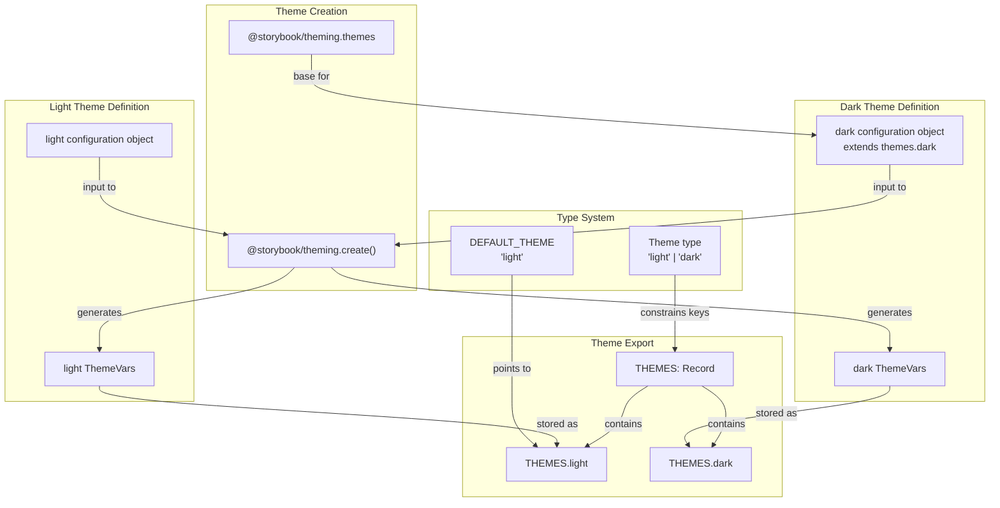
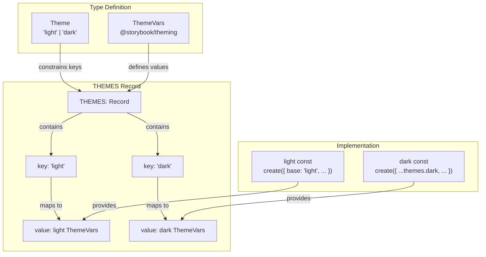
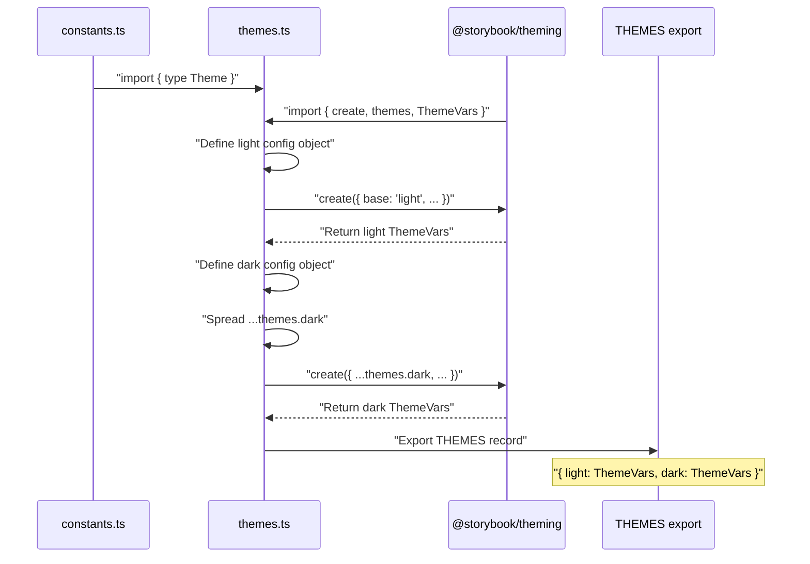

<!-- source: DeepWiki mcp.deepwiki.com · repo openai/apps-sdk-ui · extra page Theme Definitions · fetched 2026-10-26 -->

# Theme Definitions

<details>
<summary>Relevant source files</summary>

The following files were used as context for generating this wiki page:

- [.storybook-base/addon-theme/constants.ts](.storybook-base/addon-theme/constants.ts)
- [.storybook-base/addon-theme/themes.ts](.storybook-base/addon-theme/themes.ts)

</details>


## Purpose and Scope

This page documents the theme configurations that define the visual appearance of the Storybook environment. The theme definitions specify colors, typography, branding, and UI properties for both light and dark themes. These definitions integrate with Storybook's native theming system and are consumed by the theme storage system ([4.1.2](#4.1.2)) and applied via the theme tool component ([4.1.1](#4.1.1)).

For information about the broader design token system used in component documentation, see [Design Tokens](#5.1). For information about how themes are applied at runtime, see [Theme System](#5.2).

---

## Theme Type System

The theme type system defines the available theme variants and default selection through TypeScript type definitions.

### Type Definition

The `Theme` type is defined as a union of string literals:

[.storybook-base/addon-theme/constants.ts:1-2]()

This creates a type-safe enumeration that restricts theme values to either `"light"` or `"dark"`, providing compile-time validation throughout the theme system.

### Default Theme

The system specifies a default theme that is used when no theme preference is found:

[.storybook-base/addon-theme/constants.ts:2]()

The light theme serves as the fallback when the theme storage system cannot determine a user preference from URL parameters or localStorage.

**Sources:** `.storybook-base/addon-theme/constants.ts`

---

## Theme Structure Overview

Both themes are created using Storybook's `create` function from `@storybook/theming`, which generates `ThemeVars` objects containing all styling properties for the Storybook UI.



**Sources:** `.storybook-base/addon-theme/constants.ts`, `.storybook-base/addon-theme/themes.ts`

---

## Theme Property Categories

Each theme configuration is organized into five primary categories of properties that control different aspects of the Storybook UI.

### Property Category Breakdown

| Category | Properties | Purpose |
|----------|-----------|---------|
| **Branding** | `brandTitle`, `brandImage`, `brandUrl`, `brandTarget` | Controls logo, title, and navigation behavior in the Storybook toolbar |
| **Typography** | `fontBase`, `fontCode` | Defines font stacks for UI text and code blocks |
| **Colors** | `colorPrimary`, `colorSecondary` | Primary and secondary accent colors used throughout the UI |
| **UI Background** | `appBg`, `appContentBg`, `appPreviewBg` | Background colors for different UI regions |
| **UI Borders** | `appBorderColor`, `appBorderRadius` | Border styling for UI elements |
| **Toolbar** | `barTextColor`, `barBg` | Styling for the Storybook toolbar |

```mermaid
graph LR
    subgraph "Theme Configuration Structure"
        theme_obj["Theme Configuration Object"]
        
        subgraph "Brand Properties"
            brandTitle["brandTitle"]
            brandImage["brandImage"]
            brandUrl["brandUrl"]
            brandTarget["brandTarget"]
        end
        
        subgraph "Typography Properties"
            fontBase["fontBase"]
            fontCode["fontCode"]
        end
        
        subgraph "Color Properties"
            colorPrimary["colorPrimary"]
            colorSecondary["colorSecondary"]
        end
        
        subgraph "UI Properties"
            appBg["appBg"]
            appContentBg["appContentBg"]
            appPreviewBg["appPreviewBg"]
            appBorderColor["appBorderColor"]
            appBorderRadius["appBorderRadius"]
        end
        
        subgraph "Toolbar Properties"
            barTextColor["barTextColor"]
            barBg["barBg"]
        end
    end
    
    theme_obj -->|contains| brandTitle
    theme_obj -->|contains| brandImage
    theme_obj -->|contains| brandUrl
    theme_obj -->|contains| brandTarget
    theme_obj -->|contains| fontBase
    theme_obj -->|contains| fontCode
    theme_obj -->|contains| colorPrimary
    theme_obj -->|contains| colorSecondary
    theme_obj -->|contains| appBg
    theme_obj -->|contains| appContentBg
    theme_obj -->|contains| appPreviewBg
    theme_obj -->|contains| appBorderColor
    theme_obj -->|contains| appBorderRadius
    theme_obj -->|contains| barTextColor
    theme_obj -->|contains| barBg
```



**Sources:** `.storybook-base/addon-theme/themes.ts`

---

## Light Theme Configuration

The light theme is created with the `"light"` base and custom property overrides.

### Light Theme Properties

[.storybook-base/addon-theme/themes.ts:4-32]()

#### Detailed Property Values

| Property | Value | Description |
|----------|-------|-------------|
| `base` | `"light"` | Storybook's base theme type |
| `brandTitle` | `"Apps SDK UI"` | Title displayed in toolbar |
| `brandImage` | `https://openai.github.io/apps-sdk-ui/logo-storybook.svg` | Logo URL for light backgrounds |
| `brandUrl` | `https://developers.openai.com` | Link destination when logo is clicked |
| `brandTarget` | `"_self"` | Opens links in same tab |
| `fontBase` | System UI font stack | Sans-serif fonts for UI text |
| `fontCode` | Monospace font stack | Monospace fonts for code blocks |
| `colorPrimary` | `#3A10E5` | Purple primary accent color |
| `colorSecondary` | `#585C6D` | Gray secondary color |
| `appBg` | `#ffffff` | White main background |
| `appContentBg` | `#ffffff` | White content area background |
| `appPreviewBg` | `#ffffff` | White preview area background |
| `appBorderColor` | `#ededed` | Light gray borders |
| `appBorderRadius` | `6` | 6px border radius |
| `barTextColor` | `#6e6e80` | Medium gray toolbar text |
| `barBg` | `#ffffff` | White toolbar background |

### Font Stack Details

The `fontBase` property uses a comprehensive system font stack that prioritizes native UI fonts for optimal performance and appearance:

```
ui-sans-serif, -apple-system, system-ui, "Segoe UI", "Noto Sans", "Helvetica",
"Arial", "Apple Color Emoji", "Segoe UI Emoji", "Segoe UI Symbol", sans-serif
```

The `fontCode` property provides a monospace font stack for code display:

```
ui-monospace, "SFMono-Regular", "SF Mono", "Menlo", "Monaco", "Consolas",
"Liberation Mono", "DejaVu Sans Mono", "Courier New", monospace
```

**Sources:** `.storybook-base/addon-theme/themes.ts`

---

## Dark Theme Configuration

The dark theme extends Storybook's built-in dark theme with custom overrides.

### Dark Theme Properties

[.storybook-base/addon-theme/themes.ts:34-62]()

#### Detailed Property Values

| Property | Value | Description |
|----------|-------|-------------|
| `...themes.dark` | Spreads base dark theme | Inherits all properties from Storybook's default dark theme |
| `brandTitle` | `"Apps SDK UI"` | Title displayed in toolbar |
| `brandImage` | `https://openai.github.io/apps-sdk-ui/logo-storybook-dark.svg` | Logo URL optimized for dark backgrounds |
| `brandUrl` | `https://platform.openai.com` | Link destination when logo is clicked |
| `brandTarget` | `"_self"` | Opens links in same tab |
| `fontBase` | System UI font stack | Same as light theme |
| `fontCode` | Monospace font stack | Same as light theme |
| `colorPrimary` | `#3A10E5` | Purple primary accent (same as light) |
| `colorSecondary` | `#585C6D` | Gray secondary color (same as light) |
| `appBg` | `#212121` | Dark gray main background |
| `appContentBg` | `#212121` | Dark gray content area background |
| `appPreviewBg` | `#212121` | Dark gray preview area background |
| `appBorderColor` | `#393939` | Lighter gray borders for contrast |
| `appBorderRadius` | `6` | 6px border radius (same as light) |
| `barTextColor` | `#c1c1c1` | Light gray toolbar text |
| `barBg` | `#212121` | Dark gray toolbar background |

### Theme Inheritance Strategy

The dark theme uses a spread operator to inherit from `themes.dark`:

[.storybook-base/addon-theme/themes.ts:35]()

This strategy ensures that all unspecified properties automatically receive appropriate dark theme defaults from Storybook's theming system, while custom overrides take precedence.

### Brand Differences Between Themes

The themes differ in their branding configuration:

- **Logo**: Light theme uses `logo-storybook.svg`, dark theme uses `logo-storybook-dark.svg`
- **Brand URL**: Light theme links to `developers.openai.com`, dark theme links to `platform.openai.com`

**Sources:** `.storybook-base/addon-theme/themes.ts`

---

## Theme Export and Type Mapping

The themes are exported as a type-safe record that maps theme names to their configurations.

### THEMES Record

[.storybook-base/addon-theme/themes.ts:64-67]()

This export creates a strongly-typed mapping:



**Sources:** `.storybook-base/addon-theme/themes.ts`, `.storybook-base/addon-theme/constants.ts`

---

## Integration with Storybook Theming System

The theme definitions integrate with Storybook's theming API through the `create` function and `ThemeVars` type.

### Theme Creation Flow



### Usage by Theme System

The `THEMES` export is consumed by:

- **Theme Store** ([4.1.2](#4.1.2)): Retrieves theme configuration based on current theme selection
- **Storybook App** (see [3.4](#3.4)): Applies themes to Storybook's UI via the theming API
- **Manager Configuration** (see [3.2](#3.2)): Sets initial theme for Storybook manager

The type-safe record ensures that any code referencing themes can only use valid theme names (`"light"` or `"dark"`), preventing runtime errors from invalid theme selections.

**Sources:** `.storybook-base/addon-theme/themes.ts`, `.storybook-base/addon-theme/constants.ts`

---

## Color Palette Comparison

The following table compares the color values between themes:

| Color Property | Light Theme | Dark Theme | Usage |
|---------------|-------------|------------|-------|
| Primary | `#3A10E5` | `#3A10E5` | Accent color, links, interactive elements |
| Secondary | `#585C6D` | `#585C6D` | Secondary UI elements |
| App Background | `#ffffff` | `#212121` | Main container background |
| Content Background | `#ffffff` | `#212121` | Content area background |
| Preview Background | `#ffffff` | `#212121` | Component preview background |
| Border Color | `#ededed` | `#393939` | UI element borders |
| Toolbar Text | `#6e6e80` | `#c1c1c1` | Toolbar button text |
| Toolbar Background | `#ffffff` | `#212121` | Toolbar background |

Note that the primary and secondary accent colors remain consistent across both themes, providing brand continuity while background and text colors adjust for optimal contrast.

**Sources:** `.storybook-base/addon-theme/themes.ts`

---

