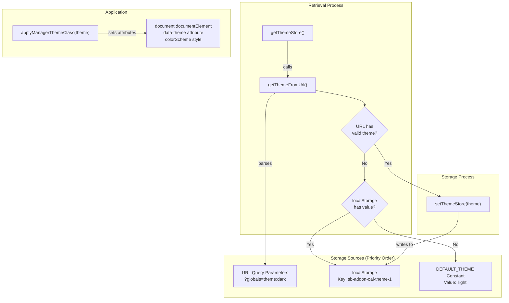
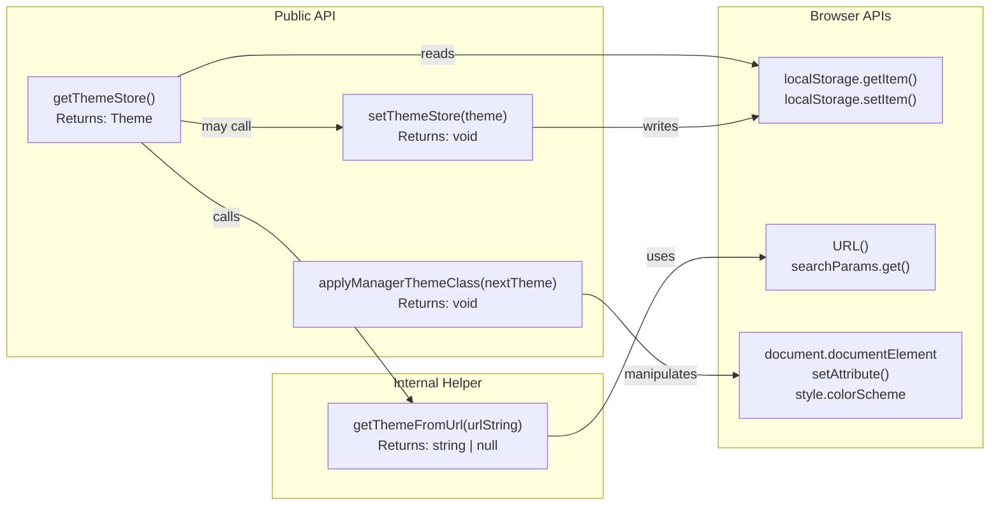
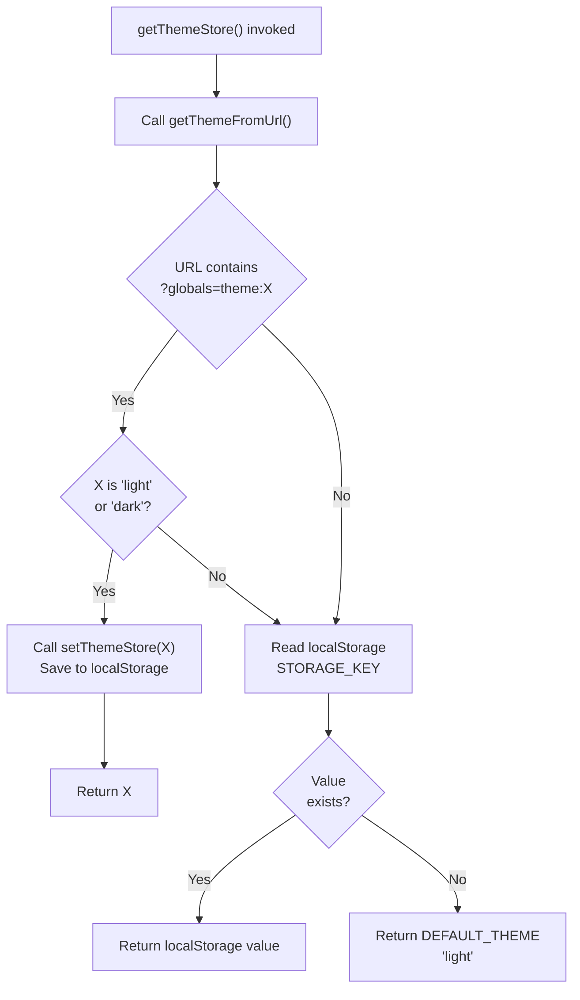
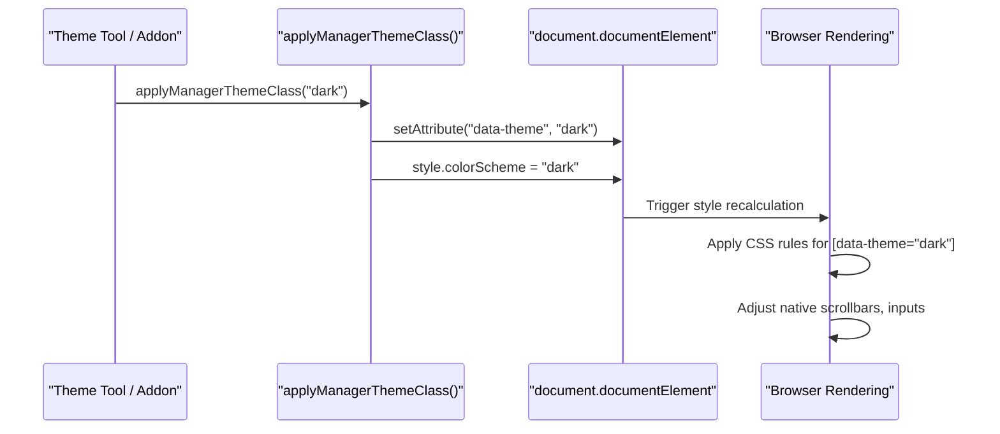
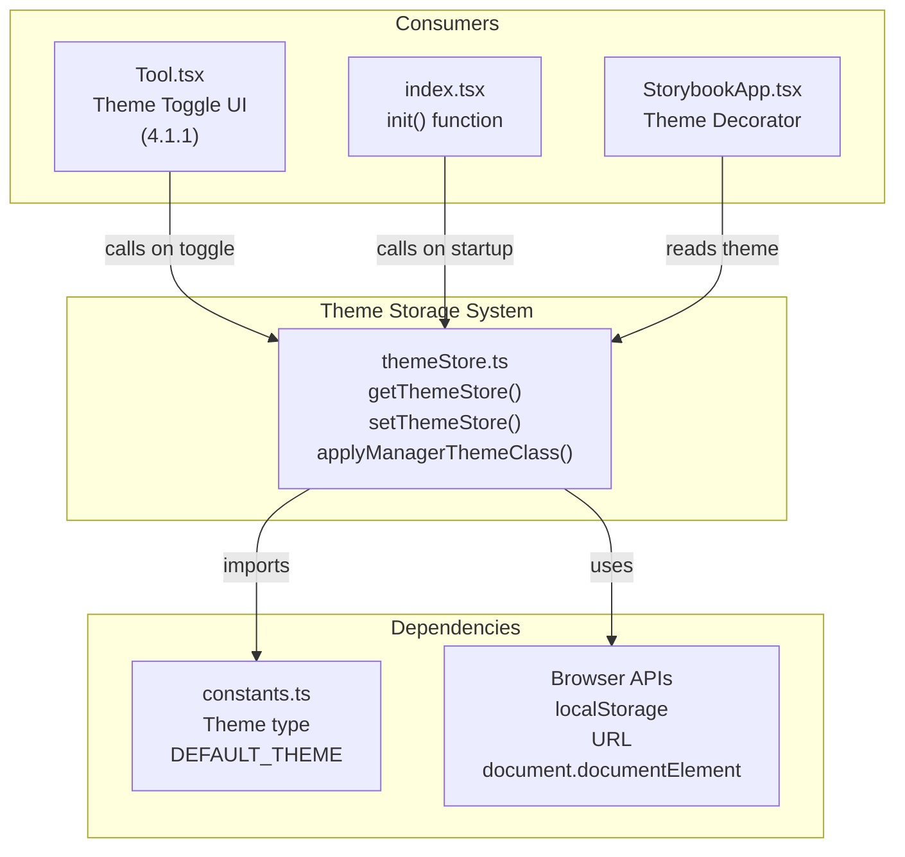

<!-- source: DeepWiki mcp.deepwiki.com · repo openai/apps-sdk-ui · extra page Theme Storage System · fetched 2026-10-26 -->

# Theme Storage System

<details>
<summary>Relevant source files</summary>

The following files were used as context for generating this wiki page:

- [.storybook-base/addon-theme/constants.ts](.storybook-base/addon-theme/constants.ts)
- [.storybook-base/addon-theme/themeStore.ts](.storybook-base/addon-theme/themeStore.ts)

</details>


The Theme Storage System manages persistence and retrieval of user theme preferences across Storybook sessions. It implements a three-tier priority system where URL parameters override localStorage, which in turn overrides the default theme setting. The system also provides DOM manipulation utilities to apply theme changes to the Storybook manager interface.

For information about the UI component that allows users to toggle themes, see [Theme Tool Component](#4.1.1). For theme configuration objects and styling definitions, see [Theme Definitions](#4.1.3).

## Purpose and Scope

This system is responsible for:

- **Persistence**: Storing theme preferences in browser localStorage
- **Retrieval**: Reading theme values from URL parameters, localStorage, or defaults
- **Priority Resolution**: Determining which theme source takes precedence
- **DOM Application**: Applying theme attributes to the document element
- **URL Synchronization**: Parsing and respecting theme values from URL query parameters

The system does not handle theme rendering or styling definitions—those are managed by separate systems documented in [Theme Definitions](#4.1.3) and [Manager UI Customization](#3.3).

---

## Storage Architecture

The theme storage system uses two primary storage mechanisms with a fallback to a hardcoded default:



**Diagram: Storage Priority and Flow**

Sources: [.storybook-base/addon-theme/themeStore.ts:1-42](), [.storybook-base/addon-theme/constants.ts:1-3]()

---

## Core Components

### Constants and Types

| Symbol | Type | Value | Purpose |
|--------|------|-------|---------|
| `Theme` | Type Alias | `"light" \| "dark"` | Defines valid theme values |
| `DEFAULT_THEME` | Constant | `"light"` | Fallback theme when no preference exists |
| `STORAGE_KEY` | Constant | `"sb-addon-oai-theme-1"` | localStorage key for persistence |

The `Theme` type is a string literal union restricting values to `"light"` or `"dark"`. This ensures type safety throughout the theme system.

Sources: [.storybook-base/addon-theme/constants.ts:1-2](), [.storybook-base/addon-theme/themeStore.ts:4]()

### Function Reference



**Diagram: Function Dependencies and Browser API Interactions**

Sources: [.storybook-base/addon-theme/themeStore.ts:1-42]()

---

## Priority System

The theme resolution follows a strict three-tier priority hierarchy:

### Priority Table

| Priority | Source | Conditions | Behavior |
|----------|--------|------------|----------|
| 1 (Highest) | URL Parameter | `?globals=theme:light` or `?globals=theme:dark` | Overrides all other sources; writes to localStorage |
| 2 | localStorage | Key `sb-addon-oai-theme-1` exists | Used if URL has no theme parameter |
| 3 (Lowest) | Default Constant | Always available | Used only if URL and localStorage have no value |

### Resolution Flow



**Diagram: Theme Resolution Decision Tree**

The URL parameter implementation ensures that when users share Storybook links with `?globals=theme:dark`, the recipient sees the same theme. The system automatically persists this to localStorage so the preference survives navigation within Storybook.

Sources: [.storybook-base/addon-theme/themeStore.ts:26-35]()

---

## URL Parameter Parsing

### Format Specification

The theme value is embedded in a `globals` query parameter with the following structure:

```
?globals=theme:dark
?globals=theme:light
?globals=otherKey:value;theme:dark;anotherKey:value
```

Multiple global values can be semicolon-delimited, with each value formatted as `key:value`.

### Implementation Details

The `getThemeFromUrl()` function implements the parser:

| Step | Implementation | Line Reference |
|------|----------------|----------------|
| 1. Parse URL | `new URL(urlString)` | [themeStore.ts:7]() |
| 2. Get globals parameter | `params.get("globals")` | [themeStore.ts:9]() |
| 3. Split by semicolon | `globals.split(";")` | [themeStore.ts:11]() |
| 4. Split each pair by colon | `pair.split(":")` | [themeStore.ts:13]() |
| 5. Find theme key | `if (key === "theme")` | [themeStore.ts:14]() |
| 6. Return value | `return value` | [themeStore.ts:15]() |

The function returns `null` if no theme parameter is found, allowing the caller to proceed to the next priority level.

Sources: [.storybook-base/addon-theme/themeStore.ts:6-20]()

---

## Storage Operations

### Writing to Storage

The `setThemeStore()` function provides the write interface:

```typescript
setThemeStore(theme: Theme) => void
```

**Behavior:**
- Writes theme value to localStorage under key `sb-addon-oai-theme-1`
- Type-safe: only accepts `Theme` type (`"light"` | `"dark"`)
- Synchronous operation
- No return value

**Usage Context:**
This function is called internally by `getThemeStore()` when a URL parameter is detected, ensuring URL preferences are persisted. It is also called by the Theme Tool Component (see [Theme Tool Component](#4.1.1)) when users manually toggle themes.

Sources: [.storybook-base/addon-theme/themeStore.ts:22-24]()

### Reading from Storage

The `getThemeStore()` function provides the read interface:

```typescript
getThemeStore() => Theme
```

**Behavior:**
- Always returns a valid `Theme` value (never null/undefined)
- Implements the three-tier priority system
- May have side effect: writes to localStorage if URL parameter detected
- Reads from `window.location.href` and `window.localStorage`

**Return Value Guarantee:**
The function guarantees a return value through the fallback chain: URL → localStorage → DEFAULT_THEME.

Sources: [.storybook-base/addon-theme/themeStore.ts:26-35]()

---

## DOM Integration

### Applying Theme to Document

The `applyManagerThemeClass()` function bridges the storage system to the visual rendering layer:

```typescript
applyManagerThemeClass(nextTheme: Theme) => void
```

**DOM Modifications:**

| Property | Target | Value | Purpose |
|----------|--------|-------|---------|
| `data-theme` attribute | `document.documentElement` | `"light"` or `"dark"` | CSS selector target for theme-specific styles |
| `colorScheme` style | `document.documentElement.style` | `"light"` or `"dark"` | Hints to browser for native UI elements |

### Implementation



**Diagram: DOM Application Sequence**

The `data-theme` attribute is used by CSS selectors throughout the Storybook manager to apply theme-specific colors and styles. The `colorScheme` property instructs the browser to render native form controls (scrollbars, inputs, buttons) in an appearance consistent with the theme.

Sources: [.storybook-base/addon-theme/themeStore.ts:37-41]()

---

## Integration Points

The theme storage system integrates with several other components:



**Diagram: System Integration Points**

Sources: [.storybook-base/addon-theme/themeStore.ts:1-2]()

---

## Storage Key Versioning

The storage key `sb-addon-oai-theme-1` includes a version suffix (`-1`). This versioning scheme allows for future migrations if the storage format or theme values need to change. A new version would use a different key (e.g., `sb-addon-oai-theme-2`), preventing conflicts with legacy stored values.

**Key Components:**
- `sb-addon`: Indicates Storybook addon context
- `oai`: Namespace prefix (likely organization identifier)
- `theme`: Feature identifier
- `1`: Version number

Sources: [.storybook-base/addon-theme/themeStore.ts:4]()

---

## Type Safety

All functions are strongly typed using the `Theme` type alias imported from `constants.ts`:

```typescript
export type Theme = "light" | "dark"
```

This provides compile-time safety ensuring:
- Only valid theme strings can be passed to `setThemeStore()` and `applyManagerThemeClass()`
- `getThemeStore()` is guaranteed to return a valid theme value
- TypeScript autocomplete works correctly in consuming code

Internal validation in `getThemeFromUrl()` at [themeStore.ts:28]() performs runtime validation to ensure URL parameters match the type definition before returning.

Sources: [.storybook-base/addon-theme/constants.ts:1](), [.storybook-base/addon-theme/themeStore.ts:1-2]()

---

## Summary

The Theme Storage System provides a robust, type-safe mechanism for persisting theme preferences with the following characteristics:

- **Resilient**: Three-tier fallback ensures a theme is always available
- **User-friendly**: URL sharing propagates theme preferences automatically
- **Persistent**: localStorage maintains preferences across sessions
- **Type-safe**: TypeScript types prevent invalid theme values
- **Browser-integrated**: Leverages `colorScheme` for native UI consistency
- **Versioned**: Storage key allows for future format migrations

The system serves as the data layer for the theme addon, with the UI layer implemented in [Theme Tool Component](#4.1.1) and styling definitions in [Theme Definitions](#4.1.3).

Sources: [.storybook-base/addon-theme/themeStore.ts:1-42](), [.storybook-base/addon-theme/constants.ts:1-3]()

---

