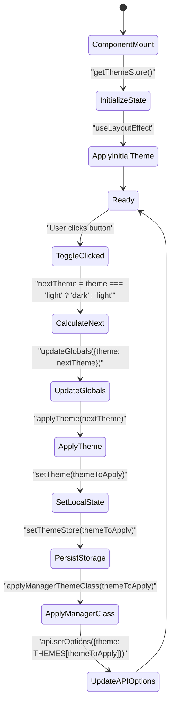
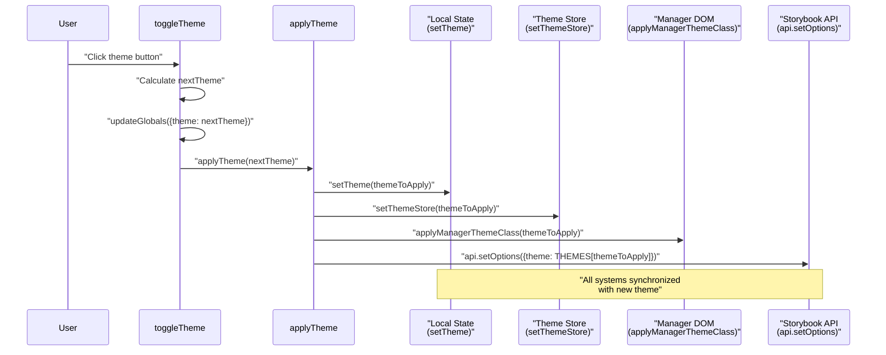
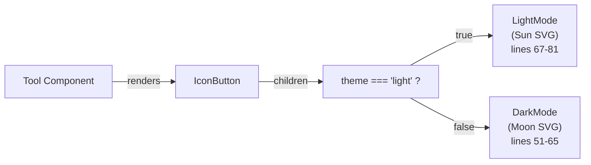
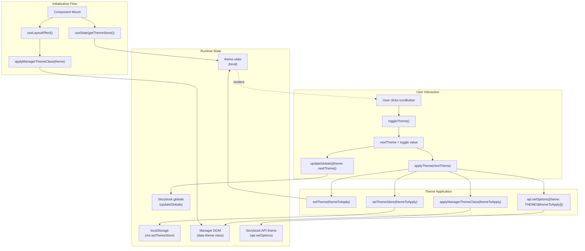

<!-- source: DeepWiki mcp.deepwiki.com · repo openai/apps-sdk-ui · extra page Theme Tool Component · fetched 2026-10-26 -->

# Theme Tool Component

<details>
<summary>Relevant source files</summary>

The following files were used as context for generating this wiki page:

- [.storybook-base/addon-theme/Tool.tsx](.storybook-base/addon-theme/Tool.tsx)
- [.storybook-base/addon-theme/constants.ts](.storybook-base/addon-theme/constants.ts)

</details>


This page documents the `Tool` React component located at [.storybook-base/addon-theme/Tool.tsx](). This component renders the theme toggle button in the Storybook toolbar, allowing users to switch between light and dark modes.

**Scope**: This page covers the React component implementation, its state management, and rendering logic. For information about theme persistence and storage mechanisms, see [Theme Storage System](#4.1.2). For theme configuration and definitions, see [Theme Definitions](#4.1.3).

---

## Component Structure

The `Tool` component is a memoized React component that serves as the primary UI control for theme switching in the Storybook manager interface.

### Props Interface

| Prop | Type | Description |
|------|------|-------------|
| `api` | `API` | Storybook manager API instance for controlling Storybook configuration |

The component accepts a single prop containing the Storybook manager API, which is used to update Storybook's global theme configuration.

**Sources**: [.storybook-base/addon-theme/Tool.tsx:11]()

---

## Component Dependencies

```mermaid
graph TB
    Tool["Tool Component<br/>(.storybook-base/addon-theme/Tool.tsx)"]
    
    subgraph "Storybook Imports"
        IconButton["IconButton<br/>@storybook/components"]
        API["API type<br/>@storybook/manager-api"]
        useGlobals["useGlobals hook<br/>@storybook/manager-api"]
    end
    
    subgraph "React Imports"
        memo["memo"]
        useLayoutEffect["useLayoutEffect"]
        useState["useState"]
    end
    
    subgraph "Local Module Imports"
        Theme["Theme type<br/>./constants.ts"]
        THEMES["THEMES map<br/>./themes.ts"]
        getThemeStore["getThemeStore()"]
        setThemeStore["setThemeStore()"]
        applyManagerThemeClass["applyManagerThemeClass()"]
    end
    
    subgraph "Inline Components"
        DarkMode["DarkMode SVG"]
        LightMode["LightMode SVG"]
    end
    
    Tool -->|uses| IconButton
    Tool -->|receives| API
    Tool -->|calls| useGlobals
    Tool -->|wrapped in| memo
    Tool -->|uses| useLayoutEffect
    Tool -->|uses| useState
    Tool -->|imports| Theme
    Tool -->|references| THEMES
    Tool -->|calls| getThemeStore
    Tool -->|calls| setThemeStore
    Tool -->|calls| applyManagerThemeClass
    Tool -->|renders| DarkMode
    Tool -->|renders| LightMode
```



**Sources**: [.storybook-base/addon-theme/Tool.tsx:1-9]()

---

## State Management

The `Tool` component manages theme state through a combination of local React state and Storybook's global state system.

### Local State

The component maintains a local `theme` state variable initialized with the value from persistent storage:

```typescript
const [theme, setTheme] = useState<Theme>(getThemeStore())
```

The `theme` variable holds the current theme value (`"light"` or `"dark"`) and is synchronized with the theme store on initialization.

**Sources**: [.storybook-base/addon-theme/Tool.tsx:13]()

### Global State Integration

The component uses Storybook's `useGlobals` hook to manage theme state globally across the Storybook instance:

```typescript
const [, updateGlobals] = useGlobals()
```

The `updateGlobals` function is called when the theme changes, making the theme value accessible to stories and documentation pages through Storybook's global state.

**Sources**: [.storybook-base/addon-theme/Tool.tsx:12](), [.storybook-base/addon-theme/Tool.tsx:18]()

### State Flow Diagram



**Sources**: [.storybook-base/addon-theme/Tool.tsx:13-37]()

---

## Theme Toggle Logic

The component implements theme toggling through two primary functions: `toggleTheme` and `applyTheme`.

### toggleTheme Function

The `toggleTheme` function handles user interaction with the theme toggle button:

| Step | Action | Code Line Reference |
|------|--------|---------------------|
| 1 | Calculate next theme | [Tool.tsx:16]() |
| 2 | Update Storybook globals | [Tool.tsx:18]() |
| 3 | Apply theme visually | [Tool.tsx:20]() |

The function toggles between `"light"` and `"dark"` values using a ternary operator:

```typescript
const nextTheme = theme === "light" ? "dark" : "light"
```

**Sources**: [.storybook-base/addon-theme/Tool.tsx:15-21]()

### applyTheme Function

The `applyTheme` function orchestrates the complete theme application process across multiple systems:



**Sources**: [.storybook-base/addon-theme/Tool.tsx:23-31]()

### Integration Points

The `applyTheme` function updates four distinct systems:

1. **Component State**: Updates the local `theme` state via `setTheme()`
2. **Persistent Storage**: Saves theme preference via `setThemeStore()`
3. **Manager UI**: Applies CSS classes via `applyManagerThemeClass()`
4. **Storybook Configuration**: Updates theme styling via `api.setOptions()`

**Sources**: [.storybook-base/addon-theme/Tool.tsx:24-30]()

---

## Rendering and UI

The component renders a Storybook `IconButton` with theme-appropriate icons and tooltips.

### IconButton Configuration

| Property | Value | Purpose |
|----------|-------|---------|
| `active` | `false` | Button does not show active state |
| `title` | Dynamic tooltip text | Provides accessibility and user guidance |
| `onClick` | `toggleTheme` | Triggers theme toggle on click |

The tooltip text dynamically displays the opposite theme, indicating what will happen on click:

```typescript
title={`Switch to ${theme === "light" ? "Dark" : "Light"} Mode`}
```

**Sources**: [.storybook-base/addon-theme/Tool.tsx:40-46]()

### Icon Components

The component renders different icons based on the current theme:

- **Light theme active**: Displays `<LightMode />` component (sun icon)
- **Dark theme active**: Displays `<DarkMode />` component (moon icon)

Both icon components are inline SVG implementations defined at the bottom of the file:



**Sources**: [.storybook-base/addon-theme/Tool.tsx:45](), [.storybook-base/addon-theme/Tool.tsx:51-81]()

### SVG Icon Specifications

Both icons are defined as inline React functional components returning SVG elements with the following properties:

| Property | Value |
|----------|-------|
| `xmlns` | `"http://www.w3.org/2000/svg"` |
| `width` | `"16px"` |
| `height` | `"16px"` |
| `fill` | `"currentColor"` |
| `viewBox` | `"0 0 24 24"` |

The icons use `currentColor` for fill, ensuring they inherit the toolbar's text color and adapt to Storybook's UI theme.

**Sources**: [.storybook-base/addon-theme/Tool.tsx:52-58](), [.storybook-base/addon-theme/Tool.tsx:68-74]()

---

## Lifecycle Behavior

The component uses `useLayoutEffect` to ensure proper theme initialization when the component mounts.

### Initial Theme Application

```typescript
useLayoutEffect(() => {
  // Ensure the correct class is applied to manager state on load
  applyManagerThemeClass(theme)
  // eslint-disable-next-line react-hooks/exhaustive-deps
}, [])
```

The effect runs once on mount (empty dependency array) and applies the manager theme class to ensure visual consistency. The `applyManagerThemeClass` function modifies the DOM to apply theme-specific CSS classes to the Storybook manager frame.

**Why useLayoutEffect?**: This hook is used instead of `useEffect` to ensure the theme class is applied synchronously before the browser paints, preventing a flash of incorrectly themed content.

**Sources**: [.storybook-base/addon-theme/Tool.tsx:33-37]()

---

## Complete Data Flow

The following diagram illustrates the complete data flow from component initialization through user interaction:



**Sources**: [.storybook-base/addon-theme/Tool.tsx:11-48]()

---

## Code Entity Reference

### Functions

| Function | Location | Purpose |
|----------|----------|---------|
| `Tool` | [Tool.tsx:11]() | Main component export |
| `toggleTheme` | [Tool.tsx:15]() | Handles theme toggle button click |
| `applyTheme` | [Tool.tsx:23]() | Applies theme across all systems |
| `DarkMode` | [Tool.tsx:51]() | Renders moon icon SVG |
| `LightMode` | [Tool.tsx:67]() | Renders sun icon SVG |

### Imported Functions

| Function | Source Module | Usage |
|----------|---------------|-------|
| `getThemeStore` | `./themeStore` | [Tool.tsx:13]() - Initialize theme state |
| `setThemeStore` | `./themeStore` | [Tool.tsx:26]() - Persist theme preference |
| `applyManagerThemeClass` | `./themeStore` | [Tool.tsx:28](), [Tool.tsx:35]() - Apply DOM classes |

### Imported Types and Constants

| Import | Source Module | Usage |
|--------|---------------|-------|
| `Theme` | `./constants` | [Tool.tsx:13]() - Type annotation for theme state |
| `THEMES` | `./themes` | [Tool.tsx:30]() - Map theme name to Storybook theme object |

**Sources**: [.storybook-base/addon-theme/Tool.tsx:1-9](), [.storybook-base/addon-theme/constants.ts:1-2]()

---

## Summary

The `Tool` component is a focused React component responsible for rendering the theme toggle UI and orchestrating theme changes across multiple systems. It implements a clear separation of concerns:

- **UI Layer**: `IconButton` with dynamic icons and tooltips
- **State Layer**: Local React state synchronized with Storybook globals
- **Persistence Layer**: Integration with theme storage system
- **Application Layer**: Multi-system theme application via `applyTheme`

The component uses `memo` for performance optimization and `useLayoutEffect` to ensure proper initialization timing.

**Sources**: [.storybook-base/addon-theme/Tool.tsx]()

---

