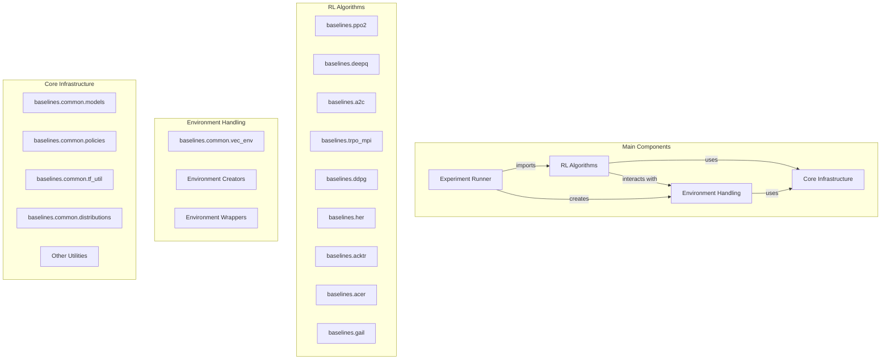
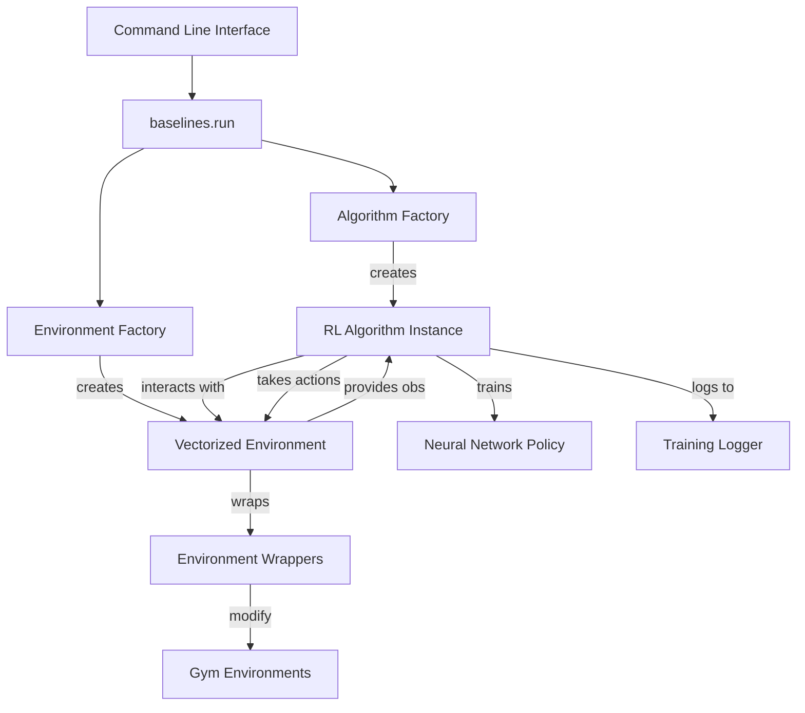
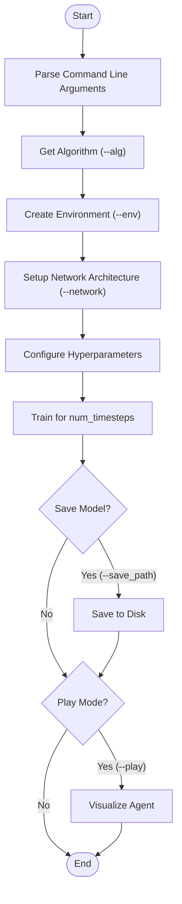
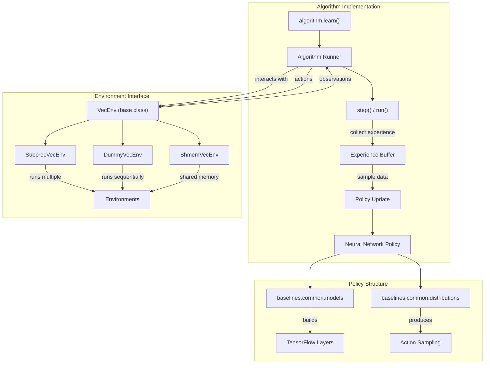
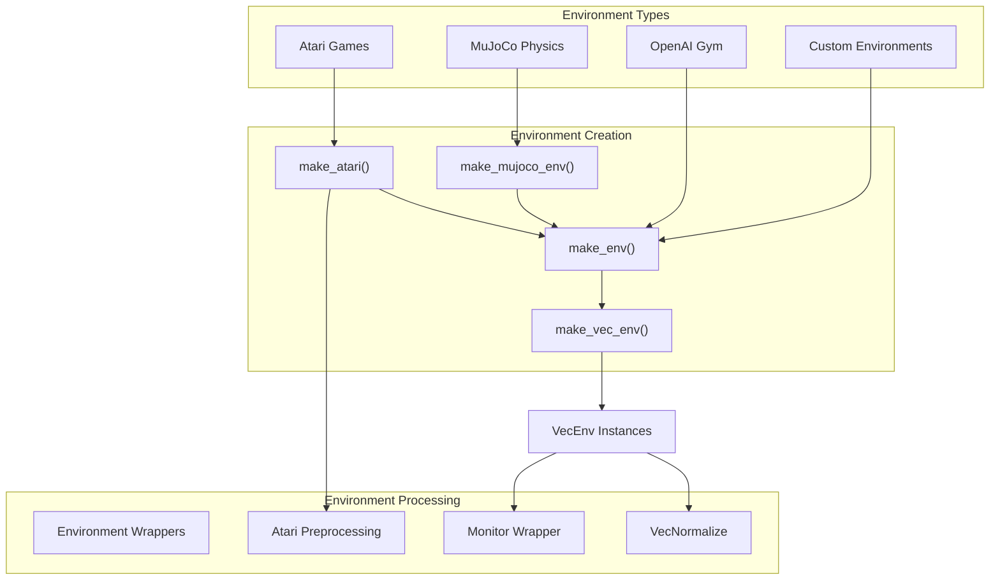
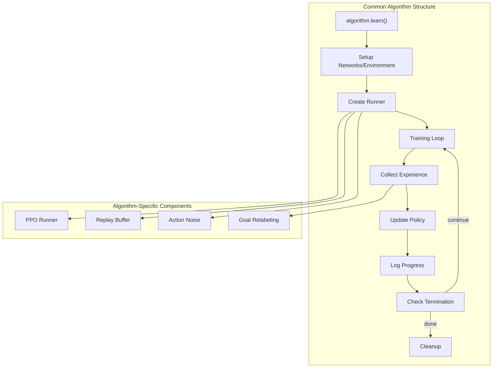

<!-- source: DeepWiki mcp.deepwiki.com · repo openai/baselines · page 1 Overview · fetched 2026-10-30 -->

# Overview

Relevant source files

The following files were used as context for generating this wiki page:

- [Dockerfile](Dockerfile)
- [README.md](README.md)

OpenAI Baselines is a set of high-quality implementations of reinforcement learning algorithms designed to serve as benchmarks for the research community. This document introduces the key components and architecture of the Baselines library, providing a high-level understanding of how the different parts of the system work together.

## Purpose and Scope

Baselines provides standardized implementations of popular reinforcement learning algorithms with these core objectives:

- Facilitate reproducibility of reinforcement learning research
- Provide reliable benchmark implementations for new algorithm development
- Create a foundation that researchers can build upon and extend
- Offer common tools for environment handling, neural network model creation, and experiment logging

For specific information about installing and using Baselines, see [Getting Started](#2). For details on running experiments, see [Running Experiments](#2.1).

## Repository Structure

Sources: [README.md:5-9](), [README.md:132-142]()

## Key Components

### Reinforcement Learning Algorithms

Baselines implements several state-of-the-art reinforcement learning algorithms:

| Algorithm | Package | Description |
|-----------|---------|-------------|
| PPO2 | `baselines.ppo2` | Proximal Policy Optimization (improved version) |
| DQN | `baselines.deepq` | Deep Q-Networks for value-based learning |
| A2C | `baselines.a2c` | Advantage Actor-Critic method |
| DDPG | `baselines.ddpg` | Deep Deterministic Policy Gradient for continuous control |
| ACKTR | `baselines.acktr` | Actor-Critic with Kronecker-Factored Trust Region |
| ACER | `baselines.acer` | Actor-Critic with Experience Replay |
| TRPO | `baselines.trpo_mpi` | Trust Region Policy Optimization |
| GAIL | `baselines.gail` | Generative Adversarial Imitation Learning |
| HER | `baselines.her` | Hindsight Experience Replay for sample-efficient learning |

Sources: [README.md:132-142]()

### Environment Handling

The environment handling system provides a standardized interface to interact with reinforcement learning environments, with particular focus on:

- **Vectorized Environments**: Run multiple environment instances in parallel for efficient data collection
- **Environment Wrappers**: Modify environment behavior for preprocessing observations, framing stacking, etc.
- **Monitoring**: Track and log performance metrics during training

Sources: [README.md:117-129]()

### Core Infrastructure

The core infrastructure provides shared functionality used by the various algorithms:

- **Neural Network Models**: Standard architectures for policy and value functions
- **Policies**: Classes that handle action selection and state processing
- **TensorFlow Utilities**: Helpers for building and training neural networks
- **Probability Distributions**: Components for stochastic policy representation
- **Logging and Visualization**: Tools for tracking experiment progress

Sources: [README.md:94-95]()

## System Architecture

The Baselines system integrates the components described above into a cohesive framework. Below are diagrams showing the high-level architecture and execution flow.

### High-Level Architecture

Sources: [README.md:78-81]()

### Experiment Execution Flow

Sources: [README.md:78-101](), [README.md:103-115]()

## Core Module Structure

Below is a diagram showing the key modules and classes that form the core of Baselines:

Sources: [README.md:94-95]()

## Integration with Environments

Baselines is designed to work with various types of environments, with special support for popular benchmarks:

Sources: [README.md:67-70](), [README.md:82-92](), [README.md:117]()

## Reinforcement Learning Algorithm Structure

The reinforcement learning algorithms in Baselines follow similar organizational patterns, typically providing a `learn()` function as the main entry point:

Sources: [README.md:94-95]()

## Usage Flow

The typical usage flow for Baselines is as follows:

1. **Installation**: Install the package and dependencies
2. **Environment Setup**: Configure the desired environment
3. **Algorithm Selection**: Choose a reinforcement learning algorithm
4. **Training**: Run the training process with specified hyperparameters
5. **Saving/Loading**: Save trained models and load them later for evaluation
6. **Visualization**: Visualize agent performance

For detailed information on these steps, please refer to [Getting Started](#2) and [Running Experiments](#2.1).

Sources: [README.md:45-65](), [README.md:78-101](), [README.md:103-115]()

---

