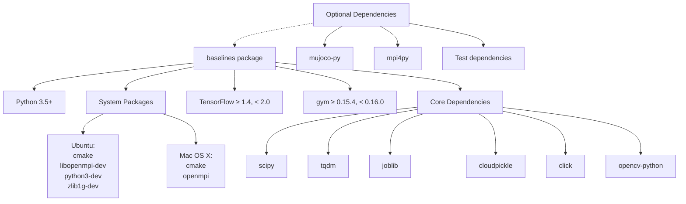
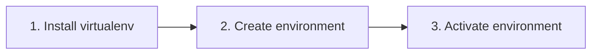
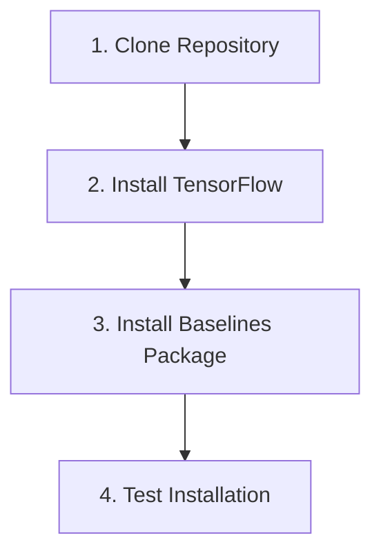
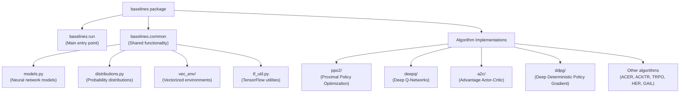
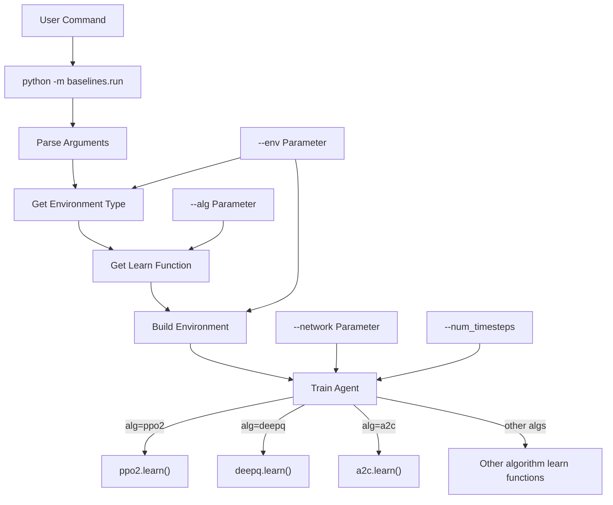

<!-- source: DeepWiki mcp.deepwiki.com · repo openai/baselines · page 2 Getting Started · fetched 2026-10-30 -->

# Getting Started

<details>
<summary>Relevant source files</summary>

The following files were used as context for generating this wiki page:

- [.travis.yml](.travis.yml)
- [Dockerfile](Dockerfile)
- [README.md](README.md)
- [setup.py](setup.py)

</details>


This page provides instructions on how to install and begin using the OpenAI Baselines library, a collection of high-quality implementations of reinforcement learning algorithms. For detailed information on running experiments after installation, see [Running Experiments](#2.1).

## Prerequisites and Dependencies

The OpenAI Baselines library requires several dependencies to function properly:



Sources: [setup.py:31-47](), [README.md:11-23]()

### System Requirements

#### Ubuntu
```bash
sudo apt-get update && sudo apt-get install cmake libopenmpi-dev python3-dev zlib1g-dev
```

#### Mac OS X
```bash
brew install cmake openmpi
```

Sources: [README.md:15-16](), [README.md:21-22]()

## Installation Process

### Virtual Environment Setup

It's recommended to use a virtual environment to avoid package conflicts:



1. Install virtualenv:
   ```bash
   pip install virtualenv
   ```

2. Create a virtual environment:
   ```bash
   virtualenv /path/to/venv --python=python3
   ```

3. Activate the virtual environment:
   ```bash
   . /path/to/venv/bin/activate
   ```

Sources: [README.md:25-39]()

### Installing Baselines

With your virtual environment activated, follow these steps:



1. Clone the repository:
   ```bash
   git clone https://github.com/openai/baselines.git
   cd baselines
   ```

2. Install TensorFlow:
   ```bash
   # For GPU support
   pip install tensorflow-gpu==1.14
   
   # For CPU only
   pip install tensorflow==1.14
   ```

3. Install the Baselines package:
   ```bash
   pip install -e .
   ```

4. Test the installation:
   ```bash
   pip install pytest
   pytest
   ```

Sources: [README.md:46-74]()

### MuJoCo (Optional)

Some of the baselines examples use MuJoCo physics simulator, which requires a license and binaries:

1. Obtain a license (30-day temporary license available) from [www.mujoco.org](http://www.mujoco.org)
2. Set up MuJoCo following the instructions at [mujoco-py](https://github.com/openai/mujoco-py)

Sources: [README.md:67-68]()

## Package Structure

The Baselines package includes multiple reinforcement learning algorithm implementations and supporting infrastructure:



Sources: [README.md:132-142]()

## Basic Usage

The main entry point for running algorithms is the `baselines.run` module. The following diagram shows how command-line arguments flow through the system:



Sources: [README.md:77-81]()

### Example Commands

Basic command structure:
```bash
python -m baselines.run --alg=<algorithm> --env=<environment_id> [additional arguments]
```

Example 1: Training PPO on MuJoCo Humanoid
```bash
python -m baselines.run --alg=ppo2 --env=Humanoid-v2 --num_timesteps=2e7
```

Example 2: Training DQN on Atari Pong
```bash
python -m baselines.run --alg=deepq --env=PongNoFrameskip-v4 --num_timesteps=1e6
```

Example 3: Training with custom hyperparameters
```bash
python -m baselines.run --alg=ppo2 --env=Humanoid-v2 --num_timesteps=2e7 --ent_coef=0.1 --num_hidden=32 --num_layers=3 --value_network=copy
```

Sources: [README.md:82-101]()

### Saving and Loading Models

To save a trained model:
```bash
python -m baselines.run --alg=ppo2 --env=PongNoFrameskip-v4 --num_timesteps=2e7 --save_path=~/models/pong_model
```

To load and visualize a trained model:
```bash
python -m baselines.run --alg=ppo2 --env=PongNoFrameskip-v4 --num_timesteps=0 --load_path=~/models/pong_model --play
```

Sources: [README.md:106-115]()

### Logging and Visualization

By default, all summary data is saved to a unique directory in a temp folder. You can specify a custom log path:

```bash
python -m baselines.run --alg=ppo2 --env=PongNoFrameskip-v4 --num_timesteps=2e7 --log_path=~/logs/pong_training/
```

The environment variable `$OPENAI_LOGDIR` can also be used to set the log directory.

Sources: [README.md:119-129]()

For more detailed information on running experiments and configuring algorithms, see [Running Experiments](#2.1).

---

