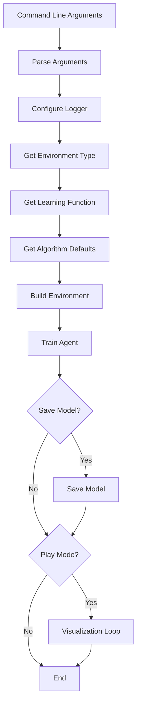
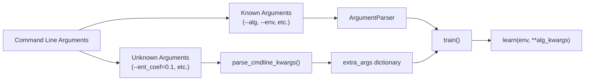
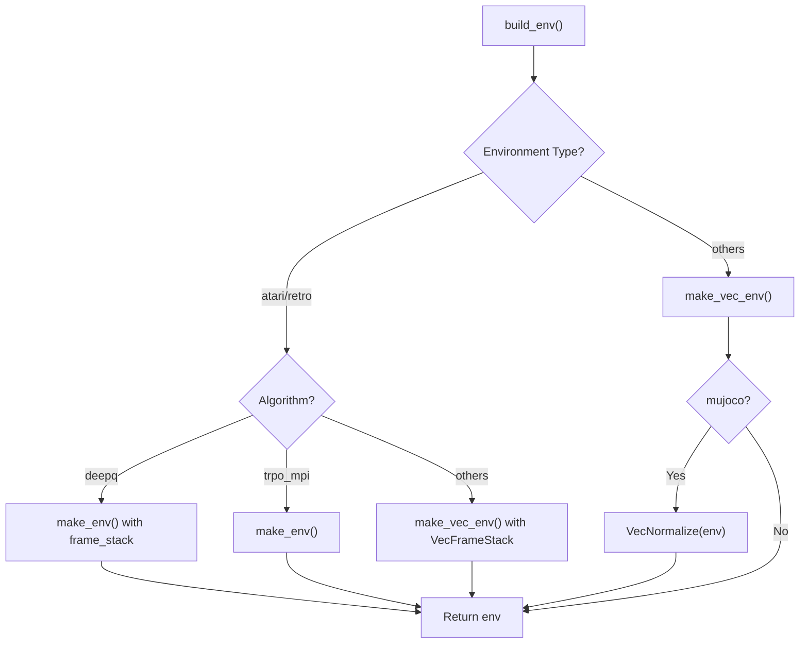
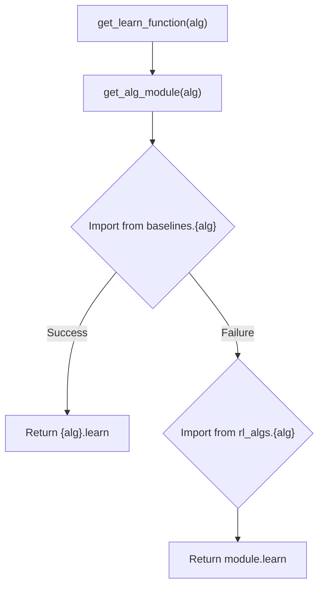
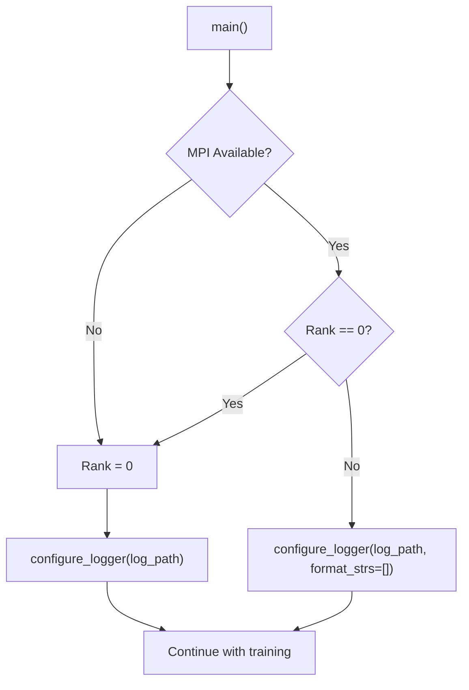
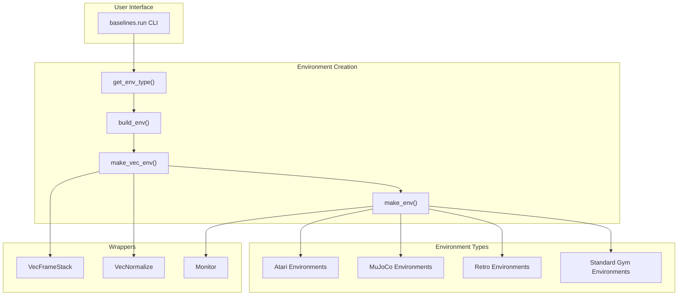

<!-- source: DeepWiki mcp.deepwiki.com · repo openai/baselines · page 2.1 Running Experiments · fetched 2026-10-30 -->

# Running Experiments

<details>
<summary>Relevant source files</summary>

The following files were used as context for generating this wiki page:

- [Dockerfile](Dockerfile)
- [README.md](README.md)
- [baselines/common/mpi_util.py](baselines/common/mpi_util.py)
- [baselines/common/running_mean_std.py](baselines/common/running_mean_std.py)
- [baselines/common/test_mpi_util.py](baselines/common/test_mpi_util.py)
- [baselines/ddpg/test_smoke.py](baselines/ddpg/test_smoke.py)
- [baselines/run.py](baselines/run.py)

</details>


This document explains how to use the `baselines.run` module to execute reinforcement learning algorithms in the OpenAI Baselines library. It covers the command-line interface, experiment workflow, and various options for training, saving, loading, and visualizing reinforcement learning agents.

## Experiment Execution Flow

The main entry point for running experiments in OpenAI Baselines is through the `baselines.run` module. When you execute this module, it follows a specific workflow to set up and run your experiment.



Sources: [baselines/run.py:202-247]()

## Command-Line Interface

The primary way to run experiments is via the command line. The general syntax is:

```
python -m baselines.run --alg=<algorithm> --env=<environment_id> [additional arguments]
```

### Core Arguments

| Argument | Description | Example |
|----------|-------------|---------|
| `--alg` | Reinforcement learning algorithm to use | `ppo2`, `deepq`, `a2c`, etc. |
| `--env` | Environment ID (from OpenAI Gym) | `CartPole-v1`, `Humanoid-v2` |
| `--network` | Neural network architecture | `mlp`, `cnn` |
| `--num_timesteps` | Total number of timesteps to train | `1e6`, `2e7` |
| `--save_path` | Path to save the trained model | `~/models/pong_20M_ppo2` |
| `--load_path` | Path to load a trained model | `~/models/pong_20M_ppo2` |
| `--play` | Run the trained model without training | Flag (no value) |

Sources: [baselines/run.py:205-207](), [README.md:78-101]()

### Hyperparameter Customization

You can customize algorithm hyperparameters directly from the command line using the format `--param_name=value`. These are parsed from unknown arguments and passed to the learning function.



Sources: [baselines/run.py:180-192](), [baselines/run.py:52-83]()

## Setting Up Environments

The `build_env()` function creates environments based on the specified environment type:



Sources: [baselines/run.py:86-118]()

## Running Training

The `train()` function orchestrates the complete training process:

1. Determines the environment type and ID
2. Retrieves the appropriate learning function for the specified algorithm
3. Gets default hyperparameters for the algorithm and environment combination
4. Updates hyperparameters with user-provided values
5. Builds the environment
6. Adds video recording if specified
7. Sets up the network architecture
8. Trains the agent using the algorithm's learn function

Sources: [baselines/run.py:53-83]()

## Learning Function Selection

The system dynamically imports the learning function for the specified algorithm:



Sources: [baselines/run.py:154-167]()

## Examples

### Example 1: PPO with MuJoCo Humanoid

Train a fully-connected network controlling MuJoCo humanoid using PPO2:

```
python -m baselines.run --alg=ppo2 --env=Humanoid-v2 --num_timesteps=2e7
```

Customize hyperparameters and network architecture:

```
python -m baselines.run --alg=ppo2 --env=Humanoid-v2 --num_timesteps=2e7 --ent_coef=0.1 --num_hidden=32 --num_layers=3 --value_network=copy
```

Sources: [README.md:82-92]()

### Example 2: DQN on Atari

Train DQN on Atari Pong:

```
python -m baselines.run --alg=deepq --env=PongNoFrameskip-v4 --num_timesteps=1e6
```

Sources: [README.md:97-100]()

## Saving and Loading Models

To save a trained model:

```
python -m baselines.run --alg=ppo2 --env=PongNoFrameskip-v4 --num_timesteps=2e7 --save_path=~/models/pong_20M_ppo2
```

To load and visualize a trained model:

```
python -m baselines.run --alg=ppo2 --env=PongNoFrameskip-v4 --num_timesteps=0 --load_path=~/models/pong_20M_ppo2 --play
```

The `--play` flag runs the trained model without further training, allowing you to visualize its performance.

Sources: [README.md:106-115](), [baselines/run.py:218-244]()

## Logging and Visualization

The system automatically logs training progress. By default, logs are saved to a temporary directory. You can specify a custom log directory with the `--log_path` option:

```
python -m baselines.run --alg=ppo2 --env=PongNoFrameskip-v4 --num_timesteps=2e7 --log_path=~/logs/Pong/
```

The logger is configured based on the MPI rank to prevent duplicate logging in distributed training scenarios:



Sources: [baselines/run.py:204-214](), [README.md:119-127]()

## Environment Handling System

One of the key components in running experiments is the environment handling system. The system provides functions for creating different types of environments and wrapping them for parallel execution.



Sources: [baselines/run.py:86-145]()

## Advanced Usage

### Using Multiple CPUs

The system can leverage multiple CPU cores for parallel environment simulation. By default, it uses all available CPU cores:

```
python -m baselines.run --alg=ppo2 --env=PongNoFrameskip-v4 --num_env=8 --num_timesteps=1e7
```

The `--num_env` parameter specifies how many environment instances to run in parallel. If not provided, it defaults to the number of CPU cores available.

Sources: [baselines/run.py:87-89]()

### Recording Videos

You can record videos of agent performance during training:

```
python -m baselines.run --alg=ppo2 --env=PongNoFrameskip-v4 --num_timesteps=1e7 --save_video_interval=4000 --save_video_length=200
```

This will record a video every 4000 steps, with each video capturing 200 steps of interaction.

Sources: [baselines/run.py:65-66]()

## MPI Support

The system supports distributed training using MPI (Message Passing Interface). When MPI is available, the system:

1. Configures the logger to prevent duplicate output
2. Ensures models are properly synchronized across processes
3. Allows environment parallelization across multiple machines

To use MPI, you need to have the `mpi4py` package installed and run the script using `mpirun`:

```
mpirun -np 4 python -m baselines.run --alg=ppo2 --env=Humanoid-v2 --num_timesteps=1e7
```

Sources: [baselines/run.py:17-20](), [baselines/run.py:204-214]()

## Conclusion

The `baselines.run` module provides a flexible and powerful interface for running reinforcement learning experiments with OpenAI Baselines. By understanding its command-line interface and core functions, you can train agents on a variety of environments, customize hyperparameters, save and load models, and visualize results.

For more information about environment handling, see [Environment Handling](#3). For details about specific algorithms, see [Reinforcement Learning Algorithms](#5).

---

