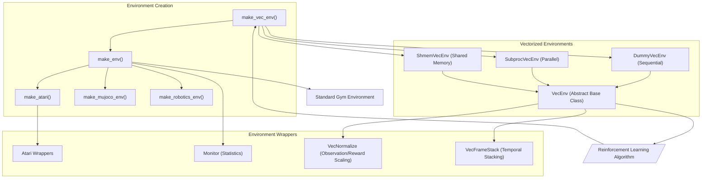
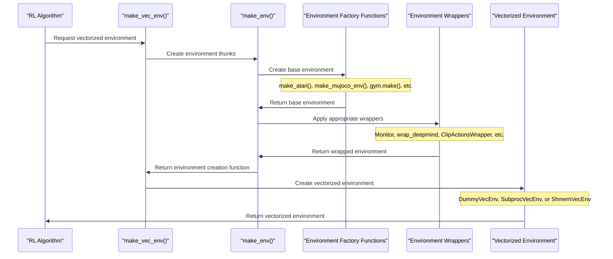
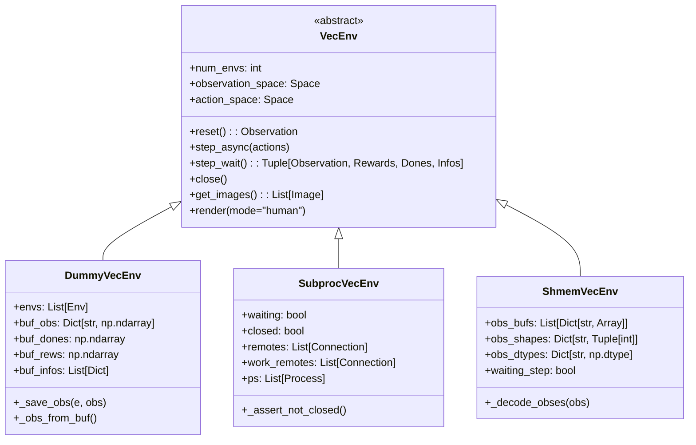
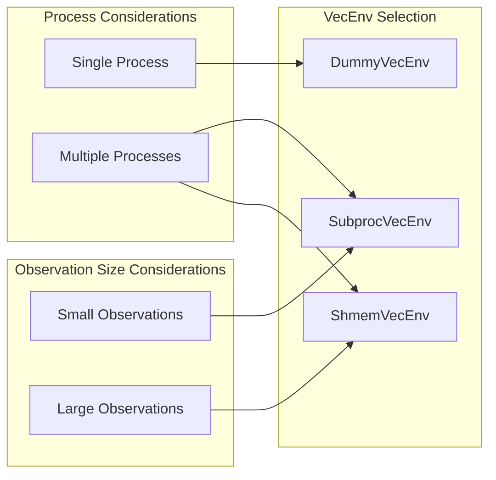
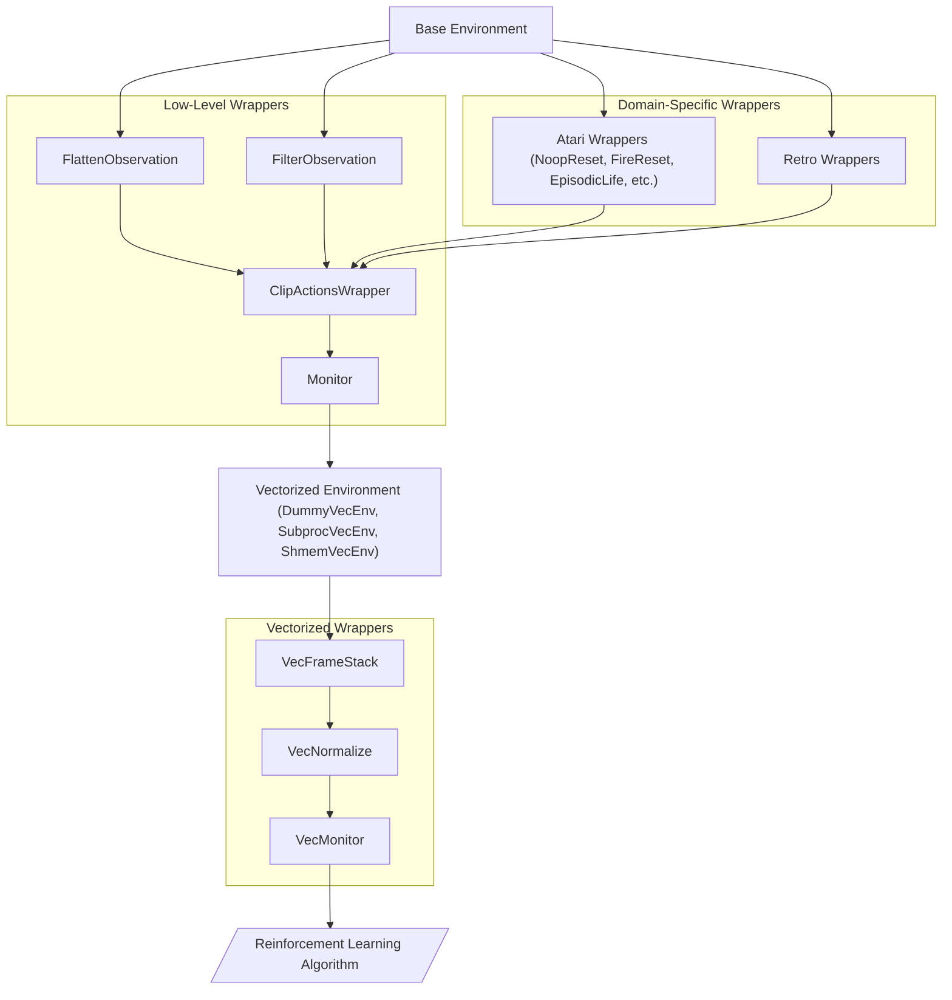
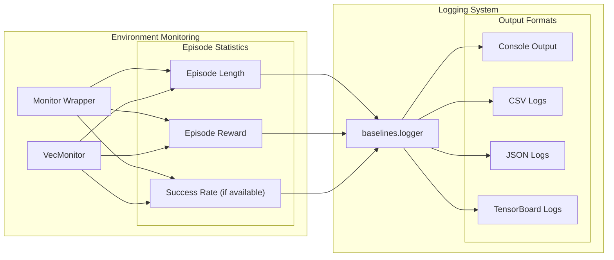
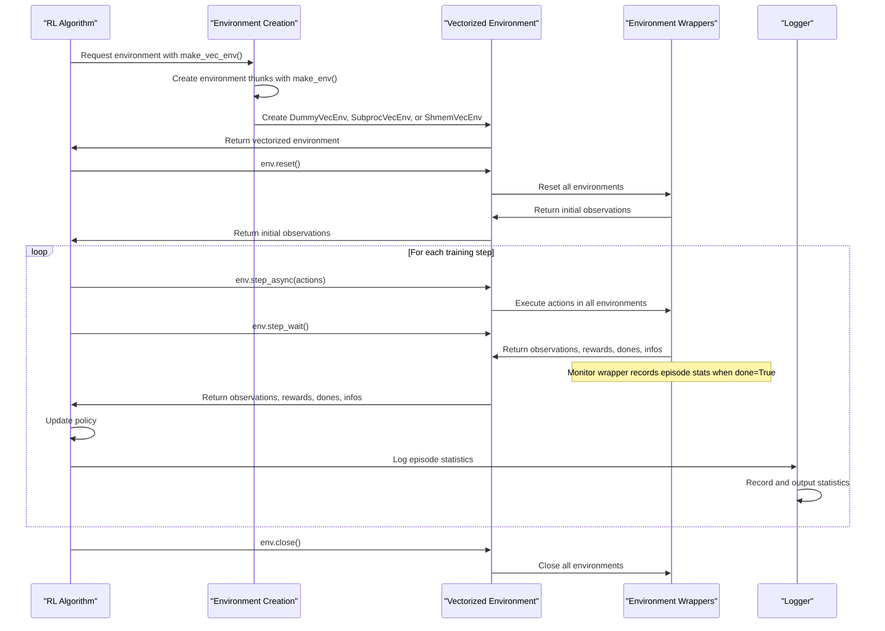

<!-- source: DeepWiki mcp.deepwiki.com · repo openai/baselines · page 3 Environment Handling · fetched 2026-10-30 -->

# Environment Handling

<details>
<summary>Relevant source files</summary>

The following files were used as context for generating this wiki page:

- [baselines/common/cmd_util.py](baselines/common/cmd_util.py)
- [baselines/common/vec_env/__init__.py](baselines/common/vec_env/__init__.py)
- [baselines/common/vec_env/dummy_vec_env.py](baselines/common/vec_env/dummy_vec_env.py)
- [baselines/common/vec_env/shmem_vec_env.py](baselines/common/vec_env/shmem_vec_env.py)
- [baselines/common/vec_env/subproc_vec_env.py](baselines/common/vec_env/subproc_vec_env.py)
- [baselines/common/vec_env/test_vec_env.py](baselines/common/vec_env/test_vec_env.py)
- [baselines/her/her.py](baselines/her/her.py)
- [baselines/logger.py](baselines/logger.py)

</details>


## Purpose and Scope

This document describes how environments are managed, parallelized, and preprocessed in the OpenAI Baselines library. It covers the core infrastructure for environment creation, vectorization for parallel execution, environment wrappers for preprocessing, and monitoring for performance tracking. For detailed information about vectorized environments specifically, see [Vectorized Environments](#3.1).

## Overview

The environment handling system in Baselines provides a flexible infrastructure for working with reinforcement learning environments. It includes utilities for creating environments, running multiple environments in parallel, preprocessing observations and rewards, and standardizing environment interfaces across different domains.



Sources: [baselines/common/cmd_util.py](). [baselines/common/vec_env/\_\_init\_\_.py](). [baselines/common/vec_env/dummy_vec_env.py](). [baselines/common/vec_env/subproc_vec_env.py](). [baselines/common/vec_env/shmem_vec_env.py]().

## Environment Creation

The environment creation process in Baselines is handled by a set of utility functions that create and configure environments based on their type (Atari, MuJoCo, Robotics, or standard Gym environments).

### Key Environment Creation Functions

The main functions for environment creation are:

| Function | Purpose | Location |
|----------|---------|----------|
| `make_vec_env()` | Creates a vectorized environment for parallel execution | [baselines/common/cmd_util.py:22-59]() |
| `make_env()` | Creates a single environment with appropriate wrappers | [baselines/common/cmd_util.py:62-105]() |
| `make_atari()` | Creates an Atari environment | [baselines/common/atari_wrappers.py]() |
| `make_mujoco_env()` | Creates a MuJoCo environment | [baselines/common/cmd_util.py:108-122]() |
| `make_robotics_env()` | Creates a Robotics environment (e.g., Fetch) | [baselines/common/cmd_util.py:124-135]() |

### Environment Creation Flow

The environment creation process typically follows this sequence:



Sources: [baselines/common/cmd_util.py:22-135]().

### Example Environment Creation

When an algorithm needs an environment, it typically calls `make_vec_env()` with appropriate parameters:

```python
# Example of how an algorithm would create an environment
env = make_vec_env(
    env_id='CartPole-v1',           # Environment ID
    env_type='gym',                 # Environment type
    num_env=8,                      # Number of parallel environments
    seed=0,                         # Random seed
    wrapper_kwargs={},              # Wrapper-specific arguments
    start_index=0,                  # Starting index for environment ID
    reward_scale=1.0,               # Reward scaling factor
    flatten_dict_observations=True, # Flatten dictionary observations
    force_dummy=False               # Force DummyVecEnv
)
```

`make_vec_env()` creates a set of environment-creation functions, then passes them to the appropriate vectorized environment implementation.

Sources: [baselines/common/cmd_util.py:22-59]().

## Vectorized Environments

Vectorized environments allow multiple environment instances to be run in parallel, which can significantly improve training throughput. Baselines implements this concept through the `VecEnv` abstract base class and three concrete implementations.

### VecEnv Class Hierarchy



Sources: [baselines/common/vec_env/\_\_init\_\_.py:1-10](). [baselines/common/vec_env/dummy_vec_env.py:5-81](). [baselines/common/vec_env/subproc_vec_env.py:39-121](). [baselines/common/vec_env/shmem_vec_env.py:20-104]().

### VecEnv Implementations

Baselines provides three different implementations of the `VecEnv` interface:

1. **DummyVecEnv**: Runs environments sequentially in a single process. Useful for debugging and when `num_env == 1`.
   
   ```python
   # DummyVecEnv execution model
   for e in range(self.num_envs):
       action = self.actions[e]
       obs, self.buf_rews[e], self.buf_dones[e], self.buf_infos[e] = self.envs[e].step(action)
   ```

2. **SubprocVecEnv**: Runs environments in parallel using multiple processes with pipe-based communication. Recommended when `num_env > 1` for improved throughput.
   
   ```python
   # SubprocVecEnv execution model (simplified)
   # In main process:
   for remote, action in zip(self.remotes, actions):
       remote.send(('step', action))
       
   # In worker processes:
   cmd, data = remote.recv()
   if cmd == 'step':
       remote.send([step_env(env, action) for env, action in zip(envs, data)])
   ```

3. **ShmemVecEnv**: Optimized version of SubprocVecEnv that uses shared memory for observation communication, reducing overhead for large observations.



Sources: [baselines/common/vec_env/dummy_vec_env.py:5-81](). [baselines/common/vec_env/subproc_vec_env.py:39-121](). [baselines/common/vec_env/shmem_vec_env.py:20-104]().

## Environment Wrappers

Environment wrappers modify the behavior of environments by intercepting and potentially transforming the interactions between an agent and an environment. Baselines includes numerous wrappers for common preprocessing tasks.

### Common Environment Wrappers

| Wrapper | Purpose | Applied To |
|---------|---------|------------|
| `Monitor` | Records episode statistics (length, rewards) | All environments |
| `ClipActionsWrapper` | Clips actions to environment action space | Environments with Box action spaces |
| `wrap_deepmind` | Applies Atari-specific preprocessing | Atari environments |
| `VecFrameStack` | Stacks consecutive frames | Vectorized environments |
| `VecNormalize` | Normalizes observations and rewards | Vectorized environments |
| `FlattenObservation` | Flattens dictionary observations | Environments with Dict observation spaces |
| `FilterObservation` | Filters dictionary observations | Environments with Dict observation spaces |
| `RewardScaler` | Scales rewards by a constant factor | Any environment |



Sources: [baselines/common/cmd_util.py:62-105](). [baselines/common/vec_env/\_\_init\_\_.py:1-10]().

### Wrapper Application in Environment Creation

The `make_env` function in `cmd_util.py` applies appropriate wrappers based on the environment type:

```python
# Simplified representation of wrapper application logic
def make_env(env_id, env_type, ...):
    # Create base environment
    if env_type == 'atari':
        env = make_atari(env_id)
    elif env_type == 'retro':
        env = retro_wrappers.make_retro(game=env_id, ...)
    else:
        env = gym.make(env_id, **env_kwargs)
    
    # Apply common wrappers
    if flatten_dict_observations and isinstance(env.observation_space, gym.spaces.Dict):
        env = FlattenObservation(env)
    
    # Add monitoring
    env = Monitor(env, logger_dir and os.path.join(logger_dir, str(mpi_rank) + '.' + str(subrank)))
    
    # Apply environment-specific wrappers
    if env_type == 'atari':
        env = wrap_deepmind(env, **wrapper_kwargs)
    elif env_type == 'retro':
        env = retro_wrappers.wrap_deepmind_retro(env, **wrapper_kwargs)
    
    # Clip actions if necessary
    if isinstance(env.action_space, gym.spaces.Box):
        env = ClipActionsWrapper(env)
    
    # Scale rewards if necessary
    if reward_scale != 1:
        env = retro_wrappers.RewardScaler(env, reward_scale)
    
    return env
```

Sources: [baselines/common/cmd_util.py:62-105]().

## Monitoring and Logging

Baselines includes a monitoring system to track environment performance metrics during training and evaluation.

### Monitoring Components

The monitoring system consists of several key components:

1. **Monitor Wrapper**: Records episode statistics like length and rewards.
2. **VecMonitor**: Vectorized version of the Monitor wrapper.
3. **Logger**: Central logging system for recording and visualizing statistics.



Sources: [baselines/logger.py:1-502](). [baselines/common/cmd_util.py:86-89]().

### Monitoring Workflow

1. The `Monitor` wrapper is applied to each environment during creation.
2. The `Monitor` records episode statistics when episodes terminate.
3. Statistics are aggregated and passed to the logger.
4. The logger outputs statistics to various formats (console, CSV, JSON, TensorBoard).

```python
# Example of how monitoring integrates with training
env = make_vec_env(...)  # Creates environments with Monitor wrapper
obs = env.reset()

for step in range(total_steps):
    actions = policy.step(obs)
    obs, rewards, dones, infos = env.step(actions)
    
    # Monitor automatically records episode statistics on done=True
    
    # Logger outputs statistics periodically
    if step % log_interval == 0:
        logger.dumpkvs()
```

Sources: [baselines/logger.py:193-218](). [baselines/her/her.py:53-63]().

## End-to-End Environment Handling Example

This section illustrates how the different components of the environment handling system interact during a typical reinforcement learning training process.



Sources: [baselines/common/cmd_util.py:22-105](). [baselines/common/vec_env/dummy_vec_env.py:31-57](). [baselines/common/vec_env/subproc_vec_env.py:75-88](). [baselines/logger.py:193-218]().

## Summary

The environment handling system in OpenAI Baselines provides a comprehensive infrastructure for creating, configuring, and managing reinforcement learning environments. Key features include:

1. **Environment Creation**: Functions like `make_vec_env` and `make_env` streamline the creation of different environment types.
2. **Vectorized Environments**: The `VecEnv` class hierarchy enables parallel environment execution for improved throughput.
3. **Environment Wrappers**: Various wrappers modify and standardize environment behavior for different domains.
4. **Monitoring**: The monitoring system tracks and logs performance metrics during training.

This infrastructure allows algorithms to interact with environments in a consistent way, regardless of the underlying environment type or implementation details, while optimizing for performance and flexibility.

Sources: [baselines/common/cmd_util.py](). [baselines/common/vec_env/\_\_init\_\_.py](). [baselines/common/vec_env/dummy_vec_env.py](). [baselines/common/vec_env/subproc_vec_env.py](). [baselines/common/vec_env/shmem_vec_env.py](). [baselines/logger.py]().

---

