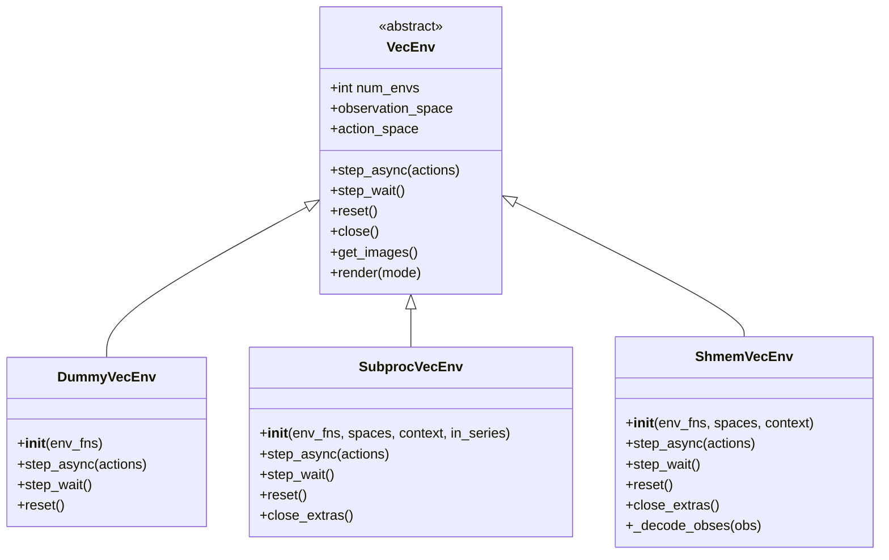
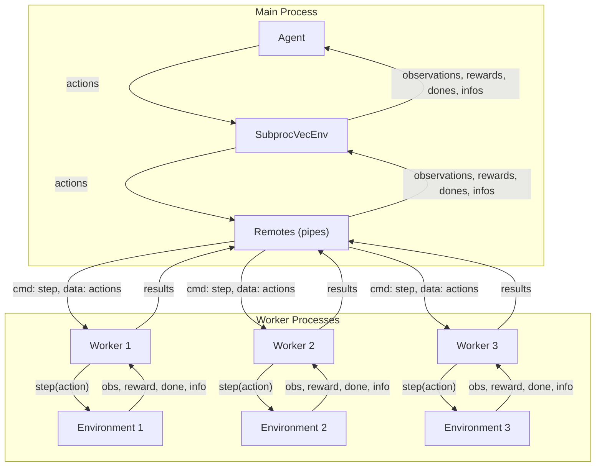
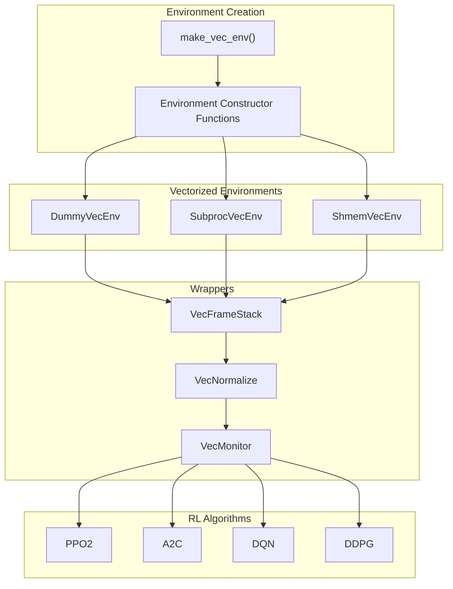

<!-- source: DeepWiki mcp.deepwiki.com · repo openai/baselines · page 3.1 Vectorized Environments · fetched 2026-10-30 -->

# Vectorized Environments

<details>
<summary>Relevant source files</summary>

The following files were used as context for generating this wiki page:

- [baselines/common/vec_env/__init__.py](baselines/common/vec_env/__init__.py)
- [baselines/common/vec_env/dummy_vec_env.py](baselines/common/vec_env/dummy_vec_env.py)
- [baselines/common/vec_env/shmem_vec_env.py](baselines/common/vec_env/shmem_vec_env.py)
- [baselines/common/vec_env/subproc_vec_env.py](baselines/common/vec_env/subproc_vec_env.py)
- [baselines/common/vec_env/test_vec_env.py](baselines/common/vec_env/test_vec_env.py)
- [baselines/her/her.py](baselines/her/her.py)

</details>


## Overview

Vectorized Environments are a core component in OpenAI Baselines that enable multiple environments to run in parallel, significantly speeding up data collection for reinforcement learning algorithms. This page explains the vectorized environment system, including its key implementations and how they interact with other components in the baselines architecture.

Sources: [baselines/common/vec_env/__init__.py:1-10]()

## Purpose and Architecture

Vectorized environments serve several critical purposes:

1. **Parallelization** - Run multiple environment instances simultaneously
2. **Standardized Interface** - Provide a consistent API regardless of implementation
3. **Efficient Collection** - Gather experiences from multiple sources at once
4. **Batched Operations** - Enable batch processing of observations and actions

The vectorized environment system is designed with an abstract base class (`VecEnv`) and multiple concrete implementations optimized for different use cases.



**Diagram: Vectorized Environment Class Hierarchy**

Sources: [baselines/common/vec_env/dummy_vec_env.py:5-81](), [baselines/common/vec_env/subproc_vec_env.py:39-121](), [baselines/common/vec_env/shmem_vec_env.py:20-104]()

## VecEnv Interface

All vectorized environment implementations follow the same core interface defined by the `VecEnv` abstract base class:

| Method | Description |
|--------|-------------|
| `step_async(actions)` | Starts stepping through environments with the provided actions |
| `step_wait()` | Waits for the steps to complete and returns results |
| `reset()` | Resets all environments and returns initial observations |
| `close()` | Closes all environments |
| `get_images()` | Returns rendered images from the environments |
| `render(mode='human')` | Renders the environments (typically just one) |

This two-part stepping mechanism (`step_async`/`step_wait`) allows for asynchronous execution, where a client can perform other operations while waiting for environments to step.

Sources: [baselines/common/vec_env/dummy_vec_env.py:31-56](), [baselines/common/vec_env/subproc_vec_env.py:75-88](), [baselines/common/vec_env/shmem_vec_env.py:69-79]()

## Vectorized Environment Implementations

### DummyVecEnv

The `DummyVecEnv` is the simplest implementation that runs multiple environments sequentially (one at a time). It's useful for:

- Debugging purposes
- When `num_env == 1` (to avoid communication overhead)
- As a reference implementation for testing other implementations

```python
# Usage example
from baselines.common.vec_env import DummyVecEnv

env_fns = [lambda: gym.make('CartPole-v1') for _ in range(4)]
env = DummyVecEnv(env_fns)

obs = env.reset()
actions = [0, 1, 0, 1]  # Actions for each environment
env.step_async(actions)
obs, rewards, dones, infos = env.step_wait()
```

Sources: [baselines/common/vec_env/dummy_vec_env.py:5-81]()

### SubprocVecEnv

The `SubprocVecEnv` runs multiple environments in parallel using Python's multiprocessing. It creates separate processes for the environments and communicates with them via pipes. This implementation is recommended when:

- You have multiple environments (`num_envs > 1`)
- The environment's `step()` method is computationally expensive or has I/O operations
- You want to utilize multiple CPU cores



**Diagram: SubprocVecEnv Communication Flow**

Sources: [baselines/common/vec_env/subproc_vec_env.py:7-138]()

The `SubprocVecEnv` also supports running multiple environments in series within each subprocess through the `in_series` parameter, which can be more efficient when balancing between parallelism and process overhead.

### ShmemVecEnv

The `ShmemVecEnv` is an optimized version of `SubprocVecEnv` that uses shared memory (via multiprocessing's Array) to communicate observations instead of sending them through pipes. This can significantly improve performance when working with large observations (e.g., images).

Key features of `ShmemVecEnv`:
- Uses shared memory buffers for observations
- Still uses pipes for commands and small data
- More efficient for environments with large observation spaces

Sources: [baselines/common/vec_env/shmem_vec_env.py:20-141]()

## Performance Considerations

When choosing between vectorized environment implementations, consider:

| Implementation | Best Used When | Advantages | Limitations |
|----------------|----------------|------------|-------------|
| `DummyVecEnv` | Single environment or debugging | No process overhead, simple | No parallelism, sequential execution |
| `SubprocVecEnv` | Multiple environments with small-medium observations | True parallelism, uses multiple cores | Process creation overhead, IPC overhead |
| `ShmemVecEnv` | Multiple environments with large observations | Efficient for large observations | Slightly more complex, still has process overhead |

For most reinforcement learning algorithms in Baselines, `SubprocVecEnv` is recommended as the default choice when running on a multi-core machine. For environments with large observations (like high-resolution images), `ShmemVecEnv` may provide better performance.

Sources: [baselines/common/vec_env/test_vec_env.py:1-158]()

## Usage in OpenAI Baselines

In the OpenAI Baselines architecture, vectorized environments are a key component that sits between environment wrappers and reinforcement learning algorithms.



**Diagram: Vectorized Environments in the OpenAI Baselines Architecture**

Sources: [baselines/common/vec_env/__init__.py:1-10](), [baselines/her/her.py:166-172]()

## Example Usage

Here's a complete example of how to create and use a vectorized environment:

```python
import gym
from baselines.common.vec_env import SubprocVecEnv

# Create a list of environment constructor functions
def make_env(env_id, rank):
    def _thunk():
        env = gym.make(env_id)
        env.seed(rank)
        return env
    return _thunk

env_id = "CartPole-v1"
num_envs = 4
env_fns = [make_env(env_id, i) for i in range(num_envs)]

# Create the vectorized environment
vec_env = SubprocVecEnv(env_fns)

# Reset all environments
obs = vec_env.reset()  # Shape: (num_envs, *obs_shape)

# Take a step in all environments
actions = [0 for _ in range(num_envs)]
vec_env.step_async(actions)
obs, rewards, dones, infos = vec_env.step_wait()

# Don't forget to close the environments when done
vec_env.close()
```

## Related Pages

For information about specific wrappers that can be applied to vectorized environments, see [Environment Wrappers](#3.2).

For monitoring and benchmarking features, see [Monitoring and Benchmarking](#3.3).

Sources: [baselines/common/vec_env/dummy_vec_env.py:5-81](), [baselines/common/vec_env/subproc_vec_env.py:39-121]()

---

