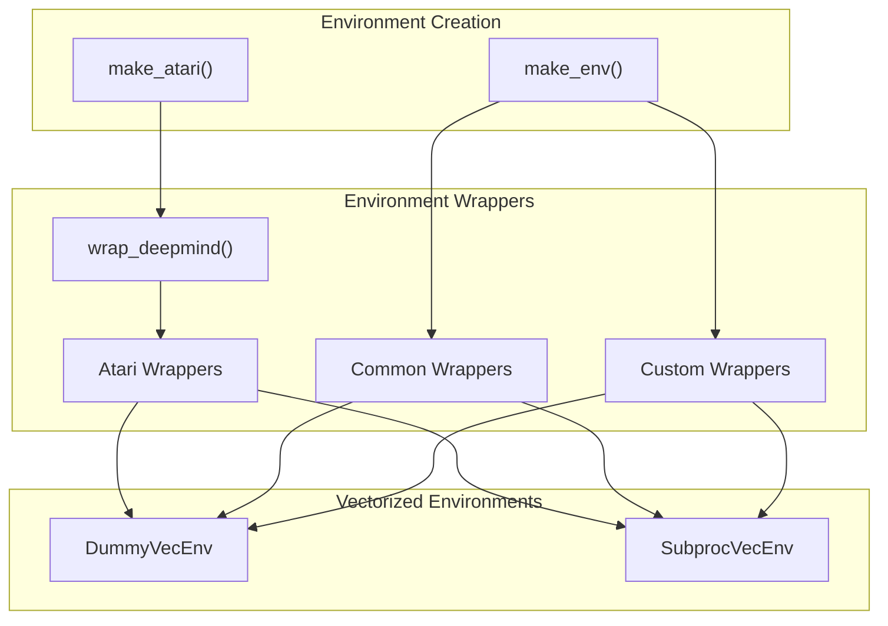
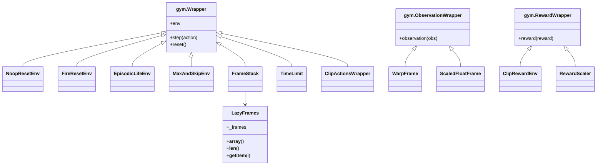
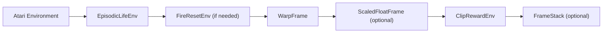
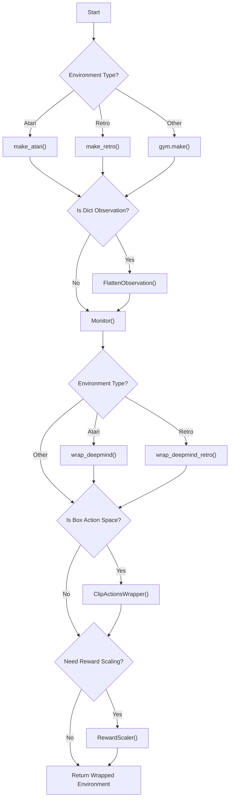

<!-- source: DeepWiki mcp.deepwiki.com · repo openai/baselines · page 3.2 Environment Wrappers · fetched 2026-10-30 -->

# Environment Wrappers

<details>
<summary>Relevant source files</summary>

The following files were used as context for generating this wiki page:

- [baselines/acktr/kfac.py](baselines/acktr/kfac.py)
- [baselines/common/atari_wrappers.py](baselines/common/atari_wrappers.py)
- [baselines/common/cmd_util.py](baselines/common/cmd_util.py)
- [baselines/logger.py](baselines/logger.py)

</details>


Environment wrappers are a core component in the OpenAI Baselines framework that modify or extend the behavior of reinforcement learning environments. These wrappers serve to preprocess observations, standardize environment interfaces, modify rewards, and manage episode termination conditions. This page documents the various environment wrappers available in Baselines and how they are used.

For information about running multiple environments in parallel, see [Vectorized Environments](#3.1).

## Overview

Environment wrappers follow the Gym wrapper pattern, where each wrapper is a subclass of `gym.Wrapper`, `gym.ObservationWrapper`, or `gym.RewardWrapper`. These wrappers allow for modifying environment behavior without changing the underlying environment code. In Baselines, wrappers are used extensively to standardize environment interfaces and implement preprocessing techniques that have been shown to improve learning performance.



Sources: [baselines/common/cmd_util.py:17-21](), [baselines/common/atari_wrappers.py:275-289]()

## Wrapper Types

Baselines includes several types of wrappers that serve different purposes:

| Wrapper Type | Purpose | Examples |
|--------------|---------|----------|
| Observation Preprocessing | Modifies observations to make them more suitable for neural networks | `WarpFrame`, `FrameStack`, `ScaledFloatFrame` |
| Action Space Modification | Changes or limits the action space | `ClipActionsWrapper` |
| Reward Modification | Alters rewards to improve learning | `ClipRewardEnv`, `RewardScaler` |
| Episode Management | Controls episode starting and ending conditions | `NoopResetEnv`, `FireResetEnv`, `EpisodicLifeEnv` |
| Performance Monitoring | Tracks environment performance | `Monitor` |
| Frame Processing | Handles frame skipping and pooling | `MaxAndSkipEnv` |

Sources: [baselines/common/atari_wrappers.py:12-264](), [baselines/common/cmd_util.py:86-104]()

## Wrapper Hierarchy

The wrappers in Baselines follow a class hierarchy based on Gym's wrapper classes:



Sources: [baselines/common/atari_wrappers.py:12-264]()

## Common Wrappers

### Atari-Specific Wrappers

Atari environments often require specialized preprocessing to make them suitable for reinforcement learning. Baselines includes several wrappers specifically designed for Atari games:

#### NoopResetEnv

Performs a random number of no-op actions at the beginning of each episode to provide stochasticity in the initial state.

```python
# Example usage
env = NoopResetEnv(env, noop_max=30)
```

Sources: [baselines/common/atari_wrappers.py:12-39]()

#### FireResetEnv

For environments that require pressing the FIRE button to start gameplay (like Pong), this wrapper automatically presses FIRE when resetting the environment.

```python
# Example usage
env = FireResetEnv(env)
```

Sources: [baselines/common/atari_wrappers.py:41-59]()

#### EpisodicLifeEnv

Makes the end of a life in an Atari game equivalent to the end of an episode, but only resets on true game over. This helps with value estimation.

```python
# Example usage
env = EpisodicLifeEnv(env)
```

Sources: [baselines/common/atari_wrappers.py:61-95]()

#### MaxAndSkipEnv

Performs frame skipping (repeating actions for k frames) and returns the maximum pixel values over the last 2 frames to handle flickering objects in Atari games.

```python
# Example usage
env = MaxAndSkipEnv(env, skip=4)
```

Sources: [baselines/common/atari_wrappers.py:97-123]()

### Observation Preprocessing Wrappers

#### WarpFrame

Resizes observations to 84x84 pixels and converts them to grayscale, as done in the DQN paper and subsequent work.

```python
# Example usage
env = WarpFrame(env)
```

Sources: [baselines/common/atari_wrappers.py:134-185]()

#### FrameStack

Stacks k consecutive frames together, allowing the agent to infer motion and temporal relationships.

```python
# Example usage
env = FrameStack(env, k=4)
```

Sources: [baselines/common/atari_wrappers.py:188-217]()

#### ScaledFloatFrame

Scales pixel values from [0, 255] to [0, 1], which can improve neural network training.

```python
# Example usage
env = ScaledFloatFrame(env)
```

Sources: [baselines/common/atari_wrappers.py:219-227]()

### Reward Modification Wrappers

#### ClipRewardEnv

Clips rewards to {+1, 0, -1} by taking the sign of the reward, as done in the DQN paper. This helps stabilize learning in environments with wildly varying reward scales.

```python
# Example usage
env = ClipRewardEnv(env)
```

Sources: [baselines/common/atari_wrappers.py:125-131]()

#### RewardScaler

Scales rewards by a constant factor, which can be useful for algorithms sensitive to reward magnitude.

```python
# Example usage
env = RewardScaler(env, scale=0.1)
```

Sources: [baselines/common/cmd_util.py:102-103]()

### Action Space Wrappers

#### ClipActionsWrapper

Clips actions to be within the action space bounds, which is important for continuous control environments.

```python
# Example usage
env = ClipActionsWrapper(env)
```

Sources: [baselines/common/cmd_util.py:99-100]()

### Monitoring Wrappers

#### Monitor

Records episodes and saves episode statistics, such as length and reward. This is important for tracking agent performance during training.

```python
# Example usage
env = Monitor(env, log_dir)
```

Sources: [baselines/common/cmd_util.py:87-89]()

## Wrapper Usage Patterns

### DeepMind-Style Atari Preprocessing

Baselines provides a convenience function `wrap_deepmind` that applies the standard preprocessing pipeline used in DeepMind's DQN paper:



Sources: [baselines/common/atari_wrappers.py:275-289]()

### Environment Creation Workflow

The `make_env` function in `cmd_util.py` shows the typical workflow for creating and wrapping environments:



Sources: [baselines/common/cmd_util.py:62-105]()

## Creating Environment Wrappers

To create custom environment wrappers, you need to subclass one of the Gym wrapper classes:

1. `gym.Wrapper` - Override `step()` and/or `reset()` to modify environment behavior
2. `gym.ObservationWrapper` - Override `observation()` to modify observations
3. `gym.RewardWrapper` - Override `reward()` to modify rewards

All wrappers should properly pass through calls to the underlying environment and maintain the expected interface.

## Performance Considerations

Some wrappers, like `ScaledFloatFrame`, can increase memory usage significantly when used with replay buffers. The `LazyFrames` class provides memory optimization for frame stacking by ensuring that common frames between consecutive observations are only stored once.

Sources: [baselines/common/atari_wrappers.py:229-264]()

## Wrapper Combinations

Different algorithms and environment types typically use different combinations of wrappers:

| Environment Type | Typical Wrapper Combination |
|------------------|------------------------------|
| Atari | `NoopResetEnv`, `MaxAndSkipEnv`, `EpisodicLifeEnv`, `FireResetEnv`, `WarpFrame`, `ClipRewardEnv`, `FrameStack` |
| MuJoCo | `Monitor`, `ClipActionsWrapper`, `RewardScaler` (if needed) |
| Robotics | `FilterObservation`, `FlattenObservation`, `Monitor` |

Sources: [baselines/common/cmd_util.py:108-135]()

## Conclusion

Environment wrappers are a powerful abstraction that allows for modifying environment behavior without changing the underlying environment code. Baselines provides a comprehensive set of wrappers that implement common preprocessing techniques and standardizations that have been shown to improve learning performance.

---

