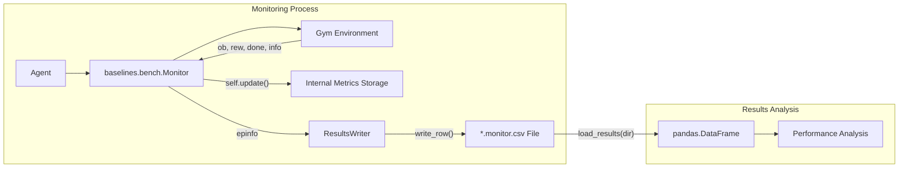
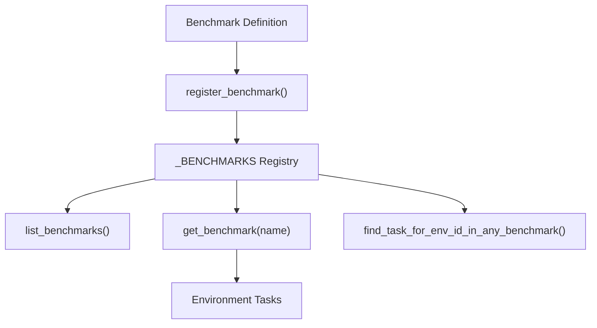

<!-- source: DeepWiki mcp.deepwiki.com · repo openai/baselines · page 3.3 Monitoring and Benchmarking · fetched 2026-10-30 -->

# Monitoring and Benchmarking

<details>
<summary>Relevant source files</summary>

The following files were used as context for generating this wiki page:

- [baselines/bench/__init__.py](baselines/bench/__init__.py)
- [baselines/bench/benchmarks.py](baselines/bench/benchmarks.py)
- [baselines/bench/monitor.py](baselines/bench/monitor.py)
- [baselines/bench/test_monitor.py](baselines/bench/test_monitor.py)
- [setup.cfg](setup.cfg)

</details>


This document explains how to monitor the performance of reinforcement learning agents and run standardized benchmarks in the OpenAI Baselines library. It covers the monitoring system for tracking metrics during training and evaluation, as well as the benchmarking framework for standardized algorithm comparison. For information about environment wrappers, see [Environment Wrappers](#3.2).

## 1. Monitoring System

The OpenAI Baselines provides a robust monitoring system centered around the `Monitor` wrapper class, which records key performance metrics during reinforcement learning training and evaluation.

### 1.1 Monitor Wrapper

The `Monitor` wrapper extends the standard Gym environment interface to track agent performance. It wraps any Gym environment to automatically record:

- Episode rewards (sum of rewards per episode)
- Episode lengths (number of steps per episode)
- Episode durations (wall-clock time per episode)
- Custom reset and info metrics (configurable)

```mermaid
classDiagram
    class "Monitor" {
        +EXT = "monitor.csv"
        +rewards[]
        +episode_rewards[]
        +episode_lengths[]
        +episode_times[]
        +total_steps
        +current_reset_info{}
        +reset(**kwargs)
        +step(action)
        +update(ob, rew, done, info)
        +get_total_steps()
        +get_episode_rewards()
        +get_episode_lengths()
        +get_episode_times()
    }
    
    class "gym.Wrapper" {
        +env
        +reset(**kwargs)
        +step(action)
    }
    
    class "ResultsWriter" {
        +extra_keys
        +logger: csv.DictWriter
        +write_row(epinfo)
    }
    
    "gym.Wrapper" <|-- "Monitor"
    "Monitor" --> "ResultsWriter"
```

Sources: [baselines/bench/monitor.py:10-94]()

### 1.2 Usage Example

To use the Monitor wrapper:

```python
import gym
from baselines.bench import Monitor

# Create environment
env = gym.make('CartPole-v1')

# Wrap with Monitor (specify output file)
env = Monitor(env, './logs/cartpole_monitor.csv')

# Use environment as normal
obs = env.reset()
for _ in range(1000):
    action = env.action_space.sample()  # Your agent would select an action here
    obs, reward, done, info = env.step(action)
    if done:
        obs = env.reset()
```

Sources: [baselines/bench/test_monitor.py:5-19]()

### 1.3 Monitoring Metrics Flow

The following diagram illustrates how metrics are captured, recorded, and can be later retrieved:



Sources: [baselines/bench/monitor.py:51-77](), [baselines/bench/monitor.py:126-163]()

## 2. Recording and Retrieving Metrics

### 2.1 Metrics Storage Format

Monitor data is saved in `.monitor.csv` files with the following structure:

1. A header line (starting with #) containing JSON metadata about the environment and start time
2. CSV rows with these columns:
   - `r`: Episode reward
   - `l`: Episode length (steps)
   - `t`: Episode time (seconds since start)
   - Any additional custom metrics specified via `info_keywords` or `reset_keywords`

Example CSV content:
```
# {"t_start": 1623845512.9834356, "env_id": "CartPole-v1"}
r,l,t
21.0,21,0.00045
35.0,35,0.0023
...
```

Sources: [baselines/bench/monitor.py:100-120]()

### 2.2 Accessing Metrics Programmatically

You can access metrics directly from a monitor instance:

```python
# Get all episode rewards
rewards = env.get_episode_rewards()

# Get all episode lengths
lengths = env.get_episode_lengths()

# Get all episode times
times = env.get_episode_times()

# Get total steps taken
total_steps = env.get_total_steps()
```

Sources: [baselines/bench/monitor.py:84-94]()

### 2.3 Loading Results from Files

To load and analyze results from saved monitor files:

```python
from baselines.bench import load_results

# Load all monitor files from a directory
results_df = load_results('./logs/')

# Access data from DataFrame
mean_reward = results_df['r'].mean()
max_reward = results_df['r'].max()
```

The `load_results` function:
- Finds all `monitor.csv` files in the specified directory
- Combines them into a single pandas DataFrame
- Normalizes timestamps relative to the earliest start time
- Preserves original headers in the `headers` attribute

Sources: [baselines/bench/monitor.py:126-163]()

## 3. Benchmarking System

The benchmarking system provides standardized evaluation protocols for reinforcement learning algorithms.

### 3.1 Benchmark Structure

Each benchmark is a dictionary with:
- `name`: Unique identifier for the benchmark
- `description`: Text description of the benchmark
- `tasks`: List of environment tasks with evaluation parameters

```mermaid
classDiagram
    class "Benchmark" {
        +name: str
        +description: str
        +tasks: list
    }
    
    class "Task" {
        +env_id: str
        +trials: int
        +num_timesteps: int or num_seconds: int
        +desc: str (optional)
    }
    
    "Benchmark" o-- "Task" : contains
```

Sources: [baselines/bench/benchmarks.py:13-23]()

### 3.2 Benchmark Registry

Benchmarks are registered in a central registry for easy access:



Sources: [baselines/bench/benchmarks.py:8-47]()

### 3.3 Available Benchmarks

The following table shows the main benchmark categories available:

| Benchmark Name | Description | Environments | Scale |
|----------------|-------------|-------------|-------|
| Atari10M | 7 Atari games from Mnih et al. (2013) | BeamRider, Breakout, etc. | 10M timesteps |
| Atari50M | 7 Atari games from Mnih et al. (2013) | BeamRider, Breakout, etc. | 50M timesteps |
| Atari1Hr | 7 Atari games from Mnih et al. (2013) | BeamRider, Breakout, etc. | 1 hour wall time |
| AtariExploration10M | 7 exploration-focused Atari games | Freeway, Gravitar, etc. | 10M timesteps |
| Atari50_10M | 47 Atari games | Alien, Amidar, etc. | 10M timesteps |
| Mujoco1M | Small 2D MuJoCo tasks | HalfCheetah, Hopper, etc. | 1M timesteps |
| MujocoWalkers | MuJoCo forward walkers | Hopper, Walker2d, Humanoid | 8-100M timesteps |
| Bullet1M | Bullet physics environments | Similar to MuJoCo tasks | 1M timesteps |
| Roboschool8M | Small 2D Roboschool tasks | RoboschoolAnt, etc. | 2-8M timesteps |
| Fetch1M | Fetch robotics tasks | FetchReach, FetchPush, etc. | 1M timesteps |

Sources: [baselines/bench/benchmarks.py:52-163]()

## 4. Using the Benchmarking System

### 4.1 Accessing Benchmarks

To use the benchmarking system:

```python
from baselines.bench import get_benchmark, list_benchmarks

# List all available benchmarks
available_benchmarks = list_benchmarks()
print(available_benchmarks)

# Get a specific benchmark
benchmark = get_benchmark('Atari10M')

# Access tasks in the benchmark
for task in benchmark['tasks']:
    env_id = task['env_id']
    trials = task['trials']
    timesteps = task['num_timesteps']
    print(f"Task: {env_id}, Trials: {trials}, Timesteps: {timesteps}")
```

Sources: [baselines/bench/benchmarks.py:26-34]()

### 4.2 Running a Benchmark

A complete example of running a benchmark with monitoring:

```python
import gym
from baselines.bench import Monitor, get_benchmark

# Get benchmark
benchmark = get_benchmark('Mujoco1M')
task = benchmark['tasks'][0]  # First task in benchmark

# Create and monitor environment
env = gym.make(task['env_id'])
log_dir = f"./logs/{task['env_id']}"
env = Monitor(env, log_dir)

# Run for specified timesteps
total_timesteps = task['num_timesteps']
num_trials = task['trials']

# Your agent training code would go here
# ...

# Load and analyze results
from baselines.bench import load_results
results = load_results(log_dir)
```

Sources: [baselines/bench/monitor.py:10-94](), [baselines/bench/benchmarks.py:26-34]()

## 5. Practical Tips

1. **Always close the monitor**: Make sure to call `env.close()` when done to properly close the CSV file.

2. **Custom metrics**: Track additional metrics by specifying `info_keywords` to the Monitor constructor:
   ```python
   env = Monitor(env, log_dir, info_keywords=('health', 'ammo'))
   ```

3. **Multiple runs**: Each benchmark specifies a number of trials to run for statistical significance.

4. **Early resets**: By default, Monitor prevents resetting an environment before it is done. Set `allow_early_resets=True` to override this behavior.

5. **Performance impact**: Monitoring adds minimal overhead but writing to disk can impact performance. Consider using a RAM disk for high-frequency logging.

Sources: [baselines/bench/monitor.py:14-33](), [baselines/bench/test_monitor.py:5-31]()

## 6. Summary

The monitoring and benchmarking system in OpenAI Baselines provides:

1. A simple interface for recording agent performance metrics
2. Standard file formats for storing and sharing results
3. Helper functions for loading and analyzing results
4. Predefined benchmark specifications for standardized evaluation
5. Support for custom metrics and trial-based experimentation

These tools facilitate reproducible research and fair comparisons between different reinforcement learning algorithms.

Sources: [baselines/bench/monitor.py](), [baselines/bench/benchmarks.py]()

---

