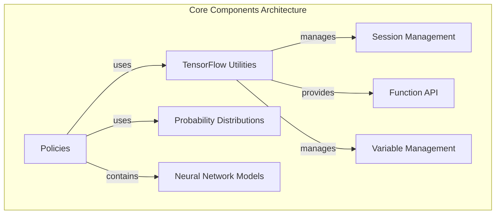
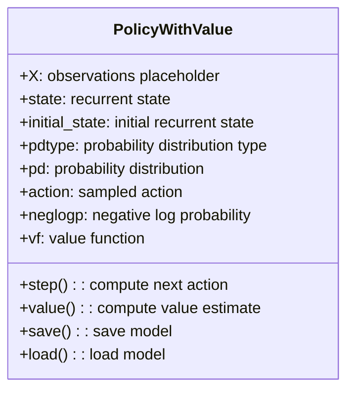
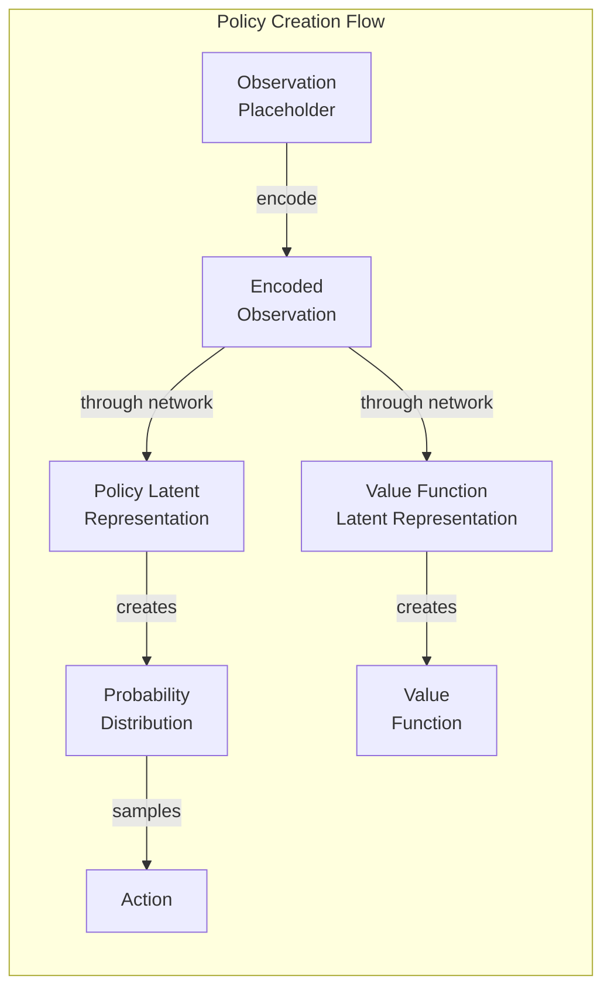
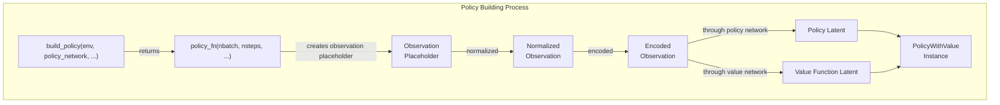
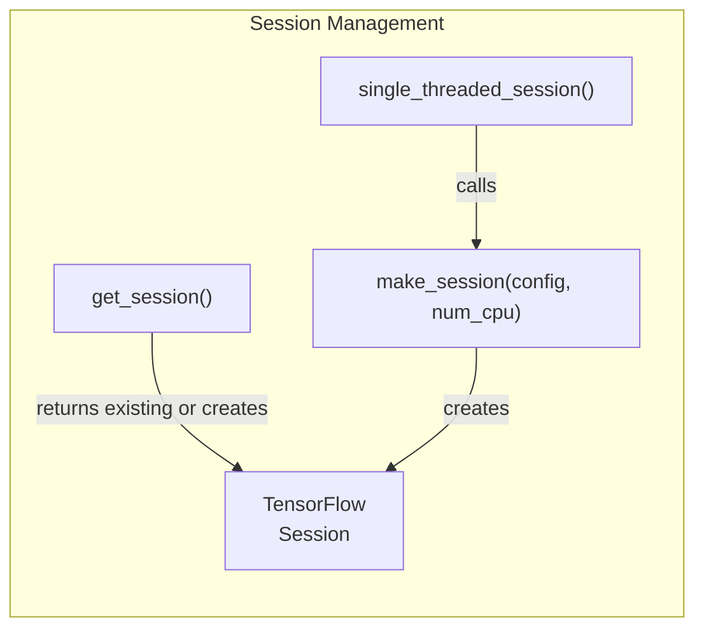
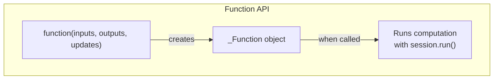
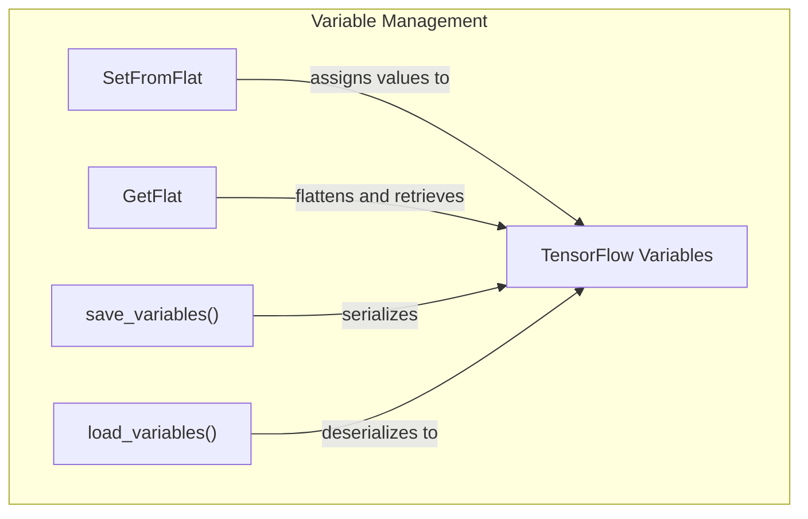
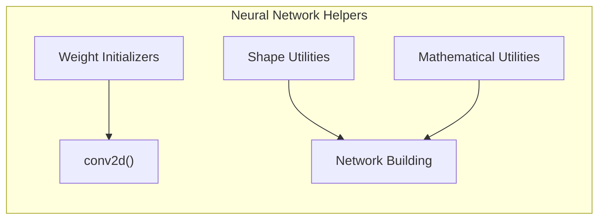
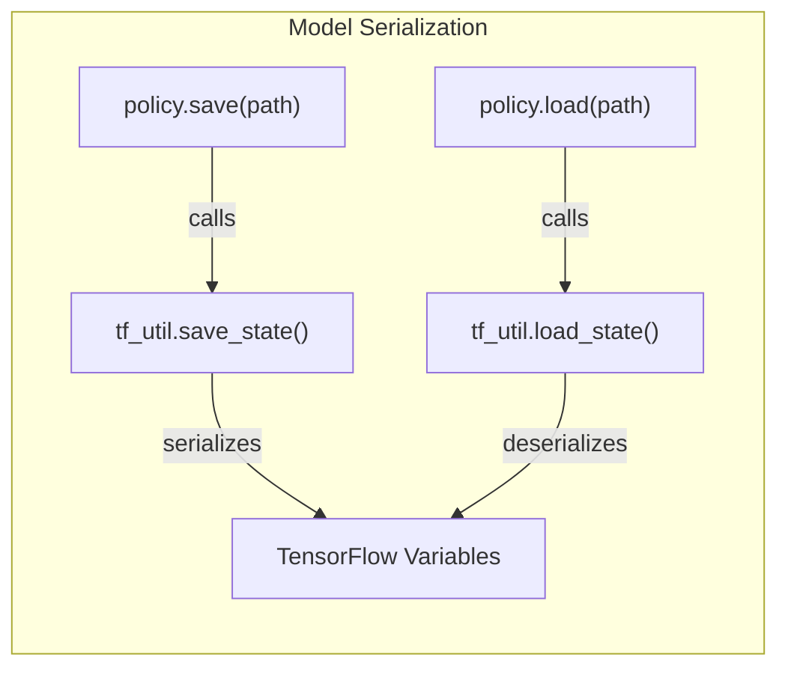
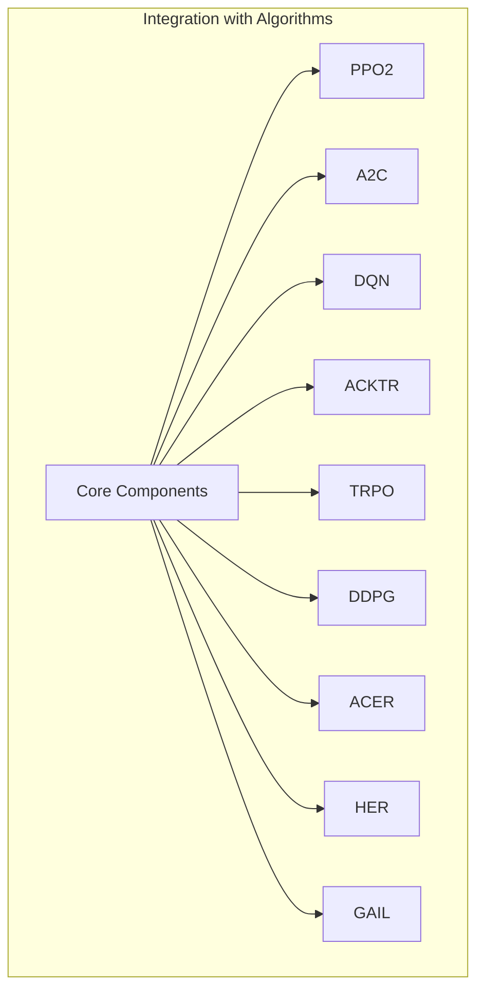

<!-- source: DeepWiki mcp.deepwiki.com · repo openai/baselines · page 4 Core Components · fetched 2026-10-30 -->

# Core Components

<details>
<summary>Relevant source files</summary>

The following files were used as context for generating this wiki page:

- [baselines/common/policies.py](baselines/common/policies.py)
- [baselines/common/tests/envs/mnist_env.py](baselines/common/tests/envs/mnist_env.py)
- [baselines/common/tests/test_serialization.py](baselines/common/tests/test_serialization.py)
- [baselines/common/tests/test_tf_util.py](baselines/common/tests/test_tf_util.py)
- [baselines/common/tf_util.py](baselines/common/tf_util.py)

</details>


This page documents the key shared infrastructure components that underpin the various reinforcement learning algorithms in OpenAI Baselines. These components provide common functionality for building, training, and evaluating reinforcement learning agents. For information about specific algorithms, see [Reinforcement Learning Algorithms](#5).

## Overview of Core Components

The core components of OpenAI Baselines provide fundamental building blocks that are reused across different reinforcement learning algorithms. These components handle policy representation, TensorFlow session management, distribution modeling for action selection, and other utilities.



Sources: [baselines/common/policies.py](), [baselines/common/tf_util.py]()

## Policies and Distributions

### PolicyWithValue

The `PolicyWithValue` class is a central component that encapsulates fields and methods for reinforcement learning policy and value function estimation with shared parameters.



Sources: [baselines/common/policies.py:13-119]()

The `PolicyWithValue` class is initialized with environment information, observations, and latent representations. It selects the appropriate probability distribution type based on the action space and constructs both policy and value function networks.



Sources: [baselines/common/policies.py:18-64](), [baselines/common/policies.py:121-178]()

Key methods of the `PolicyWithValue` class:

| Method | Description |
|--------|-------------|
| `step(observation, **extra_feed)` | Compute next action(s) given the observation(s) |
| `value(ob, *args, **kwargs)` | Compute value estimate(s) given the observation(s) |
| `save(save_path)` | Save model weights to disk |
| `load(load_path)` | Load model weights from disk |

Sources: [baselines/common/policies.py:66-119]()

### Policy Building

The `build_policy` function creates policy functions based on the provided environment and network specifications. It handles observation normalization, network construction, and creates the appropriate `PolicyWithValue` instance.



Sources: [baselines/common/policies.py:121-178]()

## TensorFlow Utilities

The OpenAI Baselines codebase provides a collection of TensorFlow utilities that simplify common operations when building and training reinforcement learning models.

### Session Management

Session management utilities provide functions for creating and managing TensorFlow sessions:



Sources: [baselines/common/tf_util.py:51-83]()

| Function | Description |
|----------|-------------|
| `get_session(config=None)` | Get default session or create one with a given config |
| `make_session(config=None, num_cpu=None, make_default=False, graph=None)` | Create a session with specified parameters |
| `single_threaded_session()` | Create a session that only uses a single CPU |
| `initialize()` | Initialize all uninitialized variables in the global scope |

Sources: [baselines/common/tf_util.py:51-91]()

### Function API

The `function` API provides a way to create Theano-like functions in TensorFlow, making it easier to specify inputs, outputs, and updates:



Sources: [baselines/common/tf_util.py:137-212]()

The `function` API takes placeholders as inputs and returns a callable that runs the specified computation with the provided input values:

```python
# Example from tf_util.py
x = tf.placeholder(tf.int32, (), name="x")
y = tf.placeholder(tf.int32, (), name="y")
z = 3 * x + 2 * y
lin = function([x, y], z, givens={y: 0})

# Usage
lin(2)  # Returns 6
lin(x=3)  # Returns 9
lin(2, 2)  # Returns 10
```

Sources: [baselines/common/tf_util.py:146-158](), [baselines/common/tests/test_tf_util.py:10-24]()

### Variable Management

The codebase includes utilities for managing TensorFlow variables:



Sources: [baselines/common/tf_util.py:218-372]()

| Class/Function | Description |
|----------------|-------------|
| `SetFromFlat` | Class that sets values of variables from a flat parameter vector |
| `GetFlat` | Class that retrieves variable values as a flat parameter vector |
| `save_variables(save_path, variables=None, sess=None)` | Saves variables to a file |
| `load_variables(load_path, variables=None, sess=None)` | Loads variables from a file |

Sources: [baselines/common/tf_util.py:239-262](), [baselines/common/tf_util.py:257-262](), [baselines/common/tf_util.py:345-372]()

## Neural Network Helpers

The codebase includes utilities for building neural networks:



Sources: [baselines/common/tf_util.py:94-131]()

| Function | Description |
|----------|-------------|
| `normc_initializer(std=1.0, axis=0)` | Returns a function that initializes weights normalized by their shapes |
| `conv2d(x, num_filters, name, ...)` | Convenience function for creating convolutional layers |
| `lrelu(x, leak=0.2)` | Leaky ReLU activation function |
| `huber_loss(x, delta=1.0)` | Implementation of Huber loss for robust regression |

Sources: [baselines/common/tf_util.py:30-45](), [baselines/common/tf_util.py:97-131]()

## Model Serialization

OpenAI Baselines provides functionality for saving and loading trained models:



Sources: [baselines/common/policies.py:115-119](), [baselines/common/tf_util.py:324-355]()

The policy serialization system allows saving and restoring trained models, which is essential for experiment reproducibility and deploying trained agents:

```python
# Saving a policy
model.save(model_path)

# Loading a policy
model = learn(total_timesteps=0, load_path=model_path)
```

Sources: [baselines/common/tests/test_serialization.py:65-75]()

## Integration with Algorithms

The core components are used by various reinforcement learning algorithms in the Baselines repository:



Sources: Based on the high-level architecture overview provided

Each algorithm leverages the core components in different ways:

| Algorithm | Core Components Used |
|-----------|----------------------|
| PPO2 | Policies, TensorFlow Utilities, Variable Management |
| A2C | Policies, TensorFlow Utilities, Session Management |
| DQN | TensorFlow Utilities, Function API, Experience Buffers |
| DDPG | Policies, TensorFlow Utilities, Experience Buffers |
| ACKTR | Policies, TensorFlow Utilities, Session Management |

## Summary

The core components of OpenAI Baselines provide essential functionality for implementing reinforcement learning algorithms. They handle common tasks such as session management, variable manipulation, policy representation, and neural network construction. These components create a unified framework that simplifies the implementation of various algorithms while ensuring consistency and reproducibility.

For information about environment handling, including vectorized environments and environment wrappers, see [Environment Handling](#3). For details about specific reinforcement learning algorithms, see [Reinforcement Learning Algorithms](#5).

---

