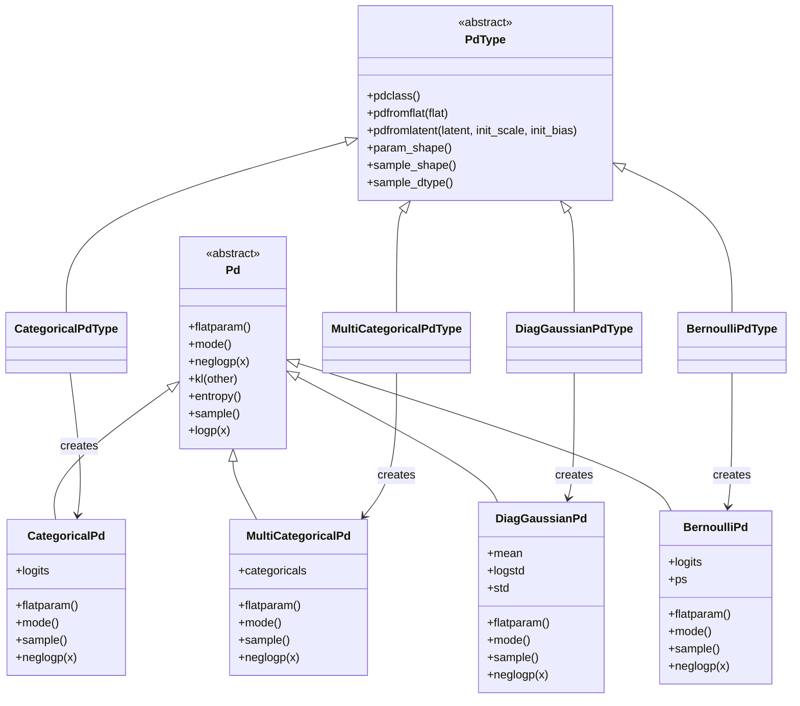
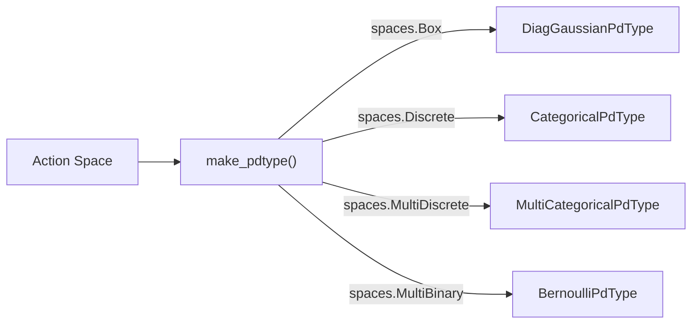
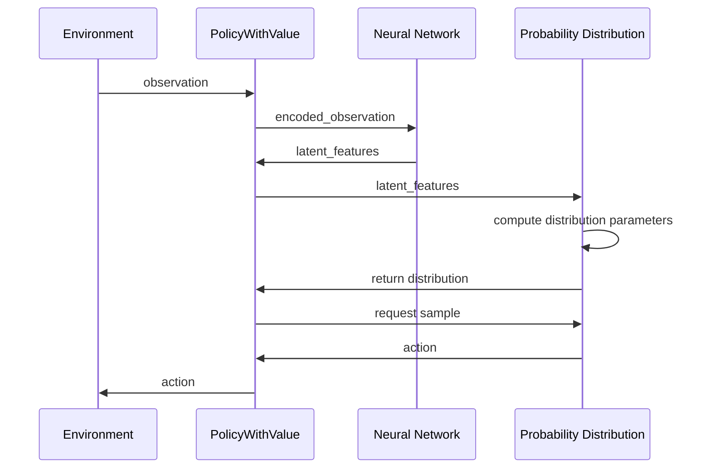
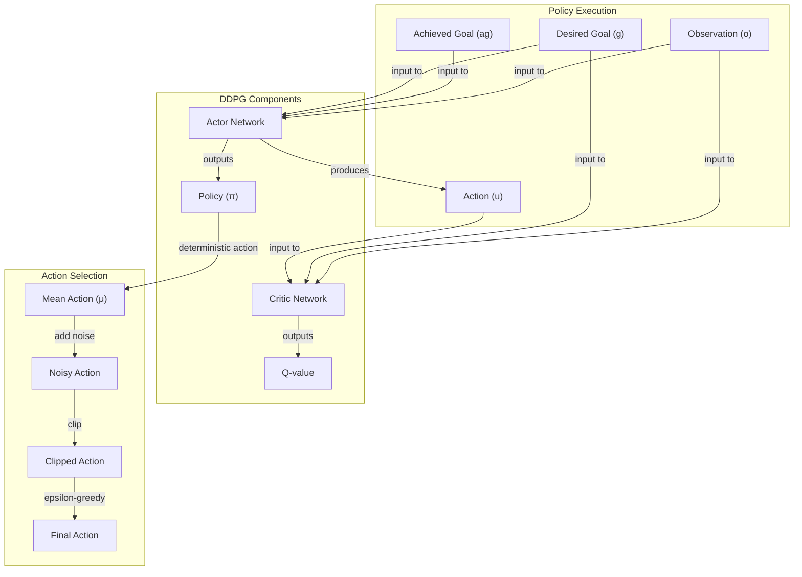

<!-- source: DeepWiki mcp.deepwiki.com · repo openai/baselines · page 4.1 Policies and Distributions · fetched 2026-10-30 -->

# Policies and Distributions

<details>
<summary>Relevant source files</summary>

The following files were used as context for generating this wiki page:

- [baselines/common/distributions.py](baselines/common/distributions.py)
- [baselines/common/policies.py](baselines/common/policies.py)
- [baselines/common/tests/envs/mnist_env.py](baselines/common/tests/envs/mnist_env.py)
- [baselines/common/tests/test_serialization.py](baselines/common/tests/test_serialization.py)
- [baselines/her/ddpg.py](baselines/her/ddpg.py)
- [baselines/her/rollout.py](baselines/her/rollout.py)

</details>


## Purpose and Scope

This document explains the probability distribution and policy implementation in OpenAI Baselines. Policies define how agents select actions in an environment, while probability distributions provide the mathematical framework for sampling these actions in both deterministic and stochastic scenarios. This page covers how different types of distributions are implemented, how they're connected to action spaces, and how policies use them to select actions.

For information about the TensorFlow utilities used to implement these components, see [TensorFlow Utilities](#4.2).

Sources: [baselines/common/distributions.py:1-356](), [baselines/common/policies.py:1-186]()

## Distribution Classes

Baselines implements a flexible architecture for handling various probability distributions used in reinforcement learning algorithms. These distributions are critical for exploration and action selection across different types of action spaces.



The distribution system is built around two key abstract base classes:

1. `Pd` - A concrete probability distribution that can sample actions and compute various statistical properties
2. `PdType` - A parametrized family of probability distributions that can create `Pd` instances

Sources: [baselines/common/distributions.py:7-32](), [baselines/common/distributions.py:34-57]()

### Distribution Types

The framework provides four primary distribution types, each mapped to specific Gym action space types:

| Distribution Type | Action Space | Description | Use Case |
|------------------|--------------|-------------|----------|
| `CategoricalPd` | `spaces.Discrete` | Categorical distribution for discrete action spaces | Atari games, discrete control tasks |
| `MultiCategoricalPd` | `spaces.MultiDiscrete` | Multiple categorical distributions | Complex discrete action spaces with multiple independent choices |
| `DiagGaussianPd` | `spaces.Box` | Diagonal Gaussian (normal) distribution | Continuous control tasks (MuJoCo, robotics) |
| `BernoulliPd` | `spaces.MultiBinary` | Bernoulli distribution for binary decisions | Binary action components |

Each distribution implements core methods:

- `sample()` - Sample an action from the distribution
- `mode()` - Return the most likely action (distribution mode)
- `neglogp(x)` - Calculate negative log probability of action x
- `kl(other)` - Calculate KL divergence with another distribution
- `entropy()` - Calculate distribution entropy

Sources: [baselines/common/distributions.py:153-276]()

### Distribution Factory

The `make_pdtype` function serves as a factory that creates the appropriate distribution type based on the action space:



Sources: [baselines/common/distributions.py:278-290]()

## Policy Implementation

Policies use the distribution framework to select actions based on observations. The main policy class is `PolicyWithValue`, which combines policy (actor) and value function (critic) functionality.

```mermaid
flowchart TD
    subgraph "Policy Construction and Execution"
        BP["build_policy(env, network)"] --> |creates| PF["policy_fn()"]
        PF --> |instantiates| PWV["PolicyWithValue"]
        
        ENV["Environment"] --> |action_space| MAKE["make_pdtype()"]
        MAKE --> PDT["PdType"]
        
        OBS["Observation"] --> ENC["Encoded Observation"]
        ENC --> |input to| NN["Neural Network"]
        NN --> LAT["Latent Vector"]
        
        LAT --> |pdfromlatent| PDT
        PDT --> PD["Probability Distribution (Pd)"]
        
        OBS --> |input to| PWV
        PWV --> |step() calls| PD
        PD --> |sample()| ACT["Action"]
        PWV --> |outputs| ACT
        PWV --> |outputs| VAL["Value Estimate"]
    end
```

### PolicyWithValue Class

The `PolicyWithValue` class encapsulates both policy and value function estimation, which share parameters in many RL algorithms. The policy selects actions using probability distributions, while the value function estimates expected returns.

Key components:
- Neural network for feature extraction from observations
- Probability distribution for action selection
- Value function estimation

Sources: [baselines/common/policies.py:13-119]()

### Policy Building

The `build_policy` function creates policies with appropriate network architectures:

1. Creates observation placeholders
2. Builds the specified neural network
3. Creates separate policy and value function networks if needed
4. Initializes the `PolicyWithValue` class

Sources: [baselines/common/policies.py:121-186]()

## Action Selection Process



The action selection process follows these steps:

1. Receive observation from the environment
2. Encode observation (normalize, preprocess)
3. Process through neural network to get latent features
4. Create probability distribution from latent features
5. Sample action from the distribution
6. Return action, value estimate, and negative log probability

Sources: [baselines/common/policies.py:66-96]()

## Integration with RL Algorithms

Policies and distributions are used by all reinforcement learning algorithms in Baselines. Here's how they're typically integrated:

### Example: DDPG Policy Usage

The Deep Deterministic Policy Gradient (DDPG) algorithm demonstrates how policies are used in practice:



In DDPG, the policy produces deterministic actions that are then modified with exploration noise. This differs from stochastic policies that sample directly from probability distributions.

Sources: [baselines/her/ddpg.py:109-158](), [baselines/her/rollout.py:50-136]()

## Code Usage Examples

### Creating and Using a Distribution

```python
# Example: Creating a categorical distribution for a discrete action space
action_space = gym.spaces.Discrete(4)  # 4 possible actions
pdtype = make_pdtype(action_space)     # Creates CategoricalPdType

# Create distribution from network output
logits = [1.0, 2.0, 0.5, -1.0]  # Output from neural network
distribution = pdtype.pdfromflat(logits)

# Sample an action
action = distribution.sample()

# Get most likely action
most_likely_action = distribution.mode()

# Compute negative log probability of an action
neg_log_prob = distribution.neglogp(action)

# Compute entropy
entropy_value = distribution.entropy()
```

### Creating and Using a Policy

```python
# Example: Creating a policy
env = gym.make('CartPole-v1')
policy_fn = build_policy(env, 'mlp')  # MLP = Multi-Layer Perceptron
policy = policy_fn(nbatch=1)

# Using the policy to select actions
observation = env.reset()
action, value, _, neglogp = policy.step(observation)

# Execute action in environment
next_observation, reward, done, info = env.step(action)
```

## Summary

The policy and distribution system in Baselines provides a flexible framework for action selection across different reinforcement learning algorithms and environments:

1. The distribution classes handle the mathematical details of different probability distributions
2. The `make_pdtype` function selects the appropriate distribution based on the action space
3. The `PolicyWithValue` class combines policy and value function estimation
4. Policies use distributions to sample actions and compute relevant statistics for learning

This architecture supports both on-policy algorithms (PPO, A2C) and off-policy algorithms (DQN, DDPG) with different types of action spaces.

Sources: [baselines/common/distributions.py:1-356](), [baselines/common/policies.py:1-186]()

---

