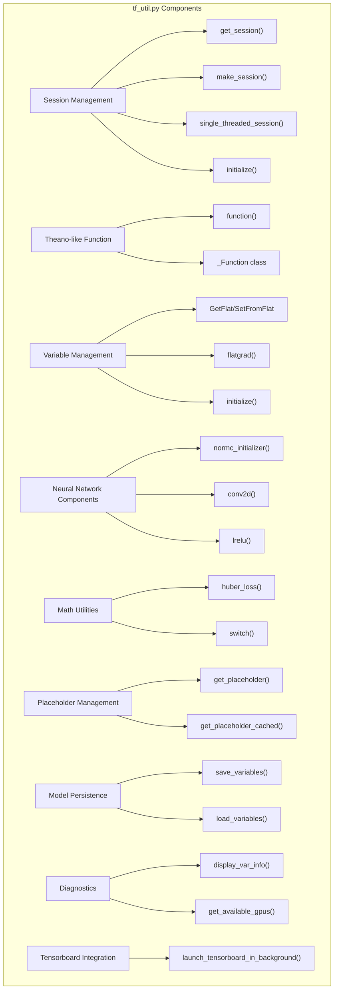
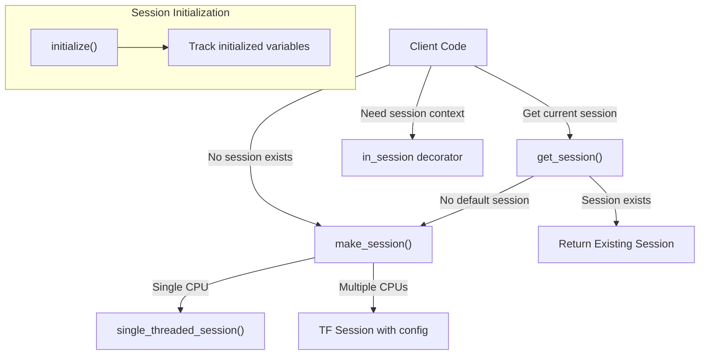
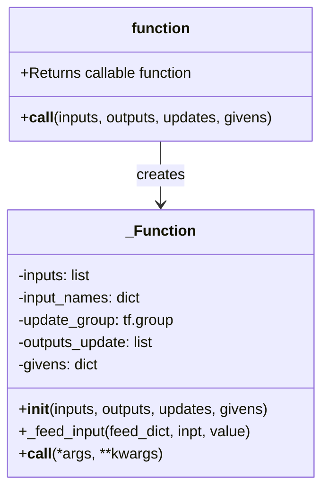
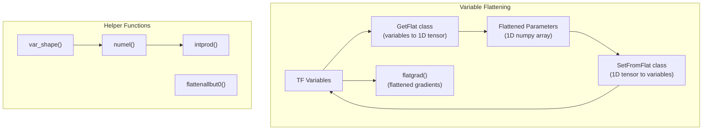
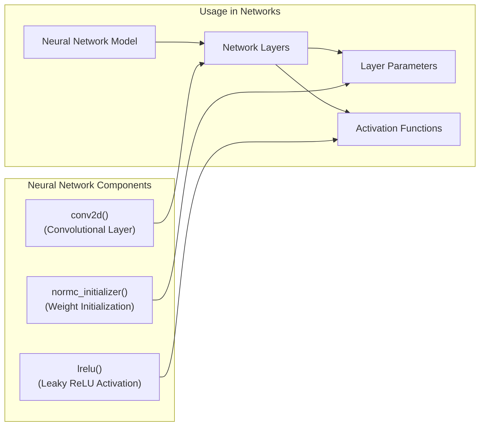
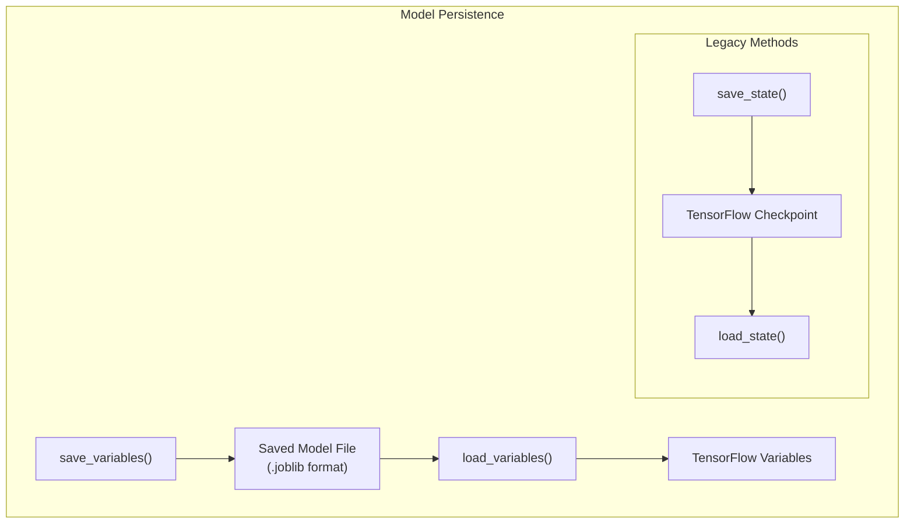

<!-- source: DeepWiki mcp.deepwiki.com · repo openai/baselines · page 4.2 TensorFlow Utilities · fetched 2026-10-30 -->

# TensorFlow Utilities

<details>
<summary>Relevant source files</summary>

The following files were used as context for generating this wiki page:

- [baselines/common/tests/test_tf_util.py](baselines/common/tests/test_tf_util.py)
- [baselines/common/tf_util.py](baselines/common/tf_util.py)

</details>


This page documents the TensorFlow helper functions and utilities provided by the OpenAI Baselines library that simplify neural network construction and training. These utilities abstract away common TensorFlow operations and provide a more convenient programming interface for building reinforcement learning algorithms.

For information about policy implementation using these utilities, see [Policies and Distributions](#4.1). For logging mechanisms that work with these utilities, see [Logging and Visualization](#4.3).

## Overview of TensorFlow Utilities

The TensorFlow utilities in Baselines are organized into several categories, each addressing common needs when building deep reinforcement learning algorithms with TensorFlow.



Sources: [baselines/common/tf_util.py:1-444]()

## Session Management

The Baselines library provides functions to create and manage TensorFlow sessions, crucial for executing TensorFlow operations.



The key session management functions include:

- `get_session()`: Returns the default TensorFlow session or creates one if none exists
- `make_session()`: Creates a new TensorFlow session with customizable CPU configuration
- `single_threaded_session()`: Creates a TensorFlow session that uses only a single CPU
- `initialize()`: Initializes all uninitialized variables in the global scope
- `in_session()`: A decorator that executes a function within a TensorFlow session

Sources: [baselines/common/tf_util.py:51-92]()

## Theano-like Function Interface

One of the most powerful utilities is the `function()` API, which provides a Theano-like interface for defining and executing TensorFlow operations.



The `function()` utility allows you to encapsulate TensorFlow operations in a callable Python function. Similar to Theano's function interface, it:

1. Takes placeholder inputs and TensorFlow expressions as outputs
2. Returns a callable that feeds values to the placeholders and computes the output expressions
3. Can handle updates to TensorFlow variables
4. Supports "givens" parameter for constant value substitutions

Example usage from test file:

```python
x = tf.placeholder(tf.int32, (), name="x")
y = tf.placeholder(tf.int32, (), name="y")
z = 3 * x + 2 * y
lin = function([x, y], z, givens={y: 0})

# lin can now be called like a normal Python function
assert lin(2) == 6        # y defaulted to 0
assert lin(x=3) == 9      # named argument
assert lin(2, 2) == 10    # both x and y provided
```

Sources: [baselines/common/tf_util.py:137-212](), [baselines/common/tests/test_tf_util.py:10-24]()

## Variable Management and Manipulation

The library provides utilities for working with TensorFlow variables, including flattening/unflattening variable collections and gradient operations.



The key variable management utilities include:

- `GetFlat`: Class for flattening TensorFlow variables into a 1D array
- `SetFromFlat`: Class for setting TensorFlow variables from a flattened 1D array
- `flatgrad()`: Computes flattened gradients for a loss function
- `var_shape()`, `numel()`, `intprod()`: Helper functions for shape manipulation

These utilities are particularly useful for optimization algorithms that need to work with all model parameters as a single vector, such as natural gradient methods.

Sources: [baselines/common/tf_util.py:215-266]()

## Placeholder Management

The library provides utilities for creating and caching TensorFlow placeholders:

- `get_placeholder()`: Creates or retrieves a cached placeholder with a given name, dtype, and shape
- `get_placeholder_cached()`: Retrieves an existing placeholder from the cache
- `_PLACEHOLDER_CACHE`: Dictionary that stores created placeholders by name

These functions enable consistent reuse of placeholders across different parts of a model.

Sources: [baselines/common/tf_util.py:271-287]()

## Neural Network Components

The library includes utilities for building neural network components:

- `normc_initializer()`: Creates a weight initializer that normalizes columns to have unit norm
- `conv2d()`: Wrapper around TensorFlow's conv2d operation with simplified parameter initialization
- `lrelu()`: Implementation of leaky ReLU activation function



Sources: [baselines/common/tf_util.py:97-132](), [baselines/common/tf_util.py:30-33]()

## Mathematical Utilities

The library includes mathematical utility functions:

- `huber_loss()`: Implementation of the Huber loss function, useful for robust regression
- `switch()`: Utility for switching between two operations based on a condition

Sources: [baselines/common/tf_util.py:39-45](), [baselines/common/tf_util.py:9-24]()

## Model Persistence

The library provides utilities for saving and loading model parameters:



- `save_variables()`: Saves TensorFlow variables to a file using joblib
- `load_variables()`: Loads TensorFlow variables from a file
- `save_state()` and `load_state()`: Legacy methods using TensorFlow's Saver (deprecated)

Sources: [baselines/common/tf_util.py:325-373]()

## Shape Adjustment

The library includes utilities for adjusting shapes between tensors and NumPy arrays:

- `adjust_shape()`: Reshapes input data to match the shape of a placeholder
- `_check_shape()`: Checks if two shapes are compatible
- `_squeeze_shape()`: Removes dimensions of size 1 from a shape

These functions help ensure that data can be correctly fed into TensorFlow placeholders.

Sources: [baselines/common/tf_util.py:377-420]()

## Diagnostic Utilities

The library provides utilities for diagnostics and debugging:

- `display_var_info()`: Displays information about model variables, including parameter counts
- `get_available_gpus()`: Returns a list of available GPUs

Sources: [baselines/common/tf_util.py:294-319]()

## Tensorboard Integration

The library provides a utility for working with TensorBoard:

- `launch_tensorboard_in_background()`: Launches TensorBoard as a subprocess for monitoring training

Sources: [baselines/common/tf_util.py:426-444]()

## Usage Patterns

The TensorFlow utilities are used throughout the Baselines library to simplify common operations. Here is a table summarizing common usage patterns:

| Utility Category | Common Usage Patterns |
|------------------|------------------------|
| Session Management | Used at the start of training to create sessions and initialize variables |
| Theano-like Function | Used to create callable functions for policy evaluation, value estimation, etc. |
| Variable Management | Used in optimization algorithms like TRPO that need to work with flattened parameters |
| Neural Network Components | Used when building neural network architectures for policies and value functions |
| Model Persistence | Used to save trained models and load them for evaluation or continuing training |
| Diagnostic Utilities | Used for debugging and verifying model architecture |

These utilities significantly reduce the amount of boilerplate code required when implementing reinforcement learning algorithms with TensorFlow, allowing researchers to focus on algorithm design rather than TensorFlow implementation details.

Sources: [baselines/common/tf_util.py:1-444]()

---

