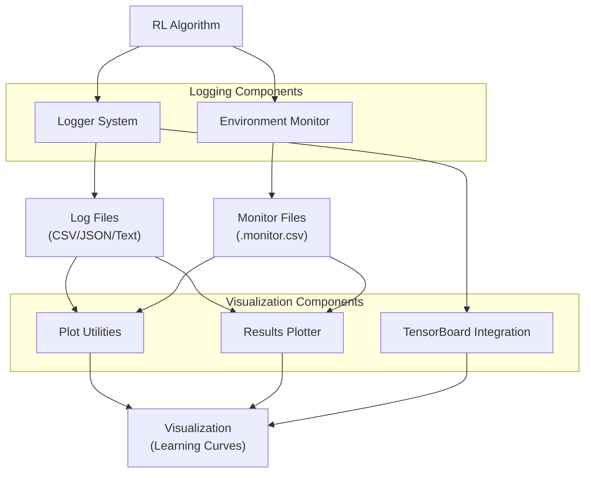
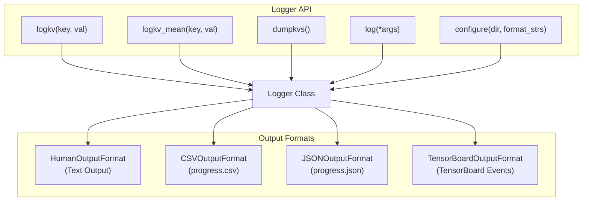
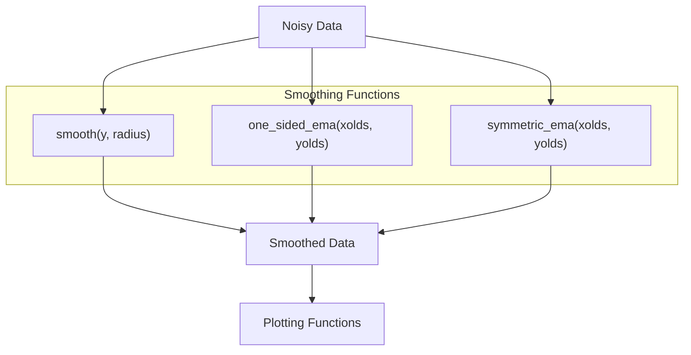

<!-- source: DeepWiki mcp.deepwiki.com · repo openai/baselines · page 4.3 Logging and Visualization · fetched 2026-10-30 -->

# Logging and Visualization

<details>
<summary>Relevant source files</summary>

The following files were used as context for generating this wiki page:

- [baselines/common/cmd_util.py](baselines/common/cmd_util.py)
- [baselines/common/plot_util.py](baselines/common/plot_util.py)
- [baselines/common/tests/test_fetchreach.py](baselines/common/tests/test_fetchreach.py)
- [baselines/logger.py](baselines/logger.py)
- [baselines/ppo2/microbatched_model.py](baselines/ppo2/microbatched_model.py)
- [baselines/ppo2/model.py](baselines/ppo2/model.py)
- [baselines/ppo2/runner.py](baselines/ppo2/runner.py)
- [baselines/ppo2/test_microbatches.py](baselines/ppo2/test_microbatches.py)
- [baselines/results_plotter.py](baselines/results_plotter.py)
- [docs/viz/viz.ipynb](docs/viz/viz.ipynb)

</details>


This page documents the logging and visualization systems in OpenAI Baselines. These systems enable tracking of training progress, recording of experimental data, and visualization of results. For information about monitoring environment performance specifically, see [Monitoring and Benchmarking](#3.3).

## Overview of Logging and Visualization

OpenAI Baselines provides a comprehensive framework for logging training metrics and visualizing results. The system consists of several components that work together to collect, store, and visualize experimental data.



Sources: [baselines/logger.py:1-503](), [baselines/common/plot_util.py:1-434](), [baselines/results_plotter.py:1-94]()

## Logger System

The core of Baselines' logging system is the `Logger` class defined in `logger.py`. This system provides a flexible way to record metrics, diagnostics, and other information during training.

### Logger Architecture



Sources: [baselines/logger.py:190-262](), [baselines/logger.py:285-362]()

### Core Logging Functions

The logger provides the following main functions:

- `logkv(key, val)`: Logs a key-value pair. If called multiple times with the same key, the last value is used.
- `logkv_mean(key, val)`: Logs a key-value pair. If called multiple times with the same key, values are averaged.
- `dumpkvs()`: Writes all logged key-value pairs to output formats and clears the log.
- `log(*args)`: Writes a message to the console and log files.

Example:
```python
from baselines import logger

logger.logkv('episode_reward', 100.5)
logger.logkv('episode_length', 200)
logger.dumpkvs()  # Write to outputs and clear
```

Sources: [baselines/logger.py:193-218]()

### Logger Configuration

The logger is configured using the `configure()` function:

```python
from baselines import logger

# Configure with specific directory and formats
logger.configure(
    dir='./logs/experiment1',
    format_strs=['stdout', 'log', 'csv', 'tensorboard']
)
```

Available output formats:
- `stdout`: Print to standard output
- `log`: Write to log file (log.txt)
- `csv`: Write to CSV file (progress.csv)
- `json`: Write to JSON file (progress.json)
- `tensorboard`: Write to TensorBoard event files

By default, logs are saved to a temporary directory with a timestamp. You can customize the directory using the `OPENAI_LOGDIR` environment variable.

Sources: [baselines/logger.py:372-399](), [baselines/logger.py:174-187]()

## Loading and Processing Results

OpenAI Baselines provides utilities for loading and processing experimental results in `common/plot_util.py`.

### Loading Results

The `load_results()` function loads results from experiment directories:

```python
from baselines.common import plot_util

# Load results from one or more directories
results = plot_util.load_results('./logs/experiment1')
```

The `load_results()` function returns a list of `Result` objects with the following fields:
- `dirname`: Path to the directory containing the results
- `metadata`: Experiment metadata (from `metadata.json`)
- `monitor`: DataFrame with episode statistics (from `*.monitor.csv`)
- `progress`: DataFrame with logged metrics (from `progress.csv`)

Sources: [baselines/common/plot_util.py:149-220]()

### Processing Results Data

Once loaded, results can be processed using pandas operations:

```python
import numpy as np

# Calculate mean rewards across experiments
for result in results:
    if result.monitor is not None:
        mean_reward = np.mean(result.monitor.r)
        print(f"{result.dirname}: Mean reward = {mean_reward}")
```

## Visualization Tools

OpenAI Baselines provides several tools for visualizing experimental results.

### Plot Utilities

The main plotting function is `plot_results()` in `plot_util.py`:

```python
from baselines.common import plot_util
import matplotlib.pyplot as plt

# Load and plot results
results = plot_util.load_results('./logs/experiment1')
plot_util.plot_results(results, 
                      average_group=True,
                      shaded_std=True)
plt.show()
```

The `plot_results()` function supports various options:
- `average_group`: Whether to average the curves in the same group
- `shaded_std`: Show shaded region for standard deviation
- `shaded_err`: Show shaded region for standard error
- `split_fn`: Function to split curves into subplots
- `group_fn`: Function to group curves by color

Sources: [baselines/common/plot_util.py:240-405]()

### Data Smoothing

Plot utilities include functions for smoothing noisy data:



Sources: [baselines/common/plot_util.py:11-147]()

### Results Plotter

For simpler plotting, you can use `results_plotter.py`:

```python
from baselines import results_plotter
import matplotlib.pyplot as plt

# Plot results with timesteps on x-axis and reward on y-axis
results_plotter.plot_results(
    ['./logs/ppo2_cartpole', './logs/a2c_cartpole'],
    x_axis=results_plotter.X_TIMESTEPS,
    y_axis=results_plotter.Y_REWARD,
    title='Learning Curves'
)
plt.show()
```

The results plotter supports different x-axis options:
- `X_TIMESTEPS`: Plot against timesteps
- `X_EPISODES`: Plot against episodes
- `X_WALLTIME`: Plot against wall clock time

Sources: [baselines/results_plotter.py:10-63](), [baselines/results_plotter.py:69-94]()

## TensorBoard Integration

OpenAI Baselines supports TensorBoard for real-time visualization of training metrics.

### Setting Up TensorBoard Output

To use TensorBoard, include 'tensorboard' in the output formats:

```python
from baselines import logger

logger.configure(
    dir='./logs/experiment1',
    format_strs=['stdout', 'csv', 'tensorboard']
)
```

This creates TensorBoard event files in a directory named `tb` within your log directory.

Sources: [baselines/logger.py:139-172](), [baselines/logger.py:184-185]()

### Working with TensorBoard Files

TensorBoard files can be loaded and processed using the `read_tb()` function:

```python
import pandas as pd
from baselines.logger import read_tb

# Load TensorBoard data
tb_data = read_tb('./logs/experiment1/tb')
```

Sources: [baselines/logger.py:468-499]()

## Logging in Command-Line Interface

When running algorithms through the command-line interface, logging can be configured using environment variables:

```bash
# Set log directory
export OPENAI_LOGDIR=./logs/experiment1

# Set log formats (comma-separated)
export OPENAI_LOG_FORMAT=stdout,log,csv,tensorboard

# Run an experiment
python -m baselines.run --alg=ppo2 --env=CartPole-v1
```

The `common_arg_parser()` function also provides command-line options for logging:

```bash
python -m baselines.run --alg=ppo2 --env=CartPole-v1 --log_path=./logs/experiment1
```

Sources: [baselines/common/cmd_util.py:155-174]()

## Integration with Monitoring

Logging and visualization integrates with the monitoring system through the `Monitor` wrapper. The wrapper records episode statistics such as rewards and lengths to `.monitor.csv` files, which can then be loaded by the visualization tools.

This integration typically happens when environments are created:

```python
from baselines.bench import Monitor
from baselines import logger
import gym

env = gym.make('CartPole-v1')
env = Monitor(env, logger.get_dir())
```

The environment creation utilities in `cmd_util.py` automatically wrap environments with `Monitor`:

```python
from baselines.common.cmd_util import make_vec_env

env = make_vec_env('CartPole-v1', env_type='classic_control', num_env=4)
```

Sources: [baselines/common/cmd_util.py:62-104]()

## Practical Usage Examples

Here are some practical examples of using the logging and visualization system:

### Example 1: Basic Logging During Training

```python
from baselines import logger

# Configure logger
logger.configure(dir='./logs/experiment1')

# During training loop
for i in range(100):
    # Record metrics
    logger.logkv('episode', i)
    logger.logkv('reward', episode_reward)
    logger.logkv('loss', loss_value)
    
    # Write to outputs
    logger.dumpkvs()
```

### Example 2: Comparing Multiple Algorithms

```python
from baselines.common import plot_util
import matplotlib.pyplot as plt

# Load results from different algorithms
results = plot_util.load_results([
    './logs/ppo2_cartpole',
    './logs/a2c_cartpole',
    './logs/dqn_cartpole'
])

# Plot and compare
plot_util.plot_results(
    results,
    split_fn=lambda r: r.dirname.split('/')[-1],
    average_group=True
)
plt.xlabel('Timesteps')
plt.ylabel('Reward')
plt.title('Algorithm Comparison')
plt.show()
```

### Example 3: Using TensorBoard for Visualization

```bash
# Configure logging with TensorBoard output
export OPENAI_LOGDIR=./logs/experiment1
export OPENAI_LOG_FORMAT=stdout,tensorboard

# Run an experiment
python -m baselines.run --alg=ppo2 --env=CartPole-v1

# In another terminal, launch TensorBoard
tensorboard --logdir=./logs
```

## Usage in Algorithm Implementations

The logging system is used extensively in algorithm implementations to track training progress. For example, in PPO2:

```python
# In PPO2's learn function, metrics are logged every update
logger.logkv("serial_timesteps", update*nbatch)
logger.logkv("nupdates", update)
logger.logkv("total_timesteps", update*nbatch)
logger.logkv("fps", fps)
logger.logkv("explained_variance", float(ev))
logger.logkv('eprewmean', safemean([epinfo['r'] for epinfo in epinfobuf]))
logger.logkv('eplenmean', safemean([epinfo['l'] for epinfo in epinfobuf]))
logger.logkv('time_elapsed', tnow - tfirststart)
for (lossval, lossname) in zip(lossvals, model.loss_names):
    logger.logkv(lossname, lossval)
logger.dumpkvs()
```

Sources: [baselines/ppo2/model.py:115-117]()

## Summary

The logging and visualization system in OpenAI Baselines provides a comprehensive framework for tracking, recording, and analyzing the performance of reinforcement learning algorithms. Key components include:

1. The `Logger` system for recording metrics during training
2. Integration with environment monitoring for collecting episode statistics
3. Utilities for loading and processing results
4. Tools for plotting learning curves and comparing algorithms
5. TensorBoard integration for real-time visualization

By using these tools effectively, researchers and practitioners can gain insights into the learning process, diagnose issues, and compare different algorithms or hyperparameters.

Sources: [baselines/logger.py:1-503](), [baselines/common/plot_util.py:1-434](), [baselines/results_plotter.py:1-94]()

---

