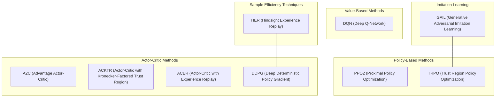
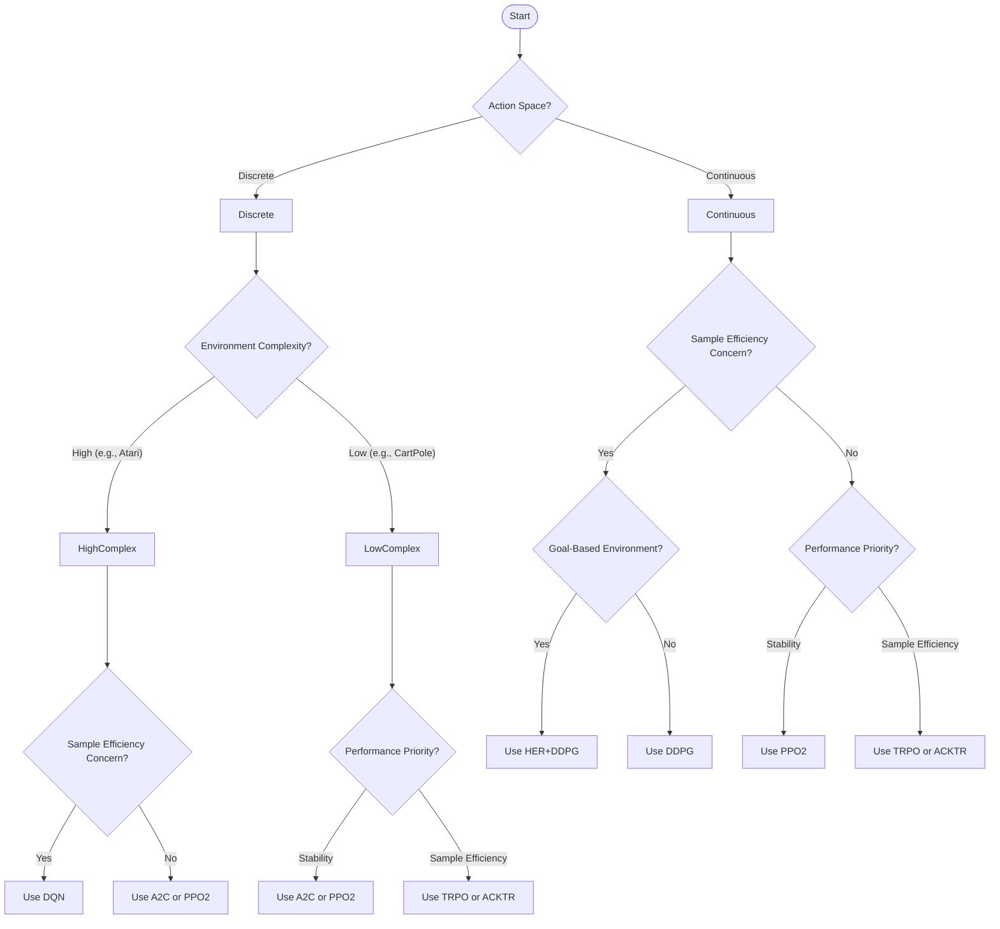
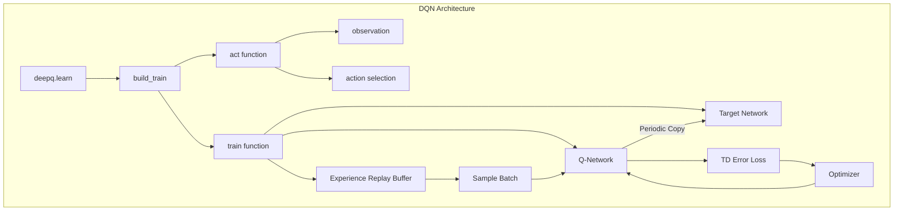
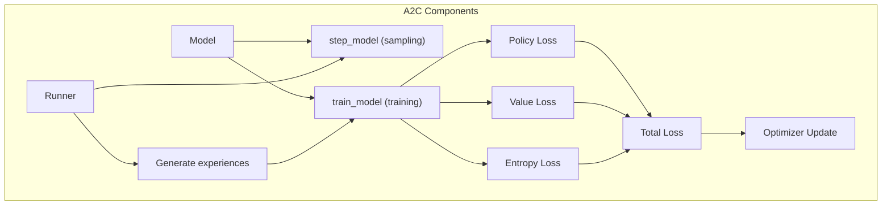
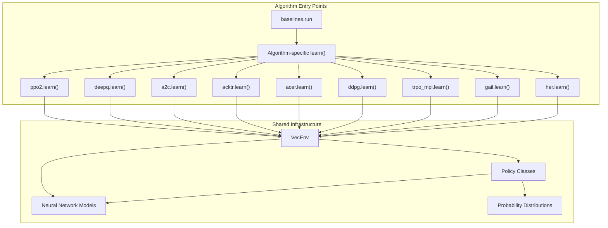

<!-- source: DeepWiki mcp.deepwiki.com · repo openai/baselines · page 5 Reinforcement Learning Algorithms · fetched 2026-10-30 -->

# Reinforcement Learning Algorithms

<details>
<summary>Relevant source files</summary>

The following files were used as context for generating this wiki page:

- [Dockerfile](Dockerfile)
- [README.md](README.md)
- [baselines/a2c/README.md](baselines/a2c/README.md)
- [baselines/acer/README.md](baselines/acer/README.md)
- [baselines/acer/__init__.py](baselines/acer/__init__.py)
- [baselines/acktr/README.md](baselines/acktr/README.md)
- [baselines/deepq/README.md](baselines/deepq/README.md)
- [baselines/deepq/experiments/train_cartpole.py](baselines/deepq/experiments/train_cartpole.py)
- [baselines/ppo2/README.md](baselines/ppo2/README.md)
- [baselines/trpo_mpi/README.md](baselines/trpo_mpi/README.md)

</details>


This document provides a comprehensive overview of the reinforcement learning (RL) algorithms implemented in the OpenAI Baselines repository. It covers the key characteristics of each algorithm, their relationships, and practical usage guidance. For detailed information about running these algorithms, see [Running Experiments](#2.1).

## Algorithm Overview

OpenAI Baselines implements a diverse set of reinforcement learning algorithms that represent state-of-the-art approaches across different paradigms. These implementations serve as reference baselines for the research community to replicate, evaluate, and build upon.



Sources: [README.md:131-143]()

## Algorithm Selection Guide

Choosing the appropriate algorithm depends on your specific environment, action space, and requirements. This flowchart provides guidance for common scenarios:



Sources: [README.md:7-9]()

## Common Usage Pattern

All algorithms in Baselines follow a consistent command-line interface via the `baselines.run` module:

```bash
python -m baselines.run --alg=<algorithm_name> --env=<environment_id> --num_timesteps=<timesteps> [options]
```

Example:
```bash
python -m baselines.run --alg=ppo2 --env=Humanoid-v2 --network=mlp --num_timesteps=2e7
```

Sources: [README.md:78-101]()

## Value-Based Methods

### Deep Q-Network (DQN)

DQN is a value-based method that learns an action-value function using neural networks. It pioneered the combination of Q-learning with deep neural networks for handling high-dimensional observation spaces.

**Key Components:**
- Experience replay buffer to store and sample transitions
- Target network to reduce training instability
- Exploration via epsilon-greedy policy



**Example Usage:**
```bash
# Train DQN on Atari Pong
python -m baselines.run --alg=deepq --env=PongNoFrameskip-v4 --num_timesteps=1e6

# Train DQN on simple CartPole environment
python -m baselines.run --alg=deepq --env=CartPole-v0 --num_timesteps=1e5
```

Sources: [baselines/deepq/README.md:10-34](), [baselines/deepq/experiments/train_cartpole.py:1-30]()

## Policy-Based Methods

### Trust Region Policy Optimization (TRPO)

TRPO is a policy optimization method that improves stability by constraining policy updates within a "trust region" using the KL divergence between old and new policies.

**Key Features:**
- Monotonic policy improvement guarantees
- Natural policy gradient for more efficient updates
- Suitable for both discrete and continuous action spaces

**Example Usage:**
```bash
# Run TRPO with MPI on Atari environment
mpirun -np 16 python -m baselines.run --alg=trpo_mpi --env=PongNoFrameskip-v4

# Run TRPO on MuJoCo environment
python -m baselines.run --alg=trpo_mpi --env=Ant-v2 --num_timesteps=1e6
```

Sources: [baselines/trpo_mpi/README.md:1-7]()

### Proximal Policy Optimization (PPO2)

PPO2 is a simplified version of TRPO that uses a clipped surrogate objective for more stable and efficient learning. It maintains performance comparable to TRPO with better sample efficiency and simpler implementation.

**Key Features:**
- Clipped surrogate objective to constrain policy updates
- Multiple epochs of minibatch updates
- Adaptable to both discrete and continuous action spaces
- Parallelized implementation for faster training

**Example Usage:**
```bash
# Train PPO2 on Atari environment
python -m baselines.run --alg=ppo2 --env=PongNoFrameskip-v4

# Train PPO2 on MuJoCo environment with custom network
python -m baselines.run --alg=ppo2 --env=Ant-v2 --network=mlp --num_timesteps=1e6
```

Sources: [baselines/ppo2/README.md:1-8]()

## Actor-Critic Methods

Actor-critic methods combine policy-based and value-based approaches by maintaining both a policy (actor) and a value function (critic).

### Advantage Actor-Critic (A2C)

A2C is a synchronous version of the A3C algorithm that combines policy gradients with value function learning.

**Key Features:**
- Synchronous updates from multiple environments
- Uses advantage function to reduce variance
- Suitable for both discrete and continuous action spaces



**Example Usage:**
```bash
python -m baselines.run --alg=a2c --env=PongNoFrameskip-v4
```

Sources: [baselines/a2c/README.md:1-14]()

### Actor-Critic with Kronecker-Factored Trust Region (ACKTR)

ACKTR applies Kronecker-factored approximation for more efficient natural gradient updates in actor-critic methods.

**Key Features:**
- Kronecker-factored approximation for natural gradient
- Improved sample efficiency compared to vanilla A2C
- Works with both discrete and continuous action spaces

**Example Usage:**
```bash
python -m baselines.run --alg=acktr --env=PongNoFrameskip-v4
```

Sources: [baselines/acktr/README.md:1-9]()

### Actor-Critic with Experience Replay (ACER)

ACER combines actor-critic methods with experience replay for off-policy learning.

**Key Features:**
- Experience replay for improved sample efficiency
- Truncated importance sampling with bias correction
- Efficient trust region policy optimization

**Example Usage:**
```bash
python -m baselines.run --alg=acer --env=PongNoFrameskip-v4
```

Sources: [baselines/acer/README.md:1-6]()

### Deep Deterministic Policy Gradient (DDPG)

DDPG is a model-free, off-policy algorithm specifically designed for continuous action spaces.

**Key Features:**
- Deterministic policy gradient for continuous control
- Actor-critic architecture with target networks
- Experience replay buffer for improved stability
- Noise process for exploration in continuous spaces

**Example Usage:**
```bash
python -m baselines.run --alg=ddpg --env=HalfCheetah-v2 --num_timesteps=1e6
```

Sources: [README.md:136]()

## Specialized Techniques

### Generative Adversarial Imitation Learning (GAIL)

GAIL uses a GAN-like approach to learn policies from expert demonstrations.

**Key Features:**
- Learns directly from expert demonstrations
- Adversarial training between policy and discriminator
- Uses TRPO for policy optimization

**Example Usage:**
```bash
python -m baselines.run --alg=gail --env=Humanoid-v2 --num_timesteps=1e7
```

Sources: [README.md:138]()

### Hindsight Experience Replay (HER)

HER improves sample efficiency in goal-based environments by treating failed experiences as successful for different goals.

**Key Features:**
- Works with goal-based environments
- Transforms failed experiences into successful ones for different goals
- Typically combined with DDPG for continuous control

**Example Usage:**
```bash
python -m baselines.run --alg=her --env=FetchReach-v1 --num_timesteps=5e5
```

Sources: [README.md:139]()

## Algorithm Implementation Architecture

The following diagram shows how the algorithm implementations are organized within the codebase:



Sources: [README.md:131-143]()

## Saving, Loading and Visualizing Models

All algorithms support saving and loading trained models via command-line arguments:

```bash
# Save a trained model
python -m baselines.run --alg=ppo2 --env=PongNoFrameskip-v4 --num_timesteps=2e7 --save_path=~/models/pong_model

# Load and visualize a trained model
python -m baselines.run --alg=ppo2 --env=PongNoFrameskip-v4 --num_timesteps=0 --load_path=~/models/pong_model --play
```

For environments that require normalization (such as MuJoCo), normalization coefficients are saved with the model.

Sources: [README.md:103-117]()

## Logging and Visualization

Training progress can be logged and later visualized:

```bash
# Log training data to a specific directory
python -m baselines.run --alg=ppo2 --env=PongNoFrameskip-v4 --num_timesteps=2e7 --log_path=~/logs/pong/
```

By default, logs are saved to a temporary directory. Use the `--log_path` option to specify a custom location.

Sources: [README.md:119-129]()

## Algorithm Performance Benchmarks

Performance benchmarks for the algorithms are available in the repository:
- [Mujoco Benchmarks (1M timesteps)](https://htmlpreview.github.com/?https://github.com/openai/baselines/blob/master/benchmarks_mujoco1M.htm)
- [Atari Benchmarks (10M timesteps)](https://htmlpreview.github.com/?https://github.com/openai/baselines/blob/master/benchmarks_atari10M.htm)

These benchmarks can help guide algorithm selection for specific environments.

Sources: [README.md:146-151]()

---

