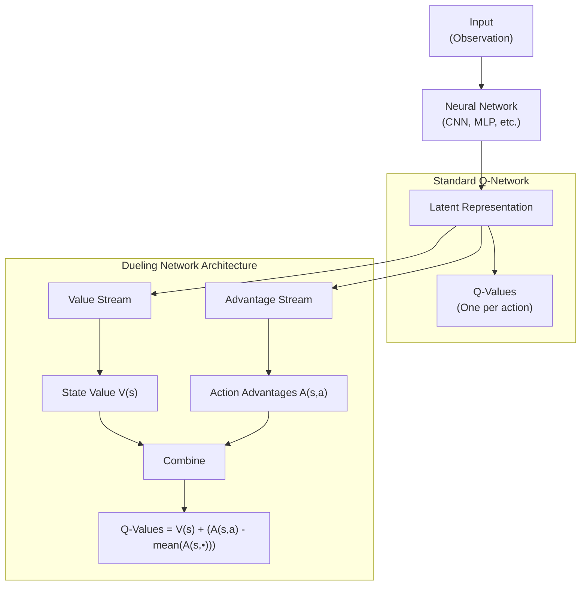
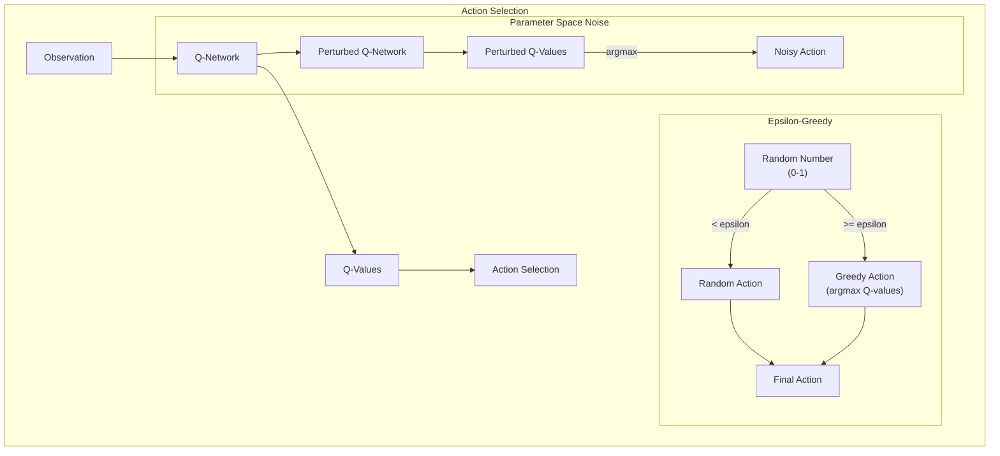
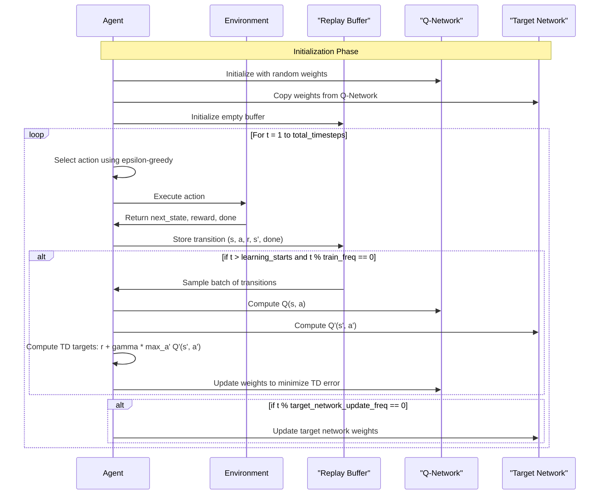
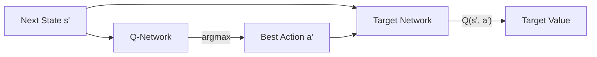
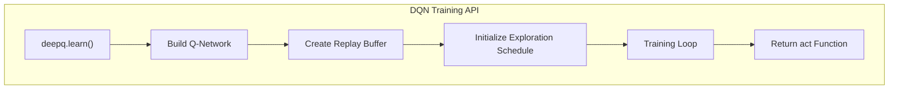
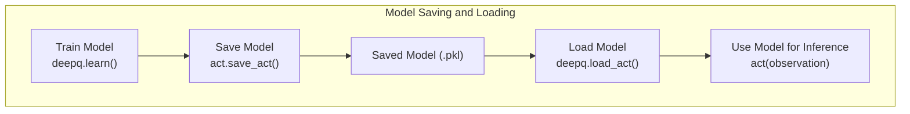
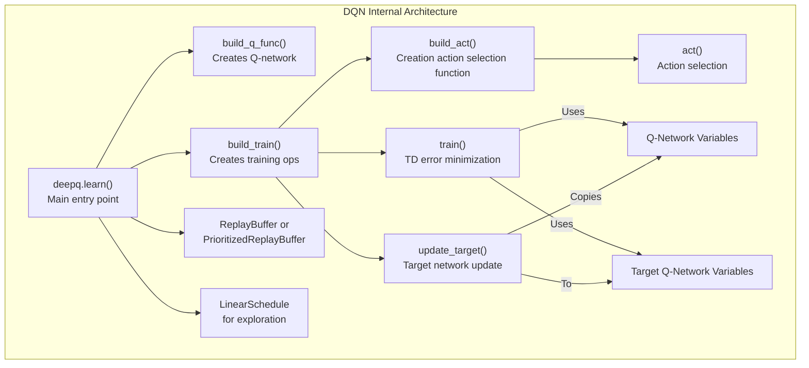
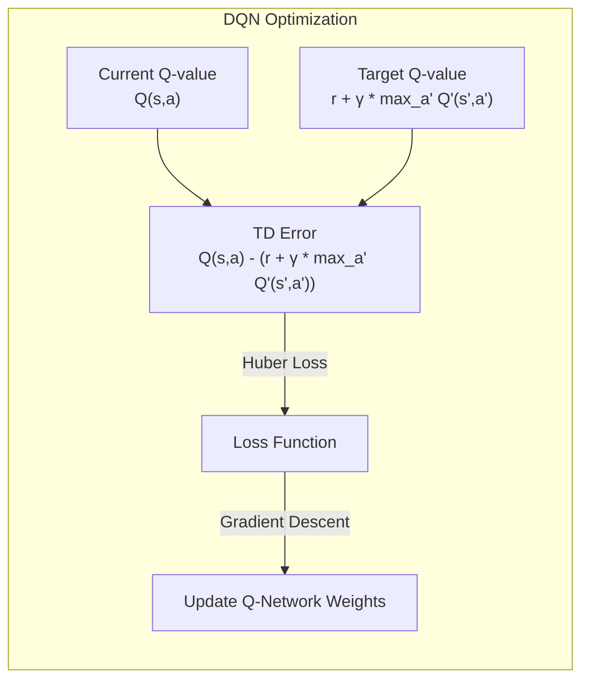

<!-- source: DeepWiki mcp.deepwiki.com · repo openai/baselines · page 5.1 Deep Q-Network (DQN) · fetched 2026-10-30 -->

# Deep Q-Network (DQN)

<details>
<summary>Relevant source files</summary>

The following files were used as context for generating this wiki page:

- [baselines/a2c/README.md](baselines/a2c/README.md)
- [baselines/acer/README.md](baselines/acer/README.md)
- [baselines/acer/__init__.py](baselines/acer/__init__.py)
- [baselines/acktr/README.md](baselines/acktr/README.md)
- [baselines/deepq/README.md](baselines/deepq/README.md)
- [baselines/deepq/build_graph.py](baselines/deepq/build_graph.py)
- [baselines/deepq/deepq.py](baselines/deepq/deepq.py)
- [baselines/deepq/experiments/train_cartpole.py](baselines/deepq/experiments/train_cartpole.py)
- [baselines/deepq/models.py](baselines/deepq/models.py)
- [baselines/ppo2/README.md](baselines/ppo2/README.md)
- [baselines/trpo_mpi/README.md](baselines/trpo_mpi/README.md)

</details>


## Purpose and Scope

This document provides an overview of the Deep Q-Network (DQN) implementation in OpenAI Baselines. It covers the architecture, key components, and usage of DQN, a value-based reinforcement learning algorithm that uses neural networks to approximate the optimal action-value function. For information about other reinforcement learning algorithms in Baselines, see [Reinforcement Learning Algorithms](#5).

## Introduction to DQN

Deep Q-Network (DQN) is a reinforcement learning algorithm introduced by DeepMind that combines Q-learning with deep neural networks. DQN overcomes previous limitations in Q-learning by using a neural network to approximate the Q-function, enabling it to handle high-dimensional state spaces. The algorithm incorporates two key innovations:

1. **Experience Replay**: Stores experience tuples (state, action, reward, next_state) in a replay buffer and samples from this buffer during training to break correlations between consecutive samples.

2. **Target Network**: Uses a separate network for generating targets in the Q-learning update, which is periodically updated with the weights of the main network to stabilize training.

```mermaid
flowchart TD
    subgraph "DQN Algorithm"
        Agent["Agent"] --> act["act(observation)"]
        act --> ActionSelection["Action Selection\n(ε-greedy or Parameter Noise)"]
        ActionSelection --> Environment["Environment"]
        Environment --> Experience["Experience\n(s, a, r, s', done)"]
        Experience --> ReplayBuffer["Replay Buffer"]
        ReplayBuffer --> SampleBatch["Sample Batch"]
        SampleBatch --> LearnFromExperience["Learn from Experience"]
        LearnFromExperience --> UpdateQNetwork["Update Q-Network"]
        UpdateQNetwork --> |"Periodically"|UpdateTargetNetwork["Update Target Network"]
    end
    
    style Agent stroke-width:2px
    style ReplayBuffer stroke-width:2px
    style UpdateQNetwork stroke-width:2px
    style UpdateTargetNetwork stroke-width:2px
```



Sources:
- [baselines/deepq/deepq.py:95-332]()
- [baselines/deepq/build_graph.py:317-449]()

## Core Components of DQN Implementation

### 1. Network Architecture

The DQN implementation in Baselines uses a flexible architecture that allows for different neural network models. The core component is the Q-function approximator which maps observations to Q-values for each action.



Sources:
- [baselines/deepq/models.py:5-45]()
- [baselines/deepq/build_graph.py:146-199]()

### 2. Q-Network and Target Network

DQN uses two identical networks:
- **Q-Network**: Actively updated during training
- **Target Network**: Periodically updated from the Q-Network to stabilize training

The Q-Network is used to select actions and compute the current Q-values, while the Target Network is used to compute the target Q-values for the Bellman equation.

| Network | Purpose | Update Frequency |
|---------|---------|------------------|
| Q-Network | Action selection, current Q-value estimation | Every training step |
| Target Network | Target Q-value generation | Periodically (default: every 500 steps) |

Sources:
- [baselines/deepq/build_graph.py:387-405]()
- [baselines/deepq/deepq.py:305-307]()

### 3. Action Selection Mechanisms

DQN in Baselines supports two exploration strategies:

1. **Epsilon-Greedy**: With probability ε, select a random action; otherwise, select the action with the highest Q-value.
2. **Parameter Space Noise**: Add noise to the parameters of the policy network to encourage exploration.



Sources:
- [baselines/deepq/build_graph.py:183-189]()
- [baselines/deepq/build_graph.py:202-314]()
- [baselines/deepq/deepq.py:265-278]()

### 4. Replay Buffer

DQN stores transitions in a replay buffer for later batch sampling during training. Baselines implements two types of replay buffers:

1. **Regular Replay Buffer**: Samples transitions uniformly.
2. **Prioritized Replay Buffer**: Samples transitions based on their TD error, giving higher priority to transitions with larger errors.

| Replay Buffer Type | Sampling Strategy | Key Parameters |
|-------------------|-------------------|----------------|
| Regular | Uniform sampling | `buffer_size` |
| Prioritized | TD error-based sampling | `buffer_size`, `alpha` (priority exponent), `beta` (importance sampling correction) |

Sources:
- [baselines/deepq/deepq.py:220-229]()
- [baselines/deepq/deepq.py:294-303]()

## Training Process

The DQN training process in Baselines follows these steps:



Sources:
- [baselines/deepq/deepq.py:259-307]()
- [baselines/deepq/build_graph.py:396-429]()

## Advanced Features

### 1. Double Q-Learning

To reduce overestimation bias in the Q-values, Baselines implements Double Q-learning. In this approach:

1. The online Q-network selects the best action for the next state
2. The target Q-network evaluates this action's value

This separation helps prevent the algorithm from selecting overestimated actions.



Sources:
- [baselines/deepq/build_graph.py:399-404]()

### 2. Dueling Networks

Baselines supports dueling network architecture, which separates the Q-value computation into:

1. A state value function V(s) that estimates the value of being in a state
2. An advantage function A(s,a) that estimates the relative advantage of each action

This separation allows the network to learn which states are valuable without having to learn the effect of each action in each state.

Sources:
- [baselines/deepq/models.py:29-41]()

### 3. Prioritized Experience Replay

This feature assigns higher sampling probabilities to transitions with higher TD errors, focusing learning on experiences where the network's prediction was furthest from the target.

| Parameter | Description | Default Value |
|-----------|-------------|---------------|
| `prioritized_replay_alpha` | Controls how much prioritization is used (0 = uniform, 1 = full prioritization) | 0.6 |
| `prioritized_replay_beta0` | Initial value of beta for importance sampling correction | 0.4 |
| `prioritized_replay_eps` | Small constant added to TD errors to ensure non-zero probability | 1e-6 |

Sources:
- [baselines/deepq/deepq.py:220-226]()
- [baselines/deepq/deepq.py:294-303]()

## Usage Guide

### Training a DQN Agent

The simplest way to train a DQN agent is to use the `deepq.learn` function:



Sources:
- [baselines/deepq/deepq.py:95-332]()
- [baselines/deepq/experiments/train_cartpole.py:13-24]()

### Important Parameters

| Parameter | Description | Default Value |
|-----------|-------------|---------------|
| `network` | Neural network architecture (e.g., 'mlp', 'cnn') | - |
| `lr` | Learning rate | 5e-4 |
| `total_timesteps` | Total number of timesteps to train for | 100000 |
| `buffer_size` | Size of the replay buffer | 50000 |
| `exploration_fraction` | Fraction of total timesteps over which exploration rate is annealed | 0.1 |
| `exploration_final_eps` | Final value of exploration rate | 0.02 |
| `train_freq` | How often to train the network | 1 |
| `batch_size` | Size of batches sampled from replay buffer | 32 |
| `gamma` | Discount factor | 1.0 |
| `target_network_update_freq` | How often to update the target network | 500 |
| `prioritized_replay` | Whether to use prioritized replay buffer | False |
| `dueling` | Whether to use dueling network architecture | True |

Sources:
- [baselines/deepq/deepq.py:95-120]()

### Loading and Using a Trained Model

After training, the `learn` function returns an `act` function wrapped in an `ActWrapper` class, which can be saved and loaded:



Sources:
- [baselines/deepq/deepq.py:23-75]()
- [baselines/deepq/deepq.py:78-92]()
- [baselines/deepq/README.md:11-15]()

### Example Usage

The simplest way to train a DQN agent on CartPole:

```bash
python -m baselines.run --alg=deepq --env=CartPole-v0 --save_path=./cartpole_model.pkl --num_timesteps=1e5
```

To visualize the learned policy:

```bash
python -m baselines.run --alg=deepq --env=CartPole-v0 --load_path=./cartpole_model.pkl --num_timesteps=0 --play
```

Sources:
- [baselines/deepq/README.md:11-15]()
- [baselines/deepq/experiments/train_cartpole.py:12-26]()

## Internal Architecture 

The DQN implementation in Baselines consists of several key components that work together:



Sources:
- [baselines/deepq/deepq.py:95-332]()
- [baselines/deepq/build_graph.py:146-449]()
- [baselines/deepq/models.py:5-45]()

### Code Structure

The DQN implementation is spread across several files:

| File | Description |
|------|-------------|
| `deepq/deepq.py` | Contains the main `learn` function and `ActWrapper` class |
| `deepq/build_graph.py` | Contains functions to build the TensorFlow graph for DQN |
| `deepq/models.py` | Contains the neural network architecture for the Q-function |
| `deepq/replay_buffer.py` | Implements the replay buffer and prioritized replay buffer |

Sources:
- [baselines/deepq/deepq.py]()
- [baselines/deepq/build_graph.py]()
- [baselines/deepq/models.py]()

## Optimization Process

The DQN optimization process minimizes the TD error between the current Q-value and the target Q-value:



Sources:
- [baselines/deepq/build_graph.py:407-422]()

## Conclusion

The DQN implementation in OpenAI Baselines provides a robust, feature-rich foundation for value-based reinforcement learning. It incorporates key innovations like experience replay, target networks, double Q-learning, and dueling networks to enhance learning stability and efficiency. The modular design allows for easy customization and extension, making it suitable for a wide range of reinforcement learning tasks.

---

