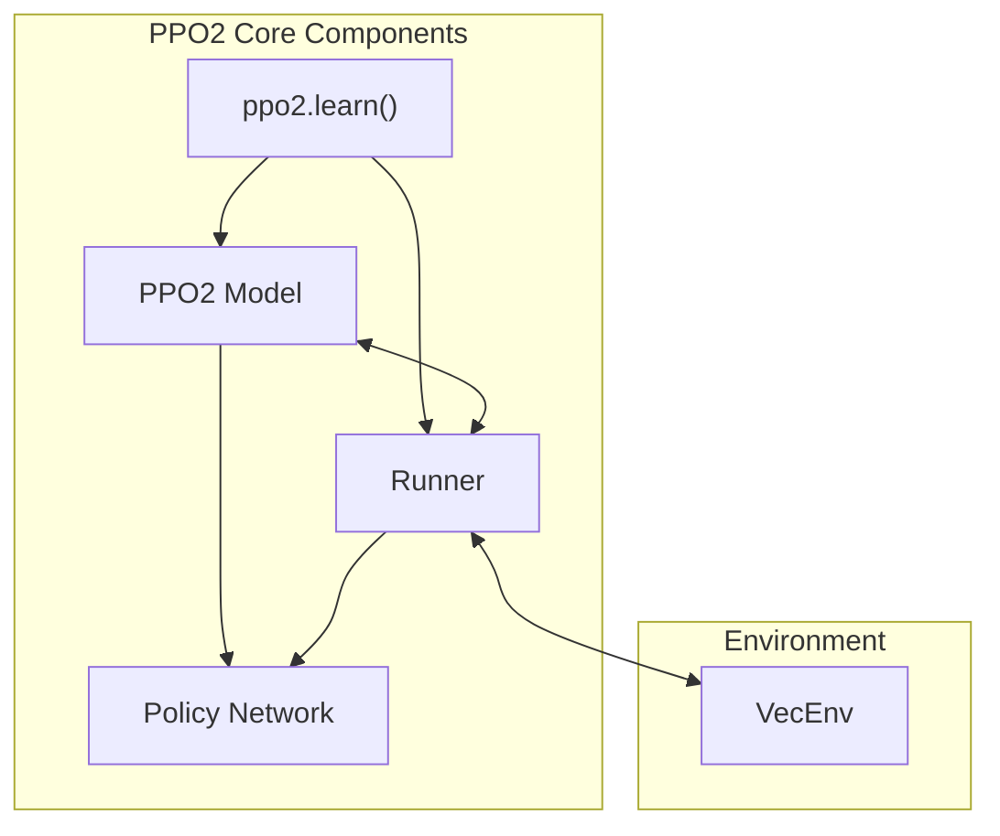
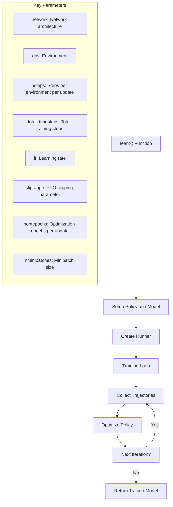
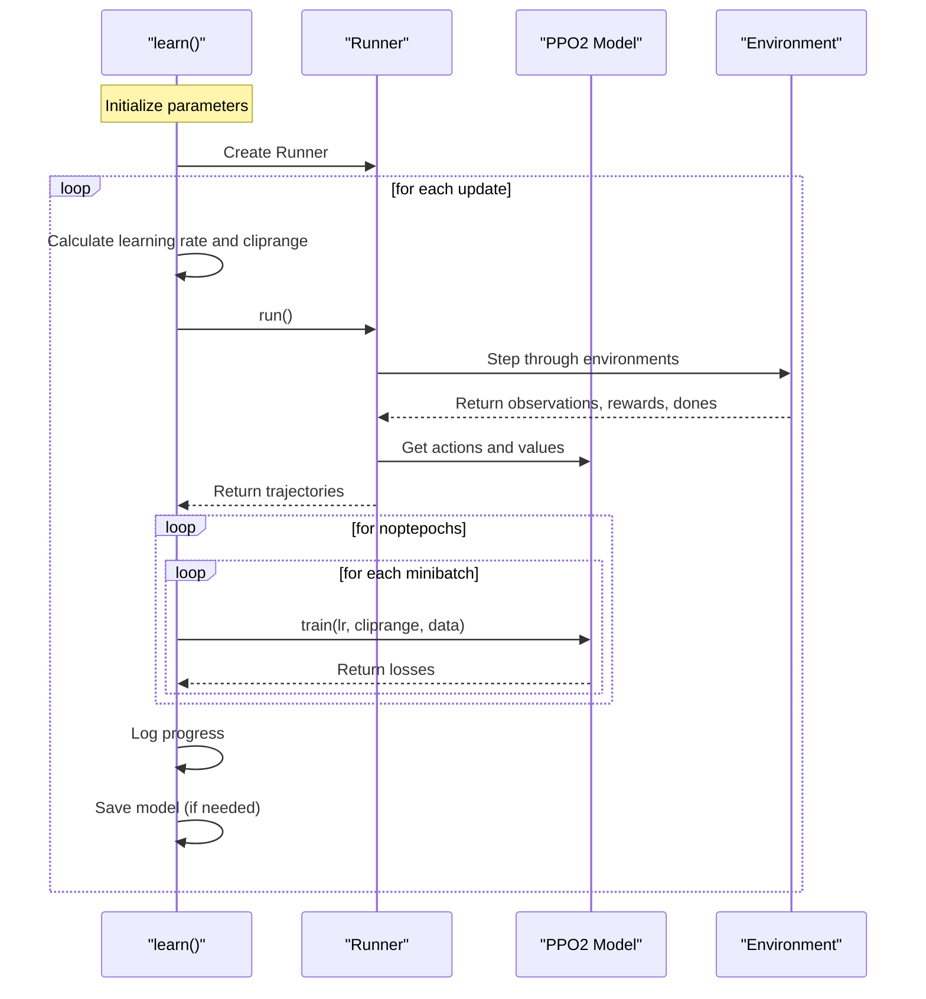
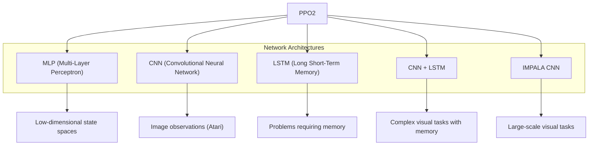
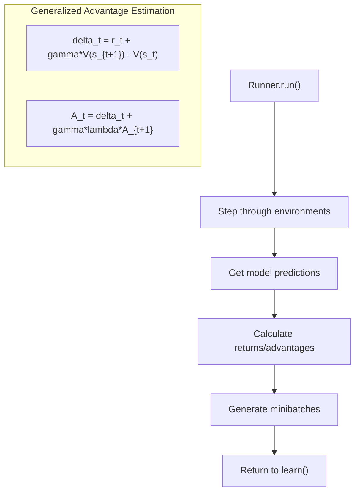
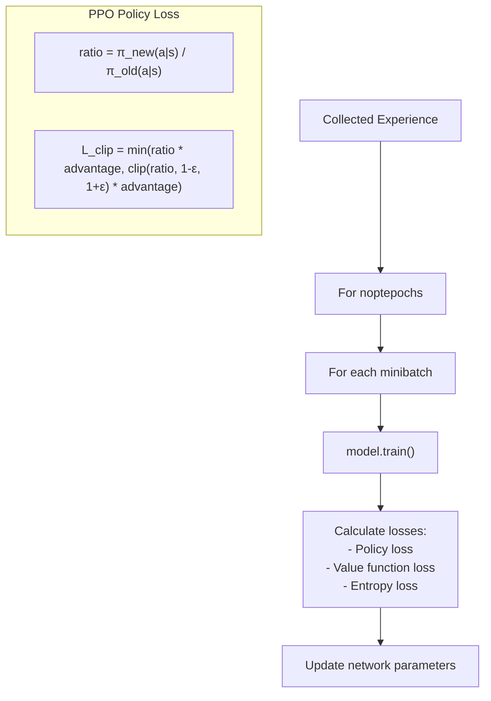
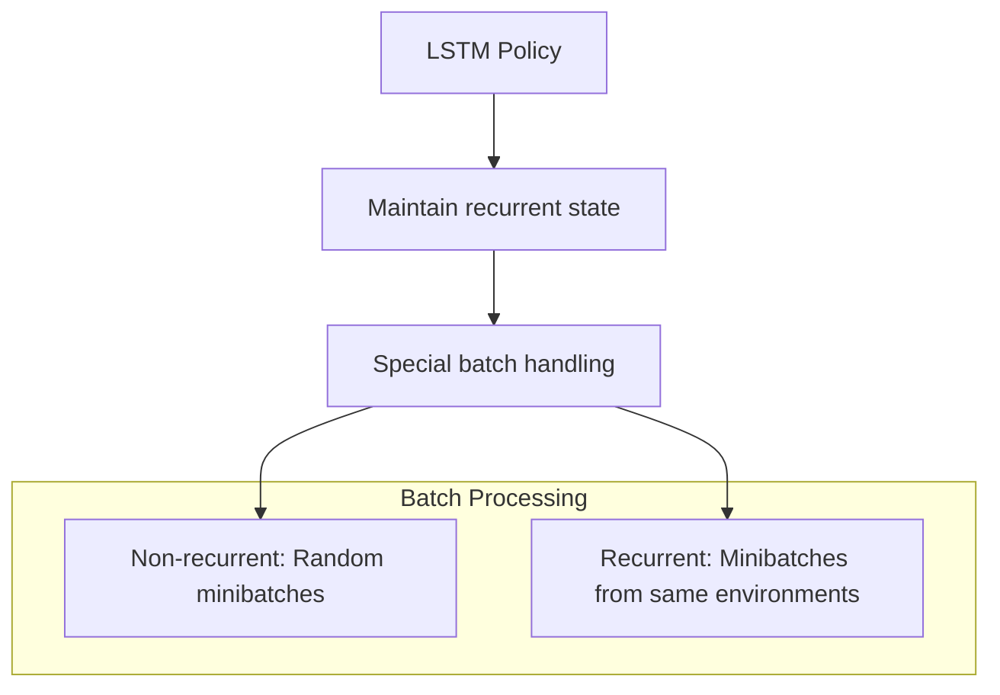

<!-- source: DeepWiki mcp.deepwiki.com · repo openai/baselines · page 5.2 Proximal Policy Optimization (PPO2) · fetched 2026-10-30 -->

# Proximal Policy Optimization (PPO2)

<details>
<summary>Relevant source files</summary>

The following files were used as context for generating this wiki page:

- [baselines/common/models.py](baselines/common/models.py)
- [baselines/common/tests/test_doc_examples.py](baselines/common/tests/test_doc_examples.py)
- [baselines/ppo2/ppo2.py](baselines/ppo2/ppo2.py)

</details>


This document provides a comprehensive explanation of the Proximal Policy Optimization (PPO2) implementation in the OpenAI Baselines repository. PPO2 is one of the policy gradient reinforcement learning algorithms that offers excellent sample efficiency while maintaining simplicity and reliability.

## 1. Overview

Proximal Policy Optimization (PPO) is a policy gradient method introduced by OpenAI in 2017. It aims to improve upon previous methods by using a clipped surrogate objective function that prevents too large policy updates while maintaining good sample efficiency. PPO2 is the improved implementation of PPO in the Baselines repository.

The implementation consists of three key components:
- The main algorithm logic (`ppo2.py`)
- The model architecture (`model.py`)
- Environment interaction (`runner.py`)



Sources: [baselines/ppo2/ppo2.py:21-218]()

## 2. Algorithm Implementation

PPO2 works by alternating between collecting trajectory samples and optimizing a surrogate objective function. The implementation follows these key steps:

1. Collect state-action-reward samples using the current policy
2. Compute advantages and returns
3. Optimize the policy using multiple epochs of minibatch SGD
4. Repeat until the desired number of timesteps is reached

### 2.1 Main Learning Function

The entry point for training with PPO2 is the `learn()` function, which accepts numerous hyperparameters to configure the training process:



Sources: [baselines/ppo2/ppo2.py:21-78]()

### 2.2 Key Hyperparameters

PPO2 offers several important hyperparameters that control its behavior:

| Parameter | Default | Description |
|-----------|---------|-------------|
| `nsteps` | 2048 | Number of steps of the environment per update |
| `ent_coef` | 0.0 | Policy entropy coefficient in the optimization |
| `lr` | 3e-4 | Learning rate |
| `vf_coef` | 0.5 | Value function loss coefficient |
| `max_grad_norm` | 0.5 | Gradient norm clipping coefficient |
| `gamma` | 0.99 | Discount factor |
| `lam` | 0.95 | GAE lambda parameter |
| `nminibatches` | 4 | Number of training minibatches per update |
| `noptepochs` | 4 | Number of optimization epochs per update |
| `cliprange` | 0.2 | PPO clipping parameter |

Sources: [baselines/ppo2/ppo2.py:21-76]()

## 3. Training Loop

The PPO2 training loop consists of collecting batches of experience and then performing multiple epochs of optimization on that data.



Sources: [baselines/ppo2/ppo2.py:128-216]()

## 4. Policy Networks

PPO2 can use various network architectures for its policy and value function. The network type is specified when calling the `learn()` function.

### 4.1 Available Network Architectures



Sources: [baselines/common/models.py:14-274]()

### 4.2 Network Selection

The network is selected and built in the `learn()` function:

```python
policy = build_policy(env, network, **network_kwargs)
```

Common network types include:
- `'mlp'`: Simple multi-layer perceptron for low-dimensional observations
- `'cnn'`: Convolutional neural network for image observations
- `'lstm'`: Recurrent network for tasks requiring memory
- `'cnn_lstm'`: Combined CNN and LSTM for visual tasks requiring memory

Sources: [baselines/ppo2/ppo2.py:88](), [baselines/common/models.py:74-213]()

## 5. Data Collection and Processing

The `Runner` class is responsible for collecting experience by stepping through environments and calculating advantages.



The Runner collects `nsteps` timesteps from each environment before returning. It uses Generalized Advantage Estimation (GAE) to compute advantages.

Sources: [baselines/ppo2/ppo2.py:113-145]()

## 6. Optimization Process

After collecting experience, PPO2 optimizes the policy and value function:



The key innovation in PPO is the clipped objective function, which prevents excessive policy updates by limiting the ratio between the new and old policies.

Sources: [baselines/ppo2/ppo2.py:152-180]()

## 7. Using PPO2

To use PPO2 in your own projects:

```python
from baselines.ppo2 import ppo2
from baselines.common.vec_env import DummyVecEnv

# Create vectorized environment
env = DummyVecEnv([lambda: gym.make('CartPole-v1')])

# Train model
model = ppo2.learn(network='mlp', env=env, total_timesteps=100000)

# Save model
model.save('/path/to/model')

# Load model
model = ppo2.learn(network='mlp', env=env, total_timesteps=0, load_path='/path/to/model')
```

Sources: [baselines/ppo2/ppo2.py:21-218]()

## 8. Recurrent Policies

When using recurrent policies like LSTM, special handling is required to manage the recurrent state:



PPO2 has special code paths for handling recurrent networks that preserve the sequential nature of the data when creating minibatches.

Sources: [baselines/ppo2/ppo2.py:154-180](), [baselines/common/models.py:131-183]()

## 9. Comparison with Other Algorithms

PPO2 offers several advantages over other reinforcement learning algorithms:

- Simpler implementation than TRPO while achieving similar performance
- Better sample efficiency than A2C
- More stable than vanilla policy gradient methods
- Works well across a wide range of environments

For continuous control tasks, consider [DDPG](#5.4) or [SAC](#5.6) as alternatives. For discrete action spaces with sparse rewards, [DQN](#5.1) might be more appropriate.

Sources: [baselines/ppo2/ppo2.py:25-27]()

## 10. Logging and Monitoring

PPO2 provides extensive logging during training, reporting metrics like:

- Explained variance (quality of value function)
- Episode rewards and lengths
- Policy loss
- Value function loss
- Entropy
- Learning rate

These metrics are logged to TensorBoard (if configured) and to the console at regular intervals defined by `log_interval`.

Sources: [baselines/ppo2/ppo2.py:192-210]()

PPO2 represents one of the most reliable and widely-used algorithms in the Baselines repository, offering a good trade-off between simplicity, sample efficiency, and performance.

---

