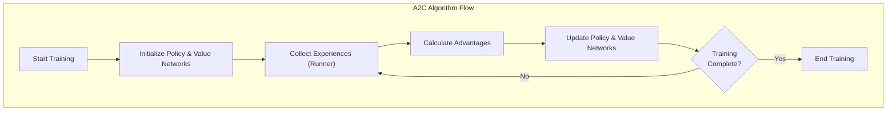
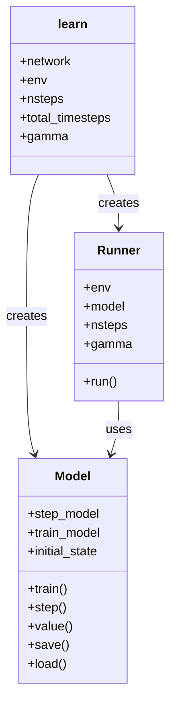
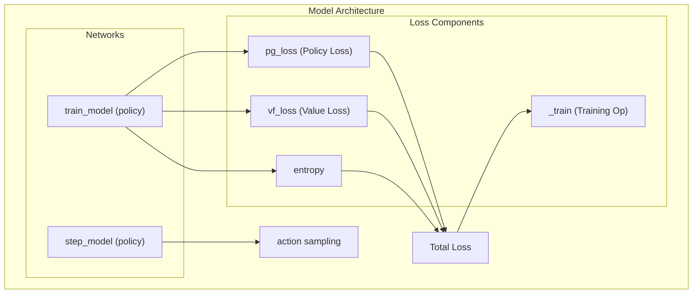
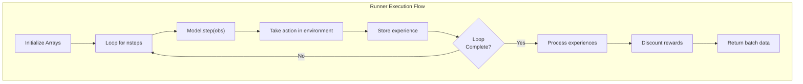
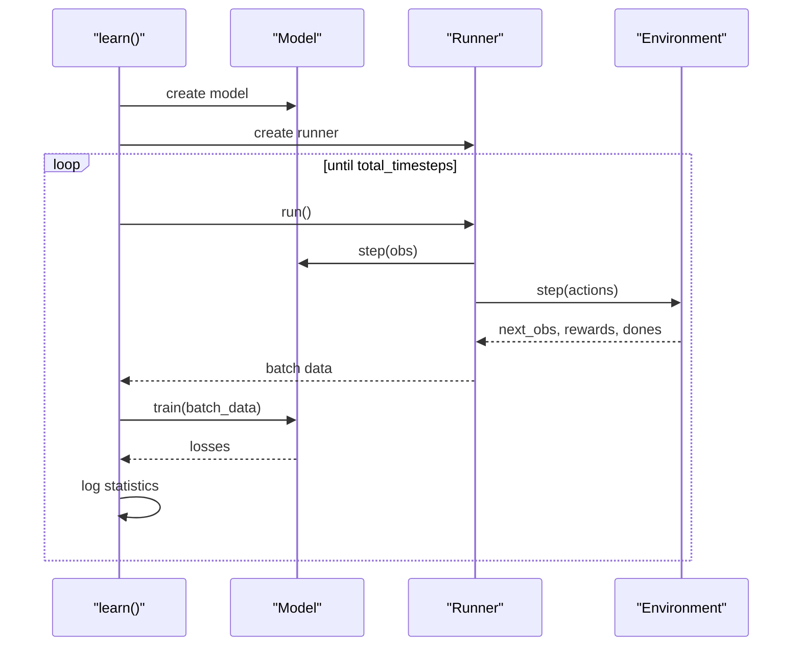

<!-- source: DeepWiki mcp.deepwiki.com · repo openai/baselines · page 5.3 Advantage Actor-Critic (A2C) · fetched 2026-10-30 -->

# Advantage Actor-Critic (A2C)

<details>
<summary>Relevant source files</summary>

The following files were used as context for generating this wiki page:

- [baselines/a2c/a2c.py](baselines/a2c/a2c.py)
- [baselines/a2c/runner.py](baselines/a2c/runner.py)
- [baselines/acktr/acktr.py](baselines/acktr/acktr.py)

</details>


## Purpose and Scope

This document explains the implementation of the Advantage Actor-Critic (A2C) algorithm in the OpenAI Baselines repository. A2C is a synchronous variant of the Asynchronous Advantage Actor-Critic (A3C) algorithm, which provides better performance with similar sample efficiency and stability. The document covers the architecture, components, implementation details, and usage of the A2C algorithm. For information about related actor-critic methods like ACKTR, see [Actor-Critic with Kronecker-Factored Trust Region (ACKTR)](#5.5).

## Algorithm Overview

A2C is a policy gradient method that combines the policy-based and value-based approaches. It maintains both a policy (actor) that determines which actions to take and a value function (critic) that evaluates how good those actions are. The advantage function helps reduce the variance of policy gradient updates by using the value function as a baseline.



Sources: [baselines/a2c/a2c.py:119-231](). [baselines/a2c/runner.py:5-76]()

## Architecture Components

The A2C implementation consists of two main components: the `Model` class that defines the neural network architecture and learning process, and the `Runner` class that collects experiences from the environment.



Sources: [baselines/a2c/a2c.py:19-117](). [baselines/a2c/runner.py:5-76]()

### Model Class

The `Model` class is the core of the A2C implementation. It creates and manages two policy networks:
1. `step_model`: Used for sampling actions during environment interaction
2. `train_model`: Used for training the network with batches of data



Sources: [baselines/a2c/a2c.py:19-117]()

### Runner Class

The `Runner` class handles the interaction with the environment and collects experience data for training. It runs the environment for a fixed number of steps (`nsteps`) and returns batches of observations, actions, rewards, and other data.



Sources: [baselines/a2c/runner.py:5-76]()

## Implementation Details

### Loss Function

The A2C loss function consists of three components:

1. **Policy Gradient Loss**: Weighted by the advantage function
2. **Value Function Loss**: Mean squared error between predicted values and returns
3. **Entropy Bonus**: Encourages exploration by penalizing deterministic policies

The total loss is calculated as:

```
Loss = pg_loss - entropy * ent_coef + vf_loss * vf_coef
```

Where:
- `pg_loss` = mean(advantage * neglogpac)
- `vf_loss` = mean_squared_error(value_pred, returns)
- `entropy` = mean of policy entropy

Sources: [baselines/a2c/a2c.py:54-68]()

### Training Process

The training process in A2C follows these steps:

1. Collect a batch of experiences using the `Runner` class
2. Calculate advantages (rewards - values)
3. Update the policy and value networks based on the loss function
4. Repeat until reaching the total number of timesteps



Sources: [baselines/a2c/a2c.py:119-231](). [baselines/a2c/runner.py:21-76]()

### Advantage Calculation

The advantage function is calculated as:

```
Advantage = R - V(s)
```

Where:
- `R` is the discounted return
- `V(s)` is the predicted value of the state

For multi-step returns, the rewards are discounted with the `discount_with_dones` function, which handles episode terminations correctly.

Sources: [baselines/a2c/a2c.py:91-93](). [baselines/a2c/runner.py:58-69]()

## Usage and Configuration

The main entry point for A2C is the `learn` function, which takes the following key parameters:

| Parameter | Type | Default | Description |
|-----------|------|---------|-------------|
| network | string/function | - | Network architecture (e.g., 'mlp', 'cnn') |
| env | VecEnv | - | Vectorized environment |
| nsteps | int | 5 | Number of steps per update |
| total_timesteps | int | 80e6 | Total number of timesteps to train |
| ent_coef | float | 0.01 | Entropy coefficient |
| vf_coef | float | 0.5 | Value function loss coefficient |
| max_grad_norm | float | 0.5 | Maximum gradient norm (for clipping) |
| lr | float | 7e-4 | Learning rate |
| gamma | float | 0.99 | Discount factor |
| lrschedule | string | 'linear' | Learning rate schedule |

Sources: [baselines/a2c/a2c.py:119-182]()

### Example Usage

To train an A2C agent, you would typically use the following code structure:

```python
from baselines.common.vec_env import DummyVecEnv
from baselines.a2c import a2c
from baselines.common.policies import MlpPolicy

# Create environment
env = DummyVecEnv([lambda: gym.make("CartPole-v1")])

# Train the model
model = a2c.learn(
    network='mlp',
    env=env,
    nsteps=5,
    total_timesteps=100000,
    lr=7e-4
)
```

## Technical Implementation

### Network Initialization

A2C uses two separate but identical policy networks:

1. **Step Model**: Processes a single step for each environment (nenvs, 1)
2. **Train Model**: Processes a batch of steps for training (nenvs*nsteps, nsteps)

```
step_model = policy(nenvs, 1, sess)
train_model = policy(nbatch, nsteps, sess)
```

Sources: [baselines/a2c/a2c.py:37-47]()

### Optimization

A2C uses RMSProp as the optimizer, with configurable learning rate, decay, and epsilon parameters:

```
trainer = tf.train.RMSPropOptimizer(learning_rate=LR, decay=alpha, epsilon=epsilon)
```

Gradients are clipped to prevent exploding gradients:

```
grads, grad_norm = tf.clip_by_global_norm(grads, max_grad_norm)
```

Sources: [baselines/a2c/a2c.py:71-86]()

### Vectorized Execution

A2C uses vectorized environments to process multiple environments in parallel, which increases throughput and stabilizes learning. The `Runner` class handles this parallel execution, collecting batches of experiences from all environments simultaneously.

```
nbatch = nenvs * nsteps  # Batch size
```

Sources: [baselines/a2c/a2c.py:39-40](). [baselines/a2c/runner.py:25-45]()

## Differences from A3C

Unlike A3C, which uses asynchronous parallel workers that each maintain their own copy of the model, A2C is synchronous. In A2C:

1. Multiple environments run in parallel to collect experiences
2. All experiences are gathered to update the policy and value networks synchronously
3. This synchronous approach provides more stable updates and can be more efficient with GPUs

This synchronous design makes A2C simpler to implement and often results in more stable training.

---

