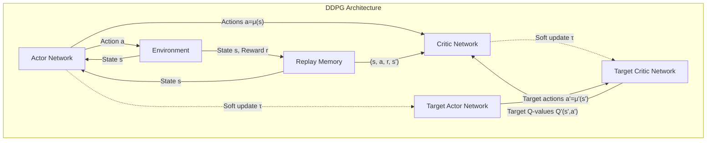
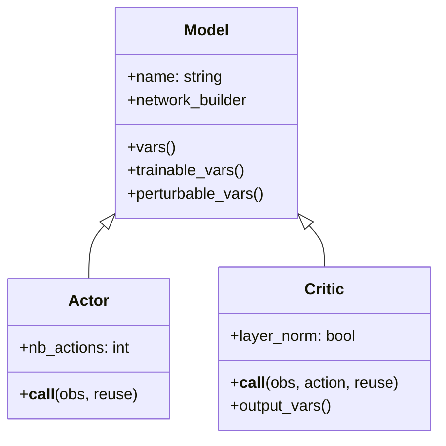
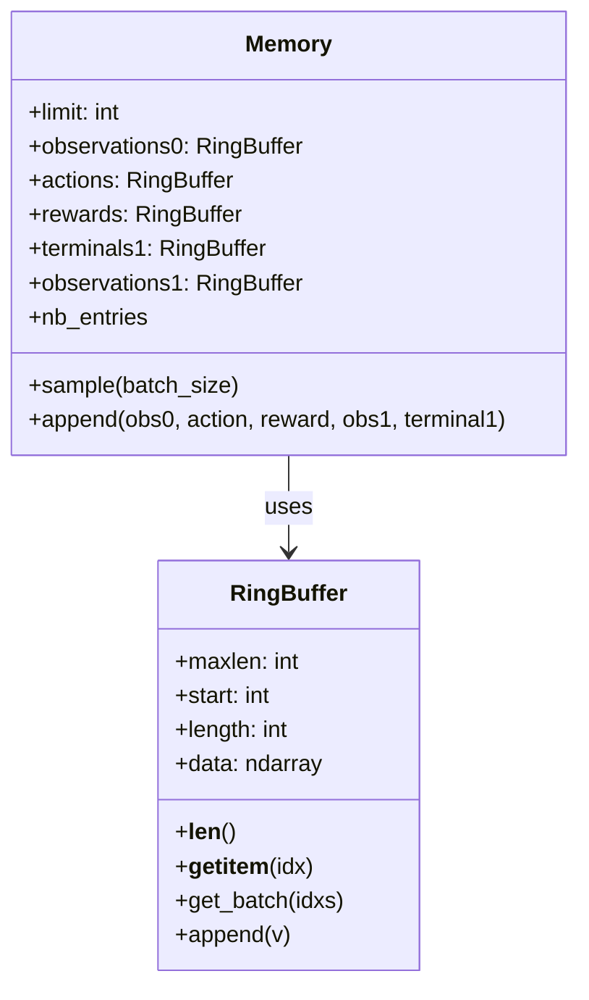
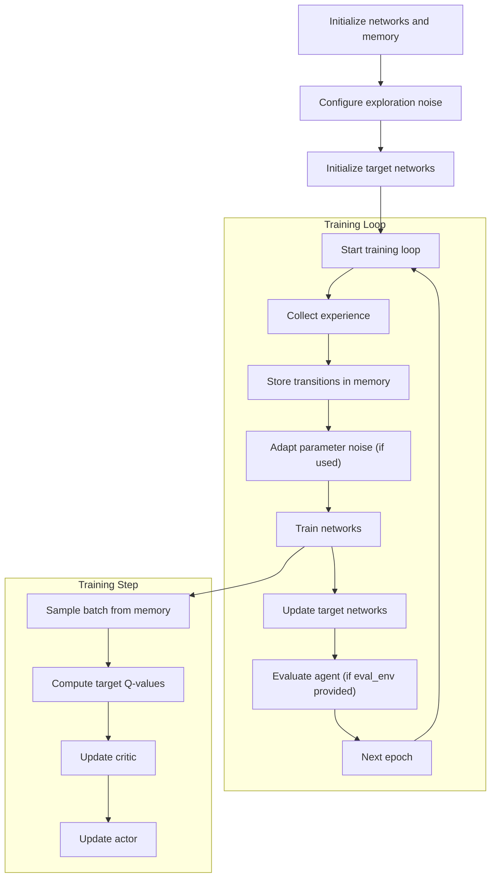

<!-- source: DeepWiki mcp.deepwiki.com · repo openai/baselines · page 5.4 Deep Deterministic Policy Gradient (DDPG) · fetched 2026-10-30 -->

# Deep Deterministic Policy Gradient (DDPG)

<details>
<summary>Relevant source files</summary>

The following files were used as context for generating this wiki page:

- [baselines/ddpg/ddpg.py](baselines/ddpg/ddpg.py)
- [baselines/ddpg/ddpg_learner.py](baselines/ddpg/ddpg_learner.py)
- [baselines/ddpg/memory.py](baselines/ddpg/memory.py)
- [baselines/ddpg/models.py](baselines/ddpg/models.py)

</details>


## Purpose and Scope

This document describes the Deep Deterministic Policy Gradient (DDPG) implementation in OpenAI Baselines. DDPG is an off-policy actor-critic algorithm designed for continuous action spaces. It combines ideas from DQN (Deep Q-Networks) with deterministic policy gradients to handle continuous control tasks. For information about other actor-critic methods like A2C, see [Advantage Actor-Critic (A2C)](#5.3).

## Algorithm Overview

DDPG addresses the challenge of applying reinforcement learning to continuous action spaces. It uses two neural networks:
- An **actor** that deterministically maps states to actions
- A **critic** that estimates action-values (Q-values)

The algorithm employs target networks, experience replay, and exploration noise to improve stability and performance.

### Key Features
- **Deterministic Policy**: Outputs a specific action rather than a probability distribution
- **Off-Policy Learning**: Can learn from stored experiences
- **Continuous Action Spaces**: Designed specifically for continuous control
- **Actor-Critic Architecture**: Combines policy-based and value-based methods

Sources: [baselines/ddpg/ddpg_learner.py](), [baselines/ddpg/models.py]()

## Architecture

The diagram below shows the DDPG architecture as implemented in Baselines:



Sources: [baselines/ddpg/ddpg_learner.py:66-147](), [baselines/ddpg/models.py:23-51]()

## Implementation Components

### DDPG Class

The core implementation is in the `DDPG` class, which handles the learning process. It creates and manages the TensorFlow computational graph for training.

Key properties:
- `actor`: Policy network that maps states to actions
- `critic`: Value network that estimates Q-values
- `target_actor`: Slowly updated copy of actor for stability
- `target_critic`: Slowly updated copy of critic for stability
- `memory`: Replay buffer for storing transitions

Sources: [baselines/ddpg/ddpg_learner.py:66-101]()

### Network Models

DDPG uses two main network models:



- **Actor**: Maps observations to actions, with a tanh activation in the output layer to bound actions
- **Critic**: Estimates Q-values by taking both observations and actions as input

Sources: [baselines/ddpg/models.py:5-51]()

### Experience Replay

The replay buffer stores transitions for off-policy learning:



The `Memory` class:
- Stores state transitions (s, a, r, s', done)
- Supports random sampling of batches for training
- Uses a circular buffer implementation for efficient memory usage

Sources: [baselines/ddpg/memory.py:4-83]()

### Exploration Techniques

DDPG implements two types of exploration strategies:

1. **Action Noise**: Adds noise directly to actions
   - Normal action noise: Gaussian noise
   - Ornstein-Uhlenbeck noise: Temporally correlated noise

2. **Parameter Noise**: Adds noise to the parameters of the actor network
   - Adaptive parameter noise: Adjusts noise scale based on action differences

Sources: [baselines/ddpg/ddpg.py:67-84](), [baselines/ddpg/ddpg_learner.py:155-170]()

## Training Process

The training process follows this workflow:



Sources: [baselines/ddpg/ddpg.py:126-258](), [baselines/ddpg/ddpg_learner.py:289-331]()

## Key Functions

### The `learn` Function

The main entry point for training a DDPG agent:

```python
learn(network, env, seed=None, total_timesteps=None, nb_epochs=None, ...)
```

Parameters:
- `network`: Network architecture ('mlp', 'cnn', etc.)
- `env`: Environment to train on
- `total_timesteps`: Total number of timesteps to train
- `nb_epochs`: Number of epochs (alternative to total_timesteps)
- `reward_scale`: Scaling factor for rewards
- `noise_type`: Type of exploration noise to use

The function handles:
- Environment interaction
- Data collection
- Agent training
- Evaluation
- Logging of metrics

Sources: [baselines/ddpg/ddpg.py:21-275]()

### The `step` Method

Used to select actions based on observations:

```python
step(obs, apply_noise=True, compute_Q=True)
```

- Feeds observations through the actor network
- Optionally applies exploration noise
- Clips actions to the valid range
- Optionally computes Q-values

Sources: [baselines/ddpg/ddpg_learner.py:259-278]()

### The `train` Method

Updates the actor and critic networks:

```python
train()
```

- Samples a batch from the replay buffer
- Computes target Q-values
- Updates the critic to minimize TD error
- Updates the actor to maximize expected Q-value
- Handles normalization if enabled

Sources: [baselines/ddpg/ddpg_learner.py:289-331]()

## Important Parameters

| Parameter | Description | Default Value |
|-----------|-------------|---------------|
| `gamma` | Discount factor | 0.99 |
| `tau` | Soft target update coefficient | 0.01 |
| `batch_size` | Size of training batches | 64 |
| `actor_lr` | Learning rate for actor | 1e-4 |
| `critic_lr` | Learning rate for critic | 1e-3 |
| `critic_l2_reg` | L2 regularization for critic | 1e-2 |
| `noise_type` | Type of exploration noise | 'adaptive-param_0.2' |
| `normalize_observations` | Whether to normalize observations | True |
| `normalize_returns` | Whether to normalize returns | False |
| `nb_train_steps` | Number of training steps per cycle | 50 |
| `nb_rollout_steps` | Number of rollout steps per cycle | 100 |

Sources: [baselines/ddpg/ddpg.py:21-46](), [baselines/ddpg/ddpg_learner.py:67-100]()

## Auxiliary Components

### Target Network Updates

DDPG uses "soft" target updates to enhance stability:

```python
θ' ← τθ + (1-τ)θ'
```

where:
- θ' are the target network parameters
- θ are the main network parameters
- τ is the update rate (typically small, e.g., 0.01)

This is implemented in the `get_target_updates` function.

Sources: [baselines/ddpg/ddpg_learner.py:36-47](), [baselines/ddpg/ddpg_learner.py:149-153]()

### Normalization

DDPG supports normalization of:
- Observations: To standardize inputs to the networks
- Returns: To handle varying reward scales

This is controlled by the `normalize_observations` and `normalize_returns` parameters.

Sources: [baselines/ddpg/ddpg_learner.py:102-118]()

## Usage Example

To use DDPG with the Baselines implementation:

```python
from baselines import ddpg
import gym

# Create environment
env = gym.make('HalfCheetah-v2')

# Train DDPG agent
model = ddpg.learn(
    network='mlp',  # Use MLP network architecture
    env=env,
    total_timesteps=1000000,
    noise_type='adaptive-param_0.2',  # Use parameter noise for exploration
    layer_norm=True,  # Use layer normalization
    reward_scale=1.0
)
```

## Relation to Other Algorithms

DDPG combines elements from:
- **DQN**: Off-policy learning with replay buffer and target networks
- **Deterministic Policy Gradient**: Actor-critic architecture with deterministic policies

It differs from other actor-critic methods like A2C and PPO, which are on-policy algorithms with stochastic policies.

---

