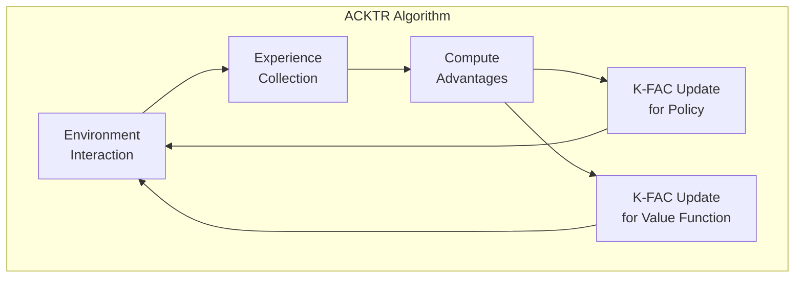
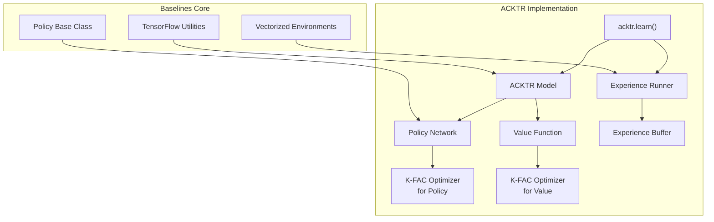
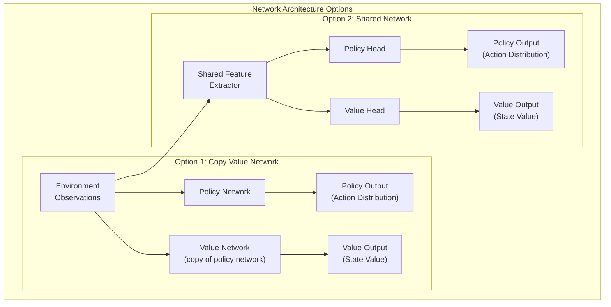
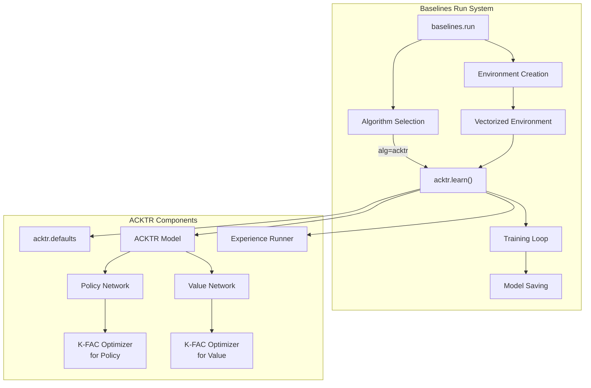

<!-- source: DeepWiki mcp.deepwiki.com · repo openai/baselines · page 5.5 Actor-Critic with Kronecker-Factored Trust Region (ACKTR) · fetched 2026-10-30 -->

# Actor-Critic with Kronecker-Factored Trust Region (ACKTR)

<details>
<summary>Relevant source files</summary>

The following files were used as context for generating this wiki page:

- [baselines/acktr/defaults.py](baselines/acktr/defaults.py)

</details>


## Purpose and Scope

This document describes the Actor-Critic with Kronecker-Factored Trust Region (ACKTR) implementation in the OpenAI Baselines repository. ACKTR is a sample-efficient deep reinforcement learning algorithm that extends the actor-critic framework by applying Kronecker-factored approximation to enable trust region optimization. This page covers the algorithm's theoretical background, implementation details, and usage within the Baselines library. For information about other actor-critic methods like A2C, see [Advantage Actor-Critic (A2C)](#5.3).

## Algorithm Overview

ACKTR combines concepts from both trust region policy optimization and actor-critic methods, using Kronecker-factored approximate curvature (K-FAC) to efficiently compute natural gradient updates. This approach allows for more stable and sample-efficient learning compared to first-order methods.



Sources: baselines/acktr/defaults.py

## Key Components and Architecture

ACKTR integrates into the Baselines architecture as an actor-critic method, sharing common infrastructure with other algorithms while implementing its specialized optimization approach.



Sources: baselines/acktr/defaults.py

## Implementation Details

### Policy and Value Network

ACKTR uses two networks: a policy network (actor) and a value network (critic). Based on the defaults file, the value network can be implemented in two ways:

- `copy`: A separate network architecture that mirrors the policy network
- Alternatively, a shared network with different output heads for policy and value



Sources: baselines/acktr/defaults.py

### Kronecker-Factored Approximate Curvature (K-FAC)

The distinctive feature of ACKTR is its use of K-FAC for natural gradient optimization. K-FAC approximates the Fisher Information Matrix (FIM) using Kronecker products, making natural gradient updates computationally feasible.

### Default Parameters

ACKTR comes with specific default parameters for MuJoCo environments:

| Parameter | Value | Description |
|-----------|-------|-------------|
| nsteps    | 2500  | Number of environment steps per update |
| value_network | 'copy' | Type of value network architecture |

Sources: baselines/acktr/defaults.py

## Usage Example

To use ACKTR with the Baselines framework, you would typically call it through the `run` module:

```python
python -m baselines.run --alg=acktr --env=HalfCheetah-v2 --num_timesteps=1e6
```

For customization, you can modify the default parameters:

```python
python -m baselines.run --alg=acktr --env=HalfCheetah-v2 --num_timesteps=1e6 --nsteps=1000
```

## Algorithm Pseudocode

```
ACKTR Algorithm:
1. Initialize policy parameters θ and value function parameters φ
2. Initialize K-FAC optimizers for policy and value function
3. For iteration = 1, 2, ..., do:
   a. Collect trajectories for nsteps (default: 2500) timesteps
   b. Compute advantages using collected value estimates
   c. Update policy using K-FAC natural gradient:
      θ ← θ + α * F^(-1) * ∇θ L_policy
      where F is approximated using K-FAC
   d. Update value function using K-FAC natural gradient:
      φ ← φ + β * G^(-1) * ∇φ L_value
      where G is approximated using K-FAC
```

## Comparison with Other Actor-Critic Methods

ACKTR differentiates itself from other actor-critic methods in Baselines through its optimization approach:

| Algorithm | Optimization Method | Sample Efficiency | Computational Cost |
|-----------|---------------------|-------------------|-------------------|
| A2C       | First-order gradient descent | Moderate | Low |
| PPO       | Clipped surrogate objective | Good | Moderate |
| TRPO      | Natural gradient with KL constraint | Good | High |
| ACKTR     | K-FAC natural gradient | Excellent | Moderate-High |

## Integration with Baselines Architecture

ACKTR fits into the overall Baselines architecture as follows:



Sources: baselines/acktr/defaults.py

## Limitations and Considerations

When using ACKTR, consider these important factors:

1. **Computational Complexity**: K-FAC optimization requires more computation per step than first-order methods
2. **Memory Requirements**: Storing the Kronecker factors increases memory usage
3. **Environment Compatibility**: The default parameters are optimized for MuJoCo environments
4. **Hyperparameter Sensitivity**: Performance may be sensitive to the choice of optimizer parameters

## Conclusion

ACKTR represents an advanced actor-critic algorithm that achieves high sample efficiency through principled optimization techniques. By using Kronecker-factored approximation for natural gradient updates, it achieves faster convergence than first-order methods while maintaining computational tractability. The implementation in Baselines provides a solid foundation for using this algorithm across various continuous control tasks.

---

