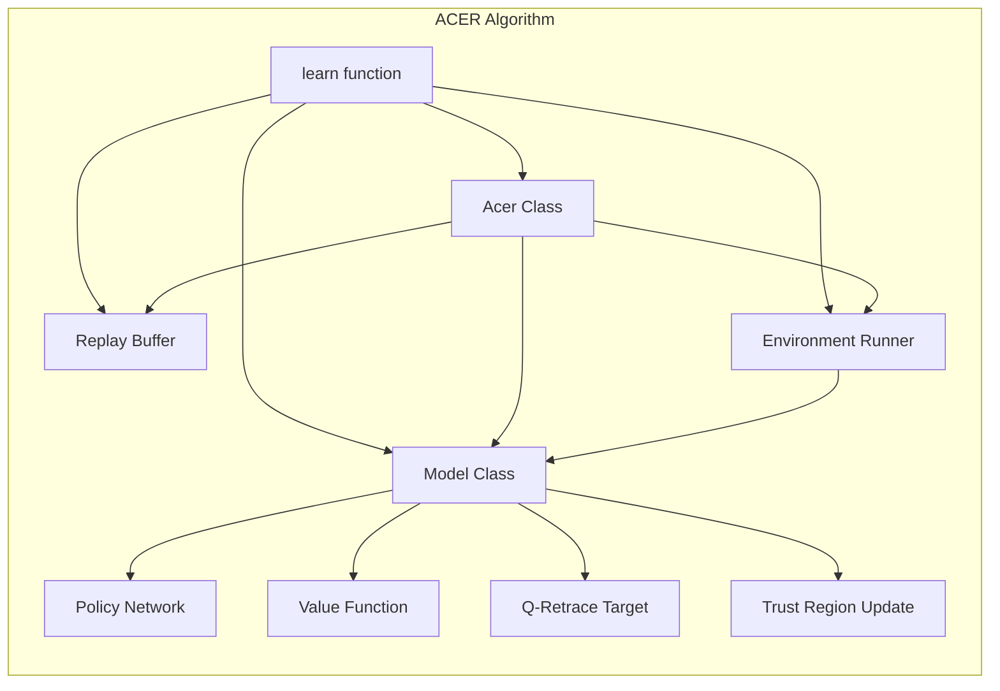
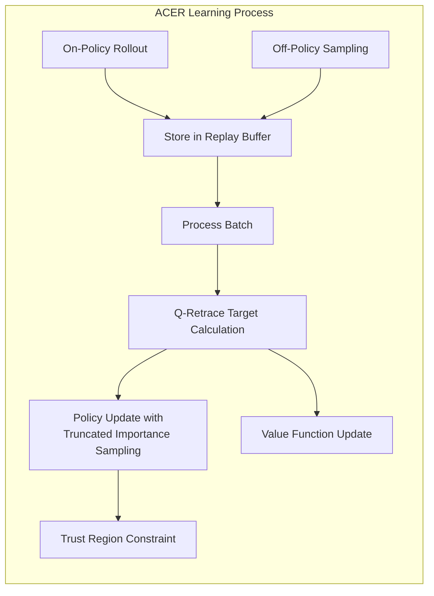
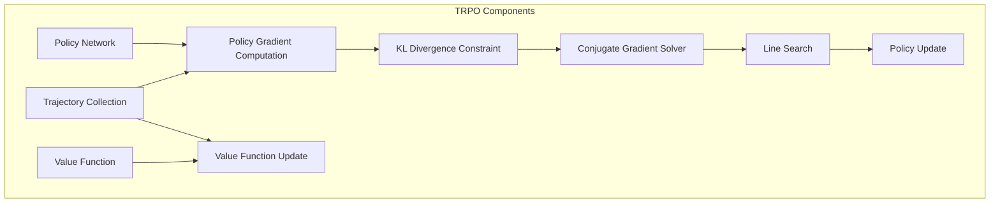
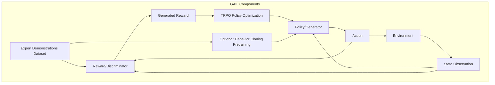
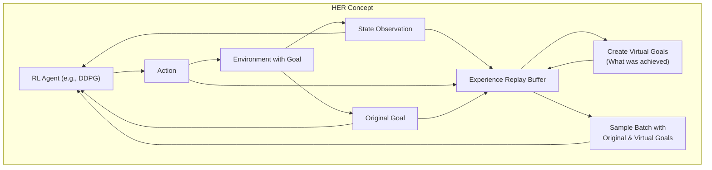

<!-- source: DeepWiki mcp.deepwiki.com · repo openai/baselines · page 5.6 Other Algorithms · fetched 2026-10-30 -->

# Other Algorithms

<details>
<summary>Relevant source files</summary>

The following files were used as context for generating this wiki page:

- [baselines/acer/acer.py](baselines/acer/acer.py)
- [baselines/acer/buffer.py](baselines/acer/buffer.py)
- [baselines/acer/runner.py](baselines/acer/runner.py)
- [baselines/common/tests/test_cartpole.py](baselines/common/tests/test_cartpole.py)
- [baselines/common/tests/test_mnist.py](baselines/common/tests/test_mnist.py)
- [baselines/gail/README.md](baselines/gail/README.md)
- [baselines/gail/adversary.py](baselines/gail/adversary.py)
- [baselines/gail/behavior_clone.py](baselines/gail/behavior_clone.py)
- [baselines/gail/dataset/mujoco_dset.py](baselines/gail/dataset/mujoco_dset.py)
- [baselines/gail/gail-eval.py](baselines/gail/gail-eval.py)
- [baselines/gail/mlp_policy.py](baselines/gail/mlp_policy.py)
- [baselines/gail/run_mujoco.py](baselines/gail/run_mujoco.py)
- [baselines/gail/trpo_mpi.py](baselines/gail/trpo_mpi.py)

</details>


This page covers additional reinforcement learning algorithms implemented in OpenAI Baselines that complement the main algorithms covered in previous sections. Specifically, we'll explore Actor-Critic with Experience Replay (ACER), Trust Region Policy Optimization (TRPO) as implemented within GAIL, Generative Adversarial Imitation Learning (GAIL), and Hindsight Experience Replay (HER). These algorithms showcase different approaches to policy optimization, imitation learning, and experience replay techniques.

For the main model-free RL algorithms like PPO2, A2C, DQN, and DDPG, please refer to their dedicated pages ([DQN](#5.1), [PPO2](#5.2), [A2C](#5.3), [DDPG](#5.4), [ACKTR](#5.5)).

## ACER (Actor-Critic with Experience Replay)

ACER is an off-policy actor-critic algorithm that combines several techniques to improve sample efficiency and stability. It extends A2C with experience replay, truncated importance sampling with bias correction, and trust region policy optimization.

### Key Components of ACER



Sources: [baselines/acer/acer.py:230-381](), [baselines/acer/buffer.py:3-141](), [baselines/acer/runner.py:7-61]()

ACER's implementation is built around several core components:

1. **Model**: Implements the neural network architecture including:
   - Policy network (actor)
   - Value function (critic)
   - Q-retrace calculation for off-policy correction
   - Trust region updates for stable learning

2. **Buffer**: A specialized replay buffer that stores:
   - Observations and stacked frames
   - Actions, rewards, and dones
   - Policy distributions (mus)
   
3. **Runner**: Manages environment interactions and collects trajectories.

4. **Acer Class**: Orchestrates the training process by:
   - Collecting on-policy samples using the Runner
   - Sampling from the replay Buffer for off-policy updates
   - Processing batches and training the Model

### Implementation Details



Sources: [baselines/acer/acer.py:118-153](), [baselines/acer/acer.py:240-273]()

ACER's implementation includes several innovative techniques:

1. **Q-Retrace**: A multi-step off-policy target for the value function:
   ```python
   qret = q_retrace(R, D, q_i, v, rho_i, nenvs, nsteps, gamma)
   ```
   This function computes off-policy corrections using importance weights (rho) to ensure stable learning.

2. **Truncated Importance Sampling with Bias Correction**:
   - Truncation: `gain_f = logf * tf.stop_gradient(adv * tf.minimum(c, rho_i))`
   - Bias correction: `gain_bc = tf.reduce_sum(logf_bc * tf.stop_gradient(adv_bc * tf.nn.relu(1.0 - (c / (rho + eps))) * f), axis = 1)`

3. **Polyak Averaging**: Uses an exponential moving average of parameters to improve stability:
   ```python
   ema = tf.train.ExponentialMovingAverage(alpha)
   ema_apply_op = ema.apply(params)
   ```

### Usage

ACER can be run through the common interface in `baselines.run` with the following parameters:

```
python -m baselines.run --alg=acer --env=PongNoFrameskip-v4
```

Key hyperparameters include:
- `nsteps`: Number of steps to run per environment (default: 20)
- `total_timesteps`: Total number of timesteps (default: 80M)
- `replay_ratio`: Number of off-policy batches per on-policy batch (default: 4)
- `buffer_size`: Size of the replay buffer (default: 50,000)
- `trust_region`: Whether to use trust region optimization (default: True)

Sources: [baselines/acer/acer.py:275-341](), [baselines/common/tests/test_cartpole.py:16-19]()

## TRPO (Trust Region Policy Optimization)

TRPO is a policy optimization algorithm that ensures monotonic improvement by constraining policy updates to a trust region defined by a KL divergence constraint. In the Baselines repository, TRPO is primarily implemented as part of the GAIL framework.

### Key Components and Implementation



Sources: [baselines/gail/trpo_mpi.py:105-353]()

TRPO is implemented with the following key components:

1. **Policy Network**: A stochastic policy parameterized by a neural network.
2. **Value Function**: Estimates the state-value function.
3. **Trust Region Constraint**: Enforces a constraint on the KL divergence between old and new policies:
   ```python
   kloldnew = oldpi.pd.kl(pi.pd)
   meankl = tf.reduce_mean(kloldnew)
   ```

4. **Conjugate Gradient**: Used to compute the natural gradient direction:
   ```python
   stepdir = cg(fisher_vector_product, g, cg_iters=cg_iters, verbose=rank == 0)
   ```

5. **Line Search**: Finds the largest step size that satisfies the KL constraint and improves the objective:
   ```python
   for _ in range(10):
       thnew = thbefore + fullstep * stepsize
       set_from_flat(thnew)
       meanlosses = surr, kl, *_ = allmean(np.array(compute_losses(*args)))
       # Check if the update satisfies constraints and improves the objective
       # ...
       stepsize *= .5
   ```

### Integration with GAIL

In OpenAI Baselines, TRPO is primarily used as the policy optimization method for GAIL. The implementation is in `gail/trpo_mpi.py` and is designed to work with MPI for distributed training.

The `learn` function in TRPO:
- Collects trajectories using the current policy
- Computes advantages and target values
- Updates the policy using trust region optimization
- Updates the value function

Sources: [baselines/gail/trpo_mpi.py:105-353](), [baselines/gail/run_mujoco.py:132-152]()

## GAIL (Generative Adversarial Imitation Learning)

GAIL is an imitation learning algorithm that leverages generative adversarial networks (GANs) to learn a policy from expert demonstrations, without needing access to the reward function.

### GAIL Architecture



Sources: [baselines/gail/README.md:1-53](), [baselines/gail/run_mujoco.py:87-106](), [baselines/gail/trpo_mpi.py:105-353]()

### Key Components

GAIL consists of several essential components:

1. **Expert Dataset**: Contains expert demonstrations:
   ```python
   dataset = Mujoco_Dset(expert_path=args.expert_path, traj_limitation=args.traj_limitation)
   ```
   The dataset includes expert observations, actions, and episode returns.

2. **Policy Network (Generator)**: The policy being trained to imitate the expert:
   ```python
   def policy_fn(name, ob_space, ac_space, reuse=False):
       return mlp_policy.MlpPolicy(name=name, ob_space=ob_space, ac_space=ac_space,
                                  reuse=reuse, hid_size=args.policy_hidden_size, num_hid_layers=2)
   ```

3. **Discriminator Network**: Distinguishes expert from generated behavior:
   ```python
   reward_giver = TransitionClassifier(env, args.adversary_hidden_size, entcoeff=args.adversary_entcoeff)
   ```
   Outputs rewards that are higher for behaviors similar to the expert.

4. **TRPO Optimizer**: Updates the policy to maximize the rewards from the discriminator.

### Implementation Details

The GAIL training process alternates between:

1. **Discriminator Training**: 
   - Sample expert data from the dataset
   - Sample policy data by running the current policy
   - Train the discriminator to distinguish between expert and policy data

2. **Policy Training**:
   - Use TRPO to update the policy to maximize the rewards from the discriminator
   - The rewards are computed as: `-log(1-sigmoid(discriminator_output))`

```python
# From the adversary.py file
self.reward_op = -tf.log(1-tf.nn.sigmoid(generator_logits)+1e-8)
```

3. **Optional Behavior Cloning Pretraining**:
   - Before GAIL training, the policy can be pretrained using behavior cloning
   - This provides a better initialization for the GAIL process

Sources: [baselines/gail/adversary.py:20-87](), [baselines/gail/behavior_clone.py:42-77](), [baselines/gail/trpo_mpi.py:241-328]()

### Usage

GAIL can be run using:

```bash
python -m baselines.gail.run_mujoco
```

Key parameters include:
- `env_id`: Environment name
- `expert_path`: Path to expert demonstrations file
- `g_step`: Number of policy updates per iteration
- `d_step`: Number of discriminator updates per iteration
- `task`: 'train', 'evaluate', or 'sample'
- `pretrained`: Whether to pretrain with behavior cloning

Sources: [baselines/gail/README.md:17-25](), [baselines/gail/run_mujoco.py:23-55]()

## Hindsight Experience Replay (HER)

Hindsight Experience Replay (HER) is a technique for dealing with sparse rewards in reinforcement learning. While specific HER implementation files weren't included in the list provided, HER is mentioned in the system architecture diagrams and is an important algorithm in Baselines.

### Concept and Architecture



### Key Idea

HER addresses the challenge of learning from sparse rewards by retroactively generating additional goals that would have been achieved:

1. When an episode fails to achieve the original goal, HER treats it as a success for a different goal (what was actually achieved)
2. The experience is stored in the replay buffer twice:
   - Once with the original goal and reward
   - Once with the achieved state as the goal and a success reward
3. This teaches the agent to reach different states, gradually learning to reach the desired goal

### Integration with Other Algorithms

In Baselines, HER is typically used with off-policy algorithms like DDPG, as shown in the reinforcement learning algorithm hierarchy diagram:

```
HER --> DDPG
```

HER enhances sample efficiency by enabling learning from failures, which is especially valuable in environments with sparse rewards, such as robotics tasks.

## Summary and Comparison

| Algorithm | Type | Key Features | Use Cases | Main Components |
|-----------|------|--------------|-----------|-----------------|
| ACER | Off-policy Actor-Critic | Experience replay, Truncated importance sampling, Trust region | Discrete action spaces | Model, Buffer, Runner |
| TRPO | On-policy Policy Optimization | Trust region constraint, Conjugate gradient, Line search | Continuous/discrete actions | PolicyNet, ValueNet, ConjugateGradient |
| GAIL | Imitation Learning | GAN-based, TRPO for optimization, BC pretraining | Learning from demonstrations | Discriminator, Policy, Expert Dataset |
| HER | Sample Efficiency Technique | Virtual goals, Works with off-policy methods | Sparse reward environments | Goal-conditioned policy, Modified replay buffer |

These algorithms represent important techniques in reinforcement learning research and complement the main algorithms covered in previous pages. Each addresses specific challenges in reinforcement learning: ACER improves sample efficiency with experience replay, TRPO ensures stable policy updates, GAIL enables learning from demonstrations without reward functions, and HER tackles sparse reward problems through goal relabeling.

Sources: [baselines/acer/acer.py:230-381](), [baselines/gail/trpo_mpi.py:105-353](), [baselines/gail/adversary.py:20-87](), [baselines/gail/run_mujoco.py:121-154]()

---

