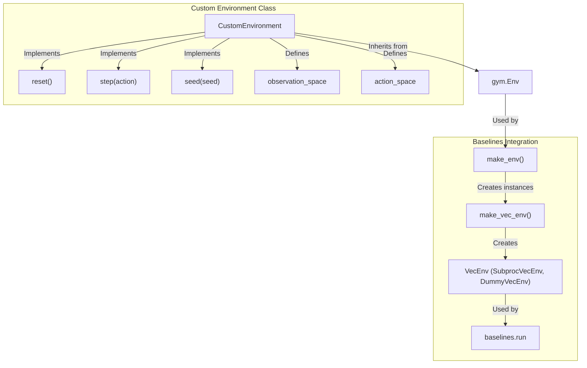
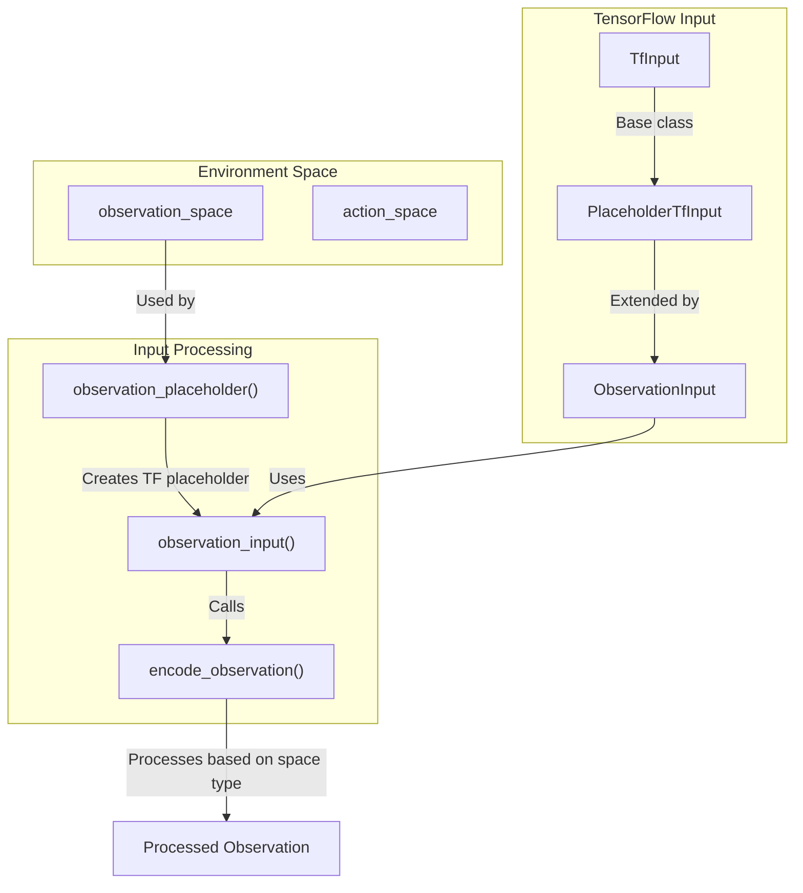
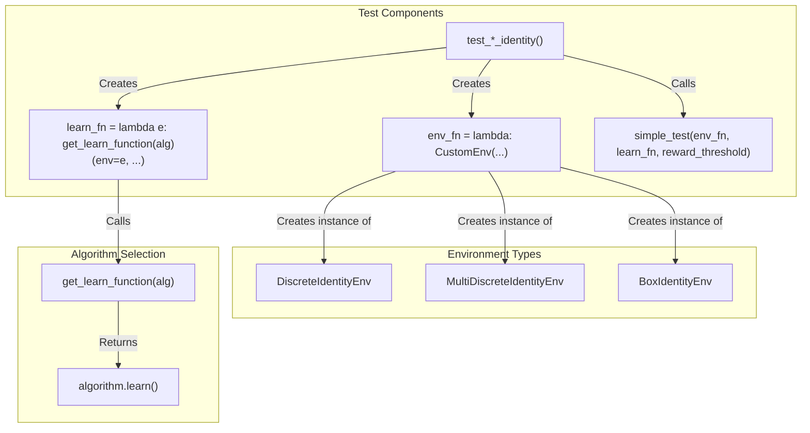
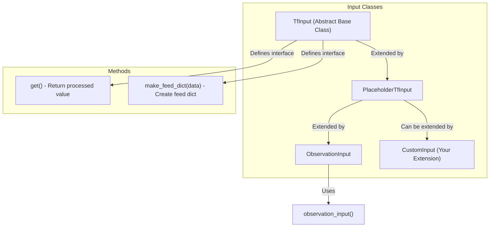
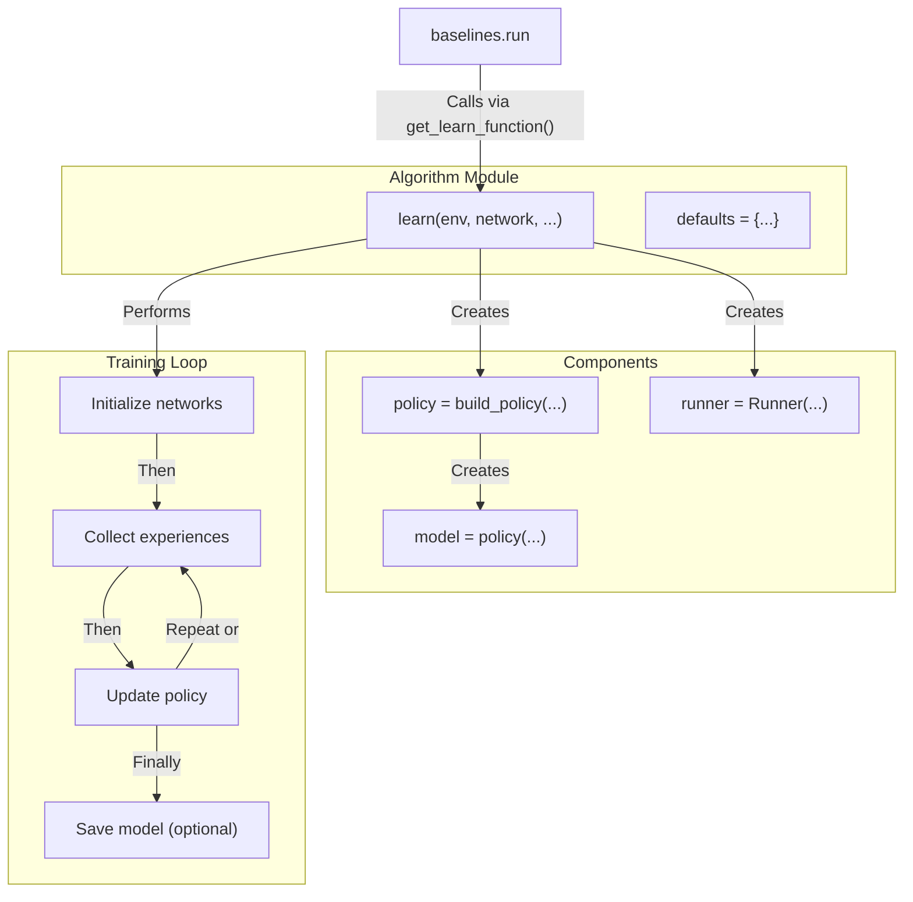

<!-- source: DeepWiki mcp.deepwiki.com · repo openai/baselines · page 6 Advanced Topics · fetched 2026-10-30 -->

# Advanced Topics

<details>
<summary>Relevant source files</summary>

The following files were used as context for generating this wiki page:

- [Dockerfile](Dockerfile)
- [README.md](README.md)
- [baselines/common/input.py](baselines/common/input.py)
- [baselines/common/tests/envs/identity_env.py](baselines/common/tests/envs/identity_env.py)
- [baselines/common/tests/test_identity.py](baselines/common/tests/test_identity.py)
- [baselines/deepq/utils.py](baselines/deepq/utils.py)

</details>


This page covers specialized topics for users who want to extend or customize the OpenAI Baselines library. For basic usage information, see [Overview](#1) and [Getting Started](#2). This document focuses on creating custom environments and extending existing algorithms to adapt Baselines for specific research needs.

## Custom Environments

### Creating a Custom Environment

Custom environments in Baselines should follow the Gym API, which requires implementing specific methods and defining observation and action spaces.

#### Environment Implementation Structure



Sources: [baselines/common/tests/envs/identity_env.py:7-44](), [README.md:78-91]()

The `IdentityEnv` class from the testing framework provides an excellent template for creating custom environments:

```python
class IdentityEnv(Env):
    def __init__(self, episode_len=None, delay=0, zero_first_rewards=True):
        self.observation_space = self.action_space  # Must be defined by subclasses
        self.episode_len = episode_len
        self.time = 0
        self.delay = delay
        self.zero_first_rewards = zero_first_rewards
        self.q = deque(maxlen=delay+1)

    def reset(self):
        # Reset environment state and return initial observation
        self.q.clear()
        for _ in range(self.delay + 1):
            self.q.append(self.action_space.sample())
        self.time = 0
        return self.q[-1]

    def step(self, actions):
        # Process action and return (observation, reward, done, info)
        rew = self._get_reward(self.q.popleft(), actions)
        if self.zero_first_rewards and self.time < self.delay:
            rew = 0
        self.q.append(self.action_space.sample())
        self.time += 1
        done = self.episode_len is not None and self.time >= self.episode_len
        return self.q[-1], rew, done, {}

    def seed(self, seed=None):
        # Set random seed for reproducibility
        self.action_space.seed(seed)
```

Sources: [baselines/common/tests/envs/identity_env.py:7-44]()

### Supported Observation and Action Spaces

Baselines provides built-in support for several types of observation and action spaces:

| Space Type | Description | Example Usage | Encoding Method |
|------------|-------------|---------------|-----------------|
| Discrete | Finite set of possible values | `Discrete(10)` | One-hot encoding |
| Box | Continuous n-dimensional space | `Box(low=-1, high=1, shape=(3,))` | Direct float conversion |
| MultiDiscrete | Multiple discrete dimensions | `MultiDiscrete([3,3])` | One-hot per dimension |

Sources: [baselines/common/input.py:5-63]()

#### Observation Processing Flow



Sources: [baselines/common/input.py:34-63](), [baselines/deepq/utils.py:8-57]()

The key function for handling observations is `encode_observation()`, which processes different space types:

```python
def encode_observation(ob_space, placeholder):
    if isinstance(ob_space, Discrete):
        return tf.to_float(tf.one_hot(placeholder, ob_space.n))
    elif isinstance(ob_space, Box):
        return tf.to_float(placeholder)
    elif isinstance(ob_space, MultiDiscrete):
        placeholder = tf.cast(placeholder, tf.int32)
        one_hots = [tf.to_float(tf.one_hot(placeholder[..., i], ob_space.nvec[i])) 
                   for i in range(placeholder.shape[-1])]
        return tf.concat(one_hots, axis=-1)
    else:
        raise NotImplementedError
```

Sources: [baselines/common/input.py:43-63]()

### Testing Custom Environments

Baselines includes a testing framework that can be used to validate custom environments:



Sources: [baselines/common/tests/test_identity.py:28-72]()

Example test function for a discrete environment:

```python
def test_discrete_identity(alg):
    '''
    Test if the algorithm (with an mlp policy)
    can learn an identity transformation (i.e. return observation as an action)
    '''

    kwargs = learn_kwargs[alg]
    kwargs.update(common_kwargs)

    learn_fn = lambda e: get_learn_function(alg)(env=e, **kwargs)
    env_fn = lambda: DiscreteIdentityEnv(10, episode_len=100)
    simple_test(env_fn, learn_fn, 0.9)
```

Sources: [baselines/common/tests/test_identity.py:28-41]()

## Extending Baselines

### Customizing Input Processing

The input processing system in Baselines can be extended to handle custom data types or preprocessing needs.

#### TensorFlow Input Hierarchy



Sources: [baselines/deepq/utils.py:8-57]()

The `TfInput` class hierarchy provides a framework for processing inputs:

```python
class TfInput(object):
    def __init__(self, name="(unnamed)"):
        """Generalized Tensorflow placeholder."""
        self.name = name

    def get(self):
        """Return the tf variable(s) representing the possibly postprocessed value
        of placeholder(s)."""
        raise NotImplementedError

    def make_feed_dict(self, data):
        """Given data input it to the placeholder(s)."""
        raise NotImplementedError
```

Sources: [baselines/deepq/utils.py:9-25]()

To create a custom input processor, extend one of these classes and implement the required methods:

```python
class CustomInput(PlaceholderTfInput):
    def __init__(self, observation_space, custom_param, name=None):
        inpt = tf.placeholder(dtype=tf.float32, shape=(...), name=name)
        self._custom_param = custom_param
        super().__init__(inpt)
    
    def get(self):
        # Apply custom processing to the placeholder
        processed = super().get() * self._custom_param
        return processed
```

### Implementing Custom Algorithms

To add a new algorithm to Baselines, you need to implement a `learn()` function and register it with the system.

#### Algorithm Implementation Structure



Sources: [baselines/common/tests/test_identity.py:14-21](), [README.md:78-91]()

Key components to implement:

1. A `learn()` function that takes an environment and training parameters
2. A policy network that maps observations to actions
3. A training loop that collects experiences and updates the policy
4. Default hyperparameters for different environment types

To register your algorithm, you would add it to the mapping in `baselines/run.py`:

```python
def get_learn_function(alg):
    # Map algorithm names to their learn functions
    return {
        'a2c': a2c.learn,
        'acktr': acktr.learn,
        'deepq': deepq.learn,
        # Add your algorithm here
        'my_algorithm': my_algorithm.learn,
    }[alg]

def get_learn_function_defaults(alg, env_type):
    # Map algorithm names to their default parameters
    try:
        alg_defaults = get_alg_module(alg).defaults
        if env_type in alg_defaults:
            return alg_defaults[env_type]
        return alg_defaults['default']
    except (ImportError, AttributeError):
        return {}
```

### Testing Custom Algorithms

Baselines provides a framework for testing algorithms on simple environments:

| Algorithm Category | Tested On | Example Algorithms |
|--------------------|-----------|-------------------|
| Discrete Action | DiscreteIdentityEnv | 'a2c', 'acktr', 'deepq', 'ppo2', 'trpo_mpi' |
| Multi-Discrete Action | MultiDiscreteIdentityEnv | 'a2c', 'acktr', 'ppo2', 'trpo_mpi' |
| Continuous Action | BoxIdentityEnv | 'a2c', 'acktr', 'ddpg', 'ppo2', 'trpo_mpi' |

Sources: [baselines/common/tests/test_identity.py:24-26]()

To test your algorithm, add it to the appropriate list in `test_identity.py` and run the tests:

```bash
pytest baselines/common/tests/test_identity.py::test_discrete_identity[your_algorithm]
```

## Best Practices

### Environment Design

1. **Complete Implementation**: Ensure your environment implements all required methods properly.

2. **Space Definition**: Clearly define observation and action spaces with appropriate bounds.

3. **Consistent Reward Structure**: Design rewards that provide meaningful learning signals.

4. **Episode Termination**: Set clear conditions for when episodes should end.

### Algorithm Extensions

1. **Parameter Tuning**: Provide default parameters for different environment types.

2. **Saving and Loading**: Implement model saving and loading functionality.

3. **Vectorization**: Support vectorized environments for parallel execution.

4. **Testing**: Test your algorithm on simple environments to verify it can learn basic tasks.

## Additional Resources

1. **Custom Environment Examples**: See identity environments in [baselines/common/tests/envs/identity_env.py]() for examples.

2. **Input Processing**: Refer to [baselines/common/input.py]() and [baselines/deepq/utils.py]() for handling observations.

3. **Testing Framework**: See [baselines/common/tests/test_identity.py]() for examples of testing algorithms.

4. **Algorithm Implementations**: Study existing algorithms in subpackages like [baselines/ppo2]() or [baselines/deepq]() to understand implementation patterns.

Sources: [README.md:131-142]()

By following these guidelines, you can effectively extend the OpenAI Baselines library to meet your specific research or application needs.

---

