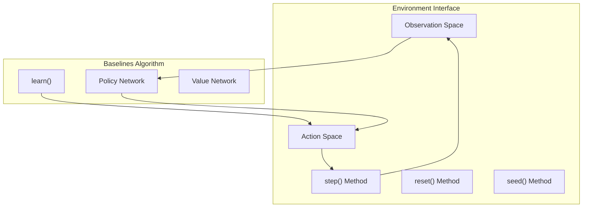
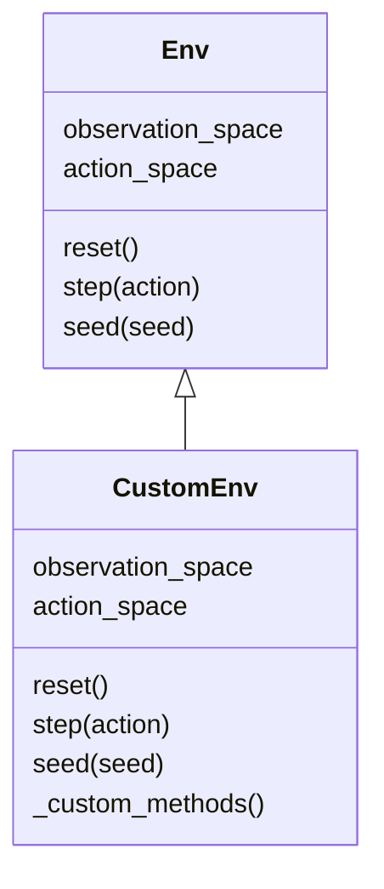
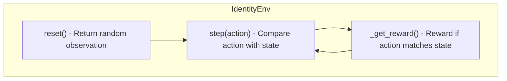
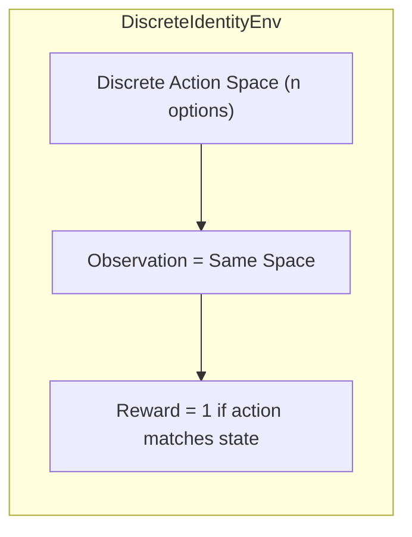
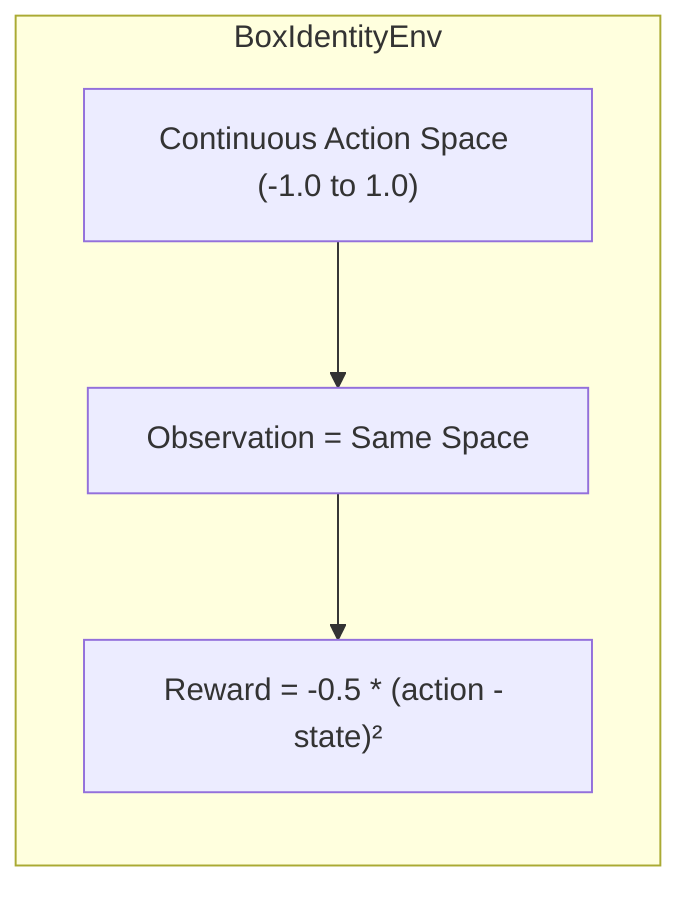
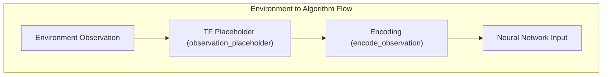
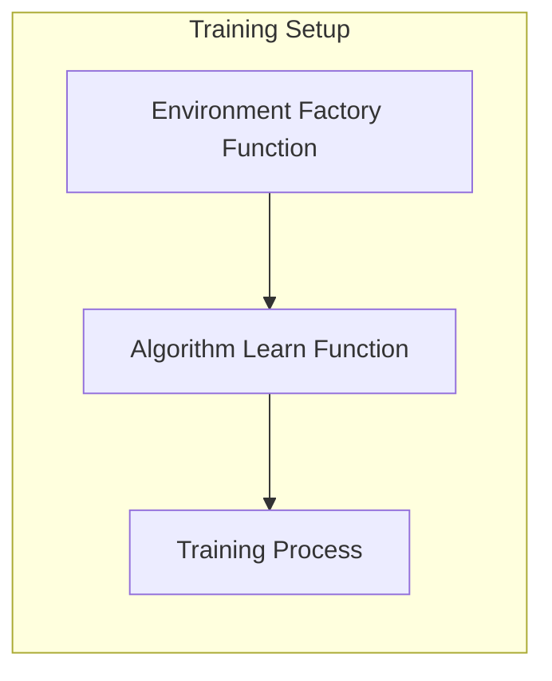
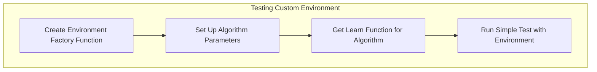
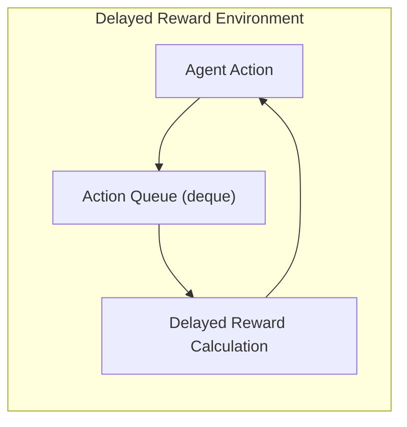

<!-- source: DeepWiki mcp.deepwiki.com · repo openai/baselines · page 6.1 Custom Environments · fetched 2026-10-30 -->

# Custom Environments

Relevant source files

The following files were used as context for generating this wiki page:

- [baselines/common/input.py](baselines/common/input.py)
- [baselines/common/tests/envs/identity_env.py](baselines/common/tests/envs/identity_env.py)
- [baselines/common/tests/test_identity.py](baselines/common/tests/test_identity.py)
- [baselines/deepq/utils.py](baselines/deepq/utils.py)

This page provides guidance on how to create and integrate custom environments with the OpenAI Baselines library. Custom environments allow you to apply reinforcement learning algorithms to new problems beyond the standard environments included in Gym. For information about using built-in environments, see [Environment Handling](#3).

## Introduction to Custom Environments

Custom environments in Baselines need to follow the Gym interface, which standardizes interaction between reinforcement learning algorithms and environments. The environment defines the observation space (what the agent can observe), the action space (what actions the agent can take), and the dynamics (how actions affect the environment).

Sources: [baselines/common/tests/envs/identity_env.py:7-44](). [baselines/common/input.py:5-22]()

## Creating a Custom Environment

To create a custom environment, you need to implement a class that inherits from `gym.Env` and implements at least the following methods:

1. `__init__()`: Initialize environment variables and define observation and action spaces
2. `reset()`: Reset the environment to its initial state and return the first observation
3. `step(action)`: Execute the action and return the next observation, reward, done flag, and info dictionary
4. `seed(seed)`: Set the random seed for reproducibility

### Basic Environment Structure

Sources: [baselines/common/tests/envs/identity_env.py:7-44]()

### Example: Identity Environment

The `IdentityEnv` class in the Baselines repository provides an excellent example of a custom environment. This environment rewards the agent for producing actions that match the observations:

Sources: [baselines/common/tests/envs/identity_env.py:7-44]()

## Environment Spaces

Baselines supports several types of observation and action spaces from the Gym library. The appropriate space depends on the nature of your problem:

| Space Type | Description | Use Case | Example |
|------------|-------------|----------|---------|
| Discrete | Single integer within a range | Selecting from a finite set of actions | `Discrete(10)` for 10 possible actions |
| Box | n-dimensional array of real numbers | Continuous control problems | `Box(-1.0, 1.0, shape=(3,))` for 3D continuous actions |
| MultiDiscrete | Vector of integers | Problems with multiple categorical variables | `MultiDiscrete([3, 3])` for two variables with 3 categories each |

Sources: [baselines/common/tests/envs/identity_env.py:47-90](). [baselines/common/input.py:24-26]()

### Implementation Examples for Different Spaces

#### Discrete Space Environment

Sources: [baselines/common/tests/envs/identity_env.py:47-60]()

#### Box Space Environment

Sources: [baselines/common/tests/envs/identity_env.py:77-90]()

## Integrating with Baselines

When integrating custom environments with Baselines, you need to understand how observations are processed and fed into neural networks:

Sources: [baselines/common/input.py:34-63](). [baselines/deepq/utils.py:41-57]()

### Input Processing

Baselines automatically processes observations from your environment based on the space type:

1. **Discrete observations**: Converted to one-hot encoded vectors
2. **Box observations**: Converted to floating-point tensors
3. **MultiDiscrete observations**: Each dimension is one-hot encoded and then concatenated

This processing happens in the `encode_observation` function:

Sources: [baselines/common/input.py:43-63]()

### Using Custom Environments with Algorithms

To use your custom environment with Baselines algorithms, you can create a factory function that returns your environment and pass it to the algorithm's learn function:

Sources: [baselines/common/tests/test_identity.py:39-41](). [baselines/common/tests/test_identity.py:54-56](). [baselines/common/tests/test_identity.py:69-72]()

## Example: Creating and Testing a Custom Environment

The `test_identity.py` file provides a complete example of creating and testing custom environments with different Baselines algorithms:

Sources: [baselines/common/tests/test_identity.py:28-72]()

## Best Practices for Custom Environments

1. **Start Simple**: Begin with a simple environment and add complexity incrementally
2. **Test Compatibility**: Not all algorithms work with all types of environments:
   - Discrete action spaces: Compatible with DQN, A2C, ACKTR, PPO2, TRPO
   - Continuous action spaces: Compatible with DDPG, A2C, ACKTR, PPO2, TRPO
   - Multi-discrete action spaces: Compatible with A2C, ACKTR, PPO2, TRPO

3. **Space Alignment**: Ensure your observation and action spaces are well-defined and appropriate for your problem
4. **Reproducibility**: Always implement the `seed` method to ensure reproducible results
5. **Episode Length**: Consider defining a maximum episode length to prevent infinite episodes

Sources: [baselines/common/tests/test_identity.py:24-26](). [baselines/common/tests/envs/identity_env.py:36]()

## Troubleshooting

Common issues when working with custom environments:

| Issue | Possible Solution |
|-------|-------------------|
| Incompatible space types | Ensure algorithm supports your action/observation space |
| Crashes during training | Check that observation/action spaces match what the algorithm expects |
| Poor learning performance | Verify reward function is well-designed and informative |
| Memory issues | Consider using vectorized environments for efficiency |
| Non-deterministic behavior | Implement proper seeding in your environment |

Sources: [baselines/common/input.py:24-26](). [baselines/common/tests/envs/identity_env.py:39-40]()

## Advanced: Delayed Rewards

The `IdentityEnv` example also demonstrates how to implement environments with delayed rewards, which is useful for problems where the effect of actions is not immediately observable:

Sources: [baselines/common/tests/envs/identity_env.py:17-21](). [baselines/common/tests/envs/identity_env.py:30-37]()

---

