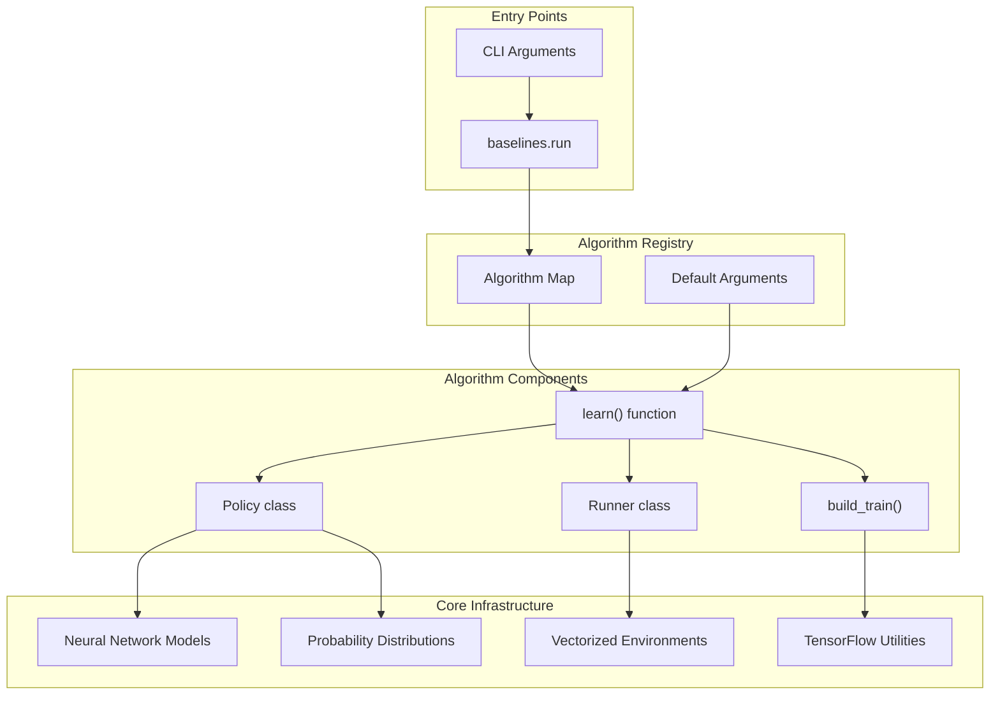
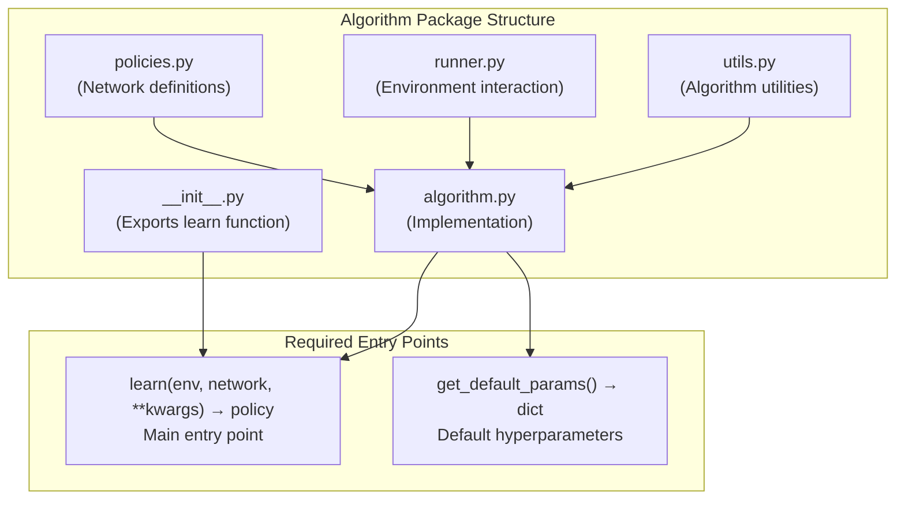
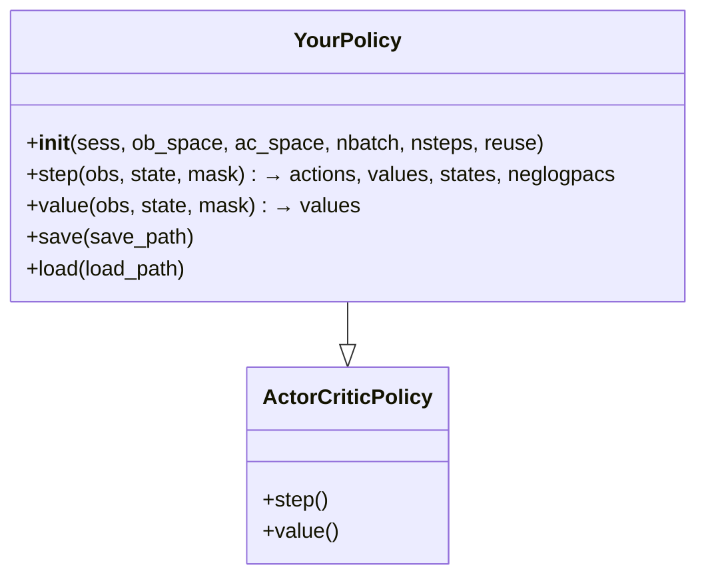
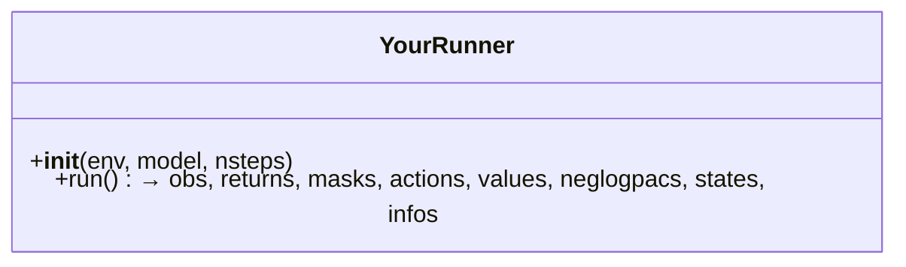
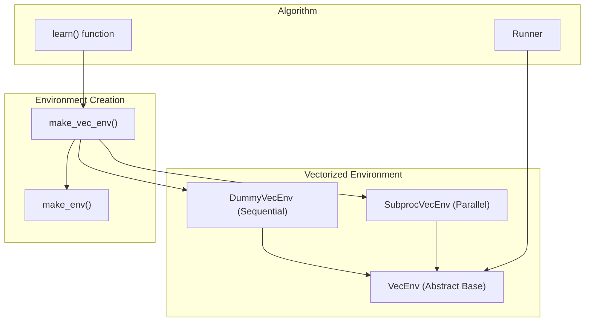

<!-- source: DeepWiki mcp.deepwiki.com · repo openai/baselines · page 6.2 Extending Baselines · fetched 2026-10-30 -->

# Extending Baselines

<details>
<summary>Relevant source files</summary>

The following files were used as context for generating this wiki page:

- [.travis.yml](.travis.yml)
- [Dockerfile](Dockerfile)
- [README.md](README.md)
- [setup.py](setup.py)

</details>


This document explains how to extend OpenAI Baselines by implementing new reinforcement learning algorithms or modifying existing ones. It provides a technical guide to the project structure, extension points, and best practices for integration with the codebase. For information about running experiments with existing algorithms, see [Running Experiments](#2.1).

## Architecture Overview

Before extending Baselines, it's important to understand its modular architecture and how different components interact:



Sources: [baselines/run.py](), [README.md:78-101]()

## Project Structure for Algorithm Implementation

When implementing a new algorithm, you'll need to create a package with specific components that follow Baselines conventions:



Sources: [baselines/ppo2/ppo2.py](), [baselines/a2c/a2c.py](), [baselines/deepq/deepq.py]()

## Creating a New Algorithm

### 1. Create the Package Structure

First, create a new directory for your algorithm in the `baselines` package:

```
baselines/
└── your_algorithm/
    ├── __init__.py
    ├── your_algorithm.py
    ├── policies.py
    └── runner.py
```

### 2. Implement the Policy Class

The policy class defines the neural network architecture and action selection mechanism:



Sources: [baselines/ppo2/policies.py](), [baselines/common/policies.py]()

### 3. Implement the Runner

The runner handles environment interaction and data collection:



Sources: [baselines/ppo2/runner.py](), [baselines/a2c/runner.py]()

### 4. Implement the Main Learning Function

The `learn()` function is the main entry point:

```python
def learn(
    env,             # Environment or VecEnv
    network,         # Network architecture 
    total_timesteps, # Total timesteps to train for
    lr=3e-4,         # Learning rate
    # ... other hyperparameters
    ):
    
    # 1. Set up the policy
    # 2. Create the runner
    # 3. Set up experience buffer
    # 4. Main training loop
    # 5. Return the trained policy
```

Sources: [baselines/ppo2/ppo2.py:152-300](), [baselines/a2c/a2c.py:81-143]()

### 5. Register Your Algorithm in run.py

To make your algorithm accessible through the CLI, register it in the `_init()` function in `run.py`:

```python
def _init():
    # ... existing code
    alg_list.append('your_algorithm')
    hyperparams = {
        'your_algorithm': your_algorithm.defaults
    }
    registered = {
        'your_algorithm': your_algorithm.learn
    }
```

Sources: [baselines/run.py:196-226]()

### 6. Define Default Parameters

Create a dictionary of default hyperparameters:

```python
def defaults():
    return {
        'nsteps': 2048,
        'lr': 3e-4,
        'gamma': 0.99,
        'lam': 0.95,
        # ... other algorithm-specific parameters
    }
```

Sources: [baselines/ppo2/defaults.py](), [baselines/a2c/defaults.py]()

## Working with Neural Network Models

Baselines provides a framework for creating neural network architectures in `baselines.common.models`:

### Network Factory Functions

Models are defined as factory functions that return network-building functions:

```python
# Custom network function
def your_network_fn(num_layers=2, num_hidden=64):
    def network_builder(X):
        h = X
        for i in range(num_layers):
            h = tf.layers.dense(h, num_hidden, activation=tf.tanh)
        return h, None  # Return network output and recurrent state
    return network_builder
```

Sources: [baselines/common/models.py:15-117]()

### Policy Types

Different policy types are available for various action spaces:

| Policy Type | Action Space | Description |
|-------------|--------------|-------------|
| `MlpPolicy` | Box/Discrete | Fully-connected layers |
| `CnnPolicy` | Box/Discrete | Convolutional layers |
| `LstmPolicy` | Box/Discrete | LSTM-based recurrent policy |
| `FeedForwardPolicy` | Any | Base class for feed-forward policies |

Sources: [baselines/common/policies.py:13-142](), [baselines/ppo2/policies.py:9-69]()

## Modifying Existing Algorithms

Instead of creating a new algorithm, you may want to modify an existing one:

### 1. Subclassing an Existing Policy

```python
from baselines.ppo2.policies import MlpPolicy

class YourCustomPolicy(MlpPolicy):
    def __init__(self, *args, **kwargs):
        super(YourCustomPolicy, self).__init__(*args, **kwargs)
        # Add custom layers or modify network structure
        
    def step(self, obs, *args, **kwargs):
        # Customize action selection
        actions, values, states, neglogpacs = super().step(obs, *args, **kwargs)
        # Modify actions if needed
        return actions, values, states, neglogpacs
```

Sources: [baselines/ppo2/policies.py:9-69](), [baselines/common/policies.py:13-142]()

### 2. Modifying the Runner

Customize the experience collection process by extending an existing runner:

```python
from baselines.ppo2.runner import Runner

class YourCustomRunner(Runner):
    def __init__(self, *args, **kwargs):
        super(YourCustomRunner, self).__init__(*args, **kwargs)
        # Add custom state or parameters
        
    def run(self):
        # Customize the experience collection process
        # or add your own exploration strategy
```

Sources: [baselines/ppo2/runner.py:12-121](), [baselines/a2c/runner.py:13-83]()

### 3. Wrapping the Learn Function

Create a modified version of an existing learning function:

```python
from baselines.ppo2 import ppo2

def custom_learn(env, network, **kwargs):
    # Pre-processing logic
    
    # Call the original learn function with modified arguments
    model = ppo2.learn(env, network, **kwargs)
    
    # Post-processing logic
    
    return model
```

Sources: [baselines/ppo2/ppo2.py:152-300](), [baselines/run.py:196-226]()

## Integration with Environment Handling

All algorithms in Baselines use vectorized environments (`VecEnv`) for standardized environment interaction:



Sources: [baselines/common/vec_env/__init__.py](), [baselines/common/cmd_util.py:15-72]()

## Testing and Benchmarking Extensions

### 1. Unit Testing

Add tests for your algorithm in the `tests` directory:

```python
# tests/test_your_algorithm.py
def test_your_algorithm():
    # Set up a simple environment
    # Run your algorithm for a few steps
    # Assert expected behavior
```

Sources: [README.md:70-75]()

### 2. Benchmarking

Compare your algorithm against existing implementations:

```python
# Run benchmark
python -m baselines.run --alg=your_algorithm --env=Humanoid-v2 --num_timesteps=1e6 --save_path=results/your_algorithm_benchmark
```

Sources: [README.md:146-151]()

## Debugging and Logging

Baselines provides utilities for logging and visualization:

### 1. TensorBoard Integration

```python
from baselines.logger import Logger, TensorBoardOutputFormat

# In your learn function:
logger = Logger(dir=log_path)
logger.add_output(TensorBoardOutputFormat(log_path))
```

Sources: [baselines/logger.py](), [README.md:119-129]()

### 2. Progress Monitoring

```python
from baselines.common.misc_util import explained_variance

# In your training loop:
logger.logkv("explained_variance", explained_variance(values, returns))
logger.logkv("fps", fps)
logger.dumpkvs()
```

Sources: [baselines/ppo2/ppo2.py:152-300]()

## Examples from Existing Algorithms

Study these implementations for guidance:

1. **PPO2** - Modern, well-optimized policy gradient method
2. **A2C** - Synchronous version of advantage actor-critic
3. **DQN** - Value-based method for discrete action spaces
4. **DDPG** - Off-policy method for continuous action spaces

Sources: [baselines/ppo2/ppo2.py](), [baselines/a2c/a2c.py](), [baselines/deepq/deepq.py](), [baselines/ddpg/ddpg.py]()

## Contributing to Baselines

When your extension is ready:

1. Follow the repository's code style
2. Add comprehensive tests
3. Document your implementation
4. Submit a pull request with a clear description

Sources: [README.md]()