# Page: Overview

# Overview

<details>
<summary>Relevant source files</summary>

The following files were used as context for generating this wiki page:

- [Dockerfile](Dockerfile)
- [README.md](README.md)

</details>


OpenAI Baselines is a set of high-quality implementations of reinforcement learning algorithms designed to serve as benchmarks for the research community. This document introduces the key components and architecture of the Baselines library, providing a high-level understanding of how the different parts of the system work together.

## Purpose and Scope

Baselines provides standardized implementations of popular reinforcement learning algorithms with these core objectives:

- Facilitate reproducibility of reinforcement learning research
- Provide reliable benchmark implementations for new algorithm development
- Create a foundation that researchers can build upon and extend
- Offer common tools for environment handling, neural network model creation, and experiment logging

For specific information about installing and using Baselines, see [Getting Started](#2). For details on running experiments, see [Running Experiments](#2.1).

## Repository Structure

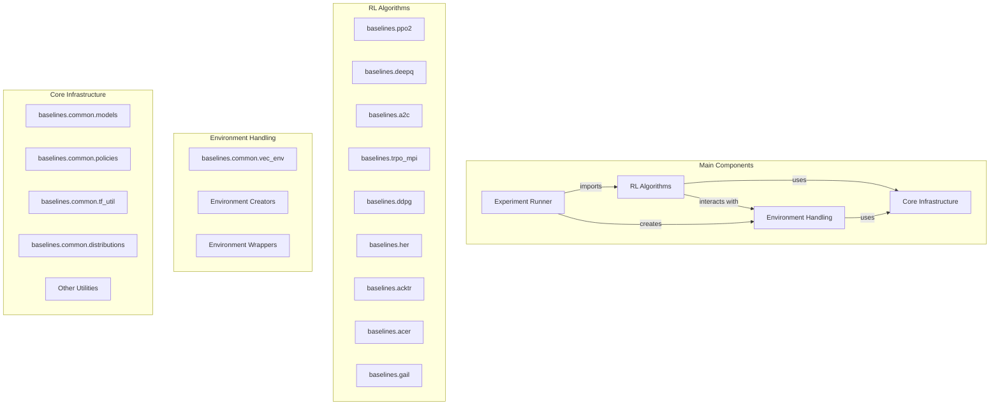

Sources: [README.md:5-9](), [README.md:132-142]()

## Key Components

### Reinforcement Learning Algorithms

Baselines implements several state-of-the-art reinforcement learning algorithms:

| Algorithm | Package | Description |
|-----------|---------|-------------|
| PPO2 | `baselines.ppo2` | Proximal Policy Optimization (improved version) |
| DQN | `baselines.deepq` | Deep Q-Networks for value-based learning |
| A2C | `baselines.a2c` | Advantage Actor-Critic method |
| DDPG | `baselines.ddpg` | Deep Deterministic Policy Gradient for continuous control |
| ACKTR | `baselines.acktr` | Actor-Critic with Kronecker-Factored Trust Region |
| ACER | `baselines.acer` | Actor-Critic with Experience Replay |
| TRPO | `baselines.trpo_mpi` | Trust Region Policy Optimization |
| GAIL | `baselines.gail` | Generative Adversarial Imitation Learning |
| HER | `baselines.her` | Hindsight Experience Replay for sample-efficient learning |

Sources: [README.md:132-142]()

### Environment Handling

The environment handling system provides a standardized interface to interact with reinforcement learning environments, with particular focus on:

- **Vectorized Environments**: Run multiple environment instances in parallel for efficient data collection
- **Environment Wrappers**: Modify environment behavior for preprocessing observations, framing stacking, etc.
- **Monitoring**: Track and log performance metrics during training

Sources: [README.md:117-129]()

### Core Infrastructure

The core infrastructure provides shared functionality used by the various algorithms:

- **Neural Network Models**: Standard architectures for policy and value functions
- **Policies**: Classes that handle action selection and state processing
- **TensorFlow Utilities**: Helpers for building and training neural networks
- **Probability Distributions**: Components for stochastic policy representation
- **Logging and Visualization**: Tools for tracking experiment progress

Sources: [README.md:94-95]()

## System Architecture

The Baselines system integrates the components described above into a cohesive framework. Below are diagrams showing the high-level architecture and execution flow.

### High-Level Architecture

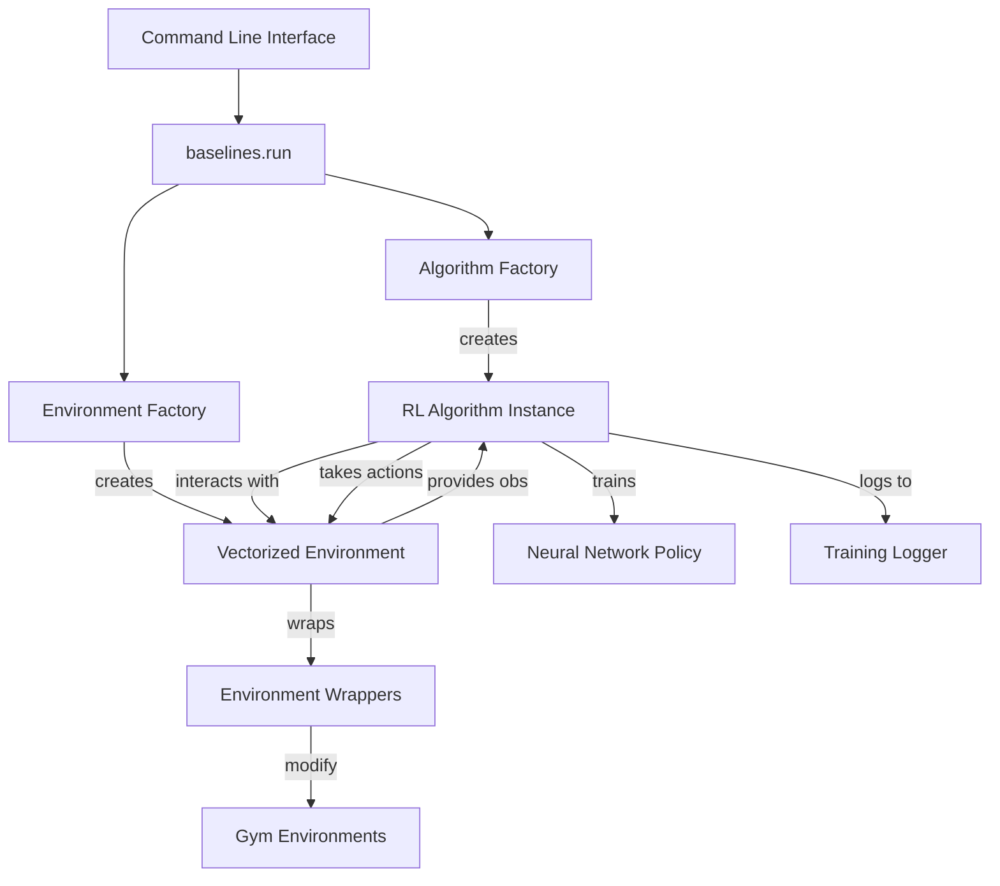

Sources: [README.md:78-81]()

### Experiment Execution Flow

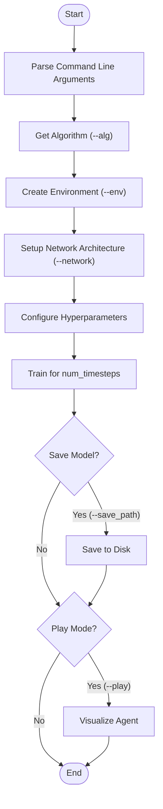

Sources: [README.md:78-101](), [README.md:103-115]()

## Core Module Structure

Below is a diagram showing the key modules and classes that form the core of Baselines:

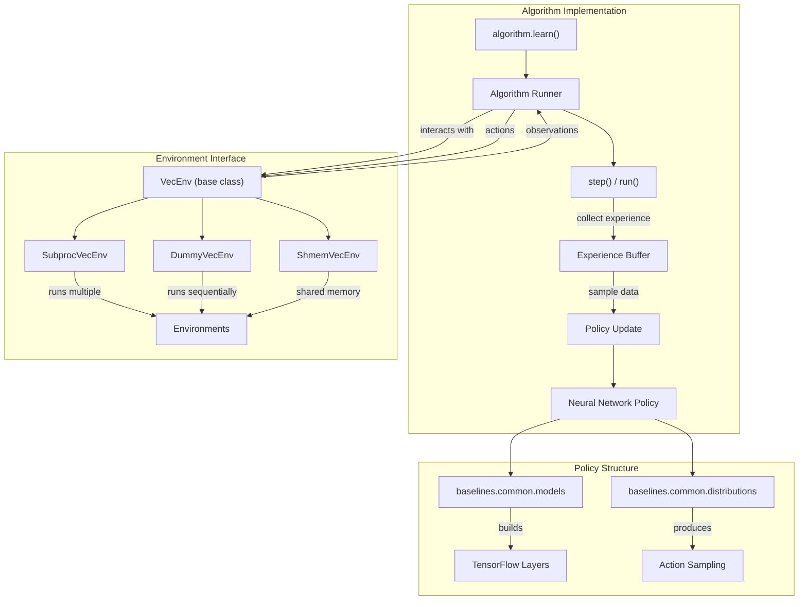

Sources: [README.md:94-95]()

## Integration with Environments

Baselines is designed to work with various types of environments, with special support for popular benchmarks:

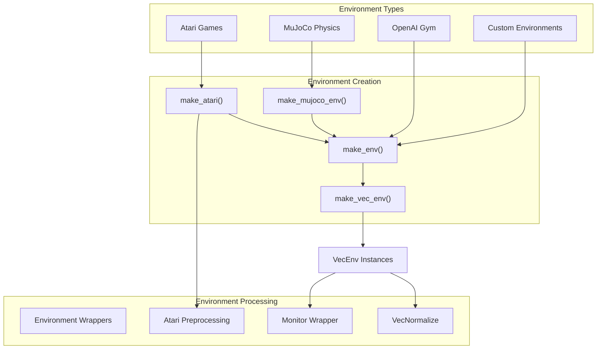

Sources: [README.md:67-70](), [README.md:82-92](), [README.md:117]()

## Reinforcement Learning Algorithm Structure

The reinforcement learning algorithms in Baselines follow similar organizational patterns, typically providing a `learn()` function as the main entry point:

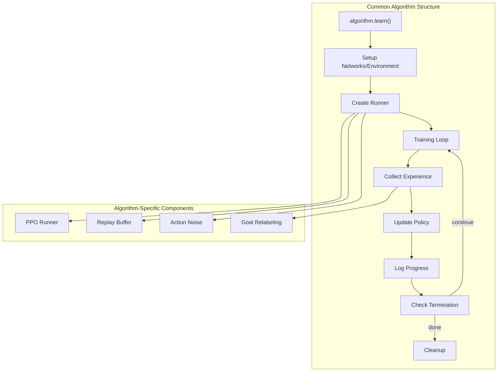

Sources: [README.md:94-95]()

## Usage Flow

The typical usage flow for Baselines is as follows:

1. **Installation**: Install the package and dependencies
2. **Environment Setup**: Configure the desired environment
3. **Algorithm Selection**: Choose a reinforcement learning algorithm
4. **Training**: Run the training process with specified hyperparameters
5. **Saving/Loading**: Save trained models and load them later for evaluation
6. **Visualization**: Visualize agent performance

For detailed information on these steps, please refer to [Getting Started](#2) and [Running Experiments](#2.1).

Sources: [README.md:45-65](), [README.md:78-101](), [README.md:103-115]()

---

# Page: Getting Started

# Getting Started

<details>
<summary>Relevant source files</summary>

The following files were used as context for generating this wiki page:

- [.travis.yml](.travis.yml)
- [Dockerfile](Dockerfile)
- [README.md](README.md)
- [setup.py](setup.py)

</details>


This page provides instructions on how to install and begin using the OpenAI Baselines library, a collection of high-quality implementations of reinforcement learning algorithms. For detailed information on running experiments after installation, see [Running Experiments](#2.1).

## Prerequisites and Dependencies

The OpenAI Baselines library requires several dependencies to function properly:

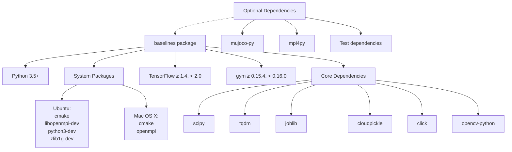

Sources: [setup.py:31-47](), [README.md:11-23]()

### System Requirements

#### Ubuntu
```bash
sudo apt-get update && sudo apt-get install cmake libopenmpi-dev python3-dev zlib1g-dev
```

#### Mac OS X
```bash
brew install cmake openmpi
```

Sources: [README.md:15-16](), [README.md:21-22]()

## Installation Process

### Virtual Environment Setup

It's recommended to use a virtual environment to avoid package conflicts:

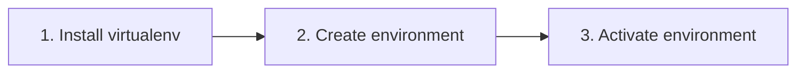

1. Install virtualenv:
   ```bash
   pip install virtualenv
   ```

2. Create a virtual environment:
   ```bash
   virtualenv /path/to/venv --python=python3
   ```

3. Activate the virtual environment:
   ```bash
   . /path/to/venv/bin/activate
   ```

Sources: [README.md:25-39]()

### Installing Baselines

With your virtual environment activated, follow these steps:

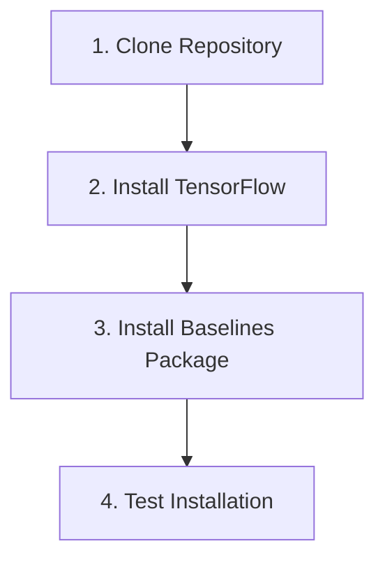

1. Clone the repository:
   ```bash
   git clone https://github.com/openai/baselines.git
   cd baselines
   ```

2. Install TensorFlow:
   ```bash
   # For GPU support
   pip install tensorflow-gpu==1.14
   
   # For CPU only
   pip install tensorflow==1.14
   ```

3. Install the Baselines package:
   ```bash
   pip install -e .
   ```

4. Test the installation:
   ```bash
   pip install pytest
   pytest
   ```

Sources: [README.md:46-74]()

### MuJoCo (Optional)

Some of the baselines examples use MuJoCo physics simulator, which requires a license and binaries:

1. Obtain a license (30-day temporary license available) from [www.mujoco.org](http://www.mujoco.org)
2. Set up MuJoCo following the instructions at [mujoco-py](https://github.com/openai/mujoco-py)

Sources: [README.md:67-68]()

## Package Structure

The Baselines package includes multiple reinforcement learning algorithm implementations and supporting infrastructure:

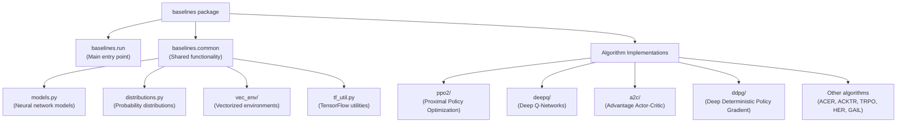

Sources: [README.md:132-142]()

## Basic Usage

The main entry point for running algorithms is the `baselines.run` module. The following diagram shows how command-line arguments flow through the system:

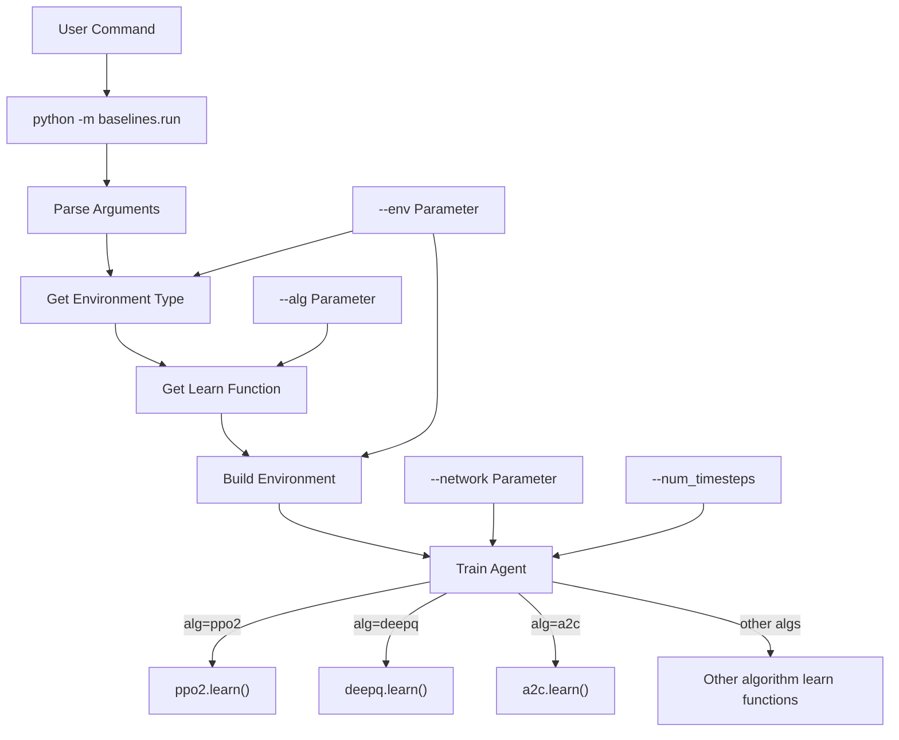

Sources: [README.md:77-81]()

### Example Commands

Basic command structure:
```bash
python -m baselines.run --alg=<algorithm> --env=<environment_id> [additional arguments]
```

Example 1: Training PPO on MuJoCo Humanoid
```bash
python -m baselines.run --alg=ppo2 --env=Humanoid-v2 --num_timesteps=2e7
```

Example 2: Training DQN on Atari Pong
```bash
python -m baselines.run --alg=deepq --env=PongNoFrameskip-v4 --num_timesteps=1e6
```

Example 3: Training with custom hyperparameters
```bash
python -m baselines.run --alg=ppo2 --env=Humanoid-v2 --num_timesteps=2e7 --ent_coef=0.1 --num_hidden=32 --num_layers=3 --value_network=copy
```

Sources: [README.md:82-101]()

### Saving and Loading Models

To save a trained model:
```bash
python -m baselines.run --alg=ppo2 --env=PongNoFrameskip-v4 --num_timesteps=2e7 --save_path=~/models/pong_model
```

To load and visualize a trained model:
```bash
python -m baselines.run --alg=ppo2 --env=PongNoFrameskip-v4 --num_timesteps=0 --load_path=~/models/pong_model --play
```

Sources: [README.md:106-115]()

### Logging and Visualization

By default, all summary data is saved to a unique directory in a temp folder. You can specify a custom log path:

```bash
python -m baselines.run --alg=ppo2 --env=PongNoFrameskip-v4 --num_timesteps=2e7 --log_path=~/logs/pong_training/
```

The environment variable `$OPENAI_LOGDIR` can also be used to set the log directory.

Sources: [README.md:119-129]()

For more detailed information on running experiments and configuring algorithms, see [Running Experiments](#2.1).

---

# Page: Running Experiments

# Running Experiments

<details>
<summary>Relevant source files</summary>

The following files were used as context for generating this wiki page:

- [Dockerfile](Dockerfile)
- [README.md](README.md)
- [baselines/common/mpi_util.py](baselines/common/mpi_util.py)
- [baselines/common/running_mean_std.py](baselines/common/running_mean_std.py)
- [baselines/common/test_mpi_util.py](baselines/common/test_mpi_util.py)
- [baselines/ddpg/test_smoke.py](baselines/ddpg/test_smoke.py)
- [baselines/run.py](baselines/run.py)

</details>


This document explains how to use the `baselines.run` module to execute reinforcement learning algorithms in the OpenAI Baselines library. It covers the command-line interface, experiment workflow, and various options for training, saving, loading, and visualizing reinforcement learning agents.

## Experiment Execution Flow

The main entry point for running experiments in OpenAI Baselines is through the `baselines.run` module. When you execute this module, it follows a specific workflow to set up and run your experiment.

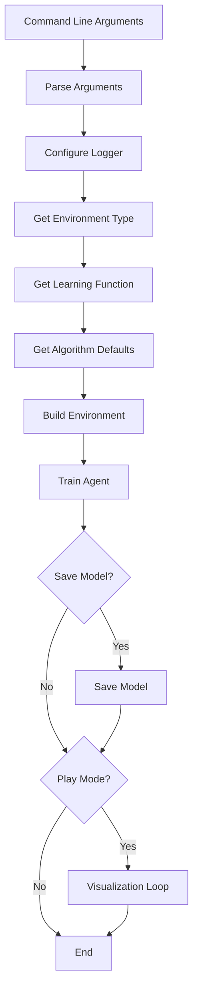

Sources: [baselines/run.py:202-247]()

## Command-Line Interface

The primary way to run experiments is via the command line. The general syntax is:

```
python -m baselines.run --alg=<algorithm> --env=<environment_id> [additional arguments]
```

### Core Arguments

| Argument | Description | Example |
|----------|-------------|---------|
| `--alg` | Reinforcement learning algorithm to use | `ppo2`, `deepq`, `a2c`, etc. |
| `--env` | Environment ID (from OpenAI Gym) | `CartPole-v1`, `Humanoid-v2` |
| `--network` | Neural network architecture | `mlp`, `cnn` |
| `--num_timesteps` | Total number of timesteps to train | `1e6`, `2e7` |
| `--save_path` | Path to save the trained model | `~/models/pong_20M_ppo2` |
| `--load_path` | Path to load a trained model | `~/models/pong_20M_ppo2` |
| `--play` | Run the trained model without training | Flag (no value) |

Sources: [baselines/run.py:205-207](), [README.md:78-101]()

### Hyperparameter Customization

You can customize algorithm hyperparameters directly from the command line using the format `--param_name=value`. These are parsed from unknown arguments and passed to the learning function.

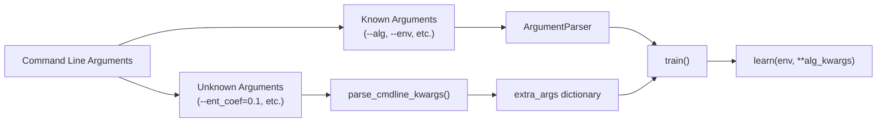

Sources: [baselines/run.py:180-192](), [baselines/run.py:52-83]()

## Setting Up Environments

The `build_env()` function creates environments based on the specified environment type:

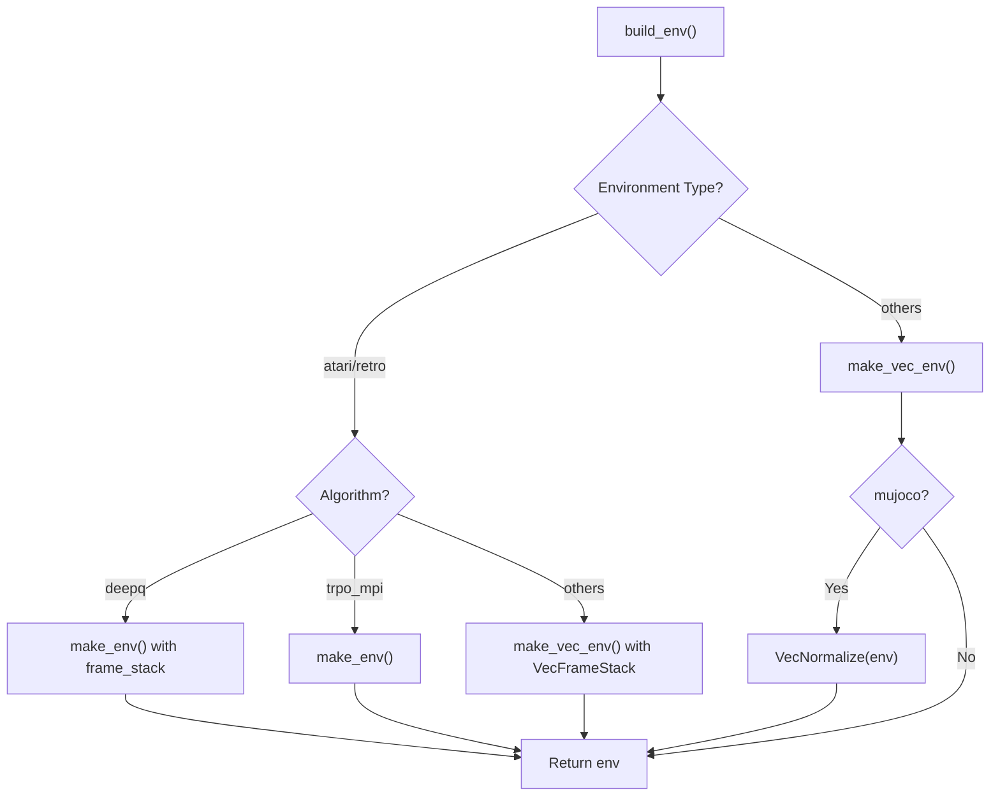

Sources: [baselines/run.py:86-118]()

## Running Training

The `train()` function orchestrates the complete training process:

1. Determines the environment type and ID
2. Retrieves the appropriate learning function for the specified algorithm
3. Gets default hyperparameters for the algorithm and environment combination
4. Updates hyperparameters with user-provided values
5. Builds the environment
6. Adds video recording if specified
7. Sets up the network architecture
8. Trains the agent using the algorithm's learn function

Sources: [baselines/run.py:53-83]()

## Learning Function Selection

The system dynamically imports the learning function for the specified algorithm:

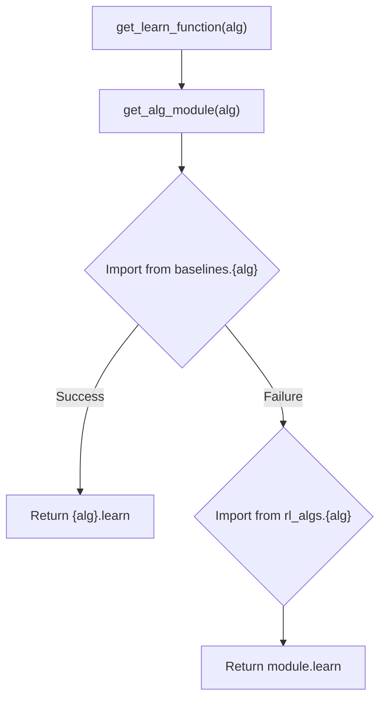

Sources: [baselines/run.py:154-167]()

## Examples

### Example 1: PPO with MuJoCo Humanoid

Train a fully-connected network controlling MuJoCo humanoid using PPO2:

```
python -m baselines.run --alg=ppo2 --env=Humanoid-v2 --num_timesteps=2e7
```

Customize hyperparameters and network architecture:

```
python -m baselines.run --alg=ppo2 --env=Humanoid-v2 --num_timesteps=2e7 --ent_coef=0.1 --num_hidden=32 --num_layers=3 --value_network=copy
```

Sources: [README.md:82-92]()

### Example 2: DQN on Atari

Train DQN on Atari Pong:

```
python -m baselines.run --alg=deepq --env=PongNoFrameskip-v4 --num_timesteps=1e6
```

Sources: [README.md:97-100]()

## Saving and Loading Models

To save a trained model:

```
python -m baselines.run --alg=ppo2 --env=PongNoFrameskip-v4 --num_timesteps=2e7 --save_path=~/models/pong_20M_ppo2
```

To load and visualize a trained model:

```
python -m baselines.run --alg=ppo2 --env=PongNoFrameskip-v4 --num_timesteps=0 --load_path=~/models/pong_20M_ppo2 --play
```

The `--play` flag runs the trained model without further training, allowing you to visualize its performance.

Sources: [README.md:106-115](), [baselines/run.py:218-244]()

## Logging and Visualization

The system automatically logs training progress. By default, logs are saved to a temporary directory. You can specify a custom log directory with the `--log_path` option:

```
python -m baselines.run --alg=ppo2 --env=PongNoFrameskip-v4 --num_timesteps=2e7 --log_path=~/logs/Pong/
```

The logger is configured based on the MPI rank to prevent duplicate logging in distributed training scenarios:

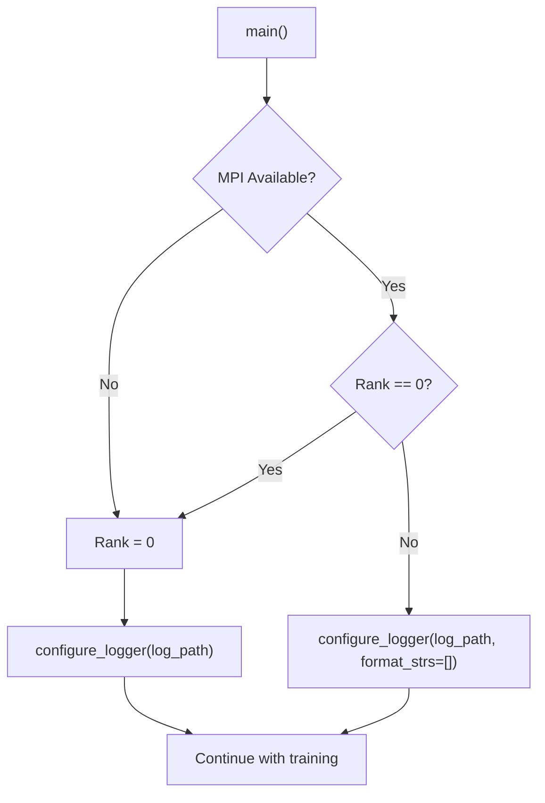

Sources: [baselines/run.py:204-214](), [README.md:119-127]()

## Environment Handling System

One of the key components in running experiments is the environment handling system. The system provides functions for creating different types of environments and wrapping them for parallel execution.

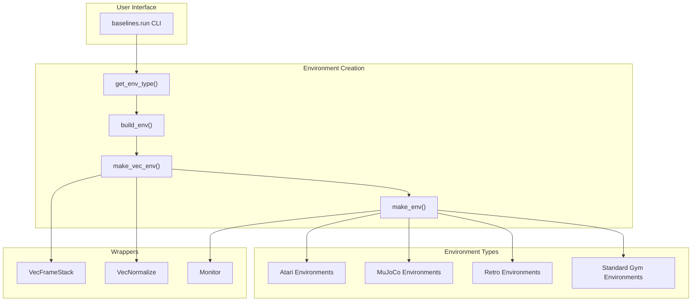

Sources: [baselines/run.py:86-145]()

## Advanced Usage

### Using Multiple CPUs

The system can leverage multiple CPU cores for parallel environment simulation. By default, it uses all available CPU cores:

```
python -m baselines.run --alg=ppo2 --env=PongNoFrameskip-v4 --num_env=8 --num_timesteps=1e7
```

The `--num_env` parameter specifies how many environment instances to run in parallel. If not provided, it defaults to the number of CPU cores available.

Sources: [baselines/run.py:87-89]()

### Recording Videos

You can record videos of agent performance during training:

```
python -m baselines.run --alg=ppo2 --env=PongNoFrameskip-v4 --num_timesteps=1e7 --save_video_interval=4000 --save_video_length=200
```

This will record a video every 4000 steps, with each video capturing 200 steps of interaction.

Sources: [baselines/run.py:65-66]()

## MPI Support

The system supports distributed training using MPI (Message Passing Interface). When MPI is available, the system:

1. Configures the logger to prevent duplicate output
2. Ensures models are properly synchronized across processes
3. Allows environment parallelization across multiple machines

To use MPI, you need to have the `mpi4py` package installed and run the script using `mpirun`:

```
mpirun -np 4 python -m baselines.run --alg=ppo2 --env=Humanoid-v2 --num_timesteps=1e7
```

Sources: [baselines/run.py:17-20](), [baselines/run.py:204-214]()

## Conclusion

The `baselines.run` module provides a flexible and powerful interface for running reinforcement learning experiments with OpenAI Baselines. By understanding its command-line interface and core functions, you can train agents on a variety of environments, customize hyperparameters, save and load models, and visualize results.

For more information about environment handling, see [Environment Handling](#3). For details about specific algorithms, see [Reinforcement Learning Algorithms](#5).

---

# Page: Environment Handling

# Environment Handling

<details>
<summary>Relevant source files</summary>

The following files were used as context for generating this wiki page:

- [baselines/common/cmd_util.py](baselines/common/cmd_util.py)
- [baselines/common/vec_env/__init__.py](baselines/common/vec_env/__init__.py)
- [baselines/common/vec_env/dummy_vec_env.py](baselines/common/vec_env/dummy_vec_env.py)
- [baselines/common/vec_env/shmem_vec_env.py](baselines/common/vec_env/shmem_vec_env.py)
- [baselines/common/vec_env/subproc_vec_env.py](baselines/common/vec_env/subproc_vec_env.py)
- [baselines/common/vec_env/test_vec_env.py](baselines/common/vec_env/test_vec_env.py)
- [baselines/her/her.py](baselines/her/her.py)
- [baselines/logger.py](baselines/logger.py)

</details>


## Purpose and Scope

This document describes how environments are managed, parallelized, and preprocessed in the OpenAI Baselines library. It covers the core infrastructure for environment creation, vectorization for parallel execution, environment wrappers for preprocessing, and monitoring for performance tracking. For detailed information about vectorized environments specifically, see [Vectorized Environments](#3.1).

## Overview

The environment handling system in Baselines provides a flexible infrastructure for working with reinforcement learning environments. It includes utilities for creating environments, running multiple environments in parallel, preprocessing observations and rewards, and standardizing environment interfaces across different domains.

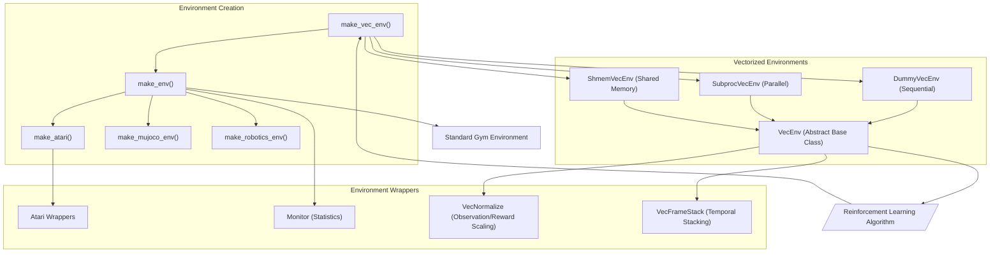

Sources: [baselines/common/cmd_util.py](). [baselines/common/vec_env/\_\_init\_\_.py](). [baselines/common/vec_env/dummy_vec_env.py](). [baselines/common/vec_env/subproc_vec_env.py](). [baselines/common/vec_env/shmem_vec_env.py]().

## Environment Creation

The environment creation process in Baselines is handled by a set of utility functions that create and configure environments based on their type (Atari, MuJoCo, Robotics, or standard Gym environments).

### Key Environment Creation Functions

The main functions for environment creation are:

| Function | Purpose | Location |
|----------|---------|----------|
| `make_vec_env()` | Creates a vectorized environment for parallel execution | [baselines/common/cmd_util.py:22-59]() |
| `make_env()` | Creates a single environment with appropriate wrappers | [baselines/common/cmd_util.py:62-105]() |
| `make_atari()` | Creates an Atari environment | [baselines/common/atari_wrappers.py]() |
| `make_mujoco_env()` | Creates a MuJoCo environment | [baselines/common/cmd_util.py:108-122]() |
| `make_robotics_env()` | Creates a Robotics environment (e.g., Fetch) | [baselines/common/cmd_util.py:124-135]() |

### Environment Creation Flow

The environment creation process typically follows this sequence:

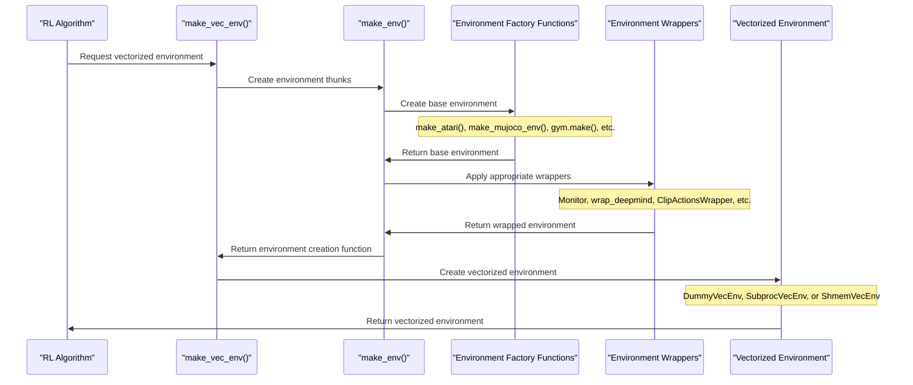

Sources: [baselines/common/cmd_util.py:22-135]().

### Example Environment Creation

When an algorithm needs an environment, it typically calls `make_vec_env()` with appropriate parameters:

```python
# Example of how an algorithm would create an environment
env = make_vec_env(
    env_id='CartPole-v1',           # Environment ID
    env_type='gym',                 # Environment type
    num_env=8,                      # Number of parallel environments
    seed=0,                         # Random seed
    wrapper_kwargs={},              # Wrapper-specific arguments
    start_index=0,                  # Starting index for environment ID
    reward_scale=1.0,               # Reward scaling factor
    flatten_dict_observations=True, # Flatten dictionary observations
    force_dummy=False               # Force DummyVecEnv
)
```

`make_vec_env()` creates a set of environment-creation functions, then passes them to the appropriate vectorized environment implementation.

Sources: [baselines/common/cmd_util.py:22-59]().

## Vectorized Environments

Vectorized environments allow multiple environment instances to be run in parallel, which can significantly improve training throughput. Baselines implements this concept through the `VecEnv` abstract base class and three concrete implementations.

### VecEnv Class Hierarchy

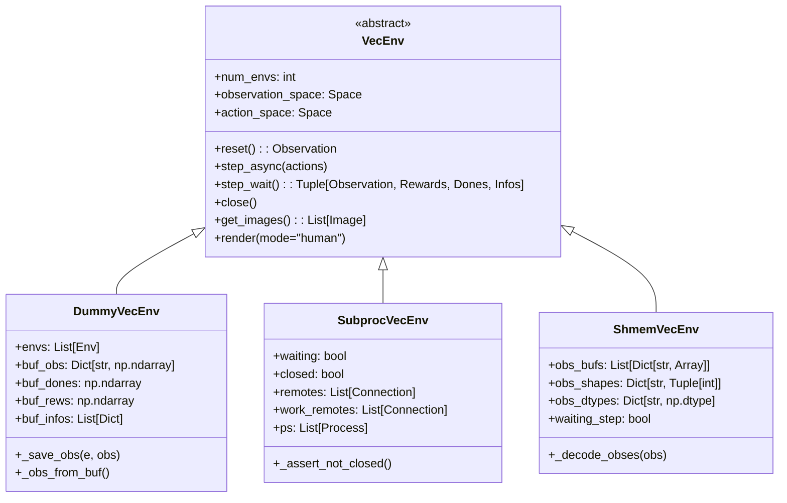

Sources: [baselines/common/vec_env/\_\_init\_\_.py:1-10](). [baselines/common/vec_env/dummy_vec_env.py:5-81](). [baselines/common/vec_env/subproc_vec_env.py:39-121](). [baselines/common/vec_env/shmem_vec_env.py:20-104]().

### VecEnv Implementations

Baselines provides three different implementations of the `VecEnv` interface:

1. **DummyVecEnv**: Runs environments sequentially in a single process. Useful for debugging and when `num_env == 1`.
   
   ```python
   # DummyVecEnv execution model
   for e in range(self.num_envs):
       action = self.actions[e]
       obs, self.buf_rews[e], self.buf_dones[e], self.buf_infos[e] = self.envs[e].step(action)
   ```

2. **SubprocVecEnv**: Runs environments in parallel using multiple processes with pipe-based communication. Recommended when `num_env > 1` for improved throughput.
   
   ```python
   # SubprocVecEnv execution model (simplified)
   # In main process:
   for remote, action in zip(self.remotes, actions):
       remote.send(('step', action))
       
   # In worker processes:
   cmd, data = remote.recv()
   if cmd == 'step':
       remote.send([step_env(env, action) for env, action in zip(envs, data)])
   ```

3. **ShmemVecEnv**: Optimized version of SubprocVecEnv that uses shared memory for observation communication, reducing overhead for large observations.

```mermaid
flowchart LR
    subgraph "Observation Size Considerations"
        Small["Small Observations"]
        Large["Large Observations"]
    end
    
    subgraph "Process Considerations"
        Single["Single Process"]
        Multi["Multiple Processes"]
    end
    
    subgraph "VecEnv Selection"
        DummyVecEnv
        SubprocVecEnv
        ShmemVecEnv
    end
    
    Small & Multi --> SubprocVecEnv
    Large & Multi --> ShmemVecEnv
    Single --> DummyVecEnv
```

Sources: [baselines/common/vec_env/dummy_vec_env.py:5-81](). [baselines/common/vec_env/subproc_vec_env.py:39-121](). [baselines/common/vec_env/shmem_vec_env.py:20-104]().

## Environment Wrappers

Environment wrappers modify the behavior of environments by intercepting and potentially transforming the interactions between an agent and an environment. Baselines includes numerous wrappers for common preprocessing tasks.

### Common Environment Wrappers

| Wrapper | Purpose | Applied To |
|---------|---------|------------|
| `Monitor` | Records episode statistics (length, rewards) | All environments |
| `ClipActionsWrapper` | Clips actions to environment action space | Environments with Box action spaces |
| `wrap_deepmind` | Applies Atari-specific preprocessing | Atari environments |
| `VecFrameStack` | Stacks consecutive frames | Vectorized environments |
| `VecNormalize` | Normalizes observations and rewards | Vectorized environments |
| `FlattenObservation` | Flattens dictionary observations | Environments with Dict observation spaces |
| `FilterObservation` | Filters dictionary observations | Environments with Dict observation spaces |
| `RewardScaler` | Scales rewards by a constant factor | Any environment |

```mermaid
flowchart TD
    BaseEnv["Base Environment"]
    
    subgraph "Low-Level Wrappers"
        FlattenObs["FlattenObservation"]
        FilterObs["FilterObservation"]
        ClipActions["ClipActionsWrapper"]
        Monitor["Monitor"]
    end
    
    subgraph "Domain-Specific Wrappers"
        AtariWrappers["Atari Wrappers (NoopReset, FireReset, EpisodicLife, etc.)"]
        RetroWrappers["Retro Wrappers"]
    end
    
    subgraph "Vectorized Wrappers"
        VecFrameStack["VecFrameStack"]
        VecNormalize["VecNormalize"]
        VecMonitor["VecMonitor"]
    end
    
    BaseEnv --> FlattenObs
    BaseEnv --> FilterObs
    BaseEnv --> AtariWrappers
    BaseEnv --> RetroWrappers
    
    FlattenObs & FilterObs & AtariWrappers & RetroWrappers --> ClipActions
    ClipActions --> Monitor
    
    Monitor --> VecEnv["Vectorized Environment (DummyVecEnv, SubprocVecEnv, ShmemVecEnv)"]
    
    VecEnv --> VecFrameStack
    VecFrameStack --> VecNormalize
    VecNormalize --> VecMonitor
    
    VecMonitor --> Algorithm[/"Reinforcement Learning Algorithm"/]
```

Sources: [baselines/common/cmd_util.py:62-105](). [baselines/common/vec_env/\_\_init\_\_.py:1-10]().

### Wrapper Application in Environment Creation

The `make_env` function in `cmd_util.py` applies appropriate wrappers based on the environment type:

```python
# Simplified representation of wrapper application logic
def make_env(env_id, env_type, ...):
    # Create base environment
    if env_type == 'atari':
        env = make_atari(env_id)
    elif env_type == 'retro':
        env = retro_wrappers.make_retro(game=env_id, ...)
    else:
        env = gym.make(env_id, **env_kwargs)
    
    # Apply common wrappers
    if flatten_dict_observations and isinstance(env.observation_space, gym.spaces.Dict):
        env = FlattenObservation(env)
    
    # Add monitoring
    env = Monitor(env, logger_dir and os.path.join(logger_dir, str(mpi_rank) + '.' + str(subrank)))
    
    # Apply environment-specific wrappers
    if env_type == 'atari':
        env = wrap_deepmind(env, **wrapper_kwargs)
    elif env_type == 'retro':
        env = retro_wrappers.wrap_deepmind_retro(env, **wrapper_kwargs)
    
    # Clip actions if necessary
    if isinstance(env.action_space, gym.spaces.Box):
        env = ClipActionsWrapper(env)
    
    # Scale rewards if necessary
    if reward_scale != 1:
        env = retro_wrappers.RewardScaler(env, reward_scale)
    
    return env
```

Sources: [baselines/common/cmd_util.py:62-105]().

## Monitoring and Logging

Baselines includes a monitoring system to track environment performance metrics during training and evaluation.

### Monitoring Components

The monitoring system consists of several key components:

1. **Monitor Wrapper**: Records episode statistics like length and rewards.
2. **VecMonitor**: Vectorized version of the Monitor wrapper.
3. **Logger**: Central logging system for recording and visualizing statistics.

```mermaid
flowchart LR
    subgraph "Environment Monitoring"
        Monitor["Monitor Wrapper"]
        VecMonitor["VecMonitor"]
        
        subgraph "Episode Statistics"
            EpLength["Episode Length"]
            EpReward["Episode Reward"]
            Success["Success Rate (if available)"]
        end
    end
    
    subgraph "Logging System"
        Logger["baselines.logger"]
        
        subgraph "Output Formats"
            Stdout["Console Output"]
            CSVLog["CSV Logs"]
            JSONLog["JSON Logs"]
            TensorBoard["TensorBoard Logs"]
        end
    end
    
    Monitor --> EpLength & EpReward & Success
    VecMonitor --> EpLength & EpReward & Success
    
    EpLength & EpReward & Success --> Logger
    
    Logger --> Stdout & CSVLog & JSONLog & TensorBoard
```

Sources: [baselines/logger.py:1-502](). [baselines/common/cmd_util.py:86-89]().

### Monitoring Workflow

1. The `Monitor` wrapper is applied to each environment during creation.
2. The `Monitor` records episode statistics when episodes terminate.
3. Statistics are aggregated and passed to the logger.
4. The logger outputs statistics to various formats (console, CSV, JSON, TensorBoard).

```python
# Example of how monitoring integrates with training
env = make_vec_env(...)  # Creates environments with Monitor wrapper
obs = env.reset()

for step in range(total_steps):
    actions = policy.step(obs)
    obs, rewards, dones, infos = env.step(actions)
    
    # Monitor automatically records episode statistics on done=True
    
    # Logger outputs statistics periodically
    if step % log_interval == 0:
        logger.dumpkvs()
```

Sources: [baselines/logger.py:193-218](). [baselines/her/her.py:53-63]().

## End-to-End Environment Handling Example

This section illustrates how the different components of the environment handling system interact during a typical reinforcement learning training process.

```mermaid
sequenceDiagram
    participant Algorithm as "RL Algorithm"
    participant EnvCreation as "Environment Creation"
    participant VecEnv as "Vectorized Environment"
    participant Wrappers as "Environment Wrappers"
    participant Logger as "Logger"
    
    Algorithm->>EnvCreation: Request environment with make_vec_env()
    
    EnvCreation->>EnvCreation: Create environment thunks with make_env()
    
    EnvCreation->>VecEnv: Create DummyVecEnv, SubprocVecEnv, or ShmemVecEnv
    
    VecEnv->>Algorithm: Return vectorized environment
    
    Algorithm->>VecEnv: env.reset()
    VecEnv->>Wrappers: Reset all environments
    Wrappers->>VecEnv: Return initial observations
    VecEnv->>Algorithm: Return initial observations
    
    loop For each training step
        Algorithm->>VecEnv: env.step_async(actions)
        VecEnv->>Wrappers: Execute actions in all environments
        
        Algorithm->>VecEnv: env.step_wait()
        Wrappers->>VecEnv: Return observations, rewards, dones, infos
        
        Note over Wrappers: Monitor wrapper records episode stats when done=True
        
        VecEnv->>Algorithm: Return observations, rewards, dones, infos
        
        Algorithm->>Algorithm: Update policy
        
        Algorithm->>Logger: Log episode statistics
        Logger->>Logger: Record and output statistics
    end
    
    Algorithm->>VecEnv: env.close()
    VecEnv->>Wrappers: Close all environments
```

Sources: [baselines/common/cmd_util.py:22-105](). [baselines/common/vec_env/dummy_vec_env.py:31-57](). [baselines/common/vec_env/subproc_vec_env.py:75-88](). [baselines/logger.py:193-218]().

## Summary

The environment handling system in OpenAI Baselines provides a comprehensive infrastructure for creating, configuring, and managing reinforcement learning environments. Key features include:

1. **Environment Creation**: Functions like `make_vec_env` and `make_env` streamline the creation of different environment types.
2. **Vectorized Environments**: The `VecEnv` class hierarchy enables parallel environment execution for improved throughput.
3. **Environment Wrappers**: Various wrappers modify and standardize environment behavior for different domains.
4. **Monitoring**: The monitoring system tracks and logs performance metrics during training.

This infrastructure allows algorithms to interact with environments in a consistent way, regardless of the underlying environment type or implementation details, while optimizing for performance and flexibility.

Sources: [baselines/common/cmd_util.py](). [baselines/common/vec_env/\_\_init\_\_.py](). [baselines/common/vec_env/dummy_vec_env.py](). [baselines/common/vec_env/subproc_vec_env.py](). [baselines/common/vec_env/shmem_vec_env.py](). [baselines/logger.py]().

---

# Page: Vectorized Environments

# Vectorized Environments

<details>
<summary>Relevant source files</summary>

The following files were used as context for generating this wiki page:

- [baselines/common/vec_env/__init__.py](baselines/common/vec_env/__init__.py)
- [baselines/common/vec_env/dummy_vec_env.py](baselines/common/vec_env/dummy_vec_env.py)
- [baselines/common/vec_env/shmem_vec_env.py](baselines/common/vec_env/shmem_vec_env.py)
- [baselines/common/vec_env/subproc_vec_env.py](baselines/common/vec_env/subproc_vec_env.py)
- [baselines/common/vec_env/test_vec_env.py](baselines/common/vec_env/test_vec_env.py)
- [baselines/her/her.py](baselines/her/her.py)

</details>


## Overview

Vectorized Environments are a core component in OpenAI Baselines that enable multiple environments to run in parallel, significantly speeding up data collection for reinforcement learning algorithms. This page explains the vectorized environment system, including its key implementations and how they interact with other components in the baselines architecture.

Sources: [baselines/common/vec_env/__init__.py:1-10]()

## Purpose and Architecture

Vectorized environments serve several critical purposes:

1. **Parallelization** - Run multiple environment instances simultaneously
2. **Standardized Interface** - Provide a consistent API regardless of implementation
3. **Efficient Collection** - Gather experiences from multiple sources at once
4. **Batched Operations** - Enable batch processing of observations and actions

The vectorized environment system is designed with an abstract base class (`VecEnv`) and multiple concrete implementations optimized for different use cases.

```mermaid
classDiagram
    class VecEnv {
        <<abstract>>
        +int num_envs
        +observation_space
        +action_space
        +step_async(actions)
        +step_wait()
        +reset()
        +close()
        +get_images()
        +render(mode)
    }
    
    VecEnv <|-- DummyVecEnv
    VecEnv <|-- SubprocVecEnv
    VecEnv <|-- ShmemVecEnv
    
    class DummyVecEnv {
        +__init__(env_fns)
        +step_async(actions)
        +step_wait()
        +reset()
    }
    
    class SubprocVecEnv {
        +__init__(env_fns, spaces, context, in_series)
        +step_async(actions)
        +step_wait()
        +reset()
        +close_extras()
    }
    
    class ShmemVecEnv {
        +__init__(env_fns, spaces, context)
        +step_async(actions)
        +step_wait()
        +reset()
        +close_extras()
        +_decode_obses(obs)
    }
```

**Diagram: Vectorized Environment Class Hierarchy**

Sources: [baselines/common/vec_env/dummy_vec_env.py:5-81](), [baselines/common/vec_env/subproc_vec_env.py:39-121](), [baselines/common/vec_env/shmem_vec_env.py:20-104]()

## VecEnv Interface

All vectorized environment implementations follow the same core interface defined by the `VecEnv` abstract base class:

| Method | Description |
|--------|-------------|
| `step_async(actions)` | Starts stepping through environments with the provided actions |
| `step_wait()` | Waits for the steps to complete and returns results |
| `reset()` | Resets all environments and returns initial observations |
| `close()` | Closes all environments |
| `get_images()` | Returns rendered images from the environments |
| `render(mode='human')` | Renders the environments (typically just one) |

This two-part stepping mechanism (`step_async`/`step_wait`) allows for asynchronous execution, where a client can perform other operations while waiting for environments to step.

Sources: [baselines/common/vec_env/dummy_vec_env.py:31-56](), [baselines/common/vec_env/subproc_vec_env.py:75-88](), [baselines/common/vec_env/shmem_vec_env.py:69-79]()

## Vectorized Environment Implementations

### DummyVecEnv

The `DummyVecEnv` is the simplest implementation that runs multiple environments sequentially (one at a time). It's useful for:

- Debugging purposes
- When `num_env == 1` (to avoid communication overhead)
- As a reference implementation for testing other implementations

```python
# Usage example
from baselines.common.vec_env import DummyVecEnv

env_fns = [lambda: gym.make('CartPole-v1') for _ in range(4)]
env = DummyVecEnv(env_fns)

obs = env.reset()
actions = [0, 1, 0, 1]  # Actions for each environment
env.step_async(actions)
obs, rewards, dones, infos = env.step_wait()
```

Sources: [baselines/common/vec_env/dummy_vec_env.py:5-81]()

### SubprocVecEnv

The `SubprocVecEnv` runs multiple environments in parallel using Python's multiprocessing. It creates separate processes for the environments and communicates with them via pipes. This implementation is recommended when:

- You have multiple environments (`num_envs > 1`)
- The environment's `step()` method is computationally expensive or has I/O operations
- You want to utilize multiple CPU cores

```mermaid
flowchart TD
    subgraph "Main Process"
        Agent["Agent"]
        VecEnv["SubprocVecEnv"]
        Remotes["Remotes (pipes)"]
    end
    
    subgraph "Worker Processes"
        Worker1["Worker 1"]
        Worker2["Worker 2"]
        Worker3["Worker 3"]
        Env1["Environment 1"]
        Env2["Environment 2"]
        Env3["Environment 3"]
    end
    
    Agent -- "actions" --> VecEnv
    VecEnv -- "actions" --> Remotes
    Remotes -- "cmd: step, data: actions" --> Worker1
    Remotes -- "cmd: step, data: actions" --> Worker2
    Remotes -- "cmd: step, data: actions" --> Worker3
    
    Worker1 -- "step(action)" --> Env1
    Worker2 -- "step(action)" --> Env2
    Worker3 -- "step(action)" --> Env3
    
    Env1 -- "obs, reward, done, info" --> Worker1
    Env2 -- "obs, reward, done, info" --> Worker2
    Env3 -- "obs, reward, done, info" --> Worker3
    
    Worker1 -- "results" --> Remotes
    Worker2 -- "results" --> Remotes
    Worker3 -- "results" --> Remotes
    
    Remotes -- "observations, rewards, dones, infos" --> VecEnv
    VecEnv -- "observations, rewards, dones, infos" --> Agent
```

**Diagram: SubprocVecEnv Communication Flow**

Sources: [baselines/common/vec_env/subproc_vec_env.py:7-138]()

The `SubprocVecEnv` also supports running multiple environments in series within each subprocess through the `in_series` parameter, which can be more efficient when balancing between parallelism and process overhead.

### ShmemVecEnv

The `ShmemVecEnv` is an optimized version of `SubprocVecEnv` that uses shared memory (via multiprocessing's Array) to communicate observations instead of sending them through pipes. This can significantly improve performance when working with large observations (e.g., images).

Key features of `ShmemVecEnv`:
- Uses shared memory buffers for observations
- Still uses pipes for commands and small data
- More efficient for environments with large observation spaces

Sources: [baselines/common/vec_env/shmem_vec_env.py:20-141]()

## Performance Considerations

When choosing between vectorized environment implementations, consider:

| Implementation | Best Used When | Advantages | Limitations |
|----------------|----------------|------------|-------------|
| `DummyVecEnv` | Single environment or debugging | No process overhead, simple | No parallelism, sequential execution |
| `SubprocVecEnv` | Multiple environments with small-medium observations | True parallelism, uses multiple cores | Process creation overhead, IPC overhead |
| `ShmemVecEnv` | Multiple environments with large observations | Efficient for large observations | Slightly more complex, still has process overhead |

For most reinforcement learning algorithms in Baselines, `SubprocVecEnv` is recommended as the default choice when running on a multi-core machine. For environments with large observations (like high-resolution images), `ShmemVecEnv` may provide better performance.

Sources: [baselines/common/vec_env/test_vec_env.py:1-158]()

## Usage in OpenAI Baselines

In the OpenAI Baselines architecture, vectorized environments are a key component that sits between environment wrappers and reinforcement learning algorithms.

```mermaid
flowchart TD
    subgraph "Environment Creation"
        make_vec_env["make_vec_env()"]
        env_fns["Environment Constructor Functions"]
    end
    
    subgraph "Vectorized Environments"
        DummyVecEnv["DummyVecEnv"]
        SubprocVecEnv["SubprocVecEnv"]
        ShmemVecEnv["ShmemVecEnv"]
    end
    
    subgraph "Wrappers"
        VecFrameStack["VecFrameStack"]
        VecNormalize["VecNormalize"]
        VecMonitor["VecMonitor"]
    end
    
    subgraph "RL Algorithms"
        PPO["PPO2"]
        A2C["A2C"]
        DQN["DQN"]
        DDPG["DDPG"]
    end
    
    make_vec_env --> env_fns
    env_fns --> DummyVecEnv
    env_fns --> SubprocVecEnv
    env_fns --> ShmemVecEnv
    
    DummyVecEnv --> VecFrameStack
    SubprocVecEnv --> VecFrameStack
    ShmemVecEnv --> VecFrameStack
    
    VecFrameStack --> VecNormalize
    VecNormalize --> VecMonitor
    
    VecMonitor --> PPO
    VecMonitor --> A2C
    VecMonitor --> DQN
    VecMonitor --> DDPG
```

**Diagram: Vectorized Environments in the OpenAI Baselines Architecture**

Sources: [baselines/common/vec_env/__init__.py:1-10](), [baselines/her/her.py:166-172]()

## Example Usage

Here's a complete example of how to create and use a vectorized environment:

```python
import gym
from baselines.common.vec_env import SubprocVecEnv

# Create a list of environment constructor functions
def make_env(env_id, rank):
    def _thunk():
        env = gym.make(env_id)
        env.seed(rank)
        return env
    return _thunk

env_id = "CartPole-v1"
num_envs = 4
env_fns = [make_env(env_id, i) for i in range(num_envs)]

# Create the vectorized environment
vec_env = SubprocVecEnv(env_fns)

# Reset all environments
obs = vec_env.reset()  # Shape: (num_envs, *obs_shape)

# Take a step in all environments
actions = [0 for _ in range(num_envs)]
vec_env.step_async(actions)
obs, rewards, dones, infos = vec_env.step_wait()

# Don't forget to close the environments when done
vec_env.close()
```

## Related Pages

For information about specific wrappers that can be applied to vectorized environments, see [Environment Wrappers](#3.2).

For monitoring and benchmarking features, see [Monitoring and Benchmarking](#3.3).

Sources: [baselines/common/vec_env/dummy_vec_env.py:5-81](), [baselines/common/vec_env/subproc_vec_env.py:39-121]()

---

# Page: Environment Wrappers

# Environment Wrappers

<details>
<summary>Relevant source files</summary>

The following files were used as context for generating this wiki page:

- [baselines/acktr/kfac.py](baselines/acktr/kfac.py)
- [baselines/common/atari_wrappers.py](baselines/common/atari_wrappers.py)
- [baselines/common/cmd_util.py](baselines/common/cmd_util.py)
- [baselines/logger.py](baselines/logger.py)

</details>


Environment wrappers are a core component in the OpenAI Baselines framework that modify or extend the behavior of reinforcement learning environments. These wrappers serve to preprocess observations, standardize environment interfaces, modify rewards, and manage episode termination conditions. This page documents the various environment wrappers available in Baselines and how they are used.

For information about running multiple environments in parallel, see [Vectorized Environments](#3.1).

## Overview

Environment wrappers follow the Gym wrapper pattern, where each wrapper is a subclass of `gym.Wrapper`, `gym.ObservationWrapper`, or `gym.RewardWrapper`. These wrappers allow for modifying environment behavior without changing the underlying environment code. In Baselines, wrappers are used extensively to standardize environment interfaces and implement preprocessing techniques that have been shown to improve learning performance.

```mermaid
flowchart TD
    subgraph "Environment Creation"
        make_atari["make_atari()"]
        make_env["make_env()"]
    end

    subgraph "Environment Wrappers"
        wrap_deepmind["wrap_deepmind()"]
        atari_wrappers["Atari Wrappers"]
        common_wrappers["Common Wrappers"]
        custom_wrappers["Custom Wrappers"]
    end

    subgraph "Vectorized Environments"
        DummyVecEnv["DummyVecEnv"]
        SubprocVecEnv["SubprocVecEnv"]
    end

    make_atari --> wrap_deepmind
    wrap_deepmind --> atari_wrappers
    make_env --> common_wrappers
    make_env --> custom_wrappers
    
    atari_wrappers --> DummyVecEnv
    common_wrappers --> DummyVecEnv
    custom_wrappers --> DummyVecEnv
    
    atari_wrappers --> SubprocVecEnv
    common_wrappers --> SubprocVecEnv
    custom_wrappers --> SubprocVecEnv
```

Sources: [baselines/common/cmd_util.py:17-21](), [baselines/common/atari_wrappers.py:275-289]()

## Wrapper Types

Baselines includes several types of wrappers that serve different purposes:

| Wrapper Type | Purpose | Examples |
|--------------|---------|----------|
| Observation Preprocessing | Modifies observations to make them more suitable for neural networks | `WarpFrame`, `FrameStack`, `ScaledFloatFrame` |
| Action Space Modification | Changes or limits the action space | `ClipActionsWrapper` |
| Reward Modification | Alters rewards to improve learning | `ClipRewardEnv`, `RewardScaler` |
| Episode Management | Controls episode starting and ending conditions | `NoopResetEnv`, `FireResetEnv`, `EpisodicLifeEnv` |
| Performance Monitoring | Tracks environment performance | `Monitor` |
| Frame Processing | Handles frame skipping and pooling | `MaxAndSkipEnv` |

Sources: [baselines/common/atari_wrappers.py:12-264](), [baselines/common/cmd_util.py:86-104]()

## Wrapper Hierarchy

The wrappers in Baselines follow a class hierarchy based on Gym's wrapper classes:

```mermaid
classDiagram
    class gym.Wrapper {
        +env
        +step(action)
        +reset()
    }
    class gym.ObservationWrapper {
        +observation(obs)
    }
    class gym.RewardWrapper {
        +reward(reward)
    }
    
    gym.Wrapper <|-- NoopResetEnv
    gym.Wrapper <|-- FireResetEnv
    gym.Wrapper <|-- EpisodicLifeEnv
    gym.Wrapper <|-- MaxAndSkipEnv
    gym.Wrapper <|-- FrameStack
    gym.Wrapper <|-- TimeLimit
    gym.Wrapper <|-- ClipActionsWrapper
    
    gym.ObservationWrapper <|-- WarpFrame
    gym.ObservationWrapper <|-- ScaledFloatFrame
    
    gym.RewardWrapper <|-- ClipRewardEnv
    gym.RewardWrapper <|-- RewardScaler
    
    class LazyFrames {
        +_frames
        +__array__()
        +__len__()
        +__getitem__(i)
    }
    
    FrameStack --> LazyFrames
```

Sources: [baselines/common/atari_wrappers.py:12-264]()

## Common Wrappers

### Atari-Specific Wrappers

Atari environments often require specialized preprocessing to make them suitable for reinforcement learning. Baselines includes several wrappers specifically designed for Atari games:

#### NoopResetEnv

Performs a random number of no-op actions at the beginning of each episode to provide stochasticity in the initial state.

```python
# Example usage
env = NoopResetEnv(env, noop_max=30)
```

Sources: [baselines/common/atari_wrappers.py:12-39]()

#### FireResetEnv

For environments that require pressing the FIRE button to start gameplay (like Pong), this wrapper automatically presses FIRE when resetting the environment.

```python
# Example usage
env = FireResetEnv(env)
```

Sources: [baselines/common/atari_wrappers.py:41-59]()

#### EpisodicLifeEnv

Makes the end of a life in an Atari game equivalent to the end of an episode, but only resets on true game over. This helps with value estimation.

```python
# Example usage
env = EpisodicLifeEnv(env)
```

Sources: [baselines/common/atari_wrappers.py:61-95]()

#### MaxAndSkipEnv

Performs frame skipping (repeating actions for k frames) and returns the maximum pixel values over the last 2 frames to handle flickering objects in Atari games.

```python
# Example usage
env = MaxAndSkipEnv(env, skip=4)
```

Sources: [baselines/common/atari_wrappers.py:97-123]()

### Observation Preprocessing Wrappers

#### WarpFrame

Resizes observations to 84x84 pixels and converts them to grayscale, as done in the DQN paper and subsequent work.

```python
# Example usage
env = WarpFrame(env)
```

Sources: [baselines/common/atari_wrappers.py:134-185]()

#### FrameStack

Stacks k consecutive frames together, allowing the agent to infer motion and temporal relationships.

```python
# Example usage
env = FrameStack(env, k=4)
```

Sources: [baselines/common/atari_wrappers.py:188-217]()

#### ScaledFloatFrame

Scales pixel values from [0, 255] to [0, 1], which can improve neural network training.

```python
# Example usage
env = ScaledFloatFrame(env)
```

Sources: [baselines/common/atari_wrappers.py:219-227]()

### Reward Modification Wrappers

#### ClipRewardEnv

Clips rewards to {+1, 0, -1} by taking the sign of the reward, as done in the DQN paper. This helps stabilize learning in environments with wildly varying reward scales.

```python
# Example usage
env = ClipRewardEnv(env)
```

Sources: [baselines/common/atari_wrappers.py:125-131]()

#### RewardScaler

Scales rewards by a constant factor, which can be useful for algorithms sensitive to reward magnitude.

```python
# Example usage
env = RewardScaler(env, scale=0.1)
```

Sources: [baselines/common/cmd_util.py:102-103]()

### Action Space Wrappers

#### ClipActionsWrapper

Clips actions to be within the action space bounds, which is important for continuous control environments.

```python
# Example usage
env = ClipActionsWrapper(env)
```

Sources: [baselines/common/cmd_util.py:99-100]()

### Monitoring Wrappers

#### Monitor

Records episodes and saves episode statistics, such as length and reward. This is important for tracking agent performance during training.

```python
# Example usage
env = Monitor(env, log_dir)
```

Sources: [baselines/common/cmd_util.py:87-89]()

## Wrapper Usage Patterns

### DeepMind-Style Atari Preprocessing

Baselines provides a convenience function `wrap_deepmind` that applies the standard preprocessing pipeline used in DeepMind's DQN paper:

```mermaid
flowchart LR
    env["Atari Environment"] --> EpisodicLifeEnv
    EpisodicLifeEnv --> FireResetEnv["FireResetEnv (if needed)"]
    FireResetEnv --> WarpFrame
    WarpFrame --> ScaledFloatFrame["ScaledFloatFrame (optional)"]
    ScaledFloatFrame --> ClipRewardEnv
    ClipRewardEnv --> FrameStack["FrameStack (optional)"]
```

Sources: [baselines/common/atari_wrappers.py:275-289]()

### Environment Creation Workflow

The `make_env` function in `cmd_util.py` shows the typical workflow for creating and wrapping environments:

```mermaid
flowchart TD
    start["Start"] --> env_type{"Environment Type?"}
    
    env_type -- "Atari" --> make_atari["make_atari()"]
    env_type -- "Retro" --> make_retro["make_retro()"]
    env_type -- "Other" --> gym_make["gym.make()"]
    
    make_atari --> flatten_check
    make_retro --> flatten_check
    gym_make --> flatten_check
    
    flatten_check{"Is Dict Observation?"} -- "Yes" --> flatten["FlattenObservation()"]
    flatten_check -- "No" --> monitor["Monitor()"]
    flatten --> monitor
    
    monitor --> wrapper_check{"Environment Type?"}
    
    wrapper_check -- "Atari" --> wrap_deepmind["wrap_deepmind()"]
    wrapper_check -- "Retro" --> wrap_retro["wrap_deepmind_retro()"]
    wrapper_check -- "Other" --> action_check
    
    wrap_deepmind --> action_check
    wrap_retro --> action_check
    
    action_check{"Is Box Action Space?"} -- "Yes" --> clip_actions["ClipActionsWrapper()"]
    action_check -- "No" --> reward_check
    clip_actions --> reward_check
    
    reward_check{"Need Reward Scaling?"} -- "Yes" --> reward_scaler["RewardScaler()"]
    reward_check -- "No" --> return["Return Wrapped Environment"]
    reward_scaler --> return
```

Sources: [baselines/common/cmd_util.py:62-105]()

## Creating Environment Wrappers

To create custom environment wrappers, you need to subclass one of the Gym wrapper classes:

1. `gym.Wrapper` - Override `step()` and/or `reset()` to modify environment behavior
2. `gym.ObservationWrapper` - Override `observation()` to modify observations
3. `gym.RewardWrapper` - Override `reward()` to modify rewards

All wrappers should properly pass through calls to the underlying environment and maintain the expected interface.

## Performance Considerations

Some wrappers, like `ScaledFloatFrame`, can increase memory usage significantly when used with replay buffers. The `LazyFrames` class provides memory optimization for frame stacking by ensuring that common frames between consecutive observations are only stored once.

Sources: [baselines/common/atari_wrappers.py:229-264]()

## Wrapper Combinations

Different algorithms and environment types typically use different combinations of wrappers:

| Environment Type | Typical Wrapper Combination |
|------------------|------------------------------|
| Atari | `NoopResetEnv`, `MaxAndSkipEnv`, `EpisodicLifeEnv`, `FireResetEnv`, `WarpFrame`, `ClipRewardEnv`, `FrameStack` |
| MuJoCo | `Monitor`, `ClipActionsWrapper`, `RewardScaler` (if needed) |
| Robotics | `FilterObservation`, `FlattenObservation`, `Monitor` |

Sources: [baselines/common/cmd_util.py:108-135]()

## Conclusion

Environment wrappers are a powerful abstraction that allows for modifying environment behavior without changing the underlying environment code. Baselines provides a comprehensive set of wrappers that implement common preprocessing techniques and standardizations that have been shown to improve learning performance.

---

# Page: Monitoring and Benchmarking

# Monitoring and Benchmarking

<details>
<summary>Relevant source files</summary>

The following files were used as context for generating this wiki page:

- [baselines/bench/__init__.py](baselines/bench/__init__.py)
- [baselines/bench/benchmarks.py](baselines/bench/benchmarks.py)
- [baselines/bench/monitor.py](baselines/bench/monitor.py)
- [baselines/bench/test_monitor.py](baselines/bench/test_monitor.py)
- [setup.cfg](setup.cfg)

</details>


This document explains how to monitor the performance of reinforcement learning agents and run standardized benchmarks in the OpenAI Baselines library. It covers the monitoring system for tracking metrics during training and evaluation, as well as the benchmarking framework for standardized algorithm comparison. For information about environment wrappers, see [Environment Wrappers](#3.2).

## 1. Monitoring System

The OpenAI Baselines provides a robust monitoring system centered around the `Monitor` wrapper class, which records key performance metrics during reinforcement learning training and evaluation.

### 1.1 Monitor Wrapper

The `Monitor` wrapper extends the standard Gym environment interface to track agent performance. It wraps any Gym environment to automatically record:

- Episode rewards (sum of rewards per episode)
- Episode lengths (number of steps per episode)
- Episode durations (wall-clock time per episode)
- Custom reset and info metrics (configurable)

```mermaid
classDiagram
    class "Monitor" {
        +EXT = "monitor.csv"
        +rewards[]
        +episode_rewards[]
        +episode_lengths[]
        +episode_times[]
        +total_steps
        +current_reset_info{}
        +reset(**kwargs)
        +step(action)
        +update(ob, rew, done, info)
        +get_total_steps()
        +get_episode_rewards()
        +get_episode_lengths()
        +get_episode_times()
    }
    
    class "gym.Wrapper" {
        +env
        +reset(**kwargs)
        +step(action)
    }
    
    class "ResultsWriter" {
        +extra_keys
        +logger: csv.DictWriter
        +write_row(epinfo)
    }
    
    "gym.Wrapper" <|-- "Monitor"
    "Monitor" --> "ResultsWriter"
```

Sources: [baselines/bench/monitor.py:10-94]()

### 1.2 Usage Example

To use the Monitor wrapper:

```python
import gym
from baselines.bench import Monitor

# Create environment
env = gym.make('CartPole-v1')

# Wrap with Monitor (specify output file)
env = Monitor(env, './logs/cartpole_monitor.csv')

# Use environment as normal
obs = env.reset()
for _ in range(1000):
    action = env.action_space.sample()  # Your agent would select an action here
    obs, reward, done, info = env.step(action)
    if done:
        obs = env.reset()
```

Sources: [baselines/bench/test_monitor.py:5-19]()

### 1.3 Monitoring Metrics Flow

The following diagram illustrates how metrics are captured, recorded, and can be later retrieved:

```mermaid
flowchart LR
    subgraph "Monitoring Process"
        Agent["Agent"] --> Monitor["baselines.bench.Monitor"]
        Monitor --> Environment["Gym Environment"]
        Environment -- "ob, rew, done, info" --> Monitor
        Monitor -- "self.update()" --> InternalMetrics["Internal Metrics Storage"]
        Monitor -- "epinfo" --> ResultsWriter["ResultsWriter"]
        ResultsWriter -- "write_row()" --> CSVFile["*.monitor.csv File"]
    end
    
    subgraph "Results Analysis"
        CSVFile -- "load_results(dir)" --> DataFrame["pandas.DataFrame"]
        DataFrame --> Analysis["Performance Analysis"]
    end
```

Sources: [baselines/bench/monitor.py:51-77](), [baselines/bench/monitor.py:126-163]()

## 2. Recording and Retrieving Metrics

### 2.1 Metrics Storage Format

Monitor data is saved in `.monitor.csv` files with the following structure:

1. A header line (starting with #) containing JSON metadata about the environment and start time
2. CSV rows with these columns:
   - `r`: Episode reward
   - `l`: Episode length (steps)
   - `t`: Episode time (seconds since start)
   - Any additional custom metrics specified via `info_keywords` or `reset_keywords`

Example CSV content:
```
# {"t_start": 1623845512.9834356, "env_id": "CartPole-v1"}
r,l,t
21.0,21,0.00045
35.0,35,0.0023
...
```

Sources: [baselines/bench/monitor.py:100-120]()

### 2.2 Accessing Metrics Programmatically

You can access metrics directly from a monitor instance:

```python
# Get all episode rewards
rewards = env.get_episode_rewards()

# Get all episode lengths
lengths = env.get_episode_lengths()

# Get all episode times
times = env.get_episode_times()

# Get total steps taken
total_steps = env.get_total_steps()
```

Sources: [baselines/bench/monitor.py:84-94]()

### 2.3 Loading Results from Files

To load and analyze results from saved monitor files:

```python
from baselines.bench import load_results

# Load all monitor files from a directory
results_df = load_results('./logs/')

# Access data from DataFrame
mean_reward = results_df['r'].mean()
max_reward = results_df['r'].max()
```

The `load_results` function:
- Finds all `monitor.csv` files in the specified directory
- Combines them into a single pandas DataFrame
- Normalizes timestamps relative to the earliest start time
- Preserves original headers in the `headers` attribute

Sources: [baselines/bench/monitor.py:126-163]()

## 3. Benchmarking System

The benchmarking system provides standardized evaluation protocols for reinforcement learning algorithms.

### 3.1 Benchmark Structure

Each benchmark is a dictionary with:
- `name`: Unique identifier for the benchmark
- `description`: Text description of the benchmark
- `tasks`: List of environment tasks with evaluation parameters

```mermaid
classDiagram
    class "Benchmark" {
        +name: str
        +description: str
        +tasks: list
    }
    
    class "Task" {
        +env_id: str
        +trials: int
        +num_timesteps: int or num_seconds: int
        +desc: str (optional)
    }
    
    "Benchmark" o-- "Task" : contains
```

Sources: [baselines/bench/benchmarks.py:13-23]()

### 3.2 Benchmark Registry

Benchmarks are registered in a central registry for easy access:

```mermaid
flowchart TD
    Definition["Benchmark Definition"] --> register_benchmark["register_benchmark()"]
    register_benchmark --> _BENCHMARKS["_BENCHMARKS Registry"]
    _BENCHMARKS --> list_benchmarks["list_benchmarks()"]
    _BENCHMARKS --> get_benchmark["get_benchmark(name)"]
    _BENCHMARKS --> find_task["find_task_for_env_id_in_any_benchmark()"]
    get_benchmark --> Task["Environment Tasks"]
```

Sources: [baselines/bench/benchmarks.py:8-47]()

### 3.3 Available Benchmarks

The following table shows the main benchmark categories available:

| Benchmark Name | Description | Environments | Scale |
|----------------|-------------|-------------|-------|
| Atari10M | 7 Atari games from Mnih et al. (2013) | BeamRider, Breakout, etc. | 10M timesteps |
| Atari50M | 7 Atari games from Mnih et al. (2013) | BeamRider, Breakout, etc. | 50M timesteps |
| Atari1Hr | 7 Atari games from Mnih et al. (2013) | BeamRider, Breakout, etc. | 1 hour wall time |
| AtariExploration10M | 7 exploration-focused Atari games | Freeway, Gravitar, etc. | 10M timesteps |
| Atari50_10M | 47 Atari games | Alien, Amidar, etc. | 10M timesteps |
| Mujoco1M | Small 2D MuJoCo tasks | HalfCheetah, Hopper, etc. | 1M timesteps |
| MujocoWalkers | MuJoCo forward walkers | Hopper, Walker2d, Humanoid | 8-100M timesteps |
| Bullet1M | Bullet physics environments | Similar to MuJoCo tasks | 1M timesteps |
| Roboschool8M | Small 2D Roboschool tasks | RoboschoolAnt, etc. | 2-8M timesteps |
| Fetch1M | Fetch robotics tasks | FetchReach, FetchPush, etc. | 1M timesteps |

Sources: [baselines/bench/benchmarks.py:52-163]()

## 4. Using the Benchmarking System

### 4.1 Accessing Benchmarks

To use the benchmarking system:

```python
from baselines.bench import get_benchmark, list_benchmarks

# List all available benchmarks
available_benchmarks = list_benchmarks()
print(available_benchmarks)

# Get a specific benchmark
benchmark = get_benchmark('Atari10M')

# Access tasks in the benchmark
for task in benchmark['tasks']:
    env_id = task['env_id']
    trials = task['trials']
    timesteps = task['num_timesteps']
    print(f"Task: {env_id}, Trials: {trials}, Timesteps: {timesteps}")
```

Sources: [baselines/bench/benchmarks.py:26-34]()

### 4.2 Running a Benchmark

A complete example of running a benchmark with monitoring:

```python
import gym
from baselines.bench import Monitor, get_benchmark

# Get benchmark
benchmark = get_benchmark('Mujoco1M')
task = benchmark['tasks'][0]  # First task in benchmark

# Create and monitor environment
env = gym.make(task['env_id'])
log_dir = f"./logs/{task['env_id']}"
env = Monitor(env, log_dir)

# Run for specified timesteps
total_timesteps = task['num_timesteps']
num_trials = task['trials']

# Your agent training code would go here
# ...

# Load and analyze results
from baselines.bench import load_results
results = load_results(log_dir)
```

Sources: [baselines/bench/monitor.py:10-94](), [baselines/bench/benchmarks.py:26-34]()

## 5. Practical Tips

1. **Always close the monitor**: Make sure to call `env.close()` when done to properly close the CSV file.

2. **Custom metrics**: Track additional metrics by specifying `info_keywords` to the Monitor constructor:
   ```python
   env = Monitor(env, log_dir, info_keywords=('health', 'ammo'))
   ```

3. **Multiple runs**: Each benchmark specifies a number of trials to run for statistical significance.

4. **Early resets**: By default, Monitor prevents resetting an environment before it is done. Set `allow_early_resets=True` to override this behavior.

5. **Performance impact**: Monitoring adds minimal overhead but writing to disk can impact performance. Consider using a RAM disk for high-frequency logging.

Sources: [baselines/bench/monitor.py:14-33](), [baselines/bench/test_monitor.py:5-31]()

## 6. Summary

The monitoring and benchmarking system in OpenAI Baselines provides:

1. A simple interface for recording agent performance metrics
2. Standard file formats for storing and sharing results
3. Helper functions for loading and analyzing results
4. Predefined benchmark specifications for standardized evaluation
5. Support for custom metrics and trial-based experimentation

These tools facilitate reproducible research and fair comparisons between different reinforcement learning algorithms.

Sources: [baselines/bench/monitor.py](), [baselines/bench/benchmarks.py]()

---

# Page: Core Components

# Core Components

<details>
<summary>Relevant source files</summary>

The following files were used as context for generating this wiki page:

- [baselines/common/policies.py](baselines/common/policies.py)
- [baselines/common/tests/envs/mnist_env.py](baselines/common/tests/envs/mnist_env.py)
- [baselines/common/tests/test_serialization.py](baselines/common/tests/test_serialization.py)
- [baselines/common/tests/test_tf_util.py](baselines/common/tests/test_tf_util.py)
- [baselines/common/tf_util.py](baselines/common/tf_util.py)

</details>


This page documents the key shared infrastructure components that underpin the various reinforcement learning algorithms in OpenAI Baselines. These components provide common functionality for building, training, and evaluating reinforcement learning agents. For information about specific algorithms, see [Reinforcement Learning Algorithms](#5).

## Overview of Core Components

The core components of OpenAI Baselines provide fundamental building blocks that are reused across different reinforcement learning algorithms. These components handle policy representation, TensorFlow session management, distribution modeling for action selection, and other utilities.

```mermaid
flowchart TD
    subgraph "Core Components Architecture"
        Policies["Policies"]
        TFUtil["TensorFlow Utilities"]
        Distributions["Probability Distributions"]
        Models["Neural Network Models"]
        
        Policies -->|uses| TFUtil
        Policies -->|uses| Distributions
        Policies -->|contains| Models
        TFUtil -->|manages| Sessions["Session Management"]
        TFUtil -->|provides| FunctionAPI["Function API"]
        TFUtil -->|manages| Variables["Variable Management"]
    end
```

Sources: [baselines/common/policies.py](), [baselines/common/tf_util.py]()

## Policies and Distributions

### PolicyWithValue

The `PolicyWithValue` class is a central component that encapsulates fields and methods for reinforcement learning policy and value function estimation with shared parameters.

```mermaid
classDiagram
    class PolicyWithValue {
        +X: observations placeholder
        +state: recurrent state
        +initial_state: initial recurrent state
        +pdtype: probability distribution type
        +pd: probability distribution
        +action: sampled action
        +neglogp: negative log probability
        +vf: value function
        +step(): compute next action
        +value(): compute value estimate
        +save(): save model
        +load(): load model
    }
```

Sources: [baselines/common/policies.py:13-119]()

The `PolicyWithValue` class is initialized with environment information, observations, and latent representations. It selects the appropriate probability distribution type based on the action space and constructs both policy and value function networks.

```mermaid
flowchart LR
    subgraph "Policy Creation Flow"
        ObsPlaceholder["Observation\nPlaceholder"] -->|encode| EncodedObs["Encoded\nObservation"]
        EncodedObs -->|through network| PolicyLatent["Policy Latent\nRepresentation"]
        EncodedObs -->|through network| VFLatent["Value Function\nLatent Representation"]
        PolicyLatent -->|creates| PD["Probability\nDistribution"]
        VFLatent -->|creates| VF["Value\nFunction"]
        PD -->|samples| Action["Action"]
    end
```

Sources: [baselines/common/policies.py:18-64](), [baselines/common/policies.py:121-178]()

Key methods of the `PolicyWithValue` class:

| Method | Description |
|--------|-------------|
| `step(observation, **extra_feed)` | Compute next action(s) given the observation(s) |
| `value(ob, *args, **kwargs)` | Compute value estimate(s) given the observation(s) |
| `save(save_path)` | Save model weights to disk |
| `load(load_path)` | Load model weights from disk |

Sources: [baselines/common/policies.py:66-119]()

### Policy Building

The `build_policy` function creates policy functions based on the provided environment and network specifications. It handles observation normalization, network construction, and creates the appropriate `PolicyWithValue` instance.

```mermaid
flowchart TD
    subgraph "Policy Building Process"
        BuildPolicy["build_policy(env, policy_network, ...)"] -->|returns| PolicyFn["policy_fn(nbatch, nsteps, ...)"]
        PolicyFn -->|creates observation placeholder| ObsPlaceholder["Observation\nPlaceholder"]
        ObsPlaceholder -->|normalized| NormObs["Normalized\nObservation"]
        NormObs -->|encoded| EncodedObs["Encoded\nObservation"]
        EncodedObs -->|through policy network| PolicyLatent["Policy Latent"]
        EncodedObs -->|through value network| VFLatent["Value Function Latent"]
        PolicyLatent --> PolicyWithValue
        VFLatent --> PolicyWithValue
        PolicyWithValue["PolicyWithValue\nInstance"]
    end
```

Sources: [baselines/common/policies.py:121-178]()

## TensorFlow Utilities

The OpenAI Baselines codebase provides a collection of TensorFlow utilities that simplify common operations when building and training reinforcement learning models.

### Session Management

Session management utilities provide functions for creating and managing TensorFlow sessions:

```mermaid
flowchart LR
    subgraph "Session Management"
        GetSession["get_session()"] -->|returns existing or creates| Session["TensorFlow\nSession"]
        MakeSession["make_session(config, num_cpu)"] -->|creates| Session
        SingleThreaded["single_threaded_session()"] -->|calls| MakeSession
    end
```

Sources: [baselines/common/tf_util.py:51-83]()

| Function | Description |
|----------|-------------|
| `get_session(config=None)` | Get default session or create one with a given config |
| `make_session(config=None, num_cpu=None, make_default=False, graph=None)` | Create a session with specified parameters |
| `single_threaded_session()` | Create a session that only uses a single CPU |
| `initialize()` | Initialize all uninitialized variables in the global scope |

Sources: [baselines/common/tf_util.py:51-91]()

### Function API

The `function` API provides a way to create Theano-like functions in TensorFlow, making it easier to specify inputs, outputs, and updates:

```mermaid
flowchart TD
    subgraph "Function API"
        Function["function(inputs, outputs, updates)"] -->|creates| FunctionObj["_Function object"]
        FunctionObj -->|when called| Execution["Runs computation\nwith session.run()"]
    end
```

Sources: [baselines/common/tf_util.py:137-212]()

The `function` API takes placeholders as inputs and returns a callable that runs the specified computation with the provided input values:

```python
# Example from tf_util.py
x = tf.placeholder(tf.int32, (), name="x")
y = tf.placeholder(tf.int32, (), name="y")
z = 3 * x + 2 * y
lin = function([x, y], z, givens={y: 0})

# Usage
lin(2)  # Returns 6
lin(x=3)  # Returns 9
lin(2, 2)  # Returns 10
```

Sources: [baselines/common/tf_util.py:146-158](), [baselines/common/tests/test_tf_util.py:10-24]()

### Variable Management

The codebase includes utilities for managing TensorFlow variables:

```mermaid
flowchart TD
    subgraph "Variable Management"
        SetFromFlat["SetFromFlat"] -->|assigns values to| Variables["TensorFlow Variables"]
        GetFlat["GetFlat"] -->|flattens and retrieves| Variables
        SaveVariables["save_variables()"] -->|serializes| Variables
        LoadVariables["load_variables()"] -->|deserializes to| Variables
    end
```

Sources: [baselines/common/tf_util.py:218-372]()

| Class/Function | Description |
|----------------|-------------|
| `SetFromFlat` | Class that sets values of variables from a flat parameter vector |
| `GetFlat` | Class that retrieves variable values as a flat parameter vector |
| `save_variables(save_path, variables=None, sess=None)` | Saves variables to a file |
| `load_variables(load_path, variables=None, sess=None)` | Loads variables from a file |

Sources: [baselines/common/tf_util.py:239-262](), [baselines/common/tf_util.py:257-262](), [baselines/common/tf_util.py:345-372]()

## Neural Network Helpers

The codebase includes utilities for building neural networks:

```mermaid
flowchart LR
    subgraph "Neural Network Helpers"
        Initializers["Weight Initializers"] --> Conv2D["conv2d()"]
        ShapeUtilities["Shape Utilities"] --> Networks["Network Building"]
        MathUtils["Mathematical Utilities"] --> Networks
    end
```

Sources: [baselines/common/tf_util.py:94-131]()

| Function | Description |
|----------|-------------|
| `normc_initializer(std=1.0, axis=0)` | Returns a function that initializes weights normalized by their shapes |
| `conv2d(x, num_filters, name, ...)` | Convenience function for creating convolutional layers |
| `lrelu(x, leak=0.2)` | Leaky ReLU activation function |
| `huber_loss(x, delta=1.0)` | Implementation of Huber loss for robust regression |

Sources: [baselines/common/tf_util.py:30-45](), [baselines/common/tf_util.py:97-131]()

## Model Serialization

OpenAI Baselines provides functionality for saving and loading trained models:

```mermaid
flowchart LR
    subgraph "Model Serialization"
        SaveState["policy.save(path)"] -->|calls| TFUtilSave["tf_util.save_state()"]
        LoadState["policy.load(path)"] -->|calls| TFUtilLoad["tf_util.load_state()"]
        TFUtilSave -->|serializes| Variables["TensorFlow Variables"]
        TFUtilLoad -->|deserializes| Variables
    end
```

Sources: [baselines/common/policies.py:115-119](), [baselines/common/tf_util.py:324-355]()

The policy serialization system allows saving and restoring trained models, which is essential for experiment reproducibility and deploying trained agents:

```python
# Saving a policy
model.save(model_path)

# Loading a policy
model = learn(total_timesteps=0, load_path=model_path)
```

Sources: [baselines/common/tests/test_serialization.py:65-75]()

## Integration with Algorithms

The core components are used by various reinforcement learning algorithms in the Baselines repository:

```mermaid
flowchart TD
    subgraph "Integration with Algorithms"
        CoreComponents["Core Components"] --> PPO["PPO2"]
        CoreComponents --> A2C["A2C"]
        CoreComponents --> DQN["DQN"]
        CoreComponents --> ACKTR["ACKTR"]
        CoreComponents --> TRPO["TRPO"]
        CoreComponents --> DDPG["DDPG"]
        CoreComponents --> ACER["ACER"]
        CoreComponents --> HER["HER"]
        CoreComponents --> GAIL["GAIL"]
    end
```

Sources: Based on the high-level architecture overview provided

Each algorithm leverages the core components in different ways:

| Algorithm | Core Components Used |
|-----------|----------------------|
| PPO2 | Policies, TensorFlow Utilities, Variable Management |
| A2C | Policies, TensorFlow Utilities, Session Management |
| DQN | TensorFlow Utilities, Function API, Experience Buffers |
| DDPG | Policies, TensorFlow Utilities, Experience Buffers |
| ACKTR | Policies, TensorFlow Utilities, Session Management |

## Summary

The core components of OpenAI Baselines provide essential functionality for implementing reinforcement learning algorithms. They handle common tasks such as session management, variable manipulation, policy representation, and neural network construction. These components create a unified framework that simplifies the implementation of various algorithms while ensuring consistency and reproducibility.

For information about environment handling, including vectorized environments and environment wrappers, see [Environment Handling](#3). For details about specific reinforcement learning algorithms, see [Reinforcement Learning Algorithms](#5).

---

# Page: Policies and Distributions

# Policies and Distributions

<details>
<summary>Relevant source files</summary>

The following files were used as context for generating this wiki page:

- [baselines/common/distributions.py](baselines/common/distributions.py)
- [baselines/common/policies.py](baselines/common/policies.py)
- [baselines/common/tests/envs/mnist_env.py](baselines/common/tests/envs/mnist_env.py)
- [baselines/common/tests/test_serialization.py](baselines/common/tests/test_serialization.py)
- [baselines/her/ddpg.py](baselines/her/ddpg.py)
- [baselines/her/rollout.py](baselines/her/rollout.py)

</details>


## Purpose and Scope

This document explains the probability distribution and policy implementation in OpenAI Baselines. Policies define how agents select actions in an environment, while probability distributions provide the mathematical framework for sampling these actions in both deterministic and stochastic scenarios. This page covers how different types of distributions are implemented, how they're connected to action spaces, and how policies use them to select actions.

For information about the TensorFlow utilities used to implement these components, see [TensorFlow Utilities](#4.2).

Sources: [baselines/common/distributions.py:1-356](), [baselines/common/policies.py:1-186]()

## Distribution Classes

Baselines implements a flexible architecture for handling various probability distributions used in reinforcement learning algorithms. These distributions are critical for exploration and action selection across different types of action spaces.

```mermaid
classDiagram
    class Pd {
        <<abstract>>
        +flatparam()
        +mode()
        +neglogp(x)
        +kl(other)
        +entropy()
        +sample()
        +logp(x)
    }
    
    class PdType {
        <<abstract>>
        +pdclass()
        +pdfromflat(flat)
        +pdfromlatent(latent, init_scale, init_bias)
        +param_shape()
        +sample_shape()
        +sample_dtype()
    }
    
    class CategoricalPd {
        +logits
        +flatparam()
        +mode()
        +sample()
        +neglogp(x)
    }
    
    class MultiCategoricalPd {
        +categoricals
        +flatparam()
        +mode()
        +sample()
        +neglogp(x)
    }
    
    class DiagGaussianPd {
        +mean
        +logstd
        +std
        +flatparam()
        +mode()
        +sample()
        +neglogp(x)
    }
    
    class BernoulliPd {
        +logits
        +ps
        +flatparam()
        +mode()
        +sample()
        +neglogp(x)
    }
    
    Pd <|-- CategoricalPd
    Pd <|-- MultiCategoricalPd
    Pd <|-- DiagGaussianPd
    Pd <|-- BernoulliPd
    
    PdType <|-- CategoricalPdType
    PdType <|-- MultiCategoricalPdType
    PdType <|-- DiagGaussianPdType
    PdType <|-- BernoulliPdType
    
    CategoricalPdType --> CategoricalPd : creates
    MultiCategoricalPdType --> MultiCategoricalPd : creates
    DiagGaussianPdType --> DiagGaussianPd : creates
    BernoulliPdType --> BernoulliPd : creates
```

The distribution system is built around two key abstract base classes:

1. `Pd` - A concrete probability distribution that can sample actions and compute various statistical properties
2. `PdType` - A parametrized family of probability distributions that can create `Pd` instances

Sources: [baselines/common/distributions.py:7-32](), [baselines/common/distributions.py:34-57]()

### Distribution Types

The framework provides four primary distribution types, each mapped to specific Gym action space types:

| Distribution Type | Action Space | Description | Use Case |
|------------------|--------------|-------------|----------|
| `CategoricalPd` | `spaces.Discrete` | Categorical distribution for discrete action spaces | Atari games, discrete control tasks |
| `MultiCategoricalPd` | `spaces.MultiDiscrete` | Multiple categorical distributions | Complex discrete action spaces with multiple independent choices |
| `DiagGaussianPd` | `spaces.Box` | Diagonal Gaussian (normal) distribution | Continuous control tasks (MuJoCo, robotics) |
| `BernoulliPd` | `spaces.MultiBinary` | Bernoulli distribution for binary decisions | Binary action components |

Each distribution implements core methods:

- `sample()` - Sample an action from the distribution
- `mode()` - Return the most likely action (distribution mode)
- `neglogp(x)` - Calculate negative log probability of action x
- `kl(other)` - Calculate KL divergence with another distribution
- `entropy()` - Calculate distribution entropy

Sources: [baselines/common/distributions.py:153-276]()

### Distribution Factory

The `make_pdtype` function serves as a factory that creates the appropriate distribution type based on the action space:

```mermaid
flowchart LR
    AS["Action Space"] --> MPDT["make_pdtype()"]
    MPDT --> |spaces.Box| DG["DiagGaussianPdType"]
    MPDT --> |spaces.Discrete| C["CategoricalPdType"]
    MPDT --> |spaces.MultiDiscrete| MC["MultiCategoricalPdType"]
    MPDT --> |spaces.MultiBinary| B["BernoulliPdType"]
```

Sources: [baselines/common/distributions.py:278-290]()

## Policy Implementation

Policies use the distribution framework to select actions based on observations. The main policy class is `PolicyWithValue`, which combines policy (actor) and value function (critic) functionality.

```mermaid
flowchart TD
    subgraph "Policy Construction and Execution"
        BP["build_policy(env, network)"] --> |creates| PF["policy_fn()"]
        PF --> |instantiates| PWV["PolicyWithValue"]
        
        ENV["Environment"] --> |action_space| MAKE["make_pdtype()"]
        MAKE --> PDT["PdType"]
        
        OBS["Observation"] --> ENC["Encoded Observation"]
        ENC --> |input to| NN["Neural Network"]
        NN --> LAT["Latent Vector"]
        
        LAT --> |pdfromlatent| PDT
        PDT --> PD["Probability Distribution (Pd)"]
        
        OBS --> |input to| PWV
        PWV --> |step() calls| PD
        PD --> |sample()| ACT["Action"]
        PWV --> |outputs| ACT
        PWV --> |outputs| VAL["Value Estimate"]
    end
```

### PolicyWithValue Class

The `PolicyWithValue` class encapsulates both policy and value function estimation, which share parameters in many RL algorithms. The policy selects actions using probability distributions, while the value function estimates expected returns.

Key components:
- Neural network for feature extraction from observations
- Probability distribution for action selection
- Value function estimation

Sources: [baselines/common/policies.py:13-119]()

### Policy Building

The `build_policy` function creates policies with appropriate network architectures:

1. Creates observation placeholders
2. Builds the specified neural network
3. Creates separate policy and value function networks if needed
4. Initializes the `PolicyWithValue` class

Sources: [baselines/common/policies.py:121-186]()

## Action Selection Process

```mermaid
sequenceDiagram
    participant Env as Environment
    participant Policy as PolicyWithValue
    participant Network as Neural Network
    participant Dist as Probability Distribution

    Env->>Policy: observation
    Policy->>Network: encoded_observation
    Network->>Policy: latent_features
    Policy->>Dist: latent_features
    Dist->>Dist: compute distribution parameters
    Dist->>Policy: return distribution
    Policy->>Dist: request sample
    Dist->>Policy: action
    Policy->>Env: action
```

The action selection process follows these steps:

1. Receive observation from the environment
2. Encode observation (normalize, preprocess)
3. Process through neural network to get latent features
4. Create probability distribution from latent features
5. Sample action from the distribution
6. Return action, value estimate, and negative log probability

Sources: [baselines/common/policies.py:66-96]()

## Integration with RL Algorithms

Policies and distributions are used by all reinforcement learning algorithms in Baselines. Here's how they're typically integrated:

### Example: DDPG Policy Usage

The Deep Deterministic Policy Gradient (DDPG) algorithm demonstrates how policies are used in practice:

```mermaid
flowchart TD
    subgraph "DDPG Components"
        ACTOR["Actor Network"] --> |outputs| PI["Policy (π)"]
        CRITIC["Critic Network"] --> |outputs| Q["Q-value"]
    end
    
    subgraph "Policy Execution"
        O["Observation (o)"] --> |input to| ACTOR
        AG["Achieved Goal (ag)"] --> |input to| ACTOR
        G["Desired Goal (g)"] --> |input to| ACTOR
        
        ACTOR --> |produces| U["Action (u)"]
        
        O --> |input to| CRITIC
        G --> |input to| CRITIC
        U --> |input to| CRITIC
    end
    
    subgraph "Action Selection"
        PI --> |deterministic action| MU["Mean Action (μ)"]
        MU --> |add noise| NOISY["Noisy Action"]
        NOISY --> |clip| CLIPPED["Clipped Action"]
        CLIPPED --> |epsilon-greedy| FINAL["Final Action"]
    end
```

In DDPG, the policy produces deterministic actions that are then modified with exploration noise. This differs from stochastic policies that sample directly from probability distributions.

Sources: [baselines/her/ddpg.py:109-158](), [baselines/her/rollout.py:50-136]()

## Code Usage Examples

### Creating and Using a Distribution

```python
# Example: Creating a categorical distribution for a discrete action space
action_space = gym.spaces.Discrete(4)  # 4 possible actions
pdtype = make_pdtype(action_space)     # Creates CategoricalPdType

# Create distribution from network output
logits = [1.0, 2.0, 0.5, -1.0]  # Output from neural network
distribution = pdtype.pdfromflat(logits)

# Sample an action
action = distribution.sample()

# Get most likely action
most_likely_action = distribution.mode()

# Compute negative log probability of an action
neg_log_prob = distribution.neglogp(action)

# Compute entropy
entropy_value = distribution.entropy()
```

### Creating and Using a Policy

```python
# Example: Creating a policy
env = gym.make('CartPole-v1')
policy_fn = build_policy(env, 'mlp')  # MLP = Multi-Layer Perceptron
policy = policy_fn(nbatch=1)

# Using the policy to select actions
observation = env.reset()
action, value, _, neglogp = policy.step(observation)

# Execute action in environment
next_observation, reward, done, info = env.step(action)
```

## Summary

The policy and distribution system in Baselines provides a flexible framework for action selection across different reinforcement learning algorithms and environments:

1. The distribution classes handle the mathematical details of different probability distributions
2. The `make_pdtype` function selects the appropriate distribution based on the action space
3. The `PolicyWithValue` class combines policy and value function estimation
4. Policies use distributions to sample actions and compute relevant statistics for learning

This architecture supports both on-policy algorithms (PPO, A2C) and off-policy algorithms (DQN, DDPG) with different types of action spaces.

Sources: [baselines/common/distributions.py:1-356](), [baselines/common/policies.py:1-186]()

---

# Page: TensorFlow Utilities

# TensorFlow Utilities

<details>
<summary>Relevant source files</summary>

The following files were used as context for generating this wiki page:

- [baselines/common/tests/test_tf_util.py](baselines/common/tests/test_tf_util.py)
- [baselines/common/tf_util.py](baselines/common/tf_util.py)

</details>


This page documents the TensorFlow helper functions and utilities provided by the OpenAI Baselines library that simplify neural network construction and training. These utilities abstract away common TensorFlow operations and provide a more convenient programming interface for building reinforcement learning algorithms.

For information about policy implementation using these utilities, see [Policies and Distributions](#4.1). For logging mechanisms that work with these utilities, see [Logging and Visualization](#4.3).

## Overview of TensorFlow Utilities

The TensorFlow utilities in Baselines are organized into several categories, each addressing common needs when building deep reinforcement learning algorithms with TensorFlow.

```mermaid
graph TD
    subgraph "tf_util.py Components"
        A["Session Management"] --> A1["get_session()"]
        A --> A2["make_session()"]
        A --> A3["single_threaded_session()"]
        A --> A4["initialize()"]
        
        B["Theano-like Function"] --> B1["function()"]
        B --> B2["_Function class"]
        
        C["Variable Management"] --> C1["GetFlat/SetFromFlat"]
        C --> C2["flatgrad()"]
        C --> C3["initialize()"]
        
        D["Neural Network Components"] --> D1["normc_initializer()"]
        D --> D2["conv2d()"]
        D --> D3["lrelu()"]
        
        E["Math Utilities"] --> E1["huber_loss()"]
        E --> E2["switch()"]
        
        F["Placeholder Management"] --> F1["get_placeholder()"]
        F --> F2["get_placeholder_cached()"]
        
        G["Model Persistence"] --> G1["save_variables()"]
        G --> G2["load_variables()"]
        
        H["Diagnostics"] --> H1["display_var_info()"]
        H --> H2["get_available_gpus()"]
        
        I["Tensorboard Integration"] --> I1["launch_tensorboard_in_background()"]
    end
```

Sources: [baselines/common/tf_util.py:1-444]()

## Session Management

The Baselines library provides functions to create and manage TensorFlow sessions, crucial for executing TensorFlow operations.

```mermaid
flowchart TD
    Client["Client Code"] -- "No session exists" --> make_session["make_session()"]
    Client -- "Get current session" --> get_session["get_session()"]
    get_session -- "No default session" --> make_session
    get_session -- "Session exists" --> ExistingSession["Return Existing Session"]
    make_session -- "Single CPU" --> SingleThreaded["single_threaded_session()"]
    make_session -- "Multiple CPUs" --> MultiCPU["TF Session with config"]
    
    subgraph "Session Initialization"
        initialize["initialize()"] --> ALREADY_INITIALIZED["Track initialized variables"]
    end
    
    Client -- "Need session context" --> in_session["in_session decorator"]
```

The key session management functions include:

- `get_session()`: Returns the default TensorFlow session or creates one if none exists
- `make_session()`: Creates a new TensorFlow session with customizable CPU configuration
- `single_threaded_session()`: Creates a TensorFlow session that uses only a single CPU
- `initialize()`: Initializes all uninitialized variables in the global scope
- `in_session()`: A decorator that executes a function within a TensorFlow session

Sources: [baselines/common/tf_util.py:51-92]()

## Theano-like Function Interface

One of the most powerful utilities is the `function()` API, which provides a Theano-like interface for defining and executing TensorFlow operations.

```mermaid
classDiagram
    class function {
        +__call__(inputs, outputs, updates, givens)
        +Returns callable function
    }
    
    class _Function {
        -inputs: list
        -input_names: dict
        -update_group: tf.group
        -outputs_update: list
        -givens: dict
        +__init__(inputs, outputs, updates, givens)
        +_feed_input(feed_dict, inpt, value)
        +__call__(*args, **kwargs)
    }
    
    function --> _Function: creates
```

The `function()` utility allows you to encapsulate TensorFlow operations in a callable Python function. Similar to Theano's function interface, it:

1. Takes placeholder inputs and TensorFlow expressions as outputs
2. Returns a callable that feeds values to the placeholders and computes the output expressions
3. Can handle updates to TensorFlow variables
4. Supports "givens" parameter for constant value substitutions

Example usage from test file:

```python
x = tf.placeholder(tf.int32, (), name="x")
y = tf.placeholder(tf.int32, (), name="y")
z = 3 * x + 2 * y
lin = function([x, y], z, givens={y: 0})

# lin can now be called like a normal Python function
assert lin(2) == 6        # y defaulted to 0
assert lin(x=3) == 9      # named argument
assert lin(2, 2) == 10    # both x and y provided
```

Sources: [baselines/common/tf_util.py:137-212](), [baselines/common/tests/test_tf_util.py:10-24]()

## Variable Management and Manipulation

The library provides utilities for working with TensorFlow variables, including flattening/unflattening variable collections and gradient operations.

```mermaid
graph TD
    subgraph "Variable Flattening"
        Variables["TF Variables"] --> GetFlat["GetFlat class\n(variables to 1D tensor)"]
        GetFlat --> FlattenedParams["Flattened Parameters\n(1D numpy array)"]
        
        FlattenedParams --> SetFromFlat["SetFromFlat class\n(1D tensor to variables)"]
        SetFromFlat --> Variables
        
        Variables --> flatgrad["flatgrad()\n(flattened gradients)"]
    end
    
    subgraph "Helper Functions"
        var_shape["var_shape()"] --> numel["numel()"]
        numel --> intprod["intprod()"]
        flattenallbut0["flattenallbut0()"]
    end
```

The key variable management utilities include:

- `GetFlat`: Class for flattening TensorFlow variables into a 1D array
- `SetFromFlat`: Class for setting TensorFlow variables from a flattened 1D array
- `flatgrad()`: Computes flattened gradients for a loss function
- `var_shape()`, `numel()`, `intprod()`: Helper functions for shape manipulation

These utilities are particularly useful for optimization algorithms that need to work with all model parameters as a single vector, such as natural gradient methods.

Sources: [baselines/common/tf_util.py:215-266]()

## Placeholder Management

The library provides utilities for creating and caching TensorFlow placeholders:

- `get_placeholder()`: Creates or retrieves a cached placeholder with a given name, dtype, and shape
- `get_placeholder_cached()`: Retrieves an existing placeholder from the cache
- `_PLACEHOLDER_CACHE`: Dictionary that stores created placeholders by name

These functions enable consistent reuse of placeholders across different parts of a model.

Sources: [baselines/common/tf_util.py:271-287]()

## Neural Network Components

The library includes utilities for building neural network components:

- `normc_initializer()`: Creates a weight initializer that normalizes columns to have unit norm
- `conv2d()`: Wrapper around TensorFlow's conv2d operation with simplified parameter initialization
- `lrelu()`: Implementation of leaky ReLU activation function

```mermaid
graph LR
    subgraph "Neural Network Components"
        Init["normc_initializer()\n(Weight Initialization)"]
        Conv["conv2d()\n(Convolutional Layer)"]
        Act["lrelu()\n(Leaky ReLU Activation)"]
    end
    
    subgraph "Usage in Networks"
        NeuralNet["Neural Network Model"] --> Layers["Network Layers"]
        Layers --> Params["Layer Parameters"]
        Layers --> Activations["Activation Functions"]
        
        Init --> Params
        Conv --> Layers
        Act --> Activations
    end
```

Sources: [baselines/common/tf_util.py:97-132](), [baselines/common/tf_util.py:30-33]()

## Mathematical Utilities

The library includes mathematical utility functions:

- `huber_loss()`: Implementation of the Huber loss function, useful for robust regression
- `switch()`: Utility for switching between two operations based on a condition

Sources: [baselines/common/tf_util.py:39-45](), [baselines/common/tf_util.py:9-24]()

## Model Persistence

The library provides utilities for saving and loading model parameters:

```mermaid
graph TD
    subgraph "Model Persistence"
        save_variables["save_variables()"] --> SavedFile["Saved Model File\n(.joblib format)"]
        SavedFile --> load_variables["load_variables()"]
        load_variables --> Variables["TensorFlow Variables"]
        
        subgraph "Legacy Methods"
            save_state["save_state()"] --> SavedCheckpoint["TensorFlow Checkpoint"]
            SavedCheckpoint --> load_state["load_state()"]
        end
    end
```

- `save_variables()`: Saves TensorFlow variables to a file using joblib
- `load_variables()`: Loads TensorFlow variables from a file
- `save_state()` and `load_state()`: Legacy methods using TensorFlow's Saver (deprecated)

Sources: [baselines/common/tf_util.py:325-373]()

## Shape Adjustment

The library includes utilities for adjusting shapes between tensors and NumPy arrays:

- `adjust_shape()`: Reshapes input data to match the shape of a placeholder
- `_check_shape()`: Checks if two shapes are compatible
- `_squeeze_shape()`: Removes dimensions of size 1 from a shape

These functions help ensure that data can be correctly fed into TensorFlow placeholders.

Sources: [baselines/common/tf_util.py:377-420]()

## Diagnostic Utilities

The library provides utilities for diagnostics and debugging:

- `display_var_info()`: Displays information about model variables, including parameter counts
- `get_available_gpus()`: Returns a list of available GPUs

Sources: [baselines/common/tf_util.py:294-319]()

## Tensorboard Integration

The library provides a utility for working with TensorBoard:

- `launch_tensorboard_in_background()`: Launches TensorBoard as a subprocess for monitoring training

Sources: [baselines/common/tf_util.py:426-444]()

## Usage Patterns

The TensorFlow utilities are used throughout the Baselines library to simplify common operations. Here is a table summarizing common usage patterns:

| Utility Category | Common Usage Patterns |
|------------------|------------------------|
| Session Management | Used at the start of training to create sessions and initialize variables |
| Theano-like Function | Used to create callable functions for policy evaluation, value estimation, etc. |
| Variable Management | Used in optimization algorithms like TRPO that need to work with flattened parameters |
| Neural Network Components | Used when building neural network architectures for policies and value functions |
| Model Persistence | Used to save trained models and load them for evaluation or continuing training |
| Diagnostic Utilities | Used for debugging and verifying model architecture |

These utilities significantly reduce the amount of boilerplate code required when implementing reinforcement learning algorithms with TensorFlow, allowing researchers to focus on algorithm design rather than TensorFlow implementation details.

Sources: [baselines/common/tf_util.py:1-444]()

---

# Page: Logging and Visualization

# Logging and Visualization

<details>
<summary>Relevant source files</summary>

The following files were used as context for generating this wiki page:

- [baselines/common/cmd_util.py](baselines/common/cmd_util.py)
- [baselines/common/plot_util.py](baselines/common/plot_util.py)
- [baselines/common/tests/test_fetchreach.py](baselines/common/tests/test_fetchreach.py)
- [baselines/logger.py](baselines/logger.py)
- [baselines/ppo2/microbatched_model.py](baselines/ppo2/microbatched_model.py)
- [baselines/ppo2/model.py](baselines/ppo2/model.py)
- [baselines/ppo2/runner.py](baselines/ppo2/runner.py)
- [baselines/ppo2/test_microbatches.py](baselines/ppo2/test_microbatches.py)
- [baselines/results_plotter.py](baselines/results_plotter.py)
- [docs/viz/viz.ipynb](docs/viz/viz.ipynb)

</details>


This page documents the logging and visualization systems in OpenAI Baselines. These systems enable tracking of training progress, recording of experimental data, and visualization of results. For information about monitoring environment performance specifically, see [Monitoring and Benchmarking](#3.3).

## Overview of Logging and Visualization

OpenAI Baselines provides a comprehensive framework for logging training metrics and visualizing results. The system consists of several components that work together to collect, store, and visualize experimental data.

```mermaid
graph TD
    subgraph "Logging Components"
        Logger["Logger System"]
        Monitor["Environment Monitor"]
    end
    
    subgraph "Visualization Components"
        PlotUtil["Plot Utilities"]
        ResultsPlotter["Results Plotter"]
        TensorBoard["TensorBoard Integration"]
    end
    
    Algorithm["RL Algorithm"] --> Logger
    Algorithm --> Monitor
    Logger --> LogFiles["Log Files\n(CSV/JSON/Text)"]
    Monitor --> MonitorFiles["Monitor Files\n(.monitor.csv)"]
    
    LogFiles --> PlotUtil
    MonitorFiles --> PlotUtil
    PlotUtil --> Visualization["Visualization\n(Learning Curves)"]
    LogFiles --> ResultsPlotter
    MonitorFiles --> ResultsPlotter
    ResultsPlotter --> Visualization
    Logger --> TensorBoard
    TensorBoard --> Visualization
```

Sources: [baselines/logger.py:1-503](), [baselines/common/plot_util.py:1-434](), [baselines/results_plotter.py:1-94]()

## Logger System

The core of Baselines' logging system is the `Logger` class defined in `logger.py`. This system provides a flexible way to record metrics, diagnostics, and other information during training.

### Logger Architecture

```mermaid
graph TD
    subgraph "Logger API"
        logkv["logkv(key, val)"]
        logkv_mean["logkv_mean(key, val)"]
        dumpkvs["dumpkvs()"]
        log["log(*args)"]
        configure["configure(dir, format_strs)"]
    end
    
    subgraph "Output Formats"
        HumanOutput["HumanOutputFormat\n(Text Output)"]
        CSVOutput["CSVOutputFormat\n(progress.csv)"]
        JSONOutput["JSONOutputFormat\n(progress.json)"]
        TBOutput["TensorBoardOutputFormat\n(TensorBoard Events)"]
    end
    
    Logger["Logger Class"] --> HumanOutput
    Logger --> CSVOutput
    Logger --> JSONOutput
    Logger --> TBOutput
    
    logkv --> Logger
    logkv_mean --> Logger
    dumpkvs --> Logger
    log --> Logger
    configure --> Logger
```

Sources: [baselines/logger.py:190-262](), [baselines/logger.py:285-362]()

### Core Logging Functions

The logger provides the following main functions:

- `logkv(key, val)`: Logs a key-value pair. If called multiple times with the same key, the last value is used.
- `logkv_mean(key, val)`: Logs a key-value pair. If called multiple times with the same key, values are averaged.
- `dumpkvs()`: Writes all logged key-value pairs to output formats and clears the log.
- `log(*args)`: Writes a message to the console and log files.

Example:
```python
from baselines import logger

logger.logkv('episode_reward', 100.5)
logger.logkv('episode_length', 200)
logger.dumpkvs()  # Write to outputs and clear
```

Sources: [baselines/logger.py:193-218]()

### Logger Configuration

The logger is configured using the `configure()` function:

```python
from baselines import logger

# Configure with specific directory and formats
logger.configure(
    dir='./logs/experiment1',
    format_strs=['stdout', 'log', 'csv', 'tensorboard']
)
```

Available output formats:
- `stdout`: Print to standard output
- `log`: Write to log file (log.txt)
- `csv`: Write to CSV file (progress.csv)
- `json`: Write to JSON file (progress.json)
- `tensorboard`: Write to TensorBoard event files

By default, logs are saved to a temporary directory with a timestamp. You can customize the directory using the `OPENAI_LOGDIR` environment variable.

Sources: [baselines/logger.py:372-399](), [baselines/logger.py:174-187]()

## Loading and Processing Results

OpenAI Baselines provides utilities for loading and processing experimental results in `common/plot_util.py`.

### Loading Results

The `load_results()` function loads results from experiment directories:

```python
from baselines.common import plot_util

# Load results from one or more directories
results = plot_util.load_results('./logs/experiment1')
```

The `load_results()` function returns a list of `Result` objects with the following fields:
- `dirname`: Path to the directory containing the results
- `metadata`: Experiment metadata (from `metadata.json`)
- `monitor`: DataFrame with episode statistics (from `*.monitor.csv`)
- `progress`: DataFrame with logged metrics (from `progress.csv`)

Sources: [baselines/common/plot_util.py:149-220]()

### Processing Results Data

Once loaded, results can be processed using pandas operations:

```python
import numpy as np

# Calculate mean rewards across experiments
for result in results:
    if result.monitor is not None:
        mean_reward = np.mean(result.monitor.r)
        print(f"{result.dirname}: Mean reward = {mean_reward}")
```

## Visualization Tools

OpenAI Baselines provides several tools for visualizing experimental results.

### Plot Utilities

The main plotting function is `plot_results()` in `plot_util.py`:

```python
from baselines.common import plot_util
import matplotlib.pyplot as plt

# Load and plot results
results = plot_util.load_results('./logs/experiment1')
plot_util.plot_results(results, 
                      average_group=True,
                      shaded_std=True)
plt.show()
```

The `plot_results()` function supports various options:
- `average_group`: Whether to average the curves in the same group
- `shaded_std`: Show shaded region for standard deviation
- `shaded_err`: Show shaded region for standard error
- `split_fn`: Function to split curves into subplots
- `group_fn`: Function to group curves by color

Sources: [baselines/common/plot_util.py:240-405]()

### Data Smoothing

Plot utilities include functions for smoothing noisy data:

```mermaid
graph TD
    subgraph "Smoothing Functions"
        smooth["smooth(y, radius)"]
        one_sided_ema["one_sided_ema(xolds, yolds)"]
        symmetric_ema["symmetric_ema(xolds, yolds)"]
    end
    
    NoisyData["Noisy Data"] --> smooth
    NoisyData --> one_sided_ema
    NoisyData --> symmetric_ema
    
    smooth --> SmoothedData["Smoothed Data"]
    one_sided_ema --> SmoothedData
    symmetric_ema --> SmoothedData
    
    SmoothedData --> Plotting["Plotting Functions"]
```

Sources: [baselines/common/plot_util.py:11-147]()

### Results Plotter

For simpler plotting, you can use `results_plotter.py`:

```python
from baselines import results_plotter
import matplotlib.pyplot as plt

# Plot results with timesteps on x-axis and reward on y-axis
results_plotter.plot_results(
    ['./logs/ppo2_cartpole', './logs/a2c_cartpole'],
    x_axis=results_plotter.X_TIMESTEPS,
    y_axis=results_plotter.Y_REWARD,
    title='Learning Curves'
)
plt.show()
```

The results plotter supports different x-axis options:
- `X_TIMESTEPS`: Plot against timesteps
- `X_EPISODES`: Plot against episodes
- `X_WALLTIME`: Plot against wall clock time

Sources: [baselines/results_plotter.py:10-63](), [baselines/results_plotter.py:69-94]()

## TensorBoard Integration

OpenAI Baselines supports TensorBoard for real-time visualization of training metrics.

### Setting Up TensorBoard Output

To use TensorBoard, include 'tensorboard' in the output formats:

```python
from baselines import logger

logger.configure(
    dir='./logs/experiment1',
    format_strs=['stdout', 'csv', 'tensorboard']
)
```

This creates TensorBoard event files in a directory named `tb` within your log directory.

Sources: [baselines/logger.py:139-172](), [baselines/logger.py:184-185]()

### Working with TensorBoard Files

TensorBoard files can be loaded and processed using the `read_tb()` function:

```python
import pandas as pd
from baselines.logger import read_tb

# Load TensorBoard data
tb_data = read_tb('./logs/experiment1/tb')
```

Sources: [baselines/logger.py:468-499]()

## Logging in Command-Line Interface

When running algorithms through the command-line interface, logging can be configured using environment variables:

```bash
# Set log directory
export OPENAI_LOGDIR=./logs/experiment1

# Set log formats (comma-separated)
export OPENAI_LOG_FORMAT=stdout,log,csv,tensorboard

# Run an experiment
python -m baselines.run --alg=ppo2 --env=CartPole-v1
```

The `common_arg_parser()` function also provides command-line options for logging:

```bash
python -m baselines.run --alg=ppo2 --env=CartPole-v1 --log_path=./logs/experiment1
```

Sources: [baselines/common/cmd_util.py:155-174]()

## Integration with Monitoring

Logging and visualization integrates with the monitoring system through the `Monitor` wrapper. The wrapper records episode statistics such as rewards and lengths to `.monitor.csv` files, which can then be loaded by the visualization tools.

This integration typically happens when environments are created:

```python
from baselines.bench import Monitor
from baselines import logger
import gym

env = gym.make('CartPole-v1')
env = Monitor(env, logger.get_dir())
```

The environment creation utilities in `cmd_util.py` automatically wrap environments with `Monitor`:

```python
from baselines.common.cmd_util import make_vec_env

env = make_vec_env('CartPole-v1', env_type='classic_control', num_env=4)
```

Sources: [baselines/common/cmd_util.py:62-104]()

## Practical Usage Examples

Here are some practical examples of using the logging and visualization system:

### Example 1: Basic Logging During Training

```python
from baselines import logger

# Configure logger
logger.configure(dir='./logs/experiment1')

# During training loop
for i in range(100):
    # Record metrics
    logger.logkv('episode', i)
    logger.logkv('reward', episode_reward)
    logger.logkv('loss', loss_value)
    
    # Write to outputs
    logger.dumpkvs()
```

### Example 2: Comparing Multiple Algorithms

```python
from baselines.common import plot_util
import matplotlib.pyplot as plt

# Load results from different algorithms
results = plot_util.load_results([
    './logs/ppo2_cartpole',
    './logs/a2c_cartpole',
    './logs/dqn_cartpole'
])

# Plot and compare
plot_util.plot_results(
    results,
    split_fn=lambda r: r.dirname.split('/')[-1],
    average_group=True
)
plt.xlabel('Timesteps')
plt.ylabel('Reward')
plt.title('Algorithm Comparison')
plt.show()
```

### Example 3: Using TensorBoard for Visualization

```bash
# Configure logging with TensorBoard output
export OPENAI_LOGDIR=./logs/experiment1
export OPENAI_LOG_FORMAT=stdout,tensorboard

# Run an experiment
python -m baselines.run --alg=ppo2 --env=CartPole-v1

# In another terminal, launch TensorBoard
tensorboard --logdir=./logs
```

## Usage in Algorithm Implementations

The logging system is used extensively in algorithm implementations to track training progress. For example, in PPO2:

```python
# In PPO2's learn function, metrics are logged every update
logger.logkv("serial_timesteps", update*nbatch)
logger.logkv("nupdates", update)
logger.logkv("total_timesteps", update*nbatch)
logger.logkv("fps", fps)
logger.logkv("explained_variance", float(ev))
logger.logkv('eprewmean', safemean([epinfo['r'] for epinfo in epinfobuf]))
logger.logkv('eplenmean', safemean([epinfo['l'] for epinfo in epinfobuf]))
logger.logkv('time_elapsed', tnow - tfirststart)
for (lossval, lossname) in zip(lossvals, model.loss_names):
    logger.logkv(lossname, lossval)
logger.dumpkvs()
```

Sources: [baselines/ppo2/model.py:115-117]()

## Summary

The logging and visualization system in OpenAI Baselines provides a comprehensive framework for tracking, recording, and analyzing the performance of reinforcement learning algorithms. Key components include:

1. The `Logger` system for recording metrics during training
2. Integration with environment monitoring for collecting episode statistics
3. Utilities for loading and processing results
4. Tools for plotting learning curves and comparing algorithms
5. TensorBoard integration for real-time visualization

By using these tools effectively, researchers and practitioners can gain insights into the learning process, diagnose issues, and compare different algorithms or hyperparameters.

Sources: [baselines/logger.py:1-503](), [baselines/common/plot_util.py:1-434](), [baselines/results_plotter.py:1-94]()

---

# Page: Reinforcement Learning Algorithms

# Reinforcement Learning Algorithms

<details>
<summary>Relevant source files</summary>

The following files were used as context for generating this wiki page:

- [Dockerfile](Dockerfile)
- [README.md](README.md)
- [baselines/a2c/README.md](baselines/a2c/README.md)
- [baselines/acer/README.md](baselines/acer/README.md)
- [baselines/acer/__init__.py](baselines/acer/__init__.py)
- [baselines/acktr/README.md](baselines/acktr/README.md)
- [baselines/deepq/README.md](baselines/deepq/README.md)
- [baselines/deepq/experiments/train_cartpole.py](baselines/deepq/experiments/train_cartpole.py)
- [baselines/ppo2/README.md](baselines/ppo2/README.md)
- [baselines/trpo_mpi/README.md](baselines/trpo_mpi/README.md)

</details>


This document provides a comprehensive overview of the reinforcement learning (RL) algorithms implemented in the OpenAI Baselines repository. It covers the key characteristics of each algorithm, their relationships, and practical usage guidance. For detailed information about running these algorithms, see [Running Experiments](#2.1).

## Algorithm Overview

OpenAI Baselines implements a diverse set of reinforcement learning algorithms that represent state-of-the-art approaches across different paradigms. These implementations serve as reference baselines for the research community to replicate, evaluate, and build upon.

```mermaid
graph TD
    subgraph "Policy-Based Methods"
        PPO2["PPO2 (Proximal Policy Optimization)"]
        TRPO["TRPO (Trust Region Policy Optimization)"]
    end
    
    subgraph "Value-Based Methods"
        DQN["DQN (Deep Q-Network)"]
    end
    
    subgraph "Actor-Critic Methods"
        A2C["A2C (Advantage Actor-Critic)"]
        ACKTR["ACKTR (Actor-Critic with Kronecker-Factored Trust Region)"]
        ACER["ACER (Actor-Critic with Experience Replay)"]
        DDPG["DDPG (Deep Deterministic Policy Gradient)"]
    end
    
    subgraph "Imitation Learning"
        GAIL["GAIL (Generative Adversarial Imitation Learning)"]
    end
    
    subgraph "Sample Efficiency Techniques"
        HER["HER (Hindsight Experience Replay)"]
    end
    
    GAIL --- TRPO
    HER --- DDPG
```

Sources: [README.md:131-143]()

## Algorithm Selection Guide

Choosing the appropriate algorithm depends on your specific environment, action space, and requirements. This flowchart provides guidance for common scenarios:

```mermaid
flowchart TD
    Start([Start]) --> ActionSpace{"Action Space?"}
    ActionSpace -->|"Discrete"| Discrete
    ActionSpace -->|"Continuous"| Continuous
    
    Discrete --> EnvironmentComplexity{"Environment Complexity?"}
    EnvironmentComplexity -->|"High (e.g., Atari)"| HighComplex
    EnvironmentComplexity -->|"Low (e.g., CartPole)"| LowComplex
    
    HighComplex --> SampleEfficiency{"Sample Efficiency Concern?"}
    SampleEfficiency -->|"Yes"| DQN["Use DQN"]
    SampleEfficiency -->|"No"| A2C_PPO["Use A2C or PPO2"]
    
    LowComplex --> Performance{"Performance Priority?"}
    Performance -->|"Stability"| A2C_PPO2["Use A2C or PPO2"]
    Performance -->|"Sample Efficiency"| TRPO_ACKTR["Use TRPO or ACKTR"]
    
    Continuous --> SampleEffCont{"Sample Efficiency Concern?"}
    SampleEffCont -->|"Yes"| GoalEnv{"Goal-Based Environment?"}
    SampleEffCont -->|"No"| BestPerf{"Performance Priority?"}
    
    GoalEnv -->|"Yes"| HER_DDPG["Use HER+DDPG"]
    GoalEnv -->|"No"| DDPG_Only["Use DDPG"]
    
    BestPerf -->|"Stability"| PPO["Use PPO2"]
    BestPerf -->|"Sample Efficiency"| TRPO_ACKTR2["Use TRPO or ACKTR"]
```

Sources: [README.md:7-9]()

## Common Usage Pattern

All algorithms in Baselines follow a consistent command-line interface via the `baselines.run` module:

```bash
python -m baselines.run --alg=<algorithm_name> --env=<environment_id> --num_timesteps=<timesteps> [options]
```

Example:
```bash
python -m baselines.run --alg=ppo2 --env=Humanoid-v2 --network=mlp --num_timesteps=2e7
```

Sources: [README.md:78-101]()

## Value-Based Methods

### Deep Q-Network (DQN)

DQN is a value-based method that learns an action-value function using neural networks. It pioneered the combination of Q-learning with deep neural networks for handling high-dimensional observation spaces.

**Key Components:**
- Experience replay buffer to store and sample transitions
- Target network to reduce training instability
- Exploration via epsilon-greedy policy

```mermaid
graph TD
    subgraph "DQN Architecture"
        learn["deepq.learn"] --> build_train["build_train"]
        build_train --> act_fn["act function"]
        build_train --> train_fn["train function"]
        
        act_fn --> obs["observation"]
        act_fn --> action["action selection"]
        
        train_fn --> replay_buffer["Experience Replay Buffer"]
        train_fn --> target_network["Target Network"]
        train_fn --> q_network["Q-Network"]
        
        replay_buffer --> batch["Sample Batch"]
        batch --> q_network
        q_network --> loss["TD Error Loss"]
        loss --> optimizer["Optimizer"]
        optimizer --> q_network
        
        q_network --"Periodic Copy"--> target_network
    end
```

**Example Usage:**
```bash
# Train DQN on Atari Pong
python -m baselines.run --alg=deepq --env=PongNoFrameskip-v4 --num_timesteps=1e6

# Train DQN on simple CartPole environment
python -m baselines.run --alg=deepq --env=CartPole-v0 --num_timesteps=1e5
```

Sources: [baselines/deepq/README.md:10-34](), [baselines/deepq/experiments/train_cartpole.py:1-30]()

## Policy-Based Methods

### Trust Region Policy Optimization (TRPO)

TRPO is a policy optimization method that improves stability by constraining policy updates within a "trust region" using the KL divergence between old and new policies.

**Key Features:**
- Monotonic policy improvement guarantees
- Natural policy gradient for more efficient updates
- Suitable for both discrete and continuous action spaces

**Example Usage:**
```bash
# Run TRPO with MPI on Atari environment
mpirun -np 16 python -m baselines.run --alg=trpo_mpi --env=PongNoFrameskip-v4

# Run TRPO on MuJoCo environment
python -m baselines.run --alg=trpo_mpi --env=Ant-v2 --num_timesteps=1e6
```

Sources: [baselines/trpo_mpi/README.md:1-7]()

### Proximal Policy Optimization (PPO2)

PPO2 is a simplified version of TRPO that uses a clipped surrogate objective for more stable and efficient learning. It maintains performance comparable to TRPO with better sample efficiency and simpler implementation.

**Key Features:**
- Clipped surrogate objective to constrain policy updates
- Multiple epochs of minibatch updates
- Adaptable to both discrete and continuous action spaces
- Parallelized implementation for faster training

**Example Usage:**
```bash
# Train PPO2 on Atari environment
python -m baselines.run --alg=ppo2 --env=PongNoFrameskip-v4

# Train PPO2 on MuJoCo environment with custom network
python -m baselines.run --alg=ppo2 --env=Ant-v2 --network=mlp --num_timesteps=1e6
```

Sources: [baselines/ppo2/README.md:1-8]()

## Actor-Critic Methods

Actor-critic methods combine policy-based and value-based approaches by maintaining both a policy (actor) and a value function (critic).

### Advantage Actor-Critic (A2C)

A2C is a synchronous version of the A3C algorithm that combines policy gradients with value function learning.

**Key Features:**
- Synchronous updates from multiple environments
- Uses advantage function to reduce variance
- Suitable for both discrete and continuous action spaces

```mermaid
graph TD
    subgraph "A2C Components"
        Model["Model"] --> step_model["step_model (sampling)"]
        Model --> train_model["train_model (training)"]
        
        Runner["Runner"] --> step_model
        Runner --> experience["Generate experiences"]
        
        experience --> train_model
        train_model --> policy_loss["Policy Loss"]
        train_model --> value_loss["Value Loss"]
        train_model --> entropy["Entropy Loss"]
        
        policy_loss --> total_loss["Total Loss"]
        value_loss --> total_loss
        entropy --> total_loss
        
        total_loss --> optimizer["Optimizer Update"]
    end
```

**Example Usage:**
```bash
python -m baselines.run --alg=a2c --env=PongNoFrameskip-v4
```

Sources: [baselines/a2c/README.md:1-14]()

### Actor-Critic with Kronecker-Factored Trust Region (ACKTR)

ACKTR applies Kronecker-factored approximation for more efficient natural gradient updates in actor-critic methods.

**Key Features:**
- Kronecker-factored approximation for natural gradient
- Improved sample efficiency compared to vanilla A2C
- Works with both discrete and continuous action spaces

**Example Usage:**
```bash
python -m baselines.run --alg=acktr --env=PongNoFrameskip-v4
```

Sources: [baselines/acktr/README.md:1-9]()

### Actor-Critic with Experience Replay (ACER)

ACER combines actor-critic methods with experience replay for off-policy learning.

**Key Features:**
- Experience replay for improved sample efficiency
- Truncated importance sampling with bias correction
- Efficient trust region policy optimization

**Example Usage:**
```bash
python -m baselines.run --alg=acer --env=PongNoFrameskip-v4
```

Sources: [baselines/acer/README.md:1-6]()

### Deep Deterministic Policy Gradient (DDPG)

DDPG is a model-free, off-policy algorithm specifically designed for continuous action spaces.

**Key Features:**
- Deterministic policy gradient for continuous control
- Actor-critic architecture with target networks
- Experience replay buffer for improved stability
- Noise process for exploration in continuous spaces

**Example Usage:**
```bash
python -m baselines.run --alg=ddpg --env=HalfCheetah-v2 --num_timesteps=1e6
```

Sources: [README.md:136]()

## Specialized Techniques

### Generative Adversarial Imitation Learning (GAIL)

GAIL uses a GAN-like approach to learn policies from expert demonstrations.

**Key Features:**
- Learns directly from expert demonstrations
- Adversarial training between policy and discriminator
- Uses TRPO for policy optimization

**Example Usage:**
```bash
python -m baselines.run --alg=gail --env=Humanoid-v2 --num_timesteps=1e7
```

Sources: [README.md:138]()

### Hindsight Experience Replay (HER)

HER improves sample efficiency in goal-based environments by treating failed experiences as successful for different goals.

**Key Features:**
- Works with goal-based environments
- Transforms failed experiences into successful ones for different goals
- Typically combined with DDPG for continuous control

**Example Usage:**
```bash
python -m baselines.run --alg=her --env=FetchReach-v1 --num_timesteps=5e5
```

Sources: [README.md:139]()

## Algorithm Implementation Architecture

The following diagram shows how the algorithm implementations are organized within the codebase:

```mermaid
graph TD
    subgraph "Algorithm Entry Points"
        Run["baselines.run"] --> AlgoLearn["Algorithm-specific learn()"]
        AlgoLearn --> PPO2Learn["ppo2.learn()"]
        AlgoLearn --> DQNLearn["deepq.learn()"]
        AlgoLearn --> A2CLearn["a2c.learn()"]
        AlgoLearn --> ACKTRLearn["acktr.learn()"]
        AlgoLearn --> ACERLearn["acer.learn()"]
        AlgoLearn --> DDPGLearn["ddpg.learn()"]
        AlgoLearn --> TRPOLearn["trpo_mpi.learn()"]
        AlgoLearn --> GAILLearn["gail.learn()"]
        AlgoLearn --> HERLearn["her.learn()"]
    end
    
    subgraph "Shared Infrastructure"
        PPO2Learn --> VecEnv["VecEnv"]
        DQNLearn --> VecEnv
        A2CLearn --> VecEnv
        ACKTRLearn --> VecEnv
        ACERLearn --> VecEnv
        DDPGLearn --> VecEnv
        TRPOLearn --> VecEnv
        GAILLearn --> VecEnv
        HERLearn --> VecEnv
        
        VecEnv --> Policies["Policy Classes"]
        VecEnv --> Models["Neural Network Models"]
        Policies --> Distribution["Probability Distributions"]
        Policies --> Models
    end
```

Sources: [README.md:131-143]()

## Saving, Loading and Visualizing Models

All algorithms support saving and loading trained models via command-line arguments:

```bash
# Save a trained model
python -m baselines.run --alg=ppo2 --env=PongNoFrameskip-v4 --num_timesteps=2e7 --save_path=~/models/pong_model

# Load and visualize a trained model
python -m baselines.run --alg=ppo2 --env=PongNoFrameskip-v4 --num_timesteps=0 --load_path=~/models/pong_model --play
```

For environments that require normalization (such as MuJoCo), normalization coefficients are saved with the model.

Sources: [README.md:103-117]()

## Logging and Visualization

Training progress can be logged and later visualized:

```bash
# Log training data to a specific directory
python -m baselines.run --alg=ppo2 --env=PongNoFrameskip-v4 --num_timesteps=2e7 --log_path=~/logs/pong/
```

By default, logs are saved to a temporary directory. Use the `--log_path` option to specify a custom location.

Sources: [README.md:119-129]()

## Algorithm Performance Benchmarks

Performance benchmarks for the algorithms are available in the repository:
- [Mujoco Benchmarks (1M timesteps)](https://htmlpreview.github.com/?https://github.com/openai/baselines/blob/master/benchmarks_mujoco1M.htm)
- [Atari Benchmarks (10M timesteps)](https://htmlpreview.github.com/?https://github.com/openai/baselines/blob/master/benchmarks_atari10M.htm)

These benchmarks can help guide algorithm selection for specific environments.

Sources: [README.md:146-151]()

---

# Page: Deep Q-Network (DQN)

# Deep Q-Network (DQN)

<details>
<summary>Relevant source files</summary>

The following files were used as context for generating this wiki page:

- [baselines/a2c/README.md](baselines/a2c/README.md)
- [baselines/acer/README.md](baselines/acer/README.md)
- [baselines/acer/__init__.py](baselines/acer/__init__.py)
- [baselines/acktr/README.md](baselines/acktr/README.md)
- [baselines/deepq/README.md](baselines/deepq/README.md)
- [baselines/deepq/build_graph.py](baselines/deepq/build_graph.py)
- [baselines/deepq/deepq.py](baselines/deepq/deepq.py)
- [baselines/deepq/experiments/train_cartpole.py](baselines/deepq/experiments/train_cartpole.py)
- [baselines/deepq/models.py](baselines/deepq/models.py)
- [baselines/ppo2/README.md](baselines/ppo2/README.md)
- [baselines/trpo_mpi/README.md](baselines/trpo_mpi/README.md)

</details>


## Purpose and Scope

This document provides an overview of the Deep Q-Network (DQN) implementation in OpenAI Baselines. It covers the architecture, key components, and usage of DQN, a value-based reinforcement learning algorithm that uses neural networks to approximate the optimal action-value function. For information about other reinforcement learning algorithms in Baselines, see [Reinforcement Learning Algorithms](#5).

## Introduction to DQN

Deep Q-Network (DQN) is a reinforcement learning algorithm introduced by DeepMind that combines Q-learning with deep neural networks. DQN overcomes previous limitations in Q-learning by using a neural network to approximate the Q-function, enabling it to handle high-dimensional state spaces. The algorithm incorporates two key innovations:

1. **Experience Replay**: Stores experience tuples (state, action, reward, next_state) in a replay buffer and samples from this buffer during training to break correlations between consecutive samples.

2. **Target Network**: Uses a separate network for generating targets in the Q-learning update, which is periodically updated with the weights of the main network to stabilize training.

```mermaid
flowchart TD
    subgraph "DQN Algorithm"
        Agent["Agent"] --> act["act(observation)"]
        act --> ActionSelection["Action Selection\n(ε-greedy or Parameter Noise)"]
        ActionSelection --> Environment["Environment"]
        Environment --> Experience["Experience\n(s, a, r, s', done)"]
        Experience --> ReplayBuffer["Replay Buffer"]
        ReplayBuffer --> SampleBatch["Sample Batch"]
        SampleBatch --> LearnFromExperience["Learn from Experience"]
        LearnFromExperience --> UpdateQNetwork["Update Q-Network"]
        UpdateQNetwork --> |"Periodically"|UpdateTargetNetwork["Update Target Network"]
    end
    
    style Agent stroke-width:2px
    style ReplayBuffer stroke-width:2px
    style UpdateQNetwork stroke-width:2px
    style UpdateTargetNetwork stroke-width:2px
```

Sources:
- [baselines/deepq/deepq.py:95-332]()
- [baselines/deepq/build_graph.py:317-449]()

## Core Components of DQN Implementation

### 1. Network Architecture

The DQN implementation in Baselines uses a flexible architecture that allows for different neural network models. The core component is the Q-function approximator which maps observations to Q-values for each action.

```mermaid
flowchart TD
    Input["Input\n(Observation)"] --> Network["Neural Network\n(CNN, MLP, etc.)"]
    Network --> Latent["Latent Representation"]
    
    subgraph "Standard Q-Network"
        Latent --> QValues["Q-Values\n(One per action)"]
    end
    
    subgraph "Dueling Network Architecture"
        Latent --> ValueStream["Value Stream"]
        Latent --> AdvantageStream["Advantage Stream"]
        ValueStream --> StateValue["State Value V(s)"]
        AdvantageStream --> ActionAdvantages["Action Advantages A(s,a)"]
        StateValue --> Combine["Combine"]
        ActionAdvantages --> Combine
        Combine --> DuelingQValues["Q-Values = V(s) + (A(s,a) - mean(A(s,•)))"]
    end
```

Sources:
- [baselines/deepq/models.py:5-45]()
- [baselines/deepq/build_graph.py:146-199]()

### 2. Q-Network and Target Network

DQN uses two identical networks:
- **Q-Network**: Actively updated during training
- **Target Network**: Periodically updated from the Q-Network to stabilize training

The Q-Network is used to select actions and compute the current Q-values, while the Target Network is used to compute the target Q-values for the Bellman equation.

| Network | Purpose | Update Frequency |
|---------|---------|------------------|
| Q-Network | Action selection, current Q-value estimation | Every training step |
| Target Network | Target Q-value generation | Periodically (default: every 500 steps) |

Sources:
- [baselines/deepq/build_graph.py:387-405]()
- [baselines/deepq/deepq.py:305-307]()

### 3. Action Selection Mechanisms

DQN in Baselines supports two exploration strategies:

1. **Epsilon-Greedy**: With probability ε, select a random action; otherwise, select the action with the highest Q-value.
2. **Parameter Space Noise**: Add noise to the parameters of the policy network to encourage exploration.

```mermaid
flowchart TD
    subgraph "Action Selection"
        Observation["Observation"] --> QNetwork["Q-Network"]
        QNetwork --> QValues["Q-Values"]
        QValues --> ActionSelection["Action Selection"]
        
        subgraph "Epsilon-Greedy"
            Random["Random Number\n(0-1)"] --> |"< epsilon"|RandomAction["Random Action"]
            Random --> |">= epsilon"|GreedyAction["Greedy Action\n(argmax Q-values)"]
            RandomAction --> FinalAction["Final Action"]
            GreedyAction --> FinalAction
        end
        
        subgraph "Parameter Space Noise"
            QNetwork --> PerturbedQNetwork["Perturbed Q-Network"]
            PerturbedQNetwork --> PerturbedQValues["Perturbed Q-Values"]
            PerturbedQValues --> |"argmax"|NoisyAction["Noisy Action"]
        end
    end
```

Sources:
- [baselines/deepq/build_graph.py:183-189]()
- [baselines/deepq/build_graph.py:202-314]()
- [baselines/deepq/deepq.py:265-278]()

### 4. Replay Buffer

DQN stores transitions in a replay buffer for later batch sampling during training. Baselines implements two types of replay buffers:

1. **Regular Replay Buffer**: Samples transitions uniformly.
2. **Prioritized Replay Buffer**: Samples transitions based on their TD error, giving higher priority to transitions with larger errors.

| Replay Buffer Type | Sampling Strategy | Key Parameters |
|-------------------|-------------------|----------------|
| Regular | Uniform sampling | `buffer_size` |
| Prioritized | TD error-based sampling | `buffer_size`, `alpha` (priority exponent), `beta` (importance sampling correction) |

Sources:
- [baselines/deepq/deepq.py:220-229]()
- [baselines/deepq/deepq.py:294-303]()

## Training Process

The DQN training process in Baselines follows these steps:

```mermaid
sequenceDiagram
    participant Agent
    participant Environment
    participant ReplayBuffer as "Replay Buffer"
    participant QNetwork as "Q-Network"
    participant TargetNetwork as "Target Network"
    
    Note over Agent,TargetNetwork: Initialization Phase
    Agent->>QNetwork: Initialize with random weights
    Agent->>TargetNetwork: Copy weights from Q-Network
    Agent->>ReplayBuffer: Initialize empty buffer
    
    loop For t = 1 to total_timesteps
        Agent->>Agent: Select action using epsilon-greedy
        Agent->>Environment: Execute action
        Environment->>Agent: Return next_state, reward, done
        Agent->>ReplayBuffer: Store transition (s, a, r, s', done)
        
        alt if t > learning_starts and t % train_freq == 0
            ReplayBuffer->>Agent: Sample batch of transitions
            Agent->>QNetwork: Compute Q(s, a)
            Agent->>TargetNetwork: Compute Q'(s', a')
            Agent->>Agent: Compute TD targets: r + gamma * max_a' Q'(s', a')
            Agent->>QNetwork: Update weights to minimize TD error
        end
        
        alt if t % target_network_update_freq == 0
            Agent->>TargetNetwork: Update target network weights
        end
    end
```

Sources:
- [baselines/deepq/deepq.py:259-307]()
- [baselines/deepq/build_graph.py:396-429]()

## Advanced Features

### 1. Double Q-Learning

To reduce overestimation bias in the Q-values, Baselines implements Double Q-learning. In this approach:

1. The online Q-network selects the best action for the next state
2. The target Q-network evaluates this action's value

This separation helps prevent the algorithm from selecting overestimated actions.

```mermaid
flowchart LR
    NextState["Next State s'"] --> QNetwork["Q-Network"]
    QNetwork --> |"argmax"|BestAction["Best Action a'"]
    NextState --> TargetNetwork["Target Network"]
    BestAction --> TargetNetwork
    TargetNetwork --> |"Q(s', a')"|TargetValue["Target Value"]
```

Sources:
- [baselines/deepq/build_graph.py:399-404]()

### 2. Dueling Networks

Baselines supports dueling network architecture, which separates the Q-value computation into:

1. A state value function V(s) that estimates the value of being in a state
2. An advantage function A(s,a) that estimates the relative advantage of each action

This separation allows the network to learn which states are valuable without having to learn the effect of each action in each state.

Sources:
- [baselines/deepq/models.py:29-41]()

### 3. Prioritized Experience Replay

This feature assigns higher sampling probabilities to transitions with higher TD errors, focusing learning on experiences where the network's prediction was furthest from the target.

| Parameter | Description | Default Value |
|-----------|-------------|---------------|
| `prioritized_replay_alpha` | Controls how much prioritization is used (0 = uniform, 1 = full prioritization) | 0.6 |
| `prioritized_replay_beta0` | Initial value of beta for importance sampling correction | 0.4 |
| `prioritized_replay_eps` | Small constant added to TD errors to ensure non-zero probability | 1e-6 |

Sources:
- [baselines/deepq/deepq.py:220-226]()
- [baselines/deepq/deepq.py:294-303]()

## Usage Guide

### Training a DQN Agent

The simplest way to train a DQN agent is to use the `deepq.learn` function:

```mermaid
flowchart TD
    subgraph "DQN Training API"
        learn["deepq.learn()"] --> BuildNetwork["Build Q-Network"]
        BuildNetwork --> CreateReplayBuffer["Create Replay Buffer"]
        CreateReplayBuffer --> InitializeExploration["Initialize Exploration Schedule"]
        InitializeExploration --> TrainingLoop["Training Loop"]
        TrainingLoop --> ReturnAct["Return act Function"]
    end
```

Sources:
- [baselines/deepq/deepq.py:95-332]()
- [baselines/deepq/experiments/train_cartpole.py:13-24]()

### Important Parameters

| Parameter | Description | Default Value |
|-----------|-------------|---------------|
| `network` | Neural network architecture (e.g., 'mlp', 'cnn') | - |
| `lr` | Learning rate | 5e-4 |
| `total_timesteps` | Total number of timesteps to train for | 100000 |
| `buffer_size` | Size of the replay buffer | 50000 |
| `exploration_fraction` | Fraction of total timesteps over which exploration rate is annealed | 0.1 |
| `exploration_final_eps` | Final value of exploration rate | 0.02 |
| `train_freq` | How often to train the network | 1 |
| `batch_size` | Size of batches sampled from replay buffer | 32 |
| `gamma` | Discount factor | 1.0 |
| `target_network_update_freq` | How often to update the target network | 500 |
| `prioritized_replay` | Whether to use prioritized replay buffer | False |
| `dueling` | Whether to use dueling network architecture | True |

Sources:
- [baselines/deepq/deepq.py:95-120]()

### Loading and Using a Trained Model

After training, the `learn` function returns an `act` function wrapped in an `ActWrapper` class, which can be saved and loaded:

```mermaid
flowchart TD
    subgraph "Model Saving and Loading"
        Train["Train Model\ndeepq.learn()"] --> SaveModel["Save Model\nact.save_act()"]
        SaveModel --> SavedModel["Saved Model (.pkl)"]
        SavedModel --> LoadModel["Load Model\ndeepq.load_act()"]
        LoadModel --> Act["Use Model for Inference\nact(observation)"]
    end
```

Sources:
- [baselines/deepq/deepq.py:23-75]()
- [baselines/deepq/deepq.py:78-92]()
- [baselines/deepq/README.md:11-15]()

### Example Usage

The simplest way to train a DQN agent on CartPole:

```bash
python -m baselines.run --alg=deepq --env=CartPole-v0 --save_path=./cartpole_model.pkl --num_timesteps=1e5
```

To visualize the learned policy:

```bash
python -m baselines.run --alg=deepq --env=CartPole-v0 --load_path=./cartpole_model.pkl --num_timesteps=0 --play
```

Sources:
- [baselines/deepq/README.md:11-15]()
- [baselines/deepq/experiments/train_cartpole.py:12-26]()

## Internal Architecture 

The DQN implementation in Baselines consists of several key components that work together:

```mermaid
flowchart TD
    subgraph "DQN Internal Architecture"
        learn["deepq.learn()\nMain entry point"] --> build_q_func["build_q_func()\nCreates Q-network"]
        learn --> build_train["build_train()\nCreates training ops"]
        
        build_train --> build_act["build_act()\nCreation action selection function"]
        build_train --> train_fn["train()\nTD error minimization"]
        build_train --> update_target["update_target()\nTarget network update"]
        
        build_act --> act["act()\nAction selection"]
        
        learn --> ReplayBuffer["ReplayBuffer or\nPrioritizedReplayBuffer"]
        learn --> ExplorationSchedule["LinearSchedule\nfor exploration"]
        
        train_fn --> |"Uses"|QFunctionVars["Q-Network Variables"]
        train_fn --> |"Uses"|TargetQFunctionVars["Target Q-Network Variables"]
        update_target --> |"Copies"|QFunctionVars
        update_target --> |"To"|TargetQFunctionVars
    end
```

Sources:
- [baselines/deepq/deepq.py:95-332]()
- [baselines/deepq/build_graph.py:146-449]()
- [baselines/deepq/models.py:5-45]()

### Code Structure

The DQN implementation is spread across several files:

| File | Description |
|------|-------------|
| `deepq/deepq.py` | Contains the main `learn` function and `ActWrapper` class |
| `deepq/build_graph.py` | Contains functions to build the TensorFlow graph for DQN |
| `deepq/models.py` | Contains the neural network architecture for the Q-function |
| `deepq/replay_buffer.py` | Implements the replay buffer and prioritized replay buffer |

Sources:
- [baselines/deepq/deepq.py]()
- [baselines/deepq/build_graph.py]()
- [baselines/deepq/models.py]()

## Optimization Process

The DQN optimization process minimizes the TD error between the current Q-value and the target Q-value:

```mermaid
flowchart LR
    subgraph "DQN Optimization"
        Current["Current Q-value\nQ(s,a)"] --> TDError["TD Error\nQ(s,a) - (r + γ * max_a' Q'(s',a'))"]
        Target["Target Q-value\nr + γ * max_a' Q'(s',a')"] --> TDError
        TDError --> |"Huber Loss"|Loss["Loss Function"]
        Loss --> |"Gradient Descent"|UpdateWeights["Update Q-Network Weights"]
    end
```

Sources:
- [baselines/deepq/build_graph.py:407-422]()

## Conclusion

The DQN implementation in OpenAI Baselines provides a robust, feature-rich foundation for value-based reinforcement learning. It incorporates key innovations like experience replay, target networks, double Q-learning, and dueling networks to enhance learning stability and efficiency. The modular design allows for easy customization and extension, making it suitable for a wide range of reinforcement learning tasks.

---

# Page: Proximal Policy Optimization (PPO2)

# Proximal Policy Optimization (PPO2)

<details>
<summary>Relevant source files</summary>

The following files were used as context for generating this wiki page:

- [baselines/common/models.py](baselines/common/models.py)
- [baselines/common/tests/test_doc_examples.py](baselines/common/tests/test_doc_examples.py)
- [baselines/ppo2/ppo2.py](baselines/ppo2/ppo2.py)

</details>


This document provides a comprehensive explanation of the Proximal Policy Optimization (PPO2) implementation in the OpenAI Baselines repository. PPO2 is one of the policy gradient reinforcement learning algorithms that offers excellent sample efficiency while maintaining simplicity and reliability.

## 1. Overview

Proximal Policy Optimization (PPO) is a policy gradient method introduced by OpenAI in 2017. It aims to improve upon previous methods by using a clipped surrogate objective function that prevents too large policy updates while maintaining good sample efficiency. PPO2 is the improved implementation of PPO in the Baselines repository.

The implementation consists of three key components:
- The main algorithm logic (`ppo2.py`)
- The model architecture (`model.py`)
- Environment interaction (`runner.py`)

```mermaid
graph TD
    subgraph "PPO2 Core Components"
        learn["ppo2.learn()"]
        model["PPO2 Model"]
        runner["Runner"]
        policy["Policy Network"]
    end

    learn --> model
    learn --> runner
    model <--> runner
    model --> policy
    runner --> policy

    subgraph "Environment"
        vecenv["VecEnv"]
    end

    runner <--> vecenv
```

Sources: [baselines/ppo2/ppo2.py:21-218]()

## 2. Algorithm Implementation

PPO2 works by alternating between collecting trajectory samples and optimizing a surrogate objective function. The implementation follows these key steps:

1. Collect state-action-reward samples using the current policy
2. Compute advantages and returns
3. Optimize the policy using multiple epochs of minibatch SGD
4. Repeat until the desired number of timesteps is reached

### 2.1 Main Learning Function

The entry point for training with PPO2 is the `learn()` function, which accepts numerous hyperparameters to configure the training process:

```mermaid
flowchart TD
    start["learn() Function"] --> setup["Setup Policy and Model"]
    setup --> runner["Create Runner"]
    runner --> loop["Training Loop"]
    
    loop --> collect["Collect Trajectories"]
    collect --> optimize["Optimize Policy"]
    optimize --> next["Next Iteration?"]
    
    next -- "Yes" --> collect
    next -- "No" --> return["Return Trained Model"]
    
    subgraph "Key Parameters"
        p1["network: Network architecture"]
        p2["env: Environment"]
        p3["nsteps: Steps per environment per update"]
        p4["total_timesteps: Total training steps"]
        p5["lr: Learning rate"]
        p6["cliprange: PPO clipping parameter"]
        p7["noptepochs: Optimization epochs per update"]
        p8["nminibatches: Minibatch size"]
    end
```

Sources: [baselines/ppo2/ppo2.py:21-78]()

### 2.2 Key Hyperparameters

PPO2 offers several important hyperparameters that control its behavior:

| Parameter | Default | Description |
|-----------|---------|-------------|
| `nsteps` | 2048 | Number of steps of the environment per update |
| `ent_coef` | 0.0 | Policy entropy coefficient in the optimization |
| `lr` | 3e-4 | Learning rate |
| `vf_coef` | 0.5 | Value function loss coefficient |
| `max_grad_norm` | 0.5 | Gradient norm clipping coefficient |
| `gamma` | 0.99 | Discount factor |
| `lam` | 0.95 | GAE lambda parameter |
| `nminibatches` | 4 | Number of training minibatches per update |
| `noptepochs` | 4 | Number of optimization epochs per update |
| `cliprange` | 0.2 | PPO clipping parameter |

Sources: [baselines/ppo2/ppo2.py:21-76]()

## 3. Training Loop

The PPO2 training loop consists of collecting batches of experience and then performing multiple epochs of optimization on that data.

```mermaid
sequenceDiagram
    participant Learn as "learn()"
    participant Runner as "Runner"
    participant Model as "PPO2 Model"
    participant Env as "Environment"
    
    Note over Learn: Initialize parameters
    Learn->>Runner: Create Runner
    
    loop for each update
        Learn->>Learn: Calculate learning rate and cliprange
        Learn->>Runner: run()
        Runner->>Env: Step through environments
        Env-->>Runner: Return observations, rewards, dones
        Runner->>Model: Get actions and values
        Runner-->>Learn: Return trajectories
        
        loop for noptepochs
            loop for each minibatch
                Learn->>Model: train(lr, cliprange, data)
                Model-->>Learn: Return losses
            end
        end
        
        Learn->>Learn: Log progress
        Learn->>Learn: Save model (if needed)
    end
```

Sources: [baselines/ppo2/ppo2.py:128-216]()

## 4. Policy Networks

PPO2 can use various network architectures for its policy and value function. The network type is specified when calling the `learn()` function.

### 4.1 Available Network Architectures

```mermaid
graph TD
    subgraph "Network Architectures"
        mlp["MLP (Multi-Layer Perceptron)"]
        cnn["CNN (Convolutional Neural Network)"]
        lstm["LSTM (Long Short-Term Memory)"]
        cnn_lstm["CNN + LSTM"]
        impala["IMPALA CNN"]
    end
    
    PPO2 --> mlp
    PPO2 --> cnn
    PPO2 --> lstm
    PPO2 --> cnn_lstm
    PPO2 --> impala
    
    mlp --> low["Low-dimensional state spaces"]
    cnn --> images["Image observations (Atari)"]
    lstm --> memory["Problems requiring memory"]
    cnn_lstm --> complex["Complex visual tasks with memory"]
    impala --> large["Large-scale visual tasks"]
```

Sources: [baselines/common/models.py:14-274]()

### 4.2 Network Selection

The network is selected and built in the `learn()` function:

```python
policy = build_policy(env, network, **network_kwargs)
```

Common network types include:
- `'mlp'`: Simple multi-layer perceptron for low-dimensional observations
- `'cnn'`: Convolutional neural network for image observations
- `'lstm'`: Recurrent network for tasks requiring memory
- `'cnn_lstm'`: Combined CNN and LSTM for visual tasks requiring memory

Sources: [baselines/ppo2/ppo2.py:88](), [baselines/common/models.py:74-213]()

## 5. Data Collection and Processing

The `Runner` class is responsible for collecting experience by stepping through environments and calculating advantages.

```mermaid
flowchart TD
    runner["Runner.run()"] --> step["Step through environments"]
    step --> get["Get model predictions"]
    get --> calc["Calculate returns/advantages"]
    calc --> mb["Generate minibatches"]
    mb --> return["Return to learn()"]
    
    subgraph "Generalized Advantage Estimation"
        a1["delta_t = r_t + gamma*V(s_{t+1}) - V(s_t)"]
        a2["A_t = delta_t + gamma*lambda*A_{t+1}"]
    end
```

The Runner collects `nsteps` timesteps from each environment before returning. It uses Generalized Advantage Estimation (GAE) to compute advantages.

Sources: [baselines/ppo2/ppo2.py:113-145]()

## 6. Optimization Process

After collecting experience, PPO2 optimizes the policy and value function:

```mermaid
flowchart TD
    data["Collected Experience"] --> epochs["For noptepochs"]
    epochs --> minibatch["For each minibatch"]
    minibatch --> train["model.train()"]
    
    train --> losses["Calculate losses:
                     - Policy loss
                     - Value function loss
                     - Entropy loss"]
    
    losses --> update["Update network parameters"]
    
    subgraph "PPO Policy Loss"
        l1["ratio = π_new(a|s) / π_old(a|s)"]
        l2["L_clip = min(ratio * advantage, clip(ratio, 1-ε, 1+ε) * advantage)"]
    end
```

The key innovation in PPO is the clipped objective function, which prevents excessive policy updates by limiting the ratio between the new and old policies.

Sources: [baselines/ppo2/ppo2.py:152-180]()

## 7. Using PPO2

To use PPO2 in your own projects:

```python
from baselines.ppo2 import ppo2
from baselines.common.vec_env import DummyVecEnv

# Create vectorized environment
env = DummyVecEnv([lambda: gym.make('CartPole-v1')])

# Train model
model = ppo2.learn(network='mlp', env=env, total_timesteps=100000)

# Save model
model.save('/path/to/model')

# Load model
model = ppo2.learn(network='mlp', env=env, total_timesteps=0, load_path='/path/to/model')
```

Sources: [baselines/ppo2/ppo2.py:21-218]()

## 8. Recurrent Policies

When using recurrent policies like LSTM, special handling is required to manage the recurrent state:

```mermaid
flowchart TD
    lstm["LSTM Policy"] --> state["Maintain recurrent state"]
    state --> batch["Special batch handling"]
    
    subgraph "Batch Processing"
        r1["Non-recurrent: Random minibatches"]
        r2["Recurrent: Minibatches from same environments"]
    end
    
    batch --> r1
    batch --> r2
```

PPO2 has special code paths for handling recurrent networks that preserve the sequential nature of the data when creating minibatches.

Sources: [baselines/ppo2/ppo2.py:154-180](), [baselines/common/models.py:131-183]()

## 9. Comparison with Other Algorithms

PPO2 offers several advantages over other reinforcement learning algorithms:

- Simpler implementation than TRPO while achieving similar performance
- Better sample efficiency than A2C
- More stable than vanilla policy gradient methods
- Works well across a wide range of environments

For continuous control tasks, consider [DDPG](#5.4) or [SAC](#5.6) as alternatives. For discrete action spaces with sparse rewards, [DQN](#5.1) might be more appropriate.

Sources: [baselines/ppo2/ppo2.py:25-27]()

## 10. Logging and Monitoring

PPO2 provides extensive logging during training, reporting metrics like:

- Explained variance (quality of value function)
- Episode rewards and lengths
- Policy loss
- Value function loss
- Entropy
- Learning rate

These metrics are logged to TensorBoard (if configured) and to the console at regular intervals defined by `log_interval`.

Sources: [baselines/ppo2/ppo2.py:192-210]()

PPO2 represents one of the most reliable and widely-used algorithms in the Baselines repository, offering a good trade-off between simplicity, sample efficiency, and performance.

---

# Page: Advantage Actor-Critic (A2C)

# Advantage Actor-Critic (A2C)

<details>
<summary>Relevant source files</summary>

The following files were used as context for generating this wiki page:

- [baselines/a2c/a2c.py](baselines/a2c/a2c.py)
- [baselines/a2c/runner.py](baselines/a2c/runner.py)
- [baselines/acktr/acktr.py](baselines/acktr/acktr.py)

</details>


## Purpose and Scope

This document explains the implementation of the Advantage Actor-Critic (A2C) algorithm in the OpenAI Baselines repository. A2C is a synchronous variant of the Asynchronous Advantage Actor-Critic (A3C) algorithm, which provides better performance with similar sample efficiency and stability. The document covers the architecture, components, implementation details, and usage of the A2C algorithm. For information about related actor-critic methods like ACKTR, see [Actor-Critic with Kronecker-Factored Trust Region (ACKTR)](#5.5).

## Algorithm Overview

A2C is a policy gradient method that combines the policy-based and value-based approaches. It maintains both a policy (actor) that determines which actions to take and a value function (critic) that evaluates how good those actions are. The advantage function helps reduce the variance of policy gradient updates by using the value function as a baseline.

```mermaid
flowchart TD
    subgraph "A2C Algorithm Flow"
        Start["Start Training"] --> Init["Initialize Policy & Value Networks"]
        Init --> CollectExp["Collect Experiences (Runner)"]
        CollectExp --> CalcAdv["Calculate Advantages"]
        CalcAdv --> UpdatePV["Update Policy & Value Networks"]
        UpdatePV --> CheckEnd{"Training\nComplete?"}
        CheckEnd -->|"No"| CollectExp
        CheckEnd -->|"Yes"| End["End Training"]
    end
```

Sources: [baselines/a2c/a2c.py:119-231](). [baselines/a2c/runner.py:5-76]()

## Architecture Components

The A2C implementation consists of two main components: the `Model` class that defines the neural network architecture and learning process, and the `Runner` class that collects experiences from the environment.

```mermaid
classDiagram
    class Model {
        +step_model
        +train_model
        +initial_state
        +train()
        +step()
        +value()
        +save()
        +load()
    }
    
    class Runner {
        +env
        +model
        +nsteps
        +gamma
        +run()
    }
    
    class learn {
        +network
        +env
        +nsteps
        +total_timesteps
        +gamma
    }
    
    learn --> Model: creates
    learn --> Runner: creates
    Runner --> Model: uses
```

Sources: [baselines/a2c/a2c.py:19-117](). [baselines/a2c/runner.py:5-76]()

### Model Class

The `Model` class is the core of the A2C implementation. It creates and manages two policy networks:
1. `step_model`: Used for sampling actions during environment interaction
2. `train_model`: Used for training the network with batches of data

```mermaid
flowchart TD
    subgraph "Model Architecture"
        subgraph "Networks"
            SM["step_model (policy)"]
            TM["train_model (policy)"]
        end
        
        subgraph "Loss Components"
            PL["pg_loss (Policy Loss)"]
            VL["vf_loss (Value Loss)"]
            E["entropy"]
            TP["_train (Training Op)"]
        end
        
        SM --> Actions["action sampling"]
        TM --> PL
        TM --> VL
        TM --> E
        
        PL --> Loss["Total Loss"]
        VL --> Loss
        E --> Loss
        Loss --> TP
    end
```

Sources: [baselines/a2c/a2c.py:19-117]()

### Runner Class

The `Runner` class handles the interaction with the environment and collects experience data for training. It runs the environment for a fixed number of steps (`nsteps`) and returns batches of observations, actions, rewards, and other data.

```mermaid
flowchart TD
    subgraph "Runner Execution Flow"
        Init["Initialize Arrays"] --> Loop["Loop for nsteps"]
        Loop --> Step["Model.step(obs)"]
        Step --> Action["Take action in environment"]
        Action --> Store["Store experience"]
        Store --> Check{"Loop\nComplete?"}
        Check -->|"No"| Loop
        Check -->|"Yes"| Process["Process experiences"]
        Process --> Discount["Discount rewards"]
        Discount --> Return["Return batch data"]
    end
```

Sources: [baselines/a2c/runner.py:5-76]()

## Implementation Details

### Loss Function

The A2C loss function consists of three components:

1. **Policy Gradient Loss**: Weighted by the advantage function
2. **Value Function Loss**: Mean squared error between predicted values and returns
3. **Entropy Bonus**: Encourages exploration by penalizing deterministic policies

The total loss is calculated as:

```
Loss = pg_loss - entropy * ent_coef + vf_loss * vf_coef
```

Where:
- `pg_loss` = mean(advantage * neglogpac)
- `vf_loss` = mean_squared_error(value_pred, returns)
- `entropy` = mean of policy entropy

Sources: [baselines/a2c/a2c.py:54-68]()

### Training Process

The training process in A2C follows these steps:

1. Collect a batch of experiences using the `Runner` class
2. Calculate advantages (rewards - values)
3. Update the policy and value networks based on the loss function
4. Repeat until reaching the total number of timesteps

```mermaid
sequenceDiagram
    participant learn as "learn()"
    participant Model as "Model"
    participant Runner as "Runner"
    participant Env as "Environment"
    
    learn->>Model: create model
    learn->>Runner: create runner
    loop until total_timesteps
        learn->>Runner: run()
        Runner->>Model: step(obs)
        Runner->>Env: step(actions)
        Env-->>Runner: next_obs, rewards, dones
        Runner-->>learn: batch data
        learn->>Model: train(batch_data)
        Model-->>learn: losses
        learn->>learn: log statistics
    end
```

Sources: [baselines/a2c/a2c.py:119-231](). [baselines/a2c/runner.py:21-76]()

### Advantage Calculation

The advantage function is calculated as:

```
Advantage = R - V(s)
```

Where:
- `R` is the discounted return
- `V(s)` is the predicted value of the state

For multi-step returns, the rewards are discounted with the `discount_with_dones` function, which handles episode terminations correctly.

Sources: [baselines/a2c/a2c.py:91-93](). [baselines/a2c/runner.py:58-69]()

## Usage and Configuration

The main entry point for A2C is the `learn` function, which takes the following key parameters:

| Parameter | Type | Default | Description |
|-----------|------|---------|-------------|
| network | string/function | - | Network architecture (e.g., 'mlp', 'cnn') |
| env | VecEnv | - | Vectorized environment |
| nsteps | int | 5 | Number of steps per update |
| total_timesteps | int | 80e6 | Total number of timesteps to train |
| ent_coef | float | 0.01 | Entropy coefficient |
| vf_coef | float | 0.5 | Value function loss coefficient |
| max_grad_norm | float | 0.5 | Maximum gradient norm (for clipping) |
| lr | float | 7e-4 | Learning rate |
| gamma | float | 0.99 | Discount factor |
| lrschedule | string | 'linear' | Learning rate schedule |

Sources: [baselines/a2c/a2c.py:119-182]()

### Example Usage

To train an A2C agent, you would typically use the following code structure:

```python
from baselines.common.vec_env import DummyVecEnv
from baselines.a2c import a2c
from baselines.common.policies import MlpPolicy

# Create environment
env = DummyVecEnv([lambda: gym.make("CartPole-v1")])

# Train the model
model = a2c.learn(
    network='mlp',
    env=env,
    nsteps=5,
    total_timesteps=100000,
    lr=7e-4
)
```

## Technical Implementation

### Network Initialization

A2C uses two separate but identical policy networks:

1. **Step Model**: Processes a single step for each environment (nenvs, 1)
2. **Train Model**: Processes a batch of steps for training (nenvs*nsteps, nsteps)

```
step_model = policy(nenvs, 1, sess)
train_model = policy(nbatch, nsteps, sess)
```

Sources: [baselines/a2c/a2c.py:37-47]()

### Optimization

A2C uses RMSProp as the optimizer, with configurable learning rate, decay, and epsilon parameters:

```
trainer = tf.train.RMSPropOptimizer(learning_rate=LR, decay=alpha, epsilon=epsilon)
```

Gradients are clipped to prevent exploding gradients:

```
grads, grad_norm = tf.clip_by_global_norm(grads, max_grad_norm)
```

Sources: [baselines/a2c/a2c.py:71-86]()

### Vectorized Execution

A2C uses vectorized environments to process multiple environments in parallel, which increases throughput and stabilizes learning. The `Runner` class handles this parallel execution, collecting batches of experiences from all environments simultaneously.

```
nbatch = nenvs * nsteps  # Batch size
```

Sources: [baselines/a2c/a2c.py:39-40](). [baselines/a2c/runner.py:25-45]()

## Differences from A3C

Unlike A3C, which uses asynchronous parallel workers that each maintain their own copy of the model, A2C is synchronous. In A2C:

1. Multiple environments run in parallel to collect experiences
2. All experiences are gathered to update the policy and value networks synchronously
3. This synchronous approach provides more stable updates and can be more efficient with GPUs

This synchronous design makes A2C simpler to implement and often results in more stable training.

---

# Page: Deep Deterministic Policy Gradient (DDPG)

# Deep Deterministic Policy Gradient (DDPG)

<details>
<summary>Relevant source files</summary>

The following files were used as context for generating this wiki page:

- [baselines/ddpg/ddpg.py](baselines/ddpg/ddpg.py)
- [baselines/ddpg/ddpg_learner.py](baselines/ddpg/ddpg_learner.py)
- [baselines/ddpg/memory.py](baselines/ddpg/memory.py)
- [baselines/ddpg/models.py](baselines/ddpg/models.py)

</details>


## Purpose and Scope

This document describes the Deep Deterministic Policy Gradient (DDPG) implementation in OpenAI Baselines. DDPG is an off-policy actor-critic algorithm designed for continuous action spaces. It combines ideas from DQN (Deep Q-Networks) with deterministic policy gradients to handle continuous control tasks. For information about other actor-critic methods like A2C, see [Advantage Actor-Critic (A2C)](#5.3).

## Algorithm Overview

DDPG addresses the challenge of applying reinforcement learning to continuous action spaces. It uses two neural networks:
- An **actor** that deterministically maps states to actions
- A **critic** that estimates action-values (Q-values)

The algorithm employs target networks, experience replay, and exploration noise to improve stability and performance.

### Key Features
- **Deterministic Policy**: Outputs a specific action rather than a probability distribution
- **Off-Policy Learning**: Can learn from stored experiences
- **Continuous Action Spaces**: Designed specifically for continuous control
- **Actor-Critic Architecture**: Combines policy-based and value-based methods

Sources: [baselines/ddpg/ddpg_learner.py](), [baselines/ddpg/models.py]()

## Architecture

The diagram below shows the DDPG architecture as implemented in Baselines:

```mermaid
flowchart TD
    subgraph DDPG["DDPG Architecture"]
        Actor["Actor Network"]
        Critic["Critic Network"]
        TargetActor["Target Actor Network"]
        TargetCritic["Target Critic Network"]
        Memory["Replay Memory"]
        
        Actor -->|"Actions a=μ(s)"| Critic
        Env["Environment"] -->|"State s"| Actor
        Env -->|"State s, Reward r"| Memory
        Actor -->|"Action a"| Env
        Memory -->|"(s, a, r, s')"| Critic
        Memory -->|"State s"| Actor
        
        Actor -.->|"Soft update τ"| TargetActor
        Critic -.->|"Soft update τ"| TargetCritic
        TargetActor -->|"Target actions a'=μ'(s')"| TargetCritic
        TargetCritic -->|"Target Q-values Q'(s',a')"| Critic
    end
```

Sources: [baselines/ddpg/ddpg_learner.py:66-147](), [baselines/ddpg/models.py:23-51]()

## Implementation Components

### DDPG Class

The core implementation is in the `DDPG` class, which handles the learning process. It creates and manages the TensorFlow computational graph for training.

Key properties:
- `actor`: Policy network that maps states to actions
- `critic`: Value network that estimates Q-values
- `target_actor`: Slowly updated copy of actor for stability
- `target_critic`: Slowly updated copy of critic for stability
- `memory`: Replay buffer for storing transitions

Sources: [baselines/ddpg/ddpg_learner.py:66-101]()

### Network Models

DDPG uses two main network models:

```mermaid
classDiagram
    class Model {
        +name: string
        +network_builder
        +vars()
        +trainable_vars()
        +perturbable_vars()
    }
    
    class Actor {
        +nb_actions: int
        +__call__(obs, reuse)
    }
    
    class Critic {
        +layer_norm: bool
        +__call__(obs, action, reuse)
        +output_vars()
    }
    
    Model <|-- Actor
    Model <|-- Critic
```

- **Actor**: Maps observations to actions, with a tanh activation in the output layer to bound actions
- **Critic**: Estimates Q-values by taking both observations and actions as input

Sources: [baselines/ddpg/models.py:5-51]()

### Experience Replay

The replay buffer stores transitions for off-policy learning:

```mermaid
classDiagram
    class Memory {
        +limit: int
        +observations0: RingBuffer
        +actions: RingBuffer
        +rewards: RingBuffer
        +terminals1: RingBuffer
        +observations1: RingBuffer
        +sample(batch_size)
        +append(obs0, action, reward, obs1, terminal1)
        +nb_entries
    }
    
    class RingBuffer {
        +maxlen: int
        +start: int
        +length: int
        +data: ndarray
        +__len__()
        +__getitem__(idx)
        +get_batch(idxs)
        +append(v)
    }
    
    Memory --> RingBuffer : uses
```

The `Memory` class:
- Stores state transitions (s, a, r, s', done)
- Supports random sampling of batches for training
- Uses a circular buffer implementation for efficient memory usage

Sources: [baselines/ddpg/memory.py:4-83]()

### Exploration Techniques

DDPG implements two types of exploration strategies:

1. **Action Noise**: Adds noise directly to actions
   - Normal action noise: Gaussian noise
   - Ornstein-Uhlenbeck noise: Temporally correlated noise

2. **Parameter Noise**: Adds noise to the parameters of the actor network
   - Adaptive parameter noise: Adjusts noise scale based on action differences

Sources: [baselines/ddpg/ddpg.py:67-84](), [baselines/ddpg/ddpg_learner.py:155-170]()

## Training Process

The training process follows this workflow:

```mermaid
flowchart TD
    Start["Initialize networks and memory"] --> Configure["Configure exploration noise"]
    Configure --> InitTarget["Initialize target networks"]
    InitTarget --> Loop["Start training loop"]
    
    subgraph TrainingLoop["Training Loop"]
        Loop --> Collect["Collect experience"]
        Collect --> Store["Store transitions in memory"]
        Store --> ParamNoise["Adapt parameter noise (if used)"]
        ParamNoise --> Train["Train networks"]
        Train --> Update["Update target networks"]
        Update --> Evaluate["Evaluate agent (if eval_env provided)"]
        Evaluate --> NextEpoch["Next epoch"]
        NextEpoch --> Loop
    end
    
    subgraph TrainingStep["Training Step"]
        Train --> SampleBatch["Sample batch from memory"]
        SampleBatch --> ComputeTargets["Compute target Q-values"]
        ComputeTargets --> UpdateCritic["Update critic"]
        UpdateCritic --> UpdateActor["Update actor"]
    end
```

Sources: [baselines/ddpg/ddpg.py:126-258](), [baselines/ddpg/ddpg_learner.py:289-331]()

## Key Functions

### The `learn` Function

The main entry point for training a DDPG agent:

```python
learn(network, env, seed=None, total_timesteps=None, nb_epochs=None, ...)
```

Parameters:
- `network`: Network architecture ('mlp', 'cnn', etc.)
- `env`: Environment to train on
- `total_timesteps`: Total number of timesteps to train
- `nb_epochs`: Number of epochs (alternative to total_timesteps)
- `reward_scale`: Scaling factor for rewards
- `noise_type`: Type of exploration noise to use

The function handles:
- Environment interaction
- Data collection
- Agent training
- Evaluation
- Logging of metrics

Sources: [baselines/ddpg/ddpg.py:21-275]()

### The `step` Method

Used to select actions based on observations:

```python
step(obs, apply_noise=True, compute_Q=True)
```

- Feeds observations through the actor network
- Optionally applies exploration noise
- Clips actions to the valid range
- Optionally computes Q-values

Sources: [baselines/ddpg/ddpg_learner.py:259-278]()

### The `train` Method

Updates the actor and critic networks:

```python
train()
```

- Samples a batch from the replay buffer
- Computes target Q-values
- Updates the critic to minimize TD error
- Updates the actor to maximize expected Q-value
- Handles normalization if enabled

Sources: [baselines/ddpg/ddpg_learner.py:289-331]()

## Important Parameters

| Parameter | Description | Default Value |
|-----------|-------------|---------------|
| `gamma` | Discount factor | 0.99 |
| `tau` | Soft target update coefficient | 0.01 |
| `batch_size` | Size of training batches | 64 |
| `actor_lr` | Learning rate for actor | 1e-4 |
| `critic_lr` | Learning rate for critic | 1e-3 |
| `critic_l2_reg` | L2 regularization for critic | 1e-2 |
| `noise_type` | Type of exploration noise | 'adaptive-param_0.2' |
| `normalize_observations` | Whether to normalize observations | True |
| `normalize_returns` | Whether to normalize returns | False |
| `nb_train_steps` | Number of training steps per cycle | 50 |
| `nb_rollout_steps` | Number of rollout steps per cycle | 100 |

Sources: [baselines/ddpg/ddpg.py:21-46](), [baselines/ddpg/ddpg_learner.py:67-100]()

## Auxiliary Components

### Target Network Updates

DDPG uses "soft" target updates to enhance stability:

```python
θ' ← τθ + (1-τ)θ'
```

where:
- θ' are the target network parameters
- θ are the main network parameters
- τ is the update rate (typically small, e.g., 0.01)

This is implemented in the `get_target_updates` function.

Sources: [baselines/ddpg/ddpg_learner.py:36-47](), [baselines/ddpg/ddpg_learner.py:149-153]()

### Normalization

DDPG supports normalization of:
- Observations: To standardize inputs to the networks
- Returns: To handle varying reward scales

This is controlled by the `normalize_observations` and `normalize_returns` parameters.

Sources: [baselines/ddpg/ddpg_learner.py:102-118]()

## Usage Example

To use DDPG with the Baselines implementation:

```python
from baselines import ddpg
import gym

# Create environment
env = gym.make('HalfCheetah-v2')

# Train DDPG agent
model = ddpg.learn(
    network='mlp',  # Use MLP network architecture
    env=env,
    total_timesteps=1000000,
    noise_type='adaptive-param_0.2',  # Use parameter noise for exploration
    layer_norm=True,  # Use layer normalization
    reward_scale=1.0
)
```

## Relation to Other Algorithms

DDPG combines elements from:
- **DQN**: Off-policy learning with replay buffer and target networks
- **Deterministic Policy Gradient**: Actor-critic architecture with deterministic policies

It differs from other actor-critic methods like A2C and PPO, which are on-policy algorithms with stochastic policies.

---

# Page: Actor-Critic with Kronecker-Factored Trust Region (ACKTR)

# Actor-Critic with Kronecker-Factored Trust Region (ACKTR)

<details>
<summary>Relevant source files</summary>

The following files were used as context for generating this wiki page:

- [baselines/acktr/defaults.py](baselines/acktr/defaults.py)

</details>


## Purpose and Scope

This document describes the Actor-Critic with Kronecker-Factored Trust Region (ACKTR) implementation in the OpenAI Baselines repository. ACKTR is a sample-efficient deep reinforcement learning algorithm that extends the actor-critic framework by applying Kronecker-factored approximation to enable trust region optimization. This page covers the algorithm's theoretical background, implementation details, and usage within the Baselines library. For information about other actor-critic methods like A2C, see [Advantage Actor-Critic (A2C)](#5.3).

## Algorithm Overview

ACKTR combines concepts from both trust region policy optimization and actor-critic methods, using Kronecker-factored approximate curvature (K-FAC) to efficiently compute natural gradient updates. This approach allows for more stable and sample-efficient learning compared to first-order methods.

```mermaid
flowchart LR
    subgraph "ACKTR Algorithm"
        direction LR
        A["Environment<br>Interaction"] --> B["Experience<br>Collection"]
        B --> C["Compute<br>Advantages"]
        C --> D["K-FAC Update<br>for Policy"]
        C --> E["K-FAC Update<br>for Value Function"]
        D --> A
        E --> A
    end
```

Sources: baselines/acktr/defaults.py

## Key Components and Architecture

ACKTR integrates into the Baselines architecture as an actor-critic method, sharing common infrastructure with other algorithms while implementing its specialized optimization approach.

```mermaid
graph TD
    subgraph "ACKTR Implementation"
        ACKTRLearn["acktr.learn()"] --> ACKTRModel["ACKTR Model"]
        ACKTRModel --> Policy["Policy Network"]
        ACKTRModel --> ValueFunc["Value Function"]
        Policy --> KFACOptimizer["K-FAC Optimizer<br>for Policy"]
        ValueFunc --> KFACOptimizer2["K-FAC Optimizer<br>for Value"]
        ACKTRLearn --> Runner["Experience Runner"]
        Runner --> Buffer["Experience Buffer"]
    end
    
    subgraph "Baselines Core"
        PolicyBase["Policy Base Class"] --> Policy
        TFUtil["TensorFlow Utilities"] --> ACKTRModel
        VecEnv["Vectorized Environments"] --> Runner
    end
```

Sources: baselines/acktr/defaults.py

## Implementation Details

### Policy and Value Network

ACKTR uses two networks: a policy network (actor) and a value network (critic). Based on the defaults file, the value network can be implemented in two ways:

- `copy`: A separate network architecture that mirrors the policy network
- Alternatively, a shared network with different output heads for policy and value

```mermaid
graph TD
    subgraph "Network Architecture Options"
        Input["Environment<br>Observations"]
        
        subgraph "Option 1: Copy Value Network"
            Input --> PolicyNet["Policy Network"]
            Input --> ValueNet["Value Network<br>(copy of policy network)"]
            PolicyNet --> PolicyOut["Policy Output<br>(Action Distribution)"]
            ValueNet --> ValueOut["Value Output<br>(State Value)"]
        end
        
        subgraph "Option 2: Shared Network"
            Input --> SharedNet["Shared Feature<br>Extractor"]
            SharedNet --> PolicyHead["Policy Head"]
            SharedNet --> ValueHead["Value Head"]
            PolicyHead --> PolicyOut2["Policy Output<br>(Action Distribution)"]
            ValueHead --> ValueOut2["Value Output<br>(State Value)"]
        end
    end
```

Sources: baselines/acktr/defaults.py

### Kronecker-Factored Approximate Curvature (K-FAC)

The distinctive feature of ACKTR is its use of K-FAC for natural gradient optimization. K-FAC approximates the Fisher Information Matrix (FIM) using Kronecker products, making natural gradient updates computationally feasible.

### Default Parameters

ACKTR comes with specific default parameters for MuJoCo environments:

| Parameter | Value | Description |
|-----------|-------|-------------|
| nsteps    | 2500  | Number of environment steps per update |
| value_network | 'copy' | Type of value network architecture |

Sources: baselines/acktr/defaults.py

## Usage Example

To use ACKTR with the Baselines framework, you would typically call it through the `run` module:

```python
python -m baselines.run --alg=acktr --env=HalfCheetah-v2 --num_timesteps=1e6
```

For customization, you can modify the default parameters:

```python
python -m baselines.run --alg=acktr --env=HalfCheetah-v2 --num_timesteps=1e6 --nsteps=1000
```

## Algorithm Pseudocode

```
ACKTR Algorithm:
1. Initialize policy parameters θ and value function parameters φ
2. Initialize K-FAC optimizers for policy and value function
3. For iteration = 1, 2, ..., do:
   a. Collect trajectories for nsteps (default: 2500) timesteps
   b. Compute advantages using collected value estimates
   c. Update policy using K-FAC natural gradient:
      θ ← θ + α * F^(-1) * ∇θ L_policy
      where F is approximated using K-FAC
   d. Update value function using K-FAC natural gradient:
      φ ← φ + β * G^(-1) * ∇φ L_value
      where G is approximated using K-FAC
```

## Comparison with Other Actor-Critic Methods

ACKTR differentiates itself from other actor-critic methods in Baselines through its optimization approach:

| Algorithm | Optimization Method | Sample Efficiency | Computational Cost |
|-----------|---------------------|-------------------|-------------------|
| A2C       | First-order gradient descent | Moderate | Low |
| PPO       | Clipped surrogate objective | Good | Moderate |
| TRPO      | Natural gradient with KL constraint | Good | High |
| ACKTR     | K-FAC natural gradient | Excellent | Moderate-High |

## Integration with Baselines Architecture

ACKTR fits into the overall Baselines architecture as follows:

```mermaid
graph TD
    subgraph "Baselines Run System"
        Run["baselines.run"] --> AlgSelection["Algorithm Selection"]
        AlgSelection -- "alg=acktr" --> ACKTRLearn["acktr.learn()"]
        Run --> EnvCreation["Environment Creation"]
        EnvCreation --> VecEnv["Vectorized Environment"]
        VecEnv --> ACKTRLearn
        ACKTRLearn --> Training["Training Loop"]
        Training --> ModelSaving["Model Saving"]
    end
    
    subgraph "ACKTR Components"
        ACKTRLearn --> Defaults["acktr.defaults"]
        ACKTRLearn --> Model["ACKTR Model"]
        ACKTRLearn --> Runner["Experience Runner"]
        Model --> PolicyNet["Policy Network"]
        Model --> ValueNet["Value Network"]
        PolicyNet --> KFACPolicy["K-FAC Optimizer<br>for Policy"]
        ValueNet --> KFACValue["K-FAC Optimizer<br>for Value"]
    end
```

Sources: baselines/acktr/defaults.py

## Limitations and Considerations

When using ACKTR, consider these important factors:

1. **Computational Complexity**: K-FAC optimization requires more computation per step than first-order methods
2. **Memory Requirements**: Storing the Kronecker factors increases memory usage
3. **Environment Compatibility**: The default parameters are optimized for MuJoCo environments
4. **Hyperparameter Sensitivity**: Performance may be sensitive to the choice of optimizer parameters

## Conclusion

ACKTR represents an advanced actor-critic algorithm that achieves high sample efficiency through principled optimization techniques. By using Kronecker-factored approximation for natural gradient updates, it achieves faster convergence than first-order methods while maintaining computational tractability. The implementation in Baselines provides a solid foundation for using this algorithm across various continuous control tasks.

---

# Page: Other Algorithms

# Other Algorithms

<details>
<summary>Relevant source files</summary>

The following files were used as context for generating this wiki page:

- [baselines/acer/acer.py](baselines/acer/acer.py)
- [baselines/acer/buffer.py](baselines/acer/buffer.py)
- [baselines/acer/runner.py](baselines/acer/runner.py)
- [baselines/common/tests/test_cartpole.py](baselines/common/tests/test_cartpole.py)
- [baselines/common/tests/test_mnist.py](baselines/common/tests/test_mnist.py)
- [baselines/gail/README.md](baselines/gail/README.md)
- [baselines/gail/adversary.py](baselines/gail/adversary.py)
- [baselines/gail/behavior_clone.py](baselines/gail/behavior_clone.py)
- [baselines/gail/dataset/mujoco_dset.py](baselines/gail/dataset/mujoco_dset.py)
- [baselines/gail/gail-eval.py](baselines/gail/gail-eval.py)
- [baselines/gail/mlp_policy.py](baselines/gail/mlp_policy.py)
- [baselines/gail/run_mujoco.py](baselines/gail/run_mujoco.py)
- [baselines/gail/trpo_mpi.py](baselines/gail/trpo_mpi.py)

</details>


This page covers additional reinforcement learning algorithms implemented in OpenAI Baselines that complement the main algorithms covered in previous sections. Specifically, we'll explore Actor-Critic with Experience Replay (ACER), Trust Region Policy Optimization (TRPO) as implemented within GAIL, Generative Adversarial Imitation Learning (GAIL), and Hindsight Experience Replay (HER). These algorithms showcase different approaches to policy optimization, imitation learning, and experience replay techniques.

For the main model-free RL algorithms like PPO2, A2C, DQN, and DDPG, please refer to their dedicated pages ([DQN](#5.1), [PPO2](#5.2), [A2C](#5.3), [DDPG](#5.4), [ACKTR](#5.5)).

## ACER (Actor-Critic with Experience Replay)

ACER is an off-policy actor-critic algorithm that combines several techniques to improve sample efficiency and stability. It extends A2C with experience replay, truncated importance sampling with bias correction, and trust region policy optimization.

### Key Components of ACER

```mermaid
flowchart TD
    subgraph "ACER Algorithm"
        direction TB
        Model["Model Class"]
        Acer["Acer Class"]
        Buffer["Replay Buffer"]
        Runner["Environment Runner"]
        Learn["learn function"]
        
        Learn --> Model
        Learn --> Buffer
        Learn --> Runner
        Learn --> Acer
        
        Acer --> Model
        Acer --> Buffer
        Acer --> Runner
        
        Runner --> Model
        
        Model --> Policy["Policy Network"]
        Model --> Value["Value Function"]
        Model --> QRetrace["Q-Retrace Target"]
        Model --> TrustRegion["Trust Region Update"]
    end
```

Sources: [baselines/acer/acer.py:230-381](), [baselines/acer/buffer.py:3-141](), [baselines/acer/runner.py:7-61]()

ACER's implementation is built around several core components:

1. **Model**: Implements the neural network architecture including:
   - Policy network (actor)
   - Value function (critic)
   - Q-retrace calculation for off-policy correction
   - Trust region updates for stable learning

2. **Buffer**: A specialized replay buffer that stores:
   - Observations and stacked frames
   - Actions, rewards, and dones
   - Policy distributions (mus)
   
3. **Runner**: Manages environment interactions and collects trajectories.

4. **Acer Class**: Orchestrates the training process by:
   - Collecting on-policy samples using the Runner
   - Sampling from the replay Buffer for off-policy updates
   - Processing batches and training the Model

### Implementation Details

```mermaid
flowchart LR
    subgraph "ACER Learning Process"
        OnPolicy["On-Policy Rollout"]
        OffPolicy["Off-Policy Sampling"]
        QRetrace["Q-Retrace Target Calculation"]
        PolicyUpdate["Policy Update with\nTruncated Importance Sampling"]
        TrustRegion["Trust Region Constraint"]
        ValueUpdate["Value Function Update"]
        
        OnPolicy --> Buffer["Store in Replay Buffer"]
        OffPolicy --> Buffer
        Buffer --> BatchProcess["Process Batch"]
        BatchProcess --> QRetrace
        QRetrace --> PolicyUpdate
        PolicyUpdate --> TrustRegion
        QRetrace --> ValueUpdate
    end
```

Sources: [baselines/acer/acer.py:118-153](), [baselines/acer/acer.py:240-273]()

ACER's implementation includes several innovative techniques:

1. **Q-Retrace**: A multi-step off-policy target for the value function:
   ```python
   qret = q_retrace(R, D, q_i, v, rho_i, nenvs, nsteps, gamma)
   ```
   This function computes off-policy corrections using importance weights (rho) to ensure stable learning.

2. **Truncated Importance Sampling with Bias Correction**:
   - Truncation: `gain_f = logf * tf.stop_gradient(adv * tf.minimum(c, rho_i))`
   - Bias correction: `gain_bc = tf.reduce_sum(logf_bc * tf.stop_gradient(adv_bc * tf.nn.relu(1.0 - (c / (rho + eps))) * f), axis = 1)`

3. **Polyak Averaging**: Uses an exponential moving average of parameters to improve stability:
   ```python
   ema = tf.train.ExponentialMovingAverage(alpha)
   ema_apply_op = ema.apply(params)
   ```

### Usage

ACER can be run through the common interface in `baselines.run` with the following parameters:

```
python -m baselines.run --alg=acer --env=PongNoFrameskip-v4
```

Key hyperparameters include:
- `nsteps`: Number of steps to run per environment (default: 20)
- `total_timesteps`: Total number of timesteps (default: 80M)
- `replay_ratio`: Number of off-policy batches per on-policy batch (default: 4)
- `buffer_size`: Size of the replay buffer (default: 50,000)
- `trust_region`: Whether to use trust region optimization (default: True)

Sources: [baselines/acer/acer.py:275-341](), [baselines/common/tests/test_cartpole.py:16-19]()

## TRPO (Trust Region Policy Optimization)

TRPO is a policy optimization algorithm that ensures monotonic improvement by constraining policy updates to a trust region defined by a KL divergence constraint. In the Baselines repository, TRPO is primarily implemented as part of the GAIL framework.

### Key Components and Implementation

```mermaid
flowchart TD
    subgraph "TRPO Components"
        Policy["Policy Network"]
        ValueFunc["Value Function"]
        KLConstraint["KL Divergence Constraint"]
        ConjugateGrad["Conjugate Gradient Solver"]
        LineSearch["Line Search"]
        
        Policy --> PolicyGrad["Policy Gradient Computation"]
        PolicyGrad --> KLConstraint
        KLConstraint --> ConjugateGrad
        ConjugateGrad --> LineSearch
        LineSearch --> PolicyUpdate["Policy Update"]
        
        Trajectory["Trajectory Collection"]
        Trajectory --> PolicyGrad
        Trajectory --> ValueUpdate["Value Function Update"]
        
        ValueFunc --> ValueUpdate
    end
```

Sources: [baselines/gail/trpo_mpi.py:105-353]()

TRPO is implemented with the following key components:

1. **Policy Network**: A stochastic policy parameterized by a neural network.
2. **Value Function**: Estimates the state-value function.
3. **Trust Region Constraint**: Enforces a constraint on the KL divergence between old and new policies:
   ```python
   kloldnew = oldpi.pd.kl(pi.pd)
   meankl = tf.reduce_mean(kloldnew)
   ```

4. **Conjugate Gradient**: Used to compute the natural gradient direction:
   ```python
   stepdir = cg(fisher_vector_product, g, cg_iters=cg_iters, verbose=rank == 0)
   ```

5. **Line Search**: Finds the largest step size that satisfies the KL constraint and improves the objective:
   ```python
   for _ in range(10):
       thnew = thbefore + fullstep * stepsize
       set_from_flat(thnew)
       meanlosses = surr, kl, *_ = allmean(np.array(compute_losses(*args)))
       # Check if the update satisfies constraints and improves the objective
       # ...
       stepsize *= .5
   ```

### Integration with GAIL

In OpenAI Baselines, TRPO is primarily used as the policy optimization method for GAIL. The implementation is in `gail/trpo_mpi.py` and is designed to work with MPI for distributed training.

The `learn` function in TRPO:
- Collects trajectories using the current policy
- Computes advantages and target values
- Updates the policy using trust region optimization
- Updates the value function

Sources: [baselines/gail/trpo_mpi.py:105-353](), [baselines/gail/run_mujoco.py:132-152]()

## GAIL (Generative Adversarial Imitation Learning)

GAIL is an imitation learning algorithm that leverages generative adversarial networks (GANs) to learn a policy from expert demonstrations, without needing access to the reward function.

### GAIL Architecture

```mermaid
flowchart TD
    subgraph "GAIL Components"
        ExpertData["Expert Demonstrations Dataset"]
        Policy["Policy/Generator"]
        Discriminator["Reward/Discriminator"]
        Environment["Environment"]
        
        ExpertData --> Discriminator
        
        Environment --> State["State Observation"]
        State --> Policy
        Policy --> Action["Action"]
        Action --> Environment
        State --> Discriminator
        Action --> Discriminator
        
        Discriminator --> Reward["Generated Reward"]
        Reward --> TRPO["TRPO Policy Optimization"]
        TRPO --> Policy
        
        BehaviorClone["Optional: Behavior Cloning Pretraining"]
        ExpertData --> BehaviorClone
        BehaviorClone --> Policy
    end
```

Sources: [baselines/gail/README.md:1-53](), [baselines/gail/run_mujoco.py:87-106](), [baselines/gail/trpo_mpi.py:105-353]()

### Key Components

GAIL consists of several essential components:

1. **Expert Dataset**: Contains expert demonstrations:
   ```python
   dataset = Mujoco_Dset(expert_path=args.expert_path, traj_limitation=args.traj_limitation)
   ```
   The dataset includes expert observations, actions, and episode returns.

2. **Policy Network (Generator)**: The policy being trained to imitate the expert:
   ```python
   def policy_fn(name, ob_space, ac_space, reuse=False):
       return mlp_policy.MlpPolicy(name=name, ob_space=ob_space, ac_space=ac_space,
                                  reuse=reuse, hid_size=args.policy_hidden_size, num_hid_layers=2)
   ```

3. **Discriminator Network**: Distinguishes expert from generated behavior:
   ```python
   reward_giver = TransitionClassifier(env, args.adversary_hidden_size, entcoeff=args.adversary_entcoeff)
   ```
   Outputs rewards that are higher for behaviors similar to the expert.

4. **TRPO Optimizer**: Updates the policy to maximize the rewards from the discriminator.

### Implementation Details

The GAIL training process alternates between:

1. **Discriminator Training**: 
   - Sample expert data from the dataset
   - Sample policy data by running the current policy
   - Train the discriminator to distinguish between expert and policy data

2. **Policy Training**:
   - Use TRPO to update the policy to maximize the rewards from the discriminator
   - The rewards are computed as: `-log(1-sigmoid(discriminator_output))`

```python
# From the adversary.py file
self.reward_op = -tf.log(1-tf.nn.sigmoid(generator_logits)+1e-8)
```

3. **Optional Behavior Cloning Pretraining**:
   - Before GAIL training, the policy can be pretrained using behavior cloning
   - This provides a better initialization for the GAIL process

Sources: [baselines/gail/adversary.py:20-87](), [baselines/gail/behavior_clone.py:42-77](), [baselines/gail/trpo_mpi.py:241-328]()

### Usage

GAIL can be run using:

```bash
python -m baselines.gail.run_mujoco
```

Key parameters include:
- `env_id`: Environment name
- `expert_path`: Path to expert demonstrations file
- `g_step`: Number of policy updates per iteration
- `d_step`: Number of discriminator updates per iteration
- `task`: 'train', 'evaluate', or 'sample'
- `pretrained`: Whether to pretrain with behavior cloning

Sources: [baselines/gail/README.md:17-25](), [baselines/gail/run_mujoco.py:23-55]()

## Hindsight Experience Replay (HER)

Hindsight Experience Replay (HER) is a technique for dealing with sparse rewards in reinforcement learning. While specific HER implementation files weren't included in the list provided, HER is mentioned in the system architecture diagrams and is an important algorithm in Baselines.

### Concept and Architecture

```mermaid
flowchart TD
    subgraph "HER Concept"
        Agent["RL Agent (e.g., DDPG)"]
        EnvWithGoal["Environment with Goal"]
        Buffer["Experience Replay Buffer"]
        
        EnvWithGoal --> State["State Observation"]
        EnvWithGoal --> OriginalGoal["Original Goal"]
        
        State --> Agent
        OriginalGoal --> Agent
        
        Agent --> Action["Action"]
        Action --> EnvWithGoal
        
        State --> Buffer
        Action --> Buffer
        OriginalGoal --> Buffer
        
        Buffer --> VirtualGoal["Create Virtual Goals\n(What was achieved)"]
        VirtualGoal --> Buffer
        
        Buffer --> BatchSampling["Sample Batch with\nOriginal & Virtual Goals"]
        BatchSampling --> Agent
    end
```

### Key Idea

HER addresses the challenge of learning from sparse rewards by retroactively generating additional goals that would have been achieved:

1. When an episode fails to achieve the original goal, HER treats it as a success for a different goal (what was actually achieved)
2. The experience is stored in the replay buffer twice:
   - Once with the original goal and reward
   - Once with the achieved state as the goal and a success reward
3. This teaches the agent to reach different states, gradually learning to reach the desired goal

### Integration with Other Algorithms

In Baselines, HER is typically used with off-policy algorithms like DDPG, as shown in the reinforcement learning algorithm hierarchy diagram:

```
HER --> DDPG
```

HER enhances sample efficiency by enabling learning from failures, which is especially valuable in environments with sparse rewards, such as robotics tasks.

## Summary and Comparison

| Algorithm | Type | Key Features | Use Cases | Main Components |
|-----------|------|--------------|-----------|-----------------|
| ACER | Off-policy Actor-Critic | Experience replay, Truncated importance sampling, Trust region | Discrete action spaces | Model, Buffer, Runner |
| TRPO | On-policy Policy Optimization | Trust region constraint, Conjugate gradient, Line search | Continuous/discrete actions | PolicyNet, ValueNet, ConjugateGradient |
| GAIL | Imitation Learning | GAN-based, TRPO for optimization, BC pretraining | Learning from demonstrations | Discriminator, Policy, Expert Dataset |
| HER | Sample Efficiency Technique | Virtual goals, Works with off-policy methods | Sparse reward environments | Goal-conditioned policy, Modified replay buffer |

These algorithms represent important techniques in reinforcement learning research and complement the main algorithms covered in previous pages. Each addresses specific challenges in reinforcement learning: ACER improves sample efficiency with experience replay, TRPO ensures stable policy updates, GAIL enables learning from demonstrations without reward functions, and HER tackles sparse reward problems through goal relabeling.

Sources: [baselines/acer/acer.py:230-381](), [baselines/gail/trpo_mpi.py:105-353](), [baselines/gail/adversary.py:20-87](), [baselines/gail/run_mujoco.py:121-154]()

---

# Page: Advanced Topics

# Advanced Topics

<details>
<summary>Relevant source files</summary>

The following files were used as context for generating this wiki page:

- [Dockerfile](Dockerfile)
- [README.md](README.md)
- [baselines/common/input.py](baselines/common/input.py)
- [baselines/common/tests/envs/identity_env.py](baselines/common/tests/envs/identity_env.py)
- [baselines/common/tests/test_identity.py](baselines/common/tests/test_identity.py)
- [baselines/deepq/utils.py](baselines/deepq/utils.py)

</details>


This page covers specialized topics for users who want to extend or customize the OpenAI Baselines library. For basic usage information, see [Overview](#1) and [Getting Started](#2). This document focuses on creating custom environments and extending existing algorithms to adapt Baselines for specific research needs.

## Custom Environments

### Creating a Custom Environment

Custom environments in Baselines should follow the Gym API, which requires implementing specific methods and defining observation and action spaces.

#### Environment Implementation Structure

```mermaid
graph TD
    subgraph "Custom Environment Class"
        CustomEnv["CustomEnvironment"]
        Reset["reset()"]
        Step["step(action)"]
        Seed["seed(seed)"]
        ObsSpace["observation_space"]
        ActSpace["action_space"]
    end
    
    subgraph "Baselines Integration"
        make_env["make_env()"]
        make_vec_env["make_vec_env()"]
        VecEnv["VecEnv (SubprocVecEnv, DummyVecEnv)"]
        Run["baselines.run"]
    end
    
    CustomEnv -->|"Inherits from"| GymEnv["gym.Env"]
    CustomEnv -->|"Implements"| Reset
    CustomEnv -->|"Implements"| Step
    CustomEnv -->|"Implements"| Seed
    CustomEnv -->|"Defines"| ObsSpace
    CustomEnv -->|"Defines"| ActSpace
    
    GymEnv -->|"Used by"| make_env
    make_env -->|"Creates instances"| make_vec_env
    make_vec_env -->|"Creates"| VecEnv
    VecEnv -->|"Used by"| Run
```

Sources: [baselines/common/tests/envs/identity_env.py:7-44](), [README.md:78-91]()

The `IdentityEnv` class from the testing framework provides an excellent template for creating custom environments:

```python
class IdentityEnv(Env):
    def __init__(self, episode_len=None, delay=0, zero_first_rewards=True):
        self.observation_space = self.action_space  # Must be defined by subclasses
        self.episode_len = episode_len
        self.time = 0
        self.delay = delay
        self.zero_first_rewards = zero_first_rewards
        self.q = deque(maxlen=delay+1)

    def reset(self):
        # Reset environment state and return initial observation
        self.q.clear()
        for _ in range(self.delay + 1):
            self.q.append(self.action_space.sample())
        self.time = 0
        return self.q[-1]

    def step(self, actions):
        # Process action and return (observation, reward, done, info)
        rew = self._get_reward(self.q.popleft(), actions)
        if self.zero_first_rewards and self.time < self.delay:
            rew = 0
        self.q.append(self.action_space.sample())
        self.time += 1
        done = self.episode_len is not None and self.time >= self.episode_len
        return self.q[-1], rew, done, {}

    def seed(self, seed=None):
        # Set random seed for reproducibility
        self.action_space.seed(seed)
```

Sources: [baselines/common/tests/envs/identity_env.py:7-44]()

### Supported Observation and Action Spaces

Baselines provides built-in support for several types of observation and action spaces:

| Space Type | Description | Example Usage | Encoding Method |
|------------|-------------|---------------|-----------------|
| Discrete | Finite set of possible values | `Discrete(10)` | One-hot encoding |
| Box | Continuous n-dimensional space | `Box(low=-1, high=1, shape=(3,))` | Direct float conversion |
| MultiDiscrete | Multiple discrete dimensions | `MultiDiscrete([3,3])` | One-hot per dimension |

Sources: [baselines/common/input.py:5-63]()

#### Observation Processing Flow

```mermaid
flowchart TD
    subgraph "Environment Space"
        ObsSpace["observation_space"]
        ActSpace["action_space"]
    end
    
    subgraph "Input Processing"
        obs_placeholder["observation_placeholder()"]
        obs_input["observation_input()"]
        encode_obs["encode_observation()"]
    end
    
    subgraph "TensorFlow Input"
        TfInput["TfInput"]
        PlaceholderTfInput["PlaceholderTfInput"]
        ObservationInput["ObservationInput"]
    end
    
    ObsSpace -->|"Used by"| obs_placeholder
    obs_placeholder -->|"Creates TF placeholder"| obs_input
    obs_input -->|"Calls"| encode_obs
    encode_obs -->|"Processes based on space type"| ProcessedObs["Processed Observation"]
    
    TfInput -->|"Base class"| PlaceholderTfInput
    PlaceholderTfInput -->|"Extended by"| ObservationInput
    ObservationInput -->|"Uses"| obs_input
```

Sources: [baselines/common/input.py:34-63](), [baselines/deepq/utils.py:8-57]()

The key function for handling observations is `encode_observation()`, which processes different space types:

```python
def encode_observation(ob_space, placeholder):
    if isinstance(ob_space, Discrete):
        return tf.to_float(tf.one_hot(placeholder, ob_space.n))
    elif isinstance(ob_space, Box):
        return tf.to_float(placeholder)
    elif isinstance(ob_space, MultiDiscrete):
        placeholder = tf.cast(placeholder, tf.int32)
        one_hots = [tf.to_float(tf.one_hot(placeholder[..., i], ob_space.nvec[i])) 
                   for i in range(placeholder.shape[-1])]
        return tf.concat(one_hots, axis=-1)
    else:
        raise NotImplementedError
```

Sources: [baselines/common/input.py:43-63]()

### Testing Custom Environments

Baselines includes a testing framework that can be used to validate custom environments:

```mermaid
graph TD
    subgraph "Test Components"
        test_function["test_*_identity()"]
        env_fn["env_fn = lambda: CustomEnv(...)"]
        learn_fn["learn_fn = lambda e: get_learn_function(alg)(env=e, ...)"]
        simple_test["simple_test(env_fn, learn_fn, reward_threshold)"]
    end
    
    subgraph "Environment Types"
        DiscreteIdentityEnv["DiscreteIdentityEnv"]
        MultiDiscreteIdentityEnv["MultiDiscreteIdentityEnv"]
        BoxIdentityEnv["BoxIdentityEnv"]
    end
    
    subgraph "Algorithm Selection"
        get_learn_function["get_learn_function(alg)"]
        algorithm_learn["algorithm.learn()"]
    end
    
    test_function -->|"Creates"| env_fn
    test_function -->|"Creates"| learn_fn
    test_function -->|"Calls"| simple_test
    
    env_fn -->|"Creates instance of"| DiscreteIdentityEnv
    env_fn -->|"Creates instance of"| MultiDiscreteIdentityEnv
    env_fn -->|"Creates instance of"| BoxIdentityEnv
    
    learn_fn -->|"Calls"| get_learn_function
    get_learn_function -->|"Returns"| algorithm_learn
```

Sources: [baselines/common/tests/test_identity.py:28-72]()

Example test function for a discrete environment:

```python
def test_discrete_identity(alg):
    '''
    Test if the algorithm (with an mlp policy)
    can learn an identity transformation (i.e. return observation as an action)
    '''

    kwargs = learn_kwargs[alg]
    kwargs.update(common_kwargs)

    learn_fn = lambda e: get_learn_function(alg)(env=e, **kwargs)
    env_fn = lambda: DiscreteIdentityEnv(10, episode_len=100)
    simple_test(env_fn, learn_fn, 0.9)
```

Sources: [baselines/common/tests/test_identity.py:28-41]()

## Extending Baselines

### Customizing Input Processing

The input processing system in Baselines can be extended to handle custom data types or preprocessing needs.

#### TensorFlow Input Hierarchy

```mermaid
graph TD
    subgraph "Input Classes"
        TfInput["TfInput (Abstract Base Class)"]
        PlaceholderTfInput["PlaceholderTfInput"]
        ObservationInput["ObservationInput"]
        CustomInput["CustomInput (Your Extension)"]
    end
    
    subgraph "Methods"
        get["get() - Return processed value"]
        make_feed_dict["make_feed_dict(data) - Create feed dict"]
    end
    
    TfInput -->|"Defines interface"| get
    TfInput -->|"Defines interface"| make_feed_dict
    
    TfInput -->|"Extended by"| PlaceholderTfInput
    PlaceholderTfInput -->|"Extended by"| ObservationInput
    PlaceholderTfInput -->|"Can be extended by"| CustomInput
    
    ObservationInput -->|"Uses"| observation_input["observation_input()"]
```

Sources: [baselines/deepq/utils.py:8-57]()

The `TfInput` class hierarchy provides a framework for processing inputs:

```python
class TfInput(object):
    def __init__(self, name="(unnamed)"):
        """Generalized Tensorflow placeholder."""
        self.name = name

    def get(self):
        """Return the tf variable(s) representing the possibly postprocessed value
        of placeholder(s)."""
        raise NotImplementedError

    def make_feed_dict(self, data):
        """Given data input it to the placeholder(s)."""
        raise NotImplementedError
```

Sources: [baselines/deepq/utils.py:9-25]()

To create a custom input processor, extend one of these classes and implement the required methods:

```python
class CustomInput(PlaceholderTfInput):
    def __init__(self, observation_space, custom_param, name=None):
        inpt = tf.placeholder(dtype=tf.float32, shape=(...), name=name)
        self._custom_param = custom_param
        super().__init__(inpt)
    
    def get(self):
        # Apply custom processing to the placeholder
        processed = super().get() * self._custom_param
        return processed
```

### Implementing Custom Algorithms

To add a new algorithm to Baselines, you need to implement a `learn()` function and register it with the system.

#### Algorithm Implementation Structure

```mermaid
graph TD
    subgraph "Algorithm Module"
        learn["learn(env, network, ...)"]
        defaults["defaults = {...}"]
    end
    
    subgraph "Components"
        policy["policy = build_policy(...)"]
        model["model = policy(...)"]
        runner["runner = Runner(...)"]
    end
    
    subgraph "Training Loop"
        initialize["Initialize networks"]
        collect["Collect experiences"]
        update["Update policy"]
        save["Save model (optional)"]
    end
    
    learn -->|"Creates"| policy
    policy -->|"Creates"| model
    learn -->|"Creates"| runner
    
    learn -->|"Performs"| initialize
    initialize -->|"Then"| collect
    collect -->|"Then"| update
    update -->|"Repeat or"| collect
    update -->|"Finally"| save
    
    run["baselines.run"] -->|"Calls via get_learn_function()"| learn
```

Sources: [baselines/common/tests/test_identity.py:14-21](), [README.md:78-91]()

Key components to implement:

1. A `learn()` function that takes an environment and training parameters
2. A policy network that maps observations to actions
3. A training loop that collects experiences and updates the policy
4. Default hyperparameters for different environment types

To register your algorithm, you would add it to the mapping in `baselines/run.py`:

```python
def get_learn_function(alg):
    # Map algorithm names to their learn functions
    return {
        'a2c': a2c.learn,
        'acktr': acktr.learn,
        'deepq': deepq.learn,
        # Add your algorithm here
        'my_algorithm': my_algorithm.learn,
    }[alg]

def get_learn_function_defaults(alg, env_type):
    # Map algorithm names to their default parameters
    try:
        alg_defaults = get_alg_module(alg).defaults
        if env_type in alg_defaults:
            return alg_defaults[env_type]
        return alg_defaults['default']
    except (ImportError, AttributeError):
        return {}
```

### Testing Custom Algorithms

Baselines provides a framework for testing algorithms on simple environments:

| Algorithm Category | Tested On | Example Algorithms |
|--------------------|-----------|-------------------|
| Discrete Action | DiscreteIdentityEnv | 'a2c', 'acktr', 'deepq', 'ppo2', 'trpo_mpi' |
| Multi-Discrete Action | MultiDiscreteIdentityEnv | 'a2c', 'acktr', 'ppo2', 'trpo_mpi' |
| Continuous Action | BoxIdentityEnv | 'a2c', 'acktr', 'ddpg', 'ppo2', 'trpo_mpi' |

Sources: [baselines/common/tests/test_identity.py:24-26]()

To test your algorithm, add it to the appropriate list in `test_identity.py` and run the tests:

```bash
pytest baselines/common/tests/test_identity.py::test_discrete_identity[your_algorithm]
```

## Best Practices

### Environment Design

1. **Complete Implementation**: Ensure your environment implements all required methods properly.

2. **Space Definition**: Clearly define observation and action spaces with appropriate bounds.

3. **Consistent Reward Structure**: Design rewards that provide meaningful learning signals.

4. **Episode Termination**: Set clear conditions for when episodes should end.

### Algorithm Extensions

1. **Parameter Tuning**: Provide default parameters for different environment types.

2. **Saving and Loading**: Implement model saving and loading functionality.

3. **Vectorization**: Support vectorized environments for parallel execution.

4. **Testing**: Test your algorithm on simple environments to verify it can learn basic tasks.

## Additional Resources

1. **Custom Environment Examples**: See identity environments in [baselines/common/tests/envs/identity_env.py]() for examples.

2. **Input Processing**: Refer to [baselines/common/input.py]() and [baselines/deepq/utils.py]() for handling observations.

3. **Testing Framework**: See [baselines/common/tests/test_identity.py]() for examples of testing algorithms.

4. **Algorithm Implementations**: Study existing algorithms in subpackages like [baselines/ppo2]() or [baselines/deepq]() to understand implementation patterns.

Sources: [README.md:131-142]()

By following these guidelines, you can effectively extend the OpenAI Baselines library to meet your specific research or application needs.

---

# Page: Custom Environments

# Custom Environments

<details>
<summary>Relevant source files</summary>

The following files were used as context for generating this wiki page:

- [baselines/common/input.py](baselines/common/input.py)
- [baselines/common/tests/envs/identity_env.py](baselines/common/tests/envs/identity_env.py)
- [baselines/common/tests/test_identity.py](baselines/common/tests/test_identity.py)
- [baselines/deepq/utils.py](baselines/deepq/utils.py)

</details>


This page provides guidance on how to create and integrate custom environments with the OpenAI Baselines library. Custom environments allow you to apply reinforcement learning algorithms to new problems beyond the standard environments included in Gym. For information about using built-in environments, see [Environment Handling](#3).

## Introduction to Custom Environments

Custom environments in Baselines need to follow the Gym interface, which standardizes interaction between reinforcement learning algorithms and environments. The environment defines the observation space (what the agent can observe), the action space (what actions the agent can take), and the dynamics (how actions affect the environment).

```mermaid
flowchart TD
    subgraph "Environment Interface"
        observation["Observation Space"]
        action["Action Space"]
        step["step() Method"]
        reset["reset() Method"]
        seed["seed() Method"]
    end
    
    subgraph "Baselines Algorithm"
        learn["learn()"]
        policy["Policy Network"]
        value["Value Network"]
    end
    
    action --> step
    step --> observation
    learn --> action
    observation --> policy
    policy --> action
```

Sources: [baselines/common/tests/envs/identity_env.py:7-44](). [baselines/common/input.py:5-22]()

## Creating a Custom Environment

To create a custom environment, you need to implement a class that inherits from `gym.Env` and implements at least the following methods:

1. `__init__()`: Initialize environment variables and define observation and action spaces
2. `reset()`: Reset the environment to its initial state and return the first observation
3. `step(action)`: Execute the action and return the next observation, reward, done flag, and info dictionary
4. `seed(seed)`: Set the random seed for reproducibility

### Basic Environment Structure

```mermaid
classDiagram
    class Env {
        observation_space
        action_space
        reset()
        step(action)
        seed(seed)
    }
    
    class CustomEnv {
        observation_space
        action_space
        reset()
        step(action)
        seed(seed)
        _custom_methods()
    }
    
    Env <|-- CustomEnv
```

Sources: [baselines/common/tests/envs/identity_env.py:7-44]()

### Example: Identity Environment

The `IdentityEnv` class in the Baselines repository provides an excellent example of a custom environment. This environment rewards the agent for producing actions that match the observations:

```mermaid
flowchart TD
    subgraph "IdentityEnv"
        reset["reset() - Return random observation"]
        step["step(action) - Compare action with state"]
        reward["_get_reward() - Reward if action matches state"]
    end
    
    reset --> step
    step --> reward
    reward --> step
```

Sources: [baselines/common/tests/envs/identity_env.py:7-44]()

## Environment Spaces

Baselines supports several types of observation and action spaces from the Gym library. The appropriate space depends on the nature of your problem:

| Space Type | Description | Use Case | Example |
|------------|-------------|----------|---------|
| Discrete | Single integer within a range | Selecting from a finite set of actions | `Discrete(10)` for 10 possible actions |
| Box | n-dimensional array of real numbers | Continuous control problems | `Box(-1.0, 1.0, shape=(3,))` for 3D continuous actions |
| MultiDiscrete | Vector of integers | Problems with multiple categorical variables | `MultiDiscrete([3, 3])` for two variables with 3 categories each |

Sources: [baselines/common/tests/envs/identity_env.py:47-90](). [baselines/common/input.py:24-26]()

### Implementation Examples for Different Spaces

#### Discrete Space Environment

```mermaid
flowchart LR
    subgraph "DiscreteIdentityEnv"
        discreteAction["Discrete Action Space (n options)"]
        discreteObs["Observation = Same Space"]
        discreteReward["Reward = 1 if action matches state"]
    end
    
    discreteAction --> discreteObs
    discreteObs --> discreteReward
```

Sources: [baselines/common/tests/envs/identity_env.py:47-60]()

#### Box Space Environment

```mermaid
flowchart LR
    subgraph "BoxIdentityEnv"
        boxAction["Continuous Action Space (-1.0 to 1.0)"]
        boxObs["Observation = Same Space"]
        boxReward["Reward = -0.5 * (action - state)²"]
    end
    
    boxAction --> boxObs
    boxObs --> boxReward
```

Sources: [baselines/common/tests/envs/identity_env.py:77-90]()

## Integrating with Baselines

When integrating custom environments with Baselines, you need to understand how observations are processed and fed into neural networks:

```mermaid
flowchart TD
    subgraph "Environment to Algorithm Flow"
        envObs["Environment Observation"]
        placeholder["TF Placeholder (observation_placeholder)"]
        encoding["Encoding (encode_observation)"]
        network["Neural Network Input"]
    end
    
    envObs --> placeholder
    placeholder --> encoding
    encoding --> network
```

Sources: [baselines/common/input.py:34-63](). [baselines/deepq/utils.py:41-57]()

### Input Processing

Baselines automatically processes observations from your environment based on the space type:

1. **Discrete observations**: Converted to one-hot encoded vectors
2. **Box observations**: Converted to floating-point tensors
3. **MultiDiscrete observations**: Each dimension is one-hot encoded and then concatenated

This processing happens in the `encode_observation` function:

Sources: [baselines/common/input.py:43-63]()

### Using Custom Environments with Algorithms

To use your custom environment with Baselines algorithms, you can create a factory function that returns your environment and pass it to the algorithm's learn function:

```mermaid
flowchart LR
    subgraph "Training Setup"
        envFn["Environment Factory Function"]
        learnFn["Algorithm Learn Function"]
        training["Training Process"]
    end
    
    envFn --> learnFn
    learnFn --> training
```

Sources: [baselines/common/tests/test_identity.py:39-41](). [baselines/common/tests/test_identity.py:54-56](). [baselines/common/tests/test_identity.py:69-72]()

## Example: Creating and Testing a Custom Environment

The `test_identity.py` file provides a complete example of creating and testing custom environments with different Baselines algorithms:

```mermaid
flowchart TD
    subgraph "Testing Custom Environment"
        createEnv["Create Environment Factory Function"]
        setupAlgo["Set Up Algorithm Parameters"]
        getLearn["Get Learn Function for Algorithm"]
        runTest["Run Simple Test with Environment"]
    end
    
    createEnv --> setupAlgo
    setupAlgo --> getLearn
    getLearn --> runTest
```

Sources: [baselines/common/tests/test_identity.py:28-72]()

## Best Practices for Custom Environments

1. **Start Simple**: Begin with a simple environment and add complexity incrementally
2. **Test Compatibility**: Not all algorithms work with all types of environments:
   - Discrete action spaces: Compatible with DQN, A2C, ACKTR, PPO2, TRPO
   - Continuous action spaces: Compatible with DDPG, A2C, ACKTR, PPO2, TRPO
   - Multi-discrete action spaces: Compatible with A2C, ACKTR, PPO2, TRPO

3. **Space Alignment**: Ensure your observation and action spaces are well-defined and appropriate for your problem
4. **Reproducibility**: Always implement the `seed` method to ensure reproducible results
5. **Episode Length**: Consider defining a maximum episode length to prevent infinite episodes

Sources: [baselines/common/tests/test_identity.py:24-26](). [baselines/common/tests/envs/identity_env.py:36]()

## Troubleshooting

Common issues when working with custom environments:

| Issue | Possible Solution |
|-------|-------------------|
| Incompatible space types | Ensure algorithm supports your action/observation space |
| Crashes during training | Check that observation/action spaces match what the algorithm expects |
| Poor learning performance | Verify reward function is well-designed and informative |
| Memory issues | Consider using vectorized environments for efficiency |
| Non-deterministic behavior | Implement proper seeding in your environment |

Sources: [baselines/common/input.py:24-26](). [baselines/common/tests/envs/identity_env.py:39-40]()

## Advanced: Delayed Rewards

The `IdentityEnv` example also demonstrates how to implement environments with delayed rewards, which is useful for problems where the effect of actions is not immediately observable:

```mermaid
flowchart LR
    subgraph "Delayed Reward Environment"
        action["Agent Action"]
        queue["Action Queue (deque)"]
        delayedReward["Delayed Reward Calculation"]
    end
    
    action --> queue
    queue --> delayedReward
    delayedReward --> action
```

Sources: [baselines/common/tests/envs/identity_env.py:17-21](). [baselines/common/tests/envs/identity_env.py:30-37]()

---

# Page: Extending Baselines

# Extending Baselines

<details>
<summary>Relevant source files</summary>

The following files were used as context for generating this wiki page:

- [.travis.yml](.travis.yml)
- [Dockerfile](Dockerfile)
- [README.md](README.md)
- [setup.py](setup.py)

</details>


This document explains how to extend OpenAI Baselines by implementing new reinforcement learning algorithms or modifying existing ones. It provides a technical guide to the project structure, extension points, and best practices for integration with the codebase. For information about running experiments with existing algorithms, see [Running Experiments](#2.1).

## Architecture Overview

Before extending Baselines, it's important to understand its modular architecture and how different components interact:

```mermaid
graph TD
    subgraph "Entry Points"
        run["baselines.run"]
        cmdArgs["CLI Arguments"]
    end
    
    subgraph "Algorithm Registry"
        algMap["Algorithm Map"]
        defArgs["Default Arguments"]
    end
    
    subgraph "Algorithm Components"
        learnFunc["learn() function"]
        policy["Policy class"]
        runner["Runner class"]
        buildTrain["build_train()"]
    end
    
    subgraph "Core Infrastructure"
        models["Neural Network Models"]
        distributions["Probability Distributions"]
        vecEnv["Vectorized Environments"]
        tfUtil["TensorFlow Utilities"]
    end
    
    run --> algMap
    cmdArgs --> run
    algMap --> learnFunc
    defArgs --> learnFunc
    
    learnFunc --> policy
    learnFunc --> runner
    learnFunc --> buildTrain
    
    policy --> models
    policy --> distributions
    runner --> vecEnv
    buildTrain --> tfUtil
```

Sources: [baselines/run.py](), [README.md:78-101]()

## Project Structure for Algorithm Implementation

When implementing a new algorithm, you'll need to create a package with specific components that follow Baselines conventions:

```mermaid
flowchart TD
    subgraph "Algorithm Package Structure"
        direction TB
        init["__init__.py<br>(Exports learn function)"]
        learn["algorithm.py<br>(Implementation)"]
        policies["policies.py<br>(Network definitions)"]
        runner["runner.py<br>(Environment interaction)"]
        utils["utils.py<br>(Algorithm utilities)"]
    end
    
    subgraph "Required Entry Points"
        direction TB
        learnFunc["learn(env, network, **kwargs) → policy<br>Main entry point"]
        defaultArgs["get_default_params() → dict<br>Default hyperparameters"]
    end
    
    init --> learnFunc
    learn --> learnFunc
    learn --> defaultArgs
    policies --> learn
    runner --> learn
    utils --> learn
```

Sources: [baselines/ppo2/ppo2.py](), [baselines/a2c/a2c.py](), [baselines/deepq/deepq.py]()

## Creating a New Algorithm

### 1. Create the Package Structure

First, create a new directory for your algorithm in the `baselines` package:

```
baselines/
└── your_algorithm/
    ├── __init__.py
    ├── your_algorithm.py
    ├── policies.py
    └── runner.py
```

### 2. Implement the Policy Class

The policy class defines the neural network architecture and action selection mechanism:

```mermaid
classDiagram
    class YourPolicy {
        +__init__(sess, ob_space, ac_space, nbatch, nsteps, reuse)
        +step(obs, state, mask) → actions, values, states, neglogpacs
        +value(obs, state, mask) → values
        +save(save_path)
        +load(load_path)
    }
    
    class ActorCriticPolicy {
        +step()
        +value()
    }
    
    YourPolicy --|> ActorCriticPolicy
```

Sources: [baselines/ppo2/policies.py](), [baselines/common/policies.py]()

### 3. Implement the Runner

The runner handles environment interaction and data collection:

```mermaid
classDiagram
    class YourRunner {
        +__init__(env, model, nsteps)
        +run() → obs, returns, masks, actions, values, neglogpacs, states, infos
    }
```

Sources: [baselines/ppo2/runner.py](), [baselines/a2c/runner.py]()

### 4. Implement the Main Learning Function

The `learn()` function is the main entry point:

```python
def learn(
    env,             # Environment or VecEnv
    network,         # Network architecture 
    total_timesteps, # Total timesteps to train for
    lr=3e-4,         # Learning rate
    # ... other hyperparameters
    ):
    
    # 1. Set up the policy
    # 2. Create the runner
    # 3. Set up experience buffer
    # 4. Main training loop
    # 5. Return the trained policy
```

Sources: [baselines/ppo2/ppo2.py:152-300](), [baselines/a2c/a2c.py:81-143]()

### 5. Register Your Algorithm in run.py

To make your algorithm accessible through the CLI, register it in the `_init()` function in `run.py`:

```python
def _init():
    # ... existing code
    alg_list.append('your_algorithm')
    hyperparams = {
        'your_algorithm': your_algorithm.defaults
    }
    registered = {
        'your_algorithm': your_algorithm.learn
    }
```

Sources: [baselines/run.py:196-226]()

### 6. Define Default Parameters

Create a dictionary of default hyperparameters:

```python
def defaults():
    return {
        'nsteps': 2048,
        'lr': 3e-4,
        'gamma': 0.99,
        'lam': 0.95,
        # ... other algorithm-specific parameters
    }
```

Sources: [baselines/ppo2/defaults.py](), [baselines/a2c/defaults.py]()

## Working with Neural Network Models

Baselines provides a framework for creating neural network architectures in `baselines.common.models`:

### Network Factory Functions

Models are defined as factory functions that return network-building functions:

```python
# Custom network function
def your_network_fn(num_layers=2, num_hidden=64):
    def network_builder(X):
        h = X
        for i in range(num_layers):
            h = tf.layers.dense(h, num_hidden, activation=tf.tanh)
        return h, None  # Return network output and recurrent state
    return network_builder
```

Sources: [baselines/common/models.py:15-117]()

### Policy Types

Different policy types are available for various action spaces:

| Policy Type | Action Space | Description |
|-------------|--------------|-------------|
| `MlpPolicy` | Box/Discrete | Fully-connected layers |
| `CnnPolicy` | Box/Discrete | Convolutional layers |
| `LstmPolicy` | Box/Discrete | LSTM-based recurrent policy |
| `FeedForwardPolicy` | Any | Base class for feed-forward policies |

Sources: [baselines/common/policies.py:13-142](), [baselines/ppo2/policies.py:9-69]()

## Modifying Existing Algorithms

Instead of creating a new algorithm, you may want to modify an existing one:

### 1. Subclassing an Existing Policy

```python
from baselines.ppo2.policies import MlpPolicy

class YourCustomPolicy(MlpPolicy):
    def __init__(self, *args, **kwargs):
        super(YourCustomPolicy, self).__init__(*args, **kwargs)
        # Add custom layers or modify network structure
        
    def step(self, obs, *args, **kwargs):
        # Customize action selection
        actions, values, states, neglogpacs = super().step(obs, *args, **kwargs)
        # Modify actions if needed
        return actions, values, states, neglogpacs
```

Sources: [baselines/ppo2/policies.py:9-69](), [baselines/common/policies.py:13-142]()

### 2. Modifying the Runner

Customize the experience collection process by extending an existing runner:

```python
from baselines.ppo2.runner import Runner

class YourCustomRunner(Runner):
    def __init__(self, *args, **kwargs):
        super(YourCustomRunner, self).__init__(*args, **kwargs)
        # Add custom state or parameters
        
    def run(self):
        # Customize the experience collection process
        # or add your own exploration strategy
```

Sources: [baselines/ppo2/runner.py:12-121](), [baselines/a2c/runner.py:13-83]()

### 3. Wrapping the Learn Function

Create a modified version of an existing learning function:

```python
from baselines.ppo2 import ppo2

def custom_learn(env, network, **kwargs):
    # Pre-processing logic
    
    # Call the original learn function with modified arguments
    model = ppo2.learn(env, network, **kwargs)
    
    # Post-processing logic
    
    return model
```

Sources: [baselines/ppo2/ppo2.py:152-300](), [baselines/run.py:196-226]()

## Integration with Environment Handling

All algorithms in Baselines use vectorized environments (`VecEnv`) for standardized environment interaction:

```mermaid
flowchart TD
    subgraph "Algorithm"
        learn["learn() function"]
        runner["Runner"]
    end
    
    subgraph "Environment Creation"
        make_vec_env["make_vec_env()"]
        make_env["make_env()"]
    end
    
    subgraph "Vectorized Environment"
        VecEnv["VecEnv (Abstract Base)"]
        DummyVecEnv["DummyVecEnv (Sequential)"]
        SubprocVecEnv["SubprocVecEnv (Parallel)"]
    end
    
    learn --> make_vec_env
    make_vec_env --> make_env
    make_vec_env --> DummyVecEnv
    make_vec_env --> SubprocVecEnv
    DummyVecEnv --> VecEnv
    SubprocVecEnv --> VecEnv
    runner --> VecEnv
```

Sources: [baselines/common/vec_env/__init__.py](), [baselines/common/cmd_util.py:15-72]()

## Testing and Benchmarking Extensions

### 1. Unit Testing

Add tests for your algorithm in the `tests` directory:

```python
# tests/test_your_algorithm.py
def test_your_algorithm():
    # Set up a simple environment
    # Run your algorithm for a few steps
    # Assert expected behavior
```

Sources: [README.md:70-75]()

### 2. Benchmarking

Compare your algorithm against existing implementations:

```python
# Run benchmark
python -m baselines.run --alg=your_algorithm --env=Humanoid-v2 --num_timesteps=1e6 --save_path=results/your_algorithm_benchmark
```

Sources: [README.md:146-151]()

## Debugging and Logging

Baselines provides utilities for logging and visualization:

### 1. TensorBoard Integration

```python
from baselines.logger import Logger, TensorBoardOutputFormat

# In your learn function:
logger = Logger(dir=log_path)
logger.add_output(TensorBoardOutputFormat(log_path))
```

Sources: [baselines/logger.py](), [README.md:119-129]()

### 2. Progress Monitoring

```python
from baselines.common.misc_util import explained_variance

# In your training loop:
logger.logkv("explained_variance", explained_variance(values, returns))
logger.logkv("fps", fps)
logger.dumpkvs()
```

Sources: [baselines/ppo2/ppo2.py:152-300]()

## Examples from Existing Algorithms

Study these implementations for guidance:

1. **PPO2** - Modern, well-optimized policy gradient method
2. **A2C** - Synchronous version of advantage actor-critic
3. **DQN** - Value-based method for discrete action spaces
4. **DDPG** - Off-policy method for continuous action spaces

Sources: [baselines/ppo2/ppo2.py](), [baselines/a2c/a2c.py](), [baselines/deepq/deepq.py](), [baselines/ddpg/ddpg.py]()

## Contributing to Baselines

When your extension is ready:

1. Follow the repository's code style
2. Add comprehensive tests
3. Document your implementation
4. Submit a pull request with a clear description

Sources: [README.md]()