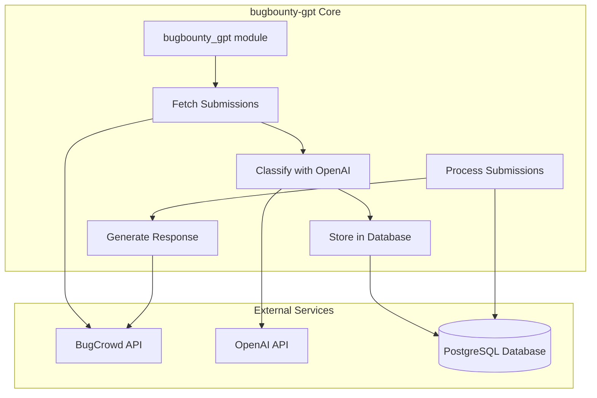
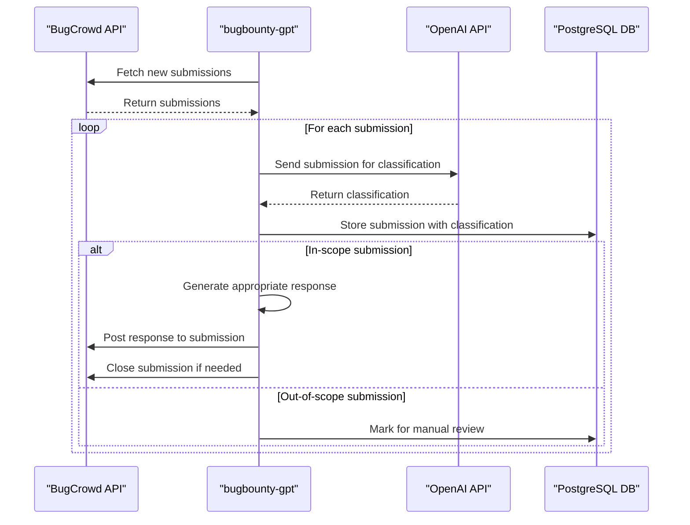
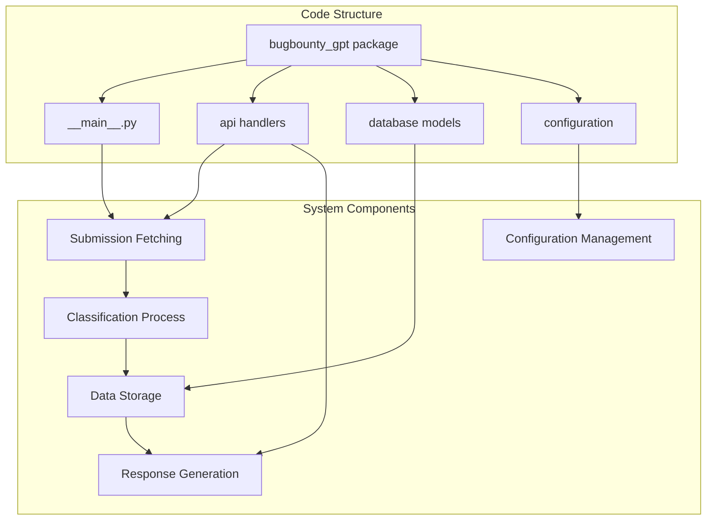

<!-- source: DeepWiki mcp.deepwiki.com · repo openai/bugbounty-gpt · page 1 Overview · fetched 2026-10-26 -->

# Overview

Relevant source files

The following files were used as context for generating this wiki page:

- [Dockerfile](Dockerfile)
- [README.md](README.md)
- [pyproject.toml](pyproject.toml)

This document provides an introduction to the `bugbounty-gpt` system, a tool designed to automate the triage and classification of bug bounty submissions from the BugCrowd platform using OpenAI's language models. The system classifies incoming submissions, stores them in a database, and can automatically respond to certain types of submissions based on their classification.

For detailed information about the system architecture, see [System Architecture](#1.1). For configuration details, see [Configuration](#1.2). For deployment instructions, see [Deployment](#1.3).

## Purpose and Functionality

The `bugbounty-gpt` system serves as an automated triage tool for BugCrowd bug bounty programs. It performs the following key functions:

1. Fetches new submissions from the BugCrowd API
2. Uses OpenAI's language models to classify submissions into predefined categories
3. Stores submission data and classifications in a PostgreSQL database
4. Automatically responds to and closes submissions based on their classification
5. Provides a configurable framework for handling different types of bug reports

Sources: [README.md:1-4](), [pyproject.toml:2-4]()

## System Overview

Sources: [README.md:1-4](), [Dockerfile:37-38]()

## Key Components

The system consists of several interconnected components:

| Component | Description | Related Files |
|-----------|-------------|---------------|
| BugCrowd API Integration | Handles communication with the BugCrowd platform to fetch submissions and post responses | See [BugCrowd API Integration](#2.1) |
| OpenAI Integration | Uses OpenAI models to classify submissions based on configurable prompts | See [OpenAI Integration](#2.2) |
| Database Layer | Stores submission data, classifications, and processing state | See [Database](#3) |
| Submission Handler | Processes submissions based on their classification | See [Submission Handling](#2.3) |
| Configuration System | Manages settings through config files and environment variables | See [Configuration](#1.2) |

Sources: [README.md:3-4](), [README.md:35-63]()

## System Workflow

Sources: [README.md:28-34](), [Dockerfile:37-38]()

## Code Organization

The codebase is organized as a Python package named `bugbounty_gpt`. The main components are:

1. Core application logic in the `bugbounty_gpt` package
2. Configuration through `config.yaml` and environment variables
3. Database migrations managed by Alembic
4. Containerization with Docker for easy deployment

Sources: [pyproject.toml:9-12](), [Dockerfile:13-24]()

## Deployment Options

The system can be deployed in multiple ways:

1. **Docker Container**: The recommended approach for production use
2. **Docker Compose**: Useful for development and testing with an ephemeral database
3. **Direct Python Execution**: Running the module directly with `python -m bugbounty_gpt`

Sources: [README.md:28-34](), [Dockerfile:33-38]()

## Technology Stack

The `bugbounty-gpt` system is built using the following technologies:

| Technology | Purpose |
|------------|---------|
| Python 3.11 | Core programming language |
| SQLAlchemy | ORM for database operations |
| Alembic | Database migration management |
| OpenAI API | AI-powered classification |
| PostgreSQL | Data storage |
| Docker | Containerization |
| Poetry | Dependency management |

Sources: [pyproject.toml:14-27](), [Dockerfile:1-5]()

## System Requirements

To run the system, you need:

1. Python 3.11
2. PostgreSQL database
3. BugCrowd API key
4. OpenAI API key
5. Docker (optional, for containerized deployment)

Sources: [README.md:21-27](), [pyproject.toml:15]()

## Configuration Overview

The system is configured through:

1. A `config.yaml` file for general settings
2. Environment variables for sensitive information like API keys
3. Docker Compose configuration for development environments

For detailed configuration instructions, see [Configuration](#1.2).

Sources: [README.md:35-63](), [README.md:103-114]()

## Code to System Mapping

Sources: [pyproject.toml:9-12](), [README.md:35-63]()

## Summary

The `bugbounty-gpt` system provides an automated solution for triaging and responding to bug bounty submissions. By leveraging OpenAI's language models, it can accurately classify submissions and generate appropriate responses, reducing the manual effort required to manage a bug bounty program. The system is designed to be flexible and configurable, allowing it to be adapted to different bug bounty programs and requirements.

For more detailed information about specific components of the system, please refer to the linked sections in this documentation.

Sources: [README.md:1-4](), [pyproject.toml:2-4]()

---

