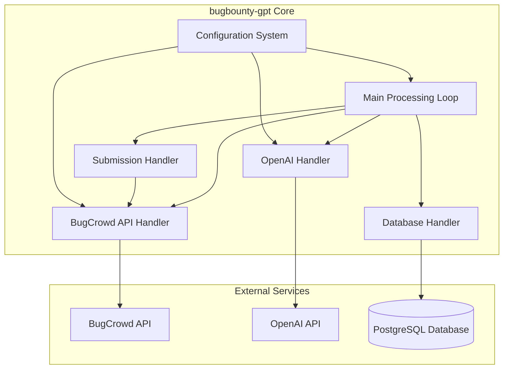
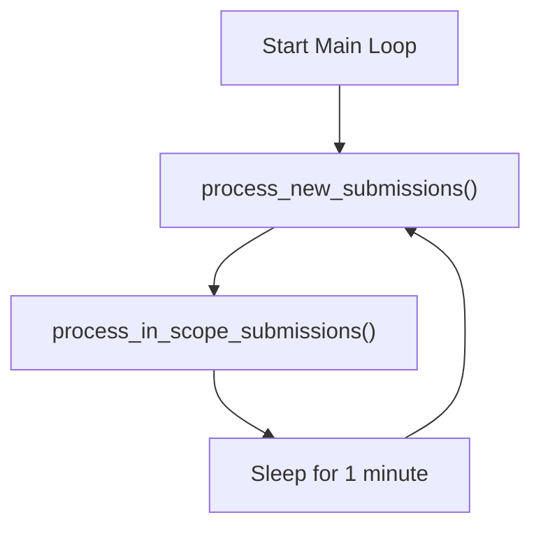
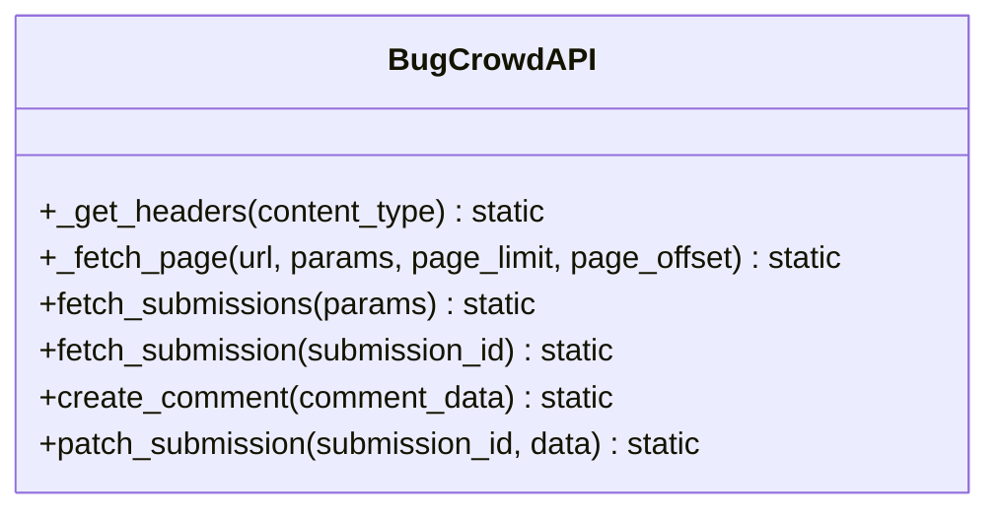
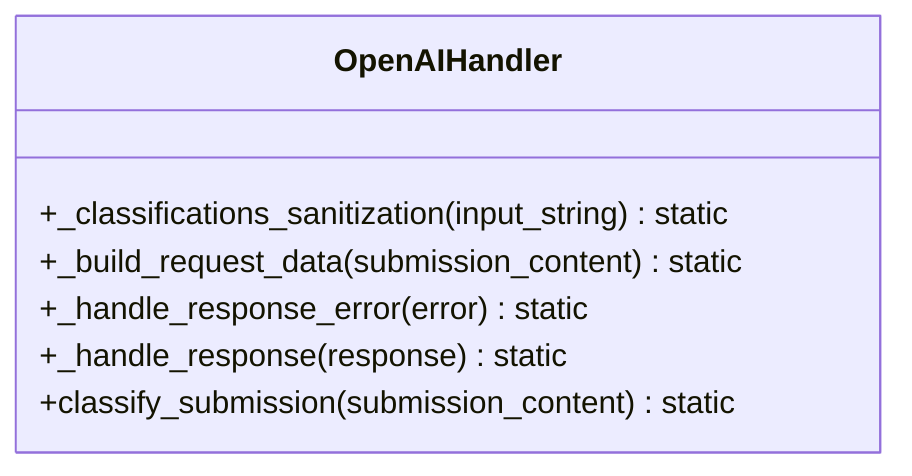
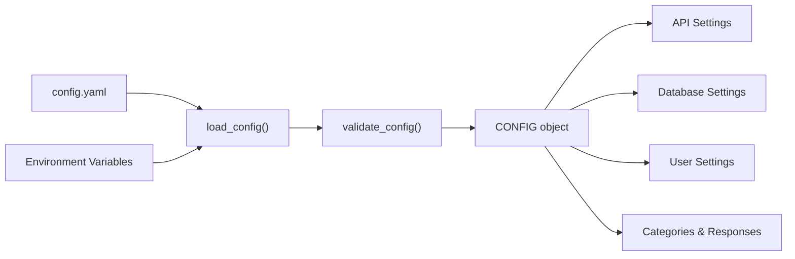
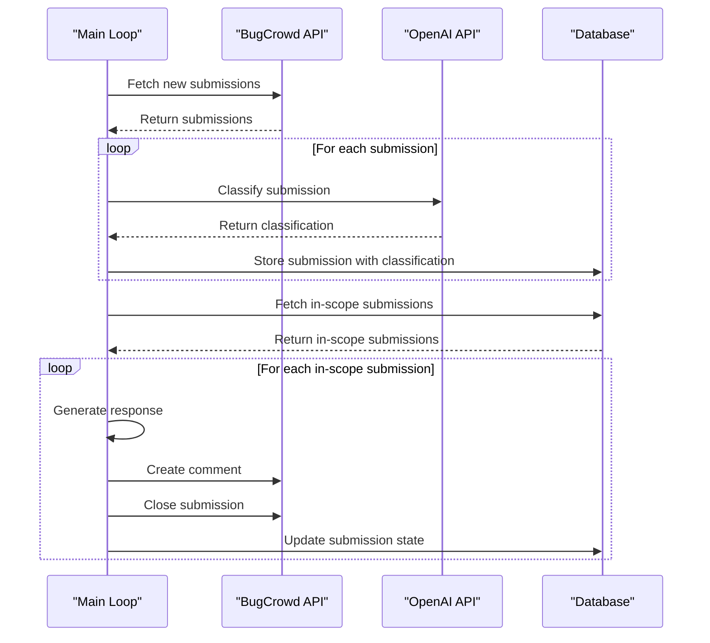
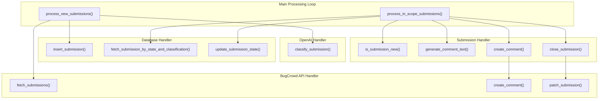
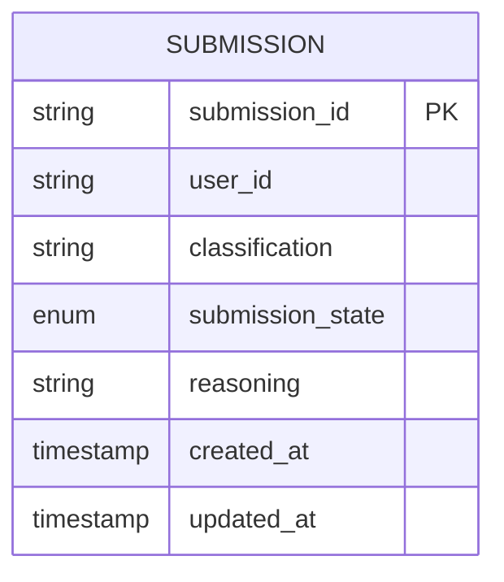
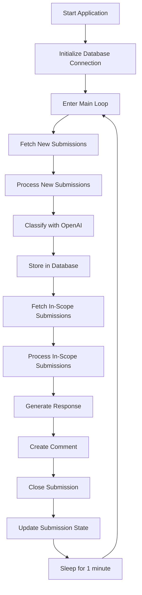

<!-- source: DeepWiki mcp.deepwiki.com · repo openai/bugbounty-gpt · page 1.1 System Architecture · fetched 2026-10-26 -->

# System Architecture

Relevant source files

The following files were used as context for generating this wiki page:

- [bugbounty_gpt/__main__.py](bugbounty_gpt/__main__.py)
- [bugbounty_gpt/env.py](bugbounty_gpt/env.py)
- [bugbounty_gpt/handlers/bugcrowd_api.py](bugbounty_gpt/handlers/bugcrowd_api.py)
- [bugbounty_gpt/handlers/openai_handler.py](bugbounty_gpt/handlers/openai_handler.py)

This document describes the high-level architecture of the `bugbounty-gpt` system, including its main components and their interactions. The system is designed to automate the triage and classification of bug bounty submissions from the BugCrowd platform using OpenAI's language models.

For information about configuring the system, see [Configuration](#1.2). For deployment details, see [Deployment](#1.3).

## System Overview

The `bugbounty-gpt` system is an automated solution for processing bug bounty submissions. It fetches new submissions from BugCrowd, classifies them using OpenAI's language models, and takes appropriate actions based on the classification results.

Sources: [bugbounty_gpt/__main__.py:1-100](), [bugbounty_gpt/env.py:1-71](), [bugbounty_gpt/handlers/bugcrowd_api.py:1-137](), [bugbounty_gpt/handlers/openai_handler.py:1-85]()

## Core Components

### Main Processing Loop

The main processing loop is the central orchestrator of the system. It periodically:
1. Fetches new submissions from BugCrowd
2. Classifies them using OpenAI
3. Stores the results in the database
4. Processes submissions that are in scope
5. Generates responses and updates the submissions on BugCrowd

Sources: [bugbounty_gpt/__main__.py:84-100]()

### BugCrowd API Handler

The `BugCrowdAPI` class handles all interactions with the BugCrowd API, including:
- Fetching submissions
- Creating comments
- Updating submission states

Sources: [bugbounty_gpt/handlers/bugcrowd_api.py:9-137]()

### OpenAI Handler

The `OpenAIHandler` class is responsible for classifying submissions using OpenAI's language models. It:
- Builds the request data for the OpenAI API
- Handles the response from the API
- Sanitizes and validates the classification results

Sources: [bugbounty_gpt/handlers/openai_handler.py:9-85]()

### Database Handler

The database handler manages all interactions with the PostgreSQL database, including:
- Inserting new submissions
- Updating submission states
- Fetching submissions based on state and classification

Sources: [bugbounty_gpt/__main__.py:19-25](), [bugbounty_gpt/__main__.py:58](), [bugbounty_gpt/__main__.py:68](), [bugbounty_gpt/__main__.py:80](), [bugbounty_gpt/__main__.py:82]()

### Submission Handler

The `BugCrowdSubmission` class represents a submission and provides methods to:
- Check if a submission is new
- Generate comment text based on classification
- Create comments on the submission
- Close the submission

Sources: [bugbounty_gpt/__main__.py:71-82]()

### Configuration System

The configuration system loads and validates settings from a YAML file and environment variables. It provides:
- API settings (BugCrowd and OpenAI)
- Database connection details
- User-specific settings
- Categories and responses for classification

Sources: [bugbounty_gpt/env.py:8-70]()

## Data Flow

The following diagram illustrates the data flow through the system:

Sources: [bugbounty_gpt/__main__.py:29-82]()

## Component Interactions

The following diagram shows how the different components interact with each other:

Sources: [bugbounty_gpt/__main__.py:29-82]()

## Database Schema

The system uses a PostgreSQL database to store submission data and track the state of each submission.

Sources: [bugbounty_gpt/__main__.py:5](), [bugbounty_gpt/__main__.py:50-56]()

## Execution Flow

The main execution flow of the system is as follows:

Sources: [bugbounty_gpt/__main__.py:84-100](), [bugbounty_gpt/__main__.py:29-82]()

## Configuration Dependencies

The system relies on configuration from both a YAML file and environment variables:

| Configuration Source | Provides |
|----------------------|----------|
| config.yaml | API base URL, OpenAI model, user ID, filter program, valid categories, response categories, default category, OpenAI prompt |
| Environment Variables | BugCrowd API key, OpenAI API key, Database connection URL |

Sources: [bugbounty_gpt/env.py:8-70]()

## Error Handling

The system includes error handling at various levels:

1. API request errors are logged and handled gracefully
2. OpenAI classification errors result in using the default category
3. Database errors are caught and logged
4. The main loop continues running even if individual submissions fail to process

Sources: [bugbounty_gpt/handlers/openai_handler.py:38-48](), [bugbounty_gpt/handlers/bugcrowd_api.py:42-48](), [bugbounty_gpt/handlers/bugcrowd_api.py:132-135]()

## Summary

The `bugbounty-gpt` system architecture follows a modular design with clear separation of concerns. The main components (BugCrowd API Handler, OpenAI Handler, Database Handler, and Submission Handler) interact through well-defined interfaces, orchestrated by the main processing loop. The configuration system provides centralized management of settings, and the database ensures persistence of submission data and state.

This architecture allows for easy extension and modification of individual components without affecting the overall system, making it maintainable and adaptable to changing requirements.

---

